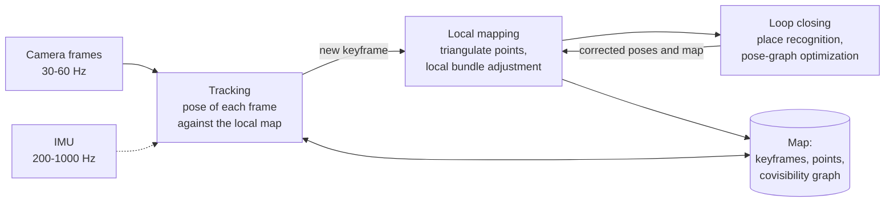

## Why this matters

[Post 05]({{ '/blog/2026/3d-vision-05-multi-view-geometry-and-bundle-adjustment/' | relative_url }}) solved Structure-from-Motion: given a pile of photos, find all cameras and points at once, with as much time as it takes. A robot, a drone or an AR headset has a harder version of the problem. The images arrive one at a time, at 30 or more per second. The pose of the current frame is needed *now*, within a few milliseconds, to control a motor or to draw a virtual object in the right place, and the map must stay consistent over minutes or hours of motion. This is **Simultaneous Localization and Mapping (SLAM)**: estimate the trajectory of a sensor and a map of its surroundings, online, from the sensor's own measurements.

This post builds visual SLAM from first principles. We start from the problem that defines it, **drift**, and formulate SLAM as probabilistic inference on a **factor graph**. Then we look at the two halves of every system: the **front end** (visual odometry, feature-based or direct) and the **back end** (pose-graph optimization on $SE(3)$, with robust kernels against wrong loop closures). In between we pick up just enough Lie theory to optimize poses correctly, and we see how loop closures are detected with a **bag of visual words**. The last part covers filtering versus optimization (EKF, MSCKF, sliding windows) and **visual-inertial odometry** with IMU preintegration. It ends with a tour of real systems, from ORB-SLAM3 and VINS-Mono to DROID-SLAM, MASt3R-SLAM and Gaussian-splatting SLAM. Every algorithm is run on a toy problem whose numbers are quoted in the text.

## Prerequisites

- The camera model and conventions of [post 01]({{ '/blog/2026/3d-vision-01-image-formation-and-camera-models/' | relative_url }}): $P = K[R \mid \mathbf t]$, the OpenCV camera frame, $T\_{w2c}$ and $T\_{c2w}$.
- Gauss-Newton and Levenberg-Marquardt from [post 02]({{ '/blog/2026/3d-vision-02-camera-calibration/' | relative_url }}) (section 4.2), and its camera-IMU calibration (section 9).
- Features, RANSAC and optical flow from [post 03]({{ '/blog/2026/3d-vision-03-features-and-matching/' | relative_url }}).
- Two-view geometry ([post 04]({{ '/blog/2026/3d-vision-04-two-view-geometry/' | relative_url }})) and PnP and bundle adjustment ([post 05]({{ '/blog/2026/3d-vision-05-multi-view-geometry-and-bundle-adjustment/' | relative_url }})). We use them as building blocks and do not re-derive them.
- Rigid transforms and $SE(3)$: [embodied AI post 1]({{ '/blog/2026/embodied-ai-01-robotics-foundations/' | relative_url }}). Section 4 below adds what optimization needs.
- Basic probability: Gaussians, Bayes' rule, the negative log-likelihood.

**Notation.** As in post 01, a camera's extrinsics $(R, \mathbf t)$ map world points into the OpenCV camera frame ($x$ right, $y$ down, $z$ forward). In SLAM it is more convenient to store the **pose** of camera $i$ as the camera-to-world transform

$$
T_i = T_{wc_i} = T_{c2w} = \begin{pmatrix} R^\top & \mathbf C \\ \mathbf 0^\top & 1 \end{pmatrix} \in SE(3),
$$

whose translation is the camera centre $\mathbf C$ and whose rotation columns are the camera axes in world coordinates. The relative pose of camera $j$ seen from camera $i$ is $T\_i^{-1} T\_j$. Throughout, "pose" means this $T\_i$.

## 1. The problem: localization, mapping and drift

### 1.1 Two problems that need each other

If you had a map (3D points with descriptors), localizing a new image would be PnP with RANSAC (post 05). If you had the camera poses, building the map would be triangulation (post 04). SLAM has neither: the map is built from poses that are estimated from the map. Solving the two together is what the "S" in SLAM means. The classical probabilistic formulation goes back to Smith, Self and Cheeseman's work on uncertain spatial relationships (1990) and was named and surveyed by Durrant-Whyte and Bailey (2006). Cadena et al. (2016) give the modern view used in this post.

### 1.2 Odometry drifts, and how fast

The easiest way to track a camera is **odometry**: estimate the motion between consecutive frames and chain the motions together. Every step adds a little error, and the errors accumulate. How fast? Take a robot that drives straight ahead in steps of 1 m and measures each step with a little noise: either a distance error of $\sigma\_d$ per step, or a heading error of $\sigma\_\theta$ per step.

Distance errors simply add up. After $n$ steps the error is a sum of $n$ independent terms, so its standard deviation is $\sigma\_d\sqrt n$, a **random walk**.

Heading errors are much worse, because a wrong heading also corrupts every *later* step. After $k$ steps the heading error is $\theta\_k = \sum\_{i \le k}\epsilon\_i$, and the step taken then is displaced sideways by about $\theta\_k$ metres. The lateral error after $n$ steps is $y\_n \approx \sum\_{k=1}^n \theta\_k = \sum\_{i=1}^n (n - i + 1)\,\epsilon\_i$, whose variance is

$$
\operatorname{Var}(y_n) \approx \sigma_\theta^2 \sum_{m=1}^{n} m^2 = \sigma_\theta^2\,\frac{n(n+1)(2n+1)}{6} \approx \frac{\sigma_\theta^2\, n^3}{3}.
$$

The error grows like $n^{3/2}$, not $\sqrt n$. Rotation errors are lever arms.

```python
import numpy as np


def dead_reckon(n, sigma_d, sigma_th, trials, rng, step=1.0):
    """Integrate n odometry steps of a robot driving straight ahead. Each step moves `step`
    metres with noise sigma_d and turns by a noisy angle (sigma_th). Returns the end-point
    errors of all trials (the true end point is (n * step, 0))."""
    th = np.cumsum(rng.normal(0, sigma_th, (trials, n)), axis=1)       # heading after each step
    d = step + rng.normal(0, sigma_d, (trials, n))
    x, y = (d * np.cos(th)).sum(1), (d * np.sin(th)).sum(1)
    return np.hypot(x - n * step, y)


rng = np.random.default_rng(0)
for n in (10, 100, 1000):
    e_d = dead_reckon(n, 0.02, 0.0, 2000, rng)                 # only distance noise (2 cm/step)
    e_th = dead_reckon(n, 0.0, np.deg2rad(0.5), 2000, rng)     # only heading noise (0.5 deg/step)
    print(f"n = {n:4d}: RMS error, distance noise {np.sqrt(np.mean(e_d**2)):7.3f} m"
          f" (theory {0.02 * np.sqrt(n):6.3f}),  heading noise {np.sqrt(np.mean(e_th**2)):7.2f} m"
          f" (theory {np.deg2rad(0.5) * np.sqrt(n * (n + 1) * (2 * n + 1) / 6):6.2f})")
```

```text
n =   10: RMS error, distance noise   0.063 m (theory  0.063),  heading noise    0.17 m (theory   0.17)
n =  100: RMS error, distance noise   0.194 m (theory  0.200),  heading noise    5.02 m (theory   5.08)
n = 1000: RMS error, distance noise   0.635 m (theory  0.632),  heading noise  156.49 m (theory 159.45)
```

A heading error of only 0.5° per step leaves the robot 5 m off after 100 m, and 156 m off after 1 km, while 2 cm of distance noise per step costs only 0.6 m over the same kilometre.

{% include blog_figure.liquid path="assets/img/blog/3d-vision/06-drift.svg" localized="true" caption="Left: twelve runs of 100 noisy odometry steps along the dashed line, with 2 cm of distance noise per step (blue, the runs stay on the line) or 0.5° of heading noise per step (red, the runs bend away like a fan). Right: the RMS end-point error over 1500 runs against the number of steps $n$ on log-log axes. Distance noise follows $\sigma\_d\sqrt n$ (slope 1/2); heading noise follows $\sigma\_\theta\sqrt{n(n+1)(2n+1)/6} \approx \sigma\_\theta n^{3/2}/\sqrt 3$ (slope 3/2): 0.17 m after 10 steps, 5 m after 100, 156 m after 1000." %}

This is the central fact of SLAM. Odometry, whether from wheels, an IMU or a camera, drifts without bound. The only cure is to recognize a place you have seen before and to use that **loop closure** to pull the whole trajectory back into consistency. The rest of the post is about doing that correctly and efficiently.

### 1.3 Anatomy of a visual SLAM system

Almost every modern system is organized like PTAM (Klein and Murray, 2007), which first split tracking and mapping into parallel threads:



- The **front end** turns pixels into geometric constraints: it detects and tracks features (or aligns pixels directly), estimates the motion of each frame, decides which frames become **keyframes**, and finds loop-closure candidates.
- The **back end** turns constraints into estimates: it optimizes the poses and the map, by local bundle adjustment over a window of keyframes and by pose-graph optimization after a loop closure.
- **Keyframes** make this affordable. A camera at 30 Hz produces 1800 frames a minute, most of them nearly identical. Only frames that add information (enough parallax, enough new points, or too few tracked points left) become keyframes, and only keyframes enter the expensive optimizations. ORB-SLAM, for example, inserts keyframes generously and later culls those whose points are almost all seen by other keyframes.

## 2. SLAM as MAP inference on a factor graph

### 2.1 From Bayes' rule to least squares

Collect all unknowns (poses, landmarks, perhaps velocities and sensor biases) in $\mathcal X$, and all measurements in $\mathcal Z = \lbrace \mathbf z\_1, \dots, \mathbf z\_K \rbrace$. Each measurement depends on a few variables $\mathcal X\_k \subset \mathcal X$ through a **measurement model** with Gaussian noise,

$$
\mathbf z_k = h_k(\mathcal X_k) + \boldsymbol\epsilon_k, \qquad \boldsymbol\epsilon_k \sim \mathcal N(\mathbf 0, \Sigma_k).
$$

For a reprojection, $h\_k$ projects landmark $j$ into camera $i$ (post 01); for an odometry measurement, it is the relative pose $T\_i^{-1}T\_j$; for a GPS fix, the position of one pose. The **maximum a posteriori** (MAP) estimate is the most probable $\mathcal X$ given everything measured. By Bayes' rule, and because the noises of different measurements are independent,

$$
\mathcal X^\star = \arg\max_{\mathcal X}\; p(\mathcal X \mid \mathcal Z)
= \arg\max_{\mathcal X}\; p(\mathcal X) \prod_{k=1}^K p(\mathbf z_k \mid \mathcal X_k).
$$

Each Gaussian likelihood is $p(\mathbf z\_k \mid \mathcal X\_k) \propto \exp\big(-\tfrac12 \lVert h\_k(\mathcal X\_k) - \mathbf z\_k \rVert^2\_{\Sigma\_k}\big)$, with the **Mahalanobis norm** $\lVert \mathbf e \rVert^2\_\Sigma = \mathbf e^\top \Sigma^{-1}\mathbf e$. Taking the negative logarithm turns the product into a sum, and the MAP problem becomes **nonlinear least squares**:

$$
\mathcal X^\star = \arg\min_{\mathcal X} \sum_{k} \big\lVert h_k(\mathcal X_k) - \mathbf z_k \big\rVert^2_{\Sigma_k}
= \arg\min_{\mathcal X} \sum_k \mathbf r_k^\top \Omega_k\, \mathbf r_k ,
$$

where $\mathbf r\_k = h\_k(\mathcal X\_k) - \mathbf z\_k$ is the **residual** and $\Omega\_k = \Sigma\_k^{-1}$ its **information matrix**. A prior $p(\mathcal X)$, if Gaussian, is just one more term of the same form. This is the same "maximum likelihood is least squares" step as for calibration in post 02, applied to a much larger set of variables.

We solve it with Gauss-Newton (post 02, section 4.2): linearize every residual around the current estimate, $\mathbf r\_k(\mathcal X \oplus \boldsymbol\delta) \approx \mathbf r\_k + J\_k\boldsymbol\delta$, and solve the normal equations

$$
\underbrace{\Big(\sum_k J_k^\top \Omega_k J_k\Big)}_{H}\;\boldsymbol\delta = -\underbrace{\sum_k J_k^\top \Omega_k\,\mathbf r_k}_{\mathbf g}.
$$

$H$ is the (approximate) **information matrix** of the whole problem; at the optimum, $H^{-1}$ approximates the covariance of the estimate. The $\oplus$ is a placeholder for "update the variable by $\boldsymbol\delta$", which for poses is not plain addition (section 4).

### 2.2 Factor graphs

A **factor graph** draws this sum. It is a bipartite graph with one **variable node** per unknown and one **factor node** per term $\mathbf r\_k^\top\Omega\_k\mathbf r\_k$ (equivalently, per probability factor $p(\mathbf z\_k \mid \mathcal X\_k)$), connected to exactly the variables that term depends on. The graph *is* the problem: adding a measurement adds a factor; marginalizing a variable removes a node; the sparsity of $H$ is the adjacency of the graph. Dellaert and Kaess's monograph (2017) develops SLAM entirely in this language, and libraries such as GTSAM, g2o (Kümmerle et al., 2011) and Ceres are factor-graph solvers in practice.

Why sparsity follows: $J\_k$ is nonzero only in the columns of the variables of factor $k$, so $J\_k^\top\Omega\_k J\_k$ is nonzero only in the blocks $(a, b)$ where $a$ and $b$ both belong to factor $k$. **Block $(a, b)$ of $H$ is nonzero exactly when variables $a$ and $b$ share a factor.**

### 2.3 A worked example in one dimension

Before poses and rotations, a toy that can be solved by hand. A robot moves along a line through positions $x\_0, x\_1, x\_2$ and sees one landmark at position $l$. The measurements are:

- a prior $x\_0 = 0$ with $\sigma = 0.01$ (this fixes the origin);
- odometry $x\_1 - x\_0 = 1.1$ and $x\_2 - x\_1 = 1.1$ with $\sigma = 0.1$;
- the landmark's offset $l - x\_0 = 3.0$ from the first position and $l - x\_2 = 1.0$ from the last, with $\sigma = 0.05$.

Odometry alone says $x\_2 = 2.2$; the two landmark measurements together say $x\_2 = 3.0 - 1.0 = 2.0$. Every factor is linear, $\mathbf a\_k^\top \mathbf x = b\_k + \epsilon\_k$, so the problem is one weighted linear least-squares solve. Dividing each row by its $\sigma$ (**whitening**) turns it into ordinary least squares.

```python
# State x = (x0, x1, x2, l): three robot positions on a line and one landmark.
# Every factor is linear: a row a with a @ x = b + noise of standard deviation s.
factors = [  # (row a,               b,    s,    name)
    (np.array([1., 0, 0, 0]),   0.0, 0.01, "prior x0 = 0"),
    (np.array([-1., 1, 0, 0]),  1.1, 0.10, "odometry x1 - x0"),
    (np.array([0., -1, 1, 0]),  1.1, 0.10, "odometry x2 - x1"),
    (np.array([-1., 0, 0, 1]),  3.0, 0.05, "landmark l - x0"),
    (np.array([0., 0, -1, 1]),  1.0, 0.05, "landmark l - x2"),
]
A = np.array([a / s for a, b, s, _ in factors])       # whitened Jacobian
b = np.array([b / s for a, b, s, _ in factors])       # whitened measurements
H = A.T @ A                                           # information matrix
x_map = np.linalg.solve(H, A.T @ b)                   # MAP = weighted least squares
cov = np.linalg.inv(H)
x_odo = np.array([0.0, 1.1, 2.2, 3.0])                # odometry only (and l from x0)
print("MAP estimate  :", x_map.round(4))
print("odometry only :", x_odo)
print("std devs      :", np.sqrt(np.diag(cov)).round(4))
print("H zero pattern:\n", (np.abs(H) > 1e-12).astype(int))
```

```text
MAP estimate  : [0.   1.02 2.04 3.02]
odometry only : [0.  1.1 2.2 3. ]
std devs      : [0.01   0.0781 0.064  0.0485]
H zero pattern:
 [[1 1 0 1]
 [1 1 1 0]
 [0 1 1 1]
 [1 0 1 1]]
```

The landmark acts as a tiny loop closure. Seeing it again from $x\_2$ pulls $x\_2$ from 2.2 back to 2.04, and the correction is spread over both odometry steps ($x\_1 = 1.02$, not 1.1). The odometry is trusted less than the landmark measurements ($\sigma$ of 0.1 against 0.05), so the result is closer to the landmark's verdict, but not equal to it. Note also the uncertainties. $x\_1$, which is constrained only by odometry, is the least certain (0.078); $x\_2$ (0.064) is better than $x\_1$ although it is further from the origin, because the landmark measurement constrains it directly.

{% include blog_figure.liquid path="assets/img/blog/3d-vision/06-factor-graph.svg" caption="(a) The factor graph of the 1D example: variable nodes (circles) $x\_0, x\_1, x\_2$ and the landmark $l$; factor nodes (black squares) for the prior $p\_0$, the odometry $u\_1, u\_2$ and the landmark observations $z\_0, z\_2$. (b) The information matrix $H = A^\top A$: an entry is nonzero exactly when two variables share a factor, so $(x\_0, x\_2)$ and $(x\_1, l)$ are zero. The prior gives $x\_0$ its large diagonal entry $10^4 + 100 + 400$. (c) Odometry-only positions (red squares) and the MAP estimate with $\pm1\sigma$ bars (purple): the second sighting of the landmark pulls $x\_2$ from 2.2 to 2.04 and spreads the correction over the trajectory." %}

### 2.4 Sparsity, and what marginalization does to it

Real problems have thousands of poses and hundreds of thousands of points, so the structure of $H$ decides what is affordable. Order the variables as poses then landmarks:

$$
H = \begin{pmatrix} H_{xx} & H_{xl} \\ H_{lx} & H_{ll} \end{pmatrix}.
$$

In the full problem ("full smoothing"), $H\_{xx}$ is block tridiagonal (odometry links consecutive poses), $H\_{ll}$ is block diagonal (landmarks never share a factor with each other), and $H\_{xl}$ links each pose to the landmarks it sees. To get rid of variables we **marginalize** them. For a Gaussian in information form, the marginal of the kept variables $k$ after removing $d$ has information matrix equal to the **Schur complement**

$$
H_{kk}^{\text{marg}} = H_{kk} - H_{kd}\,H_{dd}^{-1}\,H_{dk}.
$$

(To see why, eliminate $\boldsymbol\delta\_d$ from the normal equations: the second block row gives $\boldsymbol\delta\_d = H\_{dd}^{-1}(-\mathbf g\_d - H\_{dk}\boldsymbol\delta\_k)$; substituting into the first leaves exactly this matrix.) The subtracted term connects every pair of kept variables that were both connected to some removed variable. That is **fill-in**, and which variables you remove decides how much of it you get:

- Remove the **landmarks** (as bundle adjustment does with the Schur trick, post 05): $H\_{ll}$ is block diagonal, so inverting it is cheap. Two poses become connected if they see a common landmark, which gives the **reduced camera system**, still fairly sparse.
- Remove the **past poses** and keep only the current one with the landmarks (as an **EKF-SLAM filter** does at every step): the odometry chain connects all past poses, so every pair of landmarks seen along the way becomes connected, and the matrix fills in completely.

```python
def schur_marginalize(H, keep, drop):
    """Information matrix of the variables `keep` after marginalizing out `drop`:
    H_kk - H_kd H_dd^-1 H_dk (the Schur complement)."""
    Hkk, Hkd, Hdd = H[np.ix_(keep, keep)], H[np.ix_(keep, drop)], H[np.ix_(drop, drop)]
    return Hkk - Hkd @ np.linalg.solve(Hdd, Hkd.T)


def toy_slam_information(n_poses=20, n_lm=30, fov=3, seed=0):
    """Scalar 'information pattern' of a toy SLAM problem: poses in a chain (odometry), each pose
    observing the landmarks within `fov` index steps of its own position along the path."""
    rng = np.random.default_rng(seed)
    n = n_poses + n_lm
    H = np.eye(n) * 1e-3
    def add(i, j, w):                                  # a factor between variables i and j
        H[i, i] += w; H[j, j] += w; H[i, j] -= w; H[j, i] -= w
    for k in range(n_poses - 1):
        add(k, k + 1, 1.0 + rng.random())              # odometry
    for k in range(n_poses):
        c = k * n_lm / n_poses
        for m in range(n_lm):
            if abs(m - c) <= fov:
                add(k, n_poses + m, 0.5 + rng.random())   # observation of landmark m
    H[0, 0] += 10.0                                    # prior on the first pose (the gauge)
    return H


H_toy = toy_slam_information()
P, L = list(range(20)), list(range(20, 50))                      # pose and landmark indices
H_filter = schur_marginalize(H_toy, keep=[19] + L, drop=P[:-1])   # EKF-SLAM: only the last pose
H_rcs = schur_marginalize(H_toy, keep=P, drop=L)                    # BA: reduced camera system
nnz = lambda M: int((np.abs(M) > 1e-12 * np.abs(M).max()).sum())     # count structural nonzeros
print("full smoothing:", H_toy.shape, "nonzeros", nnz(H_toy), f"({nnz(H_toy) / H_toy.size:.0%})")
print("filter (last pose + landmarks):", H_filter.shape, "nonzeros", nnz(H_filter),
      f"({nnz(H_filter) / H_filter.size:.0%})")
print("poses only (landmarks marginalized):", H_rcs.shape, "nonzeros", nnz(H_rcs),
      f"({nnz(H_rcs) / H_rcs.size:.0%})")
```

```text
full smoothing: (50, 50) nonzeros 334 (13%)
filter (last pose + landmarks): (31, 31) nonzeros 923 (96%)
poses only (landmarks marginalized): (20, 20) nonzeros 144 (36%)
```

{% include blog_figure.liquid path="assets/img/blog/3d-vision/06-marginalization.svg" caption="Nonzero pattern (black) of the information matrix of a toy problem with 20 poses $x$ and 30 landmarks $l$, each pose seeing the landmarks near it. (a) Full smoothing, ordered [poses | landmarks]: tridiagonal pose block, diagonal landmark block, banded pose-landmark block; 13% nonzero. (b) After marginalizing the landmarks (the reduced camera system of bundle adjustment): poses that share landmarks become connected; a band, 36% nonzero. (c) After marginalizing all past poses, as a filter does: almost every pair of landmarks is now connected, 96% nonzero. The few zeros left are landmarks seen only by the last pose." %}

The figure is the essence of the "filtering versus smoothing" debate of section 7. A filter keeps the state small, but the state's information matrix becomes dense; a smoother keeps more variables, but its matrix stays sparse, and sparse matrices with $10^5$ variables are solved faster than dense ones with $10^3$.

## 3. The front end: visual odometry

**Visual odometry (VO)** estimates the camera motion frame by frame from images. It is SLAM without loop closure: locally accurate, globally drifting. There are two families.

### 3.1 Feature-based (indirect) VO

Feature-based methods first reduce each image to a set of keypoints with descriptors (post 03) and then do geometry only on those points. A typical tracking loop, in the style of PTAM and ORB-SLAM:

1. **Initialization.** From the first two frames with enough parallax, estimate the relative pose from an essential matrix (or a homography for a planar or low-parallax scene) and triangulate an initial map (post 04). With one camera the scale is arbitrary; it is usually fixed by setting the median depth or the first baseline to 1.
2. **Tracking.** Predict the pose of the new frame (for example with a constant-velocity model), project the local map points into it, search for matches near the projections, and refine the pose by minimizing the reprojection error over the matches. This is **motion-only bundle adjustment**: PnP followed by a few Gauss-Newton steps with a robust kernel (post 05). If tracking is lost, **relocalize** by place recognition (section 6) against all keyframes.
3. **Keyframe decision.** Make the frame a keyframe if it tracks too few map points, sees much that is new, or is far from the last keyframe.
4. **Local mapping.** For a new keyframe, triangulate new points with its neighbours, then run **local bundle adjustment** over the keyframe, its covisible keyframes and their points, with more distant keyframes held fixed. Remove points that are rarely re-observed.

The **covisibility graph** (keyframes as nodes, an edge when two keyframes share enough points) decides what "local" means. Indirect methods are robust to large motions and lighting changes, because descriptors are matched over large displacements and are fairly invariant to brightness, and they give a natural map for relocalization and loop closure. They throw away everything that is not a keypoint, though: textureless walls, edges and smooth gradients contribute nothing.

### 3.2 Direct VO: aligning pixels instead of features

Direct methods skip keypoints and minimize a **photometric error**: the difference of image intensities at corresponding pixels. Take a pixel $\mathbf u$ of a reference keyframe $i$ with known inverse depth $d\_{\mathbf u}$. Back-project it, move it into frame $j$ and project:

$$
\mathbf u' = \pi\big(T_{ji}\,\pi^{-1}(\mathbf u, d_{\mathbf u})\big), \qquad T_{ji} = T_j^{-1}T_i,
\qquad
r_{\mathbf u} = I_j(\mathbf u') - I_i(\mathbf u),
$$

where $\pi$ is the camera projection of post 01 and $\pi^{-1}(\mathbf u, d) = K^{-1}\tilde{\mathbf u}/d$ the back-projection. The pose is found by Gauss-Newton on $\sum\_{\mathbf u}\rho(r\_{\mathbf u}^2)$. With $\mathbf X = (X, Y, Z)$ the point in frame $j$ and a small motion $T\_{ji} \leftarrow \mathrm{Exp}(\boldsymbol\xi)\,T\_{ji}$ (section 4), the chain rule gives the Jacobian of one residual as a product of three familiar pieces:

$$
\frac{\partial r_{\mathbf u}}{\partial \boldsymbol\xi}
= \underbrace{\nabla I_j(\mathbf u')}_{1\times 2\ \text{image gradient}}\;
\underbrace{\begin{pmatrix} f_x/Z & 0 & -f_x X/Z^2 \\ 0 & f_y/Z & -f_y Y/Z^2 \end{pmatrix}}_{\partial\pi/\partial\mathbf X}\;
\underbrace{\begin{pmatrix} I_3 & -[\mathbf X]_\times \end{pmatrix}}_{\partial\mathbf X/\partial\boldsymbol\xi}.
$$

The image gradient is the key. The residual changes only where the image has texture *in the direction of motion*: the aperture problem of optical flow (post 03, section 8) appears again. This is also why direct methods converge only from close initial guesses. The photometric cost is very non-convex, with a local minimum for every repeated texture, so it is minimized coarse to fine on an image pyramid, exactly like pyramidal Lucas-Kanade.

The snippet below shows the effect on the simplest possible case, a 1D "image row" shifted by $s^\star = 13$ pixels, with a single unknown $s$.

```python
from scipy import ndimage as ndi

def make_signal(n=400, seed=0, width=5):
    """A 1D 'image row': random intensity steps every `width` pixels, slightly blurred."""
    rng = np.random.default_rng(seed)
    steps = np.repeat(rng.uniform(0, 1, n // width + 1), width)[:n]
    return ndi.gaussian_filter1d(steps, 1.0)


def sample(I, x):
    return np.interp(x, np.arange(len(I)), I)


def align_1d(I_ref, I_cur, s0=0.0, sigmas=(0.0,), iters=15, margin=40):
    """Gauss-Newton on the photometric error E(s) = sum_x (I_cur(x + s) - I_ref(x))^2,
    coarse to fine: each stage blurs both signals with the given sigma (0 = no blur)."""
    s, xs = s0, np.arange(margin, len(I_ref) - margin, dtype=float)
    for sg in sigmas:
        R = ndi.gaussian_filter1d(I_ref, sg) if sg > 0 else I_ref
        C = ndi.gaussian_filter1d(I_cur, sg) if sg > 0 else I_cur
        G = np.gradient(C)                                # dI_cur / dx
        for _ in range(iters):
            r = sample(C, xs + s) - sample(R, xs)         # photometric residuals
            J = sample(G, xs + s)                         # d r / d s
            s -= (J @ r) / (J @ J)                        # Gauss-Newton step (1 unknown)
    return s


I_ref = make_signal()
s_true = 13.0
I_cur = sample(I_ref, np.arange(400) - s_true) + np.random.default_rng(4).normal(0, 0.01, 400)
print("single level from s = 0  :", round(align_1d(I_ref, I_cur), 3))
print("pyramid 8, 4, 2, 1, 0    :", round(align_1d(I_ref, I_cur, sigmas=(8, 4, 2, 1, 0)), 3))
print("single level from s = 10 :", round(align_1d(I_ref, I_cur, s0=10.0), 3))
```

```text
single level from s = 0  : 1.924
pyramid 8, 4, 2, 1, 0    : 12.989
single level from s = 10 : 12.989
```

Started at $s = 0$ on the sharp signal, Gauss-Newton gets stuck at $s = 1.92$, a local minimum. Started at $s = 10$, it finds $s^\star$. With a blur pyramid it finds $s^\star$ from $s = 0$ too: the blurred cost has one wide valley, and each finer level starts inside the basin of the next. Counting integer starts between $-10$ and $35$, the sharp signal converges from 13 of 46 (from 7 to 19), a blur of $\sigma = 2$ followed by the sharp signal from 19 (4 to 22), and a blur of $\sigma = 8$ from all 46.

{% include blog_figure.liquid path="assets/img/blog/3d-vision/06-direct-alignment.svg" localized="true" caption="Direct alignment in 1D. (a) A window of the reference row and of the current row, shifted by $s^\star = 13$ px, with noise of 0.01. (b) The photometric cost $E(s)$ (normalized) for no blur and for Gaussian blurs of $\sigma = 2$ and 8: the sharp cost is narrow and ragged; blurring widens its basin. Gauss-Newton followed by a refinement on the sharp signal converges from 13, 19 and 46 of 46 integer starts in $[-10, 35]$ respectively. (c) The iterates from $s\_0 = 0$: on the sharp signal alone they stop at 1.92 (a local minimum); with the pyramid $\sigma = 8, 4, 2, 1, 0$ they reach 12.989 in a few iterations." %}

Direct methods differ in which pixels they use and how they model brightness:

- **Dense** methods use every pixel. DTAM (Newcombe, Lovegrove and Davison, 2011) estimated a dense depth map per keyframe on the GPU and tracked against it.
- **Semi-dense** methods, such as **LSD-SLAM** (Engel, Schöps and Cremers, ECCV 2014), use only pixels with sufficient gradient and keep a probabilistic inverse depth for each. LSD-SLAM tracks keyframes with direct $\mathrm{Sim}(3)$ alignment, so that scale drift can be detected and corrected, and runs on a CPU.
- **Sparse** direct methods use a few thousand well-distributed pixels. **DSO** (Engel, Koltun and Cremers, TPAMI 2018) optimizes poses, inverse depths and per-frame brightness parameters jointly in a sliding window of keyframes (a photometric bundle adjustment). Its key observation is that the photometric error is only meaningful with a **photometric calibration**: the exposure time $t$, the camera's nonlinear response function and the lens vignetting. DSO's residual for a point $\mathbf p$ of frame $i$ observed in frame $j$ compares $I\_j[\mathbf p'] - b\_j$ with $\frac{t\_j e^{a\_j}}{t\_i e^{a\_i}}\big(I\_i[\mathbf p] - b\_i\big)$, where $a$ and $b$ are an affine brightness correction estimated per frame, over a small pattern of pixels around $\mathbf p$ and with a Huber norm. DSO is pure odometry: it has no loop closure.
- **Semi-direct** methods such as **SVO** (Forster, Pizzoli and Scaramuzza, ICRA 2014) align small patches directly for speed and then refine with feature-like reprojection errors.

Direct methods use more of the image (edges, weak texture) and are very accurate when the photometric model holds. They are fragile under fast motion, rolling shutter (post 01, section 3.5), auto-exposure without calibration, and large viewpoint changes. Feature-based methods are the opposite. Learned systems (section 9) try to take the best of both.

### 3.3 The scale problem of a single camera

From images alone, a monocular camera can recover the trajectory and the map only up to an unknown global scale (post 04): doubling every distance and every translation leaves all images unchanged. Worse, the scale is not even consistent along the way. Each new piece of the map is triangulated from the previous one, so scale errors accumulate like the heading errors of section 1.2: this is **scale drift**. When a monocular system closes a loop, the two ends of the trajectory can disagree in scale as well as in pose. For this reason monocular systems close loops with **similarity transforms** $\mathrm{Sim}(3)$ (rotation, translation and scale, 7 degrees of freedom) instead of $SE(3)$, as proposed by Strasdat, Montiel and Davison (2010) and used by LSD-SLAM and ORB-SLAM. Stereo, RGB-D and IMU measurements make the scale observable, and then $SE(3)$ suffices.

## 4. Poses as optimization variables: just enough Lie theory

### 4.1 Why we cannot just add a $\boldsymbol\delta$ to a rotation

Gauss-Newton computes an update vector $\boldsymbol\delta$ and adds it to the variables. A rotation matrix has 9 entries and 3 degrees of freedom; adding a $3\times3$ update breaks orthogonality. Euler angles have singularities (gimbal lock), and quaternions have 4 numbers for 3 degrees of freedom. The standard solution, used by every SLAM back end, is to keep the pose as a matrix and apply updates through the **exponential map**: a minimal 3-vector (for rotations) or 6-vector (for poses) in the tangent space, mapped onto the group. Solà, Deray and Atchuthan's "micro Lie theory" (2018) is the best short reference; we need four tools.

**Tool 1: the exponential and logarithm of $SO(3)$.** A rotation vector $\boldsymbol\phi = \theta\,\mathbf k$ (axis $\mathbf k$, angle $\theta$) maps to a rotation by Rodrigues' formula (post 02), and the logarithm inverts it:

$$
\mathrm{Exp}(\boldsymbol\phi) = I + \frac{\sin\theta}{\theta}[\boldsymbol\phi]_\times + \frac{1 - \cos\theta}{\theta^2}[\boldsymbol\phi]_\times^2,
\qquad
\theta = \arccos\frac{\operatorname{tr}R - 1}{2},\quad \mathrm{Log}(R) = \frac{\theta}{2\sin\theta}\begin{pmatrix} R_{32}-R_{23} \\ R_{13}-R_{31} \\ R_{21}-R_{12}\end{pmatrix}.
$$

Here $[\boldsymbol\phi]\_\times$ is the skew-symmetric matrix with $[\boldsymbol\phi]\_\times\mathbf v = \boldsymbol\phi \times \mathbf v$.

**Tool 2: the exponential of $SE(3)$.** A pose tangent vector $\boldsymbol\xi = (\boldsymbol\rho, \boldsymbol\phi) \in \mathbb R^6$ (translation part first) maps to

$$
\mathrm{Exp}(\boldsymbol\xi) = \begin{pmatrix} \mathrm{Exp}(\boldsymbol\phi) & J_l(\boldsymbol\phi)\,\boldsymbol\rho \\ \mathbf 0^\top & 1\end{pmatrix},
\qquad
J_l(\boldsymbol\phi) = I + \frac{1-\cos\theta}{\theta^2}[\boldsymbol\phi]_\times + \frac{\theta - \sin\theta}{\theta^3}[\boldsymbol\phi]_\times^2 .
$$

The translation is not $\boldsymbol\rho$ itself: $\mathrm{Exp}(\boldsymbol\xi)$ is the result of moving along a **screw** (rotating and translating simultaneously at constant rates for unit time), and $J\_l$, the **left Jacobian** of $SO(3)$, accounts for the rotation during the motion. Embodied AI post 1 pictures such screw motions.

**Tool 3: perturbations and $\oplus$, $\ominus$.** We write updates as **right perturbations**, small motions expressed in the pose's own (body) frame:

$$
T \oplus \boldsymbol\delta = T\,\mathrm{Exp}(\boldsymbol\delta), \qquad T_a \ominus T_b = \mathrm{Log}(T_b^{-1}T_a) \in \mathbb R^6 .
$$

The Gauss-Newton update of section 2.1 becomes $T\_i \leftarrow T\_i\,\mathrm{Exp}(\boldsymbol\delta\_i)$, a **retraction**: the result is always a valid pose. (Left perturbations $\mathrm{Exp}(\boldsymbol\delta)\,T$, in the world frame, work equally well; a library must simply be consistent. The direct-alignment Jacobian of section 3.2 used a left perturbation of $T\_{ji}$.)

**Tool 4: the adjoint.** Moving a perturbation from one side of a pose to the other requires the **adjoint** matrix:

$$
T\,\mathrm{Exp}(\boldsymbol\xi)\,T^{-1} = \mathrm{Exp}(\mathrm{Ad}_T\,\boldsymbol\xi), \qquad
\mathrm{Ad}_T = \begin{pmatrix} R & [\mathbf t]_\times R \\ 0 & R\end{pmatrix} \quad\text{for } T = \begin{pmatrix} R & \mathbf t \\ \mathbf 0^\top & 1\end{pmatrix}.
$$

Finally, products of exponentials are not exponentials of sums, but to first order in a small $\boldsymbol\delta$ they nearly are (the Baker-Campbell-Hausdorff formula):

$$
\mathrm{Log}\big(\mathrm{Exp}(\boldsymbol\xi)\,\mathrm{Exp}(\boldsymbol\delta)\big) \approx \boldsymbol\xi + J_r^{-1}(\boldsymbol\xi)\,\boldsymbol\delta,
\qquad J_r^{-1}(\boldsymbol\xi) \approx I + \tfrac12\,\mathrm{ad}(\boldsymbol\xi),
$$

where $J\_r$ is the right Jacobian of $SE(3)$ and $\mathrm{ad}(\boldsymbol\xi) = \begin{pmatrix} [\boldsymbol\phi]\_\times & [\boldsymbol\rho]\_\times \\\\ 0 & [\boldsymbol\phi]\_\times\end{pmatrix}$. The second approximation holds when $\boldsymbol\xi$ is small, which is the case for the residuals of a nearly consistent graph.

```python
def hat(w):
    return np.array([[0, -w[2], w[1]], [w[2], 0, -w[0]], [-w[1], w[0], 0]])


def so3_exp(w):
    th = np.linalg.norm(w)
    if th < 1e-10:
        return np.eye(3) + hat(w)
    K = hat(w / th)
    return np.eye(3) + np.sin(th) * K + (1 - np.cos(th)) * K @ K        # Rodrigues


def so3_log(R):
    c = np.clip((np.trace(R) - 1) / 2, -1, 1)
    th = np.arccos(c)
    v = np.array([R[2, 1] - R[1, 2], R[0, 2] - R[2, 0], R[1, 0] - R[0, 1]])
    if th < 1e-10:
        return v / 2
    if th > np.pi - 1e-6:                     # near 180 deg: (R + I) / 2 = k k^T
        B = (R + np.eye(3)) / 2
        i = np.argmax(np.diag(B))
        return th * B[:, i] / np.sqrt(B[i, i])
    return th / (2 * np.sin(th)) * v


def so3_left_jacobian(w):
    th = np.linalg.norm(w)
    K = hat(w)
    if th < 1e-8:
        return np.eye(3) + 0.5 * K
    return (np.eye(3) + (1 - np.cos(th)) / th**2 * K + (th - np.sin(th)) / th**3 * K @ K)


def se3_exp(xi):
    """xi = (rho, phi) -> 4x4 pose. The translation is V(phi) rho, not rho itself."""
    T = np.eye(4)
    T[:3, :3] = so3_exp(xi[3:])
    T[:3, 3] = so3_left_jacobian(xi[3:]) @ xi[:3]
    return T


def se3_log(T):
    phi = so3_log(T[:3, :3])
    rho = np.linalg.solve(so3_left_jacobian(phi), T[:3, 3])
    return np.r_[rho, phi]


def se3_inv(T):
    Ti = np.eye(4)
    Ti[:3, :3] = T[:3, :3].T
    Ti[:3, 3] = -T[:3, :3].T @ T[:3, 3]
    return Ti


def se3_adjoint(T):
    """Ad_T with xi = (rho, phi):  T Exp(xi) T^-1 = Exp(Ad_T xi)."""
    R, t = T[:3, :3], T[:3, 3]
    Ad = np.zeros((6, 6))
    Ad[:3, :3] = R; Ad[3:, 3:] = R; Ad[:3, 3:] = hat(t) @ R
    return Ad


xi = np.array([0.3, -0.2, 0.5, 0.4, 0.1, -0.7])
T = se3_exp(xi)
print("log(exp(xi)) == xi:", np.allclose(se3_log(T), xi))
print("translation of exp(xi):", T[:3, 3].round(4), " vs rho:", xi[:3])
A_ = se3_exp(np.array([0.1, 0.2, -0.1, 0.05, -0.02, 0.03]))
d = np.array([0.01, -0.02, 0.01, 0.02, 0.01, -0.01])
print("adjoint check:", np.allclose(A_ @ se3_exp(d) @ se3_inv(A_), se3_exp(se3_adjoint(A_) @ d)))
```

The round trip $\mathrm{Log}(\mathrm{Exp}(\boldsymbol\xi)) = \boldsymbol\xi$ holds (`True`); the translation of $\mathrm{Exp}(\boldsymbol\xi)$ is $(0.2094, -0.3767, 0.423)$, visibly different from $\boldsymbol\rho = (0.3, -0.2, 0.5)$ because of the 0.81 rad of rotation; and the adjoint identity holds (`True`).

## 5. The back end: pose-graph optimization

### 5.1 From full SLAM to a pose graph

The full factor graph contains every landmark. For large-scale consistency we can often drop them: marginalize the landmarks of each local window (section 2.4), or simply measure **relative poses** between keyframes, and keep a graph whose nodes are keyframe poses and whose edges are relative-pose measurements $Z\_{ij} \approx T\_i^{-1}T\_j$ with information $\Omega\_{ij}$. Odometry gives edges between consecutive keyframes; loop closures give edges between distant ones. This **pose graph** is tiny compared with the full problem (6 numbers per keyframe instead of 3 per point) and is what systems optimize right after closing a loop. ORB-SLAM's **essential graph** is such a pose graph: a spanning tree of the covisibility graph, plus loop-closure edges, plus strong covisibility edges. After pose-graph optimization, map points are moved with their keyframes, and a full bundle adjustment may follow in the background.

### 5.2 Residuals and Jacobians on $SE(3)$

The residual of an edge measures how far the current relative pose is from the measured one, in the tangent space:

$$
\mathbf r_{ij} = \mathrm{Log}\big(Z_{ij}^{-1}\,T_i^{-1}T_j\big) \in \mathbb R^6,
\qquad
E = \sum_{(i,j)} \mathbf r_{ij}^\top\,\Omega_{ij}\,\mathbf r_{ij}.
$$

$\mathbf r\_{ij} = \mathbf 0$ when the poses agree with the measurement. For the Jacobians, perturb each pose on the right. Write $E\_{ij} = Z\_{ij}^{-1}T\_i^{-1}T\_j = \mathrm{Exp}(\mathbf r\_{ij})$.

- **With respect to $T\_j$:** $Z\_{ij}^{-1}T\_i^{-1}T\_j\,\mathrm{Exp}(\boldsymbol\delta\_j) = E\_{ij}\,\mathrm{Exp}(\boldsymbol\delta\_j)$, so by the BCH approximation $\mathbf r\_{ij} \to \mathbf r\_{ij} + J\_r^{-1}(\mathbf r\_{ij})\boldsymbol\delta\_j$.
- **With respect to $T\_i$:** $(T\_i\mathrm{Exp}(\boldsymbol\delta\_i))^{-1} = \mathrm{Exp}(-\boldsymbol\delta\_i)T\_i^{-1}$. Move the perturbation to the right end with the adjoint: $Z\_{ij}^{-1}\mathrm{Exp}(-\boldsymbol\delta\_i)T\_i^{-1}T\_j = E\_{ij}\,\mathrm{Exp}\big(-\mathrm{Ad}\_{T\_j^{-1}T\_i}\,\boldsymbol\delta\_i\big)$.

Together:

$$
\frac{\partial \mathbf r_{ij}}{\partial \boldsymbol\delta_j} = J_r^{-1}(\mathbf r_{ij}),
\qquad
\frac{\partial \mathbf r_{ij}}{\partial \boldsymbol\delta_i} = -J_r^{-1}(\mathbf r_{ij})\,\mathrm{Ad}_{T_j^{-1}T_i},
\qquad
J_r^{-1}(\mathbf r) \approx I + \tfrac12\mathrm{ad}(\mathbf r).
$$

Each edge contributes four $6\times6$ blocks to $H$ (at $(i,i)$, $(i,j)$, $(j,i)$, $(j,j)$), so $H$ has exactly the sparsity of the graph, and a sparse Cholesky factorization solves the normal equations. The code below is a complete Gauss-Newton pose-graph optimizer in about 50 lines, with an optional robust kernel that section 5.5 explains.

```python
import scipy.sparse as sp
import scipy.sparse.linalg as spla


def ad_se3(xi):
    """The small adjoint ad(xi) of se(3), xi = (rho, phi)."""
    M = np.zeros((6, 6))
    M[:3, :3] = hat(xi[3:]); M[3:, 3:] = hat(xi[3:]); M[:3, 3:] = hat(xi[:3])
    return M


def edge_residual(Ti, Tj, Zij):
    """r = Log(Z_ij^-1 T_i^-1 T_j): zero when the poses agree with the measurement."""
    return se3_log(se3_inv(Zij) @ se3_inv(Ti) @ Tj)


def edge_jacobians(Ti, Tj, r):
    """Jacobians of r w.r.t. right perturbations T_i Exp(d_i) and T_j Exp(d_j).
    Uses J_r^-1(r) ~ I + ad(r)/2, accurate to second order in the (small) residual."""
    Jr_inv = np.eye(6) + 0.5 * ad_se3(r)
    Jj = Jr_inv
    Ji = -Jr_inv @ se3_adjoint(se3_inv(Tj) @ Ti)
    return Ji, Jj


def optimize_pose_graph(T, edges, iters=10, kernel=None, c=1.0, verbose=False):
    """Gauss-Newton on sum_e w(e) r_e^T Omega_e r_e over poses T (list of 4x4), with pose 0 fixed.
    edges: list of (i, j, Z_ij, Omega_ij). kernel='cauchy' turns on IRLS with scale c."""
    T = [t.copy() for t in T]
    n = len(T)
    history = []
    for it in range(iters):
        rows, cols, vals = [], [], []
        g = np.zeros(6 * n)
        cost = 0.0
        for i, j, Z, Om in edges:
            r = edge_residual(T[i], T[j], Z)
            e2 = r @ Om @ r                                   # squared Mahalanobis error
            w = 1.0 / (1.0 + e2 / c**2) if kernel == "cauchy" else 1.0
            cost += c**2 * np.log1p(e2 / c**2) if kernel == "cauchy" else e2
            Ji, Jj = edge_jacobians(T[i], T[j], r)
            for a, Ja in ((i, Ji), (j, Jj)):
                g[6 * a:6 * a + 6] += w * Ja.T @ Om @ r
                for bb, Jb in ((i, Ji), (j, Jj)):
                    blk = w * Ja.T @ Om @ Jb
                    rr, cc = np.meshgrid(np.arange(6 * a, 6 * a + 6), np.arange(6 * bb, 6 * bb + 6), indexing="ij")
                    rows.append(rr.ravel()); cols.append(cc.ravel()); vals.append(blk.ravel())
        history.append(cost)
        Hs = sp.csc_matrix((np.concatenate(vals), (np.concatenate(rows), np.concatenate(cols))),
                           shape=(6 * n, 6 * n))
        dx = np.zeros(6 * n)
        dx[6:] = spla.spsolve(Hs[6:, 6:], -g[6:])            # gauge: pose 0 stays fixed
        for a in range(1, n):
            T[a] = T[a] @ se3_exp(dx[6 * a:6 * a + 6])        # retraction on SE(3)
        if verbose:
            print(f"iter {it}: cost {cost:.4g}, |dx| {np.linalg.norm(dx):.2e}")
        if np.linalg.norm(dx) < 1e-8:
            break
    return T, history
```

Analytic Jacobians are easy to get wrong, so check them against finite differences on a random edge:

```python
rng = np.random.default_rng(1)
Ti, Tj = se3_exp(rng.normal(0, 1, 6)), se3_exp(rng.normal(0, 1, 6))
Z = se3_inv(Ti) @ Tj @ se3_exp(rng.normal(0, 0.05, 6))           # a slightly inconsistent edge
r0 = edge_residual(Ti, Tj, Z)
Ji, Jj = edge_jacobians(Ti, Tj, r0)
eps = 1e-6
Ji_num = np.array([(edge_residual(Ti @ se3_exp(eps * e), Tj, Z) - r0) / eps for e in np.eye(6)]).T
Jj_num = np.array([(edge_residual(Ti, Tj @ se3_exp(eps * e), Z) - r0) / eps for e in np.eye(6)]).T
print(f"|r| = {np.linalg.norm(r0):.3f};  max Jacobian error: J_i {np.abs(Ji - Ji_num).max():.1e},"
      f" J_j {np.abs(Jj - Jj_num).max():.1e}")
```

For a residual of norm 0.056 the largest discrepancy is $1.6\times10^{-4}$ for $J\_i$ and $1.9\times10^{-4}$ for $J\_j$. That is the expected size of the neglected second-order term of $J\_r^{-1}$ (of order $\lVert\mathbf r\rVert^2/12 \approx 2.6\times10^{-4}$), not a bug. Gauss-Newton tolerates such small Jacobian errors; they change the path to the minimum, not the minimum itself.

### 5.3 Gauge freedom

The cost $E$ depends only on *relative* poses. If you move every pose by the same rigid transform $G$, $T\_i \to G\,T\_i$, every $T\_i^{-1}T\_j$ is unchanged, and so is $E$. The problem has 6 directions of exactly zero curvature (7 for $\mathrm{Sim}(3)$ graphs), $H$ is singular, and the normal equations have no unique solution. This is the **gauge freedom** that post 05 met in bundle adjustment. The simplest fix, used above, is to hold the first pose fixed (delete its rows and columns from $H$). A prior factor on it, or on a GPS position, does the same job softly.

### 5.4 A ground robot closes its loops

The run below simulates a ground robot driving two laps of a 24 m × 12 m rounded rectangle with a forward-looking camera, 200 poses in all, about 0.7 m apart. The odometry between consecutive poses has noise of 2 cm and 0.6° per axis. Every eighth pose queries place recognition; if the robot is within 1 m of a pose at least 20 steps older, a loop-closure edge with noise of 5 cm and 1° is added. The initial guess is dead reckoning.

```python
def camera_pose(p, forward, up=np.array([0.0, 0.0, 1.0])):
    """T_wc of an OpenCV camera at p looking along `forward` (x right, y down, z forward)."""
    f = forward / np.linalg.norm(forward)
    r = np.cross(f, up); r /= np.linalg.norm(r)       # right = forward x up
    T = np.eye(4)
    T[:3, :3] = np.c_[r, np.cross(f, r), f]            # columns: camera axes in the world
    T[:3, 3] = p
    return T


def simulate_pose_graph(path, sig_odo, sig_loop, loop_radius=1.0, min_gap=20, stride=8, seed=0):
    """Ground-truth poses along `path` (k x 3 points), noisy odometry between consecutive poses,
    and, every `stride` poses, a loop-closure edge to the nearest pose at least min_gap steps older
    if it is closer than loop_radius.
    sig_* = (sigma_rho [m], sigma_phi [rad]). Returns truth, dead-reckoned initial guess, edges."""
    rng = np.random.default_rng(seed)
    fwd = np.gradient(path, axis=0)
    truth = [camera_pose(p, f) for p, f in zip(path, fwd)]
    def measure(i, j, sig):
        noise = np.r_[rng.normal(0, sig[0], 3), rng.normal(0, sig[1], 3)]
        Z = se3_inv(truth[i]) @ truth[j] @ se3_exp(noise)
        Om = np.diag(np.r_[np.full(3, sig[0] ** -2), np.full(3, sig[1] ** -2)])
        return (i, j, Z, Om)
    edges = [measure(i, i + 1, sig_odo) for i in range(len(path) - 1)]
    init = [truth[0]]
    for i, j, Z, Om in edges:
        init.append(init[-1] @ Z)                          # dead reckoning: chain the odometry
    for j in range(min_gap + 1, len(path), stride):        # a place-recognition query every `stride`
        dist = np.linalg.norm(path[:j - min_gap] - path[j], axis=1)
        if dist.min() < loop_radius:
            edges.append(measure(int(dist.argmin()), j, sig_loop))
    return truth, init, edges


def ate_rmse(est, truth):
    """Absolute trajectory error: RMS distance between estimated and true camera centres."""
    d = np.array([e[:3, 3] - t[:3, 3] for e, t in zip(est, truth)])
    return np.sqrt(np.mean(np.sum(d ** 2, 1)))


# a ground robot: two laps of a 24 m x 12 m rounded rectangle, one pose every ~0.75 m
s = np.linspace(0, 2, 200, endpoint=False) * 2 * np.pi
path_2d = np.c_[12 * np.sign(np.cos(s)) * np.abs(np.cos(s)) ** 0.4,
                6 * np.sign(np.sin(s)) * np.abs(np.sin(s)) ** 0.4,
                np.zeros_like(s)]
truth, init, edges = simulate_pose_graph(path_2d, sig_odo=(0.02, np.deg2rad(0.6)),
                                         sig_loop=(0.05, np.deg2rad(1.0)))
n_loop = len(edges) - (len(truth) - 1)
print(f"{len(truth)} poses, {len(truth) - 1} odometry edges, {n_loop} loop closures")
est, hist = optimize_pose_graph(init, edges, iters=10)
print(f"ATE: dead reckoning {ate_rmse(init, truth):.3f} m -> optimized {ate_rmse(est, truth):.3f} m")
print("cost per iteration:", np.array(hist[:6]).round(1))
```

```text
200 poses, 199 odometry edges, 13 loop closures
ATE: dead reckoning 2.702 m -> optimized 0.319 m
cost per iteration: [29824.3   171.3    81.6    81.6    81.6    81.6]
```

Thirteen loop closures reduce the RMS position error (ATE, section 10) from 2.70 m to 0.32 m. Gauss-Newton needs two iterations: the cost drops from 29824 to 171 to 81.6 and then stays. The final cost is a useful sanity check. At the optimum, a consistent graph should have a cost close to its number of degrees of freedom, the number of residual components minus the number of unknowns: $(199 + 13)\times 6 - 199\times 6 = 78$, and we get 81.6. A final cost far above that means the noise model is too optimistic, or there is an outlier.

{% include blog_figure.liquid path="assets/img/blog/3d-vision/06-pose-graph.svg" localized="true" caption="Pose-graph optimization of the ground robot (top view, two laps, 200 poses, the black dot is the fixed first pose). (a) Dead reckoning (red) drifts away from the ground truth (thick gray); each green segment is a loop-closure edge, drawn between the two current estimates it connects: ATE 2.70 m. (b) After Gauss-Newton the 13 loop closures have pulled the trajectory onto the truth: ATE 0.32 m. (c) The cost per iteration: 29824, 171, 81.6, then constant; 81.6 is close to the 78 degrees of freedom of the graph." %}

Try this yourself in the widget below, which runs the same algorithm on $SE(2)$ (planar poses $x, y, \theta$, 3 degrees of freedom per pose) for a robot driving a figure-eight and a quarter.

{% include widget.liquid name="3d-vision-pose-graph" height="480" caption="Pose-graph SLAM. The purple trajectory is dead reckoning: odometry with the heading and distance noise set by the sliders, chained from the fixed black pose 0. Press “add loop closures” to connect revisited places (green), then “optimize” (or “GN step”) to run Gauss-Newton and watch the trajectory snap onto the ground truth and the ATE drop. Tap one pose and then another to add your own loop closure. “Add false loop” inserts a wrong edge between two distant places (red dashed): with the L2 kernel the whole map bends; switch the kernel to Cauchy and optimize again." %}

### 5.5 A drone in 3D

Nothing in the optimizer is planar. The next run is a drone flying three laps of an 8 m × 5 m ellipse while slowly climbing and descending 1.5 m, so its laps cross each other only at a few places; 240 poses, odometry noise of 2 cm and 0.5°, loop closures within 0.8 m.

```python
# a drone: three laps of an 8 m x 5 m ellipse, climbing and descending 1.5 m each lap
s = np.linspace(0, 3, 240, endpoint=False) * 2 * np.pi
path_3d = np.c_[8 * np.cos(s), 5 * np.sin(s), 2.0 + 1.5 * np.sin(s / 1.5) ** 2]
truth3, init3, edges3 = simulate_pose_graph(path_3d, sig_odo=(0.02, np.deg2rad(0.5)),
                                            sig_loop=(0.05, np.deg2rad(1.0)), loop_radius=0.8,
                                            stride=6, seed=2)
est3, hist3 = optimize_pose_graph(init3, edges3, iters=10)
rot_err = lambda A, B: np.rad2deg(np.linalg.norm(so3_log(A[:3, :3].T @ B[:3, :3])))
print(f"{len(truth3)} poses, {len(edges3) - len(truth3) + 1} loop closures, {len(hist3)} iterations")
print(f"ATE {ate_rmse(init3, truth3):.3f} m -> {ate_rmse(est3, truth3):.3f} m;"
      f" max rotation error {max(rot_err(a, b) for a, b in zip(init3, truth3)):.2f} deg"
      f" -> {max(rot_err(a, b) for a, b in zip(est3, truth3)):.2f} deg")
```

```text
240 poses, 13 loop closures, 7 iterations
ATE 1.368 m -> 0.330 m; max rotation error 19.76 deg -> 5.47 deg
```

{% include blog_figure.liquid path="assets/img/blog/3d-vision/06-pose-graph-3d.svg" localized="true" caption="Pose-graph optimization on $SE(3)$: a drone flies three laps of an 8 m × 5 m ellipse while climbing and descending (240 poses; the camera axes $x, y, z$ are drawn in red, green and blue every 20 poses). (a) Dead reckoning (red) against the ground truth (thick gray), with the 13 loop-closure edges in green. (b) After 7 Gauss-Newton iterations. (c) Position error per pose before and after; vertical lines mark the poses where loop closures were found. The ATE falls from 1.37 m to 0.33 m and the worst rotation error from 19.8° to 5.5°. The error stays largest between loop closures and after the last one, where only odometry constrains the trajectory." %}

Panel (c) of the figure carries a practical lesson. A loop closure is a strong constraint only near its two ends; between closures, the trajectory is as good as the odometry. Sparse loop closures leave error "bubbles" in between, and the poses after the last closure drift freely.

### 5.6 Wrong loop closures and robust kernels

Place recognition is never perfect. Corridors, office floors and parking garages contain places that look the same. One wrong loop closure, given the same confidence as a correct one, can wreck the whole map, because least squares has no notion of "outlier": the quadratic cost of a 14 m inconsistency is enormous, and the optimizer distorts everything to reduce it.

The standard remedy is a **robust kernel** (post 05 uses the same tool for bundle adjustment). Replace each term $e^2 = \mathbf r^\top\Omega\mathbf r$ by $\rho(e^2)$, a function that grows more slowly for large errors. For the **Cauchy** kernel with scale $c$,

$$
\rho(e^2) = c^2\log\big(1 + e^2/c^2\big), \qquad w(e^2) = \rho'(e^2) = \frac{1}{1 + e^2/c^2}.
$$

Minimizing $\sum\rho(e\_k^2)$ by Gauss-Newton is the same as **iteratively reweighted least squares** (IRLS): at each iteration, compute each edge's weight $w$ from its current error and solve the weighted normal equations. An edge with a Mahalanobis error of $c$ gets half weight; one at $10c$ gets about 1%. The code above does exactly this with `kernel="cauchy"`.

```python
i_bad, j_bad = 25, 170                    # two different places that "look the same"
Z_bad = np.eye(4); Z_bad[:3, 3] = [0.0, 0.0, 0.5]
edges_bad = edges + [(i_bad, j_bad, Z_bad, edges[-1][3])]
est_l2, hist_l2 = optimize_pose_graph(init, edges_bad, iters=100)
print(f"L2 with the false loop: {len(hist_l2)} iterations, cost {hist_l2[0]:.0f} -> {hist_l2[-1]:.0f}")
est_ca, _ = optimize_pose_graph(init, edges_bad, iters=15, kernel="cauchy", c=3.0)
def edge_err(T, e):
    r = edge_residual(T[e[0]], T[e[1]], e[2]); return np.sqrt(r @ e[3] @ r)
print(f"false loop between places {np.linalg.norm(path_2d[i_bad] - path_2d[j_bad]):.1f} m apart")
print(f"one false loop closure, L2:     ATE {ate_rmse(est_l2, truth):.3f} m")
print(f"one false loop closure, Cauchy: ATE {ate_rmse(est_ca, truth):.3f} m,"
      f" weight of the false edge {1 / (1 + edge_err(est_ca, edges_bad[-1])**2 / 9):.2e}")
```

```text
L2 with the false loop: 100 iterations, cost 198946 -> 19372
false loop between places 14.1 m apart
one false loop closure, L2:     ATE 13.251 m
one false loop closure, Cauchy: ATE 0.321 m, weight of the false edge 4.43e-05
```

{% include blog_figure.liquid path="assets/img/blog/3d-vision/06-robust-kernel.svg" localized="true" caption="One false loop closure (red dashed; the crosses mark the two true places, 14.1 m apart) added to the 13 correct ones of the previous figure. (a) Plain least squares (L2): the optimizer folds the map to bring the two places together; after 100 Gauss-Newton iterations the cost is still 19372 (against 81.6 without the false edge) and the ATE is 13.3 m. (b) Cauchy kernel with $c = 3$, started from the same dead-reckoning guess: ATE 0.32 m, as if the false edge were absent. (c) The final Cauchy weights of the 14 loop-closure edges on a log scale: the correct ones keep weights between about 0.5 and 1; the false one gets $4.4\times10^{-5}$." %}

Two caveats. First, a robust kernel makes the cost non-convex, so a good initial guess matters; in this run dead reckoning was good enough, but a false loop that is *consistent* with a badly drifted estimate can survive. Second, the scale $c$ must be set in units of the Mahalanobis error: here $c = 3$ means "an error of three standard deviations gets half weight". More principled back ends make outlier rejection explicit: **switchable constraints** (Sünderhauf and Protzel, IROS 2012) give every loop edge a switch variable that the optimizer may turn off at a cost, and the authors report that it handles up to 1000 false loop closures on their datasets; **dynamic covariance scaling** (Agarwal et al., ICRA 2013) is a closed-form variant; **graduated non-convexity** solves a sequence of increasingly robust problems. Front ends help too, by verifying loop candidates geometrically (section 6.2) and by requiring several consecutive consistent detections.

## 6. Loop closure detection: have I been here before?

### 6.1 Place recognition with a bag of visual words

Comparing the current image to every past keyframe by matching descriptors would cost seconds after a few minutes of operation. Systems therefore first retrieve a few **candidates** cheaply, with an image-retrieval technique borrowed from text search: the **bag of visual words** (Sivic and Zisserman's "Video Google", ICCV 2003).

1. **Vocabulary.** Offline, cluster millions of descriptors from training images, for example with k-means. Each cluster centre is a **visual word**. Nistér and Stewénius (CVPR 2006) built the vocabulary as a tree, hierarchical k-means with branching factor $k$ and depth $L$, so that a descriptor is assigned to one of $k^L$ words (a million for $k = 10$, $L = 6$) with only $kL$ comparisons. **DBoW2** (Gálvez-López and Tardós, TRO 2012) does the same for binary descriptors (BRIEF, ORB) and is used by ORB-SLAM and VINS-Mono.
2. **Image vector.** An image becomes a histogram over the words, weighted by **tf-idf**: the term frequency $\mathrm{tf}\_w$ (the fraction of the image's features assigned to word $w$) times the inverse document frequency $\mathrm{idf}\_w = \log(N / n\_w)$, where $n\_w$ of the $N$ database images contain $w$. Words that appear everywhere (a common corner type) get weight near zero; rare, distinctive words dominate.
3. **Scoring.** Compare normalized vectors, by the cosine similarity or an L1 score. An **inverted index**, which lists for each word the images that contain it, means only images sharing words with the query are ever touched.
4. **Normalization.** Raw scores depend on how much texture a scene has. DBoW2 therefore divides the score of a candidate by the score between the current image and the previous one, which is the best match one can expect, and accepts candidates above a threshold.

The simulation below gives each place a set of 80 characteristic words (neighbouring places share some), adds 40 "clutter" words per frame drawn from a heavily skewed (Zipf) distribution, and drives a route that revisits 40 earlier places.

```python
def simulate_bow(place_seq, n_words=2000, words_per_place=80, clutter=40, seed=0):
    """Each place owns a random set of visual words; neighbouring places share some of them.
    A frame at place p sees 70% of its pool plus `clutter` frequent words (Zipf-distributed)."""
    rng = np.random.default_rng(seed)
    n_places = max(place_seq) + 1
    own = [rng.choice(n_words, words_per_place, replace=False) for _ in range(n_places)]
    zipf = 1.0 / np.arange(1, n_words + 1); zipf /= zipf.sum()
    frames = []
    for p in place_seq:
        pool = np.r_[own[p], own[max(p - 1, 0)][:words_per_place // 4],
                     own[min(p + 1, n_places - 1)][:words_per_place // 4]]
        seen = pool[rng.random(len(pool)) < 0.7]
        frames.append(np.r_[seen, rng.choice(n_words, clutter, p=zipf)])
    return frames, n_words


def tfidf_vectors(frames, n_words):
    """Rows: L2-normalized tf-idf vectors, idf_w = log(N / n_w) over the N frames."""
    tf = np.array([np.bincount(f, minlength=n_words) for f in frames], float)
    tf /= tf.sum(1, keepdims=True)
    n_w = np.maximum((tf > 0).sum(0), 1)
    v = tf * np.log(len(frames) / n_w)
    return v / np.linalg.norm(v, axis=1, keepdims=True)


# the robot drives through places 0..69, explores 70..99, revisits 15..54, then explores 100..119
place_seq = list(range(70)) + list(range(70, 100)) + list(range(15, 55)) + list(range(100, 120))
frames, n_words = simulate_bow(place_seq)
V = tfidf_vectors(frames, n_words)
S = V @ V.T                                               # cosine similarity of all frame pairs
hits, false_hits, missed = 0, 0, 0
for t in range(31, len(frames)):
    older = np.arange(t - 30)                             # ignore the last 30 frames
    k = older[np.argmax(S[t, older])]
    score = S[t, k] / S[t, t - 1]                         # normalized by the previous frame (DBoW2)
    revisit = place_seq[t] in place_seq[:t - 30]
    if score > 1.0:
        if abs(place_seq[k] - place_seq[t]) <= 1: hits += 1
        else: false_hits += 1
    elif revisit:
        missed += 1
print(f"{len(frames)} frames: {hits} correct loop detections, {false_hits} false, {missed} missed")
print(f"mean similarity: same place {np.mean([S[t, place_seq.index(place_seq[t])] for t in range(100, 140)]):.3f},"
      f" neighbouring frame {np.mean([S[t, t - 1] for t in range(1, len(frames))]):.3f},"
      f" unrelated {np.mean(S[100:140, 70:100]):.3f}")
```

```text
160 frames: 41 correct loop detections, 0 false, 0 missed
mean similarity: same place 0.560, neighbouring frame 0.207, unrelated 0.050
```

All 40 revisited frames are detected, with no false positives. The 41st detection is frame 140, the first frame after the revisit: it matches place 99, a neighbour of its own place 100 that shares a quarter of its words, so it is a near-miss rather than an error. Note how the normalization behaves at the two ends of the revisit, though. Frames 100 and 140 come right after a jump in the route, their previous frame is unrelated, and the normalized score shoots up (to about 10 and 5). Real systems therefore also require **temporal consistency**, several consecutive detections that agree, before they trust a candidate.

{% include blog_figure.liquid path="assets/img/blog/3d-vision/06-bag-of-words.svg" localized="true" caption="Bag-of-words place recognition on a simulated route of 160 frames that revisits places 15-54 at frames 100-139. (a) The cosine similarity of the tf-idf vectors of every pair of frames: the main diagonal is each frame with itself and its neighbours; the two short off-diagonal stripes are the revisit (frame 100 resembles frame 15, ..., frame 139 resembles frame 54). Same place: mean similarity 0.56; unrelated frames: 0.05. (b) The best match among frames older than $t - 30$, divided by the similarity to the previous frame, as in DBoW2. With a threshold of 1 (dashed), all 40 revisit frames are detected and no other frame is. The spikes at frames 100 and 140 come from the jump in the route, where the previous frame is unrelated." %}

### 6.2 From a candidate to a loop-closure edge

A retrieval hit is only a hypothesis. To turn it into an edge:

1. **Match features** between the current keyframe and the candidate (and its covisible neighbours), with the vocabulary as a coarse filter: only descriptors assigned to the same word, or the same node of the tree, are compared.
2. **Verify geometrically** with RANSAC (post 03): a fundamental or essential matrix between the two images, or better, since both have 3D points, a 3D-3D or 3D-2D alignment. Monocular systems estimate a $\mathrm{Sim}(3)$ transform here, which also measures the accumulated scale drift.
3. **Accept** only if enough inliers support it, and (in ORB-SLAM) only if the candidate is consistent with those of previous keyframes.
4. **Correct.** Fuse the duplicated map points across the loop, add the loop edge, optimize the pose graph (section 5), and optionally run a full bundle adjustment in a background thread.

Bags of words built on hand-crafted features struggle with large changes in appearance: day and night, seasons, the same street seen in the opposite direction. **Learned global descriptors** such as NetVLAD (Arandjelović et al., CVPR 2016) aggregate CNN features into one vector per image, trained so that images of the same place are close. They are widely used for large-scale visual localization and increasingly inside SLAM.

## 7. Filtering versus optimization

### 7.1 EKF-SLAM

The first real-time visual SLAM system, **MonoSLAM** (Davison et al., TPAMI 2007), was an **extended Kalman filter**. The state is the current camera pose and velocity plus all landmark positions, $\mathbf s = (\mathbf x, \mathbf l\_1, \dots, \mathbf l\_M)$, with a mean and a full covariance $\Sigma$. Each frame does two things:

- **Predict:** propagate the camera with a motion model, $\mathbf s \leftarrow f(\mathbf s)$, $\Sigma \leftarrow F\Sigma F^\top + Q$.
- **Update:** for each observed landmark, with predicted measurement $h(\mathbf s)$ and Jacobian $H\_k$, compute the gain $K = \Sigma H\_k^\top(H\_k\Sigma H\_k^\top + R)^{-1}$ and update $\mathbf s \leftarrow \mathbf s + K(\mathbf z - h(\mathbf s))$, $\Sigma \leftarrow (I - KH\_k)\Sigma$.

This is exactly the "marginalize every past pose" strategy of section 2.4, in covariance form. The covariance is dense, so every update costs $O(M^2)$, which limited MonoSLAM to about a hundred landmarks. There is a subtler problem too. Each measurement is linearized once, at the estimate of that moment, and never revisited. Linearization errors are baked in permanently, and because different measurements of the same quantity are linearized at different points, the filter can gain spurious information along unobservable directions, such as the global yaw, and become **inconsistent** (overconfident).

### 7.2 Why filter?

Strasdat, Montiel and Davison asked exactly this in "Visual SLAM: why filter?" (Image and Vision Computing, 2012). They compared filtering with keyframe bundle adjustment on the same budget and concluded that keyframe optimization gives the most accuracy per unit of computing time. The reasons are the ones we have met. Optimization keeps the problem sparse (figure of section 2.4), uses many more features per frame, and can **relinearize** every constraint when the estimate improves. Since PTAM and this analysis, the mainstream of visual SLAM has been optimization-based, with filters surviving where computing power is very limited.

### 7.3 Sliding-window optimization and marginalization

A full smoother grows forever. **Sliding-window** estimators (OKVIS, VINS-Mono, DSO) optimize only the most recent keyframes and their landmarks. When a keyframe leaves the window, it is not simply deleted, since that would throw its information away. It is **marginalized**: the Schur complement of section 2.4 turns its factors into a single Gaussian **prior factor** on the variables that remain. Marginalization creates fill-in, so systems choose carefully what to marginalize (VINS-Mono, for example, drops the measurements of a non-keyframe instead of marginalizing them, to keep the prior sparse). The prior is linearized at the moment of marginalization, and to stay consistent the remaining variables' Jacobians in that prior must be evaluated at the same point later on: the **first-estimate Jacobian** (FEJ) technique.

### 7.4 MSCKF: a filter without landmarks

The **multi-state constraint Kalman filter** (Mourikis and Roumeliotis, ICRA 2007) is a clever filter for visual-inertial navigation that avoids the dense landmark covariance altogether. Its state holds the current IMU state plus a sliding window of past camera poses ("clones"), and no landmarks. When a feature track ends, the feature's 3D position $\mathbf p\_f$ is triangulated from the window, and its reprojection residuals in all poses that saw it are stacked and linearized:

$$
\mathbf r = H_x\,\tilde{\mathbf x} + H_f\,\tilde{\mathbf p}_f + \mathbf n .
$$

The feature error $\tilde{\mathbf p}\_f$ is unknown and correlated with the poses. Multiply by a matrix $N^\top$ whose rows span the **left null space** of $H\_f$ ($N^\top H\_f = 0$; $H\_f$ is $2m\times 3$ for $m$ observations, so $N$ has $2m-3$ columns):

$$
N^\top\mathbf r = N^\top H_x\,\tilde{\mathbf x} + N^\top\mathbf n .
$$

The feature has disappeared, and what remains is a standard EKF update on the poses alone: a constraint *among the poses* that saw the feature, hence the name "multi-state constraint". The cost is linear in the number of features, and MSCKF and its descendants (with FEJ and observability-constrained variants) run on phones and headsets. It is a good example of how marginalization, done in the right order, is efficient.

## 8. Visual-inertial odometry

### 8.1 What an IMU measures

An **inertial measurement unit** (IMU) has a gyroscope and an accelerometer, sampled at hundreds of hertz. For a body with orientation $R$ (body to world), velocity $\mathbf v$ and position $\mathbf p$ in a world frame where gravity is $\mathbf g = (0, 0, -9.81)$, the measurements are

$$
\tilde{\boldsymbol\omega} = \boldsymbol\omega + \mathbf b_g + \boldsymbol\eta_g,
\qquad
\tilde{\mathbf a} = R^\top(\mathbf a - \mathbf g) + \mathbf b_a + \boldsymbol\eta_a .
$$

The gyroscope measures the angular velocity $\boldsymbol\omega$ in the body frame; the accelerometer measures the **specific force**, the acceleration *minus gravity*, also in the body frame (an accelerometer at rest on a table reads $+9.81$ upwards). Both have slowly varying **biases** $\mathbf b\_g$, $\mathbf b\_a$ (modelled as random walks) and white noise $\boldsymbol\eta$. The kinematics are $\dot R = R[\boldsymbol\omega]\_\times$, $\dot{\mathbf v} = \mathbf a$, $\dot{\mathbf p} = \mathbf v$.

The two sensors complement each other. A camera gives accurate, drift-free information about the scene, but fails with fast motion, blur or no texture, and with one camera it has no scale. An IMU works at any speed and in the dark, measures gravity (so roll and pitch are absolute) and metric acceleration (so scale becomes observable), but on its own it drifts very fast.

### 8.2 How fast an IMU alone drifts

Integrating the IMU twice to get position (**strapdown** integration) is dead reckoning, and section 1.2's arithmetic gets worse. A constant accelerometer bias $b\_a$ integrates twice into a position error of $\tfrac12 b\_a t^2$. A gyroscope bias $b\_g$ about a horizontal axis tilts the estimated orientation by $b\_g t$, which makes a fraction $g\sin(b\_g t) \approx g\,b\_g t$ of gravity appear as a horizontal acceleration, and integrating that twice gives $\tfrac16 g\,b\_g t^3$.

```python
g = np.array([0.0, 0.0, -9.81])                           # gravity in the world frame (z up)


def right_jacobian_so3(w):
    return so3_left_jacobian(-w)


def imu_trajectory(t, spin=True):
    """A smooth hand-held motion: position p(t), velocity, acceleration and body rotation R(t).
    With spin=False the body keeps a constant, level orientation."""
    w0 = 0.8
    p = np.c_[np.cos(w0 * t), 0.6 * np.sin(w0 * t), 0.2 * np.sin(2 * w0 * t)]
    v = np.c_[-w0 * np.sin(w0 * t), 0.6 * w0 * np.cos(w0 * t), 0.4 * w0 * np.cos(2 * w0 * t)]
    a = np.c_[-w0**2 * np.cos(w0 * t), -0.6 * w0**2 * np.sin(w0 * t), -0.8 * w0**2 * np.sin(2 * w0 * t)]
    rv = np.c_[0.3 * np.sin(0.7 * t), 0.2 * np.sin(0.5 * t + 1), 0.5 * t] * spin   # rotation vector
    R = np.array([so3_exp(r) for r in rv])
    return p, v, a, R


def simulate_imu(dt=0.005, T_end=10.0, bg=np.zeros(3), ba=np.zeros(3), sg=0.0, sa=0.0, spin=True, seed=0):
    """Ideal IMU readings plus constant biases and white noise: gyro w_m = w + bg + n_g,
    accelerometer a_m = R^T (a - g) + ba + n_a (specific force, body frame)."""
    rng = np.random.default_rng(seed)
    t = np.arange(0, T_end + dt / 2, dt)
    p, v, a, R = imu_trajectory(t, spin)
    w_body = np.array([so3_log(R[k].T @ R[k + 1]) / dt for k in range(len(t) - 1)])
    f_body = np.einsum("kji,kj->ki", R[:-1], a[:-1] - g)
    w_m = w_body + bg + rng.normal(0, sg / np.sqrt(dt), w_body.shape)
    a_m = f_body + ba + rng.normal(0, sa / np.sqrt(dt), f_body.shape)
    return t, p, v, R, w_m, a_m


def integrate_imu(R0, v0, p0, w_m, a_m, dt):
    """Strapdown dead reckoning in the world frame (what you get with an IMU and nothing else)."""
    R, v, p = R0.copy(), v0.copy(), p0.copy()
    P = [p.copy()]
    for w, f in zip(w_m, a_m):
        acc = R @ f + g
        p = p + v * dt + 0.5 * acc * dt**2
        v = v + acc * dt
        R = R @ so3_exp(w * dt)
        P.append(p.copy())
    return np.array(P)


dt = 0.005
for name, kw, theory in [("noise only", dict(sg=1.7e-4, sa=2e-3), None),
                         ("accel bias 0.05 m/s^2", dict(ba=np.array([0.05, 0, 0])), 0.5 * 0.05 * 10**2),
                         ("gyro bias 0.5 deg/s", dict(bg=np.deg2rad([0.5, 0, 0])),
                          9.81 * np.deg2rad(0.5) * 10**3 / 6)]:
    t, p, v, R, w_m, a_m = simulate_imu(dt=dt, spin=False, **kw)      # level body, no rotation
    P = integrate_imu(R[0], v[0], p[0], w_m, a_m, dt)
    e = np.linalg.norm(P - p, axis=1)
    msg = f"  (theory {theory:.1f} m)" if theory else ""
    print(f"{name:22s}: position error after 1 s {e[200]:.3f} m, after 10 s {e[-1]:.2f} m{msg}")
```

```text
noise only            : position error after 1 s 0.002 m, after 10 s 0.33 m
accel bias 0.05 m/s^2 : position error after 1 s 0.025 m, after 10 s 2.49 m  (theory 2.5 m)
gyro bias 0.5 deg/s   : position error after 1 s 0.013 m, after 10 s 14.25 m  (theory 14.3 m)
```

The noise densities used here (gyroscope $1.7\times10^{-4}$ rad/s/$\sqrt{\text{Hz}}$, accelerometer $2\times10^{-3}$ m/s²/$\sqrt{\text{Hz}}$) are typical of a MEMS IMU. Even with perfect biases, the position is off by a third of a metre after 10 s. A gyroscope bias of half a degree per second, not unusual for an uncalibrated MEMS gyroscope, puts it 14 m off. An IMU is excellent for a fraction of a second and useless for a minute, which is exactly the opposite of a camera.

### 8.3 IMU preintegration

To fuse the two in a factor graph, we want an IMU factor between consecutive keyframes $i$ and $j$, typically 50-100 ms apart with tens of IMU samples in between. Integrating the samples from the state at $i$ gives

$$
\begin{aligned}
R_j &= R_i \prod_{k=i}^{j-1}\mathrm{Exp}\big((\tilde{\boldsymbol\omega}_k - \mathbf b_g)\Delta t\big),\\
\mathbf v_j &= \mathbf v_i + \mathbf g\,\Delta t_{ij} + \sum_{k=i}^{j-1} R_k\,(\tilde{\mathbf a}_k - \mathbf b_a)\,\Delta t,\\
\mathbf p_j &= \mathbf p_i + \mathbf v_i\,\Delta t_{ij} + \tfrac12\mathbf g\,\Delta t_{ij}^2 + \sum_{k=i}^{j-1}\Big[(\mathbf v_k - \mathbf v_i - \mathbf g (t_k - t_i))\Delta t + \tfrac12 R_k(\tilde{\mathbf a}_k - \mathbf b_a)\Delta t^2\Big],
\end{aligned}
$$

where $\Delta t\_{ij} = t\_j - t\_i$. The problem is that $R\_k$ inside the sums depends on $R\_i$. Every time the optimizer changes the estimate of $R\_i$, all the samples would have to be integrated again. The trick of **preintegration** (Lupton and Sukkarieh, TRO 2012; on the manifold by Forster et al., TRO 2017) is to move everything that depends on the state at $i$ to the left-hand side and express the rest in the body frame of $i$:

$$
\begin{aligned}
\Delta R_{ij} &\doteq R_i^\top R_j = \prod_{k=i}^{j-1}\mathrm{Exp}\big((\tilde{\boldsymbol\omega}_k - \mathbf b_g)\Delta t\big),\\
\Delta\mathbf v_{ij} &\doteq R_i^\top\big(\mathbf v_j - \mathbf v_i - \mathbf g\,\Delta t_{ij}\big) = \sum_{k=i}^{j-1}\Delta R_{ik}(\tilde{\mathbf a}_k - \mathbf b_a)\Delta t,\\
\Delta\mathbf p_{ij} &\doteq R_i^\top\big(\mathbf p_j - \mathbf p_i - \mathbf v_i\Delta t_{ij} - \tfrac12\mathbf g\,\Delta t_{ij}^2\big) = \sum_{k=i}^{j-1}\Big[\Delta\mathbf v_{ik}\Delta t + \tfrac12\Delta R_{ik}(\tilde{\mathbf a}_k - \mathbf b_a)\Delta t^2\Big].
\end{aligned}
$$

The right-hand sides contain only IMU samples and the biases. They are computed once, as the samples arrive, and give three "pseudo-measurements" of relative motion. The left-hand sides are functions of the states at $i$ and $j$, and the IMU factor's residuals are their differences:

$$
\mathbf r_{\Delta R} = \mathrm{Log}\big(\Delta R_{ij}^\top R_i^\top R_j\big),\quad
\mathbf r_{\Delta v} = R_i^\top(\mathbf v_j - \mathbf v_i - \mathbf g\Delta t_{ij}) - \Delta\mathbf v_{ij},\quad
\mathbf r_{\Delta p} = R_i^\top(\mathbf p_j - \mathbf p_i - \mathbf v_i\Delta t_{ij} - \tfrac12\mathbf g\Delta t_{ij}^2) - \Delta\mathbf p_{ij}.
$$

Their covariance is propagated alongside the deltas from the IMU noise densities. One dependence remains: the deltas depend on the **biases**, which are also being estimated. Re-integrating whenever a bias estimate changes would defeat the purpose, so the deltas are corrected to first order instead,

$$
\Delta\mathbf p_{ij}(\mathbf b + \delta\mathbf b) \approx \Delta\mathbf p_{ij}(\mathbf b) + \frac{\partial\Delta\mathbf p_{ij}}{\partial\mathbf b_g}\delta\mathbf b_g + \frac{\partial\Delta\mathbf p_{ij}}{\partial\mathbf b_a}\delta\mathbf b_a ,
\qquad
\Delta R_{ij}(\mathbf b_g + \delta\mathbf b_g) \approx \Delta R_{ij}\,\mathrm{Exp}\Big(\frac{\partial\Delta R_{ij}}{\partial\mathbf b_g}\delta\mathbf b_g\Big),
$$

(and likewise for $\Delta\mathbf v$), with bias Jacobians that obey simple recursions over the samples. The code accumulates the deltas and the Jacobians together.

```python
def preintegrate(w_m, a_m, dt, bg=np.zeros(3), ba=np.zeros(3)):
    """Delta R, Delta v, Delta p between two keyframes (body frame of the first one, gravity and
    initial velocity left out), and their Jacobians w.r.t. the biases (Forster et al. 2017)."""
    dR, dv, dp = np.eye(3), np.zeros(3), np.zeros(3)
    dR_bg, dv_bg, dv_ba, dp_bg, dp_ba = (np.zeros((3, 3)) for _ in range(5))
    for w, f in zip(w_m, a_m):
        wc, fc = w - bg, f - ba
        # Jacobians first: they use the values of dR, dv at step k
        dp_ba += dv_ba * dt - 0.5 * dR * dt**2
        dp_bg += dv_bg * dt - 0.5 * dR @ hat(fc) @ dR_bg * dt**2
        dv_ba += -dR * dt
        dv_bg += -dR @ hat(fc) @ dR_bg * dt
        dR_bg = so3_exp(wc * dt).T @ dR_bg - right_jacobian_so3(wc * dt) * dt
        # then the deltas
        dp = dp + dv * dt + 0.5 * dR @ fc * dt**2
        dv = dv + dR @ fc * dt
        dR = dR @ so3_exp(wc * dt)
    return dR, dv, dp, dict(dR_bg=dR_bg, dv_bg=dv_bg, dv_ba=dv_ba, dp_bg=dp_bg, dp_ba=dp_ba)


# preintegration between two keyframes 0.5 s apart (samples 400..500), noise-free IMU
t, p, v, R, w_m, a_m = simulate_imu(dt=dt)
i, j = 400, 500
Dt = (j - i) * dt
dR, dv, dp, Jb = preintegrate(w_m[i:j], a_m[i:j], dt)
dR_true = R[i].T @ R[j]
dv_true = R[i].T @ (v[j] - v[i] - g * Dt)
dp_true = R[i].T @ (p[j] - p[i] - v[i] * Dt - 0.5 * g * Dt**2)
print(f"preintegration errors: rotation {np.rad2deg(np.linalg.norm(so3_log(dR.T @ dR_true))):.1e} deg,"
      f" velocity {np.linalg.norm(dv - dv_true):.1e} m/s, position {np.linalg.norm(dp - dp_true):.1e} m")

# bias update: first-order correction versus re-integrating from scratch
dbg, dba = np.deg2rad([0.3, -0.2, 0.4]), np.array([0.04, -0.03, 0.02])
dR2, dv2, dp2, _ = preintegrate(w_m[i:j], a_m[i:j], dt, bg=dbg, ba=dba)
dp_lin = dp + Jb["dp_bg"] @ dbg + Jb["dp_ba"] @ dba
dR_lin = dR @ so3_exp(Jb["dR_bg"] @ dbg)
print(f"bias change: Delta p moves {1000 * np.linalg.norm(dp2 - dp):.2f} mm; first-order update error"
      f" {1000 * np.linalg.norm(dp_lin - dp2):.4f} mm; rotation error"
      f" {np.rad2deg(np.linalg.norm(so3_log(dR_lin.T @ dR2))):.1e} deg")
```

```text
preintegration errors: rotation 1.0e-14 deg, velocity 1.1e-03 m/s, position 2.9e-04 m
bias change: Delta p moves 6.75 mm; first-order update error 0.0044 mm; rotation error 2.0e-05 deg
```

On the rotating, accelerating test motion (now with `spin=True`), the preintegrated deltas reproduce the true relative motion: the rotation exactly (the simulated gyro samples are exact finite differences), the velocity and position to 1 mm/s and 0.3 mm. That residual comes from sampling the acceleration only at the start of each 5 ms step, the same discretization any integrator at 200 Hz would make. A realistic bias change moves $\Delta\mathbf p$ by 6.75 mm, and the first-order update reproduces the re-integrated value to 0.0044 mm.

{% include blog_figure.liquid path="assets/img/blog/3d-vision/06-imu.svg" localized="true" caption="(a) Position error of IMU-only dead reckoning (200 Hz, level body, 10 s) on log-log axes. White noise alone (gray): 0.33 m after 10 s. An accelerometer bias of 0.05 m/s² (blue) follows $\tfrac12 b\_a t^2$ (dotted), 2.49 m after 10 s. A gyroscope bias of 0.5°/s (red) tilts the body and leaks gravity into the horizontal: $\tfrac16 g\,b\_g t^3$, 14.3 m after 10 s. (b) Bias correction of a 0.5 s preintegrated $\Delta\mathbf p$. The bias change is $k$ times $(\delta\mathbf b\_g, \delta\mathbf b\_a) = ((0.3, -0.2, 0.4)°/\mathrm{s}, (0.04, -0.03, 0.02)\ \mathrm{m/s^2})$. Without an update (red) the error is the full change, linear in $k$; the first-order update (purple) leaves an error that grows as $k^2$, $4.4\ \mu$m at $k = 1$ (dashed line)." %}

### 8.4 Putting it together: tightly coupled VIO

A **tightly coupled** VIO estimator optimizes, over a sliding window of keyframes, one cost with three kinds of terms:

$$
\min_{\mathcal X}\;
\underbrace{\lVert \mathbf r_{\text{prior}}\rVert^2}_{\text{marginalization}}
+ \sum_{(i,j)}\underbrace{\lVert \mathbf r_{\text{IMU}}(\mathbf x_i, \mathbf x_j)\rVert^2_{\Sigma_{ij}}}_{\text{preintegrated IMU}}
+ \sum_{(l,i)} \rho\Big(\underbrace{\lVert \mathbf r_{\text{cam}}(\mathbf x_i, \mathbf l_l)\rVert^2_{\Sigma_c}}_{\text{reprojection}}\Big),
$$

where each keyframe state $\mathbf x\_i = (R\_i, \mathbf p\_i, \mathbf v\_i, \mathbf b\_{g,i}, \mathbf b\_{a,i})$ has 15 degrees of freedom, and the camera residuals use the camera-IMU extrinsics and time offset calibrated as in post 02, section 9. ("Loosely coupled" systems instead fuse the outputs of a separate VO and an IMU filter; they are simpler but lose information.) **OKVIS** (Leutenegger et al., IJRR 2015) and **VINS-Mono** (Qin, Li and Shen, TRO 2018) are the classic optimization-based systems; MSCKF-based ones are their filtering counterparts.

Three practical issues dominate VIO:

- **Initialization.** The optimizer needs a starting guess for gravity direction, velocity, scale and biases. VINS-Mono first runs a short visual-only SfM, then aligns it with the preintegrated IMU to solve for scale, gravity and velocities. ORB-SLAM3 solves an inertial-only MAP problem on the visual trajectory, and its abstract stresses that it relies on MAP estimation even during IMU initialization.
- **Observability.** With a camera and an IMU, the global position (3 DoF) and the rotation about gravity (yaw, 1 DoF) are **unobservable**: nothing measured changes if the whole world is shifted or turned about the vertical. Roll and pitch are observable through gravity, and scale through the accelerometer, provided the motion has non-constant acceleration (scale is unobservable at constant velocity). This is why VINS-Mono's global pose graph has only **4 degrees of freedom** per keyframe (position and yaw): roll and pitch are already fixed by gravity and need no correction at a loop closure.
- **Excitation and timing.** Biases and scale are estimated well only when the sensor rotates and accelerates; a car on a straight highway is a hard case. Time offsets of a few milliseconds between camera and IMU matter (post 02, section 9), as does rolling shutter.

## 9. A tour of real systems

### 9.1 Milestones

| System | Year | Sensors | Front end | Back end | Loop closure |
| --- | --- | --- | --- | --- | --- |
| MonoSLAM (Davison et al.) | 2007 | mono | sparse patches, active search | EKF | — |
| PTAM (Klein, Murray) | 2007 | mono | FAST corners, patch tracking | keyframe BA in a parallel thread | relocalization only |
| MSCKF (Mourikis, Roumeliotis) | 2007 | mono + IMU | feature tracks | EKF with pose clones | — |
| LSD-SLAM (Engel et al.) | 2014 | mono | direct, semi-dense | $\mathrm{Sim}(3)$ pose graph | yes |
| ORB-SLAM (Mur-Artal et al.) | 2015 | mono | ORB | local BA, essential graph | DBoW2, $\mathrm{Sim}(3)$ |
| OKVIS (Leutenegger et al.) | 2015 | stereo + IMU | keypoints | sliding-window optimization | — |
| DSO (Engel et al.) | 2018 | mono | direct, sparse, photometric calibration | windowed photometric BA | — (odometry) |
| VINS-Mono (Qin et al.) | 2018 | mono + IMU | KLT tracks | sliding window, preintegration | DBoW2, 4-DoF pose graph |
| ORB-SLAM3 (Campos et al.) | 2021 | mono, stereo, RGB-D, ± IMU, pinhole and fisheye | ORB | local BA with IMU, MAP initialization | multi-map (Atlas) |
| DROID-SLAM (Teed, Deng) | 2021 | mono, stereo, RGB-D | learned dense flow (recurrent) | differentiable dense BA layer | proximity edges, global BA |
| DPVO (Teed et al.) | 2023 | mono | learned sparse patches | differentiable BA | — (odometry) |
| MASt3R-SLAM (Murai et al.) | 2025 | mono | MASt3R two-view pointmaps | second-order global optimization | yes |
| VGGT-SLAM (Maggio et al.) | 2025 | mono, uncalibrated | VGGT submaps | optimization on $\mathrm{SL}(4)$ | yes |

### 9.2 ORB-SLAM3 in a little more detail

**ORB-SLAM** (Mur-Artal, Montiel and Tardós, TRO 2015) is the most complete expression of the feature-based design, and its third version (Campos et al., TRO 2021) is a common baseline. It runs three threads. **Tracking** matches ORB features to the local map and optimizes the pose of each frame; with an IMU, the preintegrated factor joins the optimization. **Local mapping** inserts keyframes, triangulates and culls points, and runs local BA (visual-inertial when an IMU is present). **Loop closing** queries DBoW2, verifies candidates geometrically, fuses duplicated points, optimizes the essential graph and then launches a full BA. Its **Atlas** keeps several disconnected maps. When tracking is lost, it starts a new map, and when a later place-recognition hit connects two maps, it merges them. The same ORB features are used for everything (tracking, mapping, relocalization, loop closing), which keeps the system coherent. Its authors report that it is 2 to 5 times more accurate than previous approaches in their evaluation.

### 9.3 Learned SLAM

**DROID-SLAM** (Teed and Deng, NeurIPS 2021) replaces the hand-made front end with a recurrent network derived from the RAFT optical-flow model (post 03, section 8.3). For every edge of a frame graph it predicts a dense flow correction and a per-pixel confidence. A **differentiable dense bundle adjustment layer** then solves for the poses and per-pixel inverse depths that best explain the flow, with Gauss-Newton and a Schur complement over the depths, exactly the machinery of this post and post 05. The network is trained end to end through the BA layer on synthetic data (TartanAir), and the authors report large error reductions over earlier methods and far fewer catastrophic failures. **DPVO** (Teed, Lipson and Deng, NeurIPS 2023) keeps the recurrent-update-plus-BA design but tracks sparse patches instead of dense flow. The authors report better accuracy than DROID's odometry with a third of the memory and about three times the speed on average.

The newest systems build on the feed-forward 3D foundation models of [post 09]({{ '/blog/2026/3d-vision-09-3d-reconstruction-classic-to-feed-forward/' | relative_url }}). As of November 2026, two representative published examples:

- **MASt3R-SLAM** (Murai, Dexheimer and Davison, CVPR 2025) uses the two-view pointmaps of MASt3R as a prior. It does pointmap matching, camera tracking with local fusion, graph construction with loop closure, and second-order global optimization, at about 15 frames per second, and produces globally consistent poses and dense geometry. With known calibration, a simple modification of the system reaches state-of-the-art accuracy on several benchmarks, according to the authors.
- **VGGT-SLAM** (Maggio, Lim and Carlone, NeurIPS 2025) stitches submaps reconstructed by VGGT. Because uncalibrated views determine a reconstruction only up to a 15-degree-of-freedom projective transformation, it aligns submaps with homographies optimized on the $\mathrm{SL}(4)$ manifold instead of similarity transforms, with loop closures. This is the gauge freedom of section 5.3 in its most general form.

### 9.4 Dense, neural and Gaussian SLAM

Classical systems produce sparse maps: good for localization, poor for rendering, collision checking or interaction. Dense SLAM builds a full surface model alongside: KinectFusion-style TSDF volumes for RGB-D sensors (post 07 covers TSDF fusion), surfels, and since 2021 neural fields (iMAP, ICCV 2021; NICE-SLAM, CVPR 2022) and 3D Gaussians. **Gaussian-splatting SLAM** (SplaTAM and MonoGS, both CVPR 2024) alternates tracking, which optimizes the pose against a rendering of the frozen map, and mapping, which optimizes the Gaussians on keyframes, all through a differentiable rasterizer. MonoGS derives the photometric Jacobians with respect to the pose on $SE(3)$, the direct-method Jacobian of section 3.2 with a rasterizer in place of a warp. [Neural rendering post 5]({{ '/blog/2026/neural-rendering-05-3dgs-frontiers/' | relative_url }}) covers these systems; the representation trade-offs are the subject of [post 08]({{ '/blog/2026/3d-vision-08-3d-representations/' | relative_url }}).

## 10. Evaluating SLAM

### 10.1 Trajectory metrics

Two metrics, introduced with the TUM RGB-D benchmark (Sturm et al., IROS 2012), are standard:

- **Absolute trajectory error (ATE):** align the estimated trajectory to the ground truth, then take the RMS of the position differences. It measures global consistency.
- **Relative pose error (RPE):** compare relative motions over a fixed interval (one second, or 100 m) between estimate and ground truth. It measures local drift and is insensitive to a single bad loop closure far away. KITTI's odometry benchmark reports the translational error in percent over segments of 100 to 800 m.

The alignment depends on what the system can observe. Stereo and RGB-D systems are aligned with an $SE(3)$ transform, VIO with 4 DoF (position and yaw), and monocular systems with $\mathrm{Sim}(3)$, because their scale is arbitrary. The closed-form least-squares similarity between two point sets is due to Umeyama (TPAMI 1991):

```python
def umeyama(X, Y, with_scale=True):
    """s, R, t minimizing sum ||Y_k - (s R X_k + t)||^2 (Umeyama 1991); X, Y are n x 3."""
    mx, my = X.mean(0), Y.mean(0)
    Xc, Yc = X - mx, Y - my
    U, D, Vt = np.linalg.svd(Yc.T @ Xc / len(X))
    S = np.diag([1, 1, np.sign(np.linalg.det(U @ Vt))])     # no reflections
    R = U @ S @ Vt
    s = np.trace(np.diag(D) @ S) / Xc.var(0).sum() if with_scale else 1.0
    return s, R, my - s * R @ mx


# a monocular estimate lives in its own frame and scale: simulate one from est3
P_true = np.array([T[:3, 3] for T in truth3])
P_est = np.array([T[:3, 3] for T in est3])
Rg = so3_exp(np.array([0.2, -0.4, 1.0]))
P_mono = 0.37 * P_est @ Rg.T + np.array([3.0, -1.0, 0.5])
s_, R_, t_ = umeyama(P_mono, P_true)
ate = lambda P: np.sqrt(np.mean(np.sum((P - P_true) ** 2, 1)))
print(f"ATE without alignment {ate(P_mono):.2f} m;  Sim(3)-aligned {ate(s_ * P_mono @ R_.T + t_):.3f} m"
      f" (scale {s_:.3f} = 1/{1 / s_:.2f})")
```

```text
ATE without alignment 6.69 m;  Sim(3)-aligned 0.074 m (scale 2.713 = 1/0.37)
```

The scale of the simulated monocular result (0.37) is recovered exactly. Note that the aligned ATE, 0.074 m, is smaller than the 0.330 m of the same trajectory in section 5.5. There, pose 0 was pinned to the truth, so a small error in the first pose's orientation tilted the whole trajectory; the best-fit alignment removes such global errors. **Always state which alignment an ATE uses.** Comparing an $SE(3)$-aligned number with a $\mathrm{Sim}(3)$-aligned one is a common mistake in papers.

### 10.2 Datasets

- **TUM RGB-D** (Sturm et al., 2012): 39 sequences from an office and an industrial hall, Kinect colour and depth at 640×480 and 30 Hz, motion-capture ground truth, and the reference evaluation tools.
- **EuRoC MAV** (Burri et al., IJRR 2016): 11 sequences from a micro aerial vehicle with stereo images and a synchronized IMU, ground truth from a laser tracker or motion capture; the standard VIO benchmark, from slow flights to fast ones with motion blur.
- **KITTI odometry** (Geiger et al., CVPR 2012): stereo driving sequences with GPS/INS ground truth, scored by relative error over long segments.
- **TartanAir** (synthetic, photo-realistic, with difficult motion and lighting), widely used to train learned systems such as DROID-SLAM.

## Try it

- The **pose-graph widget** in section 5.4. Set the heading noise to 3° and watch how much more the trajectory drifts than with 10 cm of distance noise (section 1.2). Add loop closures by hand at only one place and see where the error bubbles stay. Then insert two false loops and compare L2 with Cauchy.
- Run the snippets in order: they form one script, and every number in this post is printed by it. The figure script `bin/figures/3d-vision/vision3d_06.py` contains them verbatim.
- On the home page, the [Interactive Lab]({{ '/' | relative_url }}#lab) renders the scene from a camera pose that you drive. SLAM solves the inverse problem: it recovers that pose from the images alone.

## Representative papers

| Paper | Venue | Year | Link | Why it matters |
| --- | --- | --- | --- | --- |
| Video Google: a text retrieval approach to object matching in videos (Sivic, Zisserman) | ICCV | 2003 | — | Bag of visual words with tf-idf and inverted files |
| MonoSLAM: real-time single camera SLAM (Davison, Reid, Molton, Stasse) | TPAMI | 2007 | [DOI](https://doi.org/10.1109/TPAMI.2007.1049) | First real-time monocular SLAM, an EKF |
| Parallel tracking and mapping for small AR workspaces (Klein, Murray) | ISMAR | 2007 | [DOI](https://doi.org/10.1109/ISMAR.2007.4538852) | Tracking and mapping in parallel threads; keyframe BA |
| A multi-state constraint Kalman filter for vision-aided inertial navigation (Mourikis, Roumeliotis) | ICRA | 2007 | [DOI](https://doi.org/10.1109/ROBOT.2007.364024) | MSCKF: null-space projection, a filter without landmarks |
| g2o: a general framework for graph optimization (Kümmerle et al.) | ICRA | 2011 | [DOI](https://doi.org/10.1109/ICRA.2011.5979949) | The standard open-source pose-graph and BA solver |
| Visual-inertial-aided navigation for high-dynamic motion in built environments without initial conditions (Lupton, Sukkarieh) | IEEE TRO | 2012 | [DOI](https://doi.org/10.1109/TRO.2011.2170332) | IMU preintegration |
| Bags of binary words for fast place recognition in image sequences (Gálvez-López, Tardós) | IEEE TRO | 2012 | [DOI](https://doi.org/10.1109/TRO.2012.2197158) | DBoW2, the loop detector of ORB-SLAM and VINS-Mono |
| iSAM2: incremental smoothing and mapping using the Bayes tree (Kaess et al.) | IJRR | 2012 | [author page](https://people.csail.mit.edu/kaess/pub/Kaess12ijrr.html) | Incremental factor-graph optimization |
| Visual SLAM: why filter? (Strasdat, Montiel, Davison) | Image and Vision Computing | 2012 | [PDF](https://www.doc.ic.ac.uk/~ajd/Publications/strasdat_etal_ivc2012.pdf) | Keyframe optimization beats filtering per unit of compute |
| Switchable constraints for robust pose graph SLAM (Sünderhauf, Protzel) | IROS | 2012 | [DOI](https://doi.org/10.1109/IROS.2012.6385590) | Robust back end against false loop closures |
| A benchmark for the evaluation of RGB-D SLAM systems (Sturm et al.) | IROS | 2012 | [DOI](https://doi.org/10.1109/IROS.2012.6385773) | TUM RGB-D; ATE and RPE |
| LSD-SLAM: large-scale direct monocular SLAM (Engel, Schöps, Cremers) | ECCV | 2014 | [DOI](https://doi.org/10.1007/978-3-319-10605-2_54) | Semi-dense direct SLAM with $\mathrm{Sim}(3)$ |
| ORB-SLAM: a versatile and accurate monocular SLAM system (Mur-Artal, Montiel, Tardós) | IEEE TRO | 2015 | [arXiv](https://arxiv.org/abs/1502.00956) | Feature-based SLAM: covisibility and essential graphs |
| The EuRoC micro aerial vehicle datasets (Burri et al.) | IJRR | 2016 | [DOI](https://doi.org/10.1177/0278364915620033) | The standard VIO benchmark |
| Past, present, and future of simultaneous localization and mapping (Cadena et al.) | IEEE TRO | 2016 | [arXiv](https://arxiv.org/abs/1606.05830) | The survey of the factor-graph era |
| On-manifold preintegration for real-time visual-inertial odometry (Forster, Carlone, Dellaert, Scaramuzza) | IEEE TRO | 2017 | [arXiv](https://arxiv.org/abs/1512.02363) | Preintegration on $SO(3)$ with bias Jacobians |
| Factor graphs for robot perception (Dellaert, Kaess) | Foundations and Trends in Robotics | 2017 | [DOI](https://doi.org/10.1561/2300000043) | The factor-graph view of SLAM, as a book |
| Direct sparse odometry (Engel, Koltun, Cremers) | TPAMI | 2018 | [arXiv](https://arxiv.org/abs/1607.02565) | Sparse direct VO with photometric calibration |
| VINS-Mono: a robust and versatile monocular visual-inertial state estimator (Qin, Li, Shen) | IEEE TRO | 2018 | [arXiv](https://arxiv.org/abs/1708.03852) | Optimization-based VIO with a 4-DoF pose graph |
| A micro Lie theory for state estimation in robotics (Solà, Deray, Atchuthan) | arXiv preprint | 2018 | [arXiv](https://arxiv.org/abs/1812.01537) | The Lie-group toolkit of section 4 |
| ORB-SLAM3 (Campos, Elvira, Gómez Rodríguez, Montiel, Tardós) | IEEE TRO | 2021 | [arXiv](https://arxiv.org/abs/2007.11898) | Visual, visual-inertial and multi-map SLAM |
| DROID-SLAM (Teed, Deng) | NeurIPS | 2021 | [arXiv](https://arxiv.org/abs/2108.10869) | Recurrent dense flow plus a differentiable BA layer |
| Deep patch visual odometry (Teed, Lipson, Deng) | NeurIPS | 2023 | [arXiv](https://arxiv.org/abs/2208.04726) | Sparse learned VO |
| MASt3R-SLAM (Murai, Dexheimer, Davison) | CVPR | 2025 | [arXiv](https://arxiv.org/abs/2412.12392) | Real-time dense SLAM on a two-view 3D prior |
| VGGT-SLAM (Maggio, Lim, Carlone) | NeurIPS | 2025 | [arXiv](https://arxiv.org/abs/2505.12549) | Submap SLAM with projective alignment on $\mathrm{SL}(4)$ |

## Learning resources

- C. Cadena et al., "Past, present, and future of SLAM" (2016): read it first for the map of the field.
- F. Dellaert and M. Kaess, *Factor Graphs for Robot Perception* (2017), and the GTSAM library and tutorials.
- T. Barfoot, *State Estimation for Robotics* (Cambridge University Press, 2nd ed. 2024): Lie groups, filtering and batch estimation in one consistent notation.
- J. Solà, J. Deray and D. Atchuthan, "A micro Lie theory for state estimation in robotics" (2018), with the `manif` library.
- G. Grisetti, R. Kümmerle, C. Stachniss and W. Burgard, "A tutorial on graph-based SLAM" (IEEE Intelligent Transportation Systems Magazine, 2010): the $SE(2)$ Jacobians used in the widget.
- X. Gao, T. Zhang et al., *14 Lectures on Visual SLAM* (in Chinese, with open-source code; an English edition appeared as *Introduction to Visual SLAM*): a practical, code-first path through VO, BA and pose graphs.
- Open-source systems worth reading: ORB-SLAM3, VINS-Mono and VINS-Fusion, DSO, OpenVINS (an MSCKF-family VIO), DROID-SLAM, and the evaluation tool `evo`.

## Exercises

1. Show that the lateral error of section 1.2 is $y\_n = \sum\_i (n - i + 1)\epsilon\_i$ to first order, and derive its variance. How does the result change if the robot drives a circle instead of a straight line?

   <details markdown="1"><summary>Hint</summary>

   Step $k$ is taken with heading $\theta\_k = \sum\_{i\le k}\epsilon\_i$, and for small angles its sideways component is $\sin\theta\_k \approx \theta\_k$. Sum over $k$ and collect the coefficient of each $\epsilon\_i$: it appears in steps $i, \dots, n$. The variance is $\sigma\_\theta^2\sum\_{m=1}^n m^2$. On a circle the heading error rotates the remaining arc rather than a straight segment; the error is no longer purely lateral, but it still grows like $n^{3/2}$ for $n$ much smaller than a full circle.
   </details>

2. In the 1D example of section 2.3, remove the factor $l - x\_2 = 1.0$ and recompute the MAP estimate and the standard deviations. Then add a second landmark observed from $x\_1$ and $x\_2$ only. Which entries of $H$ become nonzero?

   <details markdown="1"><summary>Hint</summary>

   Without the second sighting the landmark is only "attached" to $x\_0$, so the estimate is pure odometry, $(0, 1.1, 2.2, 3.0)$, and the standard deviation of $x\_2$ grows to $\sqrt{0.01^2 + 2\cdot 0.1^2} \approx 0.142$. A new landmark $l'$ seen from $x\_1$ and $x\_2$ adds a row and column with nonzeros at $(x\_1, l')$, $(x\_2, l')$ and $(l', l')$, and adds to the $(x\_1, x\_1)$ and $(x\_2, x\_2)$ entries.
   </details>

3. Derive the Jacobian of the pose-graph residual with respect to a **left** perturbation $T\_i \leftarrow \mathrm{Exp}(\boldsymbol\delta\_i)T\_i$, and check it numerically with the finite-difference code of section 5.2.

   <details markdown="1"><summary>Hint</summary>

   $T\_i^{-1} \to T\_i^{-1}\mathrm{Exp}(-\boldsymbol\delta\_i)$. Write $Z^{-1}T\_i^{-1}\mathrm{Exp}(-\boldsymbol\delta\_i)T\_j = E\,\big(T\_j^{-1}\mathrm{Exp}(-\boldsymbol\delta\_i)T\_j\big) = E\,\mathrm{Exp}(-\mathrm{Ad}\_{T\_j^{-1}}\boldsymbol\delta\_i)$, so $\partial\mathbf r/\partial\boldsymbol\delta\_i = -J\_r^{-1}(\mathbf r)\,\mathrm{Ad}\_{T\_j^{-1}}$. In the check, perturb with `se3_exp(eps * e) @ Ti`.
   </details>

4. Repeat the robust-kernel experiment of section 5.6 with $c = 1$ and with $c = 30$, and with five false loop closures instead of one. When does the Cauchy kernel fail, and why does the initial guess matter?

   <details markdown="1"><summary>Hint</summary>

   With a large $c$ the kernel is nearly quadratic and the false edge keeps a large weight. With a very small $c$ even the correct loop closures are down-weighted at the start, because dead reckoning makes their errors large too, so the optimizer may never pull the loops together. Print the weights of all loop edges after each iteration to see it happen.
   </details>

5. Using `preintegrate`, show numerically that the first-order bias update of $\Delta R$ has an error that grows quadratically with the bias change, as $\Delta\mathbf p$ does in the figure. Then estimate how long the preintegration interval may be before the first-order update error reaches 1 mm for a bias change of 0.1 m/s².

   <details markdown="1"><summary>Hint</summary>

   Scale `dbg` by $k$ and compare `dR @ so3_exp(Jb["dR_bg"] @ (k * dbg))` with a re-integration at `bg = k * dbg`; the angle of the difference should go as $k^2$. For the interval, repeat with `j = i + m` for growing `m`. The accelerometer bias enters $\Delta\mathbf p$ linearly (its Jacobian is exact), so the second-order error comes from the gyroscope part and from rotation during the interval.
   </details>

**Next:** [Depth estimation and multi-view stereo]({{ '/blog/2026/3d-vision-07-depth-estimation-and-multi-view-stereo/' | relative_url }}): with the poses from SLAM or SfM in hand, compute a depth for every pixel, from plane sweeps and PatchMatch to learned and monocular depth, and fuse the depth maps into one surface.
