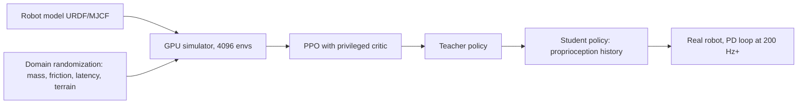

## Why this matters

In the [previous post]({{ '/blog/2026/embodied-ai-01-robotics-foundations/' | relative_url }}) every controller
was designed by hand from a model. That works for an arm moving in free space, but it becomes very hard for a
quadruped running over rubble or a hand spinning a cube, where contacts switch on and off hundreds of times a second.
**Reinforcement learning** (RL) replaces the hand design by optimization: write down a reward, let the robot try
millions of times in a simulator, and transfer the resulting policy to hardware. Since about 2019 this recipe has
become the standard way to build locomotion controllers, and its ideas (advantages, entropy, domain randomization)
show up again in imitation learning, VLA fine-tuning and world-model training later in this series.

**Prerequisites**

- Post 1 of this series (joint-space PD control, action spaces).
- Probability: expectations, the log-derivative trick, Gaussian distributions.
- PyTorch basics (autograd, `nn.Module`, optimizers).
- If you know world models: model-based RL appears in post 5 and in the world-models track; here we stay model-free.

## 1. The RL problem

### Markov decision processes

An MDP is a tuple $(\mathcal{S}, \mathcal{A}, P, r, \gamma, \rho_0)$: states, actions, transition dynamics
$$P(s' \mid s, a)$$, reward $r(s, a)$, discount $\gamma \in [0, 1)$ and initial-state distribution $\rho_0$.
A (stochastic) policy $\pi_\theta(a \mid s)$ induces trajectories $\tau = (s_0, a_0, s_1, a_1, \dots)$ and the
objective is the expected discounted return

$$
J(\theta) = \mathbb{E}_{\tau\sim\pi_\theta}\left[\sum_{t=0}^{\infty} \gamma^t r(s_t, a_t)\right].
$$

Real robots are **partially observable** (POMDP): the policy sees observations $o_t$ (joint encoders, an IMU,
images) rather than the full state (exact contact forces, terrain friction). Practitioners handle this with
observation histories, recurrent networks, or the privileged-information tricks of section 4.

For a robot the modelling choices are as important as the algorithm:

| MDP element | Typical choice for a legged robot |
| --- | --- |
| Observation | base angular velocity, projected gravity, joint positions and velocities, previous action, velocity command, (height map) |
| Action | joint position targets $q^{\text{des}}$ for a PD loop at 200 Hz to 1 kHz; policy at 50 Hz |
| Reward | track commanded velocity, penalize torque, joint acceleration, action rate, foot slip, base orientation |
| Episode | 20 s, terminate on falls (base contact), randomized start state and terrain |

Put together, one step of a legged-robot RL system looks like the loop in the figure: the policy runs slowly, a PD loop turns its targets into torques quickly, and batches of trajectories from many parallel environments feed the PPO update.



### Value functions and the Bellman equations

The state value and action value of a policy are

$$
V^\pi(s) = \mathbb{E}_\pi\left[\sum_{k\ge 0}\gamma^k r_{t+k} \,\middle\vert\, s_t = s\right], \qquad
Q^\pi(s,a) = \mathbb{E}_\pi\left[\sum_{k\ge 0}\gamma^k r_{t+k} \,\middle\vert\, s_t = s, a_t = a\right],
$$

and the **advantage** $A^\pi(s,a) = Q^\pi(s,a) - V^\pi(s)$ measures how much better action $a$ is than the policy's
average. They satisfy the Bellman expectation equation

$$
Q^\pi(s,a) = r(s,a) + \gamma\,\mathbb{E}_{s'\sim P,\,a'\sim\pi}\left[Q^\pi(s',a')\right],
$$

and the optimal action value satisfies the Bellman optimality equation
$$Q^{\ast}(s,a) = r + \gamma\,\mathbb{E}_{s'}[\max_{a'} Q^{\ast}(s',a')]$$. Q-learning and DQN (Mnih et al. 2015) iterate the
latter, but the $\max$ over a continuous, high-dimensional action space is awkward, which is why robotics mostly uses
**policy-gradient** and **actor-critic** methods.

For a small, known MDP the Bellman optimality equation can be solved directly by **value iteration**, $V_{k+1}(s) = \max_a \sum_{s'} P(s'\mid s,a)\,[r + \gamma V_k(s')]$. The figure and the widget below show how value spreads backwards from the reward, one sweep at a time.

{% include blog_figure.liquid path="assets/img/blog/embodied-ai/02-value-iteration.svg" caption="Value iteration on a 6 x 5 gridworld with $\gamma = 0.9$: entering the blue cell gives $+1$, the red cell $-1$, black cells are walls, and each move succeeds with probability 0.8 and slips sideways with probability 0.1 each way. Numbers are $V_k(s)$, arrows the greedy policy. After one sweep only the cell next to the goal knows about it; at convergence every cell has a value, and the policy next to the $-1$ cell points away from it (bottom-right corner) because of the slip risk." %}



## 2. Policy gradients

### The policy gradient theorem

Using $\nabla_\theta p_\theta(\tau) = p_\theta(\tau)\nabla_\theta\log p_\theta(\tau)$ and the fact that the dynamics do not
depend on $\theta$, one gets (Williams 1992; Sutton et al. 2000)

$$
\nabla_\theta J(\theta) = \mathbb{E}_{\pi_\theta}\left[\sum_t \nabla_\theta\log\pi_\theta(a_t\mid s_t)\, \hat A_t\right],
$$

where $\hat A_t$ can be the return-to-go (REINFORCE), the return minus a baseline $b(s_t)$, or an advantage estimate.
Subtracting a state-dependent baseline does not bias the gradient but greatly reduces its variance. Intuitively,
the gradient raises the log-probability of actions that turned out better than expected and lowers the others.

For continuous control the policy is usually a diagonal Gaussian $\pi_\theta(a\mid s) = \mathcal{N}(\mu_\theta(s), \mathrm{diag}(\sigma^2))$
with a state-independent, learned $\log\sigma$.

A one-step problem (a bandit) makes the update visible. Samples with positive advantage pull the mean of the Gaussian toward them, samples with negative advantage push it away, and repeated steps also shrink $\sigma$ once the policy has found the optimum:



### Generalized advantage estimation

With a learned critic $V_\phi$ define the TD residual $\delta_t = r_t + \gamma V_\phi(s_{t+1}) - V_\phi(s_t)$.
**GAE** (Schulman et al. 2016) averages $k$-step advantage estimates with exponentially decaying weights:

$$
\hat A_t^{\mathrm{GAE}(\gamma,\lambda)} = \sum_{l=0}^{\infty} (\gamma\lambda)^l\,\delta_{t+l}.
$$

$\lambda = 0$ gives the low-variance, biased one-step TD advantage; $\lambda = 1$ gives the unbiased, high-variance
Monte-Carlo advantage. $\lambda \approx 0.95$ is the usual compromise. The critic is regressed to the
targets $\hat R_t = \hat A_t + V_\phi(s_t)$.

The top panel shows how $\lambda$ sets the horizon over which TD residuals are averaged. The bottom panel measures the resulting trade-off on a toy chain whose critic is deliberately wrong:

{% include blog_figure.liquid path="assets/img/blog/embodied-ai/02-gae.svg" caption="Top: the weight $(\gamma\lambda)^l$ that GAE gives to the TD residual $l$ steps ahead ($\gamma = 0.99$). Bottom: Monte-Carlo estimate (4,000 episodes) of the error of $\hat A_0$ on a 300-step chain with noisy rewards and a critic that is off by $2 + 4\sin(0.15t)$. Bias is measured against the $\lambda = 1$ target $G_0 - V_\phi(s_0)$. Small $\lambda$ trusts the wrong critic (bias); large $\lambda$ sums many noisy rewards (variance grows by two orders of magnitude). The dotted line marks the usual $\lambda = 0.95$." %}

### Trust regions and PPO

Plain policy gradients are fragile: one large step can collapse the policy, and then the data it collects is useless.
**TRPO** (Schulman et al. 2015) maximizes a surrogate objective subject to a KL-divergence constraint between the
old and new policy. **PPO** (Schulman et al. 2017) gets most of the benefit with a first-order trick. With the
probability ratio $\rho_t(\theta) = \pi_\theta(a_t\mid s_t)/\pi_{\theta_{\text{old}}}(a_t\mid s_t)$ it maximizes

$$
L^{\text{CLIP}}(\theta) = \mathbb{E}_t\left[\min\left(\rho_t(\theta)\hat A_t,\; \operatorname{clip}(\rho_t(\theta), 1-\epsilon, 1+\epsilon)\,\hat A_t\right)\right],
$$

usually with $\epsilon = 0.2$. The $\min$ makes this a pessimistic bound: once the ratio leaves $[1-\epsilon, 1+\epsilon]$
in the direction that would improve the objective, the gradient vanishes, so there is no incentive to move further.
That lets PPO reuse each batch for several epochs of minibatch SGD. The full loss adds a value loss and an optional
entropy bonus:

$$
L(\theta,\phi) = -L^{\text{CLIP}}(\theta) + c_v\,\mathbb{E}_t\left[(V_\phi(s_t) - \hat R_t)^2\right] - c_e\,\mathbb{E}_t\left[\mathcal{H}(\pi_\theta(\cdot\mid s_t))\right].
$$

PPO is on-policy and sample-inefficient, but it is simple, stable and embarrassingly parallel. With thousands of
simulated robots on one GPU, sample efficiency matters much less than wall-clock time, which is why PPO is the
default in Isaac Lab, legged_gym and most locomotion papers.

Plotting $L^{\text{CLIP}}$ for a single sample shows the pessimism of the $\min$: the objective is flat, and its gradient zero, exactly where moving further would look good.

{% include blog_figure.liquid path="assets/img/blog/embodied-ai/02-ppo-clip.svg" caption="The PPO objective for one sample as a function of the probability ratio, $\epsilon = 0.2$. Left, $\hat A > 0$: raising the probability helps until $\rho = 1.2$, after which the clipped term caps the objective (shaded, zero gradient). Right, $\hat A < 0$: lowering the probability helps until $\rho = 0.8$. In the opposite directions the unclipped term is the smaller one, so a step that made things worse is still fully penalized." %}

### A compact PPO in PyTorch

The following file is self-contained: an actor-critic, GAE, the PPO update, and a vectorized toy task in which 64
point masses must move to the origin (a stand-in for a reaching task). It runs in a few minutes on a laptop CPU.

```python
import torch
import torch.nn as nn

class ActorCritic(nn.Module):
    def __init__(self, obs_dim, act_dim, hidden=64):
        super().__init__()
        self.pi = nn.Sequential(nn.Linear(obs_dim, hidden), nn.Tanh(),
                                nn.Linear(hidden, hidden), nn.Tanh(), nn.Linear(hidden, act_dim))
        self.v = nn.Sequential(nn.Linear(obs_dim, hidden), nn.Tanh(),
                               nn.Linear(hidden, hidden), nn.Tanh(), nn.Linear(hidden, 1))
        self.log_std = nn.Parameter(torch.full((act_dim,), -0.5))

    def dist(self, obs):
        return torch.distributions.Normal(self.pi(obs), self.log_std.exp())

def gae(rew, val, done, last_val, gamma=0.99, lam=0.95):
    """rew, val, done: [T, N] tensors (N parallel envs). Returns advantages and returns."""
    T = rew.shape[0]
    adv = torch.zeros_like(rew)
    next_val, running = last_val, torch.zeros_like(last_val)
    for t in reversed(range(T)):
        mask = 1.0 - done[t]
        delta = rew[t] + gamma * next_val * mask - val[t]
        running = delta + gamma * lam * mask * running
        adv[t] = running
        next_val = val[t]
    return adv, adv + val

def ppo_update(model, opt, obs, act, logp_old, adv, ret,
               clip=0.2, vf_coef=0.5, ent_coef=0.0, epochs=10, minibatch=256):
    """One PPO update on a flattened batch of B transitions."""
    adv = (adv - adv.mean()) / (adv.std() + 1e-8)
    B = obs.shape[0]
    for _ in range(epochs):
        for idx in torch.randperm(B).split(minibatch):
            d = model.dist(obs[idx])
            logp = d.log_prob(act[idx]).sum(-1)
            ratio = (logp - logp_old[idx]).exp()
            surr = torch.min(ratio * adv[idx],
                             ratio.clamp(1 - clip, 1 + clip) * adv[idx])
            v_loss = (model.v(obs[idx]).squeeze(-1) - ret[idx]).pow(2).mean()
            loss = -surr.mean() + vf_coef * v_loss - ent_coef * d.entropy().sum(-1).mean()
            opt.zero_grad()
            loss.backward()
            nn.utils.clip_grad_norm_(model.parameters(), 0.5)
            opt.step()

# --- a toy "reaching" task: a 2-D point mass must move to the origin ---
class PointReach:
    def __init__(self, n, horizon=50):
        self.n, self.H = n, horizon
        self.damp, self.gain = 0.9, 0.1               # nominal physics
    def reset(self):
        self.pos = torch.rand(self.n, 2) * 2 - 1
        self.vel = torch.zeros(self.n, 2)
        self.t = torch.zeros(self.n)
        return torch.cat([self.pos, self.vel], -1)
    def step(self, a):
        a = a.clamp(-1, 1)
        self.vel = self.damp * self.vel + self.gain * a  # simple damped dynamics
        self.pos = self.pos + 0.1 * self.vel
        self.t += 1
        rew = -self.pos.norm(dim=-1) - 0.01 * a.pow(2).sum(-1)
        done = (self.t >= self.H).float()
        if done.any():                                # auto-reset finished envs
            k = done.bool()
            self.pos[k] = torch.rand(int(k.sum()), 2) * 2 - 1
            self.vel[k] = 0.0
            self.t[k] = 0
        return torch.cat([self.pos, self.vel], -1), rew, done

torch.manual_seed(0)
env, T = PointReach(n=64), 128
model = ActorCritic(4, 2)
opt = torch.optim.Adam(model.parameters(), lr=3e-4)
obs = env.reset()
for it in range(150):
    buf = {k: [] for k in ["obs", "act", "logp", "rew", "val", "done"]}
    with torch.no_grad():
        for t in range(T):
            d = model.dist(obs)
            a = d.sample()
            buf["obs"].append(obs); buf["act"].append(a)
            buf["logp"].append(d.log_prob(a).sum(-1))
            buf["val"].append(model.v(obs).squeeze(-1))
            obs, r, done = env.step(a)
            buf["rew"].append(r); buf["done"].append(done)
        last_val = model.v(obs).squeeze(-1)
    b = {k: torch.stack(v) for k, v in buf.items()}            # [T, N, ...]
    adv, ret = gae(b["rew"], b["val"], b["done"], last_val)
    flat = lambda x: x.reshape(T * env.n, *x.shape[2:])
    ppo_update(model, opt, flat(b["obs"]), flat(b["act"]), flat(b["logp"]), flat(adv), flat(ret))
    if it % 25 == 0 or it == 149:
        print(f"iter {it:3d}  mean reward per step {b['rew'].mean():.3f}")
```

On my run the mean reward per step goes from about $-0.89$ (random actions) to about $-0.1$ (the masses reach the
origin and stay there). Details that matter in practice and are easy to get wrong:

- **Masking at episode ends.** `mask` stops bootstrapping across an auto-reset. Strictly, a **time-limit** truncation
  should still bootstrap from $V(s_{T})$ (the robot did not fail, we just stopped watching); legged_gym handles this
  by adding $\gamma V$ of the final state to the reward on time-outs. The toy code treats time-outs as terminal, which
  is a small bias.
- **Advantage normalization**, **gradient clipping** and a **state-independent log-std** are standard; observation
  normalization (running mean/variance) matters on real robots where units differ by orders of magnitude.
- **Action scaling.** The network output is clamped to $[-1, 1]$ here; on a robot it is usually scaled and added to a
  nominal joint configuration, $q^{\text{des}} = q_0 + k_a a_t$.

Running the script above unchanged produces the learning curve in the figure, together with the behaviour of the trained policy:

{% include blog_figure.liquid path="assets/img/blog/embodied-ai/02-ppo-training.svg" caption="Top: mean reward per step during training, from real runs of the code above on one CPU core. The purple curve is the post's run (seed 0): $-0.889$ at iteration 0, about $-0.16$ after 50 iterations and $-0.108$ at the end, matching the printed output. Also shown: the same run with $\lambda = 0$ and $\lambda = 1$ in `gae`, and training on `RandomizedPointReach`. Bottom: the trained policy (mean action) from 12 start points on a circle of radius 0.9; all point masses reach the origin within about 20 steps." %}

## 3. Soft Actor-Critic

PPO throws away data after each update. **Off-policy** methods keep a replay buffer and are far more sample-efficient,
which matters when samples come from a real robot. **SAC** (Haarnoja et al. 2018) optimizes the maximum-entropy objective

$$
J(\pi) = \sum_t \mathbb{E}_{(s_t,a_t)\sim\pi}\left[r(s_t,a_t) + \alpha\,\mathcal{H}(\pi(\cdot\mid s_t))\right],
$$

which keeps the policy as random as possible while still solving the task. This gives robust exploration and a policy
that does not collapse onto one brittle solution. SAC learns two soft Q-functions $Q_{\phi_1}, Q_{\phi_2}$
(taking the minimum to fight overestimation, as in TD3) with targets

$$
y = r + \gamma\left(\min_{j=1,2} Q_{\bar\phi_j}(s', \tilde a') - \alpha\log\pi_\theta(\tilde a'\mid s')\right), \qquad \tilde a' \sim \pi_\theta(\cdot\mid s'),
$$

where $\bar\phi$ are slowly updated (Polyak-averaged) target networks. The actor uses the **reparameterization trick**
with a tanh-squashed Gaussian, $\tilde a = \tanh(\mu_\theta(s) + \sigma_\theta(s)\odot\xi)$ with $\xi\sim\mathcal{N}(0, I)$, and minimizes

$$
L_\pi(\theta) = \mathbb{E}_{s\sim\mathcal{D},\,\xi}\left[\alpha\log\pi_\theta(\tilde a\mid s) - \min_j Q_{\phi_j}(s, \tilde a)\right].
$$

The tanh changes the density, so $\log\pi(\tilde a\mid s) = \log\mathcal{N}(u;\mu,\sigma) - \sum_i\log(1-\tanh^2 u_i)$. The follow-up
paper (Haarnoja et al. 2018b) also tunes $\alpha$ automatically toward a target entropy (often $-\dim\mathcal{A}$) and
demonstrated learning to walk directly on a real Minitaur quadruped in about two hours of experience.

| | PPO | SAC |
| --- | --- | --- |
| Data | on-policy, discard after update | off-policy, replay buffer |
| Sample efficiency | low | high |
| Parallel simulation | scales very well | needs care (update-to-data ratio) |
| Typical use | sim-to-real locomotion, massively parallel sim | real-world RL, manipulation, fine-tuning |
| Exploration | Gaussian noise + optional entropy bonus | maximum entropy, automatic temperature |

Two pictures help with SAC. The entropy bonus turns the greedy $\arg\max_a Q$ into a Boltzmann distribution $\pi \propto \exp(Q/\alpha)$ (the optimal policy of the maximum-entropy objective in a one-step problem), and the tanh squashing needs the density correction given above:

{% include blog_figure.liquid path="assets/img/blog/embodied-ai/02-max-entropy.svg" caption="Top: for a bimodal $Q(s, a)$ (dashed), the maximum-entropy policy $\pi \propto e^{Q/\alpha}$ for three temperatures, with its differential entropy $\mathcal{H}$. A small $\alpha$ commits to the best mode; a larger $\alpha$ keeps probability on the second-best solution and explores more. Bottom: histograms of $\tanh(u)$ for 200,000 Gaussian samples agree with the analytic density $\mathcal{N}(u;\mu,\sigma)/(1-\tanh^2u)$, the correction SAC adds to $\log\pi$. Wide Gaussians pile up mass near the action limits $\pm 1$." %}

## 4. Reward design

The reward is the specification of the task, and every loophole will be found. Common patterns:

- **Dense task terms** (e.g. $$\exp(-\lVert v^{\text{cmd}}_{xy} - v_{xy}\rVert^2 / \sigma)$$ for velocity tracking) plus many small
  **regularization penalties** (torque, power, joint acceleration, action rate $\lVert a_t - a_{t-1}\rVert^2$, foot slip,
  feet air time). The penalties are what make gaits look natural and transferable; without them policies vibrate,
  which simulators tolerate and motors do not.
- **Potential-based shaping** (Ng, Harada and Russell, ICML 1999): adding $$F = \gamma\Phi(s') - \Phi(s)$$ for any potential
  $\Phi$ provably leaves the optimal policy unchanged, while other shaping terms can change it.
- **Sparse rewards plus demonstrations or curricula** for manipulation: success/failure is easy to specify but hard to
  explore, so one adds demonstrations (post 4), automatic curricula (terrain difficulty that increases as the policy
  improves, as in Rudin et al.), or goal relabeling.
- **Style rewards from data**: motion imitation (DeepMimic, Peng et al. 2018) or adversarial motion priors reward the
  policy for looking like reference motion capture, a direct bridge from character animation to robotics.
- **LLM-written rewards**: Eureka (Ma et al. 2024) asks an LLM to write reward code, trains policies in Isaac Gym,
  and feeds training statistics back to the LLM to refine the reward.

## 5. Sim-to-real transfer

Policies trained in simulation face the **reality gap**: wrong masses and friction, unmodelled actuator dynamics,
latency, sensor noise, and images that look nothing like rendered ones. The main tools:

### Domain randomization

Instead of making the simulator exactly right, make it **randomly wrong** in many ways, so that the real world looks
like just another sample. Tobin et al. (IROS 2017) randomized textures, lighting, camera pose and distractors in a
non-photorealistic renderer and trained an object detector that localized objects on a real robot to within about
1.5 cm with no real images. Peng et al. (ICRA 2018) randomized **dynamics** (masses, friction, damping, latency) and used
a recurrent policy that can implicitly identify the current dynamics. OpenAI's dexterous hand work (2018, 2019) pushed
this to the extreme with automatic domain randomization, gradually widening the ranges as the policy succeeds.

In code, randomization is just per-environment physics parameters resampled on reset. In the toy task above:

```python
class RandomizedPointReach(PointReach):
    """Domain randomization: every env gets its own damping and actuator gain."""
    def reset(self):
        self.damp = torch.empty(self.n, 1).uniform_(0.8, 0.97)
        self.gain = torch.empty(self.n, 1).uniform_(0.05, 0.2)
        return super().reset()
```

Replace `PointReach(n=64)` by `RandomizedPointReach(n=64)` and the same PPO loop learns a single policy that works
across all of these "robots". (For brevity the parameters are sampled once per `reset()`; a full implementation
resamples them for each environment when it auto-resets.) The trade-off is conservatism: the wider the ranges, the
more robust and the less optimal the policy.

Does it help here? The figure trains both versions with the PPO code above and evaluates them over a whole grid of physics parameters:

{% include blog_figure.liquid path="assets/img/blog/embodied-ai/02-domain-randomization.svg" localized="true" caption="Domain randomization on the toy task, with real training runs. Top: every parallel environment gets its own damping and actuator gain from the box; the real robot is unknown, but should lie inside it. Bottom: mean reward per step of the deterministic policy evaluated over a grid of physics parameters (256 random starts each, 50 steps). Inside the box the two maps are almost identical: at the nominal point $-0.132$ versus $-0.135$, at the star $-0.180$ versus $-0.185$, and the worst case in the box $-0.233$ versus $-0.235$. This toy controller barely depends on the parameters, so the nominal policy is already robust; reward collapses only at low gain, outside the box, where the clamped action is too weak for any policy. The useful habit the figure shows is to evaluate a policy over the whole parameter range, not only at the nominal point." %}

### System identification and actuator models

Randomization is no substitute for getting the big things right. Hwangbo et al. (Science Robotics 2019) trained an
**actuator network**, an MLP that maps a short history of joint position errors and velocities to the torque the
real series-elastic actuator produces, on data recorded from ANYmal. Plugging it into the simulator closed most of
the gap; the learned policies ran faster than the previous model-based controller and could recover from falls in
complex configurations, which hand-designed controllers had not achieved.

### Privileged teachers, students and adaptation

A simulator knows things the robot never will: exact terrain, friction, contact states. Two widespread ways to use
that knowledge:

- **Asymmetric actor-critic** (Pinto et al. RSS 2018): the critic sees the full simulator state while the actor sees
  only the robot's observations. The critic is discarded at deployment, so it may cheat.
- **Teacher-student distillation** (Lee et al. Science Robotics 2020): first train a teacher policy with privileged
  information, then train a student that sees only proprioceptive history to imitate the teacher. The student learns
  to infer the terrain from how its legs feel. This let ANYmal walk over mud, snow, rubble and vegetation it never saw
  in training. Miki et al. (2022) extended it with an attention-based fusion of exteroception (height maps from
  cameras and LiDAR) and proprioception, and the robot completed a hiking trail up Mount Etzel in Switzerland.
- **Rapid Motor Adaptation** (Kumar et al. RSS 2021): encode the privileged environment parameters into a latent
  "extrinsics" vector, and train an adaptation module to estimate it online from recent states and actions.

### Massively parallel simulation

Rudin et al. (CoRL 2021) showed that running thousands of environments on a single GPU with Isaac Gym, combined
with a game-inspired terrain curriculum and carefully tuned PPO, trains a quadruped policy for flat terrain in under four
minutes and for uneven terrain in about twenty, and the policies transfer to the real ANYmal. Their open-source
`legged_gym` became the template for a generation of locomotion work, including humanoids
(Radosavovic et al., Science Robotics 2024). The lesson: when simulation is cheap, the simple on-policy algorithm wins.



## 6. Beyond locomotion

- **Manipulation.** End-to-end visuomotor policies (Levine et al. JMLR 2016) trained with guided policy search;
  QT-Opt grasping from large-scale real data; in-hand reorientation with a Shadow hand (OpenAI 2018).
  Manipulation is harder for RL than locomotion because rewards are sparse and the relevant state (object pose,
  contacts) is hard to perceive, which is why imitation learning (post 4) dominates manipulation today.
- **Agile flight.** Champion-level drone racing (Kaufmann et al. Nature 2023) combined RL in simulation with
  data-driven residual models of perception and dynamics.
- **RL fine-tuning of foundation policies.** Increasingly, RL is used to refine a policy pre-trained by imitation,
  using success rewards or learned reward models; the ideas of this post carry over directly.

## Try it

The **[Lab]({{ '/' | relative_url }}#lab)** XPBD cloth demo is a physics simulator with substepping and constraint
projection, the same kind of engine an RL agent trains inside. Dragging the cloth is a perturbation that a robust
policy would have to reject; imagine randomizing the cloth's stiffness and mass as domain randomization.

## Representative papers

| Paper | Venue | Year | Link | Why it matters |
| --- | --- | --- | --- | --- |
| Mnih et al., *Human-level control through deep reinforcement learning* | Nature | 2015 | [DOI](https://doi.org/10.1038/nature14236) | DQN, start of deep RL |
| Schulman et al., *Trust region policy optimization* | ICML | 2015 | [arXiv](https://arxiv.org/abs/1502.05477) | KL-constrained policy updates |
| Schulman et al., *High-dimensional continuous control using generalized advantage estimation* | ICLR | 2016 | [arXiv](https://arxiv.org/abs/1506.02438) | GAE |
| Levine et al., *End-to-end training of deep visuomotor policies* | JMLR | 2016 | [arXiv](https://arxiv.org/abs/1504.00702) | Pixels-to-torques manipulation |
| Schulman et al., *Proximal policy optimization algorithms* | arXiv | 2017 | [arXiv](https://arxiv.org/abs/1707.06347) | PPO |
| Tobin et al., *Domain randomization for transferring deep neural networks from simulation to the real world* | IROS | 2017 | [arXiv](https://arxiv.org/abs/1703.06907) | Visual domain randomization |
| Peng et al., *Sim-to-real transfer of robotic control with dynamics randomization* | ICRA | 2018 | [arXiv](https://arxiv.org/abs/1710.06537) | Dynamics randomization |
| Pinto et al., *Asymmetric actor critic for image-based robot learning* | RSS | 2018 | [arXiv](https://arxiv.org/abs/1710.06542) | Privileged critic |
| Haarnoja et al., *Soft actor-critic: off-policy maximum entropy deep RL with a stochastic actor* | ICML | 2018 | [arXiv](https://arxiv.org/abs/1801.01290) | SAC |
| Peng et al., *DeepMimic: example-guided deep RL of physics-based character skills* | ACM TOG (SIGGRAPH) | 2018 | [arXiv](https://arxiv.org/abs/1804.02717) | Motion imitation rewards, graphics meets RL |
| OpenAI et al., *Learning dexterous in-hand manipulation* | IJRR | 2020 | [arXiv](https://arxiv.org/abs/1808.00177) | Extreme domain randomization |
| Hwangbo et al., *Learning agile and dynamic motor skills for legged robots* | Science Robotics | 2019 | [DOI](https://doi.org/10.1126/scirobotics.aau5872) | Actuator net, RL on ANYmal |
| Lee et al., *Learning quadrupedal locomotion over challenging terrain* | Science Robotics | 2020 | [DOI](https://doi.org/10.1126/scirobotics.abc5986) | Teacher-student sim-to-real |
| Kumar et al., *RMA: Rapid motor adaptation for legged robots* | RSS | 2021 | [arXiv](https://arxiv.org/abs/2107.04034) | Online adaptation |
| Rudin et al., *Learning to walk in minutes using massively parallel deep RL* | CoRL | 2021 | [arXiv](https://arxiv.org/abs/2109.11978) | GPU-parallel PPO, legged_gym |
| Miki et al., *Learning robust perceptive locomotion for quadrupedal robots in the wild* | Science Robotics | 2022 | [arXiv](https://arxiv.org/abs/2201.08117) | Exteroception + proprioception |
| Kaufmann et al., *Champion-level drone racing using deep reinforcement learning* | Nature | 2023 | [DOI](https://doi.org/10.1038/s41586-023-06419-4) | RL beats human champions |
| Ma et al., *Eureka: human-level reward design via coding large language models* | ICLR | 2024 | [arXiv](https://arxiv.org/abs/2310.12931) | LLM-written rewards |
| Radosavovic et al., *Real-world humanoid locomotion with reinforcement learning* | Science Robotics | 2024 | [arXiv](https://arxiv.org/abs/2303.03381) | Transformer policy for a humanoid |

## Learning resources

- R. Sutton and A. Barto, [*Reinforcement Learning: An Introduction*](http://incompleteideas.net/book/the-book-2nd.html),
  2nd ed. (MIT Press, 2018), free online. Chapters 3 to 6 and 13.
- OpenAI [Spinning Up in Deep RL](https://spinningup.openai.com): clear derivations of policy gradients, PPO, SAC with
  reference code.
- S. Levine, CS 285 Deep Reinforcement Learning (UC Berkeley), lectures online.
- R. Tedrake, [*Underactuated Robotics*](https://underactuated.csail.mit.edu): the control-theory view of RL and
  trajectory optimization.
- Code: [CleanRL](https://github.com/vwxyzjn/cleanrl) (single-file implementations),
  [Stable-Baselines3](https://github.com/DLR-RM/stable-baselines3),
  [legged_gym](https://github.com/leggedrobotics/legged_gym) and [rsl_rl](https://github.com/leggedrobotics/rsl_rl),
  [Isaac Lab](https://github.com/isaac-sim/IsaacLab).

## Exercises

1. Derive the policy gradient theorem from $\nabla_\theta\log p_\theta(\tau)$ and show that a state-dependent baseline
   leaves it unbiased.
2. In the PPO code, set `lam=0` and `lam=1` in `gae` and compare learning curves. Then set `clip=10` (effectively no
   clipping) and observe the stability.
3. Fix the time-limit bias: return separate `terminated` and `truncated` flags from `PointReach.step` and bootstrap
   from the value of the final observation on truncation.
4. Train on `PointReach`, then evaluate on `RandomizedPointReach` with extreme parameters, and compare against a policy
   trained with randomization. Add the true damping to the observation (a "privileged" input) and see how much it helps.
5. Implement SAC for the same task (replay buffer, twin Q, tanh Gaussian, automatic $\alpha$) and compare the number of
   environment steps needed with PPO.

**Next:** [Simulation platforms]({{ '/blog/2026/embodied-ai-03-simulation-platforms/' | relative_url }}),
the engines where all this training happens.
