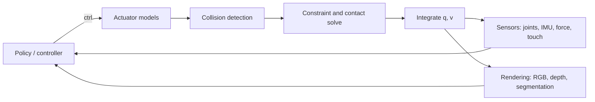

## Why this matters

The [RL post]({{ '/blog/2026/embodied-ai-02-reinforcement-learning-for-robots/' | relative_url }}) ended with policies
that learn to walk in minutes, but only because thousands of copies of the robot were simulated in parallel.
Simulators are to embodied AI what datasets are to computer vision: they generate the training data, define the
benchmarks, and their errors become the reality gap. They are also where robotics meets **computer graphics**
most directly. A modern simulator is a game engine with a stricter physics core, and the techniques of the
[graphics track]({{ '/blog/category/graphics/' | relative_url }}) (rasterization, ray tracing, BVHs, position-based dynamics)
are its building blocks. This post explains what a simulator computes, compares the major platforms, and walks through
MuJoCo in Python.

**Prerequisites**

- Posts 1 and 2 (equations of motion, PD control, RL training loops).
- Basic numerical integration (explicit and semi-implicit Euler).
- Optional: the graphics track's posts on rasterization, ray tracing and physics simulation.

## 1. What a robotics simulator does

Every simulator repeats the same loop at a fixed time step $\Delta t$ (typically 1 to 5 ms), usually several
"substeps" per control step:



### Rigid-body dynamics

Most robotics engines use **generalized (reduced) coordinates**: the state is the joint vector $q$ and its velocity
$v$, and the dynamics are the manipulator equation from post 1,

$$
M(q)\,\dot v + c(q, v) = \tau + J_c(q)^\top f_c ,
$$

where $c$ collects Coriolis, centrifugal and gravity terms and $J_c^\top f_c$ maps contact forces into joint space.
Joints are satisfied exactly by construction, and $M$, $c$ are computed with the $O(n)$ algorithms of Featherstone
(CRBA, RNEA, ABA). MuJoCo, Drake, Pinocchio, RaiSim and PhysX articulations work this way. Game engines and many
graphics solvers instead use **maximal coordinates**: every body has its own 6-DoF pose and joints are constraints
between bodies. That is simpler and parallelizes well, but joint constraints drift and long chains converge slowly.

Integration is usually **semi-implicit (symplectic) Euler**, $v_{t+1} = v_t + \Delta t\,\dot v_t$, then
$q_{t+1} = q_t \oplus \Delta t\, v_{t+1}$ (where $\oplus$ handles quaternions for free joints). MuJoCo also offers
implicit integration of damping terms and an RK4 integrator; stiff joints and actuators often require the implicit options.

### Contacts and friction

Contacts are where simulators differ the most and where most sim-to-real problems come from.

1. **Collision detection.** A broad phase (bounding-volume hierarchies or sweep-and-prune, exactly the BVH ideas used
   in ray tracing) finds candidate pairs; a narrow phase computes contact points, normals and penetration depths for
   convex shapes with GJK/EPA or MPR, or with analytic formulas for primitive pairs (sphere-plane, capsule-capsule).
   Non-convex meshes are usually decomposed into convex pieces (e.g. V-HACD, CoACD) or approximated with SDFs.
2. **Contact model.** For a contact with normal impulse $\lambda_n$ and gap $\phi(q)$ the ideal rigid model is the
   **complementarity condition**

   $$
   0 \le \lambda_n \;\perp\; \phi(q) \ge 0 ,
   $$

   i.e. either the bodies touch and push, or they separate and the force is zero. Coulomb friction adds a
   **friction cone** $\lVert \lambda_t \rVert \le \mu \lambda_n$ together with maximal dissipation. Solving this exactly gives a
   (nonlinear) complementarity problem per step, often linearized with a pyramidal friction cone into an LCP
   (Stewart and Trinkle 1996; Anitescu and Potra 1997) and solved with projected Gauss-Seidel (PGS).
3. **MuJoCo's approach** (Todorov, ICRA 2014) relaxes hard complementarity into a **convex optimization**:
   constraint forces minimize a quadratic objective subject to friction-cone constraints, with a small amount of
   softness controlled by the `solref` and `solimp` parameters. Convexity gives a unique solution and smooth,
   invertible dynamics (useful for optimization and estimation) at the cost of small penetrations and slip. You saw
   a 0.1 mm penetration in the example below.
4. **Position-based approaches.** PBD and XPBD (Macklin et al. 2016) skip forces altogether and directly project
   positions onto constraints. XPBD adds a compliance $\alpha$ so stiffness is independent of the iteration count: for
   a constraint $C(x) = 0$ with $\tilde\alpha = \alpha / \Delta t^2$, each iteration updates the Lagrange multiplier and positions as

   $$
   \Delta\lambda = \frac{-C(x) - \tilde\alpha\,\lambda}{\nabla C\, M^{-1}\nabla C^\top + \tilde\alpha}, \qquad
   \Delta x = M^{-1}\nabla C^\top \Delta\lambda .
   $$

   This is what the cloth demo on the home page runs, and it is the basis of NVIDIA's Flex and of cloth, rope and
   soft-body simulation in Isaac and Genesis.

Practical consequences: contact parameters (friction, restitution, softness) are among the most important things to
randomize; small time steps help more than many solver iterations; and grasping with thin objects or many contacts
(cloth, granular media, cables) remains hard everywhere.

### Actuators and sensors

A real joint is not an ideal torque source. Simulators model **actuators**: DC motors with gear ratios, armature
(reflected rotor inertia, which strongly stabilizes small fast joints), joint damping and friction, torque and velocity
limits, position servos with gains, and sometimes learned actuator networks (post 2). **Sensors** read the state with
noise and latency: joint encoders, IMUs (accelerometer and gyro of a site), force/torque sensors, touch sensors on
geoms, and cameras.

### Rendering

Vision-based policies need images. Options trade speed for realism:

| Renderer | Examples | Use |
| --- | --- | --- |
| Rasterization (OpenGL/Vulkan) | MuJoCo, SAPIEN, PyBullet, Habitat-Sim | fast RGB-D and segmentation, millions of frames |
| Batched GPU renderers | ManiSkill3, Madrona, MJX/MJWarp batch renderers | thousands of cameras in parallel for visual RL |
| Real-time ray/path tracing | Isaac Sim (RTX), SAPIEN ray tracer, Genesis | photorealistic data, synthetic data generation |
| Neural / Gaussian-splatting scenes | SplatSim, RoboGSim, Real-is-Sim (research) | photoreal digital twins reconstructed from real scans |

The last row is where the neural-rendering track meets robotics: 3D Gaussian Splatting reconstructs a real workspace
from a phone video, and the simulator renders the robot and objects inside it, which can shrink the visual sim-to-real gap.

### Scene and robot description formats

- **URDF** (ROS): links, joints, inertias, visual and collision meshes; widely supported but tree-only and with no
  actuators or sensors beyond extensions.
- **MJCF** (MuJoCo): richer, including actuators, tendons, sensors, equality constraints and defaults.
- **USD** (Pixar's Universal Scene Description, used by Omniverse/Isaac Sim): full scenes with materials and physics schemas.
  The graphics pipeline's scene graph format becomes the robot's world.

Collections such as MuJoCo Menagerie provide curated, tested models of many commercial robots.

## 2. The platform landscape

| Platform | Physics | Strengths | Typical use |
| --- | --- | --- | --- |
| **MuJoCo** (Google DeepMind, open source since 2022) | generalized coords, convex soft contacts | accurate, fast on CPU, MJX (JAX) and MuJoCo Warp (GPU) variants, MuJoCo Playground | control research, locomotion, dexterous hands, model-based RL |
| **Isaac Sim / Isaac Lab** (NVIDIA) | PhysX 5 on GPU, RTX rendering, USD | massive parallelism, photoreal sensors, large robot library | sim-to-real locomotion and manipulation, synthetic data |
| **Habitat** (Meta) | Bullet-based, focus on rendering speed | thousands of FPS in scanned 3D homes (Matterport, HM3D), humans and avatars in 3.0 | navigation, rearrangement, embodied QA, human-robot collaboration |
| **SAPIEN / ManiSkill** (UCSD, Hillbot) | PhysX, GPU-parallel in ManiSkill3 | articulated objects (PartNet-Mobility), fast batched rendering, many tasks | manipulation benchmarks, visual RL, imitation |
| **Genesis** (open-source consortium, 2024) | multi-solver: rigid, MPM, SPH, FEM, PBD | many material types in one engine, Python-native, generative data engine planned | soft bodies, fluids, research prototyping |
| **Drake** (TRI/MIT) | hydroelastic contact, optimization tools | rigorous modelling, trajectory optimization, systems framework | model-based control and planning |
| **PyBullet** | Bullet, maximal + reduced coords | simple, ubiquitous in older papers | teaching, legacy baselines |
| **Newton** (NVIDIA, Google DeepMind, Disney Research; Linux Foundation, 2025) | GPU, built on NVIDIA Warp, includes MuJoCo Warp | extensible differentiable physics | next-generation robot learning |

A few specifics worth knowing:

- **Isaac Gym** (Makoviychuk et al. 2021) first showed end-to-end GPU simulation and training with tensors that never leave
  the GPU. It evolved into **Orbit** (Mittal et al. 2023) and then **Isaac Lab**, built on Isaac Sim.
- **MJX** reimplements MuJoCo in JAX so a whole batch of worlds can be `vmap`ped and `jit`ted onto a GPU or TPU, and is
  differentiable; **MuJoCo Warp** is a newer GPU implementation that scales better on contact-rich scenes.
  **MuJoCo Playground** (2025) packages locomotion and manipulation environments with sim-to-real recipes on top of them.
- **Habitat** optimizes for rendering throughput in photorealistic scanned interiors, which matters for navigation,
  where physics is simple but images are everything.
- **ManiSkill3** focuses on GPU-parallel simulation *and* rendering for manipulation, including heterogeneous scenes per
  environment.

## 3. Differentiable simulation

If the simulator is differentiable, $\partial s_{t+1}/\partial s_t$ and $\partial s_{t+1}/\partial a_t$ are available, and a policy can be
trained by backpropagating through the rollout (analytic policy gradients):

$$
\nabla_\theta \sum_{t} r(s_t, a_t), \qquad s_{t+1} = f(s_t, \pi_\theta(s_t)) .
$$

Frameworks include **Brax** (JAX), **MJX**, **DiffTaichi**, **NVIDIA Warp**, and Genesis. In practice contact makes
gradients discontinuous or misleading (a tiny change can switch a contact on and produce a huge gradient, or a
resting contact can produce zero gradient), and long horizons produce exploding gradients, just as in RNNs.
**SHAC** (Xu et al. ICLR 2022) mitigates this by truncating the rollout into short windows and bootstrapping with a
learned critic. Differentiable simulation is most compelling for system identification (fitting friction and mass to
real trajectories), soft bodies and cloth, and inverse design; for contact-rich locomotion, sampling-based RL with
massive parallelism usually still wins.

## 4. Benchmarks

| Benchmark | Simulator | Focus |
| --- | --- | --- |
| Meta-World (Yu et al. CoRL 2019) | MuJoCo | 50 tabletop tasks for multi-task and meta-RL |
| robosuite (Zhu et al. 2020) | MuJoCo | modular manipulation tasks; used by robomimic |
| RLBench (James et al. RA-L 2020) | CoppeliaSim | 100 tasks with demonstrations, vision-based |
| Habitat ObjectNav / Rearrange (Savva et al. 2019; Szot et al. 2021) | Habitat | navigation and home rearrangement |
| CALVIN (Mees et al. RA-L 2022) | PyBullet | long-horizon language-conditioned manipulation |
| ManiSkill2 / ManiSkill3 (Gu et al. ICLR 2023; Tao et al. 2024) | SAPIEN | generalizable manipulation, GPU-parallel |
| BEHAVIOR-1K (Li et al. CoRL 2022) | OmniGibson (Isaac Sim) | 1,000 everyday household activities |
| LIBERO (Liu et al. NeurIPS 2023) | robosuite | lifelong learning, standard for VLA evaluation |
| SimplerEnv (Li et al. CoRL 2024) | SAPIEN | simulated evaluation of real-world policies (RT-1, Octo, OpenVLA) |

A recurring lesson: simulated success rates correlate with real ones only if the simulation was built and validated for
that purpose. SimplerEnv explicitly measures that correlation, and it is a good habit to ask of any benchmark.

## 5. Hands-on: MuJoCo in Python

`pip install mujoco` gives the engine plus Python bindings. The example defines a 2-link arm and a free box in MJCF,
holds the arm at a target with PD control plus bias compensation, and inspects contacts.

```python
import mujoco
import numpy as np

XML = """
<mujoco model="arm_and_box">
  <option timestep="0.002" gravity="0 0 -9.81"/>
  <worldbody>
    <light pos="0 0 3"/>
    <geom name="floor" type="plane" size="2 2 0.1"/>
    <body name="link1" pos="0 0 0.5">
      <joint name="shoulder" type="hinge" axis="0 1 0" damping="0.5"/>
      <geom type="capsule" fromto="0 0 0 0.5 0 0" size="0.04" mass="1"/>
      <body name="link2" pos="0.5 0 0">
        <joint name="elbow" type="hinge" axis="0 1 0" damping="0.5"/>
        <geom type="capsule" fromto="0 0 0 0.4 0 0" size="0.035" mass="0.6"/>
        <site name="ee" pos="0.4 0 0"/>
      </body>
    </body>
    <body name="box" pos="0.6 0.4 0.3">
      <freejoint/>
      <geom name="box" type="box" size="0.05 0.05 0.05" mass="0.2" friction="0.8 0.005 0.0001"/>
    </body>
  </worldbody>
  <actuator>
    <motor name="m_shoulder" joint="shoulder" gear="1" ctrlrange="-30 30"/>
    <motor name="m_elbow" joint="elbow" gear="1" ctrlrange="-30 30"/>
  </actuator>
  <sensor>
    <jointpos joint="shoulder"/>
    <jointpos joint="elbow"/>
    <framepos objtype="site" objname="ee"/>
  </sensor>
</mujoco>
"""

model = mujoco.MjModel.from_xml_string(XML)
data = mujoco.MjData(model)
print("nq", model.nq, "nv", model.nv, "nu", model.nu)   # 2 hinges + 1 free joint: nq=9, nv=8

q_ref = np.array([-0.6, 1.2])                # shoulder, elbow targets (rad)
Kp, Kd = 60.0, 4.0
arm = [model.joint("shoulder").qposadr[0], model.joint("elbow").qposadr[0]]
arm_v = [model.joint("shoulder").dofadr[0], model.joint("elbow").dofadr[0]]

for step in range(1500):                     # 3 s of simulated time
    q, qd = data.qpos[arm], data.qvel[arm_v]
    # PD + gravity/Coriolis compensation: qfrc_bias holds C(q,qd) qd + g(q)
    data.ctrl[:] = Kp * (q_ref - q) - Kd * qd + data.qfrc_bias[arm_v]
    mujoco.mj_step(model, data)

print("joint error", np.round(q_ref - data.qpos[arm], 4))
print("end-effector (sensor)", np.round(data.sensordata[2:5], 3))
print("box height", round(data.body("box").xpos[2], 4))   # resting on the floor at 0.05

# inspect contacts: which geoms touch and with what normal force
f = np.zeros(6)
for i in range(data.ncon):
    c = data.contact[i]
    mujoco.mj_contactForce(model, data, i, f)  # f[0] = normal force in the contact frame
    g1, g2 = model.geom(c.geom1).name, model.geom(c.geom2).name
    print(f"contact {g1}-{g2}: depth {c.dist:+.5f} m, normal force {f[0]:.3f} N")
```

Output (MuJoCo 3.3.7):

```text
nq 9 nv 8 nu 2
joint error [0. 0.]
end-effector (sensor) [0.743 0.    0.556]
box height 0.0499
contact floor-box: depth -0.00011 m, normal force 0.490 N
contact floor-box: depth -0.00011 m, normal force 0.490 N
contact floor-box: depth -0.00011 m, normal force 0.491 N
contact floor-box: depth -0.00011 m, normal force 0.491 N
```

Things to notice:

- `nq = 9` but `nv = 8`: the free joint stores a position and a **quaternion** (7 numbers) but has only 6 velocity
  DoFs. Always index with `qposadr` and `dofadr` rather than assuming they match.
- `qfrc_bias` is exactly $c(q, v)$, so the controller is the "PD + gravity compensation" law from post 1, and the joint
  error goes to zero.
- The box rests on **four contact points**, whose normal forces sum to $4 \times 0.49 \approx 1.96$ N $= 0.2\,\text{kg}\times 9.81\,\text{m/s}^2$.
  The small negative depth (0.1 mm penetration) is MuJoCo's soft contact at work.
- To see the scene, run `python -m mujoco.viewer` and load a file, or call `mujoco.viewer.launch_passive(model, data)`
  inside the loop. For offscreen images (e.g. camera observations) use `mujoco.Renderer(model, 240, 320)`, which needs an
  OpenGL backend such as EGL on headless machines (`MUJOCO_GL=egl`).

### Batched simulation with MJX

The same model runs as a batch of worlds on an accelerator with MJX (`pip install mujoco-mjx`). Save the example above
as `arm_and_box.py` and:

```python
import jax
import jax.numpy as jnp
import mujoco
from mujoco import mjx

from arm_and_box import XML                  # the MJCF string from the previous example

model = mujoco.MjModel.from_xml_string(XML)
mx = mjx.put_model(model)                    # copy the model to the accelerator

def rollout(qpos0):
    d = mjx.make_data(mx).replace(qpos=qpos0)
    def body(d, _):
        return mjx.step(mx, d), None
    d, _ = jax.lax.scan(body, d, None, length=500)
    return d.qpos

# 1024 worlds whose shoulder angle starts at different values
qpos0 = jnp.tile(jnp.array(model.qpos0), (1024, 1))
qpos0 = qpos0.at[:, 0].set(jnp.linspace(-1.0, 1.0, 1024))
final = jax.jit(jax.vmap(rollout))(qpos0)
print(final.shape)                           # (1024, 9)
```

`vmap` turns the single-world step into a batched one and `jit` compiles it; on a GPU this is the pattern behind
"train a locomotion policy in minutes". Because `mjx.step` is written in JAX, `jax.grad` through `rollout` also works,
which is the differentiable-simulation use case above (with the caveats about contact gradients). Importing
`arm_and_box` also runs its CPU simulation once, which is harmless here.

## 6. Choosing a simulator

- **Locomotion, sim-to-real, many robots in parallel:** Isaac Lab, MuJoCo Playground (MJX / MuJoCo Warp), Genesis.
- **Dexterous or precise contact, model-based control, system identification:** MuJoCo, Drake.
- **Visual manipulation benchmarks and imitation learning:** ManiSkill3, robosuite/robomimic, LIBERO, RLBench.
- **Navigation and home-scale tasks with people:** Habitat 3.0, BEHAVIOR-1K (OmniGibson).
- **Deformables, fluids, cloth:** Genesis, Isaac Sim (PBD/FEM), dedicated XPBD or MPM code.

Whatever you choose, validate the parts that matter for your task against the real robot: drop tests, swing tests,
recorded joint trajectories, and a few real rollouts of the trained policy.

## Try it

Open the **[Lab]({{ '/' | relative_url }}#lab)** on the home page and switch to the **Cloth · XPBD** tab: a 40 x 40
particle cloth simulated with XPBD and many substeps. Pull it, cut it, stretch it until it tears. Every update you
see is the $\Delta\lambda$ formula above applied to distance constraints. Notice that more substeps make the cloth
stiffer and more stable; that is the same reason robotics simulators prefer small time steps. Neighbouring tabs show
the rendering side: a path tracer and a Gaussian-splatting world.

## Representative papers

| Paper | Venue | Year | Link | Why it matters |
| --- | --- | --- | --- | --- |
| Todorov, Erez, Tassa, *MuJoCo: a physics engine for model-based control* | IROS | 2012 | [DOI](https://doi.org/10.1109/IROS.2012.6386109) | MuJoCo |
| Todorov, *Convex and analytically-invertible dynamics with contacts and constraints: theory and implementation in MuJoCo* | ICRA | 2014 | [DOI](https://doi.org/10.1109/ICRA.2014.6907751) | MuJoCo's convex contact model |
| Macklin, Müller, Chentanez, *XPBD: position-based simulation of compliant constrained dynamics* | MIG | 2016 | [DOI](https://doi.org/10.1145/2994258.2994272) | XPBD, used by the home-page cloth demo |
| Savva et al., *Habitat: a platform for embodied AI research* | ICCV | 2019 | [arXiv](https://arxiv.org/abs/1904.01201) | Fast photoreal embodied simulation |
| Hu et al., *DiffTaichi: differentiable programming for physical simulation* | ICLR | 2020 | [arXiv](https://arxiv.org/abs/1910.00935) | Differentiable simulation language |
| Xiang et al., *SAPIEN: a simulated part-based interactive environment* | CVPR | 2020 | [arXiv](https://arxiv.org/abs/2003.08515) | Articulated-object simulation |
| James et al., *RLBench: the robot learning benchmark and learning environment* | RA-L | 2020 | [arXiv](https://arxiv.org/abs/1909.12271) | Manipulation benchmark |
| Makoviychuk et al., *Isaac Gym: high performance GPU-based physics simulation for robot learning* | NeurIPS D&B | 2021 | [arXiv](https://arxiv.org/abs/2108.10470) | End-to-end GPU simulation |
| Freeman et al., *Brax: a differentiable physics engine for large scale rigid body simulation* | NeurIPS D&B | 2021 | [arXiv](https://arxiv.org/abs/2106.13281) | JAX physics |
| Szot et al., *Habitat 2.0: training home assistants to rearrange their habitat* | NeurIPS | 2021 | [arXiv](https://arxiv.org/abs/2106.14405) | Interactive home rearrangement |
| Xu et al., *Accelerated policy learning with parallel differentiable simulation* (SHAC) | ICLR | 2022 | [arXiv](https://arxiv.org/abs/2204.07137) | Making differentiable sim useful for RL |
| Gu et al., *ManiSkill2: a unified benchmark for generalizable manipulation skills* | ICLR | 2023 | [arXiv](https://arxiv.org/abs/2302.04659) | Manipulation benchmark |
| Mittal et al., *Orbit: a unified simulation framework for interactive robot learning environments* | RA-L | 2023 | [arXiv](https://arxiv.org/abs/2301.04195) | Predecessor of Isaac Lab |
| Liu et al., *LIBERO: benchmarking knowledge transfer for lifelong robot learning* | NeurIPS D&B | 2023 | [arXiv](https://arxiv.org/abs/2306.03310) | Standard VLA benchmark |
| Puig et al., *Habitat 3.0: a co-habitat for humans, avatars and robots* | ICLR | 2024 | [arXiv](https://arxiv.org/abs/2310.13724) | Humans in the loop |
| Li et al., *Evaluating real-world robot manipulation policies in simulation* (SimplerEnv) | CoRL | 2024 | [arXiv](https://arxiv.org/abs/2405.05941) | Sim-real correlation |
| Tao et al., *ManiSkill3: GPU parallelized robotics simulation and rendering for generalizable embodied AI* | RSS (demo) | 2025 | [arXiv](https://arxiv.org/abs/2410.00425) | GPU-parallel sim and rendering |
| Zakka et al., *MuJoCo Playground* | RSS (demo) | 2025 | [arXiv](https://arxiv.org/abs/2502.08844) | MJX environments with sim-to-real recipes |
| Mittal et al., *Isaac Lab: a GPU-accelerated simulation framework for multi-modal robot learning* | arXiv | 2025 | [arXiv](https://arxiv.org/abs/2511.04831) | Isaac Lab design |

## Learning resources

- [MuJoCo documentation](https://mujoco.readthedocs.io), especially the *Computation* chapter (dynamics, contact model,
  solver), the [Python bindings](https://mujoco.readthedocs.io/en/stable/python.html), the
  [MJX page](https://mujoco.readthedocs.io/en/stable/mjx.html) and the official Colab tutorials linked from them.
- [MuJoCo Menagerie](https://github.com/google-deepmind/mujoco_menagerie): curated robot models.
- [Isaac Lab](https://github.com/isaac-sim/IsaacLab) documentation and tutorials;
  [ManiSkill](https://github.com/haosulab/ManiSkill); [Habitat-Lab](https://github.com/facebookresearch/habitat-lab);
  [Genesis](https://genesis-embodied-ai.github.io); [Newton](https://github.com/newton-physics/newton);
  [MuJoCo Warp](https://github.com/google-deepmind/mujoco_warp).
- R. Tedrake, [*Robotic Manipulation*](https://manipulation.csail.mit.edu), chapters on simulation and contact with Drake.
- R. Featherstone, *Rigid Body Dynamics Algorithms* (Springer, 2008); D. Stewart, "Rigid-body dynamics with friction and
  impact", SIAM Review 2000, for the complementarity view of contact.
- M. Macklin and M. Müller's position-based dynamics tutorials and the graphics track's simulation post.

## Exercises

1. In the MuJoCo example, change the box friction to 0.1 and give the floor a slight tilt (rotate the plane). At what
   angle does the box start sliding? Compare with $\tan\theta = \mu$.
2. Replace the `motor` actuators with `position` actuators (`kp` gain) and compare the tracking error with and without
   the `qfrc_bias` term. Why does a pure position servo sag?
3. Use `mujoco.Renderer` to render a 64 x 64 depth image of the scene after each control step, and measure frames per
   second on CPU.
4. Randomize the box mass and friction across the 1024 MJX worlds (put per-world values in a batched `mjx.Model`) and
   plot the distribution of final box positions after a push.
5. Implement a 1-D XPBD chain (10 particles, distance constraints) in NumPy and show that increasing the iteration
   count changes the stiffness with plain PBD but not with XPBD.

**Next:** [Imitation learning]({{ '/blog/2026/embodied-ai-04-imitation-learning/' | relative_url }}): learning from
demonstrations instead of rewards.
