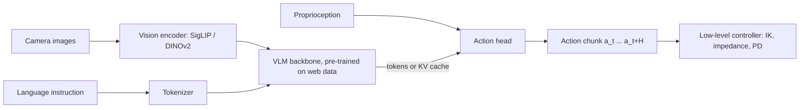
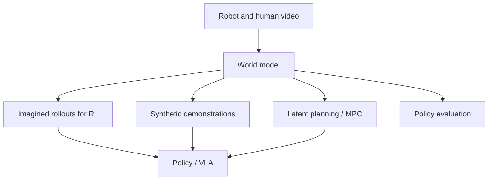

## Why this matters

[Imitation learning]({{ '/blog/2026/embodied-ai-04-imitation-learning/' | relative_url }}) gives a robot one skill
from a few dozen demonstrations. A **Vision-Language-Action model** (VLA) aims for a single policy that takes camera
images and a natural-language instruction and outputs robot actions for many tasks, scenes and even robot bodies.
The recipe borrows from large language and vision-language models: start from a model pre-trained on the internet,
then train it on large, heterogeneous robot datasets such as Open X-Embodiment. Since 2023 this has become the main
direction of robot learning in industry and academia. This post explains the main models, the design patterns that
distinguish them, how they are evaluated, and where world models fit in.

**Prerequisites**

- Posts 1 to 4, especially action chunking and diffusion/flow action heads (post 4).
- Transformers and vision-language models (ViT/SigLIP encoders, LLM decoders, tokenization).
- Flow matching or diffusion basics. The [world-models track]({{ '/blog/category/world-models/' | relative_url }})
  covers video world models and JEPA in depth.

## 1. From language-conditioned policies to VLAs

Early systems kept language and control separate. **SayCan** (Ahn et al. CoRL 2022) used an LLM to propose the next
skill from a fixed library and multiplied the LLM's score by a learned value function that estimated whether the skill
could succeed in the current state, which grounded the language model in what the robot could actually do. The skills
themselves were ordinary language-conditioned policies.

**RT-1** (Brohan et al. RSS 2023) was the first large "Robotics Transformer": a policy trained on about 130k
real-world episodes covering over 700 tasks, collected with a fleet of 13 mobile manipulators over 17 months. It
tokenizes images with a FiLM-conditioned EfficientNet (conditioned on the instruction embedding), compresses them with
TokenLearner, and outputs **discretized actions** (256 bins per dimension for arm, base and mode) with a transformer
at about 3 Hz. RT-1 showed that data scale and diversity, not clever algorithms, dominate generalization.

**PaLM-E** (Driess et al. ICML 2023) went the other way: inject continuous sensor observations (images, state
estimates) as tokens into a large language model and train it end-to-end for embodied reasoning and planning.
The largest version had 562B parameters and kept its general language abilities while learning robot planning tasks.

**RT-2** (Brohan et al. CoRL 2023) merged the two ideas and coined the term VLA. It fine-tunes large vision-language
models (PaLI-X and PaLM-E) to output robot actions **as text tokens**: each of the 7 action dimensions plus a
termination flag is discretized into 256 bins and written as a string of integers. Crucially, it is **co-fine-tuned**
on robot data and the original web vision-language data, so the model keeps its semantic knowledge. RT-2 could follow
instructions involving concepts never seen in robot data ("move the banana to the sum of two plus one", "pick up the
extinct animal") because that knowledge came from the web.

## 2. Open generalist policies

| Model | Year | Backbone | Action output | Data | Notes |
| --- | --- | --- | --- | --- | --- |
| Octo | 2024 | transformer trained from scratch (27M / 93M) | diffusion head, action chunks | 800k OXE trajectories | flexible observation and goal tokens, easy fine-tuning |
| OpenVLA | 2024 | Llama 2 7B + DINOv2 + SigLIP (Prismatic VLM) | 256-bin action tokens | 970k OXE episodes | open weights; beat RT-2-X (55B) by 16.5% absolute on 29 tasks |
| RDT-1B | 2024 | diffusion transformer, 1.2B | diffusion over a unified action space | multi-robot, bimanual focus | "physically interpretable unified action space" |
| pi0 | 2024 | PaliGemma 3B + 300M action expert | flow matching, chunks of 50 | large cross-embodiment mixture + OXE | dexterous long-horizon tasks (laundry folding) |
| pi0.5 | 2025 | pi0 lineage | discrete (FAST) + flow-matching expert | robot + web + high-level subtask data | cleans kitchens and bedrooms in unseen homes |
| GR00T N1 | 2025 | Eagle-2 VLM (System 2) + diffusion transformer (System 1) | flow matching at high rate | real + synthetic + human video "data pyramid" | open model for humanoids |
| Gemini Robotics | 2025 | Gemini 2.0 | low-latency action decoder | large ALOHA 2 bimanual dataset + web | plus Gemini Robotics-ER for embodied reasoning |
| SmolVLA | 2025 | small VLM (about 0.45B total) | flow-matching action expert | community LeRobot datasets | runs on consumer hardware |

Placed on a time line, the models of this post and the world-model work of section 5 show how quickly the field has moved since 2022:



### Octo

Octo (Octo Model Team, RSS 2024) is a transformer-based policy pre-trained on 800k trajectories from Open X-Embodiment.
Observations (several cameras, proprioception) and task specifications (language or goal images) are tokenized and
processed by a transformer with block-wise attention; readout tokens feed a small **diffusion head** that predicts an
action chunk. Its design goal is adaptability: new sensors or action spaces can be added during fine-tuning by adding
tokenizers and heads.

### OpenVLA

OpenVLA (Kim et al. CoRL 2024) is the open-source RT-2 analogue: a 7B Prismatic VLM (Llama 2 with fused DINOv2 and
SigLIP features) fine-tuned on 970k episodes to output 256-bin action tokens, which overwrite the 256 least-used tokens
of the Llama vocabulary. It showed that LoRA fine-tuning to new robots works on a single GPU and that the fused
DINOv2+SigLIP vision encoder helps spatial reasoning. **OpenVLA-OFT** (Kim et al. RSS 2025) later found that an
"optimized fine-tuning" recipe (parallel decoding of action chunks, continuous actions with an L1 loss) improves both
success rate and inference speed considerably.

### pi0 and pi0.5

**pi0** (Black et al., Physical Intelligence, RSS 2025) adds a separate **action expert** (about 300M parameters) to a
PaliGemma VLM. Images and language go through the VLM; the action expert processes proprioception and noisy action
tokens, attends to the VLM's tokens, and is trained with **flow matching** to output chunks of $H = 50$ continuous
actions, which enables high-frequency dexterous control (laundry folding, table bussing, box assembly). The two sets of
weights form a mixture-of-experts-like transformer: VLM tokens never attend to action tokens, so the VLM's knowledge
is protected.

**FAST** (Pertsch et al. RSS 2025) revisits discrete tokens: it compresses an action chunk with the **discrete cosine
transform**, quantizes the coefficients and applies byte-pair encoding. Smooth chunks become a few tokens, which makes
autoregressive VLAs trainable on high-frequency data and much faster to train than diffusion-style heads.

**pi0.5** (Physical Intelligence, CoRL 2025) targets **open-world generalization**: a mobile manipulator cleaning
kitchens and bedrooms in homes not seen during training. Its key ingredient is **co-training on heterogeneous data**:
data from many robots, web data (captioning, VQA, object detection), and high-level semantic labels. At inference the
model first predicts a high-level subtask in text ("pick up the plate") and then the low-level actions for it, in one
model. The authors report that performance in new homes rises with the number of distinct training environments.

### GR00T N1

NVIDIA's **GR00T N1** (2025) is an open foundation model for humanoids with a **dual-system** architecture inspired by
"thinking fast and slow": System 2, a vision-language module (Eagle-2 VLM), interprets the scene and instruction at
around 10 Hz, and System 1, a diffusion transformer trained with flow matching, generates motor actions at a high rate
(the paper reports 120 Hz). The two are trained jointly end to end. Training uses a **data pyramid**: web and human
video at the bottom, synthetic data from simulation and neural video generation in the middle, and real robot data at
the top. Human videos and generated videos have no action labels, so latent actions or inverse-dynamics pseudo-labels
are inferred for them.

### Gemini Robotics

Google DeepMind's **Gemini Robotics** (2025) builds a VLA on Gemini 2.0. A companion model, **Gemini Robotics-ER**
(embodied reasoning), extends Gemini's spatial understanding with pointing, object detection, 3D bounding boxes,
trajectory and grasp prediction. The VLA itself splits into a backbone in the cloud and a local action decoder to keep
latency low, and the report shows long-horizon dexterous tasks on ALOHA 2, fast adaptation to new short tasks from
around 100 demonstrations, and adaptation to new robot bodies. **Gemini Robotics 1.5** (technical report, 2025)
adds "thinking" before acting and transfers motions learned on one embodiment to others.

## 3. Design patterns



The two dominant ways to attach actions to a VLM, drawn side by side:

{% include blog_figure.liquid path="assets/img/blog/embodied-ai/05-vla-architectures.svg" localized="true" caption="(a) RT-2 and OpenVLA write each action dimension as one of 256 tokens and decode them autoregressively with the VLM itself; the token values shown are arbitrary examples. (b) pi0 keeps the VLM for images and language and adds a separate action expert that sees proprioception and a noisy action chunk, attends to the VLM's tokens, and predicts a flow-matching velocity that is integrated in about 10 Euler steps into a chunk of 50 continuous actions." %}

### Action representation

Two families dominate:

1. **Discrete action tokens** (RT-1, RT-2, OpenVLA, FAST). Each dimension $a^{(j)}\in[\ell_j, u_j]$ is mapped to a bin
   $b^{(j)} = \lfloor (a^{(j)}-\ell_j)/(u_j-\ell_j)\cdot 256\rfloor$, and the model is trained with the usual next-token cross-entropy.
   Pros: reuses the LLM machinery unchanged; categorical outputs are naturally multimodal. Cons: one token per
   dimension per step makes high-frequency chunks long and slow to decode, unless compressed (FAST).
2. **Continuous generative heads** (Octo, pi0, GR00T, RDT): a diffusion or flow-matching model predicts a whole
   chunk conditioned on backbone features. Pros: precise, smooth, fast for long chunks with a few integration steps.
   Cons: an extra network, and gradients from the action loss can disturb the pre-trained backbone (later work from
   Physical Intelligence on "knowledge insulation" stops those gradients and trains the backbone on discrete tokens instead).

Both rely on **action chunking** (post 4) and on careful **normalization** (per-dataset quantiles, e.g. mapping the 1st
and 99th percentiles to $\pm 1$), because robots and datasets differ in units and ranges.

The code below shows both: 256-bin tokenization with its quantization error, and DCT compression in the spirit of FAST.

```python
import numpy as np
from scipy.fft import dct, idct

# ---- RT-2 / OpenVLA style: 256 uniform bins per action dimension ----
def to_bins(a, low, high, n_bins=256):
    a = np.clip(a, low, high)
    return np.minimum(((a - low) / (high - low) * n_bins).astype(int), n_bins - 1)

def from_bins(b, low, high, n_bins=256):
    return low + (b + 0.5) * (high - low) / n_bins        # bin centers

# a smooth 7-D action chunk (xyz, rpy, gripper) at 50 Hz for 1 s
t = np.linspace(0, 1, 50)[:, None]
chunk = np.concatenate([0.05 * np.sin(2 * np.pi * t * [1, 0.5, 0.25]),
                        0.1 * np.cos(np.pi * t * [1, 2, 3]),
                        (t > 0.5).astype(float)], axis=1)  # [50, 7]
low, high = chunk.min(0) - 1e-3, chunk.max(0) + 1e-3     # per-dimension range (from the dataset)
tokens = to_bins(chunk, low, high)                        # [50, 7] integers -> 350 tokens
err = np.abs(from_bins(tokens, low, high) - chunk).max()
print(f"binning: {tokens.size} tokens, max error {err:.5f}")

# ---- FAST-style: DCT along time, quantize, keep the few non-zero coefficients ----
coef = dct(chunk, axis=0, norm="ortho")                   # [50, 7] frequency coefficients
for scale in [10.0, 50.0, 200.0]:
    q = np.round(coef * scale).astype(int)                # most high frequencies round to 0
    recon = idct(q / scale, axis=0, norm="ortho")
    print(f"DCT scale {scale:5.0f}: {np.count_nonzero(q):3d} non-zero of {q.size} coefficients, "
          f"mean error {np.abs(recon - chunk).mean():.4f}")
```

```text
binning: 350 tokens, max error 0.00096
DCT scale    10:  35 non-zero of 350 coefficients, mean error 0.0052
DCT scale    50:  42 non-zero of 350 coefficients, mean error 0.0016
DCT scale   200:  57 non-zero of 350 coefficients, mean error 0.0005
```

A one-second chunk at 50 Hz costs 350 tokens with per-step binning, but only a few dozen non-zero DCT coefficients,
because smooth motions concentrate their energy in low frequencies. FAST then run-length/BPE-encodes the sparse
integer matrix into a short token sequence; the scale is the knob between compression and precision.

The figures below show what these numbers mean for the chunk built in the code: first the 256-bin grid on one dimension, then where the DCT puts the chunk's energy.

{% include blog_figure.liquid path="assets/img/blog/embodied-ai/05-binning.svg" caption="Top: the 7-D chunk from the code (each dimension rescaled for display): smooth sinusoids for position and orientation and a step for the gripper. Bottom: a zoom on the $x$ dimension around its peak. With 256 bins over its range each bin is only 0.40 mm wide (grey lines), so the decoded bin centres (red) follow the continuous action closely: the maximum error over the whole chunk is 0.00096. The price is one token per dimension per step, 350 tokens for this one-second chunk." %}

{% include blog_figure.liquid path="assets/img/blog/embodied-ai/05-dct-fast.svg" caption="Top left: magnitude of the DCT coefficients of the same chunk (log scale; rows are temporal frequencies). The smooth dimensions concentrate their energy in the first few rows; the gripper step spreads it over many frequencies. Top middle and right: the coefficients that survive rounding at scale 10 (35 of 350) and 50 (42). Bottom: reconstruction from the 35 integers at scale 10. The smooth dimensions are almost exact, and the gripper shows small ringing around the step, which is why a larger scale is used when precision matters." %}

### A flow-matching action expert

The other family, in the style of pi0 and GR00T, learns a velocity field that transports Gaussian noise to the action
chunk, conditioned on the backbone's features $c$. With the linear path $A^t = (1-t)\,\epsilon + t\,A$, the target
velocity is constant, $\frac{d}{dt}A^t = A - \epsilon$, and the loss is

$$
\mathcal{L}(\theta) = \mathbb{E}_{t\sim p(t),\,\epsilon\sim\mathcal{N}(0,I),\,(A,c)\sim\mathcal{D}}\left[\left\lVert v_\theta(A^t, t, c) - (A - \epsilon)\right\rVert^2\right].
$$

Sampling integrates $dA/dt = v_\theta$ from $t = 0$ to $t = 1$, typically with about 10 Euler steps. (pi0 uses the same
idea with its own time convention and a Beta-shaped distribution $p(t)$ that emphasizes the noisier time steps.) In the
toy below, a random vector stands in for the VLM embedding of two instructions, "go left" and "go right":

```python
import math
import torch
import torch.nn as nn
import torch.nn.functional as F

torch.manual_seed(0)
H, A, C = 8, 2, 64           # chunk length, action dim, size of the "VLM" context embedding

class ActionExpert(nn.Module):
    """v_theta(A_t, t, c): predicts the flow velocity for a whole action chunk.
    pi0 uses a transformer "action expert" attending to the VLM's tokens; an MLP keeps this toy fast."""
    def __init__(self, hidden=256):
        super().__init__()
        self.net = nn.Sequential(nn.Linear(H * A + C + 32, hidden), nn.SiLU(),
                                 nn.Linear(hidden, hidden), nn.SiLU(),
                                 nn.Linear(hidden, hidden), nn.SiLU(),
                                 nn.Linear(hidden, H * A))
    def forward(self, a_t, t, c):
        freqs = torch.exp(torch.arange(16) * (-math.log(1000.0) / 16))
        emb = 1000 * t[:, None] * freqs[None]             # sinusoidal embedding of flow time
        x = torch.cat([a_t.flatten(1), c, emb.sin(), emb.cos()], -1)
        return self.net(x).view(-1, H, A)

def flow_matching_loss(model, actions, ctx):
    """Linear path from noise (t=0) to data (t=1); regress the constant velocity."""
    eps = torch.randn_like(actions)
    t = torch.rand(actions.shape[0])
    a_t = (1 - t)[:, None, None] * eps + t[:, None, None] * actions
    return F.mse_loss(model(a_t, t, ctx), actions - eps)

@torch.no_grad()
def sample(model, ctx, steps=10):
    a = torch.randn(ctx.shape[0], H, A)
    for i in range(steps):                                # forward Euler on da/dt = v
        t = torch.full((ctx.shape[0],), i / steps)
        a = a + model(a, t, ctx) / steps
    return a

# toy data: two instructions ("go left" / "go right") encoded as fixed context vectors
instr = torch.randn(2, C)
def batch(n):
    side = torch.randint(0, 2, (n,))
    tt = torch.linspace(0, 1, H)
    y = (side.float() * 2 - 1)[:, None] * torch.sin(math.pi * tt) * 0.5
    return torch.stack([tt.expand(n, H), y], -1), instr[side], side

model = ActionExpert()
opt = torch.optim.AdamW(model.parameters(), lr=1e-3)
for it in range(3000):
    act, ctx, _ = batch(128)
    loss = flow_matching_loss(model, act, ctx)
    opt.zero_grad(); loss.backward(); opt.step()
act, ctx, side = batch(512)
pred = sample(model, ctx)
ok = (torch.sign(pred[:, H // 2, 1]) == (side * 2 - 1)).float().mean()
print(f"final loss {loss.item():.4f}; follows the instruction in {ok:.1%} of samples; "
      f"chunk error {(pred - act).abs().mean():.3f}")
```

```text
final loss 0.0246; follows the instruction in 100.0% of samples; chunk error 0.018
```

Ten Euler steps of a small network turn noise into the right chunk for each instruction. In a real VLA the context is
the backbone's tokens (attended to by a transformer action expert), the chunk has 50 steps and 7 to 30+ dimensions, and
the instruction set is open-ended.

Recording the ten Euler steps shows the flow at work: noise chunks are transported, in straight lines on average, to the chunk that matches each instruction.

{% include blog_figure.liquid path="assets/img/blog/embodied-ai/05-flow-matching.svg" caption="Sampling from the toy action expert above, retrained with the same code and seed (final loss 0.0246, as printed). Each line is an 8-step chunk in the $x$-$y$ plane, coloured by the instruction it is conditioned on; with the post's convention, 'go left' bends to negative $y$. At $t = 0$ the chunks are Gaussian noise; after 3 and 6 of the 10 Euler steps they contract toward the data; at $t = 1$ all 40 chunks follow their instruction." %}

### Cross-embodiment training

Datasets differ in robots, cameras, control frequencies and action spaces. Common choices:

- **A shared action convention**, usually end-effector deltas plus gripper, normalized per dataset; or a padded
  "unified" action vector where each embodiment fills its own slots (RDT, pi0), plus an embodiment or dataset token.
- **Data mixtures with weights**: heavily used datasets are down-weighted, diverse ones up-weighted; pi0.5 shows that
  web and cross-robot data improve generalization in new environments even for a single target robot.
- **Human and synthetic data** without actions (GR00T's data pyramid): latent action models infer pseudo-actions from
  consecutive frames, so video can teach motion priors.

{% include blog_figure.liquid path="assets/img/blog/embodied-ai/05-cross-embodiment.svg" localized="true" caption="Top: a unified action vector (example layout, not any specific model's): each embodiment fills its own slots, and the unused tail is padding that is masked out of the loss. Bottom: two synthetic action datasets with different units and spreads before and after per-dataset quantile normalization (1st and 99th percentiles mapped to $\pm 1$). After normalization both use the same numeric range, so neither dominates the loss." %}

### Hierarchy and reasoning

Long tasks need planning. Options range from an external LLM/VLM planner calling a VLA (SayCan style), to a single
model that predicts subtasks before actions (pi0.5), to dual-system designs with a slow reasoner and a fast actor
(GR00T N1, Figure's Helix as described in its public announcement), and "embodied chain-of-thought" that reasons in text
or with pointing and boxes before acting (Gemini Robotics-ER and 1.5).

## 4. Scaling and evaluation

Evaluating VLAs is hard: each real rollout costs minutes of human time, success depends on the scene setup, and
variance across seeds and evaluators is large. Practices that have emerged:

- **Generalization axes**: visual (new backgrounds, lighting, distractors), semantic (new objects, new instructions),
  behavioural (new positions, new motions), and embodiment (new robots). RT-2 and OpenVLA report results along these axes.
- **Standardized simulated proxies**: LIBERO for fine-tuning comparisons, SimplerEnv (post 3) for policies trained on
  real Google-robot and WidowX data, with explicit measurement of sim-real correlation.
- **Blind A/B evaluations** across institutions and pairwise comparisons, which reduce evaluator bias.
- **Scaling studies**: pi0.5's environment-count scaling, OXE's cross-embodiment gains, and GR00T's mixtures suggest
  that diversity of scenes and embodiments matters at least as much as raw episode count. Unlike language models, we do
  not yet have clean power laws for robot success rate.

Deployment concerns are very practical: inference latency (a 7B model at a few Hz needs chunking and asynchronous
execution), on-robot compute, safety constraints in the low-level controller, and failure detection.

## 5. World models for robot learning

A **world model** predicts how observations evolve given actions. The world-models track discusses them in depth;
here are the main ways they meet robotics:

1. **Learned simulators for RL.** Dreamer-style agents learn a latent dynamics model and train the policy in
   imagination. **DayDreamer** (Wu et al. CoRL 2022) trained a quadruped to walk from scratch in about an hour of
   real-world interaction, and DreamerV3 (Hafner et al., Nature 2025) generalized the recipe across domains.
2. **Video prediction as planning.** **UniPi** (Du et al. NeurIPS 2023) generates a video of the task being done from
   a text instruction, then extracts actions with an inverse dynamics model. **GR-1** (Wu et al. ICLR 2024) pre-trains a
   GPT-style model on large-scale video prediction and fine-tunes it to predict actions and future frames jointly.
3. **Interactive simulators from video.** **UniSim** (Yang et al. ICLR 2024) learns an action-conditioned video
   simulator from diverse data and uses it to train policies and planners; **Genie** (Bruce et al. ICML 2024) learns
   latent actions from unlabeled video so the resulting world can be controlled. NVIDIA's **Cosmos** world foundation
   models (2025) are designed to be post-trained into robot- and driving-specific simulators and synthetic data
   generators (GR00T's "neural trajectories" are one use).
4. **Latent planning.** **V-JEPA 2** (Assran et al., 2025) pre-trains a video encoder with a joint-embedding predictive
   objective on over a million hours of internet video, then trains an action-conditioned predictor (V-JEPA 2-AC) on
   about 62 hours of unlabeled robot video from DROID. Planning with goal images in the learned latent space enabled
   zero-shot pick-and-place on Franka arms in two labs, with no task-specific data or rewards.
5. **Policy evaluation.** Because real evaluation is expensive, an action-conditioned world model can serve as a
   learned evaluator that ranks policies before they reach the robot, provided it is validated against real outcomes.



The open question is whether one model can be both: a VLA that predicts actions and a world model that predicts their
consequences, trained jointly so each improves the other. Several 2025 systems already train action and future-frame
prediction together.

## 6. Open problems

- **Data**: robot data is still orders of magnitude smaller than text or video; human video, simulation and XR
  teleoperation (post 6) are the main levers.
- **Precision and contact**: VLAs are good at semantics and coarse motion, weaker at millimetre-precise, force-sensitive
  manipulation; tactile sensing and force-aware action spaces are active areas.
- **Memory and long horizons**: most VLAs see only the last frame or two.
- **Reliability**: 80% success is impressive in a paper and unacceptable in a home; learning from deployment
  (RL fine-tuning, interventions) is the next frontier.
- **Evaluation** that is reproducible across labs.

## Try it

The home-page **[Lab]({{ '/' | relative_url }}#lab)** has a "Gaussian World" demo: describe a world and an editable
open world of about 200,000 3D Gaussians is built (a keyword-driven procedural generator stands in for a learned model)
and stays live: relit, sculptable, walkable. It is a tiny analogue of the generative world models above. Combined with the XPBD physics demo,
it hints at the long-term picture: generative 3D worlds with physics, in which VLAs are trained and evaluated.

## Representative papers

| Paper | Venue | Year | Link | Why it matters |
| --- | --- | --- | --- | --- |
| Ahn et al., *Do as I can, not as I say: grounding language in robotic affordances* (SayCan) | CoRL | 2022 | [arXiv](https://arxiv.org/abs/2204.01691) | LLM planning grounded by value functions |
| Reed et al., *A generalist agent* (Gato) | TMLR | 2022 | [arXiv](https://arxiv.org/abs/2205.06175) | One transformer for games, captions and a robot arm |
| Wu et al., *DayDreamer: world models for physical robot learning* | CoRL | 2022 | [arXiv](https://arxiv.org/abs/2206.14176) | World-model RL on real robots |
| Brohan et al., *RT-1: Robotics Transformer for real-world control at scale* | RSS | 2023 | [arXiv](https://arxiv.org/abs/2212.06817) | Large-scale real-world robot transformer |
| Jiang et al., *VIMA: robot manipulation with multimodal prompts* | ICML | 2023 | [arXiv](https://arxiv.org/abs/2210.03094) | Multimodal task prompts |
| Driess et al., *PaLM-E: an embodied multimodal language model* | ICML | 2023 | [arXiv](https://arxiv.org/abs/2303.03378) | Sensor tokens in an LLM |
| Brohan et al., *RT-2: vision-language-action models transfer web knowledge to robotic control* | CoRL | 2023 | [arXiv](https://arxiv.org/abs/2307.15818) | The first VLA, actions as text tokens |
| Du et al., *Learning universal policies via text-guided video generation* (UniPi) | NeurIPS | 2023 | [arXiv](https://arxiv.org/abs/2302.00111) | Video generation as planning |
| Bousmalis et al., *RoboCat: a self-improving generalist agent for robotic manipulation* | TMLR | 2023 | [arXiv](https://arxiv.org/abs/2306.11706) | Self-improvement across embodiments |
| Yang et al., *Learning interactive real-world simulators* (UniSim) | ICLR | 2024 | [arXiv](https://arxiv.org/abs/2310.06114) | Action-conditioned video simulator |
| Wu et al., *Unleashing large-scale video generative pre-training for visual robot manipulation* (GR-1) | ICLR | 2024 | [arXiv](https://arxiv.org/abs/2312.13139) | Video pre-training for policies |
| Bruce et al., *Genie: generative interactive environments* | ICML | 2024 | [arXiv](https://arxiv.org/abs/2402.15391) | Latent actions from unlabeled video |
| Octo Model Team, *Octo: an open-source generalist robot policy* | RSS | 2024 | [arXiv](https://arxiv.org/abs/2405.12213) | Open generalist policy with diffusion head |
| Kim et al., *OpenVLA: an open-source vision-language-action model* | CoRL | 2024 | [arXiv](https://arxiv.org/abs/2406.09246) | Open 7B VLA |
| Liu et al., *RDT-1B: a diffusion foundation model for bimanual manipulation* | ICLR | 2025 | [arXiv](https://arxiv.org/abs/2410.07864) | Diffusion transformer VLA |
| Black et al., *pi0: a vision-language-action flow model for general robot control* | RSS | 2025 | [arXiv](https://arxiv.org/abs/2410.24164) | Flow-matching action expert |
| Pertsch et al., *FAST: efficient action tokenization for vision-language-action models* | RSS | 2025 | [arXiv](https://arxiv.org/abs/2501.09747) | DCT + BPE action tokens |
| NVIDIA, *Cosmos world foundation model platform for physical AI* | arXiv | 2025 | [arXiv](https://arxiv.org/abs/2501.03575) | World foundation models for robotics |
| Kim et al., *Fine-tuning vision-language-action models: optimizing speed and success* (OpenVLA-OFT) | RSS | 2025 | [arXiv](https://arxiv.org/abs/2502.19645) | Better VLA fine-tuning recipe |
| NVIDIA, *GR00T N1: an open foundation model for generalist humanoid robots* | arXiv | 2025 | [arXiv](https://arxiv.org/abs/2503.14734) | Dual-system humanoid VLA |
| Gemini Robotics Team, *Gemini Robotics: bringing AI into the physical world* | arXiv | 2025 | [arXiv](https://arxiv.org/abs/2503.20020) | VLA and embodied reasoning on Gemini 2.0 |
| Physical Intelligence, *pi0.5: a vision-language-action model with open-world generalization* | CoRL | 2025 | [arXiv](https://arxiv.org/abs/2504.16054) | Co-training for unseen homes |
| Shukor et al., *SmolVLA: a vision-language-action model for affordable and efficient robotics* | arXiv | 2025 | [arXiv](https://arxiv.org/abs/2506.01844) | Small open VLA |
| Assran et al., *V-JEPA 2: self-supervised video models enable understanding, prediction and planning* | arXiv | 2025 | [arXiv](https://arxiv.org/abs/2506.09985) | Latent world model for zero-shot planning |
| Gemini Robotics Team, *Gemini Robotics 1.5* | arXiv | 2025 | [arXiv](https://arxiv.org/abs/2510.03342) | Thinking VLA, motion transfer |

## Learning resources

- [OpenVLA code](https://github.com/openvla/openvla) and [openpi](https://github.com/Physical-Intelligence/openpi)
  (open pi0 / pi0.5 weights and fine-tuning code).
- [LeRobot](https://github.com/huggingface/lerobot): pi0, SmolVLA, ACT and Diffusion Policy in one library.
- [Octo](https://github.com/octo-models/octo) and [Isaac GR00T](https://github.com/NVIDIA/Isaac-GR00T).
- [Open X-Embodiment](https://robotics-transformer-x.github.io) datasets in RLDS format.
- Surveys and courses: Stanford CS 224R (deep RL and robot learning), CMU 16-831, and the robotics chapters of
  Tedrake's [*Robotic Manipulation*](https://manipulation.csail.mit.edu).

## Exercises

1. Compute how many tokens RT-2-style binning needs for a 2-second chunk at 50 Hz with 14 dimensions (a bimanual
   robot), and compare with FAST at the three scales above.
2. Change the flow-matching toy so the context contains noise (the two instructions are only partially separable).
   How does the instruction-following rate change? Then sample with 1, 2, 5 and 10 Euler steps.
3. Replace the MLP action expert with a small transformer that attends to a sequence of 16 "VLM tokens" instead of a
   single vector. What changes in training speed and accuracy?
4. Read the OpenVLA and pi0 papers and draw both architectures in the same diagram style as the Mermaid figure above.
   Mark which weights are pre-trained, which are trained from scratch, and where gradients flow.
5. Design an evaluation protocol for a VLA in your lab: list the generalization axes, the number of trials per
   condition, and how you would estimate confidence intervals for success rates.

**Next:** [Embodied AI meets XR and HCI]({{ '/blog/2026/embodied-ai-06-embodied-ai-meets-xr-and-hci/' | relative_url }}),
where humans, headsets and robots meet.
