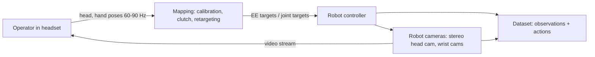
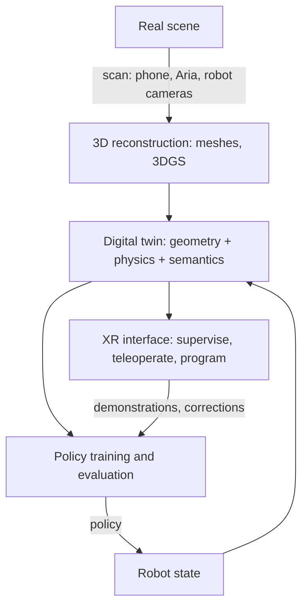

## Why this matters

Every post in this series has quietly depended on people. Demonstrations for imitation learning come from human
teleoperators; VLAs are pre-trained on human-made web data and fine-tuned on human-collected robot data; world models
learn from videos that people recorded; and the end goal is robots that work with and for people. Extended reality (XR:
VR, AR and mixed reality) and human-computer interaction (HCI) are the disciplines that study exactly these interfaces
between humans and machines. After [VLA models]({{ '/blog/2026/embodied-ai-05-vision-language-action-models/' | relative_url }}),
this final post looks at the human side of embodied AI in four roles: the human as a **source of motion data**, as a
**teleoperator**, as a **collaborator**, and as a **user of interfaces** such as digital twins. It ends with research
opportunities at the intersection of embodied AI, world models, AR/VR, HCI and graphics.

**Prerequisites**

- Posts 1 (SE(3) transforms, IK), 4 (imitation learning and data collection) and 5 (VLAs, world models).
- Basic familiarity with VR/AR headsets (6-DoF tracking, hand tracking, passthrough).
- Graphics background helps for the sections on body models, rendering and digital twins.

## 1. Capturing human motion

### Sensors

| Technology | Examples | What it measures | Trade-offs |
| --- | --- | --- | --- |
| Optical marker mocap | Vicon, OptiTrack | 3-D marker positions, sub-millimetre | studio only, occlusions, markers on the body |
| Inertial suits | Xsens-style IMU suits | segment orientations | portable, drift in global position |
| Markerless vision | multi-view or monocular pose estimation | body and hand keypoints, mesh fits | cheap, less accurate, struggles with occlusion |
| XR headsets | Quest, Vision Pro, Project Aria | head 6-DoF, hands (26 or so joints), eye gaze | egocentric, real time, limited body tracking |
| Gloves and wearables | data gloves, tactile gloves, EMG bands | finger angles, contact pressure, muscle activity | richest hand data, intrusive |

### Parametric body and hand models

Raw keypoints are noisy and incomplete, so graphics-style **parametric models** are fitted to them. **SMPL**
(Loper et al. SIGGRAPH Asia 2015) represents a body mesh with shape parameters $\beta$ and pose parameters $\theta$
(axis-angle rotations of 24 joints):

$$
M(\beta, \theta) = W\big(T_P(\beta, \theta),\, J(\beta),\, \theta,\, \mathcal{W}\big), \qquad
T_P(\beta, \theta) = \bar T + B_S(\beta) + B_P(\theta),
$$

where $\bar T$ is a template mesh, $B_S$ and $B_P$ are learned linear shape and pose-corrective blend shapes, $J(\beta)$
regresses joint locations, and $W$ is **linear blend skinning** with weights $\mathcal{W}$: each vertex is transformed by a
weighted sum of the joints' rigid transforms $G_k(\theta, J) \in SE(3)$,

$$
v_i' = \sum_{k} w_{ik}\, G_k(\theta, J)\, v_i .
$$

The $G_k$ are exactly the forward-kinematics chain of post 1: a human body model is a kinematic tree with a skin.
**MANO** (Romero et al. SIGGRAPH Asia 2017) does the same for hands, and SMPL-X combines body, hands and face.
**AMASS** (Mahmood et al. ICCV 2019) unified many mocap datasets into SMPL parameters; it is the standard source of human
motion for training humanoid controllers.

Linear blend skinning is easy to see on a 2-D strip with two bones:

{% include blog_figure.liquid path="assets/img/blog/embodied-ai/06-lbs.svg" caption="Linear blend skinning computed for a strip of vertices with two bones. Left: rest pose, coloured by the weight $w_{i2}$ of the second bone (blue 0, red 1), which ramps smoothly across the joint. Middle: bending the joint by 100° with each vertex attached rigidly to its nearest bone tears the surface open on the outside and makes it overlap on the inside. Right: blending the two rigid transforms with the weights gives a continuous surface, but the inside of the elbow collapses, the 2-D cousin of the candy-wrapper artefact that SMPL's pose-corrective blend shapes compensate." %}

### Retargeting human motion to robots

Human and robot bodies differ in link lengths, joint limits and degrees of freedom, so motion has to be **retargeted**.
The usual formulation is an optimization per frame:

$$
q^{\ast}_t = \arg\min_{q} \sum_{k} \left\lVert s\, p^{\text{human}}_k - p^{\text{robot}}_k(q) \right\rVert^2
+ \lambda_1 \lVert q - q^{\ast}_{t-1}\rVert^2 \quad \text{s.t. } q_{\min} \le q \le q_{\max},
$$

matching selected keypoints (wrists, elbows, fingertips) with a scale $s$ while staying smooth and within joint limits.
It is solved with the damped least-squares IK of post 1 or a small QP. For dexterous hands, matching fingertip
**relative vectors** (thumb-to-index distance) matters more than absolute positions, because pinch grasps depend on it.
Whole-body retargeting for humanoids adds balance: H2O and OmniH2O (He et al. 2024) retarget AMASS motions to a humanoid,
filter infeasible ones, and train an RL tracking policy in simulation; **HumanPlus** (Fu et al. CoRL 2024) trained such a
"shadowing" policy on about 40 hours of human motion data and then let a humanoid copy a person's body and hand motion
in real time from a single RGB camera, using the shadowing data for imitation learning.

Two small experiments show both halves of this paragraph: keypoint retargeting of an arm, and why relative fingertip vectors matter for a pinch.

{% include blog_figure.liquid path="assets/img/blog/embodied-ai/06-retargeting.svg" caption="Retargeting a synthetic human arm motion (upper arm 0.30 m, forearm 0.25 m, hand 0.15 m, 2 mm tracking noise) to the planar 3-link arm of post 1 with the objective above ($s = 2.3/0.70$, $\lambda_1 = 0.3$, Gauss-Newton per frame). Dashed lines and rings: the scaled human at four frames; solid: the robot. Matching only the hand (left) reproduces the hand path but lets the robot's elbow wander up to 0.2 units from the human's around frame 60; matching elbow, wrist and hand (right) keeps the whole pose similar at the price of a slightly larger hand error (bottom)." %}

{% include blog_figure.liquid path="assets/img/blog/embodied-ai/06-hand-retargeting.svg" caption="Fingertip retargeting for a pinch, solved with bounded least squares (joint limits 0 to 1.6 rad). Left: a planar human index finger (purple) and thumb (orange) whose tips touch. Middle: a robot gripper with a wider palm and different finger lengths, fitted to the scaled human keypoints (fingertips plus middle joints); the crosses are the scaled human fingertips. The compromise leaves the tips 32 mm apart, so the grasp fails. Right: weighting the tip-to-tip vector instead closes the pinch to 1 mm, although the finger shapes differ more from the human's." %}

## 2. Egocentric data: learning from how people see and act

Humans perform manipulation tasks billions of times a day, and egocentric (first-person) video captures them from a
viewpoint close to a robot's head or wrist camera.

- **Ego4D** (Grauman et al. CVPR 2022): 3,670 hours of daily-life video from 931 camera wearers in 74 locations across 9
  countries, with benchmarks for episodic memory, hand-object interaction and forecasting.
- **Ego-Exo4D** (CVPR 2024): synchronized egocentric and exocentric views of skilled activities, with 3D body and hand poses.
- **Project Aria** (Meta, 2023): research glasses with an RGB camera, two SLAM cameras, two eye-tracking cameras, IMUs,
  a seven-microphone array and more, plus machine-perception services (SLAM trajectories, eye gaze, hand tracking).
  **Aria Digital Twin** (ICCV 2023) pairs Aria recordings with a full digital reconstruction of the scene and objects,
  giving ground-truth 3D for every frame.
- **EgoDex** (Apple, ICLR 2026): 829 hours of egocentric video recorded with Apple Vision Pro, with paired 3D hand and
  finger tracking for 194 tabletop manipulation tasks.

How robots use it:

1. **Visual representations.** R3M (Nair et al. CoRL 2022) pre-trained a visual encoder on Ego4D with time-contrastive
   and video-language objectives and improved data efficiency of downstream robot imitation.
2. **Plans and priors from human play.** MimicPlay (Wang et al. CoRL 2023) learns a high-level latent plan from cheap
   human play videos and a low-level controller from a small amount of teleoperation.
3. **Human data as robot data.** EgoMimic (Kareer et al. ICRA 2025) records humans wearing Aria glasses and treats human
   hand trajectories as another embodiment, co-training with robot data; DexCap (Wang et al. RSS 2024) uses a portable
   mocap glove plus a chest camera to collect dexterous hand data that is retargeted to robot hands.
4. **Latent actions from video**, as in Genie and GR00T's data pyramid (post 5), turn action-free video into training signal.

The **embodiment gap** remains the central challenge: human hands are not grippers, and human videos show the human,
not the robot. Masking or inpainting the hand, retargeting to robot kinematics, and matching camera viewpoints (head
camera ≈ robot head camera, wrist camera ≈ UMI) are the main tricks.

The viewpoint argument is geometric. Projecting the same tabletop into a head-mounted and a wrist-mounted pinhole camera shows how different the two observations are:

{% include blog_figure.liquid path="assets/img/blog/embodied-ai/06-egocentric.svg" localized="true" caption="Top: a table with three objects, a head camera at 1.55 m looking down at the workspace, and a wrist camera 20 cm above the objects (frusta drawn to scale, z up). Bottom: the images each camera sees, computed with the same pinhole model (focal length 300 px, 640 x 480). The head view shows the whole scene small and in context, like Ego4D or Aria footage; the wrist view shows a few objects large and close, like UMI or a robot wrist camera. A policy trained on one view does not see the other, which is why matching camera placement between human and robot data matters." %}

## 3. VR and AR teleoperation for data collection

Since robot learning is bottlenecked by demonstrations, the teleoperation interface determines both data quantity and
quality. XR headsets are attractive because they already track the head and hands at high rates, are cheap, and show
stereo video.



Representative systems:

- **VR teleoperation for deep imitation** (Zhang et al. ICRA 2018) showed early that consumer VR can collect demonstrations
  for visuomotor policies.
- **Holo-Dex** (Arunachalam et al. ICRA 2023) and **AnyTeleop** (Qin et al. RSS 2023) map tracked human hands to
  multi-fingered robot hands, with AnyTeleop supporting many arms and hands from a vision-based hand tracker.
- **Open-TeleVision** (Cheng et al. CoRL 2024) streams **stereoscopic** video from a head-mounted camera that actively
  follows the operator's head, giving immersive first-person perception; on Unitree H1 and Fourier GR1 humanoids, stereo
  streaming improved success and completion time, and the active camera made control faster and smoother.
- **Bunny-VisionPro** (Ding et al. IROS 2025) adds haptic feedback and collision avoidance for bimanual dexterous
  teleoperation with Apple Vision Pro.
- **GELLO** (Wu et al. IROS 2024) is the low-cost alternative: 3D-printed kinematic replicas of the robot arm, showing that
  joint-space leader-follower devices are often more precise than free-space hand tracking.

### Engineering the mapping

The core of any XR teleoperation system is a chain of SE(3) transforms (post 1) plus some HCI. A typical design:

- **Calibration** $T_{\text{robot},\text{headset}}$ between the headset's tracking frame and the robot base (from a marker, a
  shared anchor, or manually aligning a virtual robot with the real one in passthrough).
- **Clutching** (relative mapping): when the operator holds a button, the current hand and end-effector poses are stored,
  and subsequent hand motion is applied relative to them. The operator can release, move the hand back to a comfortable
  spot and re-engage, as with lifting a mouse.
- **Motion scaling** for precision (e.g. 2:1) and **filtering** of tracking jitter. The **1€ filter** (Casiez, Roussel and
  Vogel, CHI 2012), a classic from HCI, is a first-order low-pass filter whose cutoff rises with speed, so it removes
  jitter when the hand is still and lag when it moves fast.

```python
import numpy as np

class OneEuroFilter:
    """1 Euro filter (Casiez, Roussel, Vogel, CHI 2012): a speed-adaptive low-pass filter.
    Slow motion -> low cutoff (removes jitter); fast motion -> high cutoff (removes lag)."""
    def __init__(self, freq, min_cutoff=1.0, beta=0.05, d_cutoff=1.0):
        self.freq, self.min_cutoff, self.beta, self.d_cutoff = freq, min_cutoff, beta, d_cutoff
        self.x_prev, self.dx_prev = None, None

    def _alpha(self, cutoff):
        tau = 1.0 / (2 * np.pi * cutoff)
        return 1.0 / (1.0 + tau * self.freq)

    def __call__(self, x):
        if self.x_prev is None:
            self.x_prev, self.dx_prev = x, np.zeros_like(x)
            return x
        dx = (x - self.x_prev) * self.freq
        a_d = self._alpha(self.d_cutoff)
        dx_hat = a_d * dx + (1 - a_d) * self.dx_prev               # filtered speed
        cutoff = self.min_cutoff + self.beta * np.linalg.norm(dx_hat)
        a = self._alpha(cutoff)
        x_hat = a * x + (1 - a) * self.x_prev
        self.x_prev, self.dx_prev = x_hat, dx_hat
        return x_hat

def pose(R=np.eye(3), p=np.zeros(3)):
    T = np.eye(4); T[:3, :3] = R; T[:3, 3] = p
    return T

def rot_z(a):
    c, s = np.cos(a), np.sin(a)
    return np.array([[c, -s, 0], [s, c, 0], [0, 0, 1]])

class ClutchTeleop:
    """Relative (clutched) mapping from a VR hand/controller pose to a robot end-effector target.
    T_robot_headset is a calibration transform (headset tracking frame -> robot base frame)."""
    def __init__(self, T_robot_headset, scale=1.0):
        self.T_rh, self.scale = T_robot_headset, scale
        self.anchor_hand = self.anchor_ee = None

    def engage(self, T_h_hand, T_r_ee):             # clutch pressed: remember both poses
        self.anchor_hand = self.T_rh @ T_h_hand      # hand pose expressed in the robot frame
        self.anchor_ee = T_r_ee.copy()

    def target(self, T_h_hand):
        T_r_hand = self.T_rh @ T_h_hand
        dp = (T_r_hand[:3, 3] - self.anchor_hand[:3, 3]) * self.scale   # scaled translation
        dR = T_r_hand[:3, :3] @ self.anchor_hand[:3, :3].T              # rotation since engage
        return pose(dR @ self.anchor_ee[:3, :3], self.anchor_ee[:3, 3] + dp)

if __name__ == "__main__":
    rng = np.random.default_rng(0)
    freq = 90.0                                          # headset tracking rate (Hz)
    t = np.arange(0, 3, 1 / freq)
    # the operator moves the hand 20 cm along x in the headset frame, with 3 mm tracking jitter
    true = np.stack([0.2 * np.clip(t - 1, 0, 1), 0 * t, 0 * t], 1) + np.array([0.3, 1.2, -0.4])
    noisy = true + rng.normal(0, 0.003, true.shape)

    T_rh = pose(rot_z(np.pi / 2), np.array([0.5, 0.0, -0.8]))   # headset frame -> robot base
    teleop = ClutchTeleop(T_rh, scale=0.5)              # 2:1 motion scaling for precision
    ee0 = pose(p=np.array([0.4, 0.0, 0.3]))
    teleop.engage(pose(p=noisy[0]), ee0)
    f = OneEuroFilter(freq, min_cutoff=1.0, beta=5.0)
    raw = np.array([teleop.target(pose(p=x))[:3, 3] for x in noisy])
    filt = np.array([teleop.target(pose(p=f(x)))[:3, 3] for x in noisy])
    still = t < 1.0                                      # hand at rest
    print("jitter at rest  raw %.2f mm, filtered %.2f mm" %
          (1e3 * raw[still].std(0).max(), 1e3 * filt[still].std(0).max()))
    moving = (t > 1.0) & (t < 2.0)
    print("max |filtered - raw| while moving: %.1f mm" % (1e3 * np.abs(filt[moving] - raw[moving]).max()))
    print("final target", np.round(filt[-1], 3), "(expected [0.4, 0.1, 0.3])")
```

```text
jitter at rest  raw 1.61 mm, filtered 0.42 mm
max |filtered - raw| while moving: 6.9 mm
final target [0.4   0.099 0.299] (expected [0.4, 0.1, 0.3])
```

The 3 mm tracking noise becomes 1.6 mm after 2:1 scaling and about 0.4 mm after the 1€ filter, while the 20 cm hand
motion along the headset's $x$ axis correctly becomes 10 cm along the robot's $y$ axis (the calibration rotates by 90°).
The deviation while moving (about 7 mm, including the noise the raw signal still carries) is the lag the filter
trades for smoothness; `beta` sets that trade-off, and tuning it with real users is an HCI experiment in itself.
The resulting target poses go to the IK or impedance controller of post 1.

Both effects, the frame change and the filtering, are easier to judge in pictures of the same run:



{% include blog_figure.liquid path="assets/img/blog/embodied-ai/06-one-euro.svg" caption="The same run plotted over time. Top: the end-effector target along $y_r$ from the raw (grey) and 1€-filtered (purple) hand positions; the inset zooms into the first second, where the filter cuts the jitter from 1.61 mm to 0.42 mm. During the motion (shaded) the filtered target trails the raw one by up to 6.9 mm. Bottom: the filter's cutoff frequency, which rises from about 1 Hz at rest to about 5 Hz while the hand moves; this speed-dependent cutoff is the whole idea of the 1€ filter." %}

### Human factors

XR teleoperation is a human-factors problem as much as a robotics one:

- **Latency.** Motion-to-photon latency in the headset and command latency to the robot add up; above roughly 100 ms
  operators slow down and overshoot, and mismatched head motion and video cause discomfort. Predictive display and
  local reprojection of the robot's video (as in VR timewarp) help.
- **Embodiment and presence.** Seeing the robot's hands where one's own hands are (first-person, stereo, correct scale)
  makes teleoperation intuitive; mismatched scale or viewpoint breaks it.
- **Haptics.** Most XR teleoperation is purely visual. Vibration cues, force feedback from leader arms, or visual force
  overlays reduce excessive grasp forces.
- **Workload and data quality.** NASA-TLX workload, task time and success rate are standard HCI measures; for learning,
  demonstration consistency and smoothness matter too, because they affect the policy (post 4).
- **Rendering budget.** High-resolution stereo streams are expensive. Eye-tracked **foveated rendering**, shading at full
  resolution only where the user looks, is one way to cut the cost of photoreal digital twins in the headset.

## 4. Human-robot interaction

Once robots work near people, interaction quality matters as much as task success:

- **Legibility and predictability.** Dragan, Lee and Srinivasa (HRI 2013) distinguished *predictable* motion (what an
  observer expects given the goal) from *legible* motion (which lets an observer infer the goal quickly), and showed how to
  optimize trajectories for legibility. Exaggerating motion toward the intended object makes intent readable.
- **Shared autonomy.** The robot infers the user's goal from partial input (a joystick, gaze, EEG) and assists, blending
  user commands with autonomous actions. Gaze from XR headsets is a strong intent signal.
- **Communicating intent.** AR can show the planned trajectory, the object the robot will grasp, or a safety zone, which
  is often clearer than robot motion or lights alone.
- **Safety and trust.** Collaborative robots limit power and force (ISO/TS 15066 gives body-region limits); learned
  policies need runtime monitors and safe fallback controllers. Calibrated trust, neither over- nor under-reliance, is a
  core HCI concern.
- **Language interaction.** VLAs make language the default interface, which raises classic HCI questions: ambiguity,
  clarification dialogues, and explaining failures.

## 5. Digital twins and mixed-reality interfaces

A **digital twin** is a synchronized virtual copy of the robot and its environment. It connects all of the tracks of
this blog: geometry from 3D reconstruction (neural rendering), physics from simulators (post 3), predictions from world
models (post 5), and display in XR.

- **Real-to-sim-to-real.** RialTo (Torne et al. RSS 2024) builds a simulation of a real scene from a phone scan with a
  GUI, fine-tunes imitation policies with RL in that "digital twin", and transfers them back, improving robustness.
- **Gaussian-splatting twins.** SplatSim, RoboGSim and Real-is-Sim (2024 to 2025 preprints) render robots and objects inside
  3D Gaussian Splatting reconstructions for photoreal training and evaluation, narrowing the visual sim-to-real gap.
- **Mixed-reality robot interfaces.** The VAM-HRI survey of Walker et al. (ACM THRI 2023) organizes how virtual, augmented
  and mixed reality are used in HRI, from showing robot intent to programming by demonstration in AR and remote
  supervision through a twin.
- **Egocentric digital twins.** Aria Digital Twin shows the same idea for humans: a full 3D model of a space plus tracked
  people and objects, the kind of ground truth that world models and assistive robots both need.



## 6. Research opportunities

This intersection is young and wide open. Directions that combine embodied AI, world models, AR/VR, HCI and graphics:

1. **XR-native data engines.** Teleoperation interfaces designed with HCI methods for throughput and data quality, with
   real-time feedback on demonstration consistency, automatic segmentation and language annotation, and active requests
   for the demonstrations a policy needs most.
2. **Egocentric world models.** Action-conditioned world models trained on head-mounted video (Aria, Vision Pro) that
   predict how the world responds to a person's hands, usable both for AR assistance ("what happens if I pull this?") and
   for robot planning.
3. **Closing the embodiment gap.** Retargeting and representation learning that map human egocentric demonstrations to
   robot actions, including hand-object contact and force, with graphics-based hand-object reconstruction as supervision.
4. **Mixed-reality supervision of VLAs.** Showing what a VLA "intends" (predicted chunks, attention, subgoals) in AR, letting
   people correct it in place, and using those corrections for online learning.
5. **Photoreal, physical digital twins.** Fusing Gaussian splatting with simulation and generative world models, rendered
   efficiently (e.g. foveated) in headsets, for training, evaluation and remote operation.
6. **Haptics and multisensory feedback** for dexterous teleoperation and for tactile datasets.
7. **Human-centred evaluation.** Benchmarks that measure not only success rate but legibility, workload, trust and
   comfort when people share space with learned robots.
8. **Characters and robots.** Physics-based character animation (DeepMimic, adversarial motion priors) and humanoid
   control now share methods and data; avatars in VR and humanoids in the real world can be driven by the same motion models.

As a map, the eight directions above all start from embodied AI and differ in which other fields they pull in:



## Try it

The home-page **[Lab]({{ '/' | relative_url }}#lab)** has a **Foveated Rendering** demo: your cursor is the simulated gaze,
the scene is ray-marched at full resolution only around it and at 1/2 and 1/4 resolution further out, as in eye-tracked
headsets such as Apple Vision Pro and Meta Quest Pro. Imagine streaming a robot's stereo cameras or a digital twin to an
operator this way. The **Gaussian World** tab shows the 3DGS representation that photoreal digital twins are built from,
and the **Cloth · XPBD** tab the kind of physics they need.

## Representative papers

| Paper | Venue | Year | Link | Why it matters |
| --- | --- | --- | --- | --- |
| Casiez, Roussel, Vogel, *1€ filter: a simple speed-based low-pass filter for noisy input in interactive systems* | CHI | 2012 | - | Standard jitter filter for tracking input |
| Dragan, Lee, Srinivasa, *Legibility and predictability of robot motion* | HRI | 2013 | [DOI](https://doi.org/10.1109/HRI.2013.6483603) | Readable robot intent |
| Loper et al., *SMPL: a skinned multi-person linear model* | ACM TOG (SIGGRAPH Asia) | 2015 | [DOI](https://doi.org/10.1145/2816795.2818013) | Standard body model |
| Romero, Tzionas, Black, *Embodied hands: modeling and capturing hands and bodies together* (MANO) | ACM TOG (SIGGRAPH Asia) | 2017 | [arXiv](https://arxiv.org/abs/2201.02610) | Standard hand model |
| Zhang et al., *Deep imitation learning for complex manipulation tasks from virtual reality teleoperation* | ICRA | 2018 | [arXiv](https://arxiv.org/abs/1710.04615) | VR teleoperation for imitation |
| Mahmood et al., *AMASS: archive of motion capture as surface shapes* | ICCV | 2019 | [arXiv](https://arxiv.org/abs/1904.03278) | Unified human motion data |
| Grauman et al., *Ego4D: around the world in 3,000 hours of egocentric video* | CVPR | 2022 | [arXiv](https://arxiv.org/abs/2110.07058) | Large egocentric dataset |
| Nair et al., *R3M: a universal visual representation for robot manipulation* | CoRL | 2022 | [arXiv](https://arxiv.org/abs/2203.12601) | Human video for robot vision |
| Arunachalam et al., *Holo-Dex: teaching dexterity with immersive mixed reality* | ICRA | 2023 | [arXiv](https://arxiv.org/abs/2210.06463) | MR teleoperation of robot hands |
| Qin et al., *AnyTeleop: a general vision-based dexterous robot arm-hand teleoperation system* | RSS | 2023 | [arXiv](https://arxiv.org/abs/2307.04577) | Vision-based hand teleop |
| Walker et al., *Virtual, augmented, and mixed reality for human-robot interaction: a survey and virtual design element taxonomy* | ACM THRI | 2023 | [arXiv](https://arxiv.org/abs/2202.11249) | VAM-HRI survey |
| Meta Reality Labs Research, *Project Aria: a new tool for egocentric multi-modal AI research* | arXiv | 2023 | [arXiv](https://arxiv.org/abs/2308.13561) | Research glasses |
| Pan et al., *Aria Digital Twin: a new benchmark dataset for egocentric 3D machine perception* | ICCV | 2023 | [arXiv](https://arxiv.org/abs/2306.06362) | Egocentric digital twin |
| Wang et al., *MimicPlay: long-horizon imitation learning by watching human play* | CoRL | 2023 | [arXiv](https://arxiv.org/abs/2302.12422) | Plans from human play |
| Grauman et al., *Ego-Exo4D: understanding skilled human activity from first- and third-person perspectives* | CVPR | 2024 | [arXiv](https://arxiv.org/abs/2311.18259) | Ego and exo views with 3D pose |
| Wang et al., *DexCap: scalable and portable mocap data collection system for dexterous manipulation* | RSS | 2024 | [arXiv](https://arxiv.org/abs/2403.07788) | Mocap gloves to robot hands |
| Torne et al., *Reconciling reality through simulation: a real-to-sim-to-real approach for robust manipulation* (RialTo) | RSS | 2024 | [arXiv](https://arxiv.org/abs/2403.03949) | Digital twins for policy robustness |
| He et al., *Learning human-to-humanoid real-time whole-body teleoperation* (H2O) | IROS | 2024 | [arXiv](https://arxiv.org/abs/2403.04436) | Humanoid teleoperation via RL |
| Fu et al., *HumanPlus: humanoid shadowing and imitation from humans* | CoRL | 2024 | [arXiv](https://arxiv.org/abs/2406.10454) | Shadowing from one RGB camera |
| He et al., *OmniH2O: universal and dexterous human-to-humanoid whole-body teleoperation and learning* | CoRL | 2024 | [arXiv](https://arxiv.org/abs/2406.08858) | VR and RGB humanoid teleop |
| Cheng et al., *Open-TeleVision: teleoperation with immersive active visual feedback* | CoRL | 2024 | [arXiv](https://arxiv.org/abs/2407.01512) | Stereo, active-camera XR teleop |
| Wu et al., *GELLO: a general, low-cost, and intuitive teleoperation framework for robot manipulators* | IROS | 2024 | [arXiv](https://arxiv.org/abs/2309.13037) | Low-cost leader arms |
| Ding et al., *Bunny-VisionPro: real-time bimanual dexterous teleoperation for imitation learning* | IROS | 2025 | [arXiv](https://arxiv.org/abs/2407.03162) | Vision Pro teleop with haptics |
| Kareer et al., *EgoMimic: scaling imitation learning via egocentric video* | ICRA | 2025 | [arXiv](https://arxiv.org/abs/2410.24221) | Humans as another embodiment |
| Hoque et al., *EgoDex: learning dexterous manipulation from large-scale egocentric video* | ICLR | 2026 | [arXiv](https://arxiv.org/abs/2505.11709) | Vision Pro hand-tracked dataset |
| Qureshi et al., *SplatSim: zero-shot sim2real transfer of RGB manipulation policies using Gaussian splatting* | arXiv | 2024 | [arXiv](https://arxiv.org/abs/2409.10161) | 3DGS for photoreal simulation |

## Learning resources

- [Project Aria](https://www.projectaria.com) tools and datasets; [Ego4D](https://ego4d-data.org).
- [SMPL](https://smpl.is.tue.mpg.de) and [MANO](https://mano.is.tue.mpg.de) model pages; [AMASS](https://amass.is.tue.mpg.de).
- [AnyTeleop project page](https://yzqin.github.io/anyteleop/); the Open-TeleVision and GELLO papers (linked in the table
  above) point to their open-source code.
- The ACM/IEEE HRI conference and the VAM-HRI workshop series; ACM CHI and UIST for interaction techniques; IEEE VR and
  ISMAR for XR systems.
- Graphics background for body models and skinning: the graphics track of this blog; for rendering in headsets, the
  foveated rendering demo on the home page.

## Exercises

1. Implement linear blend skinning for a 2-bone "arm" in 2-D (a strip of vertices, weights blending two joint transforms)
   and observe the "candy-wrapper" artefact when the elbow twists. How do SMPL's pose-corrective blend shapes address it?
2. Write a retargeting optimizer that maps a human shoulder-elbow-wrist trajectory (from any mocap clip) to the planar
   3-link arm of post 1 using `ik_dls` with a smoothness term. Compare position-matching with direction-matching of links.
3. Extend `ClutchTeleop` to rotation scaling (scale the axis-angle of $\Delta R$) and add a dead zone. Tune the 1€ filter's
   `min_cutoff` and `beta` and plot jitter versus lag.
4. Design a small user study for an XR teleoperation interface: two conditions (e.g. mono vs. stereo video), tasks,
   measures (success, time, NASA-TLX, demonstration smoothness) and the number of participants. What would you expect?
5. Pick one of the research opportunities above and write a one-page proposal: the question, the system you would build,
   the data you would collect, and how you would evaluate it.

**Where to go next:** this is the last post of the embodied AI track. The
[world-models track]({{ '/blog/category/world-models/' | relative_url }}) explores the predictive models touched on here
in depth, and the [roadmap posts]({{ '/blog/category/roadmap/' | relative_url }}) connect all tracks into one study plan.
