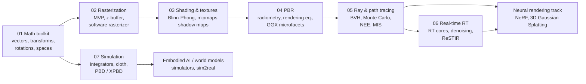
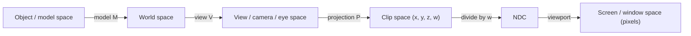

## Why this matters

Every image a computer draws, whether a game frame, a path-traced film shot, a NeRF or a 3D Gaussian Splatting render, starts the same way: points in 3D get moved, rotated and projected onto a 2D grid of pixels. This series builds that machinery from scratch and carries it up to research-level rendering and simulation, so that later posts on neural rendering read like a natural continuation instead of magic. This first post does two things. It lays out the **roadmap** for the whole series, and it collects the **math toolkit** that every later post uses: vectors, matrices, homogeneous coordinates, rotation representations, coordinate spaces and the normal-transform rule.

## Prerequisites

- Linear algebra at the level of a first university course: matrix multiplication, inverse, transpose, determinant.
- Basic programming in Python. All code uses only NumPy.
- No graphics background is assumed.

## The roadmap

Computer graphics has two big ways to make an image and one way to make things move:

- **Rasterization** projects each triangle onto the screen and fills the pixels it covers. It is what GPUs are built for, and it powers almost every real-time application.
- **Ray tracing** shoots rays from the camera into the scene and asks what they hit. Combined with Monte Carlo integration it becomes **path tracing**, which simulates light transport physically and is the standard in film.
- **Physically based simulation** moves the scene itself: cloth, rigid bodies, fluids. The same solvers appear in games, VR and robotics simulators.

The seven posts of this track follow that structure:



| Post | Core question | What you can build afterwards |
| --- | --- | --- |
| 01 Math toolkit | How do we describe positions, directions and orientations? | A transform library with quaternions |
| 02 Rasterization | How does a triangle become pixels? | A ~150-line software rasterizer |
| 03 Shading and textures | What color is a pixel? | Blinn-Phong shading, texture filtering, shadow maps |
| 04 Physically based rendering | What does "physically correct" mean for light? | A GGX metallic-roughness shader |
| 05 Ray and path tracing | How do we solve the rendering equation? | A Monte Carlo path tracer with NEE and MIS |
| 06 Real-time ray tracing | How do we do it in 16 ms? | An understanding of RT hardware, denoisers and ReSTIR |
| 07 Simulation | How do things move believably? | An XPBD cloth solver |

Neural rendering builds directly on this. NeRF is volume rendering along camera rays (post 05's ray generation plus an integral along the ray). 3D Gaussian Splatting is a rasterizer for anisotropic Gaussians (post 02's projection, plus the Jacobian of the projection from this post's toolkit). If you understand the seven posts here, those papers become readable.

## Vectors: positions, directions and the two products

A 3D vector $\mathbf{v} = (v_x, v_y, v_z)$ can mean two different things in graphics: a **point** (a position) or a **direction** (a displacement, a velocity, a surface normal). They are stored the same way, but they transform differently. Homogeneous coordinates will make that difference explicit.

### Dot product

$$
\mathbf{a}\cdot\mathbf{b} = a_x b_x + a_y b_y + a_z b_z = \lVert\mathbf{a}\rVert\,\lVert\mathbf{b}\rVert\cos\theta .
$$

The dot product shows up everywhere:

- **Angles and lighting.** For unit vectors, $\mathbf{n}\cdot\mathbf{l} = \cos\theta$, which is the core of Lambertian shading in post 03.
- **Projection.** The component of $\mathbf{a}$ along a unit vector $\hat{\mathbf{b}}$ is $(\mathbf{a}\cdot\hat{\mathbf{b}})\,\hat{\mathbf{b}}$.
- **Front or back.** The sign of $(\mathbf{q}-\mathbf{p})\cdot\mathbf{n}$ tells which side of a plane a point $\mathbf{q}$ is on. Back-face culling and ray-plane intersection both use it.

The figure below uses the two vectors from the code that follows, $\mathbf{a}=(1,2,2)$ and $\mathbf{b}=(3,0,4)$: the dark segment along $\mathbf{b}$ is the projection, and its length $\mathbf{a}\cdot\hat{\mathbf{b}} = 2.2$ is the dot product divided by $\lVert\mathbf{b}\rVert$.

{% include blog_figure.liquid path="assets/img/blog/graphics/01-dot-product.svg" width="75%" caption="Dot product as projection. Drop a perpendicular (dashed) from the tip of **a** onto the line of **b**: the dark segment is the projection (1.32, 0, 1.76) of length 2.2, so a·b = 2.2 × 5 = 11 and cos θ = 11/15 (θ = 42.83°). Right-handed axes, z drawn up." %}

### Cross product

$$
\mathbf{a}\times\mathbf{b} =
\begin{pmatrix} a_y b_z - a_z b_y \\ a_z b_x - a_x b_z \\ a_x b_y - a_y b_x \end{pmatrix},
\qquad
\lVert\mathbf{a}\times\mathbf{b}\rVert = \lVert\mathbf{a}\rVert\,\lVert\mathbf{b}\rVert\sin\theta .
$$

The result is perpendicular to both inputs, follows the right-hand rule, and its length is the area of the parallelogram spanned by $\mathbf{a}$ and $\mathbf{b}$. So the normal of a triangle $(\mathbf{p}_0,\mathbf{p}_1,\mathbf{p}_2)$ is $(\mathbf{p}_1-\mathbf{p}_0)\times(\mathbf{p}_2-\mathbf{p}_0)$, and half its length is the triangle's area. The order of the vertices (the **winding order**) decides which way the normal points, which is how GPUs decide which faces are "front".

The figure shows the triangle from the code below. Swapping two vertices reverses the winding and flips the normal, and the same sign flip appears in the side test for the point $\mathbf{q}$.



```python
import numpy as np

def normalize(v):
    return v / np.linalg.norm(v)

a = np.array([1.0, 2.0, 2.0])
b = np.array([3.0, 0.0, 4.0])

cos_theta = a @ b / (np.linalg.norm(a) * np.linalg.norm(b))
print("angle (deg):", np.degrees(np.arccos(cos_theta)))     # 42.83
proj = (a @ normalize(b)) * normalize(b)                       # projection of a onto b
print("projection:", proj)

# Triangle normal and area from the cross product
p0, p1, p2 = np.array([0., 0, 0]), np.array([1., 0, 0]), np.array([0., 1, 0])
c = np.cross(p1 - p0, p2 - p0)
print("normal:", normalize(c), "area:", 0.5 * np.linalg.norm(c))  # [0 0 1], 0.5

# Which side of the plane is a point on? sign of a dot product
q = np.array([0.2, 0.2, 0.5])
print("q above the triangle plane:", (q - p0) @ c > 0)         # True
```

A useful identity for later: the triple product $\mathbf{a}\cdot(\mathbf{b}\times\mathbf{c}) = \det[\mathbf{a}\ \mathbf{b}\ \mathbf{c}]$ is the signed volume of the parallelepiped. Its 2D version, $(b_x-a_x)(c_y-a_y)-(b_y-a_y)(c_x-a_x)$, is the **edge function** that the rasterizer in post 02 uses to test whether a pixel is inside a triangle.

Try both products yourself. In the widget below the vectors lie in the $xy$-plane, so $\mathbf{a}\times\mathbf{b} = (0, 0, a_x b_y - a_y b_x)$ and its single nonzero component is exactly that 2D edge function: drag $\mathbf{b}$ across the line of $\mathbf{a}$ and watch the sign flip.



## Matrices as linear transforms

A $3\times 3$ matrix $A$ defines a linear map $\mathbf{x}\mapsto A\mathbf{x}$. The best way to read a matrix is column by column: **the columns are the images of the basis vectors**.

$$
A = \begin{pmatrix} \vert & \vert & \vert \\ A\mathbf{e}_x & A\mathbf{e}_y & A\mathbf{e}_z \\ \vert & \vert & \vert \end{pmatrix}.
$$

So if you want a matrix that sends the $x$-axis to some vector $\mathbf{r}$, the $y$-axis to $\mathbf{u}$ and the $z$-axis to $\mathbf{f}$, you just write those three vectors into the columns. This is how camera matrices and tangent frames (post 03) are built.

The basic linear transforms are:

- **Scale**: $S = \operatorname{diag}(s_x, s_y, s_z)$. If the $s_i$ differ, the scale is **non-uniform**, which matters for normals (see below).
- **Rotation about a coordinate axis**: $R_x$, $R_y$, $R_z$ (written out below).
- **Shear**: for example $x' = x + k\,y$.

Reading the columns is easiest to see on a grid. The figure applies each basic map to the integer grid and the unit square: the red and green arrows, the images of $\mathbf{e}_x$ and $\mathbf{e}_y$, are literally the two columns of the matrix.



The rotation about $z$ by an angle $\theta$ is

$$
R_z(\theta) = \begin{pmatrix} \cos\theta & -\sin\theta & 0 \\ \sin\theta & \cos\theta & 0 \\ 0 & 0 & 1 \end{pmatrix}.
$$

$R_x$ and $R_y$ have the same pattern in the other planes. Note the sign in $R_y$: $R_y(\theta)$ has $+\sin\theta$ in the top-right corner, because a right-handed rotation about $y$ takes $z$ toward $x$.

Rotation matrices are **orthogonal** with determinant $+1$: $R^\top R = I$, so $R^{-1} = R^\top$. A determinant of $-1$ means a reflection, which flips the winding order of triangles.

Transforms compose by multiplication, and **matrix multiplication does not commute**. With column vectors (the convention in this series, OpenGL, GLSL, NumPy code and most papers) the transform written rightmost is applied first: $M = ABC$ means "apply $C$, then $B$, then $A$". DirectX/HLSL often uses row vectors, $\mathbf{x}^\top M$, where everything is transposed and the order reads left to right. Whenever a formula from another source looks "backwards", check which convention it uses.

## Affine transforms and homogeneous coordinates

Translation $\mathbf{x}\mapsto\mathbf{x}+\mathbf{t}$ is not linear (it moves the origin), so no $3\times 3$ matrix can do it. The general **affine transform** is $\mathbf{x}\mapsto A\mathbf{x}+\mathbf{t}$. Homogeneous coordinates fold it into a single matrix by appending a fourth coordinate $w$:

$$
\begin{pmatrix} \mathbf{x}' \\ 1 \end{pmatrix}
=
\begin{pmatrix} A & \mathbf{t} \\ \mathbf{0}^\top & 1 \end{pmatrix}
\begin{pmatrix} \mathbf{x} \\ 1 \end{pmatrix}.
$$

The fourth coordinate encodes the point/direction distinction:

- **Points** have $w = 1$, so they get translated.
- **Directions** have $w = 0$, so the translation column is multiplied by zero. That is correct: moving an object does not change which way an arrow points.
- The difference of two points ($w = 1 - 1 = 0$) is a direction, and a point plus a direction is a point. Adding two points gives $w = 2$, which is a hint that the operation is meaningless unless it is part of an average with weights summing to one.

Geometrically, the extra coordinate lifts the plane into one more dimension, and translation becomes a **shear** of that bigger space. The figure shows the 2D case, where points live on the plane $w=1$ and directions on the plane $w=0$.

{% include blog_figure.liquid path="assets/img/blog/graphics/01-homogeneous.svg" localized="true" width="80%" caption="Translation by t = (1.5, 1) as a 3×3 matrix H acting on (x, y, w). H shears space parallel to the w = 0 plane: the square of points on w = 1 slides by t, while a direction d on w = 0 does not move at all. The dashed line through the origin shows that (3, 2, 2) and (1.5, 1, 1) are the same projective point." %}

More generally, a homogeneous vector $(x, y, z, w)$ with $w \neq 0$ represents the 3D point $(x/w, y/w, z/w)$. Multiplying all four coordinates by any nonzero constant gives the same point. This is the space of **projective geometry**. A perspective projection is a $4\times 4$ matrix whose bottom row is not $(0,0,0,1)$, so it produces a $w$ that depends on depth. The later **perspective divide** by $w$ creates the "far things look smaller" effect. Post 02 derives that matrix. Blinn and Newell (1978) explained why clipping must happen in homogeneous coordinates *before* this divide, and post 02 explains it too.

### TRS composition

An object's placement in the world is almost always written as **translate · rotate · scale**:

$$
M = T\,R\,S, \qquad M^{-1} = S^{-1} R^\top T^{-1}.
$$

Reading right to left, the object is first scaled about its own origin, then rotated about its own origin, and then moved to its position. Any other order gives a different, usually unwanted, result: translating first and then rotating swings the object around the world origin like a planet. To rotate about a pivot $\mathbf{c}$ instead of the origin, conjugate by a translation: $T(\mathbf{c})\,R\,T(-\mathbf{c})$. The inverse has a cheap closed form because each factor has one. Scene graphs (a hand attached to an arm attached to a body) are just products of such matrices along a path from the root.

The figure draws the exact example from the code below, including the pivot rotation.

{% include blog_figure.liquid path="assets/img/blog/graphics/01-trs-order.svg" caption="The same three matrices T = T(5,0,0), R = Rz(90°), S = S(2) in two orders, applied to an arrow-shaped object (purple) seen from +z. Left: TRS scales, rotates and then moves it; the point p = (1,0) lands at (5,2). Middle: SRT first moves it to x = 5, then the rotation swings it around the world origin (dotted arc) and the scale doubles the distance, so p lands at (0,12). Right: T(c) R T(−c) rotates about the pivot c = (1,1) instead of the origin (gray: plain R)." %}

```python
import numpy as np
np.set_printoptions(suppress=True, precision=4)

def translate(tx, ty, tz):
    M = np.eye(4); M[:3, 3] = [tx, ty, tz]; return M

def scale(sx, sy, sz):
    return np.diag([sx, sy, sz, 1.0])

def rotate_x(deg):
    c, s = np.cos(np.radians(deg)), np.sin(np.radians(deg))
    return np.array([[1, 0, 0, 0], [0, c, -s, 0], [0, s, c, 0], [0, 0, 0, 1.0]])

def rotate_y(deg):
    c, s = np.cos(np.radians(deg)), np.sin(np.radians(deg))
    return np.array([[c, 0, s, 0], [0, 1, 0, 0], [-s, 0, c, 0], [0, 0, 0, 1.0]])

def rotate_z(deg):
    c, s = np.cos(np.radians(deg)), np.sin(np.radians(deg))
    return np.array([[c, -s, 0, 0], [s, c, 0, 0], [0, 0, 1, 0], [0, 0, 0, 1.0]])

point = np.array([1.0, 0.0, 0.0, 1.0])       # w = 1: a position
direction = np.array([1.0, 0.0, 0.0, 0.0])   # w = 0: a direction

T, R, S = translate(5, 0, 0), rotate_z(90), scale(2, 2, 2)
M = T @ R @ S                                 # scale, then rotate, then translate
print("point:", M @ point)                   # [5. 2. 0. 1.]
print("direction:", M @ direction)           # [0. 2. 0. 0.]  (translation ignored)
print("other order:", (S @ R @ T) @ point)    # [0. 12. 0. 1.]  -- order matters

# Inverse of TRS without a general 4x4 inverse: S^-1 R^T T^-1
M_inv = scale(0.5, 0.5, 0.5) @ R.T @ translate(-5, 0, 0)
print("inverse ok:", np.allclose(M_inv @ M, np.eye(4)))

# Rotate 90 degrees about the pivot c = (1, 1, 0): T(c) R T(-c)
pivot = translate(1, 1, 0) @ rotate_z(90) @ translate(-1, -1, 0)
print("about pivot:", pivot @ np.array([2.0, 1.0, 0.0, 1.0]))  # [1. 2. 0. 1.]
```

The snippets below reuse these helper functions, so run them in the same Python session.

## Rotation representations

Rotations are the hardest part of the toolkit, because the set of 3D rotations, the group $SO(3)$, is a curved 3-dimensional space and not a vector space. Every representation trades off some of these properties: few parameters, easy composition, smooth interpolation, no singularities, and being easy for humans to edit.

### Euler angles and gimbal lock

Euler angles write a rotation as three rotations about coordinate axes, for example (yaw, pitch, roll) in the Z-Y-X order:

$$
R(\psi,\theta,\phi) = R_z(\psi)\,R_y(\theta)\,R_x(\phi).
$$

They are intuitive and are what animation tools show in the UI. But they have a **singularity**. At $\theta = \pm 90^\circ$ the first and last rotation axes line up, and the formula depends only on $\psi - \phi$ (for $+90^\circ$) or $\psi + \phi$ (for $-90^\circ$). One degree of freedom disappears. This is **gimbal lock**, named after the physical gimbals of inertial navigation units, where three nested rings can align and lose a rotational axis. Near the singularity, a small change in orientation can need a huge change in the angles, so interpolating Euler angles produces wild spins. There are also 12 valid axis orders (XYZ, ZYX, ZXZ, ...), and mixing them up is a classic bug.

The figure makes this concrete with three nested rings, one per rotation in $R_z(\psi)R_y(\theta)R_x(\phi)$, each drawn perpendicular to the axis it turns about.

{% include blog_figure.liquid path="assets/img/blog/graphics/01-gimbal-lock.svg" width="90%" caption="Gimbal rings for the Z-Y-X order with yaw 30° and roll 10°. Blue: the yaw ring turns about the world z axis; green: the pitch ring turns about the yawed y axis; red: the roll ring turns about Rz Ry x, the body's nose axis (black airplane). At pitch 40° (left) the three axes are independent and the Jacobian has rank 3. At pitch 90° (right) the roll axis has swung onto the yaw axis (180° apart, i.e. the same line), the red ring lies in the plane of the blue one, and the rank drops to 2." %}

```python
# Euler angles (Z-Y-X order: R = Rz(yaw) Ry(pitch) Rx(roll)) and gimbal lock
def euler_zyx(yaw, pitch, roll):
    return rotate_z(yaw) @ rotate_y(pitch) @ rotate_x(roll)

A = euler_zyx(30, 90, 10)
B = euler_zyx(50, 90, 30)   # yaw and roll both +20: yaw - roll is unchanged
print("same matrix:", np.allclose(A, B))   # True: at pitch = 90 deg one DOF is lost

# Numerically: the Jacobian of the rotation w.r.t. (yaw, pitch, roll) loses rank
def jac_rank(yaw, pitch, roll, h=1e-4):
    f = lambda e: euler_zyx(*e)[:3, :3].ravel()
    e0 = np.array([yaw, pitch, roll], dtype=float)
    J = np.stack([(f(e0 + h * d) - f(e0 - h * d)) / (2 * h) for d in np.eye(3)], axis=1)
    return np.linalg.matrix_rank(J, tol=1e-6)

print("rank at pitch=40:", jac_rank(30, 40, 10))   # 3
print("rank at pitch=90:", jac_rank(30, 90, 10))   # 2
```

The rank drop of the Jacobian is the precise meaning of "losing a degree of freedom". It is also why optimizing orientations with Euler angles (in inverse kinematics, camera calibration or pose estimation) can get stuck.

### Axis-angle and Rodrigues' formula

Euler's rotation theorem says that every rotation is a rotation by some angle $\theta$ about some unit axis $\mathbf{k}$. Rotating a vector $\mathbf{v}$ is then given by **Rodrigues' formula**:

$$
\mathbf{v}_{\text{rot}} = \mathbf{v}\cos\theta + (\mathbf{k}\times\mathbf{v})\sin\theta + \mathbf{k}\,(\mathbf{k}\cdot\mathbf{v})(1-\cos\theta).
$$

To derive it, split $\mathbf{v}$ into the part parallel to $\mathbf{k}$, which does not move, and the perpendicular part, which rotates by $\theta$ inside the plane spanned by $\mathbf{v}_\perp$ and $\mathbf{k}\times\mathbf{v}$. In matrix form, with the skew-symmetric "cross-product matrix" $K$ such that $K\mathbf{v} = \mathbf{k}\times\mathbf{v}$:

$$
K = \begin{pmatrix} 0 & -k_z & k_y \\ k_z & 0 & -k_x \\ -k_y & k_x & 0 \end{pmatrix},
\qquad
R = I + \sin\theta\, K + (1-\cos\theta)\, K^2 .
$$

This is exactly the matrix exponential $R = \exp(\theta K)$. The 3-vector $\boldsymbol{\omega} = \theta\mathbf{k}$ (the **rotation vector** or **exponential map**) is a minimal 3-parameter representation that is singular only at $\lVert\boldsymbol{\omega}\rVert = 2\pi$. That makes it popular for optimization and for neural networks that predict rotations (Grassia 1998 is the classic graphics reference). The inverse map uses $\operatorname{tr}R = 1 + 2\cos\theta$.

The decomposition behind the formula is easiest to see in 3D. The figure uses the axis, angle and vector from the code below.

{% include blog_figure.liquid path="assets/img/blog/graphics/01-rodrigues.svg" width="80%" caption="Rodrigues' formula for k = (1,2,3)/√14, θ = 0.7 and v = (0.3, −1, 2), drawn in a frame rotated so that k points up (the world axes are shown rotated with it). The parallel part (cyan) stays fixed; the perpendicular part (red) and k × v (green) span the plane of the dotted circle, and v⊥ turns by θ inside it (dashed orange), so the tip of v moves along the circle to v_rot." %}

```python
# Axis-angle -> rotation matrix (Rodrigues' formula)
def skew(k):
    return np.array([[0, -k[2], k[1]], [k[2], 0, -k[0]], [-k[1], k[0], 0]])

def rodrigues(axis, angle):
    k = axis / np.linalg.norm(axis)
    K = skew(k)
    return np.eye(3) + np.sin(angle) * K + (1 - np.cos(angle)) * (K @ K)

def matrix_to_axis_angle(R):
    angle = np.arccos(np.clip((np.trace(R) - 1) / 2, -1, 1))
    if angle < 1e-8:
        return np.array([1.0, 0, 0]), 0.0
    # valid for 0 < angle < pi; angle near pi needs a separate branch
    axis = np.array([R[2, 1] - R[1, 2], R[0, 2] - R[2, 0], R[1, 0] - R[0, 1]])
    return axis / (2 * np.sin(angle)), angle

R = rodrigues(np.array([0, 0, 1.0]), np.pi / 2)
print("matches rotate_z(90):", np.allclose(R, rotate_z(90)[:3, :3]))
axis, ang = matrix_to_axis_angle(rodrigues(np.array([1.0, 2, 3]), 0.7))
print("recovered:", axis, ang)   # [0.2673 0.5345 0.8018] 0.7
```

### Quaternions

A quaternion $q = w + x\,i + y\,j + z\,k$ extends complex numbers with three imaginary units satisfying Hamilton's rule $i^2 = j^2 = k^2 = ijk = -1$. Write it as a scalar plus a vector, $q = (w, \mathbf{v})$. The product is

$$
q_1 q_2 = \big(w_1 w_2 - \mathbf{v}_1\cdot\mathbf{v}_2,\;\; w_1\mathbf{v}_2 + w_2\mathbf{v}_1 + \mathbf{v}_1\times\mathbf{v}_2\big),
$$

which is associative but not commutative, just like rotations. A rotation by $\theta$ about the unit axis $\mathbf{k}$ is the **unit quaternion**

$$
q = \Big(\cos\tfrac{\theta}{2},\; \sin\tfrac{\theta}{2}\,\mathbf{k}\Big),
$$

and it rotates a vector $\mathbf{v}$ by "sandwiching" it as a pure quaternion $p = (0, \mathbf{v})$:

$$
p' = q\,p\,q^{*}, \qquad q^{*} = (w, -\mathbf{v}).
$$

Expanding the sandwich gives Rodrigues' formula again. That is why the half angle appears: $q$ acts twice. Some facts worth remembering:

- **Composition** is multiplication: "first $q_a$, then $q_b$" is $q_b q_a$, with the same right-to-left order as matrices. It costs 16 multiplications instead of 27 for $3\times 3$ matrices.
- **Double cover**: $q$ and $-q$ represent the same rotation, because $\theta$ and $\theta + 2\pi$ give opposite quaternions. Interpolation must pick the right sign.
- **Drift**: after many multiplications, round-off makes $\lVert q\rVert \neq 1$. Renormalizing a quaternion is trivial. Re-orthogonalizing a matrix is not.
- **No gimbal lock**: the unit quaternions form the 3-sphere $S^3$, a smooth space without singular points.

**Slerp** (spherical linear interpolation, Shoemake 1985) moves along the great-circle arc between two unit quaternions at constant angular velocity:

$$
\operatorname{slerp}(q_0, q_1; t) = \frac{\sin\big((1-t)\Omega\big)}{\sin\Omega}\,q_0 + \frac{\sin(t\Omega)}{\sin\Omega}\,q_1,
\qquad \cos\Omega = q_0\cdot q_1 .
$$

If $q_0\cdot q_1 < 0$, negate $q_1$ first so that you take the short way around. When $\Omega$ is tiny, $\sin\Omega\to 0$ and the formula becomes numerically unstable, so implementations fall back to normalized linear interpolation (**nlerp**). Nlerp does not have constant speed but it is cheap, commutative and still a good choice for blending many rotations, as in skinning.

The figure compares the two on the example from the code below. Because both quaternions lie in the $(w, y)$ plane, the great circle of $S^3$ through them is an ordinary unit circle there.



```python
# Quaternions stored as (w, x, y, z)
def q_from_axis_angle(axis, angle):
    k = axis / np.linalg.norm(axis)
    return np.concatenate([[np.cos(angle / 2)], np.sin(angle / 2) * k])

def q_mul(a, b):
    w1, v1 = a[0], a[1:]
    w2, v2 = b[0], b[1:]
    return np.concatenate([[w1 * w2 - v1 @ v2], w1 * v2 + w2 * v1 + np.cross(v1, v2)])

def q_conj(q):
    return np.concatenate([[q[0]], -q[1:]])

def q_rotate(q, v):
    return q_mul(q_mul(q, np.concatenate([[0.0], v])), q_conj(q))[1:]

def q_to_matrix(q):
    w, x, y, z = q
    return np.array([
        [1 - 2 * (y * y + z * z), 2 * (x * y - w * z), 2 * (x * z + w * y)],
        [2 * (x * y + w * z), 1 - 2 * (x * x + z * z), 2 * (y * z - w * x)],
        [2 * (x * z - w * y), 2 * (y * z + w * x), 1 - 2 * (x * x + y * y)]])

def slerp(q0, q1, t):
    d = q0 @ q1
    if d < 0:            # q and -q are the same rotation: take the short arc
        q1, d = -q1, -d
    if d > 0.9995:       # nearly parallel: normalized lerp is accurate and stable
        q = q0 + t * (q1 - q0)
        return q / np.linalg.norm(q)
    omega = np.arccos(d)
    return (np.sin((1 - t) * omega) * q0 + np.sin(t * omega) * q1) / np.sin(omega)

axis, angle = np.array([1.0, 2, 3]), 0.7
q = q_from_axis_angle(axis, angle)
v = np.array([0.3, -1.0, 2.0])
print("q p q* == Rodrigues:", np.allclose(q_rotate(q, v), rodrigues(axis, angle) @ v))
print("matrix ok:", np.allclose(q_to_matrix(q), rodrigues(axis, angle)))

# Composition: rotate by qa first, then qb  ->  qb * qa
qa = q_from_axis_angle(np.array([0, 0, 1.0]), np.pi / 2)
qb = q_from_axis_angle(np.array([1.0, 0, 0]), np.pi / 2)
print("compose:", np.allclose(q_to_matrix(q_mul(qb, qa)), q_to_matrix(qb) @ q_to_matrix(qa)))

# Slerp moves at constant angular speed
q0 = np.array([1.0, 0, 0, 0])
q1 = q_from_axis_angle(np.array([0, 1.0, 0]), np.radians(120))
for t in [0, 0.25, 0.5, 1]:
    qt = slerp(q0, q1, t)
    print(t, "angle from q0 (deg):", np.degrees(2 * np.arccos(np.clip(qt[0], -1, 1))))  # 0, 30, 60, 120
```

Watch the storage order: this code (like Eigen's constructor and many papers) writes $(w, x, y, z)$, while GLM, Unity and SciPy store $(x, y, z, w)$. Mixing the two silently produces wrong rotations.

### Choosing a representation

| Representation | Parameters | Composition | Interpolation | Singularities | Typical use |
| --- | --- | --- | --- | --- | --- |
| Rotation matrix | 9 (6 constraints) | Matrix product | Poor (lerp leaves $SO(3)$) | None | Final transform sent to the GPU |
| Euler angles | 3 | Convert first | Poor | Gimbal lock at $\theta = \pm 90^\circ$ | UI, animation curves, vehicle attitude |
| Axis-angle / rotation vector | 3 or 4 | Convert first | Fine for small steps | At $\lVert\boldsymbol\omega\rVert = 2\pi$ | Optimization, angular velocity, network outputs |
| Unit quaternion | 4 (1 constraint) | Quaternion product | Slerp / nlerp | None (double cover $q \equiv -q$) | Animation, physics, camera orientation |

Neural networks that regress rotations are a special case. Every 3D or 4D representation has a discontinuity somewhere, and for this reason Zhou et al. (CVPR 2019, *On the continuity of rotation representations in neural networks*) proposed a continuous 6D representation: two columns of the rotation matrix, re-orthogonalized by Gram-Schmidt. You will meet this again in pose estimation and robotics.

## Coordinate spaces

A vertex travels through a chain of coordinate systems before it becomes a pixel. Each arrow is one matrix (or one fixed operation):



| Space | What it is | Typical convention (OpenGL) |
| --- | --- | --- |
| Object (model) | Coordinates as authored in the modeling tool, origin at the object's pivot | Any |
| World | Shared space where all objects, lights and the camera live | Right-handed, $y$ up (many engines use $z$ up) |
| View (camera, eye) | Camera at the origin | Camera looks down $-z$, $x$ right, $y$ up |
| Clip | Output of the projection, still homogeneous | Visible iff $-w \le x, y, z \le w$ |
| NDC (normalized device coordinates) | After dividing by $w$ | Cube $[-1,1]^3$ |
| Screen (window) | Pixels plus a depth value | Origin bottom-left, depth in $[0,1]$ |

Conventions differ between APIs. Direct3D and Vulkan use NDC depth in $[0,1]$ instead of $[-1,1]$. Vulkan's NDC $y$ axis points down. Image libraries usually put the pixel origin at the top-left. Most rendering bugs at the start come from a sign or range mismatch here, so write the conventions of your codebase down once.

The figure follows one cube through the whole chain, using the `look_at` from below and the perspective matrix from post 02.

{% include blog_figure.liquid path="assets/img/blog/graphics/01-coordinate-spaces.svg" localized="true" caption="One unit cube in every space (the orange dot marks its (+,+,+) corner). Object: centered at its pivot. World: placed by M = T(1,0,0) Ry(45°), with the camera at (2,2,5) looking at the origin (gray frustum, axes r, u, −f). View: the camera sits at the origin and looks down −z. NDC: after P and the divide by w, the frustum has become the cube [−1,1]³; nearby parts are enlarged, and z now points away from the camera (OpenGL NDC is left-handed). Screen: the viewport maps NDC to a 240×240 pixel image with row 0 at the top." %}

The vertex shader computes $\mathbf{p}_{\text{clip}} = P\,V\,M\,\mathbf{p}_{\text{obj}}$. That is why $P V M$ is called the **MVP matrix**. Post 02 builds $P$ and the viewport transform. The **view matrix** $V$ is the inverse of the camera's own world transform. If the camera sits at $\mathbf{e}$ with orthonormal right/up/back axes $\mathbf{r}, \mathbf{u}, -\mathbf{f}$, its world matrix is $C = \begin{pmatrix} \mathbf{r} & \mathbf{u} & -\mathbf{f} & \mathbf{e} \\ 0 & 0 & 0 & 1 \end{pmatrix}$. Because the rotation part is orthogonal, the inverse is

$$
V = C^{-1} = \begin{pmatrix} \mathbf{r}^\top & -\mathbf{r}\cdot\mathbf{e} \\ \mathbf{u}^\top & -\mathbf{u}\cdot\mathbf{e} \\ -\mathbf{f}^\top & \mathbf{f}\cdot\mathbf{e} \\ \mathbf{0}^\top & 1 \end{pmatrix}.
$$

The familiar `lookAt(eye, target, up)` function constructs exactly this, using two cross products to build the orthonormal basis:

```python
# Build a view (camera) matrix with look-at
def look_at(eye, target, up):
    f = target - eye
    f = f / np.linalg.norm(f)                       # forward
    r = np.cross(f, up); r = r / np.linalg.norm(r)  # right
    u = np.cross(r, f)                              # true up
    V = np.eye(4)
    V[0, :3], V[1, :3], V[2, :3] = r, u, -f         # rows = camera axes (camera looks down -z)
    V[:3, 3] = -V[:3, :3] @ eye                     # then translate by -eye
    return V

V = look_at(np.array([0, 0, 5.0]), np.zeros(3), np.array([0, 1.0, 0]))
print(V @ np.array([0, 0, 0, 1.0]))   # world origin is 5 units in front: [0 0 -5 1]
model = translate(1, 0, 0) @ rotate_y(45)
p_obj = np.array([0, 0, 1.0, 1.0])
p_view = V @ model @ p_obj            # object -> world -> view
print("view-space point:", p_view)
```

`look_at` breaks down when `up` is parallel to the viewing direction (the cross product is zero). This is the camera's version of gimbal lock, and you have to handle it, for example by choosing a different `up`.

The same idea shows up again in computer vision with different names. The view matrix is the camera's **extrinsics** $[R\,\vert\,\mathbf{t}]$, and the projection plus viewport plays the role of the **intrinsics** $K$. OpenCV cameras look down $+z$ with $y$ down, which is the opposite of OpenGL. Converting between the two conventions is a routine step when you load COLMAP poses into a NeRF or Gaussian Splatting pipeline.

## Transforming normals: the inverse transpose

A surface normal is not an ordinary direction. It is defined by being perpendicular to the surface. Take a tangent vector $\mathbf{t}$ lying in the surface and the normal $\mathbf{n}$, with $\mathbf{n}^\top\mathbf{t} = 0$. After transforming the surface by the linear part $M$ (the upper-left $3\times 3$ of the model matrix), the tangent becomes $\mathbf{t}' = M\mathbf{t}$. We want a matrix $G$ with $\mathbf{n}' = G\mathbf{n}$ such that perpendicularity is preserved:

$$
\mathbf{n}'^\top\mathbf{t}' = \mathbf{n}^\top G^\top M\,\mathbf{t} = 0 \quad\text{for all } \mathbf{t}\perp\mathbf{n}
\;\;\Longleftarrow\;\; G^\top M = I
\;\;\Longrightarrow\;\; G = \big(M^{-1}\big)^\top .
$$

So **normals transform by the inverse transpose** $M^{-\top}$, and then have to be renormalized. For a pure rotation $M^{-\top} = M$, and for a uniform scale it is $M$ up to a scalar, so the distinction only matters with non-uniform scale or shear. That is exactly when it causes ugly, hard-to-find lighting bugs. A practical variant is the **cofactor matrix** $\operatorname{cof}(M) = \det(M)\,M^{-\top}$, whose columns are cross products of the columns of $M$. It needs no division, works even for singular $M$, and keeps normals pointing outward when $\det M < 0$ (a mirroring transform).

The figure shows what goes wrong otherwise, using the matrix $M = R_z(30^\circ)\,S(3,1,1)$ and the 45° line from the code below.



```python
# Normals must be transformed with the inverse transpose
M = (rotate_z(30) @ scale(3, 1, 1))[:3, :3]     # non-uniform scale
t = np.array([1.0, 1.0, 0.0]) / np.sqrt(2)       # tangent of a 45-degree line
n = np.array([-1.0, 1.0, 0.0]) / np.sqrt(2)      # its normal, n . t = 0

t2 = M @ t
n_wrong = M @ n
n_right = np.linalg.inv(M).T @ n
n_right /= np.linalg.norm(n_right)
print("M n       . M t =", n_wrong @ t2)         # != 0, no longer perpendicular
print("M^-T n    . M t =", n_right @ t2)         # 0 (up to rounding)

# Cofactor matrix: det(M) * M^-T, no inverse needed and correct even if det < 0
def cofactor(M):
    return np.stack([np.cross(M[:, 1], M[:, 2]),
                     np.cross(M[:, 2], M[:, 0]),
                     np.cross(M[:, 0], M[:, 1])], axis=1)
print("cofactor = det * inv^T:", np.allclose(cofactor(M), np.linalg.det(M) * np.linalg.inv(M).T))
```

In a renderer you compute the **normal matrix** $M^{-\top}$ once per object on the CPU and pass it to the vertex shader alongside the MVP matrix. You will see it as `uNormalMatrix` in the GLSL of posts 02 and 03.

Underneath this rule is a more general idea that comes back in physically based rendering and differentiable rendering. Normals are *covectors* (linear functionals that act on tangent vectors), and covectors transform with the inverse transpose. Gradients are covectors too, which is why the chain rule for gradients uses transposed Jacobians.

## Numerical habits

A few habits will save you many hours in later posts:

- **Use epsilons for comparisons.** Never test floating-point values for equality. Ray-tracing code needs a small offset ($\sim 10^{-4}$ in scene units) to avoid self-intersection, called "shadow acne" in post 03.
- **Renormalize.** Interpolated normals, accumulated quaternions and repeatedly multiplied rotation matrices all drift.
- **Prefer closed-form inverses** ($R^\top$, $S^{-1}R^\top T^{-1}$) to a general `inv` when you know the structure.
- **Use `float32` deliberately.** GPUs compute in 32-bit floats, which have about 7 significant digits. Large world coordinates (planet-scale scenes, a camera far from the origin) lose precision. Engines fix this with camera-relative rendering.

## Try it

The home page has an [interactive lab]({{ '/' | relative_url }}#lab). Every demo there uses the toolkit in this post: the path tracer builds camera rays from an orthonormal camera basis, the Gaussian World demo projects 3D covariance matrices with the view matrix and the Jacobian of the projection, and the XPBD cloth demo builds `lookAt` and perspective matrices by hand in JavaScript (`assets/js/lab.js`). Orbit the camera in any of them and think about which matrix is changing.

## Representative papers

| Paper | Venue | Year | Link | Why it matters |
| --- | --- | --- | --- | --- |
| Sutherland, *Sketchpad: A man-machine graphical communication system* | PhD thesis, MIT (reissued as Cambridge tech report UCAM-CL-TR-574) | 1963 | [report](https://www.cl.cam.ac.uk/techreports/UCAM-CL-TR-574.html) | The start of interactive computer graphics, with transforms of drawn objects |
| Blinn and Newell, *Clipping using homogeneous coordinates* | SIGGRAPH (Computer Graphics 12(3)) | 1978 | [SIGGRAPH history](https://history.siggraph.org/?p=103260) | Why clipping happens in 4D clip space before the perspective divide |
| Shoemake, *Animating rotation with quaternion curves* | SIGGRAPH (Computer Graphics 19(3)) | 1985 | [DOI](https://doi.org/10.1145/325165.325242) | Introduced quaternions and slerp to computer graphics |
| Grassia, *Practical parameterization of rotations using the exponential map* | Journal of Graphics Tools 3(3) | 1998 | [DOI](https://doi.org/10.1080/10867651.1998.10487493) | When to use the rotation vector, and how to handle its singularity |
| Kavan, Collins, Žára and O'Sullivan, *Geometric skinning with approximate dual quaternion blending* | ACM TOG 27(4) | 2008 | [DOI](https://doi.org/10.1145/1409625.1409627) | Dual quaternions extend quaternions to rigid transforms. They are the standard fix for "candy-wrapper" artifacts in skinning |

## Learning resources

- **GAMES101: Introduction to Modern Computer Graphics** (Lingqi Yan): lectures 2-4 cover exactly this material. [Course page](https://sites.cs.ucsb.edu/~lingqi/teaching/games101.html).
- **Berkeley CS184/284A** (Computer Graphics and Imaging): [course site](https://cs184.eecs.berkeley.edu/). Stanford **CS148** is a gentler introduction with a similar scope.
- **3Blue1Brown, *Essence of Linear Algebra***: the best visual intuition for "columns are images of basis vectors". [Series](https://www.3blue1brown.com/topics/linear-algebra).
- **Physically Based Rendering (PBRT), 4th ed.**, chapter 3 (Geometry and Transformations), free online at [pbr-book.org](https://pbr-book.org/).
- **Scratchapixel**: lessons on geometry, matrices and coordinate systems at [scratchapixel.com](https://www.scratchapixel.com/).
- **LearnOpenGL**, "Transformations" and "Coordinate Systems": [learnopengl.com](https://learnopengl.com/).
- **Real-Time Rendering, 4th ed.** (Akenine-Möller et al.), chapter 4 "Transforms". [Book site](https://www.realtimerendering.com/).

## Exercises

1. Prove that for unit quaternions, $q\,(0,\mathbf{v})\,q^*$ reproduces Rodrigues' formula. Then show that $-q$ gives the same result.
2. Implement `matrix_to_quaternion(R)`. Use the numerically stable version that branches on the largest diagonal element, and test it on 10,000 random rotations by checking `q_to_matrix(matrix_to_quaternion(R)) == R`.
3. Animate a rotation from yaw/pitch/roll $(0^\circ, 0^\circ, 0^\circ)$ to $(170^\circ, 89^\circ, -170^\circ)$ in two ways: by linearly interpolating the Euler angles, and by slerping the corresponding quaternions. Plot the angular distance from the start over time and explain the difference.
4. Show that the inverse transpose of $M = R\,S$ with $S = \operatorname{diag}(s_x, s_y, s_z)$ equals $R\,S^{-1}$. Explain geometrically why normals get "squashed" where the surface gets stretched.
5. Write a function that converts an OpenCV camera pose (looking down $+z$, $y$ down) to an OpenGL view matrix (looking down $-z$, $y$ up), and verify it with `look_at`.

Next: [Rasterization]({{ '/blog/2026/graphics-02-rasterization/' | relative_url }}) turns the MVP pipeline into pixels. We derive the perspective projection matrix and write a complete software rasterizer.
