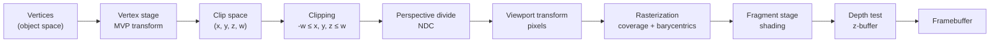

## Why this matters

Rasterization is how almost every real-time image you have ever seen was made: games, VR headsets, CAD tools and the viewport of every 3D editor. It answers one question very fast: *which pixels does this triangle cover, and what is the closest surface at each pixel?* In the [previous post]({{ '/blog/2026/graphics-01-roadmap-and-math/' | relative_url }}) we built the math toolkit (homogeneous coordinates, transforms, coordinate spaces). Here we put it to work and build a complete renderer from scratch. The ideas reappear much later in the roadmap: 3D Gaussian Splatting is a rasterizer of ellipsoids, and differentiable rasterizers are how neural networks learn from images of meshes.

**Prerequisites**

- Matrices, homogeneous coordinates and the object → world → view → clip → NDC → screen chain from post 1.
- Basic NumPy (broadcasting, boolean masks).
- Optional: any OpenGL / WebGL "hello triangle" experience, for the GPU section.

## 1. The pipeline at a glance

A rasterization pipeline turns a list of triangles in 3D into a 2D image. Every stage below exists both in our Python code and in GPU hardware:



The vertex positions are multiplied by the **model-view-projection** (MVP) matrix

$$
\mathbf{p}_{\text{clip}} = P\,V\,M\,\mathbf{p}_{\text{obj}},
$$

where $M$ places the object in the world, $V$ moves the world into the camera frame (the camera sits at the origin and looks down $-z$, the OpenGL convention we use throughout), and $P$ is the projection. Everything after that is fixed-function work done per triangle and per pixel.

## 2. The view matrix

Given a camera position $\mathbf{e}$, a target $\mathbf{t}$ and an approximate up vector $\mathbf{u}_0$, we build an orthonormal camera basis:

$$
\mathbf{f} = \frac{\mathbf{t}-\mathbf{e}}{\lVert\mathbf{t}-\mathbf{e}\rVert},\quad
\mathbf{s} = \frac{\mathbf{f}\times\mathbf{u}_0}{\lVert\mathbf{f}\times\mathbf{u}_0\rVert},\quad
\mathbf{u} = \mathbf{s}\times\mathbf{f}.
$$

The camera's right, up and backward axes are $\mathbf{s}$, $\mathbf{u}$ and $-\mathbf{f}$. The view matrix is the inverse of the camera's placement: first translate by $-\mathbf{e}$, then rotate world axes onto camera axes. Because the rotation is orthonormal, its inverse is its transpose, so the rows of $V$ are simply the camera axes:

$$
V = \begin{bmatrix}
s_x & s_y & s_z & -\mathbf{s}\cdot\mathbf{e}\\
u_x & u_y & u_z & -\mathbf{u}\cdot\mathbf{e}\\
-f_x & -f_y & -f_z & \mathbf{f}\cdot\mathbf{e}\\
0 & 0 & 0 & 1
\end{bmatrix}.
$$

## 3. Deriving the perspective projection matrix

### 3.1 Similar triangles

A pinhole camera maps a view-space point $(x, y, z)$ with $z<0$ onto the near plane $z=-n$ by similar triangles:

$$
x' = \frac{n\,x}{-z},\qquad y' = \frac{n\,y}{-z}.
$$

The division by $-z$ is what makes distant things small. A matrix cannot divide, but homogeneous coordinates can: if we set the output $w$ component to $-z$, the later **perspective divide** $(x, y, z)/w$ performs the division for us. That fixes the last row of $P$ to $(0, 0, -1, 0)$.

### 3.2 Normalizing x and y

The visible window on the near plane spans $[-r, r]\times[-t, t]$ with $t = n\tan(\theta_y/2)$ for a vertical field of view $\theta_y$ and $r = a\,t$ for aspect ratio $a = W/H$. We want that window to land on $[-1,1]^2$ in normalized device coordinates (NDC), so

$$
x_{\text{ndc}} = \frac{x'}{r} = \frac{n}{r}\cdot\frac{x}{-z},\qquad
y_{\text{ndc}} = \frac{n}{t}\cdot\frac{y}{-z}.
$$

With $n/t = 1/\tan(\theta_y/2) =: c$ the first two rows of $P$ are $(c/a, 0, 0, 0)$ and $(0, c, 0, 0)$.

### 3.3 Mapping depth

We also need a depth value for the z-buffer. Its row must be of the form $(0, 0, A, B)$ (it cannot depend on $x$ or $y$), so after the divide

$$
z_{\text{ndc}} = \frac{A z + B}{-z}.
$$

We demand $z=-n \mapsto -1$ and $z=-f \mapsto +1$:

$$
\frac{-An + B}{n} = -1,\qquad \frac{-Af + B}{f} = 1
\;\;\Longrightarrow\;\;
A = \frac{f+n}{n-f},\quad B = \frac{2fn}{n-f}.
$$

(Subtract the two equations $-An+B=-n$ and $-Af+B=f$ to get $A$, then substitute.) Altogether:

$$
P = \begin{bmatrix}
\dfrac{c}{a} & 0 & 0 & 0\\[4pt]
0 & c & 0 & 0\\[4pt]
0 & 0 & \dfrac{f+n}{n-f} & \dfrac{2fn}{n-f}\\[4pt]
0 & 0 & -1 & 0
\end{bmatrix},\qquad c = \frac{1}{\tan(\theta_y/2)}.
$$

This is exactly the matrix produced by `gluPerspective` and `glm::perspective`. Direct3D and Vulkan use a depth range of $[0,1]$ instead of $[-1,1]$, and Vulkan flips $y$, but the derivation is identical with different targets.

### 3.4 Depth is not linear

Note that $z_{\text{ndc}} = -A + B/w$ with $w = -z$: it is linear in $1/w$, not in $z$. Let us check numerically:

```python
import numpy as np

def perspective(fovy_deg, aspect, n, f):
    t = 1.0 / np.tan(np.radians(fovy_deg) / 2)
    return np.array([[t / aspect, 0, 0, 0], [0, t, 0, 0],
                     [0, 0, (f + n) / (n - f), 2 * f * n / (n - f)], [0, 0, -1, 0]])

n, f = 0.1, 100.0
P = perspective(60, 16 / 9, n, f)
for z in (-n, -0.2, -1.0, -10.0, -f):
    c = P @ np.array([0.0, 0.0, z, 1.0])
    print(f"z_view = {z:7.1f}   w = {c[3]:6.1f}   z_ndc = {c[2] / c[3]: .6f}")
```

```text
z_view =    -0.1   w =    0.1   z_ndc = -1.000000
z_view =    -0.2   w =    0.2   z_ndc =  0.001001
z_view =    -1.0   w =    1.0   z_ndc =  0.801802
z_view =   -10.0   w =   10.0   z_ndc =  0.981982
z_view =  -100.0   w =  100.0   z_ndc =  1.000000
```

Half of the whole depth range is spent between 0.1 and 0.2 units from the camera. Everything beyond 10 units shares the last 2 %. This is why a tiny near plane causes **z-fighting** far away, and why modern engines use *reversed-Z* (map near to 1 and far to 0 with a floating-point depth buffer, so float precision and $1/w$ precision cancel out). The good news is the flip side of the same fact: because $z_{\text{ndc}}$ is an affine function of $1/w$, and $1/w$ is affine in screen space (Section 6), **depth can be interpolated linearly across the screen**.

## 4. Clipping

After the projection, a point is visible if and only if

$$
-w \le x \le w,\qquad -w \le y \le w,\qquad -w \le z \le w.
$$

We clip *before* the divide for a good reason. A vertex behind the camera has $w<0$; dividing by a negative $w$ mirrors it through the center of projection, and a triangle with one vertex behind the camera would be drawn as a huge, inverted mess. In homogeneous clip space all six planes are linear, so clipping is just a sequence of linear interpolations.

The classic algorithm is **Sutherland-Hodgman**: clip the polygon against one plane at a time. For a plane with signed distance $d(\mathbf{p})$ (for the near plane, $d = z + w$), walk the edges $(\mathbf{p}, \mathbf{q})$ of the polygon:

- if $\mathbf{p}$ is inside ($d(\mathbf{p}) \ge 0$), keep it;
- if the edge crosses the plane, emit the intersection $\mathbf{p} + t(\mathbf{q}-\mathbf{p})$ with $t = d(\mathbf{p}) / (d(\mathbf{p}) - d(\mathbf{q}))$.

Vertex attributes (colors, UVs) are interpolated with the same $t$, which is correct because clip space is still a linear image of object space. A triangle clipped by one plane becomes a polygon with up to four vertices, which we re-triangulate as a fan.

In practice only the **near plane** is essential. The side planes can be replaced by a *guard band*: we simply clamp the triangle's pixel bounding box to the screen, and the edge functions reject everything else. GPUs do the same: they clip geometrically only when a triangle would overflow the fixed-point range of the rasterizer. (The far plane can also be skipped if we let the depth test discard those fragments.)

## 5. Viewport transform

NDC coordinates in $[-1,1]$ are mapped to pixel coordinates for an image of width $W$ and height $H$. Images store row 0 at the top, so $y$ flips:

$$
x_s = \frac{x_{\text{ndc}}+1}{2}\,W,\qquad
y_s = \frac{1-y_{\text{ndc}}}{2}\,H,\qquad
z_s = \frac{z_{\text{ndc}}+1}{2} \in [0,1].
$$

Pixel $(i, j)$ covers the square $[i, i+1)\times[j, j+1)$, and we sample it at its center $(i+\tfrac12, j+\tfrac12)$.

## 6. Rasterizing a triangle

### 6.1 Edge functions

For a 2D edge from $\mathbf{a}$ to $\mathbf{b}$ define the **edge function** (Pineda, 1988)

$$
E_{ab}(\mathbf{p}) = (b_x - a_x)(p_y - a_y) - (b_y - a_y)(p_x - a_x),
$$

the z-component of the 2D cross product $(\mathbf{b}-\mathbf{a})\times(\mathbf{p}-\mathbf{a})$. In a y-up frame it is positive when $\mathbf{p}$ lies to the left of the directed edge, zero on the line and negative on the right. A point is inside a counter-clockwise triangle $(\mathbf{a}, \mathbf{b}, \mathbf{c})$ when all three of $E_{ab}$, $E_{bc}$, $E_{ca}$ are non-negative.

Two properties make edge functions perfect for hardware:

1. They are **affine** in $\mathbf{p}$. Stepping one pixel right adds the constant $a_y - b_y$; stepping one pixel down adds $b_x - a_x$. A rasterizer can evaluate them incrementally with additions only, or evaluate a whole tile of pixels in parallel.
2. Their sign also gives orientation: $E_{ab}(\mathbf{c})$ is twice the signed area of the triangle. A negative area means the triangle faces away from the camera, so **back-face culling** is free.

In pixel coordinates, $y$ points down, which flips every sign. Our code therefore uses the negated expression so that triangles that are counter-clockwise in NDC (front faces) still have positive area.

*Ties:* a pixel center lying exactly on an edge shared by two triangles must be drawn by exactly one of them, otherwise blending or stencil effects double-count it. Hardware uses the **top-left rule** (a pixel on an edge counts only if the edge is a top or a left edge). Our simple `>= 0` test draws such pixels twice, which is harmless for opaque geometry with a depth test.

### 6.2 Barycentric coordinates

Normalize the edge functions by the total area and you get the **barycentric coordinates** of $\mathbf{p}$:

$$
\lambda_a = \frac{E_{bc}(\mathbf{p})}{E_{ab}(\mathbf{c})},\qquad
\lambda_b = \frac{E_{ca}(\mathbf{p})}{E_{ab}(\mathbf{c})},\qquad
\lambda_c = \frac{E_{ab}(\mathbf{p})}{E_{ab}(\mathbf{c})},\qquad
\lambda_a+\lambda_b+\lambda_c = 1.
$$

Geometrically, $\lambda_a$ is the area of the sub-triangle opposite $\mathbf{a}$ divided by the total area. They satisfy $\mathbf{p} = \lambda_a\mathbf{a} + \lambda_b\mathbf{b} + \lambda_c\mathbf{c}$, and "inside" is equivalent to all $\lambda \ge 0$. So the same three numbers answer both questions a rasterizer asks: *is this pixel covered?* and *how do I blend the vertex attributes here?*

### 6.3 Perspective-correct interpolation

Here is the subtle part. The $\lambda$ above are barycentric coordinates **in screen space**. But colors and UVs vary linearly across the triangle **in 3D**, and the perspective divide is not linear. Interpolating with screen-space $\lambda$ makes textures swim and bend, the famous artifact of the original PlayStation.

Let $\beta_i$ be the true (3D, or equivalently clip-space) barycentrics of a surface point, so its clip-space position is $\sum_i \beta_i \mathbf{P}_i$ with $\mathbf{P}_i = (x_i, y_i, z_i, w_i)$. Its screen position is

$$
\mathbf{s} = \frac{\sum_i \beta_i (x_i, y_i)}{\sum_j \beta_j w_j}
= \sum_i \underbrace{\frac{\beta_i w_i}{\sum_j \beta_j w_j}}_{\lambda_i}\,\mathbf{s}_i,
\qquad \mathbf{s}_i = \frac{(x_i, y_i)}{w_i}.
$$

So $\lambda_i \propto \beta_i w_i$, and inverting gives

$$
\beta_i = \frac{\lambda_i / w_i}{\sum_j \lambda_j / w_j}.
$$

The recipe: interpolate $u/w$ and $1/w$ **linearly in screen space**, then divide. In particular $1/w = \sum_j \lambda_j / w_j$ is affine in screen space, which is the fact we used for depth in Section 3.4. How large is the effect? Take a segment whose endpoints have $w = 1$ and $w = 10$ and look at the pixel halfway between them:

```python
import numpy as np

w = np.array([1.0, 10.0])     # clip-space w (= -z_view) of the two endpoints
lam = np.array([0.5, 0.5])    # the pixel halfway between them on screen
beta = (lam / w) / (lam / w).sum()
print(beta.round(3))          # [0.909 0.091]
```

The pixel in the middle of the screen segment is only 9 % of the way along the segment in 3D. Depth itself is the one quantity we interpolate with plain $\lambda$, because $z_{\text{ndc}}$ is already affine in screen space.

### 6.4 The z-buffer

To resolve visibility, keep a **depth buffer** with one value per pixel, initialized to $+\infty$ (or 1). For every fragment, compare its depth with the stored one and write color and depth only if it is closer. This is the z-buffer algorithm, described by Catmull (1974) and independently by Straßer (1974). It is order-independent for opaque surfaces, needs $O(\text{pixels})$ memory, and is trivially parallel, which is why it beat every sorting-based visibility algorithm in hardware. Its weaknesses: transparency still needs sorting (or order-independent transparency tricks), and finite precision causes z-fighting (Section 3.4).

## 7. Aliasing and anti-aliasing

Sampling each pixel at a single point is a *point sampling* of a signal with infinitely sharp edges. By the sampling theorem, frequencies above half the sampling rate cannot be represented and fold back as **aliasing**: jagged edges ("jaggies"), crawling edges in motion, and moiré on fine textures. Remedies:

- **SSAA (supersampling)**: render at $s\times s$ the resolution and average (box-filter) each $s\times s$ block. Correct and simple, but costs $s^2$ times the shading, memory and bandwidth. Our rasterizer does this with one `reshape(...).mean(...)`.
- **MSAA (multisample)**: store $N$ coverage and depth samples per pixel (typically 4 or 8, in a rotated-grid pattern), but run the fragment shader **once per pixel per triangle** and copy the result to the covered samples. At the end a *resolve* averages the samples. Edges get $N$-sample quality while interior shading costs stay at 1×. MSAA fixes geometric edges only; aliasing inside a surface (specular highlights, high-frequency textures) must be handled by texture filtering (next post) or by shading more often.
- **Post-process and temporal methods** (FXAA, SMAA, TAA, learned upscalers such as DLSS) work on the final image, and in the temporal case reuse samples from previous frames. They dominate today because deferred shading makes MSAA expensive; we meet them in [post 6]({{ '/blog/2026/graphics-06-real-time-ray-tracing/' | relative_url }}).

## 8. A complete software rasterizer in NumPy

Everything above fits in about 115 lines. The renderer below transforms vertices with MVP, clips against the near plane with Sutherland-Hodgman, performs the perspective divide and viewport transform, rasterizes with vectorized edge functions over each triangle's bounding box, interpolates attributes perspective-correctly, resolves visibility with a z-buffer, anti-aliases with 2×2 SSAA, and writes a PPM image (viewable in most image viewers, or convert with `python -c "from PIL import Image; Image.open('persp.ppm').save('persp.png')"`).

The scene is an RGB-colored cube on a 40 × 40 checkerboard floor. The floor is deliberately large enough to pass behind the camera, so near-plane clipping is actually exercised: without it the program would draw garbage.

```python
import numpy as np

# ---------- transforms ----------
def look_at(eye, target, up):
    f = target - eye; f = f / np.linalg.norm(f)          # forward
    s = np.cross(f, up); s = s / np.linalg.norm(s)        # right
    u = np.cross(s, f)                                    # true up
    V = np.eye(4)
    V[0, :3], V[1, :3], V[2, :3] = s, u, -f               # camera looks down -z
    V[:3, 3] = -V[:3, :3] @ eye
    return V

def perspective(fovy_deg, aspect, n, f):
    t = 1.0 / np.tan(np.radians(fovy_deg) / 2)
    return np.array([[t / aspect, 0, 0, 0],
                     [0, t, 0, 0],
                     [0, 0, (f + n) / (n - f), 2 * f * n / (n - f)],
                     [0, 0, -1, 0]])

def rot_y(deg):
    c, s = np.cos(np.radians(deg)), np.sin(np.radians(deg))
    return np.array([[c, 0, s, 0], [0, 1, 0, 0], [-s, 0, c, 0], [0, 0, 0, 1]])

# ---------- clipping against the near plane (z >= -w) ----------
def clip_near(poly):
    """poly: list of (clip_pos[4], attrs[k]). Sutherland-Hodgman, one plane."""
    out = []
    for i in range(len(poly)):
        (p, pa), (q, qa) = poly[i], poly[(i + 1) % len(poly)]
        dp, dq = p[2] + p[3], q[2] + q[3]                 # signed distance to plane
        if dp >= 0:
            out.append((p, pa))
        if (dp >= 0) != (dq >= 0):                        # edge crosses the plane
            t = dp / (dp - dq)
            out.append((p + t * (q - p), pa + t * (qa - pa)))
    return out

# ---------- rasterization ----------
def edge(a, b, px, py):
    # > 0 when p is to the right of a->b in y-down pixel coordinates
    return (px - a[0]) * (b[1] - a[1]) - (py - a[1]) * (b[0] - a[0])

def draw_triangle(clip, attrs, shade, color, depth, persp=True):
    H, W = depth.shape
    w = clip[:, 3]
    ndc = clip[:, :3] / w[:, None]                        # perspective divide
    sx = (ndc[:, 0] + 1) * 0.5 * W                        # viewport transform
    sy = (1 - ndc[:, 1]) * 0.5 * H
    sz = ndc[:, 2] * 0.5 + 0.5                            # depth in [0, 1]
    v = np.stack([sx, sy], 1)
    area = edge(v[0], v[1], v[2, 0], v[2, 1])
    if area <= 0:                                         # back-facing or degenerate
        return
    x0, x1 = max(int(np.floor(sx.min())), 0), min(int(np.ceil(sx.max())), W)
    y0, y1 = max(int(np.floor(sy.min())), 0), min(int(np.ceil(sy.max())), H)
    if x0 >= x1 or y0 >= y1:
        return
    px, py = np.meshgrid(np.arange(x0, x1) + 0.5, np.arange(y0, y1) + 0.5)  # pixel centers
    l0 = edge(v[1], v[2], px, py) / area                  # barycentric coordinates
    l1 = edge(v[2], v[0], px, py) / area
    l2 = edge(v[0], v[1], px, py) / area
    inside = (l0 >= 0) & (l1 >= 0) & (l2 >= 0)
    z = l0 * sz[0] + l1 * sz[1] + l2 * sz[2]              # z_ndc is affine in screen space
    zb = depth[y0:y1, x0:x1]
    mask = inside & (z < zb)                              # z-buffer test
    if not mask.any():
        return
    b = np.stack([l0[mask], l1[mask], l2[mask]], 1)       # (N, 3)
    if persp:                                             # perspective-correct weights
        b = b / w
        b = b / b.sum(1, keepdims=True)
    a = b @ attrs                                         # interpolated attributes (N, k)
    zb[mask] = z[mask]
    color[y0:y1, x0:x1][mask] = shade(a)

def render(meshes, mvp, W, H, ssaa=1, persp=True):
    Ws, Hs = W * ssaa, H * ssaa
    color = np.zeros((Hs, Ws, 3)); color[:] = (0.08, 0.09, 0.12)
    depth = np.full((Hs, Ws), np.inf)
    for verts, attrs, tris, shade, model in meshes:
        vh = np.c_[verts, np.ones(len(verts))] @ (mvp @ model).T   # vertex "shader"
        for tri in tris:
            poly = clip_near([(vh[i], attrs[i]) for i in tri])
            for k in range(1, len(poly) - 1):                       # fan-triangulate
                p = [poly[0], poly[k], poly[k + 1]]
                draw_triangle(np.array([q[0] for q in p]), np.array([q[1] for q in p]),
                              shade, color, depth, persp)
    # SSAA resolve: box-filter each ssaa x ssaa block down to one pixel
    return color.reshape(H, ssaa, W, ssaa, 3).mean((1, 3))

def save_ppm(path, img):
    img8 = (np.clip(img, 0, 1) ** (1 / 2.2) * 255 + 0.5).astype(np.uint8)
    with open(path, "wb") as f:
        f.write(b"P6 %d %d 255\n" % (img.shape[1], img.shape[0]))
        f.write(img8.tobytes())

# ---------- scene ----------
cube_v = np.array([[x, y, z] for z in (-.5, .5) for y in (-.5, .5) for x in (-.5, .5)], float)
cube_q = [(0, 2, 3, 1), (4, 5, 7, 6), (0, 1, 5, 4), (2, 6, 7, 3), (0, 4, 6, 2), (1, 3, 7, 5)]
cube_t = [t for a, b, c, d in cube_q for t in ((a, b, c), (a, c, d))]
S = 20.0                                                   # big floor: crosses the near plane
floor_v = np.array([[-S, 0, -S], [-S, 0, S], [S, 0, S], [S, 0, -S]])
floor_uv = np.array([[0, 0], [0, 2 * S], [2 * S, 2 * S], [2 * S, 0]], float)
checker = lambda uv: np.where(((np.floor(uv[:, 0]) + np.floor(uv[:, 1])) % 2)[:, None] > 0, 0.8, 0.2) * np.ones(3)
model_cube = np.array([[1, 0, 0, 0], [0, 1, 0, 0.5], [0, 0, 1, 0], [0, 0, 0, 1.]]) @ rot_y(30)

if __name__ == "__main__":
    W, H = 320, 240
    V = look_at(np.array([2.5, 1.6, 3.5]), np.array([0, 0.4, 0]), np.array([0, 1., 0]))
    P = perspective(60, W / H, 0.1, 100)
    meshes = [(floor_v, floor_uv, [(0, 1, 2), (0, 2, 3)], checker, np.eye(4)),
              (cube_v, cube_v + 0.5, cube_t, lambda c: c, model_cube)]
    save_ppm("persp.ppm", render(meshes, P @ V, W, H, ssaa=2))
    save_ppm("affine.ppm", render(meshes, P @ V, W, H, ssaa=2, persp=False))
    print("wrote persp.ppm and affine.ppm")
```

A few notes on the design:

- **Meshes** are tuples `(vertices, per-vertex attributes, triangles, shade function, model matrix)`. The cube's attribute is its RGB color (position + 0.5); the floor's is a UV coordinate that the `checker` "fragment shader" turns into a checkerboard. Cube faces are listed counter-clockwise when seen from outside, so back faces are culled by the `area <= 0` test.
- **Vectorization**: instead of looping over pixels, each triangle evaluates its three edge functions on a NumPy grid covering its bounding box. That is the software analogue of a GPU evaluating many pixels of a tile at once.
- **Depth test before shading**: `shade` is only called for fragments that survive the z-test, which is what GPUs call *early-z*.
- **Gamma**: the PPM writer applies a $1/2.2$ power because displays expect sRGB-encoded values, while shading math happens in linear space (more on this in the next posts).

Running it renders the same scene twice, once with perspective-correct interpolation and once with plain screen-space (affine) interpolation:


On the left the checkerboard converges correctly to the horizon. On the right the floor, which after clipping consists of a few gigantic triangles, has its UVs interpolated in screen space, and the texture collapses into a smear with a single visible seam along the diagonal. The cube looks almost identical in both, because its depth range is small: the error grows with the ratio of $w$ across a triangle. Old hardware without perspective correction hid the problem by subdividing large triangles.

Rendering 320 × 240 with 2×2 SSAA takes well under a second in NumPy. A C++ version of the same loop runs millions of triangles per second; a GPU does billions of fragments per second because every stage is massively parallel.

## 9. How the GPU maps onto this

The GPU pipeline is the same algorithm with two stages made programmable:

| Our code | GPU (OpenGL / Vulkan / Direct3D) | Programmable? |
| --- | --- | --- |
| `verts @ (mvp @ model).T` | **Vertex shader** writes `gl_Position` (clip space) | yes |
| `clip_near`, fan triangulation | Primitive assembly, clipping, guard band | no |
| divide by `w`, viewport | Perspective divide, viewport transform | no (configurable) |
| `area <= 0` | Face culling (`glCullFace`) | configurable |
| edge functions on a grid | Rasterizer, tiles of pixels, top-left rule | no |
| `b / w`, renormalize | Perspective-correct varyings (default `smooth`) | qualifier only |
| `shade(a)` | **Fragment (pixel) shader** | yes |
| `z < zb` | Depth test, early-z, hierarchical z | configurable |
| SSAA `reshape().mean()` | MSAA samples + resolve | configurable |

A minimal GLSL program for our colored cube is just the two programmable stages:

```glsl
// vertex shader
#version 330 core
layout(location = 0) in vec3 aPos;
layout(location = 1) in vec3 aColor;
uniform mat4 uModel;
uniform mat4 uView;
uniform mat4 uProj;
out vec3 vColor;            // a "varying": interpolated per fragment

void main() {
    vColor = aColor;
    gl_Position = uProj * uView * uModel * vec4(aPos, 1.0);   // clip space
}
```

```glsl
// fragment shader
#version 330 core
in vec3 vColor;             // perspective-correct by default
out vec4 fragColor;

void main() {
    fragColor = vec4(vColor, 1.0);
}
```

Everything between these two functions, clipping, the divide, the viewport, edge functions, barycentrics and the depth test, is the fixed-function hardware we just wrote by hand. Declaring the varying as `noperspective out vec3 vColor;` (and `noperspective in` in the fragment shader) switches the hardware to the affine interpolation from the right half of the figure above; the default `smooth` is perspective-correct.

Two more facts help when reading GPU papers:

- Real GPUs rasterize in **tiles** (for example 8 × 8 or 16 × 16 pixels), test whole tiles against the edge functions first, and shade pixels in **2 × 2 quads** so that the hardware can take finite differences of UVs for texture mip-level selection (next post).
- Mobile GPUs are **tile-based deferred renderers**: they first bin all triangles into screen tiles, then rasterize each tile entirely in on-chip memory, saving bandwidth.

## 10. Where rasterization goes next

Rasterization answers *primary visibility*: what the camera sees directly. It does not know about shadows, reflections or indirect light. Real-time engines add those with tricks (shadow maps, screen-space reflections, next post) or with ray tracing ([post 5]({{ '/blog/2026/graphics-05-ray-and-path-tracing/' | relative_url }}) and [post 6]({{ '/blog/2026/graphics-06-real-time-ray-tracing/' | relative_url }})). Rasterization also matters for learning-based graphics. Differentiable rasterizers such as nvdiffrast make the image a differentiable function of mesh vertices and textures, and 3D Gaussian Splatting is a tile-based rasterizer that sorts and alpha-blends millions of projected Gaussians instead of triangles.

## Try it

The home page [lab]({{ '/' | relative_url }}#lab) runs all its demos on the GPU pipeline described here: vertex shaders transform the cloth mesh, the Gaussian World is splatted by a rasterizer, and even the path tracer uses a full-screen triangle so that its fragment shader runs once per pixel.

## Representative papers

| Paper | Venue | Year | Link | Why it matters |
| --- | --- | --- | --- | --- |
| Sutherland & Hodgman, *Reentrant Polygon Clipping* | Communications of the ACM 17(1) | 1974 | [DOI](https://doi.org/10.1145/360767.360802) | Clip one plane at a time; still the standard polygon clipper |
| Catmull, *A Subdivision Algorithm for Computer Display of Curved Surfaces* (PhD thesis, Univ. of Utah) | Thesis | 1974 | n/a | Introduced the z-buffer (alongside texture mapping) |
| Blinn & Newell, *Clipping Using Homogeneous Coordinates* | SIGGRAPH | 1978 | [SIGGRAPH history](https://history.siggraph.org/?p=103260) | Why to clip in 4D before the divide, with $-w \le x \le w$ |
| Pineda, *A Parallel Algorithm for Polygon Rasterization* | SIGGRAPH | 1988 | [SIGGRAPH history](https://history.siggraph.org/?p=119557) | Edge functions: the basis of every modern hardware rasterizer |
| Heckbert & Moreton, *Interpolation for Polygon Texture Mapping and Shading* | State of the Art in Computer Graphics (Springer) | 1991 | n/a | Clean derivation of perspective-correct interpolation |
| Akeley, *RealityEngine Graphics* | SIGGRAPH | 1993 | [SIGGRAPH history](https://history.siggraph.org/?p=118597) | Multisample anti-aliasing in hardware, the ancestor of MSAA |
| Olano & Greer, *Triangle Scan Conversion using 2D Homogeneous Coordinates* | Graphics Hardware (HWWS) | 1997 | [DOI](https://doi.org/10.1145/258694.258723) | Rasterize without explicit clipping using homogeneous edge functions |
| Laine & Karras, *High-Performance Software Rasterization on GPUs* | High-Performance Graphics | 2011 | [DOI](https://doi.org/10.1145/2018323.2018337) | A full software pipeline in CUDA; shows what the hardware is doing |
| Laine et al., *Modular Primitives for High-Performance Differentiable Rendering* (nvdiffrast) | ACM TOG 39(6) / SIGGRAPH Asia | 2020 | [arXiv](https://arxiv.org/abs/2011.03277) | Differentiable rasterization for inverse rendering and learning |
| Kerbl et al., *3D Gaussian Splatting for Real-Time Radiance Field Rendering* | ACM TOG 42(4) / SIGGRAPH | 2023 | [arXiv](https://arxiv.org/abs/2308.04079) | A tile-based rasterizer for Gaussians; the bridge to neural rendering |

## Learning resources

- **GAMES101** (Lingqi Yan), lectures 5-7 on rasterization, anti-aliasing and the z-buffer: [course page](https://sites.cs.ucsb.edu/~lingqi/teaching/games101.html).
- **Berkeley CS184**, project 1 is a rasterizer with supersampling: [cs184.eecs.berkeley.edu](https://cs184.eecs.berkeley.edu/).
- **Scratchapixel**, "Rasterization: a practical implementation": [lesson](https://scratchapixel.com/lessons/3d-basic-rendering/rasterization-practical-implementation/overview-rasterization-algorithm.html).
- **tinyrenderer** (Dmitry Sokolov), a software rasterizer in about 500 lines of C++, written as a course: [GitHub](https://github.com/ssloy/tinyrenderer).
- **LearnOpenGL**, for the GPU side (shaders, buffers, depth testing, MSAA): [learnopengl.com](https://learnopengl.com/).
- Fabian Giesen, "Triangle rasterization in practice" and the follow-up posts on optimizing it (The ryg blog, 2013).
- *Real-Time Rendering*, 4th ed. (Akenine-Möller et al.), chapters 2-3 and 23 on the graphics pipeline and hardware: [realtimerendering.com](https://www.realtimerendering.com/).

## Exercises

1. **Derive the Direct3D matrix.** Redo Section 3.3 with the target depth range $[0, 1]$ and check your $A$, $B$ numerically with the snippet from Section 3.4. Then implement reversed-Z ($n \mapsto 1$, $f \mapsto 0$) and print the same table.
2. **Top-left rule.** Render two triangles that share an edge with additive blending (`color += 0.5` instead of overwrite) and observe the bright seam. Fix it by implementing the top-left rule in `draw_triangle`.
3. **Full clipping.** Extend `clip_near` to all six planes and verify that the image does not change (the guard band already handled the side planes). When would it change?
4. **MSAA.** Replace SSAA with 4× MSAA: keep 4 depth and coverage samples per pixel but call `shade` once per pixel per triangle. Compare the edge quality and the number of `shade` calls.
5. **Visualizing normals.** Add per-vertex normals to the cube and output `0.5 * n + 0.5` as color. Then think about which matrix should transform the normals (post 1's inverse-transpose).

**Next:** the triangles are visible, but flat. In [post 3]({{ '/blog/2026/graphics-03-shading-and-textures/' | relative_url }}) we light them with Lambert and Blinn-Phong, add textures with mipmaps, and cast shadows with shadow maps.
