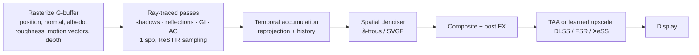

## Why this matters

In the [previous post]({{ '/blog/2026/graphics-05-ray-and-path-tracing/' | relative_url }}) we built a path tracer that converges to the right answer, given enough samples. An offline renderer can spend thousands of samples per pixel; a game at 60 fps has about 16 ms for *everything*, which buys roughly **one or two rays per pixel per frame**. Real-time ray tracing is the art of making those few samples count: hardware that traces them fast, sampling that makes each one smarter (ReSTIR), and reconstruction that reuses information across pixels and frames (temporal accumulation, SVGF, TAA, learned upscalers). These ideas also matter for neural rendering: reuse across views and time, G-buffer–guided filtering and small online-trained networks reappear in NeRF and 3D Gaussian Splatting pipelines.

## Prerequisites

- Monte Carlo estimators, importance sampling, MIS and NEE ([post 05]({{ '/blog/2026/graphics-05-ray-and-path-tracing/' | relative_url }})).
- BVHs and ray–triangle intersection (post 05).
- The rasterization pipeline and G-buffers ([post 02]({{ '/blog/2026/graphics-02-rasterization/' | relative_url }}), [post 03]({{ '/blog/2026/graphics-03-shading-and-textures/' | relative_url }})) and the rendering equation and GGX ([post 04]({{ '/blog/2026/graphics-04-physically-based-rendering/' | relative_url }})).

## 1. Hardware ray tracing

### 1.1 The API model: DXR and Vulkan Ray Tracing

Microsoft announced **DirectX Raytracing (DXR)** in 2018, and Khronos finalized the cross-vendor **Vulkan Ray Tracing** extensions (`VK_KHR_acceleration_structure`, `VK_KHR_ray_tracing_pipeline`, `VK_KHR_ray_query`) in 2020. Both expose the same abstraction:

1. **Acceleration structures (AS)** in two levels.
   - A **bottom-level AS (BLAS)** holds the geometry of one mesh (triangles or procedural AABBs) and is a BVH built by the driver.
   - A **top-level AS (TLAS)** holds *instances*: a BLAS reference plus a 3×4 object-to-world transform, an instance mask and a hit-group offset.
   - Rigid motion only needs a TLAS rebuild, which is cheap because there are few instances. Deforming meshes need a BLAS **refit** (update bounds, keep topology) or a full **rebuild** (better quality, slower). Choosing between them per frame is a classic engine trade-off.
2. **A ray tracing pipeline** with new shader stages:
   - **ray generation**: one invocation per pixel (or per work item); calls `TraceRay`.
   - **intersection**: custom primitives (spheres, curves); triangles use the built-in test.
   - **any-hit**: called for every candidate hit; used for alpha-tested foliage (`IgnoreHit()`) or shadow rays that only need *some* hit (`AcceptHitAndEndSearch()`).
   - **closest-hit**: shades the nearest hit; may trace further rays (recursion).
   - **miss**: no hit; returns sky/environment.
3. A **shader binding table (SBT)** that maps (instance, geometry, ray type) to the hit group to run, so that different materials can run different shaders.
4. **Inline ray tracing** (DXR 1.1 `RayQuery`, Vulkan `VK_KHR_ray_query`): trace from *any* shader stage (compute, fragment) without the pipeline and SBT. It is often preferred for shadow and AO rays because the scheduling is simpler.

The figure below shows the two levels on a toy 2D scene: one BLAS per mesh, built once in object space, and a TLAS over the world-space bounds of the instances that reference them.



A minimal DXR (HLSL) ray-generation, miss and closest-hit trio for hard shadows from a G-buffer:

```hlsl
RaytracingAccelerationStructure gScene : register(t0);
Texture2D<float4> gPosition : register(t1);   // world position, w = 1 if valid
Texture2D<float4> gNormal   : register(t2);
RWTexture2D<float> gShadow  : register(u0);
cbuffer Light : register(b0) { float3 gLightPos; float gPad; };

struct ShadowPayload { float visible; };

[shader("raygeneration")]
void RayGen()
{
    uint2 p = DispatchRaysIndex().xy;
    float4 P = gPosition[p];
    if (P.w == 0) { gShadow[p] = 1; return; }
    float3 N = normalize(gNormal[p].xyz);
    float3 L = gLightPos - P.xyz;

    RayDesc ray;
    ray.Origin    = P.xyz + 1e-3 * N;           // offset to avoid self-intersection
    ray.Direction = normalize(L);
    ray.TMin      = 0.0;
    ray.TMax      = length(L) - 1e-3;

    ShadowPayload pl = { 0.0 };
    // shadow rays only need to know "is anything in the way?"
    TraceRay(gScene,
             RAY_FLAG_ACCEPT_FIRST_HIT_AND_END_SEARCH | RAY_FLAG_SKIP_CLOSEST_HIT_SHADER,
             0xFF, 0, 1, 0, ray, pl);
    gShadow[p] = pl.visible;
}

[shader("miss")]
void ShadowMiss(inout ShadowPayload pl) { pl.visible = 1.0; }

[shader("closesthit")]
void ShadowHit(inout ShadowPayload pl, in BuiltInTriangleIntersectionAttributes a)
{
    pl.visible = 0.0;   // not executed here (skipped by the flag), kept for completeness
}
```

The `TraceRay` arguments after the flags are the instance mask, the SBT hit-group offset, the SBT stride (number of ray types), the miss shader index, the ray and the payload.

### 1.2 What the RT cores actually do

Since NVIDIA Turing (2018), and later in AMD RDNA 2, Intel Arc and recent mobile GPUs, GPUs include fixed-function units for the two inner loops of [post 05]({{ '/blog/2026/graphics-05-ray-and-path-tracing/' | relative_url }}): **ray–box tests during BVH traversal** and **ray–triangle tests**. How much is in hardware differs by vendor (some do the traversal loop itself in hardware, some only the box/triangle tests). In every case, the programmable cores still run your shaders. Practical consequences:

- **Divergence is the enemy.** Neighbouring pixels' secondary rays go in random directions, hit different materials and run different closest-hit shaders. GPUs execute in SIMD groups (warps/wavefronts), so incoherence wastes lanes. Hardware and APIs therefore add **shader execution reordering** (e.g. NVIDIA SER), which regroups threads by the hit shader they are about to run.
- **Memory traffic, not arithmetic, usually dominates**: compact BVH nodes, compressed BLAS and keeping hit shaders small all help.
- **Rays are a budget.** Engines spend them where rasterization is weakest: shadows from area lights, reflections, ambient occlusion and diffuse global illumination.

## 2. Hybrid rendering

Primary visibility is a "ray from the camera". Rasterization answers it exactly and very fast, so almost every real-time ray tracer is **hybrid**:



Two rules of thumb make this work:

1. **Separate signals before denoising.** Diffuse and specular indirect light have very different noise and spatial structure. They are traced into separate buffers and denoised with different parameters.
2. **Demodulate textures.** Divide the noisy irradiance by the albedo before filtering and multiply back afterwards. The filter then blurs only the smooth lighting, not the sharp texture detail:

$$
\text{color} = \text{albedo}\cdot \underbrace{E}_{\text{filter this}},\qquad E \approx \frac{\text{noisy color}}{\max(\text{albedo},\epsilon)} .
$$

## 3. Temporal accumulation and reprojection

A static camera could just average frames: after $n$ frames the variance drops as $\sigma^2/n$. When things move, we must find **where the current pixel was last frame**. The rasterizer writes a **motion vector** per pixel (the screen-space difference between the current and previous projected positions of the same surface point):

$$
\mathbf{u}_{\text{prev}} = \mathbf{u} - \mathbf{m}(\mathbf{u}),\qquad
\mathbf{m}(\mathbf{u}) = \pi\!\left(P_t V_t\, \mathbf{x}\right) - \pi\!\left(P_{t-1} V_{t-1} M_{t-1} M_t^{-1}\mathbf{x}\right),
$$

where $\pi$ is the perspective divide plus viewport transform and $M$ are the object's model matrices. The history is fetched at $$\mathbf{u}_{\text{prev}}$$ (bilinearly, at a sub-pixel position). It is **rejected** when the surfaces do not match, i.e. on **disocclusion**: the depth differs by more than a tolerance, the normals disagree ($$\mathbf{n}\cdot\mathbf{n}_{\text{prev}} < \cos\theta_{\max}$$), or the mesh/object ids differ.

The figure shows both cases on a toy example.

{% include blog_figure.liquid path="assets/img/blog/graphics/06-reprojection.svg" caption="Reprojection on a toy frame pair with a static camera: a dark disc moves 10 pixels to the right. Middle: each pixel on the disc follows its motion vector back to where the same surface was in frame t−1 (orange arrows; dashed circle = old position). Right: the depth test accepts the history on the disc (green) and rejects the crescent of floor that was hidden behind the disc in the last frame (red). That is a disocclusion: these pixels must start a new history." %}

Accepted history is blended with an **exponential moving average**:

$$
\bar{c}_t = (1-\alpha)\,\bar{c}_{t-1} + \alpha\, c_t, \qquad \alpha \approx 0.05\text{–}0.2 .
$$

For i.i.d. inputs with variance $\sigma^2$, the steady-state variance of the EMA is

$$
\operatorname{Var}[\bar c] = \sum_{k\ge0} \alpha^2 (1-\alpha)^{2k}\sigma^2 = \frac{\alpha}{2-\alpha}\,\sigma^2 ,
$$

so $\alpha=0.2$ behaves like averaging about 9 frames. The price is **lag** (ghosting) when lighting changes. A common refinement keeps a per-pixel **history length** $n$ and uses $\alpha = \max(1/n,\ \alpha_{\min})$. A freshly disoccluded pixel ($n=1$) takes the new sample fully, a pixel with $n$ frames of history is a true running mean, and long histories fall back to the EMA.

Both effects are visible in the figure below.

{% include blog_figure.liquid path="assets/img/blog/graphics/06-ema.svg" localized="true" caption="Left: the variance reduction of the EMA expressed as (2−α)/α equivalent frames; α = 0.2 gives 9. Right: a simulated pixel (noise σ = 0.25) that sees a different surface from frame 60 on. A fixed α = 0.1 without history rejection lags behind for dozens of frames (ghosting). Rejecting the history and using α = max(1/n, 0.1) jumps to the new value at once and then settles into the same noise band (shaded, ±σ√(α/(2−α)))." %}

## 4. Spatial denoising

Temporal reuse fails exactly where we need help most: just after disocclusion, on moving objects and under changing light. A **spatial** filter fills the gap by borrowing from neighbouring pixels that see "the same kind of surface".

### 4.1 Edge-avoiding à-trous wavelets (Dammertz et al. 2010)

A large Gaussian blur is expensive ($O(r^2)$ taps per pixel). The **à-trous** ("with holes") algorithm approximates a large kernel by applying the same small 5×5 B3-spline kernel $h = \tfrac{1}{16}[1,4,6,4,1]$ repeatedly, with its taps spread $2^i$ pixels apart at level $i$. Five levels (steps 1, 2, 4, 8, 16) cover a footprint of $125\times125$ pixels with only $5\times25$ taps per pixel. To avoid blurring across geometric edges, each tap $q$ around pixel $p$ is weighted by **edge-stopping functions** computed from the G-buffer:

$$
\hat c_{i+1}(p) = \frac{\sum_{q} h_i(q)\, w(p,q)\, \hat c_i(q)}{\sum_q h_i(q)\, w(p,q)},\qquad
w = w_{\text{rt}}\cdot w_{\mathbf n}\cdot w_{\mathbf x},
$$

$$
w_{\text{rt}} = e^{-\frac{\lVert c_p - c_q\rVert^2}{\sigma_{\text{rt}}^2}},\quad
w_{\mathbf n} = e^{-\frac{\lVert \mathbf n_p - \mathbf n_q\rVert^2}{\sigma_{\mathbf n}^2}},\quad
w_{\mathbf x} = e^{-\frac{\lVert \mathbf x_p - \mathbf x_q\rVert^2}{\sigma_{\mathbf x}^2}} ,
$$

with $\sigma_{\text{rt}}$ halved at every level so that the coarse levels respect edges in the already smoothed image. Many implementations, including the snippet below and the home-page demo, use the variant $w_{\mathbf n} = \max(0,\mathbf n_p\cdot\mathbf n_q)^{\sigma_{\mathbf n}}$ and a depth term instead of the world-position term. A self-contained NumPy version:

```python
import numpy as np

H = np.array([1, 4, 6, 4, 1]) / 16.0          # B3-spline kernel, separable 5x5


def atrous_level(c, nrm, z, step, s_c=0.5, s_n=128.0, s_z=1.0):
    """One edge-avoiding a-trous pass (Dammertz et al. 2010 style).
    c: (h,w,3) noisy color, nrm: (h,w,3) unit normals, z: (h,w) depth."""
    h, w, _ = c.shape
    acc = np.zeros_like(c)
    wsum = np.zeros((h, w, 1))
    for dy in range(-2, 3):
        for dx in range(-2, 3):
            # sample the neighbour 'step' pixels away (clamped at the border)
            ys = np.clip(np.arange(h) + dy * step, 0, h - 1)
            xs = np.clip(np.arange(w) + dx * step, 0, w - 1)
            cq, nq, zq = c[ys][:, xs], nrm[ys][:, xs], z[ys][:, xs]
            w_c = np.exp(-((c - cq) ** 2).sum(-1) / s_c**2)                  # color edge-stop
            w_n = np.maximum((nrm * nq).sum(-1), 0.0) ** s_n                 # normal edge-stop
            w_z = np.exp(-np.abs(z - zq) / (s_z * step + 1e-6))             # depth edge-stop
            wk = (H[dy + 2] * H[dx + 2] * w_c * w_n * w_z)[..., None]
            acc += wk * cq
            wsum += wk
    return acc / np.maximum(wsum, 1e-12)


def atrous(c, nrm, z, levels=5, s_c=4.0, **kw):
    for i in range(levels):                    # steps 1, 2, 4, 8, 16
        c = atrous_level(c, nrm, z, 2**i, s_c=s_c, **kw)
        s_c *= 0.5                             # tighten the color test each level
    return c


if __name__ == "__main__":
    rng = np.random.default_rng(1)
    h, w = 64, 96
    xx = np.mgrid[0:h, 0:w][1]
    left = xx < w // 2                                        # two "walls" meeting at an edge
    nrm = np.where(left[..., None], [1.0, 0.0, 0.0], [0.0, 0.0, 1.0])
    z = np.where(left, 2.0, 3.0)
    clean = np.where(left[..., None], [0.8, 0.3, 0.2], [0.2, 0.4, 0.8])
    noisy = clean * rng.exponential(1.0, (h, w, 1))           # 1-spp-like multiplicative noise
    out = atrous(noisy, nrm, z)
    rmse = lambda a: np.sqrt(((a - clean) ** 2).mean())
    print(f"RMSE noisy {rmse(noisy):.3f} -> filtered {rmse(out):.3f}")
    blur = atrous(noisy, nrm, z, s_n=0.0, s_z=1e9)            # no G-buffer guidance
    edge = lambda a: np.abs(a[:, w // 2 - 2:w // 2 + 2] - clean[:, w // 2 - 2:w // 2 + 2]).mean()
    print(f"error at the edge: guided {edge(out):.3f}, unguided {edge(blur):.3f}")
```

On this toy image it prints `RMSE noisy 0.523 -> filtered 0.101` and `error at the edge: guided 0.034, unguided 0.152`: the G-buffer terms are what keep the crease sharp.

The first figure below shows how the 5×5 taps spread out level by level; the second runs exactly the script above.



{% include blog_figure.liquid path="assets/img/blog/graphics/06-atrous-demo.svg" localized="true" caption="The script above on its own toy image (all numbers come from the code). Top: one exponential noise sample per pixel, then five guided and five unguided à-trous levels. Bottom left: the red channel averaged over rows. Without the normal and depth terms the crease is smeared over about 10 pixels. Bottom right: the G-buffer weight of each 5×5 tap at step 2 for a pixel p two pixels left of the crease. The taps on the other wall get weight zero (crossed), because the normals there are perpendicular." %}

### 4.2 SVGF: spatiotemporal variance-guided filtering (Schied et al. 2017)

The weakness of plain à-trous is the fixed color tolerance $\sigma_{\text{rt}}$. Too small and noise survives; too large and real lighting detail (shadow edges) is smeared. **SVGF** makes the tolerance *adaptive to the local noise level*:

1. **Temporal accumulation** (Section 3) of the demodulated color *and* of its first two luminance moments $\mu_1 = \mathbb E[l]$, $\mu_2=\mathbb E[l^2]$.
2. **Variance estimation**: $\sigma^2_l = \mu_2 - \mu_1^2$ from the temporal moments. For pixels with short history (fewer than 4 frames in the paper) it is estimated spatially from a 7×7 neighbourhood instead.
3. **Variance-guided à-trous**: five levels where the luminance edge-stop uses the *standard deviation* of the noise,

   $$
   w_l(p,q) = \exp\!\left(-\frac{\lvert l_p - l_q\rvert}{\sigma_l\sqrt{g_{3\times3}\!\left(\operatorname{Var}(l_p)\right)} + \epsilon}\right),
   $$

   with $g_{3\times3}$ a small Gaussian prefilter of the variance and $\sigma_l=4$. Because each level filters the signal, the variance is filtered too, with *squared* weights ($\operatorname{Var}\big[\sum_q w_q c_q / \sum_q w_q\big] = \sum_q w_q^2\operatorname{Var}[c_q]/(\sum_q w_q)^2$ for independent samples). Noisy regions are therefore smoothed aggressively and converged regions are left alone. The normal term is $\max(0,\mathbf n_p\cdot\mathbf n_q)^{\sigma_n}$ ($\sigma_n=128$), and the depth term divides the depth difference by the local depth gradient, $\lvert z_p - z_q\rvert / (\sigma_z \lvert\nabla z\cdot(p-q)\rvert + \epsilon)$.

4. The output of the first à-trous level is fed back as the next frame's color history, and a final TAA pass removes remaining flicker.

Production denoisers (e.g. NVIDIA's open-source NRD library: ReBLUR, ReLAX; the latter is SVGF-derived) refine this idea with per-signal tuning, hit-distance–aware kernels for specular and anti-lag heuristics. Learned denoisers that replace the hand-designed weights with a network are now common as well.

## 5. ReSTIR: reservoir-based spatiotemporal importance resampling

Denoisers can only clean up samples that are good on average. With thousands of lights, a single shadow ray per pixel aimed at a *uniformly* chosen light almost always hits a light that contributes nothing. ReSTIR (Bitterli et al. 2020) chooses much better lights for the same ray budget. It does this by **resampling** many cheap candidates and **reusing** them across pixels and frames.

### 5.1 Resampled importance sampling (RIS)

We want to estimate $I=\int f(x)\,dx$. For direct lighting, $f(x) = f_r\, L_e\, G\, V$ over points $x$ on lights. The ideal pdf is proportional to $f$, but $f$ contains the expensive visibility $V$. RIS (Talbot et al. 2005) uses a cheap **target function** $\hat p(x)\ge 0$, e.g. $f$ without $V$. It need not be normalized.

1. Draw $M$ candidates $x_1,\dots,x_M$ from an easy **source pdf** $p$ (e.g. pick a light uniformly or by power).
2. Give each the **resampling weight** $w_i = \hat p(x_i)/p(x_i)$.
3. Select one candidate $y = x_z$ with probability $w_z / \sum_j w_j$.
4. Estimate

$$
\langle I\rangle_{\text{RIS}} = \frac{f(y)}{\hat p(y)} \cdot \underbrace{\frac{1}{M}\sum_{j=1}^{M} w_j}_{\text{estimate of } \int\hat p} \;=\; f(y)\,W,\qquad W = \frac{1}{\hat p(y)}\,\frac{1}{M}\sum_j w_j .
$$

**Why it is unbiased.** Write $Z_M = \tfrac1M\sum_j w_j$. Conditioned on the candidates, the selection is a discrete importance sample, so

$$
\mathbb E\big[f(y)W \,\big\vert\, x_{1..M}\big] = \sum_{z} \frac{w_z}{M Z_M}\cdot \frac{f(x_z)}{\hat p(x_z)}\, Z_M = \frac1M\sum_{z} \frac{f(x_z)}{p(x_z)} ,
$$

whose expectation over the candidates is the standard importance-sampling estimator average, i.e. $I$. This requires $\hat p(x)>0$ wherever $f(x)\ne0$, and $p>0$ wherever $\hat p>0$. As $M\to\infty$ the distribution of $y$ approaches $\hat p/\int\hat p$, so $W$ acts like a $1/\text{pdf}$ for the selected sample. ReSTIR calls it the **unbiased contribution weight**. Only **one** shadow ray is traced, for $y$. The $M$ candidates cost only $\hat p$ evaluations.

The figure shows the procedure in one dimension.

{% include blog_figure.liquid path="assets/img/blog/graphics/06-ris.svg" localized="true" caption="RIS in 1D. Left: eight candidates drawn from the uniform source p = 1; each stem's height is its resampling weight, here simply the target $\hat p$. The orange one is selected with probability w/Σw = 0.32. The shaded integrand f also contains a visibility gap that $\hat p$ does not know about. Right: histograms of the selected sample over 200,000 runs. With M = 1 it is just the source; with M = 32 it already follows the normalized target." %}

### 5.2 Weighted reservoir sampling (WRS)

Storing all candidates is impossible on a GPU. **Weighted reservoir sampling** selects from a stream in $O(1)$ memory. It keeps the current pick $y$, the running sum $w_{\text{sum}}$ and the count $M$. When item $x_i$ with weight $w_i$ arrives, it replaces $y$ with probability $w_i/w_{\text{sum}}$ (after adding $w_i$). By induction, each item ends up selected with probability $w_i/\sum_j w_j$, exactly what RIS needs.

The key property: **two reservoirs can be merged** without their candidates. Feed reservoir $r$'s pick into a new reservoir with weight $\hat p(y_r)\,W_r\,M_r$ (for identical target functions this equals $w_{\text{sum},r}$) and add up the $M$'s. The result is distributed as if RIS had seen all $\sum_r M_r$ candidates, at the cost of one merge per reservoir. This is what makes reuse across pixels and frames cheap.

### 5.3 Spatiotemporal reuse

Per pixel and frame, ReSTIR DI:

1. **Initial candidates**: $M\approx 32$ light samples, streamed into a reservoir with $\hat p = $ unshadowed contribution.
2. *(optional)* **visibility reuse**: trace one shadow ray for $y$; if occluded set $W=0$, so occluded samples do not spread to neighbours.
3. **Temporal reuse**: merge the reservoir from the reprojected pixel of the previous frame. Its $M$ is clamped to a small multiple of the current one (e.g. 20×) to bound staleness.
4. **Spatial reuse**: merge reservoirs of $k$ random neighbours (e.g. 5 within a 30-pixel radius), rejecting those whose depth or normal differ too much. This can be iterated.
5. **Shade**: one shadow ray for the final $y$, contribution $f(y)\,W$.

The figure sketches steps 3 and 4.



When neighbours' samples are re-weighted with *this* pixel's $\hat p$, they were drawn from a different distribution. The naive weight $1/M$ then becomes **biased**, typically darkening edges where a neighbour's sample is invisible here. The unbiased version replaces $1/M$ by a normalization $1/Z$ that counts only those neighbours whose own $\hat p_q(y)>0$. It can also use MIS-style weights over the neighbours. The GRIS theory of Lin et al. (2022) generalizes these weights and also covers correlated samples and samples reused across different domains.

Below is a complete, runnable toy experiment. One shading point sees 4096 point lights of very uneven intensity, and some are hidden behind a wall. We compare uniform light selection, RIS with 32 candidates, and the merge of four independent RIS reservoirs. All three should be unbiased; RIS should have far less variance.

```python
import numpy as np

rng = np.random.default_rng(0)

# --- a toy "many lights" scene: one shading point, N point lights on a plane above it
N = 4096
light_pos = np.c_[rng.uniform(-8, 8, N), rng.uniform(0.5, 4, N), rng.uniform(-8, 8, N)]
light_I = rng.lognormal(0.0, 1.0, N)          # very uneven intensities
x, n = np.zeros(3), np.array([0.0, 1.0, 0.0])  # shading point and its normal
occluder_x = 1.0                               # lights with 0 < x < 1.5 are "behind a wall"

d = light_pos - x
dist2 = (d * d).sum(1)
cos = np.maximum((d @ n) / np.sqrt(dist2), 0.0)
visible = ~((light_pos[:, 0] > 0) & (light_pos[:, 0] < 1.5 * occluder_x))

f = light_I * cos / dist2 * visible      # integrand: contribution of light i (Lambert, albedo/pi dropped)
p_hat = light_I * cos / dist2            # target function: same, but without the visibility ray
exact = f.sum()                          # "integral" = sum over all lights


class Reservoir:
    """Weighted reservoir sampling: keeps one sample y out of a stream."""
    def __init__(self):
        self.y, self.w_sum, self.M, self.W = -1, 0.0, 0, 0.0

    def update(self, x_i, w_i, u):
        self.w_sum += w_i
        self.M += 1
        if self.w_sum > 0 and u < w_i / self.w_sum:
            self.y = x_i


def ris_estimate(M, rng):
    r = Reservoir()
    for _ in range(M):
        i = rng.integers(N)              # source pdf p(i) = 1/N (uniform light pick)
        w = p_hat[i] / (1.0 / N)         # resampling weight w_i = p_hat / p
        r.update(i, w, rng.random())
    if r.y < 0 or p_hat[r.y] == 0:
        return r, 0.0
    r.W = r.w_sum / (r.M * p_hat[r.y])   # unbiased contribution weight
    return r, f[r.y] * r.W               # one shadow ray: f includes visibility


def combine(reservoirs, rng):
    """Merge reservoirs that share the same target p_hat (e.g. spatial reuse at one pixel)."""
    s = Reservoir()
    for r in reservoirs:
        if r.y >= 0:
            s.update(r.y, p_hat[r.y] * r.W * r.M, rng.random())
            s.M += r.M - 1               # update() added 1; total M is the sum of the inputs
        else:
            s.M += r.M
    if s.y < 0:
        return s, 0.0
    s.W = s.w_sum / (s.M * p_hat[s.y])
    return s, f[s.y] * s.W


trials = 20000
uni = np.array([f[i] * N for i in rng.integers(N, size=trials)])
ris = np.array([ris_estimate(32, rng)[1] for _ in range(trials)])
mrg = np.array([combine([ris_estimate(32, rng)[0] for _ in range(4)], rng)[1] for _ in range(trials // 4)])

print(f"exact             : {exact:.4f}")
for name, e in [("uniform, 1 cand. ", uni), ("RIS, M=32        ", ris), ("4 merged RIS (128)", mrg)]:
    print(f"{name}: mean {e.mean():.4f} +- {e.std() / np.sqrt(len(e)):.4f}   rel. std per sample {e.std() / exact:.2f}")
```

Output (a few seconds on a laptop):

```text
exact             : 94.9404
uniform, 1 cand. : mean 93.2393 +- 2.2691   rel. std per sample 3.38
RIS, M=32        : mean 95.9497 +- 0.6209   rel. std per sample 0.92
4 merged RIS (128): mean 92.6408 +- 0.9898   rel. std per sample 0.74
```

All means agree with the exact value within about two standard errors. A vectorized run with 200,000 RIS estimates at $M=128$ gives $95.00 \pm 0.15$. The per-sample relative standard deviation drops from 3.4 to 0.9 with 32 candidates and to 0.74 after merging. This is the "free" quality ReSTIR gets from spatial reuse. Note that RIS cannot fix the hidden lights, because $\hat p$ ignores visibility; this is why the visibility-reuse step matters.

The figure repeats the experiment for many candidate counts.

{% include blog_figure.liquid path="assets/img/blog/graphics/06-ris-variance.svg" localized="true" caption="The many-lights experiment above, vectorized (100,000 estimates per point). Left: the 4096 lights seen from above, coloured by the target $\hat p$; the red strip is hidden by the wall. Right: the relative standard deviation per estimate drops quickly with M and flattens near 0.65, the noise that remains even when sampling exactly proportional to $\hat p$, because $\hat p$ ignores visibility. M = 1 is uniform light selection. The markers are the values printed by the script; its uniform value (3.38, from 20,000 trials) differs from ours (3.66) only by the sampling noise of this heavy-tailed estimator." %}

On the GPU the reservoir is a tiny struct stored per pixel in a buffer that persists between frames:

```glsl
struct Reservoir {
    uint  y;      // selected light sample (index or packed position)
    float wSum;   // sum of resampling weights
    float M;      // number of candidates seen (float so it can be clamped/scaled)
    float W;      // unbiased contribution weight
};

bool updateReservoir(inout Reservoir r, uint xi, float wi, float u) {
    r.wSum += wi;
    r.M += 1.0;
    if (u * r.wSum < wi) { r.y = xi; return true; }
    return false;
}

// merge reservoir q (from a neighbour or the previous frame) into r;
// pHatHere is the target function of q.y evaluated at *this* pixel
void mergeReservoir(inout Reservoir r, Reservoir q, float pHatHere, float u) {
    float M0 = r.M;
    updateReservoir(r, q.y, pHatHere * q.W * q.M, u);
    r.M = M0 + q.M;
}

void finalizeReservoir(inout Reservoir r, float pHatY) {
    r.W = (pHatY > 0.0) ? r.wSum / (r.M * pHatY) : 0.0;  // biased 1/M variant
}
```

### 5.4 ReSTIR GI

ReSTIR GI (Ouyang et al. 2021) applies the same machinery to **indirect** light. Each pixel's visible point $x_v$ traces one BSDF-sampled ray to a **sample point** $x_s$ and estimates the outgoing radiance $L_o(x_s)$ there (with its own NEE and further bounces). The reservoir stores the *path vertex* $(x_s, \mathbf n_s, L_o)$. The target function is essentially the luminance of the radiance arriving along that path, e.g. $\hat p = \operatorname{lum}(L_o(x_s))$ or that times the BSDF and cosine at $x_v$. When pixel $r$ reuses the sample of neighbour $q$, it *reconnects* its own visible point $x_r$ to $x_s$. Since the sample was generated as a solid angle around $x_q$, its pdf must be converted with the Jacobian of this change of variables:

$$
\lvert J_{q\to r}\rvert = \frac{\lvert\cos\phi_r\rvert}{\lvert\cos\phi_q\rvert}\cdot\frac{\lVert x_q - x_s\rVert^2}{\lVert x_r - x_s\rVert^2},
$$

where $\phi_q,\phi_r$ are the angles between $\mathbf n_s$ and the directions from $x_s$ toward $x_q$ and $x_r$. The reused target function is divided by $\lvert J\rvert$, and samples with extreme Jacobians are rejected. One sample per pixel per frame of path-traced indirect lighting then becomes far less noisy before denoising. ReSTIR GI still relies on a denoiser for the final image. Later work (ReSTIR PT, area ReSTIR, ReSTIR for volumes) generalizes the reconnection idea.



## 6. TAA and learned upscaling

### 6.1 Temporal anti-aliasing

Real-time renderers rarely afford MSAA together with deferred shading, so anti-aliasing is done **temporally**, with the same reprojection as Section 3. The projection matrix is **jittered** by a different sub-pixel offset each frame (a Halton(2,3) sequence is typical), so successive frames sample different positions inside each pixel. Blending them with an EMA integrates the pixel footprint: the supersampling of [post 02]({{ '/blog/2026/graphics-02-rasterization/' | relative_url }}), spread over time. The hard part is invalid history. Karis's 2014 *High Quality Temporal Supersampling* talk popularized **neighbourhood clamping**: the history color is clamped (or clipped toward the center) to the bounding box of the current frame's 3×3 neighbourhood, often in YCoCg space. A history color that could not exist in the current neighbourhood (ghosting) is pulled back:

```glsl
// history: reprojected color, cur: current frame color texture, uv: pixel center
vec3 taaResolve(sampler2D cur, vec3 history, vec2 uv, vec2 texel) {
    vec3 m1 = vec3(0.0), m2 = vec3(0.0);
    for (int y = -1; y <= 1; ++y)
        for (int x = -1; x <= 1; ++x) {
            vec3 c = texture(cur, uv + vec2(x, y) * texel).rgb;
            m1 += c; m2 += c * c;
        }
    vec3 mu = m1 / 9.0;
    vec3 sigma = sqrt(max(m2 / 9.0 - mu * mu, 0.0));
    vec3 lo = mu - 1.0 * sigma, hi = mu + 1.0 * sigma;   // box from mean +- 1 std
    vec3 h = clamp(history, lo, hi);
    vec3 c0 = texture(cur, uv).rgb;
    return mix(h, c0, 0.1);                               // alpha = 0.1
}
```

Clamping trades ghosting for some blur and flicker on thin features. This trade-off motivated learned approaches.

Why a low-discrepancy sequence rather than random jitter? The figure measures it.



### 6.2 Learned upscaling (DLSS and friends)

Rendering at a lower internal resolution and **upscaling** saves ray and shading cost roughly in proportion to the pixel count. NVIDIA's **DLSS** (since version 2 in 2020) is, at a high level, TAA whose heuristic history-rejection and blending rules are replaced by a convolutional network. The inputs are the jittered low-resolution color, depth, motion vectors and exposure, plus the previous high-resolution output warped by the motion vectors; the output is the high-resolution frame. Later versions add **frame generation** (interpolating extra frames with optical flow) and **ray reconstruction**, which replaces the hand-tuned denoisers of Section 4 with a network trained on ray-traced data. AMD FSR (versions 1–3 hand-designed; FSR 4 ML-based) and Intel XeSS play the same role. For our purposes, the lesson is structural: modern real-time images are **reconstructed** from sparse, jittered, temporally reused samples, much like neural rendering reconstructs a scene from sparse views.

## 7. Neural radiance caching

Path tracing spends most of its cost and noise on long, multi-bounce tails. A **radiance cache** stores (approximate) outgoing radiance $L_o(\mathbf x,\omega)$ so paths can stop early and look up the rest. Classical caches (irradiance caching, probe grids such as DDGI) are compact but blur detail or leak light.

**Neural radiance caching** (Müller et al. 2021) uses a small MLP $\hat L_\theta(\mathbf x, \omega, \mathbf n, r, \alpha_d, \alpha_s)$. Its inputs are position, direction, surface normal, roughness and diffuse/specular reflectance, passed through input encodings, and its output is the radiance.

- **Rendering**: each path is traced for a short prefix. It is terminated, and the cache is queried, once the path's spread becomes large enough that the cache's blur is invisible. The path throughput multiplies the cached $\hat L_\theta$.
- **Training, online**: a small fraction of paths is extended a few bounces further. The radiance they collect, which itself ends in a cache query, gives the training targets. This "self-training" lets the network learn multi-bounce light while each path stays short. A few gradient steps are taken every frame, so the cache adapts to dynamic scenes without pre-training.
- **Speed**: the network is tiny and evaluated by a "fully fused" GPU MLP (the tiny-cuda-nn approach), which keeps weights and activations in on-chip memory.



This is a direct ancestor of the neural rendering track. The same fused-MLP and input-encoding machinery appears in Instant-NGP, and an online-trained radiance network is conceptually a NeRF of the *current* scene's illumination.

## Try it

The **path tracer** in the [lab on the home page]({{ '/' | relative_url }}#lab) runs entirely in WebGL fragment shaders and demonstrates several pieces of this post:

- Turn **Denoise** on and drag the camera or an object. During interaction, only a few samples per pixel have been accumulated. A 5-level edge-avoiding **à-trous** filter (steps 1, 2, 4, 8, 16), guided by the normal, depth and albedo buffers, cleans the image, as in Section 4.1. Turn it off to see the raw signal.
- Switch the view between **Final**, **Noisy**, **Albedo**, **Normal** and **Depth**. The last three are the G-buffer that drives the edge-stopping weights. Look at how the filter keeps edges where normals or depth jump, and why albedo is used to demodulate texture.
- Shrink the light and switch between **BSDF**, **NEE** and **MIS**. Better sampling (the problem ReSTIR attacks at scale) shrinks the noise *before* the denoiser has to hide it.
- Leave the camera still: progressive accumulation is the static-camera limit of temporal accumulation (Section 3), and the image converges to the noise-free reference.

## Representative papers

| Paper | Venue | Year | Link | Why it matters |
| --- | --- | --- | --- | --- |
| Talbot, Cline, Egbert. *Importance Resampling for Global Illumination* | EGSR | 2005 | [DOI](https://doi.org/10.2312/EGWR/EGSR05/139-146) | Introduces RIS for rendering, the estimator behind ReSTIR |
| Dammertz, Sewtz, Hanika, Lensch. *Edge-Avoiding À-Trous Wavelet Transform for fast Global Illumination Filtering* | HPG | 2010 | [DOI](https://doi.org/10.2312/EGGH/HPG10/067-075) | G-buffer–guided wavelet filter; the base of most real-time denoisers |
| Karis. *High Quality Temporal Supersampling* | SIGGRAPH Advances in Real-Time Rendering course | 2014 | — | Popularized jittered TAA with neighbourhood clamping |
| Schied et al. *Spatiotemporal Variance-Guided Filtering* (SVGF) | HPG | 2017 | [DOI](https://doi.org/10.1145/3105762.3105770) | Temporal moments → variance → adaptive à-trous; 1-spp path tracing in real time |
| Bitterli et al. *Spatiotemporal Reservoir Resampling for Real-Time Ray Tracing with Dynamic Direct Lighting* (ReSTIR) | SIGGRAPH / ACM TOG 39(4) | 2020 | [DOI](https://doi.org/10.1145/3386569.3392481) | RIS + reservoirs + spatiotemporal reuse for millions of lights |
| Ouyang et al. *ReSTIR GI: Path Resampling for Real-Time Path Tracing* | HPG / Computer Graphics Forum 40(8) | 2021 | [DOI](https://doi.org/10.1111/cgf.14378) | Extends ReSTIR to indirect illumination with reconnection Jacobians |
| Müller, Rousselle, Novák, Keller. *Real-time Neural Radiance Caching for Path Tracing* | SIGGRAPH / ACM TOG 40(4) | 2021 | [arXiv](https://arxiv.org/abs/2106.12372) | Online-trained MLP cache; bridge to neural rendering |
| Lin et al. *Generalized Resampled Importance Sampling: Foundations of ReSTIR* | SIGGRAPH / ACM TOG 41(4) | 2022 | [DOI](https://doi.org/10.1145/3528223.3530158) | Rigorous theory (GRIS) for reuse across domains and correlated samples |
| Wyman et al. *A Gentle Introduction to ReSTIR: Path Reuse in Real-time* | SIGGRAPH Courses | 2023 | [DOI](https://doi.org/10.1145/3587423.3595511) | The best tutorial on ReSTIR theory and practice |

## Learning resources

- **GAMES202: Real-Time High Quality Rendering** (Lingqi Yan): real-time shadows, global illumination, PBR and the real-time ray tracing/denoising lectures. It is the natural companion to this post.
- **Real-Time Rendering**, 4th ed. (Akenine-Möller et al.): chapters on ray tracing, TAA and upscaling.
- **Ray Tracing Gems** I and II (free e-books from NVIDIA): many practical chapters on DXR, denoising and sampling.
- **PBRT** (Physically Based Rendering, free online at [pbr-book.org](https://pbr-book.org/)) for the Monte Carlo foundations.
- **Microsoft DirectX specs** (the DXR spec lives in [github.com/microsoft/DirectX-Specs](https://github.com/microsoft/DirectX-Specs)) and the Vulkan specification (`VK_KHR_ray_tracing_pipeline`, `VK_KHR_ray_query`).
- Open-source code: [NVIDIA NRD](https://github.com/NVIDIA-RTX/NRD) (real-time denoisers) and [NVIDIA RTXDI](https://github.com/NVIDIA-RTX/RTXDI) (production ReSTIR DI/GI).

## Exercises

1. Prove the EMA variance formula $\operatorname{Var}[\bar c] = \frac{\alpha}{2-\alpha}\sigma^2$, and show that $\alpha_n = 1/n$ gives exactly the running mean.
2. In the RIS script, change the source pdf to pick lights proportionally to $I_i$ (remember to update $w_i = \hat p/p$). How does the variance change for $M=1$ and $M=32$?
3. Implement the *biased* spatial reuse: merge reservoirs computed for *different* shading points (different normals) using the plain $1/M$ weight, and measure the bias. Then fix it with the $1/Z$ normalization.
4. Add a variance estimate to the à-trous script (temporal moments over 8 noisy "frames") and replace the fixed color tolerance by the SVGF luminance weight. Compare the edge error.
5. In the lab path tracer, find a configuration (small light, glossy objects) where the denoiser visibly blurs real detail. Explain which edge-stopping term is responsible.

Next: [Physically based simulation]({{ '/blog/2026/graphics-07-physically-based-simulation/' | relative_url }}), where we switch from simulating light to simulating matter: particles, cloth and XPBD.
