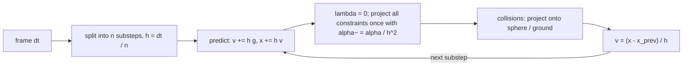

## Why this matters

So far the series has been about how light leaves a scene: [rasterization]({{ '/blog/2026/graphics-02-rasterization/' | relative_url }}), [physically based shading]({{ '/blog/2026/graphics-04-physically-based-rendering/' | relative_url }}), [path tracing]({{ '/blog/2026/graphics-05-ray-and-path-tracing/' | relative_url }}) and its [real-time variants]({{ '/blog/2026/graphics-06-real-time-ray-tracing/' | relative_url }}). This last post is about how the scene itself *moves*. Physically based animation powers cloth in games and VR, visual effects in film, and, increasingly, the simulators that generate training data for robots, embodied agents and world models. The methods here (especially Position Based Dynamics and XPBD) are also exactly what you will find inside game engines and the cloth demo on this site's home page.

We will build up from a single particle to an XPBD cloth solver you can run in NumPy, derive the XPBD update from implicit Euler, and then survey rigid bodies and particle-based fluids.

## Prerequisites

- Vectors, gradients and the chain rule ([post 1]({{ '/blog/2026/graphics-01-roadmap-and-math/' | relative_url }})).
- Basic ordinary differential equations: $\dot{\mathbf{x}} = \mathbf{v}$, $\dot{\mathbf{v}} = \mathbf{a}$.
- Newton's method and Lagrange multipliers (only the idea).
- Python with NumPy.

## 1. The simulation loop

A particle system is a set of points with positions $\mathbf{x}_i$, velocities $\mathbf{v}_i$ and masses $m_i$. Newton's second law gives a system of ordinary differential equations (ODEs)

$$
\dot{\mathbf{x}}_i = \mathbf{v}_i, \qquad m_i \dot{\mathbf{v}}_i = \mathbf{f}_i(\mathbf{x}, \mathbf{v}, t),
$$

where $\mathbf{f}_i$ collects gravity, springs, drag, contact and user forces. Stacking all particles, we write $\mathbf{x} \in \mathbb{R}^{3N}$ and a diagonal mass matrix $\mathbf{M}$, so $\mathbf{M}\ddot{\mathbf{x}} = \mathbf{f}$. It is convenient to work with the **inverse mass** $w_i = 1/m_i$: a pinned (kinematic) particle simply has $w_i = 0$.

A real-time simulator advances this ODE by a time step $\Delta t$ (often $1/60$ s per frame, split into substeps). Everything interesting is in *how* you take that step.

## 2. Time integrators

### Explicit, implicit and symplectic Euler

The simplest scheme evaluates forces at the beginning of the step:

$$
\text{explicit Euler:}\quad \mathbf{x}^{n+1} = \mathbf{x}^n + \Delta t\, \mathbf{v}^n, \qquad \mathbf{v}^{n+1} = \mathbf{v}^n + \Delta t\, \mathbf{M}^{-1}\mathbf{f}(\mathbf{x}^n).
$$

**Implicit (backward) Euler** evaluates them at the end of the step, which turns each step into a (generally nonlinear) system of equations:

$$
\text{implicit Euler:}\quad \mathbf{x}^{n+1} = \mathbf{x}^n + \Delta t\, \mathbf{v}^{n+1}, \qquad \mathbf{v}^{n+1} = \mathbf{v}^n + \Delta t\, \mathbf{M}^{-1}\mathbf{f}(\mathbf{x}^{n+1}).
$$

**Symplectic (semi-implicit) Euler** updates the velocity first and then uses the *new* velocity for the position:

$$
\text{symplectic Euler:}\quad \mathbf{v}^{n+1} = \mathbf{v}^n + \Delta t\, \mathbf{M}^{-1}\mathbf{f}(\mathbf{x}^n), \qquad \mathbf{x}^{n+1} = \mathbf{x}^n + \Delta t\, \mathbf{v}^{n+1}.
$$

It costs the same as explicit Euler but behaves completely differently.

To see why, take a single undamped spring, $m\ddot{x} = -kx$, with natural frequency $\omega = \sqrt{k/m}$. Writing one step as a linear map $(x, v)^{n+1} = \mathbf{A}(x, v)^n$, explicit Euler has

$$
\mathbf{A}_{\text{exp}} = \begin{pmatrix} 1 & \Delta t \\ -\omega^2 \Delta t & 1 \end{pmatrix}, \qquad \det \mathbf{A}_{\text{exp}} = 1 + \omega^2 \Delta t^2 > 1,
$$

so its eigenvalues have modulus $\sqrt{1+\omega^2\Delta t^2}$ and the energy grows every step, for *any* $\Delta t$. Implicit Euler has eigenvalues of modulus $1/\sqrt{1+\omega^2\Delta t^2} < 1$: it is unconditionally stable but artificially damps the motion. Symplectic Euler has $\det \mathbf{A} = 1$ (it preserves phase-space area), and for $\omega \Delta t < 2$ its eigenvalues lie on the unit circle: energy oscillates around the true value instead of drifting.

The figure plots these eigenvalue moduli as a function of $\omega\Delta t$.



### Verlet

**Störmer–Verlet** integration eliminates the velocity altogether:

$$
\mathbf{x}^{n+1} = 2\mathbf{x}^n - \mathbf{x}^{n-1} + \Delta t^2\, \mathbf{M}^{-1}\mathbf{f}(\mathbf{x}^n).
$$

It is second-order accurate, time-reversible and symplectic; velocities, if needed, come from differences such as $(\mathbf{x}^{n+1}-\mathbf{x}^{n})/\Delta t$. Jakobsen's GDC 2001 talk "Advanced Character Physics" popularized Verlet plus constraint projection for games, a direct ancestor of PBD. Note that the PBD loop below, "predict with symplectic Euler, then derive velocity from the position change", is algebraically a Verlet-style position update.

### An experiment

```python
import numpy as np

k, m, h, steps = 100.0, 1.0, 0.01, 2000          # spring stiffness, mass, time step
def energy(x, v): return 0.5 * m * v**2 + 0.5 * k * x**2

def explicit_euler(x, v):
    return x + h * v, v + h * (-k / m * x)

def symplectic_euler(x, v):
    v = v + h * (-k / m * x)                      # velocity first ...
    return x + h * v, v                           # ... then position with the new velocity

def implicit_euler(x, v):
    # solve x' = x + h v',  v' = v - h k/m x'  (linear, so closed form)
    A = np.array([[1.0, -h], [h * k / m, 1.0]])
    return tuple(np.linalg.solve(A, [x, v]))

def verlet(x, x_prev):
    a = -k / m * x
    return 2 * x - x_prev + h * h * a, x          # returns (x_next, x_current)

for name, f in [("explicit", explicit_euler), ("symplectic", symplectic_euler), ("implicit", implicit_euler)]:
    x, v = 1.0, 0.0
    for _ in range(steps):
        x, v = f(x, v)
    print(f"{name:10s} E/E0 = {energy(x, v) / energy(1.0, 0.0):.3f}")

x, xp = 1.0, 1.0 - 0.5 * h * h * k / m            # second-order start: x_{-1} = x0 - h v0 + h^2 a0 / 2
for _ in range(steps):
    x, xp = verlet(x, xp)
v = (x - xp) / h                                  # backward-difference velocity
print(f"{'verlet':10s} E/E0 = {energy(x, v) / energy(1.0, 0.0):.3f}")
```

After 20 simulated seconds ($\omega\Delta t = 0.1$) this prints an energy ratio of about $4.4 \times 10^8$ for explicit Euler (that is $1.01^{2000}$), $0.000$ for implicit Euler, and about $1.05$ for both symplectic Euler and Verlet (bounded oscillation; the last digits depend on the phase at which you stop). This is the whole story of game physics in one table: explicit Euler explodes, implicit Euler is stable but mushy, symplectic schemes are cheap and well-behaved as long as the step is small relative to the stiffest frequency.

The figures below show the same runs in phase space and over time.



{% include blog_figure.liquid path="assets/img/blog/graphics/07-integrators-energy.svg" caption="Energy ratio $E/E_0$ of the same runs over the full 20 s. Left (log scale): explicit Euler lies exactly on $1.01^n$ and reaches $4.4\times10^8$; implicit Euler decays to about $2\times10^{-9}$ (the 0.000 printed above). Right: the first 2 s of the two symplectic schemes, which oscillate within about 5 % of the true energy without drifting." %}

## 3. Mass-spring cloth

The classic cloth model connects a grid of particles with springs. A spring between particles $a$ and $b$ with rest length $L_0$, stiffness $k_s$ and damping $k_d$ applies to $a$ the force

$$
\mathbf{f}_a = -\Big(k_s\big(\lVert\mathbf{x}_{ab}\rVert - L_0\big) + k_d\, (\mathbf{v}_a - \mathbf{v}_b)\cdot\hat{\mathbf{x}}_{ab}\Big)\, \hat{\mathbf{x}}_{ab}, \qquad \mathbf{x}_{ab} = \mathbf{x}_a - \mathbf{x}_b,
$$

and $\mathbf{f}_b = -\mathbf{f}_a$. Three kinds of springs give a fabric-like response:

| Spring | Connects | Resists |
| --- | --- | --- |
| Structural (stretch) | $(i,j)$–$(i+1,j)$ and $(i,j)$–$(i,j+1)$ | stretching along warp and weft |
| Shear | the two diagonals of each grid cell | in-plane shearing |
| Bending | $(i,j)$–$(i+2,j)$ and $(i,j)$–$(i,j+2)$ | folding (a cheap substitute for dihedral-angle bending) |

The figure shows the three families on a small grid.



The difficulty is **stiffness**. Real cloth barely stretches, so $k_s$ must be large; the stable step for explicit or symplectic integration scales like $\Delta t \lesssim 2/\omega_{\max} \sim 2\sqrt{m/k_s}$, which becomes tiny. Baraff and Witkin's "Large Steps in Cloth Simulation" (SIGGRAPH 1998) solved this offline with implicit Euler: linearize the forces, solve one sparse linear system $\big(\mathbf{M} - \Delta t\,\partial\mathbf{f}/\partial\mathbf{v} - \Delta t^2\,\partial\mathbf{f}/\partial\mathbf{x}\big)\Delta\mathbf{v} = \Delta t\,(\mathbf{f} + \Delta t\, \partial\mathbf{f}/\partial\mathbf{x}\, \mathbf{v})$ per step with conjugate gradients. That is robust but costly to implement and tune. Position based methods take a different route.

## 4. Position Based Dynamics (PBD)

Müller et al. (2007) proposed to skip forces entirely and work with **constraints** on positions, $C_j(\mathbf{x}) = 0$ (equality) or $C_j(\mathbf{x}) \ge 0$ (inequality, e.g. "stay above the floor"). For a distance constraint, $C(\mathbf{x}) = \lVert\mathbf{x}_a - \mathbf{x}_b\rVert - L_0$.

The algorithm per step:

1. **Predict**: $\mathbf{v} \leftarrow \mathbf{v} + \Delta t\,\mathbf{M}^{-1}\mathbf{f}_{\text{ext}}$, $\;\mathbf{p} \leftarrow \mathbf{x} + \Delta t\,\mathbf{v}$.
2. **Project** constraints on $\mathbf{p}$ for a number of iterations (Gauss–Seidel: one constraint at a time, immediately updating positions).
3. **Update**: $\mathbf{v} \leftarrow (\mathbf{p} - \mathbf{x})/\Delta t$, $\;\mathbf{x} \leftarrow \mathbf{p}$.

### Projecting one constraint

We want a correction $\Delta\mathbf{p}$ with $C(\mathbf{p} + \Delta\mathbf{p}) = 0$. Linearizing, $C(\mathbf{p}) + \nabla C(\mathbf{p})\,\Delta\mathbf{p} \approx 0$. To conserve linear and angular momentum, the correction is chosen along the mass-weighted gradient, $\Delta\mathbf{p} = \lambda\, \mathbf{M}^{-1}\nabla C^\top$ (heavier particles move less). Substituting,

$$
\lambda = \frac{-C(\mathbf{p})}{\nabla C\, \mathbf{M}^{-1} \nabla C^\top} = \frac{-C(\mathbf{p})}{\sum_i w_i \lVert\nabla_{\mathbf{p}_i} C\rVert^2}, \qquad \Delta\mathbf{p}_i = \lambda\, w_i \nabla_{\mathbf{p}_i} C^\top.
$$

For the distance constraint, $\nabla_{\mathbf{p}_a}C = \hat{\mathbf{n}}^\top$, $\nabla_{\mathbf{p}_b}C = -\hat{\mathbf{n}}^\top$ with $\hat{\mathbf{n}} = (\mathbf{p}_a-\mathbf{p}_b)/\lVert\mathbf{p}_a-\mathbf{p}_b\rVert$, hence

$$
\Delta\mathbf{p}_a = -\frac{w_a}{w_a + w_b}\big(\lVert\mathbf{p}_a-\mathbf{p}_b\rVert - L_0\big)\hat{\mathbf{n}}, \qquad
\Delta\mathbf{p}_b = +\frac{w_b}{w_a + w_b}\big(\lVert\mathbf{p}_a-\mathbf{p}_b\rVert - L_0\big)\hat{\mathbf{n}}.
$$

PBD is unconditionally stable: it never adds energy through a stiff force, because there is no force, only geometry. It handles pinning ($w=0$), collisions and tearing trivially.

The figure shows this projection for three mass ratios.

{% include blog_figure.liquid path="assets/img/blog/graphics/07-pbd-projection.svg" caption="Projecting one stretched distance constraint with $L_0=1$. Open circles: predicted positions; filled circles: after projection, where the purple segment has exactly the rest length. Both corrections lie along $\hat{\mathbf{n}}$ and split $C$ in the ratio of the inverse masses, so the heavier particle moves less and the green cross (the center of mass) does not move. With $w_b=0$ (pinned, red), particle $a$ takes the whole correction." %}

### The problem: stiffness depends on iterations

To make a constraint "soft", original PBD scales each correction by a factor $k \in [0,1]$. After $n$ iterations the remaining error behaves like $(1-k)^n$, so the effective stiffness is $1-(1-k)^n$: it depends on the iteration count and also on the time step. Change the number of iterations to save time, and your cloth suddenly becomes rubbery. There is also no physical unit attached to $k$. XPBD fixes exactly this.

## 5. XPBD: compliant constraints, derived

Macklin, Müller and Chentanez (2016) connect PBD to implicit time integration of an elastic potential. Associate with the constraint vector $\mathbf{C}(\mathbf{x})$ the energy

$$
U(\mathbf{x}) = \tfrac{1}{2}\, \mathbf{C}(\mathbf{x})^\top \boldsymbol{\alpha}^{-1}\, \mathbf{C}(\mathbf{x}),
$$

where $\boldsymbol{\alpha}$ is a diagonal **compliance** matrix (inverse stiffness, e.g. $\alpha = 1/k$ in m/N for a distance constraint). The elastic force is $\mathbf{f}_{\text{el}} = -\nabla U^\top = -\nabla\mathbf{C}^\top \boldsymbol{\alpha}^{-1}\mathbf{C}$.

**Step 1: implicit position-level integration.** Discretize $\mathbf{M}\ddot{\mathbf{x}} = \mathbf{f}_{\text{el}}(\mathbf{x}) + \mathbf{f}_{\text{ext}}$ with the elastic force evaluated at the end of the step:

$$
\mathbf{M}\,\frac{\mathbf{x}^{n+1} - 2\mathbf{x}^n + \mathbf{x}^{n-1}}{\Delta t^2} = -\nabla\mathbf{C}(\mathbf{x}^{n+1})^\top \boldsymbol{\alpha}^{-1}\mathbf{C}(\mathbf{x}^{n+1}) + \mathbf{f}_{\text{ext}}.
$$

Define the **predicted position** $\tilde{\mathbf{x}} = 2\mathbf{x}^n - \mathbf{x}^{n-1} + \Delta t^2\mathbf{M}^{-1}\mathbf{f}_{\text{ext}} = \mathbf{x}^n + \Delta t\,\mathbf{v}^n + \Delta t^2\mathbf{M}^{-1}\mathbf{f}_{\text{ext}}$ and the **time-step-scaled compliance**

$$
\tilde{\boldsymbol{\alpha}} = \frac{\boldsymbol{\alpha}}{\Delta t^2}.
$$

**Step 2: introduce Lagrange multipliers.** Let $\boldsymbol{\lambda} = -\tilde{\boldsymbol{\alpha}}^{-1}\mathbf{C}(\mathbf{x})$. Multiplying the equation of motion by $\Delta t^2$, the step becomes the pair of equations

$$
\mathbf{g}(\mathbf{x},\boldsymbol{\lambda}) = \mathbf{M}(\mathbf{x} - \tilde{\mathbf{x}}) - \nabla\mathbf{C}(\mathbf{x})^\top \boldsymbol{\lambda} = \mathbf{0},
\qquad
\mathbf{h}(\mathbf{x},\boldsymbol{\lambda}) = \mathbf{C}(\mathbf{x}) + \tilde{\boldsymbol{\alpha}}\,\boldsymbol{\lambda} = \mathbf{0}.
$$

With $\tilde{\boldsymbol{\alpha}} = \mathbf{0}$ (infinitely stiff), the second line becomes the hard constraint $\mathbf{C}=\mathbf{0}$; with $\tilde{\boldsymbol{\alpha}} > 0$ the constraint is allowed to be violated in proportion to the force it carries.

**Step 3: Newton step, with two approximations.** Linearizing around the current iterate $(\mathbf{x}_i, \boldsymbol{\lambda}_i)$:

$$
\begin{pmatrix} \mathbf{K} & -\nabla\mathbf{C}^\top \\ \nabla\mathbf{C} & \tilde{\boldsymbol{\alpha}} \end{pmatrix}
\begin{pmatrix} \Delta\mathbf{x} \\ \Delta\boldsymbol{\lambda} \end{pmatrix}
= -\begin{pmatrix} \mathbf{g}(\mathbf{x}_i,\boldsymbol{\lambda}_i) \\ \mathbf{h}(\mathbf{x}_i,\boldsymbol{\lambda}_i) \end{pmatrix},
\qquad \mathbf{K} = \mathbf{M} - \frac{\partial^2 \mathbf{C}^\top}{\partial \mathbf{x}^2}\boldsymbol{\lambda}.
$$

XPBD makes two approximations: (i) $\mathbf{K} \approx \mathbf{M}$, dropping geometric stiffness; and (ii) $\mathbf{g} \approx \mathbf{0}$. The second is exact at the first iteration, where $\mathbf{x}_0 = \tilde{\mathbf{x}}$ and $\boldsymbol{\lambda}_0 = \mathbf{0}$, and stays small afterwards (it is also what preserves momentum). The system then reads

$$
\mathbf{M}\Delta\mathbf{x} - \nabla\mathbf{C}^\top\Delta\boldsymbol{\lambda} = \mathbf{0}, \qquad
\nabla\mathbf{C}\,\Delta\mathbf{x} + \tilde{\boldsymbol{\alpha}}\,\Delta\boldsymbol{\lambda} = -\mathbf{C}(\mathbf{x}_i) - \tilde{\boldsymbol{\alpha}}\,\boldsymbol{\lambda}_i.
$$

**Step 4: eliminate $\Delta\mathbf{x}$.** From the first equation $\Delta\mathbf{x} = \mathbf{M}^{-1}\nabla\mathbf{C}^\top\Delta\boldsymbol{\lambda}$; substituting into the second gives the Schur complement system $\big(\nabla\mathbf{C}\,\mathbf{M}^{-1}\nabla\mathbf{C}^\top + \tilde{\boldsymbol{\alpha}}\big)\Delta\boldsymbol{\lambda} = -\mathbf{C} - \tilde{\boldsymbol{\alpha}}\boldsymbol{\lambda}_i$. Solving it with Gauss–Seidel, one constraint $j$ at a time, yields the XPBD update:

$$
\boxed{\;\Delta\lambda_j = \frac{-C_j(\mathbf{x}_i) - \tilde{\alpha}_j\,\lambda_{ij}}{\nabla C_j\, \mathbf{M}^{-1}\nabla C_j^\top + \tilde{\alpha}_j}, \qquad
\lambda_{i+1,j} = \lambda_{ij} + \Delta\lambda_j, \qquad
\Delta\mathbf{x} = \mathbf{M}^{-1}\nabla C_j^\top\,\Delta\lambda_j.\;}
$$

For a distance constraint, $\nabla C\,\mathbf{M}^{-1}\nabla C^\top = w_a + w_b$, so

$$
\Delta\lambda = \frac{-\big(\lVert\mathbf{x}_a-\mathbf{x}_b\rVert - L_0\big) - \tilde{\alpha}\,\lambda}{w_a + w_b + \tilde{\alpha}}, \qquad
\Delta\mathbf{x}_a = +w_a\,\Delta\lambda\,\hat{\mathbf{n}}, \qquad \Delta\mathbf{x}_b = -w_b\,\Delta\lambda\,\hat{\mathbf{n}}.
$$

Three remarks:

- With $\alpha = 0$ and $\lambda$ never used, this is exactly PBD with $k = 1$. XPBD is a two-line change to a PBD solver: store one $\lambda$ per constraint and add $\tilde{\alpha}$ in two places.
- The term $-\tilde{\alpha}\lambda$ is what makes the result **independent of the iteration count**: as iterations converge, the solver approaches the solution of the implicit step for the physical stiffness $1/\alpha$, rather than becoming stiffer and stiffer. It also gives you a force estimate for free: $\mathbf{f}_j = \nabla C_j^\top \lambda_j / \Delta t^2$, useful for tearing or haptics.
- Damping can be added in the same framework (the XPBD paper derives a Rayleigh-damping variant); in practice small velocity damping or contact friction is common.

### Small steps

Macklin et al. (2019), "Small Steps in Physics Simulation", observed that for a fixed compute budget it is better to divide a frame into $n$ **substeps** with **one** XPBD iteration each than to take one big step with $n$ iterations. Smaller $\Delta t$ makes $\tilde{\alpha}$ larger relative to stiff effects, reduces the error of the approximations above (the linearization becomes more accurate), and greatly reduces the artificial damping that many Gauss–Seidel iterations introduce. With one iteration per substep, $\lambda$ is reset to zero at the start of each substep, so the update simplifies to $\Delta\lambda = -C/(w_a+w_b+\tilde{\alpha})$.

The complete loop:



## 6. A NumPy XPBD cloth

Gauss–Seidel is inherently sequential: each projection uses the positions just updated by the previous one. To vectorize it in NumPy (and to parallelize it on a GPU), we **color** the constraint graph so that constraints of the same color share no particle. Within a color all projections are independent and can run at once; colors run one after another, so the scheme is still Gauss–Seidel across colors.

The figure shows what the greedy coloring produces.



```python
import numpy as np

def make_cloth(n=20, size=1.0, mass=0.2):
    """n x n particles in the x-y plane (total mass in kg), pinned at the two top corners."""
    i, j = np.meshgrid(np.arange(n), np.arange(n), indexing="xy")
    x = np.stack([i.ravel() / (n - 1) * size - size / 2,
                  -j.ravel() / (n - 1) * size,
                  np.zeros(n * n)], axis=1)
    w = np.full(n * n, n * n / mass)            # inverse masses 1/m_i
    w[[0, n - 1]] = 0.0                         # pinned corners: infinite mass
    pid = lambda a, b: b * n + a
    cons, kind = [], []                         # kind: 0 stretch, 1 shear, 2 bend
    for b in range(n):
        for a in range(n):
            if a + 1 < n: cons.append((pid(a, b), pid(a + 1, b))); kind.append(0)
            if b + 1 < n: cons.append((pid(a, b), pid(a, b + 1))); kind.append(0)
            if a + 1 < n and b + 1 < n:
                cons += [(pid(a, b), pid(a + 1, b + 1)), (pid(a + 1, b), pid(a, b + 1))]; kind += [1, 1]
            if a + 2 < n: cons.append((pid(a, b), pid(a + 2, b))); kind.append(2)
            if b + 2 < n: cons.append((pid(a, b), pid(a, b + 2))); kind.append(2)
    cons, kind = np.array(cons), np.array(kind)
    rest = np.linalg.norm(x[cons[:, 0]] - x[cons[:, 1]], axis=1)
    return x, np.zeros_like(x), w, cons, kind, rest

def color_constraints(cons, num_particles):
    """Greedy graph coloring: constraints of one color share no particle,
    so each color can be projected in parallel (vectorized) without races."""
    used = [set() for _ in range(num_particles)]
    color = np.empty(len(cons), dtype=int)
    for c, (a, b) in enumerate(cons):
        k = 0
        while k in used[a] or k in used[b]:
            k += 1
        color[c] = k
        used[a].add(k); used[b].add(k)
    return [np.flatnonzero(color == k) for k in range(color.max() + 1)]

def xpbd_substep(x, v, w, cons, rest, alpha, colors, h, iters=1,
                 g=np.array([0.0, -9.81, 0.0]), sphere=(np.array([0.0, -0.7, 0.2]), 0.25)):
    free = w > 0
    x_prev = x.copy()
    v[free] += h * g                            # 1. predict (symplectic Euler)
    x[free] += h * v[free]
    lam = np.zeros(len(cons))                   # 2. Lagrange multipliers, reset every substep
    alpha_t = alpha / h**2                      #    alpha~ = alpha / dt^2
    for _ in range(iters):
        for c in colors:                        # 3. Gauss-Seidel over colors
            a, b = cons[c, 0], cons[c, 1]
            d = x[a] - x[b]
            L = np.linalg.norm(d, axis=1)
            nrm = d / np.maximum(L, 1e-12)[:, None]   # grad_a C = n, grad_b C = -n
            C = L - rest[c]
            denom = w[a] + w[b] + alpha_t[c]
            dlam = np.where(denom > 0, (-C - alpha_t[c] * lam[c]) / np.maximum(denom, 1e-12), 0.0)
            lam[c] += dlam
            x[a] += (w[a] * dlam)[:, None] * nrm
            x[b] -= (w[b] * dlam)[:, None] * nrm
    center, r = sphere                          # 4. collisions as position projection
    d = x - center
    dist = np.linalg.norm(d, axis=1)
    hit = free & (dist < r)
    x[hit] = center + d[hit] / dist[hit, None] * r
    v[:] = (x - x_prev) / h                     # 5. velocity from positions
    v[~free] = 0.0
    return x, v

def stretch_report(x, cons, kind, rest):
    s = np.linalg.norm(x[cons[:, 0]] - x[cons[:, 1]], axis=1) / rest
    return s[kind == 0].mean(), s[kind == 0].max()

if __name__ == "__main__":
    n, frame_dt, substeps = 20, 1 / 60, 15
    h = frame_dt / substeps
    for compliance in [0.0, 1e-4, 1e-2]:        # stretch compliance alpha = 1/k (m/N); bending is softer
        x, v, w, cons, kind, rest = make_cloth(n)
        alpha = np.where(kind == 2, 1e-1, np.where(kind == 1, 4 * compliance, compliance))
        colors = color_constraints(cons, len(x))
        for frame in range(180):                # 3 seconds
            for _ in range(substeps):
                xpbd_substep(x, v, w, cons, rest, alpha, colors, h)
        mean_s, max_s = stretch_report(x, cons, kind, rest)
        ke = 0.5 * (v[w > 0] ** 2 / w[w > 0, None]).sum()
        print(f"alpha={compliance:7.0e}  colors={len(colors)}  stretch mean={mean_s:.4f} max={max_s:.4f}  KE={ke:.4f}  lowest y={x[:, 1].min():.3f}")
```

A 20 × 20 cloth (400 particles, 2,202 constraints, 13 colors) hangs from two corners, falls under gravity and drapes over a sphere that intersects its plane. On NumPy 2.5 the script runs in about 9 s and prints (stretch is current length / rest length over structural edges):

| Stretch compliance $\alpha$ (m/N) | Mean stretch | Max stretch | Lowest point $y$ |
| --- | --- | --- | --- |
| $0$ (inextensible) | 1.0011 | 1.026 | −1.002 |
| $10^{-4}$ | 1.0012 | 1.032 | −1.004 |
| $10^{-2}$ | 1.0067 | 1.183 | −1.039 |

The figures below come straight from this script: the motion of the cloth over time, and the final stretch for the three compliances.





The largest stretch is near the two pinned corners, which carry the whole weight. Even with $\alpha = 0$, one iteration per substep leaves a few percent of residual there; more substeps reduce it. Now the XPBD property: run the softest cloth ($\alpha = 10^{-2}$) for 2 s with `iters=1`, `4` and `16`. Its maximum stretch is 1.210, 1.167 and 1.167: the answer *converges* to the material's stiffness instead of getting stiffer with every iteration, as PBD with a stiffness factor would.

The figure contrasts this with PBD on the same cloth.



Practical notes:

- Rest lengths, compliance and masses are all in SI units, so you can match real fabric data. A cloth with $\alpha = 0$ on stretch and a small positive $\alpha$ on bending is a good default.
- The greedy coloring is done once. For a regular grid you can hard-code the colors (e.g. horizontal edges with even $i$, then odd $i$, ...). On a GPU, either color or use a Jacobi variant with averaging (as in Position Based Fluids).
- Python loops over colors, not constraints; for larger meshes move the same code to NVIDIA Warp, Taichi or a compute shader.

## 7. Collisions

In a position based solver, a collision is just another inequality constraint. For a sphere with center $\mathbf{c}$ and radius $r$, $C(\mathbf{x}) = \lVert\mathbf{x}-\mathbf{c}\rVert - r \ge 0$; if it is violated, project the particle to the surface: $\mathbf{x} \leftarrow \mathbf{c} + r\,(\mathbf{x}-\mathbf{c})/\lVert\mathbf{x}-\mathbf{c}\rVert$. A ground plane $y \ge y_0$ is even simpler. A thickness margin keeps cloth from visually touching the surface.

The figure shows the projection and the velocity it produces.

{% include blog_figure.liquid path="assets/img/blog/graphics/07-sphere-collision.svg" caption="Sphere collision as a position projection, in a cross-section through the center. Each particle moves from its previous position (open circle) to the predicted one; if that lands inside the sphere ($C<0$, red), it is moved radially to the surface (green). Since the velocity is then recomputed from the position change over the substep, the new velocity (purple) points roughly along the surface instead of into it, without any explicit impulse." %}

Things a production solver adds on top:

- **Friction**: after projection, reduce the tangential displacement (relative to the collider) by an amount bounded by $\mu$ times the normal correction (Coulomb-like).
- **Continuous collision detection (CCD)**: fast particles can tunnel through thin objects between steps; either sweep the trajectory or rely on small substeps.
- **Self-collision**: cloth-cloth contact needs a spatial hash or BVH over particles or triangles and careful handling of thickness; this is one of the hardest parts of cloth simulation.
- **Moving colliders** should impart velocity: because velocity is derived from the position change, projecting a particle with a moving sphere automatically pushes it along.

## 8. Try it

The **Cloth · XPBD** tab of the interactive lab on the [home page]({{ '/' | relative_url }}#lab) runs exactly the scheme above in JavaScript (`assets/js/lab.js`):

- A 40 × 40 particle grid with distance constraints for stretch (structural edges), shear (cell diagonals) and bending (skip-one edges); a few particles of the top row are pinned with $w = 0$.
- Every frame is split into **15 substeps**, each with **one** Gauss–Seidel pass over all constraints, and $\lambda$ is effectively reset every substep. The projection line in the code is $\Delta\mathbf{x} \propto (\lVert\mathbf{d}\rVert - L_0)/(w_a + w_b + \tilde{\alpha})$, i.e. the boxed formula with $\lambda = 0$.
- The **Stiffness** slider maps to compliance on a log scale ($\alpha$ from about $10^{-4.5}$ down to $10^{-8.5}$ for stretch, with shear 4 × softer and bending on its own, narrower scale), divided by $h^2$ as in the paper.
- **Tear**: a stretch or shear constraint is deleted when stretched beyond 190 % of its rest length (a bending constraint goes with the edges it spans), and the mesh topology updates. **Cut** removes constraints along your swipe.
- **Ball** and the ground are collisions handled by position projection, with extra velocity damping on contact as cheap friction. **Wind** applies a gusty force along the surface normals. **Grab** pins the particle you drag ($w = 0$ while held) and pulls it toward the cursor.

Things to try: drop Stiffness to the minimum and watch the cloth become stretchy (but never unstable); pull hard to tear it; turn wind off and observe that, thanks to small steps, motion is only lightly damped.

The small 2D cloth below runs the same XPBD step right in this page: a 14 × 12 grid (1 m wide, 0.2 kg) with stretch, shear and bending distance constraints, hanging from two pinned corners.



## 9. Rigid bodies in one page

A rigid body has 6 degrees of freedom: center of mass $\mathbf{x}$ with linear velocity $\mathbf{v}$, and orientation $\mathbf{q}$ (a unit quaternion, see [post 1]({{ '/blog/2026/graphics-01-roadmap-and-math/' | relative_url }})) with angular velocity $\boldsymbol{\omega}$. The **Newton–Euler** equations are

$$
m\dot{\mathbf{v}} = \mathbf{f}, \qquad \mathbf{I}\dot{\boldsymbol{\omega}} + \boldsymbol{\omega}\times\mathbf{I}\boldsymbol{\omega} = \boldsymbol{\tau}, \qquad \dot{\mathbf{q}} = \tfrac{1}{2}\,(0, \boldsymbol{\omega})\otimes\mathbf{q},
$$

where the world-space inertia tensor is $\mathbf{I} = \mathbf{R}\,\mathbf{I}_{\text{body}}\mathbf{R}^\top$. After integrating $\mathbf{q}$ you must renormalize it. The hard part is **contact**: detect contacts (broad phase with a BVH or sweep-and-prune, narrow phase with GJK/EPA or SAT), then resolve non-penetration and Coulomb friction. Classic approaches are impulse-based methods and velocity-level complementarity problems (LCP) solved with projected Gauss–Seidel ("sequential impulses"), used by Bullet, PhysX, Box2D and MuJoCo-style solvers in different forms. Müller et al. (2020) showed that XPBD extends to rigid bodies with positional and angular constraints, joints and contacts, and with substepping becomes competitive with, and often more accurate than, velocity-level solvers.

## 10. Fluids: SPH and Position Based Fluids

**Smoothed Particle Hydrodynamics (SPH)** represents the fluid by particles that carry mass and estimates fields by kernel sums. With a smoothing kernel $W(\mathbf{r}, h)$ of support $h$,

$$
\rho_i = \sum_j m_j\, W(\mathbf{x}_i - \mathbf{x}_j, h), \qquad
A(\mathbf{x}_i) \approx \sum_j \frac{m_j}{\rho_j} A_j\, W(\mathbf{x}_i - \mathbf{x}_j, h).
$$

Müller et al. (2003) made SPH interactive in graphics: pressure from a state equation $p_i = k(\rho_i - \rho_0)$, symmetric pressure forces $\mathbf{f}_i^{p} = -\sum_j m_j \frac{p_i + p_j}{2\rho_j}\nabla W_{ij}$, viscosity and surface tension, with the Poly6 kernel for density, the Spiky kernel's gradient for pressure, and a separate kernel for viscosity. The weakness is the same stiffness problem as cloth: near-incompressibility requires a large $k$ and therefore a tiny time step.

The figure compares the three kernels.

{% include blog_figure.liquid path="assets/img/blog/graphics/07-sph-kernels.svg" caption="The three kernels of Müller et al. (2003) in 3D with support $h=1$ (each integrates to 1 over the ball, checked numerically). Left: Poly6 is smooth and flat at the center, the viscosity kernel diverges at $r=0$. Middle: the gradient of Poly6 vanishes at $r=0$, so very close particles would hardly repel each other; the Spiky gradient is largest there, which is why it is used for pressure. Right: the Laplacian of the viscosity kernel, $45(h-r)/(\pi h^6)$, is positive everywhere, so viscosity only removes energy." %}

**Position Based Fluids (PBF)** (Macklin and Müller, 2013) applies the PBD idea: for each particle a density constraint

$$
C_i(\mathbf{x}) = \frac{\rho_i}{\rho_0} - 1 = 0,
$$

solved with a Jacobi-style $\lambda_i = -C_i / \big(\sum_k \lVert\nabla_{\mathbf{x}_k} C_i\rVert^2 + \varepsilon\big)$ (the relaxation $\varepsilon$ plays the role of compliance), plus an artificial pressure term against particle clustering, vorticity confinement and XSPH viscosity. It allows large steps and runs in real time on GPUs.

Beyond particles: **Eulerian** grid solvers (Stam's "Stable Fluids", SIGGRAPH 1999: semi-Lagrangian advection plus a pressure projection) dominate smoke and fire; hybrid **FLIP/APIC** and the **Material Point Method** (MPM) combine particles and grids and handle water, sand and snow. Robert Bridson's book *Fluid Simulation for Computer Graphics* is the standard introduction.

## 11. Why this connects to neural rendering and embodied AI

Two threads leave from here. First, differentiable versions of these solvers (DiffXPBD, differentiable MPM, NVIDIA Warp) let gradient-based learning tune materials or controllers, and some dynamic 3D Gaussian Splatting work couples Gaussians to particle-based physics. Second, robot learning lives in simulators (MuJoCo, Isaac Sim, Genesis and others) whose cores are the integrators, constraint solvers and contact models described above, and learned world models are often evaluated by how well they reproduce exactly this kind of physics.

## Representative papers

| Paper | Venue | Year | Link | Why it matters |
| --- | --- | --- | --- | --- |
| Baraff & Witkin, *Large Steps in Cloth Simulation* | SIGGRAPH | 1998 | [DOI](https://doi.org/10.1145/280814.280821) | Implicit Euler + CG for stiff cloth; the reference offline approach |
| Stam, *Stable Fluids* | SIGGRAPH | 1999 | [DOI](https://doi.org/10.1145/311535.311548) | Unconditionally stable grid fluids (semi-Lagrangian advection + projection) |
| Monaghan, *Smoothed Particle Hydrodynamics* | Annu. Rev. Astron. Astrophys. | 1992 | [DOI](https://doi.org/10.1146/annurev.aa.30.090192.002551) | Classic SPH review |
| Müller, Charypar & Gross, *Particle-Based Fluid Simulation for Interactive Applications* | SCA | 2003 | [EG DL](https://diglib.eg.org/handle/10.2312/SCA.SCA03.154-159) | Brought SPH to interactive graphics (kernels, pressure, surface tension) |
| Müller, Heidelberger, Hennix & Ratcliff, *Position Based Dynamics* | J. Vis. Commun. Image Represent. | 2007 | [DOI](https://doi.org/10.1016/j.jvcir.2007.01.005) | Constraint projection on positions; unconditionally stable game physics |
| Macklin & Müller, *Position Based Fluids* | ACM TOG (SIGGRAPH) | 2013 | [DOI](https://doi.org/10.1145/2461912.2461984) | Density constraints in PBD; real-time incompressible fluids |
| Bender, Müller, Otaduy, Teschner & Macklin, *A Survey on Position-Based Simulation Methods in Computer Graphics* | Computer Graphics Forum | 2014 | [DOI](https://doi.org/10.1111/cgf.12346) | Comprehensive overview of PBD-family methods |
| Macklin, Müller & Chentanez, *XPBD: Position-Based Simulation of Compliant Constrained Dynamics* | MIG | 2016 | [DOI](https://doi.org/10.1145/2994258.2994272) | Compliance + Lagrange multipliers: iteration-independent stiffness |
| Macklin, Storey, Lu, Terdiman, Chentanez, Jeschke & Müller, *Small Steps in Physics Simulation* | SCA | 2019 | [DOI](https://doi.org/10.1145/3309486.3340247) | Many substeps with one iteration beat many iterations |
| Müller, Macklin, Chentanez, Jeschke & Kim, *Detailed Rigid Body Simulation with Extended Position Based Dynamics* | SCA / CGF | 2020 | [DOI](https://doi.org/10.1111/cgf.14105) | XPBD for rigid bodies, joints and contact |

## Learning resources

- **GAMES103** (Huamin Wang): an introduction to physics-based animation (in Chinese) covering rigid bodies, mass-spring and FEM cloth, PBD and fluids.
- **Ten Minute Physics** by Matthias Müller, short videos with self-contained JavaScript demos; the [cloth lesson](https://matthias-research.github.io/pages/tenMinutePhysics/14-cloth.html) is a perfect companion to this post.
- Witkin & Baraff, *Physically Based Modeling* (SIGGRAPH course notes): particles, implicit integration, constrained dynamics, rigid bodies.
- Robert Bridson, *Fluid Simulation for Computer Graphics* (CRC Press).
- Berkeley **CS184** has a cloth simulation project (mass-spring with Verlet); GAMES101 and *Real-Time Rendering* cover the rendering side you need to display the result.
- Code: Jan Bender's [PositionBasedDynamics](https://github.com/InteractiveComputerGraphics/PositionBasedDynamics) library, [NVIDIA Warp](https://github.com/NVIDIA/warp), [Taichi](https://github.com/taichi-dev/taichi), [MuJoCo](https://github.com/google-deepmind/mujoco).

## Exercises

1. Derive the eigenvalues of the symplectic Euler map for $m\ddot{x} = -kx$ and show that they lie on the unit circle exactly when $\omega\Delta t \le 2$. What happens above that?
2. Add Coulomb friction to the sphere collision in `xpbd_substep`: after projection, scale down the tangential part of `x - x_prev` by $\min(1, \mu\, d_n / d_t)$, where $d_n$ is the penetration depth and $d_t$ the tangential displacement.
3. Replace the bending distance constraints with a dihedral-angle constraint between adjacent triangles (see the PBD paper) and compare the folds.
4. Implement tearing: delete a stretch constraint when $\lambda / h^2$ (the force) exceeds a threshold, and compare with the length-based rule used in the home-page demo.
5. Write a 2D Position Based Fluids solver with a uniform grid for neighbor search and the density constraint above; start with 2,000 particles in a box.

This completes the graphics track. The next track, neural rendering, starts from cameras and multi-view geometry and builds up to NeRF and 3D Gaussian Splatting, where everything from these seven posts (projection, rasterization, radiance, sampling, and even differentiable simulation) comes back.
