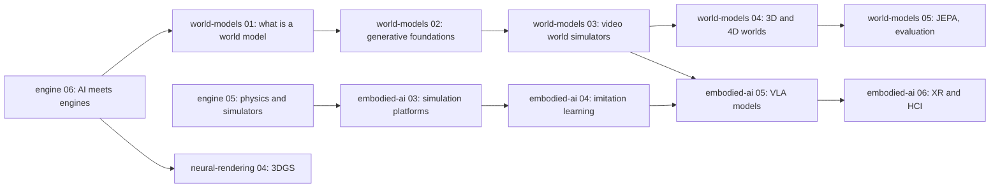

## Why this matters

Over five posts we built an engine from the frame loop up: [architecture]({{ '/blog/2026/graphics-engine-01-anatomy-of-an-engine/' | relative_url }}), [GPU APIs and render graphs]({{ '/blog/2026/graphics-engine-02-gpu-apis-and-render-graphs/' | relative_url }}), [a mini engine]({{ '/blog/2026/graphics-engine-03-build-a-mini-engine/' | relative_url }}), [production engines]({{ '/blog/2026/graphics-engine-04-inside-production-engines/' | relative_url }}) and [physics and simulation]({{ '/blog/2026/graphics-engine-05-physics-and-simulation-engines/' | relative_url }}). Every box in those diagrams was hand-written code. In 2026, neural networks sit inside many of those boxes. Some of them are in shipping games, such as upscaling and frame generation; others are maturing in SDKs, such as neural materials and texture compression. A new class of models, interactive **world models**, generates the whole frame from the player's input with no engine underneath.

This final post maps that landscape: what is replaced, what is assisted, what actually ships and what is still research. It ends by handing you over to the [world-models]({{ '/blog/2026/world-models-01-what-is-a-world-model/' | relative_url }}) and [embodied-ai]({{ '/blog/2026/embodied-ai-01-robotics-foundations/' | relative_url }}) series. Everything product-related is dated **as of November 2026** and cites official sources. This area changes monthly.

## Prerequisites

- The real-time pipeline: G-buffers, temporal anti-aliasing, ray-traced effects and denoising ([graphics 06]({{ '/blog/2026/graphics-06-real-time-ray-tracing/' | relative_url }}), [graphics 11]({{ '/blog/2026/graphics-11-real-time-rendering-techniques/' | relative_url }})).
- 3D Gaussian Splatting ([neural-rendering 04]({{ '/blog/2026/neural-rendering-04-3d-gaussian-splatting/' | relative_url }})).
- Basic deep learning: MLPs, transformers, diffusion models ([world-models 02]({{ '/blog/2026/world-models-02-generative-modeling-foundations/' | relative_url }})).

## 1. The spectrum: from classical to neural

It helps to place every engine component on a four-step scale:

1. **Classical**: hand-written algorithms (rasterizer, shadow maps, a PGS solver).
2. **ML-assisted**: a network helps a classical stage but can be removed, for example ML denoising of a path-traced image or an ML-based upscaler on top of TAA inputs.
3. **Hybrid**: a network is a *component* of the pipeline with an engineered interface: a neural texture decoded inside a shader, a radiance cache trained on the fly, a splat-based scene drawn next to meshes.
4. **Fully neural**: the network *is* the engine. It maps past frames and actions to the next frame, with no explicit geometry, physics or game logic.

{% include blog_figure.liquid path="assets/img/blog/graphics-engine/06-spectrum.svg" localized="true" caption="Where engine components stand as of November 2026 (my assessment from the sources in this post). Solid bars: deployed in shipping games or engines; dashed extensions: research or public demos. Image reconstruction (upscaling, frame generation, denoising) is the most neural part of today's engines. Physics and game logic are still classical in products, while fully neural world models generate them implicitly in research." %}

Why now? Three things came together. First, **tensor hardware in every GPU**: RTX tensor cores, the RDNA 4 ML accelerators and Intel XMX units execute small matrix multiplies far faster than the shader ALUs do. Second, a **pixel cost wall**: 4K at high frame rates with path tracing costs far more than a GPU can afford per pixel, so reconstructing pixels became cheaper than rendering them. Third, **generative models** that can now produce images, video, 3D assets and code at useful quality. The rest of the post follows the components from the bottom of the figure to the top.

## 2. Neural rendering inside real-time engines

### Upscaling and frame generation

**Super resolution** renders at a lower *internal* resolution (for example 67 % of the output width and height, so 45 % of the pixels) and reconstructs the output resolution from the current frame, motion vectors, depth and a history of past frames. It is temporal anti-aliasing (TAA) with a learned accumulation and rectification step ([graphics 11]({{ '/blog/2026/graphics-11-real-time-rendering-techniques/' | relative_url }})). **Frame generation** synthesizes extra frames *between* two rendered frames, from optical flow, motion vectors and the two images. **Multi-frame generation** inserts several of them.

Status as of November 2026, from the vendors' announcements:

| Technology | Current version | What is neural | Hardware |
| --- | --- | --- | --- |
| **NVIDIA DLSS 4** (Jan 2025) | transformer models for Super Resolution and Ray Reconstruction; **Multi Frame Generation** up to 3 generated frames per rendered frame | upscaling, denoising, frame generation | MFG: RTX 50; transformer SR/RR: all RTX |
| **NVIDIA DLSS 4.5** (announced Jan 2026) | second-generation transformer Super Resolution; **Dynamic MFG** and a **6X** mode (up to 5 generated frames), released Mar 2026; DLSS 4.5 Ray Reconstruction in early access since Aug 2026 | as above, with larger models | 6X and dynamic MFG: RTX 50; SR: all RTX |
| **AMD FSR "Redstone"** (Dec 2025) | ML **Upscaling** (formerly FSR 4), ML **Frame Generation**, **Ray Regeneration** (ML denoising) and **Radiance Caching** (technical preview) | upscaling, frame generation, denoising, a neural radiance cache | ML features: RDNA 4 (Radeon RX 9000); analytical fallbacks on older GPUs |
| **Intel XeSS 3** (SDK 3.0, Mar 2026) | upscaling plus multi-frame generation (XeSS-MFG) | upscaling, frame generation | Arc GPUs |

Official sources: [DLSS 4.5 announcement](https://www.nvidia.com/en-us/geforce/news/dlss-4-5-dynamic-multi-frame-gen-6x-2nd-gen-transformer-super-res/), [DLSS 4.5 dynamic MFG release](https://www.nvidia.com/en-us/geforce/news/nvidia-app-dlss-4-5-dynamic-multi-frame-generation-available-now/), [AMD FSR Redstone for developers](https://gpuopen.com/learn/amd-fsr-redstone-developers-neural-rendering/), [XeSS releases](https://github.com/intel/xess/releases).

{% include blog_figure.liquid path="assets/img/blog/graphics-engine/06-upscale-framegen.svg" caption="Upscaling and 4x frame generation on a timeline. The GPU renders R0 at internal resolution (blue), upscales it (orange) and generates 3 intermediate frames (green). On the display, rendered frames (blue) alternate with generated ones (light green). An interpolated frame between R0 and R1 needs R1, so R0 can be shown only after R1 is rendered: frame generation multiplies smoothness but adds roughly one rendered frame of latency (red arrow)." %}

The trade-off is easiest to see in a model. Let $t_n$ be the GPU time to render a frame at native resolution, and split it into a part that does not depend on resolution, $t_f$, and a part proportional to the pixel count. With a resolution scale $s$ per axis, an upscaler cost $t_u$, a frame-generation factor $k$ (1 = off) costing $t_g$ per generated frame, and CPU time $t_c$ (pipelined with the GPU):

$$
t_{\text{gpu}} = t_f + (t_n - t_f)\,s^2 + t_u + (k-1)\,t_g, \qquad t_{\text{frame}} = \max(t_{\text{gpu}}, t_c),
$$

$$
\text{fps}_{\text{shown}} = \min\!\Big(\frac{1000\,k}{t_{\text{frame}}},\ f_{\text{refresh}}\Big), \qquad
L \approx t_c + t_{\text{gpu}} + [k>1]\,t_{\text{frame}} + \tfrac{1}{2}\,\frac{1000}{\text{fps}_{\text{shown}}}.
$$

The latency $L$ (in ms) counts the CPU work for the input, the GPU work, the extra frame held back for interpolation when $k > 1$, and on average half a display interval. It ignores the OS, the display and techniques such as NVIDIA Reflex, so take it as an illustration, not a measurement.

**Worked example.** Take $t_n = 20$ ms (50 fps native), $t_f = 2$ ms, $t_c = 4$ ms, $t_u = t_g = 1$ ms, and no refresh cap:

- Native, $k=1$: $t_{\text{gpu}} = 20$ ms, so 50 fps and $L = 4 + 20 + 10 = 34$ ms.
- $s = 0.67$, $k = 1$: $t_{\text{gpu}} = 2 + 18 \times 0.4489 + 1 = 11.08$ ms, so 90 fps and $L = 4 + 11.08 + 5.54 = 20.6$ ms. Upscaling makes the game both smoother *and* more responsive.
- $s = 0.67$, $k = 4$: $t_{\text{gpu}} = 14.08$ ms, so 71 rendered fps and **284 displayed fps**, but $L = 4 + 14.08 + 14.08 + 1.76 = 33.9$ ms, the same latency as native 50 fps.

The same model in Python:

```python
def frame_model(scale, k, t_native=20.0, t_fixed=2.0, t_up=1.0, t_gen=1.0, t_cpu=4.0, refresh=1e9):
    render = t_fixed + (t_native - t_fixed) * scale ** 2
    gpu = render + (t_up if scale < 0.999 else 0.0) + (k - 1) * t_gen
    frame = max(gpu, t_cpu)
    fps = min(k * 1000.0 / frame, refresh)
    latency = t_cpu + gpu + (frame if k > 1 else 0.0) + 0.5 * 1000.0 / fps
    return 1000.0 / frame, fps, latency          # rendered fps, displayed fps, latency (ms)

for scale, k in [(1.0, 1), (0.67, 1), (0.67, 4)]:
    print(scale, k, [round(v, 1) for v in frame_model(scale, k)])
```



This is why vendors pair frame generation with latency reduction (NVIDIA Reflex; Reflex 2 "Frame Warp", which re-projects the finished frame with the latest mouse input, is still listed as coming soon on [NVIDIA's page](https://www.nvidia.com/en-us/geforce/technologies/reflex/)). It is also why frame generation is recommended from an already playable base frame rate. Play with the trade-offs here:

{% include widget.liquid name="graphics-engine-frame-budget" height="470" caption="Frame budget explorer, using the model above. Move the sliders (mouse or touch) for internal resolution scale, the native render cost, the upscaler cost and the frame-generation factor $k$, and pick a display refresh rate. Read the displayed fps, the rendered fps and the estimated latency, the GPU time split per rendered frame, the latency breakdown, and a 100 ms strip of rendered (blue) and generated (green) frames. Try: native 20 ms, scale 1, k = 1; then scale 0.5; then k = 4 with a 240 Hz cap." %}

### Neural radiance cache

Path tracing in real time needs many bounces, which is too expensive. The **neural radiance cache** (NRC; Müller et al., SIGGRAPH 2021) trains a small MLP *while the game runs*: a few paths are traced longer to provide training targets, and the network learns outgoing radiance as a function of position, direction and material. All other paths stop after one or two bounces and query the cache instead. The paper reports about 2.6 ms per frame at 1080p. It is the learned cousin of the irradiance caches and probes of [graphics 06]({{ '/blog/2026/graphics-06-real-time-ray-tracing/' | relative_url }}). AMD's Radiance Caching in FSR Redstone follows the same idea.

### Neural materials and neural texture compression

Film-quality layered materials (car paint with flakes, coated fabrics, ceramics) need many texture lookups and long BRDF evaluations. **Real-Time Neural Appearance Models** (Zeltner et al., SIGGRAPH 2024) replace the whole layered BRDF by a latent texture plus a small MLP decoder that runs *inside* the shader. The authors report over an order of magnitude faster evaluation than the non-neural layered materials they approximate. This is a hybrid component: the engine still rasterizes or ray traces, and a network evaluates the material.

**Neural texture compression** (NTC; Vaidyanathan et al., SIGGRAPH 2023) compresses *all* channels of a material together (albedo, normal, roughness, metalness, ambient occlusion). It stores low-resolution grids of latent features and a tiny MLP per material. To shade a pixel, the shader samples the latents at the texel's UV and runs the MLP, which outputs all channels at once. Because it is evaluated per texel, it keeps random access, which video codecs do not offer. The paper's profiles range from **0.2 to 1.0 bits per pixel per channel** (BPPC), against about **4 BPPC** for its block-compressed (BCn) baseline. It reports 16 times more texels at about 30 % less memory than that baseline.



**Worked example.** A 4096 × 4096 material with 9 channels has $4096^2 \times 9 = 150{,}994{,}944$ channel-texels. At 4 BPPC that is $603{,}979{,}776$ bits $= 72$ MiB; at 1.0 BPPC, 18 MiB; at 0.2 BPPC, 3.6 MiB. Multiply by hundreds of materials and the difference decides whether a scene fits in an 8 GB GPU.

```python
texels, channels = 4096 * 4096, 9
for name, bppc in [("BCn baseline", 4.0), ("NTC high", 1.0), ("NTC low", 0.2)]:
    print(f"{name:13s} {texels * channels * bppc / 8 / 2**20:6.1f} MiB")
```

The cost is computation: every texture sample becomes a small network evaluation. That is where tensor cores in shaders come in.

### Neural shaders and cooperative vectors: API status

To run an MLP inside a pixel shader efficiently, the shader must hand small matrix-vector products to the tensor units. The APIs are still settling:

- **Vulkan** has the vendor extension **`VK_NV_cooperative_vector`** ([spec source](https://github.com/KhronosGroup/Vulkan-Docs/blob/main/appendices/VK_NV_cooperative_vector.adoc)), which NVIDIA's samples use.
- **DirectX**: Microsoft previewed "cooperative vectors" for HLSL, but [its September 2025 post](https://devblogs.microsoft.com/directx/shader-model-6-9-and-the-future-of-cooperative-vector/) announced that the feature would not ship in Shader Model 6.9. It is being replaced by a unified matrix/vector ("LinAlg") design planned for **Shader Model 6.10**, which is in preview. SM 6.9 itself shipped in February 2026 with long vectors, shader execution reordering, opacity micromaps and DXR 1.2.
- **NVIDIA RTX Kit** ([overview](https://developer.nvidia.com/rtx-kit)) bundles RTX Neural Shaders and the Neural Texture Compression SDK, both labelled beta. The [RTXNTC SDK v0.10](https://github.com/NVIDIA-RTX/RTXNTC/releases) adds inference through the DX12 SM 6.10 path and warns that it is not yet for shipping products. RTX Neural Materials was listed as not yet released.

So as of November 2026: neural upscaling and frame generation are in hundreds of shipping games; neural materials and texture compression are mature research with beta SDKs, waiting for standard shader-model support.

## 3. Gaussian splats in engines

Splats ([neural-rendering 04]({{ '/blog/2026/neural-rendering-04-3d-gaussian-splatting/' | relative_url }})) are attractive for engines because they are rendered by rasterization (project, sort, alpha-blend), with no network at run time. Captured real places become game-ready backdrops within hours. The home page's [Gaussian World demo]({{ '/' | relative_url }}#lab) renders them in WebGL 2, and [neural-rendering 06]({{ '/blog/2026/neural-rendering-06-capture-to-vr-tutorial/' | relative_url }}) walks through capture to VR.

The ecosystem as of November 2026:

- **Standard**: Khronos announced a glTF extension, **`KHR_gaussian_splatting`**, as a release candidate in [February 2026](https://www.khronos.org/news/archives/khronos-announces-gltf-gaussian-splatting-extension). The [extension README](https://github.com/KhronosGroup/glTF/blob/main/extensions/2.0/Khronos/KHR_gaussian_splatting/README.md) now lists its status as ratified. Niantic's open **SPZ** format ([repo](https://github.com/nianticlabs/spz), MIT), about 10 times smaller than PLY, is widely used for compressed splats.
- **Web**: PlayCanvas's engine renders splats natively, including streamed level of detail, and its open-source **SuperSplat** editor ([repo](https://github.com/playcanvas/supersplat)) cleans and edits captures in the browser. **Spark** ([sparkjs.dev](https://sparkjs.dev/), from World Labs) is a three.js-based splat renderer that reads PLY, SPZ and other formats.
- **Game engines**: there is no built-in splat renderer in Unreal, Unity or Godot as far as their official notes show. There are many plugins: for Unity, Aras Pranckevičius's [UnityGaussianSplatting](https://github.com/aras-p/UnityGaussianSplatting) (MIT; the author says it is no longer actively developed); for Unreal, plugins from Luma, Volinga and others; for Godot, community add-ons.

The engineering problem is **hybrid rendering**: splats must coexist with meshes, lights, shadows and post-processing. The standard recipe is in the figure: render the mesh G-buffer first; project and sort the splats; and composite them with a depth test against the mesh depth, so that a character can walk *behind* a captured statue. Splats are pre-lit (their colors bake the capture's lighting) and do not cast correct shadows. Relighting and shadowing splats is an active research topic ([neural-rendering 05]({{ '/blog/2026/neural-rendering-05-3dgs-frontiers/' | relative_url }})).

{% include blog_figure.liquid path="assets/img/blog/graphics-engine/06-hybrid-splat-mesh.svg" caption="One frame of a hybrid mesh-plus-splat renderer. The mesh pass writes the G-buffer and depth Z (top), which feeds deferred lighting. Splats are culled, projected to 2D Gaussians and sorted by depth (bottom), then alpha-blended only where they lie in front of the mesh depth (red dashed: Z is used for occlusion). Splats do not receive the engine's lights or shadows unless they are relit, which is the main visual seam in hybrid scenes." %}

## 4. Generative content pipelines

### Image and text to 3D

Asset creation is the biggest cost in game production, so 3D generators get a lot of attention. Open models as of November 2026:

| Model | Organization | Status | Output |
| --- | --- | --- | --- |
| **TRELLIS** | Microsoft | CVPR 2025 (spotlight), [arXiv 2412.01506](https://arxiv.org/abs/2412.01506); code and weights MIT | structured 3D latents, decoded to meshes, radiance fields or Gaussians |
| **TRELLIS.2** | Microsoft | preprint [arXiv 2512.14692](https://arxiv.org/abs/2512.14692) (Dec 2025); 4B-parameter model | higher-resolution "O-Voxel" structured latents, PBR-textured meshes |
| **Hunyuan3D 2.0 / 2.1** | Tencent | [arXiv 2501.12202](https://arxiv.org/abs/2501.12202) (Jan 2025); 2.1 ([arXiv 2506.15442](https://arxiv.org/abs/2506.15442), Jun 2025) fully open with training code | shape (3.3B) + PBR texture "Paint" model (2B in 2.1) |
| **SAM 3D** (Objects, Body) | Meta | Nov 2025, [arXiv 2511.16624](https://arxiv.org/abs/2511.16624); weights under the SAM License | 3D objects and human bodies from a single image |
| **SPAR3D** | Stability AI | preprint [arXiv 2501.04689](https://arxiv.org/abs/2501.04689) (2025), builds on Stable Fast 3D | fast single-image meshes with point-cloud editing |

Commercial services (Meshy, Tripo, Hyper3D Rodin and others) wrap similar models with retopology, UV unwrapping and PBR baking. Inside the engine, the useful question is not "can it make a mesh?" but "can it make a **game-ready** asset?": clean topology with a sensible triangle budget, UVs without overlaps, separate PBR maps without baked lighting, correct scale and pivot, collision proxies and levels of detail ([graphics 08]({{ '/blog/2026/graphics-08-geometry-processing/' | relative_url }}) covers remeshing and simplification). As of 2026, generated assets are production-ready for props, prototypes and background content, and need artist cleanup for hero assets and anything that deforms.

### Materials, motion and procedural generation

- **PBR textures and materials**: diffusion models generate tileable albedo, normal and roughness maps from text or photos (Adobe's Substance 3D tools ship Firefly-based text-to-texture). Hunyuan3D's Paint model and TRELLIS.2 output PBR maps directly.
- **Motion**: text-to-motion diffusion models such as **MDM** (Tevet et al., ICLR 2023, [arXiv 2209.14916](https://arxiv.org/abs/2209.14916)) generate skeletal animation that feeds the animation runtime of [post 05]({{ '/blog/2026/graphics-engine-05-physics-and-simulation-engines/' | relative_url }}); [graphics 09]({{ '/blog/2026/graphics-09-animation-and-characters/' | relative_url }}) covers the rest.
- **Procedural generation plus LLMs**: rather than generating geometry directly, an LLM writes *parameters or code* for a classical procedural system (a Houdini graph, a Blender script, a level-layout grammar). The output stays editable, deterministic and within budget, which is why this pattern is popular in production.

## 5. LLM agents in engines and editors

The **Model Context Protocol** (MCP; [open-sourced by Anthropic in November 2024](https://www.anthropic.com/news/model-context-protocol), [specification](https://modelcontextprotocol.io/specification/2025-11-25)) lets an LLM call tools exposed by a server. An *editor* MCP server exposes operations such as creating objects, editing components, running the game or reading the console. The agent can then build a scene, write a script, run it, read the error and fix it. Separate official tools from community projects:

| Integration | Official? | Status (Nov 2026) |
| --- | --- | --- |
| **Unity AI** (Assistant with ask/plan/agent modes, MCP server, generators) | official | open beta, Unity 6+ ([Unity blog](https://unity.com/blog/unity-ai-how-to-get-started)) |
| **Unreal Engine 5.8** MCP plugin | official | experimental ([UE 5.8 release notes](https://dev.epicgames.com/documentation/en-us/unreal-engine/unreal-engine-5-8-release-notes)) |
| [unity-mcp](https://github.com/CoplayDev/unity-mcp) (Coplay) | community, not affiliated with Unity | MIT |
| [godot-mcp](https://github.com/Coding-Solo/godot-mcp) | community | MIT |
| [blender-mcp](https://github.com/ahujasid/blender-mcp) | community, not made by Blender | MIT; the [Blender Foundation states](https://www.blender.org/news/upcoming-blender-development-fund-and-ai-policies/) that no generative AI is integrated or planned in Blender itself |

**AI NPCs** run language models *at play time*. NVIDIA's ACE stack (speech recognition, a small language model, text-to-speech, animation) powers **PUBG Ally**, a voice-controlled AI teammate that ran as a [public beta in June 2026](https://www.nvidia.com/en-us/geforce/news/pubg-ally-ai-teammate-beta-available-now/) on RTX GPUs with at least 8 GB of memory, with on-device speech-to-text and a 2B-parameter language model. NVIDIA also released an [ACE Game Agent SDK](https://developer.nvidia.com/blog/build-on-device-ai-companions-with-the-nvidia-ace-game-agent-sdk-and-unreal-engine-5-plugins/) in beta with Unreal Engine 5 plugins. The hard engineering is not the model but the **interface**: a small model must call game actions through a fixed tool schema, stay within a latency budget of a few hundred milliseconds, and share the GPU with rendering.

## 6. Neural game engines and interactive world models

At the far end of the spectrum, the engine is replaced by a network that predicts the next frame from past frames and the player's action:

$$
\mathbf{o}_{t+1} \sim p_\theta\big(\mathbf{o}_{t+1} \,\big\vert\, \mathbf{o}_{t-c+1:t},\ \mathbf{a}_{t-c+1:t}\big),
$$

where $\mathbf{o}_t$ is a frame (usually a latent from an autoencoder), $\mathbf{a}_t$ the action (keys, mouse, camera pose or text) and $c$ the context length. Most models are **autoregressive video diffusion** models: a diffusion or flow model generates the next latent frame conditioned on a window of past latents and actions, and it is distilled to a few denoising steps to reach real time. [World-models 03]({{ '/blog/2026/world-models-03-video-world-simulators/' | relative_url }}) explains the generative machinery, and [world-models 04]({{ '/blog/2026/world-models-04-3d-and-4d-world-generation/' | relative_url }}) covers 3D-consistent world generation. Here we look at them as *engines*.



As of November 2026 (numbers only where the source states them):

| System | Who | Status | Trained on / controlled by | Stated performance |
| --- | --- | --- | --- | --- |
| **DIAMOND** | Alonso et al. | NeurIPS 2024, [arXiv 2405.12399](https://arxiv.org/abs/2405.12399) | Atari; 87 h of CS:GO play; keyboard and mouse | CS:GO model ~10 fps on an RTX 3090 |
| **GameNGen** | Valevski et al. (Google) | ICLR 2025, [arXiv 2408.14837](https://arxiv.org/abs/2408.14837) | DOOM, recorded RL-agent play; player input | 20 fps on one TPU |
| **Oasis** | Decart, Etched | [demo, Oct 2024](https://oasis-model.github.io/) | Minecraft-like; keyboard | 20 fps |
| **Muse / WHAM** | Microsoft Research, Ninja Theory | Nature 2025, [DOI](https://doi.org/10.1038/s41586-025-08600-3) | *Bleeding Edge*, ~7 years of play; controller | 300 × 180 frames; up to ~2 min generated |
| **Genie 2** | Google DeepMind | [blog, Dec 2024](https://deepmind.google/discover/blog/genie-2-a-large-scale-foundation-world-model/) | large video dataset; keyboard and mouse | consistent up to a minute |
| **Genie 3** | Google DeepMind | [blog, Aug 2025](https://deepmind.google/discover/blog/genie-3-a-new-frontier-for-world-models/); "Project Genie" for subscribers since Jan 2026 | navigation + text "world events" | 720p, 24 fps, consistent for a few minutes |
| **Matrix-Game 2.0 / 3.0** | Skywork | [arXiv 2508.13009](https://arxiv.org/abs/2508.13009) (Aug 2025); [arXiv 2604.08995](https://arxiv.org/abs/2604.08995) (Apr 2026) | Unreal Engine + GTA5 video (2.0); UE synthetic + game + real video (3.0); keyboard/mouse, pose | 2.0: 25 fps; 3.0: 720p, up to 40 fps (5B model) |
| **Hunyuan-GameCraft / -2** | Tencent | [arXiv 2506.17201](https://arxiv.org/abs/2506.17201) (Jun 2025); [arXiv 2511.23429](https://arxiv.org/abs/2511.23429) (Nov 2025) | 1M+ recordings from 100+ AAA games; keyboard/mouse, text (2) | not stated |
| **Yan** | Tencent | [arXiv 2508.08601](https://arxiv.org/abs/2508.08601) (Aug 2025) | frame-wise actions + text editing | 1080p, 60 fps |
| **HY-World 1.5 (WorldPlay)** | Tencent | [arXiv 2512.14614](https://arxiv.org/abs/2512.14614) (Dec 2025), open code | keyboard and mouse; long-horizon memory | 720p, 24 fps |
| **Dreamer 4** | Hafner, Yan, Lillicrap (Google DeepMind) | [arXiv 2509.24527](https://arxiv.org/abs/2509.24527) (Sep 2025) | Minecraft offline data; agent trained *inside* the model | real-time inference on one GPU |
| **RTFM** | World Labs | [research preview, Oct 2025](https://www.worldlabs.ai/blog/rtfm) | posed frames as spatial memory; camera | interactive on one H100 |
| **Marble** | World Labs | [product, Nov 2025](https://www.worldlabs.ai/blog/marble-world-model) | text, images, video, layouts | exports persistent 3D worlds (splats, meshes), not frames |
| **Odyssey-2 Pro / Max** | Odyssey | [Odyssey-2 Max, Apr 2026](https://odyssey.systems/introducing-odyssey-2-max) | general video + interaction data | 2 Pro: 720p, 22 fps |
| **Runway GWM-1 / Worlds 2** | Runway | [GWM-1, Dec 2025](https://runway.com/research/introducing-runway-gwm-1); [Worlds 2, Sep 2026](https://runway.com/research/introducing-gwm-worlds-2) | camera motion, text actions | 720p, 24 fps (Worlds 2), up to 2 min (GWM-1) |
| **Genie 4** | Google DeepMind | [research preview, 27 Oct 2026](https://deepmind.google/blog/genie-4-a-new-generation-of-world-simulation/) | keyboard and camera, text steering via Gemini, native audio | not stated |

{% include blog_figure.liquid path="assets/img/blog/graphics-engine/06-world-models.svg" caption="Stated numbers only, not a benchmark. Left: output resolution against frame rate for the systems whose sources give both (purple), and frame rate alone where resolution is not stated (gray squares, placed at 'n/s'). Right: the memory or consistency horizon each source claims, in seconds (log scale). The claims use different definitions (memory reach, session length, generated length), so read the chart as orders of magnitude." %}

How do they compare with the engine of this series?

- **What they learn**: rendering, physics, game rules and even other players' behavior, implicitly, from video plus actions. Nothing is specified by hand. That is the appeal (any world you have video of) and the problem (no guarantees).
- **Control**: keys and mouse map to learned action embeddings. Newer systems add text ("make it rain"), camera poses, or spatial memories. There is no API for "set door 3 to open"; editing has to go through prompts or conditioning.
- **Frame rate and latency**: real time requires distilling the diffusion model to a few steps, caching past activations, and often custom hardware (Oasis on Etched's chip, GameNGen on TPU). Every frame costs a large network evaluation, compared with a few milliseconds of rasterization, so energy and serving cost per player-hour remain far above a classical engine.
- **Memory and consistency**: a finite context window means the world drifts. Turn around and the room may have changed. Remedies include longer contexts, retrieval of posed past frames as **spatial memory** (RTFM, WorldPlay), and explicit 3D intermediates (Marble exports splats and meshes, which a classical engine then renders).
- **Failure modes**: objects morph or vanish, physics violations (interpenetration, objects floating), quality drift over long rollouts, actions with delayed or no effect, and degradation outside the training distribution.

So the realistic 2026 picture is **convergence** rather than replacement. World models generate content, prototypes and training environments. Classical engines provide persistence, exact rules and cheap rendering. 3D outputs (splats, meshes) are the bridge between them.

## 7. Engines as data factories

The last role of the engine is the one that connects this series to embodied AI: generating **training data** for world models and robot policies ([post 05]({{ '/blog/2026/graphics-engine-05-physics-and-simulation-engines/' | relative_url }}), Section 10).

- **Simulation and synthetic data**: Isaac Sim with Omniverse Replicator ([docs](https://docs.omniverse.nvidia.com/extensions/latest/ext_replicator.html)), Genesis and the GPU simulators of post 05 render millions of labelled frames and robot trajectories. Matrix-Game 3.0 explicitly trains on Unreal Engine renders as part of its data engine, so classical engines now produce training data for neural ones.
- **World foundation models**: NVIDIA's **Cosmos** platform ([Agarwal et al., arXiv 2501.03575](https://arxiv.org/abs/2501.03575)) provides open video world models for physical AI. **Cosmos-Predict2.5** and **Cosmos-Transfer2.5** ([arXiv 2511.00062](https://arxiv.org/abs/2511.00062)) predict future video and turn simulator renders (segmentation, depth, edges) into photoreal video. That closes the sim-to-real *appearance* gap with a generative model instead of a better renderer. In May 2026 NVIDIA released the **Cosmos 3** family ([repository](https://github.com/NVIDIA/Cosmos)).
- **Synthetic robot experience**: NVIDIA's [GR00T-Dreams blueprint](https://nvidianews.nvidia.com/news/nvidia-powers-humanoid-robot-industry-with-cloud-to-robot-computing-platforms-for-physical-ai) post-trains a Cosmos model on a robot, generates task videos from single images and extracts actions from them. **Cosmos Policy** ([arXiv 2601.16163](https://arxiv.org/abs/2601.16163)) fine-tunes a video world model directly into a robot policy.



This is the handover point. [Embodied-ai 03]({{ '/blog/2026/embodied-ai-03-simulation-platforms/' | relative_url }}) covers the simulators in depth, and [embodied-ai 05]({{ '/blog/2026/embodied-ai-05-vision-language-action-models/' | relative_url }}) the vision-language-action models trained on this data.

## 8. Open problems and a learning path

Open problems, as of late 2026:

1. **Controllability and persistence** of neural engines: exact game state, saving and loading, multiplayer consistency, deterministic replays. All of this is easy for the engine of post 01 and unsolved for world models.
2. **Cost**: the energy and serving cost per player-hour of neural frames, compared with rasterization; distillation, caching and dedicated hardware.
3. **Artifacts of reconstruction**: ghosting and disocclusion errors in frame generation; temporal stability of neural materials; relighting and shadows for splats.
4. **Standard APIs** for neural shaders (SM 6.10 LinAlg, a cross-vendor Vulkan extension) and standard formats (`KHR_gaussian_splatting`, compressed splat extensions).
5. **Evaluation**: how to measure a world model's physical correctness and consistency, not just its visual quality ([world-models 05]({{ '/blog/2026/world-models-05-jepa-evaluation-and-open-problems/' | relative_url }})).
6. **Sim-to-real**: when are generative "transfer" models better than a better renderer, and how do we make sure that they do not hallucinate physics?

A learning path through this blog, from where this series ends:



## Try it

- The frame-budget widget above: find the settings where frame generation makes latency *worse* than native rendering, and the settings where upscaling alone gives the best latency.
- The home-page [Gaussian World]({{ '/' | relative_url }}#lab) shows the sort-and-blend splat renderer that the hybrid pipeline of Section 3 composites with meshes.
- Run `frame_model` with `refresh=144` and see where the display cap makes higher $k$ useless.

## Representative papers

| Paper | Venue | Year | Link | Why it matters |
| --- | --- | --- | --- | --- |
| Müller et al., *Real-time Neural Radiance Caching for Path Tracing* | ACM TOG (SIGGRAPH) | 2021 | [arXiv](https://arxiv.org/abs/2106.12372) | Online-trained MLP cache for multi-bounce GI |
| Vaidyanathan et al., *Random-Access Neural Compression of Material Textures* | ACM TOG (SIGGRAPH) | 2023 | [arXiv](https://arxiv.org/abs/2305.17105) | Neural texture compression at 0.2-1.0 BPPC |
| Kerbl et al., *3D Gaussian Splatting for Real-Time Radiance Field Rendering* | ACM TOG (SIGGRAPH) | 2023 | [DOI](https://doi.org/10.1145/3592433) | The splat representation engines now import |
| Tevet et al., *Human Motion Diffusion Model* | ICLR | 2023 | [arXiv](https://arxiv.org/abs/2209.14916) | Text-to-motion diffusion |
| Zeltner et al., *Real-Time Neural Appearance Models* | ACM TOG (SIGGRAPH) | 2024 | [project](https://research.nvidia.com/labs/rtr/neural_appearance_models/) | Neural layered materials inside shaders |
| Alonso et al., *Diffusion for World Modeling: Visual Details Matter in Atari* (DIAMOND) | NeurIPS | 2024 | [arXiv](https://arxiv.org/abs/2405.12399) | Diffusion world model; playable CS:GO |
| Valevski et al., *Diffusion Models Are Real-Time Game Engines* (GameNGen) | ICLR | 2025 | [arXiv](https://arxiv.org/abs/2408.14837) | Playable DOOM from a diffusion model |
| Kanervisto et al., *World and Human Action Models towards gameplay ideation* (Muse / WHAM) | Nature | 2025 | [DOI](https://doi.org/10.1038/s41586-025-08600-3) | World model of a commercial game for ideation |
| Xiang et al., *Structured 3D Latents for Scalable and Versatile 3D Generation* (TRELLIS) | CVPR | 2025 | [arXiv](https://arxiv.org/abs/2412.01506) | Open image-to-3D foundation model |
| Agarwal et al., *Cosmos World Foundation Model Platform for Physical AI* | arXiv | 2025 | [arXiv](https://arxiv.org/abs/2501.03575) | Open world foundation models for robots and AVs |
| He et al., *Matrix-Game 2.0* | arXiv | 2025 | [arXiv](https://arxiv.org/abs/2508.13009) | Open real-time interactive world model |
| Hafner, Yan & Lillicrap, *Training Agents Inside of Scalable World Models* (Dreamer 4) | arXiv | 2025 | [arXiv](https://arxiv.org/abs/2509.24527) | Agents trained purely inside a world model |
| Sun et al., *WorldPlay* (HY-World 1.5) | arXiv | 2025 | [arXiv](https://arxiv.org/abs/2512.14614) | Real-time world model with long-horizon memory |
| Kim et al., *Cosmos Policy* | arXiv | 2026 | [arXiv](https://arxiv.org/abs/2601.16163) | Video world model fine-tuned into a robot policy |

## Learning resources

- NVIDIA [RTX Kit](https://developer.nvidia.com/rtx-kit) samples (neural shaders, texture compression) and AMD's [FSR Redstone developer article](https://gpuopen.com/learn/amd-fsr-redstone-developers-neural-rendering/): the most concrete view of neural components in a real-time pipeline.
- Microsoft's DirectX blog post on [Shader Model 6.9 and cooperative vectors](https://devblogs.microsoft.com/directx/shader-model-6-9-and-the-future-of-cooperative-vector/) for the API roadmap.
- Splats: [SuperSplat](https://github.com/playcanvas/supersplat), [Spark](https://sparkjs.dev/), [UnityGaussianSplatting](https://github.com/aras-p/UnityGaussianSplatting) (readable, well-commented code), the [KHR_gaussian_splatting](https://github.com/KhronosGroup/glTF/blob/main/extensions/2.0/Khronos/KHR_gaussian_splatting/README.md) specification.
- Generative 3D: the [TRELLIS](https://github.com/microsoft/TRELLIS) and [Hunyuan3D-2.1](https://github.com/Tencent-Hunyuan/Hunyuan3D-2.1) repositories.
- Agents: the [MCP specification](https://modelcontextprotocol.io/specification/2025-11-25); read an editor MCP server such as [unity-mcp](https://github.com/CoplayDev/unity-mcp) to see how editor operations become tools.
- World models: the [GameNGen](https://gamengen.github.io/) and [DIAMOND](https://diamond-wm.github.io/) project pages (DIAMOND's code runs locally), the open [HY-WorldPlay](https://github.com/Tencent-Hunyuan/HY-WorldPlay) code, and the [world-models series]({{ '/blog/2026/world-models-01-what-is-a-world-model/' | relative_url }}) on this site.

## Exercises

1. Using `frame_model`, find for $t_n = 30$ ms the internal resolution scale at which $k = 1$ reaches 60 fps, and compare its latency with that of $s = 1$, $k = 2$.
2. Extend the model with a display refresh cap and a "frame pacing" rule: generated frames are only useful if $k \cdot \text{fps}_{\text{rendered}} \le f_{\text{refresh}}$. What is the best $k$ for 144 Hz when the rendered frame rate is 70 fps?
3. Compute the texture memory of a scene with 300 unique 2048² materials of 9 channels at 4 BPPC and at 0.5 BPPC. How many additional materials fit into the saved memory?
4. Write a pseudo-MCP tool schema (name, description, JSON parameters) for "spawn prefab at position" and "set material parameter". Which validation should the editor perform before executing an LLM's call?
5. Pick one world model from the table and list three experiments that would test persistence (for example, look away and back, open a door and leave the room, return to a start position). What would a classical engine guarantee in each case?

<details markdown="1"><summary>Hints</summary>

1. Solve $2 + 28 s^2 + 1 = 16.7$ for $s$ (about $0.70$); the latency is about $4 + 16.7 + 8.3 = 29$ ms. With $s = 1$, $k = 2$: $t_{\text{gpu}} = 31$ ms, 32 rendered fps (65 displayed), about $4 + 31 + 31 + 7.8 \approx 74$ ms of latency. 2. $k = 2$ (140 fps); $k = 3$ would exceed the refresh rate, so the extra frames would never be shown. 3. $300 \times 2048^2 \times 9 \times 4 / 8$ bytes $\approx 5.3$ GiB versus about $0.66$ GiB; the 4.6 GiB saved holds about 2,100 more materials at 0.5 BPPC (2.25 MiB each). 4. Check that the prefab exists, that positions are within level bounds, and that the parameter type matches; require an undo step. 5. Persistence of object identity, state changes and position; a classical engine stores them explicitly in its scene and game state.

</details>

This post ends the graphics-engine series. From here, follow the [world-models series]({{ '/blog/2026/world-models-01-what-is-a-world-model/' | relative_url }}) for the generative side, or the [embodied-ai series]({{ '/blog/2026/embodied-ai-01-robotics-foundations/' | relative_url }}) for robots that learn in the engines of the previous post.
