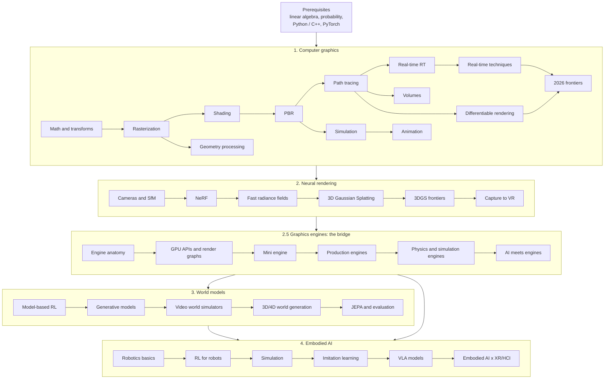

This post is the map for the rest of the blog. I am a PhD student working at the intersection of **embodied AI, world models, AR/VR, HCI and computer graphics**, and these fields share one surprisingly linear story: learn how images are formed (graphics), learn how to *invert* that process from photos (neural rendering, 3D Gaussian Splatting), learn models that *predict* how the world evolves (world models), and finally put a body inside the world and let it act (embodied AI).

The blog is organised as five series that follow that story, plus a dated paper-digest column. Four series are the stages of the story itself; the fifth, on graphics engines, is the bridge between them, because the simulators that train robots and the neural game engines that world models are becoming are both engines underneath. Every post comes in English, Chinese and Japanese, with the math written out, small runnable code snippets and links to representative papers from SIGGRAPH, CVPR/ICCV/ECCV, NeurIPS/ICLR/ICML, CoRL/RSS and other top venues. Each track also has a curated reading list in the repository.

## Stage 0: prerequisites

You do not need everything below before starting, but you will meet all of it:

- **Linear algebra**: vectors, matrices, eigen-decomposition, SVD. Much of graphics and vision is $4\times 4$ matrices and least squares.
- **Calculus and probability**: integrals over the hemisphere, expectations, Monte Carlo estimation $\hat I = \frac{1}{N}\sum_i f(x_i)/p(x_i)$, Gaussians.
- **Programming**: Python with NumPy and PyTorch for most posts; some GLSL and C++ for rendering.

## Stage 1: computer graphics from scratch

How an image is made: from transforms and rasterization to physically based light transport and simulation. This is the foundation for everything that follows: NeRF is volume rendering, 3DGS is a differentiable rasterizer, and robot simulators are physics engines plus renderers. Chapters 1-7 are the core. Chapters 8-13 go deeper into geometry, animation, volumes, real-time techniques and differentiable rendering, and end with a survey of the 2026 research frontier; you can read them now or come back to them after the later stages.

1. [Roadmap and the math toolkit]({{ '/blog/2026/graphics-01-roadmap-and-math/' | relative_url }})
2. [Rasterization]({{ '/blog/2026/graphics-02-rasterization/' | relative_url }})
3. [Shading and textures]({{ '/blog/2026/graphics-03-shading-and-textures/' | relative_url }})
4. [Physically based rendering]({{ '/blog/2026/graphics-04-physically-based-rendering/' | relative_url }})
5. [Ray tracing and path tracing]({{ '/blog/2026/graphics-05-ray-and-path-tracing/' | relative_url }})
6. [Real-time ray tracing]({{ '/blog/2026/graphics-06-real-time-ray-tracing/' | relative_url }})
7. [Physically based simulation]({{ '/blog/2026/graphics-07-physically-based-simulation/' | relative_url }})
8. [Geometry processing: meshes, curvature, smoothing, subdivision and reconstruction]({{ '/blog/2026/graphics-08-geometry-processing/' | relative_url }})
9. [Animation and characters: splines, rotations, skinning, IK, motion matching and learned motion]({{ '/blog/2026/graphics-09-animation-and-characters/' | relative_url }})
10. [Volumes and participating media: fog, smoke, clouds, sky and skin]({{ '/blog/2026/graphics-10-volumes-and-participating-media/' | relative_url }})
11. [Real-time rendering techniques: G-buffers, soft shadows, AO, reflections, real-time GI and tone mapping]({{ '/blog/2026/graphics-11-real-time-rendering-techniques/' | relative_url }})
12. [Differentiable and inverse rendering: gradients through pixels]({{ '/blog/2026/graphics-12-differentiable-and-inverse-rendering/' | relative_url }})
13. [Graphics research frontiers 2026: what SIGGRAPH, SIGGRAPH Asia and the latest preprints are doing]({{ '/blog/2026/graphics-13-research-frontiers-2026/' | relative_url }})

## Stage 2: neural rendering and 3D Gaussian Splatting

Inverting the rendering process: recover cameras from photos, then fit a radiance field (NeRF) or a set of 3D Gaussians (3DGS) that reproduces them. These representations are now the backbone of 3D capture for AR/VR and of many 3D world-generation systems.

1. [Cameras and multi-view geometry]({{ '/blog/2026/neural-rendering-01-cameras-and-multiview-geometry/' | relative_url }})
2. [NeRF]({{ '/blog/2026/neural-rendering-02-nerf/' | relative_url }})
3. [Fast radiance fields]({{ '/blog/2026/neural-rendering-03-fast-radiance-fields/' | relative_url }})
4. [3D Gaussian Splatting]({{ '/blog/2026/neural-rendering-04-3d-gaussian-splatting/' | relative_url }})
5. [3DGS frontiers]({{ '/blog/2026/neural-rendering-05-3dgs-frontiers/' | relative_url }})
6. [From capture to VR: a hands-on tutorial]({{ '/blog/2026/neural-rendering-06-capture-to-vr-tutorial/' | relative_url }})

## Stage 2.5: graphics engines (the bridge)

A renderer becomes a world that agents can live in only once it sits inside an engine: a game loop, scene data, GPU resources, physics and tools. This series opens up that machinery, from the anatomy of an engine and modern GPU APIs to a mini WebGPU engine you build yourself, the production engines behind games and VR, and the physics engines that double as robot simulators. It ends where the next two stages begin: robot simulators are engines, and neural game engines are world models.

1. [Anatomy of a game engine: loops, data, ECS, jobs and tools]({{ '/blog/2026/graphics-engine-01-anatomy-of-an-engine/' | relative_url }})
2. [Modern GPU APIs and render graphs]({{ '/blog/2026/graphics-engine-02-gpu-apis-and-render-graphs/' | relative_url }})
3. [Build a mini engine: WebGPU, glTF, PBR, shadows and an ECS in the browser]({{ '/blog/2026/graphics-engine-03-build-a-mini-engine/' | relative_url }})
4. [Inside production engines: Unreal Engine 5, Unity 6, Godot 4, Bevy and others]({{ '/blog/2026/graphics-engine-04-inside-production-engines/' | relative_url }})
5. [Physics and simulation engines: from game physics to robot simulators]({{ '/blog/2026/graphics-engine-05-physics-and-simulation-engines/' | relative_url }})
6. [AI meets graphics engines: neural rendering, generative content and neural game engines]({{ '/blog/2026/graphics-engine-06-ai-meets-graphics-engines/' | relative_url }})

## Stage 3: world models

From reconstructing the world to *predicting* it: latent dynamics models for planning, the generative toolkit (VAEs, diffusion, flow matching, transformers), video world simulators such as Genie, explicit 3D/4D world generation, and the JEPA view of predictive representation learning.

1. [What is a world model?]({{ '/blog/2026/world-models-01-what-is-a-world-model/' | relative_url }})
2. [Generative modeling foundations]({{ '/blog/2026/world-models-02-generative-modeling-foundations/' | relative_url }})
3. [Video world simulators]({{ '/blog/2026/world-models-03-video-world-simulators/' | relative_url }})
4. [3D and 4D world generation]({{ '/blog/2026/world-models-04-3d-and-4d-world-generation/' | relative_url }})
5. [JEPA, evaluation and open problems]({{ '/blog/2026/world-models-05-jepa-evaluation-and-open-problems/' | relative_url }})

## Stage 4: embodied AI

Giving the model a body: kinematics and control, reinforcement learning and sim2real, simulators, imitation learning, vision-language-action models, and finally how embodied AI connects with XR and human-computer interaction.

1. [Robotics foundations]({{ '/blog/2026/embodied-ai-01-robotics-foundations/' | relative_url }})
2. [Reinforcement learning for robots]({{ '/blog/2026/embodied-ai-02-reinforcement-learning-for-robots/' | relative_url }})
3. [Simulation platforms]({{ '/blog/2026/embodied-ai-03-simulation-platforms/' | relative_url }})
4. [Imitation learning]({{ '/blog/2026/embodied-ai-04-imitation-learning/' | relative_url }})
5. [Vision-language-action models]({{ '/blog/2026/embodied-ai-05-vision-language-action-models/' | relative_url }})
6. [Embodied AI meets XR and HCI]({{ '/blog/2026/embodied-ai-06-embodied-ai-meets-xr-and-hci/' | relative_url }})

## Suggested pace

| Stage | Posts | Suggested time | Milestone |
| --- | --- | --- | --- |
| Graphics | 13 | 8-11 weeks (core 1-7: 4-6 weeks) | write a software rasterizer and a small path tracer |
| Neural rendering | 6 | 3-4 weeks | train 3DGS on your own capture and view it in VR |
| Graphics engines | 6 | 3-5 weeks | build a mini WebGPU engine with a render graph and profile a frame |
| World models | 5 | 3-4 weeks | train a tiny latent dynamics model or DDPM |
| Embodied AI | 6 | 4-6 weeks | train a policy in simulation from demonstrations |

## Play with it

The home page has an [interactive lab]({{ '/' | relative_url }}#lab) with demos written for this blog: a GPU path tracer (GGX, NEE + MIS, à-trous denoising), *Gaussian World* (an editable, relightable open world of 3D Gaussians), XPBD cloth simulation, and eye-tracked foveated rendering. The posts link to the relevant demo wherever it helps.

## Keeping up with new papers

The series explain the foundations; the dated **paper digest** column keeps them current. Each issue covers a fixed date window and collects recent papers in six categories (graphics, graphics engines and real-time, neural rendering, world models, embodied AI, and HCI/XR), each with what it does, how it works, what is new and how it connects to the series. The first issue, [October-November 2026]({{ '/blog/2026/paper-digest-01-2026-oct-nov/' | relative_url }}), covers 42 papers first posted between 1 October and 2 November 2026.

## Browse by category

[Graphics]({{ '/blog/category/graphics/' | relative_url }}) · [Neural rendering]({{ '/blog/category/neural-rendering/' | relative_url }}) · [Graphics engines]({{ '/blog/category/graphics-engine/' | relative_url }}) · [World models]({{ '/blog/category/world-models/' | relative_url }}) · [Embodied AI]({{ '/blog/category/embodied-ai/' | relative_url }}) · [Paper digest]({{ '/blog/category/paper-digest/' | relative_url }})

I will keep extending these series as I learn; corrections and suggestions are very welcome.
