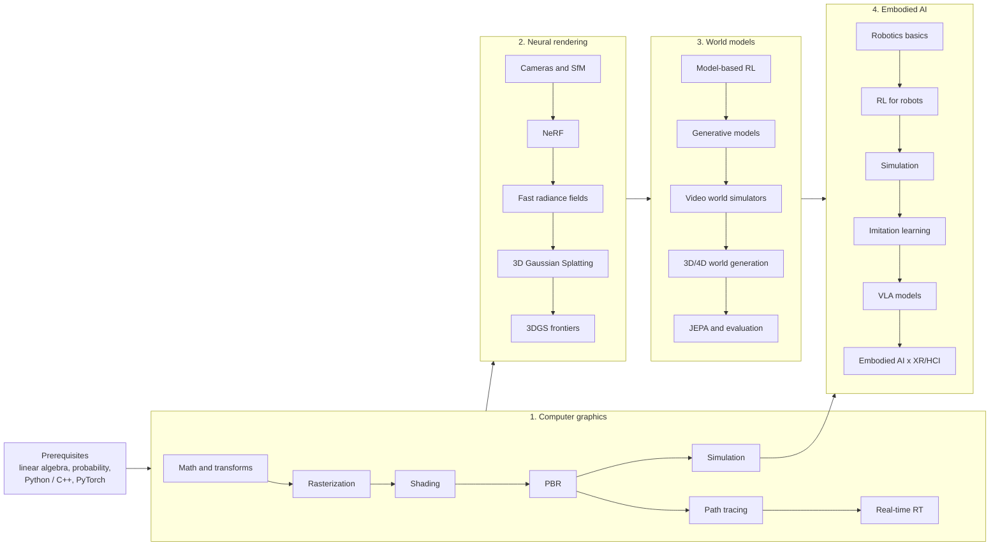

This post is the map for the rest of the blog. I am a PhD student working at the intersection of **embodied AI, world models, AR/VR, HCI and computer graphics**, and these fields share one surprisingly linear story: learn how images are formed (graphics), learn how to *invert* that process from photos (neural rendering, 3D Gaussian Splatting), learn models that *predict* how the world evolves (world models), and finally put a body inside the world and let it act (embodied AI).

The blog is organised as four series that follow that story. Every post comes in English, Chinese and Japanese, with the math written out, small runnable code snippets and links to representative papers from SIGGRAPH, CVPR/ICCV/ECCV, NeurIPS/ICLR/ICML, CoRL/RSS and other top venues. Each track also has a curated reading list in the repository.

## Stage 0: prerequisites

You do not need everything below before starting, but you will meet all of it:

- **Linear algebra**: vectors, matrices, eigen-decomposition, SVD. Much of graphics and vision is $4\times 4$ matrices and least squares.
- **Calculus and probability**: integrals over the hemisphere, expectations, Monte Carlo estimation $\hat I = \frac{1}{N}\sum_i f(x_i)/p(x_i)$, Gaussians.
- **Programming**: Python with NumPy and PyTorch for most posts; some GLSL and C++ for rendering.

## Stage 1: computer graphics from scratch

How an image is made: from transforms and rasterization to physically based light transport and simulation. This is the foundation for everything that follows: NeRF is volume rendering, 3DGS is a differentiable rasterizer, and robot simulators are physics engines plus renderers.

1. [Roadmap and the math toolkit]({{ '/blog/2026/graphics-01-roadmap-and-math/' | relative_url }})
2. [Rasterization]({{ '/blog/2026/graphics-02-rasterization/' | relative_url }})
3. [Shading and textures]({{ '/blog/2026/graphics-03-shading-and-textures/' | relative_url }})
4. [Physically based rendering]({{ '/blog/2026/graphics-04-physically-based-rendering/' | relative_url }})
5. [Ray tracing and path tracing]({{ '/blog/2026/graphics-05-ray-and-path-tracing/' | relative_url }})
6. [Real-time ray tracing]({{ '/blog/2026/graphics-06-real-time-ray-tracing/' | relative_url }})
7. [Physically based simulation]({{ '/blog/2026/graphics-07-physically-based-simulation/' | relative_url }})

## Stage 2: neural rendering and 3D Gaussian Splatting

Inverting the rendering process: recover cameras from photos, then fit a radiance field (NeRF) or a set of 3D Gaussians (3DGS) that reproduces them. These representations are now the backbone of 3D capture for AR/VR and of many 3D world-generation systems.

1. [Cameras and multi-view geometry]({{ '/blog/2026/neural-rendering-01-cameras-and-multiview-geometry/' | relative_url }})
2. [NeRF]({{ '/blog/2026/neural-rendering-02-nerf/' | relative_url }})
3. [Fast radiance fields]({{ '/blog/2026/neural-rendering-03-fast-radiance-fields/' | relative_url }})
4. [3D Gaussian Splatting]({{ '/blog/2026/neural-rendering-04-3d-gaussian-splatting/' | relative_url }})
5. [3DGS frontiers]({{ '/blog/2026/neural-rendering-05-3dgs-frontiers/' | relative_url }})
6. [From capture to VR: a hands-on tutorial]({{ '/blog/2026/neural-rendering-06-capture-to-vr-tutorial/' | relative_url }})

## Stage 3: world models

From reconstructing the world to *predicting* it: latent dynamics models for planning, the generative toolkit (VAEs, diffusion, flow matching, transformers), video world simulators such as Genie, explicit 3D/4D world generation, and the JEPA view of predictive representation learning.

1. [What is a world model?]({{ '/blog/2026/world-models-01-what-is-a-world-model/' | relative_url }})
2. [Generative modeling foundations]({{ '/blog/2026/world-models-02-generative-modeling-foundations/' | relative_url }})
3. [Video world simulators]({{ '/blog/2026/world-models-03-video-world-simulators/' | relative_url }})
4. [3D and 4D world generation]({{ '/blog/2026/world-models-04-3d-and-4d-world-generation/' | relative_url }})
5. [JEPA, evaluation and open problems]({{ '/blog/2026/world-models-05-jepa-evaluation-and-open-problems/' | relative_url }})

## Stage 4: embodied AI

Giving the model a body: kinematics and control, reinforcement learning and sim2real, simulators, imitation learning, vision-language-action models, and finally how embodied AI connects with XR and human-computer interaction.

1. [Robotics foundations]({{ '/blog/2026/embodied-ai-01-robotics-foundations/' | relative_url }})
2. [Reinforcement learning for robots]({{ '/blog/2026/embodied-ai-02-reinforcement-learning-for-robots/' | relative_url }})
3. [Simulation platforms]({{ '/blog/2026/embodied-ai-03-simulation-platforms/' | relative_url }})
4. [Imitation learning]({{ '/blog/2026/embodied-ai-04-imitation-learning/' | relative_url }})
5. [Vision-language-action models]({{ '/blog/2026/embodied-ai-05-vision-language-action-models/' | relative_url }})
6. [Embodied AI meets XR and HCI]({{ '/blog/2026/embodied-ai-06-embodied-ai-meets-xr-and-hci/' | relative_url }})

## Suggested pace

| Stage | Posts | Suggested time | Milestone |
| --- | --- | --- | --- |
| Graphics | 7 | 4-6 weeks | write a software rasterizer and a small path tracer |
| Neural rendering | 6 | 3-4 weeks | train 3DGS on your own capture and view it in VR |
| World models | 5 | 3-4 weeks | train a tiny latent dynamics model or DDPM |
| Embodied AI | 6 | 4-6 weeks | train a policy in simulation from demonstrations |

## Play with it

The home page has an [interactive lab]({{ '/' | relative_url }}#lab) with demos written for this blog: a GPU path tracer (GGX, NEE + MIS, à-trous denoising), *Gaussian World* (an editable, relightable open world of 3D Gaussians), XPBD cloth simulation, and eye-tracked foveated rendering. The posts link to the relevant demo wherever it helps.

## Browse by category

[Graphics]({{ '/blog/category/graphics/' | relative_url }}) · [Neural rendering]({{ '/blog/category/neural-rendering/' | relative_url }}) · [World models]({{ '/blog/category/world-models/' | relative_url }}) · [Embodied AI]({{ '/blog/category/embodied-ai/' | relative_url }})

I will keep extending these series as I learn; corrections and suggestions are very welcome.
