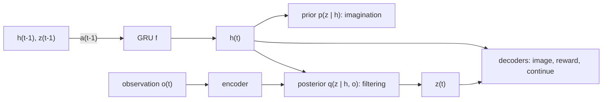

## Why this matters

"World model" has become one of the most overloaded terms in AI: it is used for a recurrent network that dreams Atari frames, for a video generator such as Sora, for a 3D scene generator, and for the abstract predictive module in LeCun's proposed architecture. Before looking at the large generative systems (posts 2-4 of this series), it pays to understand where the idea comes from: **model-based reinforcement learning**, where a world model is simply a learned predictor of what happens next, used to plan or to train a policy "in imagination". If you come from graphics and neural rendering (see the [Neural Rendering series]({{ '/blog/category/neural-rendering/' | relative_url }}) on this blog), think of a world model as a *renderer plus a simulator that were learned from data*, and which you can query with actions.

This first post builds the vocabulary that the rest of the series relies on: MDPs, Dyna, latent dynamics, the RSSM of PlaNet/Dreamer, imagination training, and MuZero's value-equivalent models.

## Prerequisites

- Basic deep learning (MLPs, RNN/GRU, backpropagation, Adam) and PyTorch.
- Probability: expectations, Gaussian distributions, KL divergence.
- Helpful but not required: the basic RL loop (state, action, reward, policy). We recap what we need.

## 1. What do we mean by a "world model"?

The idea is older than deep learning. In 1943 the psychologist Kenneth Craik suggested that the mind carries a "small-scale model" of external reality that it uses to try out alternatives before acting. In machine learning, Schmidhuber's early-1990s work on learning a differentiable model of the environment and planning through it, and Sutton's Dyna architecture (1991), turned that intuition into algorithms.

A useful working definition:

> A **world model** is a learned model that predicts how the (relevant part of the) world evolves, usually conditioned on the agent's actions, and that can be rolled out to answer "what if?" questions.

In symbols, the most common form is a learned transition distribution

$$
p_\theta(s_{t+1}, r_{t} \mid s_t, a_t) \quad\text{or, from raw observations,}\quad p_\theta(o_{t+1} \mid o_{\le t}, a_{\le t}).
$$

Three questions separate the many systems called "world models":

| Question | Options | Examples |
| --- | --- | --- |
| What is predicted? | pixels / tokens, a latent state, only task-relevant quantities (reward, value) | GameNGen (pixels), Dreamer (latent), MuZero (value-equivalent) |
| Is it conditioned on actions? | yes (interactive) / no (passive video prediction) | Genie, UniSim (yes); unconditional video models (no) |
| What is it used for? | planning, policy learning in imagination, data generation / simulation, representation learning | MuZero (planning), Dreamer (imagination), Cosmos (synthetic data), V-JEPA (representations) |

This post covers the left-most column of each row: compact latent models trained to support control. Posts 3-4 move to large generative simulators, and post 5 returns to latent prediction with JEPA.

## 2. MDPs and the model-based idea

### 2.1 Markov decision processes

A **Markov decision process** (MDP) is a tuple $(\mathcal{S}, \mathcal{A}, P, R, \gamma)$: states, actions, transition probabilities $P(s^\prime \mid s, a)$, a reward function $R(s, a)$ and a discount $\gamma \in [0, 1)$. A policy $\pi(a \mid s)$ induces the return $G_t = \sum_{k \ge 0} \gamma^k r_{t+k}$, and the value functions

$$
V^\pi(s) = \mathbb{E}_\pi\left[G_t \mid s_t = s\right], \qquad
Q^\pi(s, a) = \mathbb{E}_\pi\left[G_t \mid s_t = s, a_t = a\right].
$$

The optimal action-value function satisfies the **Bellman optimality equation**

$$
Q^\ast(s, a) = R(s, a) + \gamma \sum_{s'} P(s' \mid s, a) \max_{a'} Q^\ast(s', a').
$$

If we *know* $P$ and $R$, we can solve this by dynamic programming (value iteration). Real agents usually do not know them. When the agent only receives observations $o_t$ that do not reveal the full state (a camera image, say), we have a **partially observable MDP** (POMDP); the agent then needs a *belief* or a learned latent state that summarizes the history $o_{\le t}, a_{\lt t}$. This is exactly the role of the recurrent latent state in PlaNet and Dreamer below.

The figure below puts the two halves of this setting side by side: the interaction loop that produces experience, and a tiny MDP drawn as a graph.



### 2.2 Model-free vs. model-based

- **Model-free RL** (Q-learning, PPO, SAC) learns a value function or policy directly from real transitions.
- **Model-based RL** additionally learns $\hat P_\theta, \hat R_\theta$ and uses them to plan (search over action sequences) or to generate extra training data.

The promise of model-based RL is **sample efficiency**: a transition observed once can be "replayed" through the model many times, and the model can generalize to states never visited. The classic danger is **compounding model error**: a one-step error $\epsilon$ grows over a rollout of length $H$, and a policy optimized against the model will actively seek out states where the model is wrong and optimistic (model exploitation). Nearly every design decision in the methods below is a defense against these two problems.

To see compounding error with real numbers, we trained a small MLP $\hat P_\theta$ on only 300 random transitions of a damped pendulum (state $(\theta, \omega)$, torque $u$, time step 0.05 s) and rolled it out open-loop next to the true dynamics, as shown in the figure.

{% include blog_figure.liquid path="assets/img/blog/world-models/01-model-error.svg" caption="Left: true (solid) and model (dashed) trajectories from three start states with zero torque. The one-step predictions are almost perfect, yet the rollouts slowly drift out of phase. Right: median state error over 500 random starts and random actions (log-log axes). The error grows roughly linearly with the horizon $k$ (dotted: $k$ times the one-step error), reaching about 100 times the one-step error after 100 steps." %}



### 2.3 Dyna: learning, planning and reacting

Sutton's **Dyna** architecture (Sutton, "Dyna, an integrated architecture for learning, planning, and reacting", SIGART Bulletin 2(4), 1991) is the template for "training in imagination". The agent interleaves:

1. **Acting** in the real environment and doing a normal Q-learning update.
2. **Model learning**: store the observed transition $(s, a) \to (r, s^\prime)$.
3. **Planning**: $n$ times, sample a previously seen $(s, a)$, ask the model for $(r, s^\prime)$, and do the same Q-learning update on this *simulated* transition.

The figure shows how the three steps share one value function: real experience updates $Q$ directly and also trains the model, and the model produces extra, simulated updates.

{% include blog_figure.liquid path="assets/img/blog/world-models/01-dyna.svg" localized="true" width="85%" caption="Dyna: the blue arrow is ordinary model-free RL; the orange path (model learning, then planning) is what the world model adds. With $n$ planning updates per real step, every real transition is reused many times." %}

Here is tabular Dyna-Q on a small gridworld with a wall. It runs in a second with NumPy:

```python
import numpy as np

# 6x9 gridworld (Sutton & Barto's Dyna maze): S = start, G = goal, # = wall
MAZE = ["........G",
        "..#....#.",
        "S.#....#.",
        "..#....#.",
        ".....#...",
        "........."]
H, W = len(MAZE), len(MAZE[0])
ACTIONS = [(-1, 0), (1, 0), (0, -1), (0, 1)]  # up, down, left, right
start = next((r, c) for r in range(H) for c in range(W) if MAZE[r][c] == "S")

def step(s, a):
    r, c = s[0] + ACTIONS[a][0], s[1] + ACTIONS[a][1]
    if not (0 <= r < H and 0 <= c < W) or MAZE[r][c] == "#":
        r, c = s                       # bump into wall: stay
    done = MAZE[r][c] == "G"
    return (r, c), float(done), done

def dyna_q(n_planning, episodes=50, alpha=0.1, gamma=0.95, eps=0.1, seed=0):
    rng = np.random.default_rng(seed)
    Q = np.zeros((H, W, 4))
    model = {}                         # (s, a) -> (r, s', done): a deterministic learned model
    steps_per_episode = []
    for _ in range(episodes):
        s, done, n = start, False, 0
        while not done:
            if rng.random() < eps:
                a = int(rng.integers(4))
            else:                      # greedy with random tie-breaking
                q = Q[s]
                a = int(rng.choice(np.flatnonzero(q == q.max())))
            s2, r, done = step(s, a)
            # (1) direct RL update from real experience
            Q[s][a] += alpha * (r + gamma * (0.0 if done else Q[s2].max()) - Q[s][a])
            # (2) model learning
            model[(s, a)] = (r, s2, done)
            # (3) planning: replay simulated transitions from the model
            keys = list(model.keys())
            for _ in range(n_planning):
                ps, pa = keys[rng.integers(len(keys))]
                pr, ps2, pdone = model[(ps, pa)]
                target = pr + gamma * (0.0 if pdone else Q[ps2].max())
                Q[ps][pa] += alpha * (target - Q[ps][pa])
            s, n = s2, n + 1
        steps_per_episode.append(n)
    return steps_per_episode

for n in [0, 5, 50]:
    steps = dyna_q(n)
    print(f"n_planning={n:2d}  steps in episodes 2-10: {steps[1:10]}")
```

With `n_planning=0` (plain Q-learning) the agent needs many episodes to propagate the reward back to the start; with 50 planning steps per real step it finds a short path after only a few episodes. That is the whole promise of world models in miniature: **real data is expensive, imagined data is cheap**. Everything that follows replaces the lookup table `model` with a neural network that can generalize, and the tabular Q with neural actors and critics.

We ran the script above with 20 random seeds; the figure shows the outcome.



## 3. "World Models" (Ha & Schmidhuber, 2018)

Ha and Schmidhuber's paper ([arXiv:1803.10122](https://arxiv.org/abs/1803.10122); the NeurIPS 2018 version is titled "Recurrent World Models Facilitate Policy Evolution") made the term popular and came with a memorable interactive article. The agent has three parts:

- **V (vision)**: a VAE that compresses each 64x64 frame $o_t$ into a small latent $z_t$ (we derive the VAE in [post 2]({{ '/blog/2026/world-models-02-generative-modeling-foundations/' | relative_url }})).
- **M (memory)**: an **MDN-RNN** that models $p(z_{t+1} \mid a_t, z_t, h_t)$ as a mixture of Gaussians, where $h_t$ is the LSTM hidden state.
- **C (controller)**: a tiny linear policy $a_t = W_c [z_t; h_t] + b_c$, trained with the evolution strategy CMA-ES.

The figure shows how information flows between the three parts at every time step.



Because almost all parameters live in V and M, which are trained without rewards, the controller is small enough for black-box optimization. On CarRacing the paper reports an average score of 906 $\pm$ 21 over 100 trials, and on VizDoom "Take Cover" it trains the controller **entirely inside the dream** generated by M and transfers it back to the real game. Two lessons from that paper recur in all later work:

1. A learned model is **exploitable**: the controller found adversarial policies that made monsters never fire in the dream. Ha and Schmidhuber counteracted this by raising the sampling **temperature** $\tau$ of the MDN, making the dream more stochastic and therefore harder to exploit.
2. Separating **representation** (V), **dynamics** (M) and **behavior** (C) is a powerful decomposition, but training V with a pixel reconstruction loss spends capacity on details that may not matter for the task. Post 5 revisits this criticism.

## 4. PlaNet and the Recurrent State-Space Model (RSSM)

**PlaNet** (Hafner et al., "Learning Latent Dynamics for Planning from Pixels", ICML 2019, [arXiv:1811.04551](https://arxiv.org/abs/1811.04551)) learned the dynamics *jointly* with the representation and planned directly in latent space. Its key contribution is the **recurrent state-space model**, which is still the backbone of DreamerV3.

### 4.1 Why both deterministic and stochastic state?

A purely deterministic RNN cannot represent multiple possible futures; a purely stochastic state-space model has trouble remembering information over many steps, because every step injects noise. The RSSM splits the latent state into a deterministic part $h_t$ and a stochastic part $z_t$:

$$
\begin{aligned}
\text{deterministic state:}\quad & h_t = f_\theta(h_{t-1}, z_{t-1}, a_{t-1}) \quad \text{(a GRU)}\\
\text{prior (transition):}\quad & \hat z_t \sim p_\theta(\hat z_t \mid h_t)\\
\text{posterior (representation):}\quad & z_t \sim q_\theta(z_t \mid h_t, o_t)\\
\text{decoders:}\quad & \hat o_t \sim p_\theta(o_t \mid h_t, z_t), \quad \hat r_t \sim p_\theta(r_t \mid h_t, z_t).
\end{aligned}
$$

The **prior** is the world model proper: it predicts the next latent *without* seeing the observation, so it is what we roll out in imagination. The **posterior** is a filter that also looks at the current image; during training it tells the prior what actually happened.



Unrolled over time, the same model looks like the figure below: the left half is what happens while filtering real data, the right half during imagination.



### 4.2 The training objective

The RSSM is a sequential VAE. Applying Jensen's inequality to the log-likelihood of the observed sequence, with the posterior as the variational distribution, gives the evidence lower bound (ELBO)

$$
\ln p_\theta(o_{1:T}, r_{1:T} \mid a_{1:T})
\;\ge\;
\sum_{t=1}^{T} \Big(
\underbrace{\mathbb{E}_{q}\big[\ln p_\theta(o_t \mid h_t, z_t) + \ln p_\theta(r_t \mid h_t, z_t)\big]}_{\text{reconstruction}}
\;-\;
\underbrace{\mathbb{E}_{q}\big[\mathrm{KL}\big(q_\theta(z_t \mid h_t, o_t)\,\Vert\, p_\theta(z_t \mid h_t)\big)\big]}_{\text{make the prior predict the posterior}}
\Big).
$$

The KL term is the important one: it trains the transition prior to predict, from the past alone, the latent that the posterior infers from the image. PlaNet also proposed **latent overshooting**, a multi-step version of this KL that regularizes the prior for predictions several steps ahead (Dreamer later dropped it).

### 4.3 Planning with CEM

PlaNet has no policy network. At every real step it runs the **cross-entropy method** (CEM) in latent space: sample $J$ action sequences of length $H$ from a diagonal Gaussian, roll each out with the prior, score them by the sum of predicted rewards, refit the Gaussian to the top $K$, repeat a few times, and execute the first action of the mean. This is *model-predictive control* (MPC). It works, but searching at every step is expensive, and the planning horizon limits how far ahead rewards can be seen.

The figure runs CEM on a toy problem in which the action sequence has only two numbers, so that the whole search space can be drawn.



## 5. Dreamer: learning behaviors by latent imagination

### 5.1 DreamerV1

**Dreamer** (Hafner et al., "Dream to Control: Learning Behaviors by Latent Imagination", ICLR 2020, [arXiv:1912.01603](https://arxiv.org/abs/1912.01603)) keeps the RSSM but replaces online planning with an **actor-critic trained entirely on imagined trajectories**. The loop has three phases that alternate:

1. **Collect** real experience with the current actor into a replay buffer.
2. **World-model learning**: sample sequences and train the RSSM with the ELBO above.
3. **Behavior learning in imagination**: take posterior states from the batch as starting points, roll out the *prior* for $H = 15$ steps using the actor's actions, predict rewards, and update the actor and the critic.

The figure illustrates phase 3, using the pendulum model from Section 2.2 as the world model.

{% include blog_figure.liquid path="assets/img/blog/world-models/01-imagination.svg" width="85%" caption="Imagination rollouts in (time, $\theta$, $\omega$). Black: one real trajectory. From four states along it (dots; in Dreamer these are posterior states), the learned model is rolled out for $H = 15$ steps with five different action sequences each. Actor and critic learn only from such short imagined branches, which always start from real situations." %}

The critic $v_\psi(s_t)$ is trained toward **$\lambda$-returns**, which blend $n$-step returns of all lengths and so trade off bias (from the critic) against variance (from long model rollouts):

$$
V^\lambda_t = \hat r_t + \gamma \Big( (1-\lambda)\, v_\psi(s_{t+1}) + \lambda\, V^\lambda_{t+1} \Big),
\qquad V^\lambda_H = v_\psi(s_H).
$$

Unrolling this recursion shows which $n$-step returns $V^\lambda$ actually averages:



The key trick is how the actor is trained. Because the world model, reward head and critic are all differentiable, Dreamer maximizes $\sum_t V^\lambda_t$ by **backpropagating analytic gradients through the learned dynamics** into the actor's reparameterized actions:

$$
\max_\phi \; \mathbb{E}\Big[\sum_{t=0}^{H-1} V^\lambda_t\Big],
\qquad a_t = \pi_\phi(s_t) \text{ sampled with the reparameterization trick.}
$$

The critic looks beyond the imagination horizon, which removes the main limitation of PlaNet's planner.

### 5.2 DreamerV2: discrete latents

**DreamerV2** (Hafner et al., "Mastering Atari with Discrete World Models", ICLR 2021, [arXiv:2010.02193](https://arxiv.org/abs/2010.02193)) was the first agent to reach human-level performance on the Atari benchmark by learning behaviors inside a separately trained world model. Two changes mattered:

- **Categorical latents**: $z_t$ is a vector of 32 categorical variables with 32 classes each, sampled with straight-through gradients. Categoricals can represent multi-modal next-state distributions and seemed to be easier to fit than Gaussians.
- **KL balancing**: the KL term both trains the prior toward the posterior and regularizes the posterior toward the prior. DreamerV2 weights the two directions differently using stop-gradients $\mathrm{sg}(\cdot)$:

$$
\mathcal{L}_{\mathrm{KL}} = \alpha\, \mathrm{KL}\big(\mathrm{sg}(q) \,\Vert\, p\big) + (1-\alpha)\, \mathrm{KL}\big(q \,\Vert\, \mathrm{sg}(p)\big), \qquad \alpha = 0.8,
$$

so that the prior learns quickly while the representation is not pulled toward a poorly trained prior.

### 5.3 DreamerV3: one set of hyperparameters

**DreamerV3** (Hafner et al., "Mastering Diverse Domains through World Models", [arXiv:2301.04104](https://arxiv.org/abs/2301.04104); published as "Mastering diverse control tasks through world models", *Nature* 640, 2025, [doi:10.1038/s41586-025-08744-2](https://doi.org/10.1038/s41586-025-08744-2)) is about **robustness**: a single configuration across more than 150 tasks, from Atari to continuous control to Minecraft, where it was the first algorithm to collect diamonds from scratch without human data or curricula. The main ingredients are normalization tricks that you can reuse in any world model:

- **Symlog predictions**: decoders and reward heads predict $\mathrm{symlog}(x) = \mathrm{sign}(x)\ln(\lvert x\rvert + 1)$, so targets of very different scales (rewards of 0.01 or 1000) produce similar gradient magnitudes. The inverse is $\mathrm{symexp}(x) = \mathrm{sign}(x)(\exp(\lvert x\rvert) - 1)$.
- **Two-hot discrete regression** for rewards and values: the scalar target is spread over two neighboring bins of a fixed (symexp-spaced) grid, and the network is trained with cross-entropy. This is robust to multi-modal and heavy-tailed returns.
- **KL with free bits**: the dynamics and representation losses are clipped below 1 nat, $\max(1, \mathrm{KL})$, with weights $\beta_{\mathrm{dyn}} = 0.5$, $\beta_{\mathrm{rep}} = 0.1$, so the model does not waste capacity on already well-predicted latents.
- **Return normalization** for the actor: advantages are divided by $\max(1, S)$, where $S$ is the range between the 5th and 95th percentile of returns, so the entropy bonus has a consistent meaning across reward scales.
- **Unimix categoricals**: mixing 1% uniform probability into categorical distributions to avoid zero-probability spikes and infinite KL.

The figure shows the first two tricks on concrete numbers.



Official code: [github.com/danijar/dreamerv3](https://github.com/danijar/dreamerv3).

## 6. MuZero: a model that only predicts what matters

**MuZero** (Schrittwieser et al., "Mastering Atari, Go, Chess and Shogi by Planning with a Learned Model", *Nature* 588, 2020, [arXiv:1911.08265](https://arxiv.org/abs/1911.08265), [doi:10.1038/s41586-020-03051-4](https://doi.org/10.1038/s41586-020-03051-4)) takes the opposite view from Ha & Schmidhuber: never reconstruct observations. It learns three functions:

$$
s^0 = h_\theta(o_1, \dots, o_t), \qquad
(r^k, s^k) = g_\theta(s^{k-1}, a^k), \qquad
(\mathbf{p}^k, v^k) = f_\theta(s^k),
$$

a representation, a dynamics function and a prediction (policy and value) function. The hidden state $s^k$ has no semantics imposed on it; it is trained only so that, after unrolling $K$ steps along the actions actually taken, the predicted rewards, values and policies match their targets:

Unrolled along the actions actually taken, the three functions form the chain in the figure.



$$
\mathcal{L}_t(\theta) = \sum_{k=0}^{K} \Big[\ell^r(u_{t+k}, r^k) + \ell^v(z_{t+k}, v^k) + \ell^p(\boldsymbol{\pi}_{t+k}, \mathbf{p}^k)\Big] + c\,\lVert\theta\rVert^2,
$$

where $u$ are observed rewards, $z$ are bootstrapped value targets and $\boldsymbol{\pi}$ are the visit-count distributions of **Monte Carlo tree search** (MCTS) run inside the learned model. Such a model is called **value-equivalent**: it only needs to agree with the real environment on quantities relevant to planning. MuZero matched AlphaZero in Go, chess and shogi without being given the rules, and set a state of the art on Atari at the time.

Dreamer and MuZero mark the two poles of a debate that recurs throughout this series: should a world model **reconstruct** the world (pixels, so that it can also be used as a simulator and inspected by humans), or only **predict abstract quantities** needed for decisions? Post 5 picks up this thread with JEPA.

## 7. A map of other model-based methods

| Family | Idea | Representative work |
| --- | --- | --- |
| Probabilistic ensembles + MPC | ensemble of probabilistic MLPs to capture epistemic uncertainty; CEM planning | PETS (Chua et al., NeurIPS 2018) |
| Short model rollouts for model-free RL | branch short rollouts from real states to limit compounding error; train SAC on them | MBPO (Janner et al., NeurIPS 2019) |
| Latent MPC with value | implicit (decoder-free) latent model, MPPI planning plus a learned value, scaled to many tasks | TD-MPC2 (Hansen et al., ICLR 2024) |
| Token world models | discrete autoencoder + autoregressive Transformer as the world model | IRIS (Micheli et al., ICLR 2023) |
| Diffusion world models | predict the next frame with a diffusion model; the agent is trained inside it | DIAMOND (Alonso et al., NeurIPS 2024) |

IRIS and DIAMOND are the bridge to the rest of the series: once the dynamics model is a powerful **generative** model (autoregressive Transformer, diffusion), the world model itself becomes something you can *play*. DIAMOND's model trained on Counter-Strike gameplay is already a small neural game engine, a precursor of GameNGen and Genie (post 3).

## 8. Code: an RSSM step and imagination rollouts in PyTorch

The following snippet is a compact, runnable sketch of the Dreamer recipe on vector observations (so it runs on a CPU in seconds). It contains the RSSM (`img_step` = prior, `obs_step` = posterior), the world-model loss with KL balancing and free bits, an imagination rollout from posterior states, $\lambda$-returns, and the actor/critic updates. It omits DreamerV3's symlog/two-hot heads and return normalization for clarity.

```python
import torch
import torch.nn as nn
import torch.nn.functional as F
import torch.distributions as td

class RSSM(nn.Module):
    """Recurrent state-space model with Gaussian stochastic state (PlaNet / DreamerV1 style)."""
    def __init__(self, embed_dim, action_dim, deter=128, stoch=16, hidden=128):
        super().__init__()
        self.deter, self.stoch = deter, stoch
        self.inp = nn.Linear(stoch + action_dim, hidden)
        self.gru = nn.GRUCell(hidden, deter)
        self.prior_net = nn.Sequential(nn.Linear(deter, hidden), nn.ELU(), nn.Linear(hidden, 2 * stoch))
        self.post_net = nn.Sequential(nn.Linear(deter + embed_dim, hidden), nn.ELU(), nn.Linear(hidden, 2 * stoch))

    def initial(self, batch):
        return torch.zeros(batch, self.deter), torch.zeros(batch, self.stoch)

    @staticmethod
    def dist(stats):
        mean, std = stats.chunk(2, dim=-1)
        return td.Independent(td.Normal(mean, F.softplus(std) + 0.1), 1)

    def img_step(self, h, z, a):
        """Prior: predict the next state from the past only (used for imagination)."""
        x = F.elu(self.inp(torch.cat([z, a], -1)))
        h = self.gru(x, h)
        prior = self.dist(self.prior_net(h))
        return h, prior.rsample(), prior

    def obs_step(self, h, z, a, embed):
        """Posterior: also look at the current observation embedding (used for filtering)."""
        h, _, prior = self.img_step(h, z, a)
        post = self.dist(self.post_net(torch.cat([h, embed], -1)))
        return h, post.rsample(), post, prior

def mlp(i, o, hidden=128):
    return nn.Sequential(nn.Linear(i, hidden), nn.ELU(), nn.Linear(hidden, hidden), nn.ELU(), nn.Linear(hidden, o))

def kl_balanced(post, prior, alpha=0.8, free_nats=1.0):
    """DreamerV2-style KL balancing with free bits (detach = stop-gradient)."""
    sg = lambda d: td.Independent(td.Normal(d.base_dist.loc.detach(), d.base_dist.scale.detach()), 1)
    kl_dyn = td.kl_divergence(sg(post), prior)   # trains the prior
    kl_rep = td.kl_divergence(post, sg(prior))   # regularizes the posterior
    return alpha * kl_dyn.clamp(min=free_nats).mean() + (1 - alpha) * kl_rep.clamp(min=free_nats).mean()

def lambda_return(rewards, values, gamma=0.99, lam=0.95):
    """rewards: [H, N] for steps 0..H-1, values: [H+1, N] for states 0..H. Returns [H, N]."""
    out, last = [], values[-1]
    for t in reversed(range(rewards.shape[0])):
        last = rewards[t] + gamma * ((1 - lam) * values[t + 1] + lam * last)
        out.append(last)
    return torch.stack(out[::-1])

# ----- toy setup -----
torch.manual_seed(0)
B, T, H = 16, 32, 15                    # batch, sequence length, imagination horizon
obs_dim, act_dim, embed_dim = 64, 4, 64
rssm = RSSM(embed_dim, act_dim)
encoder, decoder = mlp(obs_dim, embed_dim), mlp(rssm.deter + rssm.stoch, obs_dim)
reward_head = mlp(rssm.deter + rssm.stoch, 1)
actor, critic = mlp(rssm.deter + rssm.stoch, 2 * act_dim), mlp(rssm.deter + rssm.stoch, 1)
wm_params = [*rssm.parameters(), *encoder.parameters(), *decoder.parameters(), *reward_head.parameters()]
wm_opt = torch.optim.Adam(wm_params, lr=3e-4)
actor_opt = torch.optim.Adam(actor.parameters(), lr=8e-5)
critic_opt = torch.optim.Adam(critic.parameters(), lr=8e-5)

# a fake replay batch: observations, previous actions, rewards
obs = torch.randn(B, T, obs_dim)
act = torch.rand(B, T, act_dim) * 2 - 1
rew = torch.randn(B, T)

def policy(feat):
    mean, std = actor(feat).chunk(2, -1)
    base = td.Normal(mean, F.softplus(std) + 1e-3)
    return torch.tanh(base.rsample()), base.entropy().sum(-1)  # reparameterized action in [-1, 1]

for it in range(3):
    # ---- 1) world-model learning: filter the sequence with the posterior ----
    h, z = rssm.initial(B)
    embed = encoder(obs)
    feats, kl = [], 0.0
    for t in range(T):
        h, z, post, prior = rssm.obs_step(h, z, act[:, t], embed[:, t])
        feats.append(torch.cat([h, z], -1))
        kl = kl + kl_balanced(post, prior)
    feats = torch.stack(feats, 1)                                   # [B, T, deter+stoch]
    recon = F.mse_loss(decoder(feats), obs)
    rew_loss = F.mse_loss(reward_head(feats).squeeze(-1), rew)
    wm_loss = recon + rew_loss + kl / T
    wm_opt.zero_grad(); wm_loss.backward(); wm_opt.step()

    # ---- 2) imagination: roll out the prior from every posterior state ----
    start = feats.detach().reshape(B * T, -1)
    h, z = start[:, :rssm.deter], start[:, rssm.deter:]
    traj, ents = [start], []
    for _ in range(H):
        a, ent = policy(traj[-1])
        h, z, _ = rssm.img_step(h, z, a)
        traj.append(torch.cat([h, z], -1))
        ents.append(ent)
    traj = torch.stack(traj)                                        # [H+1, N, F]
    rewards = reward_head(traj[1:]).squeeze(-1)                     # reward of entering s_{t+1}
    values = critic(traj).squeeze(-1)                               # [H+1, N]
    returns = lambda_return(rewards, values)                        # [H, N]

    # ---- 3) actor: maximize lambda-returns by backprop through the dynamics ----
    actor_loss = -returns.mean() - 1e-4 * torch.stack(ents).mean()
    actor_opt.zero_grad(); actor_loss.backward(); actor_opt.step()

    # ---- 4) critic: regress values of (detached) imagined states onto (detached) returns ----
    critic_loss = F.mse_loss(critic(traj[:-1].detach()).squeeze(-1), returns.detach())
    critic_opt.zero_grad(); critic_loss.backward(); critic_opt.step()
    print(f"iter {it}: wm {wm_loss.item():.3f}  actor {actor_loss.item():.3f}  critic {critic_loss.item():.3f}")
```

A few details worth noticing:

- **Imagination starts from posterior states** of real sequences, so rollouts begin from realistic situations and only need to be accurate for $H$ steps. This is the same "short branched rollouts" idea as MBPO.
- **Gradient routing**: the actor loss backpropagates through `rssm.img_step`, `reward_head` and `critic` into the actor, but only `actor_opt` steps. The world model is updated only by its own loss (its stray gradients are cleared by `wm_opt.zero_grad()` at the next iteration), and the critic only by its regression loss.
- In a real implementation you would also predict a **continue flag** (episode termination) to discount imagined returns, use a slow-moving **target critic**, and replace the MSE heads with DreamerV3's symlog/two-hot heads.

## 9. Where this leaves us

| | Ha & Schmidhuber | PlaNet | Dreamer V1-V3 | MuZero |
| --- | --- | --- | --- | --- |
| Latent state | VAE $z$ + LSTM $h$ | RSSM | RSSM (Gaussian, then categorical) | abstract $s^k$ |
| Reconstructs pixels? | yes | yes | yes | no |
| Behavior | evolution (CMA-ES) on a linear controller | CEM planning | actor-critic in imagination | MCTS in the model |
| Main lesson | policies can be trained in a dream | joint latent dynamics + planning | imagination with analytic gradients scales | only value-relevant prediction is needed |

These models are small, task-specific and trained from scratch per environment. The next two posts follow what happened when the dynamics model was replaced by internet-scale generative models: first the toolkit (VAEs, tokenizers, Transformers, diffusion, flow matching), then video world simulators such as Genie and GameNGen.

## Representative papers

| Paper | Venue | Year | Link | Why it matters |
| --- | --- | --- | --- | --- |
| Dyna, an integrated architecture for learning, planning, and reacting (Sutton) | SIGART Bulletin | 1991 | (no link) | Template for training on simulated experience |
| World Models / Recurrent World Models Facilitate Policy Evolution (Ha, Schmidhuber) | NeurIPS | 2018 | [arXiv:1803.10122](https://arxiv.org/abs/1803.10122) | V-M-C decomposition; policies trained inside a dream |
| Deep RL in a Handful of Trials using Probabilistic Dynamics Models (PETS, Chua et al.) | NeurIPS | 2018 | [arXiv:1805.12114](https://arxiv.org/abs/1805.12114) | Uncertainty-aware ensembles for model-based control |
| When to Trust Your Model: Model-Based Policy Optimization (MBPO, Janner et al.) | NeurIPS | 2019 | [arXiv:1906.08253](https://arxiv.org/abs/1906.08253) | Short branched rollouts against compounding error |
| Learning Latent Dynamics for Planning from Pixels (PlaNet, Hafner et al.) | ICML | 2019 | [arXiv:1811.04551](https://arxiv.org/abs/1811.04551) | The RSSM; planning in latent space |
| Dream to Control (Dreamer, Hafner et al.) | ICLR | 2020 | [arXiv:1912.01603](https://arxiv.org/abs/1912.01603) | Actor-critic in imagination with backprop through dynamics |
| Mastering Atari with Discrete World Models (DreamerV2) | ICLR | 2021 | [arXiv:2010.02193](https://arxiv.org/abs/2010.02193) | Categorical latents, KL balancing, human-level Atari |
| Mastering diverse control tasks through world models (DreamerV3) | Nature | 2025 | [doi:10.1038/s41586-025-08744-2](https://doi.org/10.1038/s41586-025-08744-2) | One configuration across 150+ tasks; Minecraft diamonds |
| Mastering Atari, Go, Chess and Shogi by Planning with a Learned Model (MuZero) | Nature | 2020 | [arXiv:1911.08265](https://arxiv.org/abs/1911.08265) | Value-equivalent models + MCTS |
| Transformers are Sample-Efficient World Models (IRIS, Micheli et al.) | ICLR | 2023 | [arXiv:2209.00588](https://arxiv.org/abs/2209.00588) | Discrete tokens + Transformer dynamics |
| TD-MPC2: Scalable, Robust World Models for Continuous Control (Hansen et al.) | ICLR | 2024 | [arXiv:2310.16828](https://arxiv.org/abs/2310.16828) | Decoder-free latent MPC at scale |
| Diffusion for World Modeling: Visual Details Matter in Atari (DIAMOND, Alonso et al.) | NeurIPS | 2024 | [arXiv:2405.12399](https://arxiv.org/abs/2405.12399) | Diffusion as the dynamics model; playable CS:GO model |

## Learning resources

- Sutton & Barto, *Reinforcement Learning: An Introduction* (2nd ed., 2018), chapter 8 "Planning and Learning with Tabular Methods" (Dyna): [incompleteideas.net/book/the-book-2nd.html](http://incompleteideas.net/book/the-book-2nd.html).
- Ha & Schmidhuber's interactive article: [worldmodels.github.io](https://worldmodels.github.io/).
- Danijar Hafner's code: [DreamerV3](https://github.com/danijar/dreamerv3); for a readable PyTorch version, search for community reimplementations and compare them against the official JAX code.
- Hansen et al.'s [TD-MPC2 code](https://github.com/nicklashansen/tdmpc2) and Alonso et al.'s [DIAMOND code](https://github.com/eloialonso/diamond).
- Background on VAEs and the ELBO: S. Prince, *Understanding Deep Learning* (MIT Press, 2023), free at [udlbook.github.io/udlbook](https://udlbook.github.io/udlbook/), and Stanford [CS236 Deep Generative Models](https://deepgenerativemodels.github.io/).

## Exercises

1. Run the Dyna-Q script and plot steps-per-episode for `n_planning` in {0, 5, 50}. Then change the maze after episode 25 (open a shortcut). Why does Dyna-Q adapt slowly, and how does Dyna-Q+'s exploration bonus fix it?
2. Derive the RSSM ELBO in Section 4.2 from Jensen's inequality, starting from $\ln \int p(o_{1:T}, z_{1:T} \mid a_{1:T})\, dz_{1:T}$ with the factorized posterior $\prod_t q(z_t \mid h_t, o_t)$.
3. In the PyTorch sketch, replace the Gaussian stochastic state with 8 categorical variables of 8 classes using straight-through gradients (`one_hot + probs - probs.detach()`). What changes in `kl_balanced`?
4. Set `lam=0` and `lam=1` in `lambda_return`. Which estimator does each correspond to, and which part of the system (critic or world model) does each trust?
5. MuZero never reconstructs observations. Give one advantage and one failure mode of this choice when the reward is very sparse.

**Next:** [post 2]({{ '/blog/2026/world-models-02-generative-modeling-foundations/' | relative_url }}) builds the generative toolkit that modern world models are made of: VAEs, VQ tokenizers, autoregressive Transformers, diffusion and flow matching.
