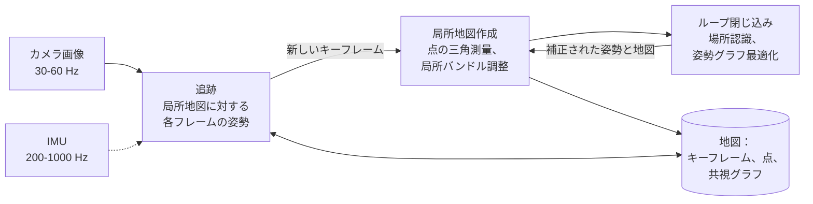

## なぜ重要か

[第 05 回]({{ '/blog/2026/3d-vision-05-multi-view-geometry-and-bundle-adjustment/' | relative_url }})では Structure-from-Motion を解きました。写真の山が与えられたら、時間をいくらかけてもよいので、すべてのカメラと点を一度に求める問題です。ロボット、ドローン、AR ヘッドセットが直面するのは、それより難しい版です。画像は 1 枚ずつ、毎秒 30 枚以上の速さで届きます。現在のフレームの姿勢は*今すぐ*、数ミリ秒のうちに必要です。モーターを制御したり、仮想物体を正しい位置に描いたりするためです。しかも地図は、数分から数時間の運動のあいだ一貫していなければなりません。これが **SLAM（Simultaneous Localization and Mapping、自己位置推定と地図作成の同時実行）**です。センサ自身の計測だけから、センサの軌跡と周囲の地図をオンラインで推定します。

本記事では Visual SLAM を基本原理から組み立てます。この問題を特徴づける現象である**ドリフト（drift）**から出発し、SLAM を**因子グラフ（factor graph）**上の確率的推論として定式化します。次に、どのシステムにもある 2 つの部分を見ます。**フロントエンド（front end）**（特徴点ベースまたは直接法の Visual Odometry）と、**バックエンド（back end）**（$SE(3)$ 上の姿勢グラフ最適化と、誤ったループ閉じ込みに対するロバストカーネル）です。その間に、姿勢を正しく最適化するのに必要なだけのリー群の知識を身につけ、**Bag of Visual Words** でループを検出する方法を学びます。後半ではフィルタと最適化の比較（EKF、MSCKF、スライディングウィンドウ）と、IMU 事前積分を用いた **Visual-Inertial Odometry（VIO）**を扱います。最後に、ORB-SLAM3 や VINS-Mono から DROID-SLAM、MASt3R-SLAM、Gaussian Splatting SLAM まで、実際のシステムを概観します。どのアルゴリズムもトイ問題で実際に実行し、本文で引用する数値はその出力です。

## 前提知識

- [第 01 回]({{ '/blog/2026/3d-vision-01-image-formation-and-camera-models/' | relative_url }})のカメラモデルと座標規約：$P = K[R \mid \mathbf t]$、OpenCV のカメラ座標系、$T\_{w2c}$ と $T\_{c2w}$。
- [第 02 回]({{ '/blog/2026/3d-vision-02-camera-calibration/' | relative_url }})のガウス・ニュートン法と Levenberg-Marquardt 法（4.2 節）、およびカメラ-IMU キャリブレーション（9 節）。
- [第 03 回]({{ '/blog/2026/3d-vision-03-features-and-matching/' | relative_url }})の特徴点、RANSAC、オプティカルフロー。
- 2 視点幾何（[第 04 回]({{ '/blog/2026/3d-vision-04-two-view-geometry/' | relative_url }})）と、PnP およびバンドル調整（[第 05 回]({{ '/blog/2026/3d-vision-05-multi-view-geometry-and-bundle-adjustment/' | relative_url }})）。これらは部品として使い、導出は繰り返しません。
- 剛体変換と $SE(3)$：[Embodied AI 第 1 回]({{ '/blog/2026/embodied-ai-01-robotics-foundations/' | relative_url }})。最適化に必要な内容は以下の 4 節で補います。
- 基礎的な確率：ガウス分布、ベイズの定理、負の対数尤度。

**記法。** 第 01 回と同じく、カメラの外部パラメータ $(R, \mathbf t)$ はワールド点を OpenCV のカメラ座標系（$x$ が右、$y$ が下、$z$ が前）に移します。SLAM では、カメラ $i$ の**姿勢（pose）**をカメラからワールドへの変換として保持するほうが便利です。

$$
T_i = T_{wc_i} = T_{c2w} = \begin{pmatrix} R^\top & \mathbf C \\ \mathbf 0^\top & 1 \end{pmatrix} \in SE(3),
$$

その並進はカメラ中心 $\mathbf C$ で、回転行列の各列はワールド座標で表したカメラの軸です。カメラ $i$ から見たカメラ $j$ の相対姿勢は $T\_i^{-1} T\_j$ です。本記事で「姿勢」と言えば、この $T\_i$ を指します。

## 1. 問題：位置推定、地図作成、そしてドリフト

### 1.1 互いを必要とする 2 つの問題

地図（記述子付きの 3 次元点）があれば、新しい画像の位置推定は RANSAC 付きの PnP です（第 05 回）。カメラ姿勢があれば、地図作成は三角測量です（第 04 回）。SLAM にはどちらもありません。地図は姿勢から作られ、その姿勢は地図から推定されます。両者を一緒に解くことが、SLAM の "S"（Simultaneous、同時）の意味です。古典的な確率的定式化は、不確かな空間関係に関する Smith、Self、Cheeseman の研究（1990）にさかのぼります。SLAM という略語自体は 1990 年代半ばに生まれ、Durrant-Whyte と Bailey の 2 部構成のチュートリアル（2006）が、フィルタ中心の古典的な時代をサーベイしています。本記事で用いる現代的な見方は Cadena ら（2016）によるものです。

### 1.2 オドメトリはドリフトする、それもどれほど速く

カメラを追跡する最も簡単な方法は**オドメトリ（odometry）**です。連続するフレーム間の運動を推定し、それをつなぎ合わせます。各ステップは少しずつ誤差を加え、誤差は蓄積します。どれほど速く蓄積するのでしょうか。1 m ずつまっすぐ進むロボットを考え、各ステップの計測に少しノイズが乗るとします。ステップごとに $\sigma\_d$ の距離誤差があるか、$\sigma\_\theta$ の方位誤差があるかのどちらかです。

距離誤差は単純に足し合わされます。$n$ ステップ後の誤差は $n$ 個の独立な項の和なので、標準偏差は $\sigma\_d\sqrt n$、つまり**ランダムウォーク（random walk）**です。

方位誤差ははるかに厄介です。方位が間違っていると、*その後の*すべてのステップが狂うからです。$k$ ステップ後の方位誤差は $\theta\_k = \sum\_{i \le k}\epsilon\_i$ で、そのときのステップは横方向に約 $\theta\_k$ メートルずれます。$n$ ステップ後の横方向誤差は $y\_n \approx \sum\_{k=1}^n \theta\_k = \sum\_{i=1}^n (n - i + 1)\,\epsilon\_i$ で、その分散は

$$
\operatorname{Var}(y_n) \approx \sigma_\theta^2 \sum_{m=1}^{n} m^2 = \sigma_\theta^2\,\frac{n(n+1)(2n+1)}{6} \approx \frac{\sigma_\theta^2\, n^3}{3}.
$$

誤差は $\sqrt n$ ではなく $n^{3/2}$ で増えます。回転誤差はてこの腕のように効きます。

```python
import numpy as np


def dead_reckon(n, sigma_d, sigma_th, trials, rng, step=1.0):
    """Integrate n odometry steps of a robot driving straight ahead. Each step moves `step`
    metres with noise sigma_d and turns by a noisy angle (sigma_th). Returns the end-point
    errors of all trials (the true end point is (n * step, 0))."""
    th = np.cumsum(rng.normal(0, sigma_th, (trials, n)), axis=1)       # heading after each step
    d = step + rng.normal(0, sigma_d, (trials, n))
    x, y = (d * np.cos(th)).sum(1), (d * np.sin(th)).sum(1)
    return np.hypot(x - n * step, y)


rng = np.random.default_rng(0)
for n in (10, 100, 1000):
    e_d = dead_reckon(n, 0.02, 0.0, 2000, rng)                 # only distance noise (2 cm/step)
    e_th = dead_reckon(n, 0.0, np.deg2rad(0.5), 2000, rng)     # only heading noise (0.5 deg/step)
    print(f"n = {n:4d}: RMS error, distance noise {np.sqrt(np.mean(e_d**2)):7.3f} m"
          f" (theory {0.02 * np.sqrt(n):6.3f}),  heading noise {np.sqrt(np.mean(e_th**2)):7.2f} m"
          f" (theory {np.deg2rad(0.5) * np.sqrt(n * (n + 1) * (2 * n + 1) / 6):6.2f})")
```

```text
n =   10: RMS error, distance noise   0.063 m (theory  0.063),  heading noise    0.17 m (theory   0.17)
n =  100: RMS error, distance noise   0.194 m (theory  0.200),  heading noise    5.02 m (theory   5.08)
n = 1000: RMS error, distance noise   0.635 m (theory  0.632),  heading noise  156.49 m (theory 159.45)
```

ステップごとにわずか 0.5° の方位誤差でも、100 m 進むとロボットは 5 m、1 km 進むと 156 m ずれます。一方、ステップごとに 2 cm の距離ノイズは、同じ 1 km で 0.6 m の誤差にしかなりません。



これが SLAM の中心的な事実です。車輪、IMU、カメラのどれによるものであれ、オドメトリのドリフトは際限なく大きくなります。唯一の対処法は、以前に訪れた場所を認識し、その**ループ閉じ込み（loop closure）**を使って軌跡全体を一貫した状態に引き戻すことです。本記事の残りは、それを正しく効率よく行う方法についてです。

### 1.3 Visual SLAM システムの構成

現代のほぼすべてのシステムは PTAM（Klein と Murray、2007）にならって構成されています。PTAM は初めて追跡と地図作成を並列スレッドに分けました。



- **フロントエンド**は画素を幾何的な制約に変えます。特徴点を検出・追跡し（あるいは画素を直接位置合わせし）、各フレームの運動を推定し、どのフレームを**キーフレーム（keyframe）**にするかを決め、ループ閉じ込みの候補を探します。
- **バックエンド**は制約を推定値に変えます。キーフレームのウィンドウに対する局所バンドル調整と、ループ閉じ込み後の姿勢グラフ最適化によって、姿勢と地図を最適化します。
- **キーフレーム**のおかげで計算量が現実的になります。30 Hz のカメラは毎分 1800 フレームを生み出しますが、その大半はほとんど同じです。情報を増やすフレーム（十分な視差がある、新しい点が十分ある、追跡できる点が少なくなった）だけがキーフレームになり、キーフレームだけが高価な最適化に入ります。たとえば ORB-SLAM はキーフレームを気前よく挿入し、あとで点のほとんどが他のキーフレームからも見えているものを間引きます。

## 2. 因子グラフ上の MAP 推定としての SLAM

### 2.1 ベイズの定理から最小二乗へ

未知数（姿勢、ランドマーク、場合によっては速度やセンサのバイアス）をすべて $\mathcal X$ にまとめ、計測をすべて $\mathcal Z = \lbrace \mathbf z\_1, \dots, \mathbf z\_K \rbrace$ にまとめます。各計測は、ガウスノイズを伴う**計測モデル**を通じて少数の変数 $\mathcal X\_k \subset \mathcal X$ に依存します。

$$
\mathbf z_k = h_k(\mathcal X_k) + \boldsymbol\epsilon_k, \qquad \boldsymbol\epsilon_k \sim \mathcal N(\mathbf 0, \Sigma_k).
$$

再投影なら $h\_k$ はランドマーク $j$ をカメラ $i$ に投影する関数（第 01 回）、オドメトリの計測なら相対姿勢 $T\_i^{-1}T\_j$、GPS の測位ならある姿勢の位置です。**最大事後確率（maximum a posteriori、MAP）**推定は、すべての計測が与えられたときに最も確からしい $\mathcal X$ です。ベイズの定理と、異なる計測のノイズが独立であることから、

$$
\mathcal X^\star = \arg\max_{\mathcal X}\; p(\mathcal X \mid \mathcal Z)
= \arg\max_{\mathcal X}\; p(\mathcal X) \prod_{k=1}^K p(\mathbf z_k \mid \mathcal X_k).
$$

各ガウス尤度は $p(\mathbf z\_k \mid \mathcal X\_k) \propto \exp\big(-\tfrac12 \lVert h\_k(\mathcal X\_k) - \mathbf z\_k \rVert^2\_{\Sigma\_k}\big)$ で、**マハラノビスノルム（Mahalanobis norm）**は $\lVert \mathbf e \rVert^2\_\Sigma = \mathbf e^\top \Sigma^{-1}\mathbf e$ です。負の対数をとると積が和になり、MAP 問題は**非線形最小二乗**になります。

$$
\mathcal X^\star = \arg\min_{\mathcal X} \sum_{k} \big\lVert h_k(\mathcal X_k) - \mathbf z_k \big\rVert^2_{\Sigma_k}
= \arg\min_{\mathcal X} \sum_k \mathbf r_k^\top \Omega_k\, \mathbf r_k ,
$$

ここで $\mathbf r\_k = h\_k(\mathcal X\_k) - \mathbf z\_k$ は**残差（residual）**、$\Omega\_k = \Sigma\_k^{-1}$ はその**情報行列（information matrix）**です。事前分布 $p(\mathcal X)$ もガウスなら、同じ形の項が 1 つ増えるだけです。これは第 02 回のキャリブレーションでの「最尤推定は最小二乗」と同じ手順を、はるかに大きな変数集合に適用したものです。

これをガウス・ニュートン法（第 02 回 4.2 節）で解きます。現在の推定値のまわりで各残差を線形化し、$\mathbf r\_k(\mathcal X \oplus \boldsymbol\delta) \approx \mathbf r\_k + J\_k\boldsymbol\delta$ として、正規方程式

$$
\underbrace{\Big(\sum_k J_k^\top \Omega_k J_k\Big)}_{H}\;\boldsymbol\delta = -\underbrace{\sum_k J_k^\top \Omega_k\,\mathbf r_k}_{\mathbf g}
$$

を解きます。$H$ は問題全体の（近似的な）**情報行列**で、最適点では $H^{-1}$ が推定値の共分散を近似します。$\oplus$ は「変数を $\boldsymbol\delta$ で更新する」ことを表すプレースホルダで、姿勢の場合は単純な足し算ではありません（4 節）。

### 2.2 因子グラフ

**因子グラフ**はこの和を図にしたものです。未知数ごとに 1 つの**変数ノード**、項 $\mathbf r\_k^\top\Omega\_k\mathbf r\_k$（同じことですが確率因子 $p(\mathbf z\_k \mid \mathcal X\_k)$）ごとに 1 つの**因子ノード**をもつ 2 部グラフで、因子ノードはその項が依存する変数とだけ結ばれます。グラフ*そのもの*が問題です。計測を加えれば因子が 1 つ増え、変数を周辺化すればノードが 1 つ消え、$H$ の疎構造はグラフの隣接関係そのものです。Dellaert と Kaess のモノグラフ（2017）は SLAM を完全にこの言葉で展開しており、GTSAM、g2o（Kümmerle ら、2011）、Ceres といったライブラリは、実際には因子グラフのソルバです。

疎になる理由：$J\_k$ は因子 $k$ の変数に対応する列でしか非ゼロにならないので、$J\_k^\top\Omega\_k J\_k$ は $a$ と $b$ がともに因子 $k$ に属するブロック $(a, b)$ でしか非ゼロになりません。**$H$ のブロック $(a, b)$ が非ゼロになるのは、変数 $a$ と $b$ がある因子を共有するときに限ります。**

### 2.3 1 次元の計算例

姿勢や回転に入る前に、手で解けるトイ問題を見ましょう。ロボットが直線上を位置 $x\_0, x\_1, x\_2$ と移動し、位置 $l$ にある 1 つのランドマークを見ます。計測は次のとおりです。

- 事前分布 $x\_0 = 0$、$\sigma = 0.01$（原点を固定する）；
- オドメトリ $x\_1 - x\_0 = 1.1$ と $x\_2 - x\_1 = 1.1$、$\sigma = 0.1$；
- 最初の位置から見たランドマークのオフセット $l - x\_0 = 3.0$ と、最後の位置からの $l - x\_2 = 1.0$、$\sigma = 0.05$。

オドメトリだけなら $x\_2 = 2.2$ ですが、2 つのランドマーク計測を合わせると $x\_2 = 3.0 - 1.0 = 2.0$ になります。どの因子も線形 $\mathbf a\_k^\top \mathbf x = b\_k + \epsilon\_k$ なので、問題は 1 回の重み付き線形最小二乗です。各行をその $\sigma$ で割る（**白色化、whitening**）と、通常の最小二乗になります。

```python
# State x = (x0, x1, x2, l): three robot positions on a line and one landmark.
# Every factor is linear: a row a with a @ x = b + noise of standard deviation s.
factors = [  # (row a,               b,    s,    name)
    (np.array([1., 0, 0, 0]),   0.0, 0.01, "prior x0 = 0"),
    (np.array([-1., 1, 0, 0]),  1.1, 0.10, "odometry x1 - x0"),
    (np.array([0., -1, 1, 0]),  1.1, 0.10, "odometry x2 - x1"),
    (np.array([-1., 0, 0, 1]),  3.0, 0.05, "landmark l - x0"),
    (np.array([0., 0, -1, 1]),  1.0, 0.05, "landmark l - x2"),
]
A = np.array([a / s for a, b, s, _ in factors])       # whitened Jacobian
b = np.array([b / s for a, b, s, _ in factors])       # whitened measurements
H = A.T @ A                                           # information matrix
x_map = np.linalg.solve(H, A.T @ b)                   # MAP = weighted least squares
cov = np.linalg.inv(H)
x_odo = np.array([0.0, 1.1, 2.2, 3.0])                # odometry only (and l from x0)
print("MAP estimate  :", x_map.round(4))
print("odometry only :", x_odo)
print("std devs      :", np.sqrt(np.diag(cov)).round(4))
print("H zero pattern:\n", (np.abs(H) > 1e-12).astype(int))
```

```text
MAP estimate  : [0.   1.02 2.04 3.02]
odometry only : [0.  1.1 2.2 3. ]
std devs      : [0.01   0.0781 0.064  0.0485]
H zero pattern:
 [[1 1 0 1]
 [1 1 1 0]
 [0 1 1 1]
 [1 0 1 1]]
```

ランドマークは小さなループ閉じ込みとして働きます。$x\_2$ からもう一度見たことで $x\_2$ は 2.2 から 2.04 に引き戻され、補正は 2 つのオドメトリステップに分配されます（$x\_1 = 1.02$ で、1.1 ではない）。オドメトリはランドマーク計測より信頼度が低い（$\sigma$ が 0.1 対 0.05）ので、結果はランドマークの言い分に近くなりますが、等しくはなりません。不確かさにも注目してください。オドメトリだけに拘束される $x\_1$ が最も不確か（0.078）で、$x\_2$ は原点から遠いのに $x\_1$ より確か（0.064）です。ランドマーク計測が直接拘束しているからです。



### 2.4 疎構造と、周辺化がそれに与える影響

実際の問題には何千もの姿勢と何十万もの点があるので、$H$ の構造が計算可能かどうかを決めます。変数を姿勢、ランドマークの順に並べます。

$$
H = \begin{pmatrix} H_{xx} & H_{xl} \\ H_{lx} & H_{ll} \end{pmatrix}.
$$

完全な問題（「完全平滑化」、full smoothing）では、$H\_{xx}$ はブロック三重対角（オドメトリが連続する姿勢を結ぶ）、$H\_{ll}$ はブロック対角（ランドマーク同士は因子を共有しない）、$H\_{xl}$ は各姿勢をそれが見るランドマークと結びます。変数を消すには**周辺化（marginalization）**します。情報形式のガウス分布では、$d$ を消したあとに残る変数 $k$ の周辺分布の情報行列は**シューア補行列（Schur complement）**です。

$$
H_{kk}^{\text{marg}} = H_{kk} - H_{kd}\,H_{dd}^{-1}\,H_{dk}.
$$

（理由：正規方程式から $\boldsymbol\delta\_d$ を消去します。2 番目のブロック行から $\boldsymbol\delta\_d = H\_{dd}^{-1}(-\mathbf g\_d - H\_{dk}\boldsymbol\delta\_k)$ が得られ、これを 1 番目に代入すると、ちょうどこの行列が残ります。）引かれる項は、消去された変数のどれかに共通してつながっていた残る変数の組をすべて結びつけます。これが**フィルイン（fill-in）**で、どの変数を消すかでその量が決まります。

- **ランドマーク**を消す（第 05 回のバンドル調整のシューア補行列のトリック）：$H\_{ll}$ はブロック対角なので逆行列は安価です。共通のランドマークを見る 2 つの姿勢が結ばれ、**縮約カメラ系（reduced camera system）**が得られます。これはまだかなり疎です。
- **過去の姿勢**を消して現在の姿勢とランドマークだけを残す（**EKF-SLAM のフィルタ**が毎ステップ行うこと）：オドメトリの連鎖がすべての過去の姿勢をつないでいるので、途中で見たランドマークのあらゆる組が結ばれ、行列は完全に埋まります。

```python
def schur_marginalize(H, keep, drop):
    """Information matrix of the variables `keep` after marginalizing out `drop`:
    H_kk - H_kd H_dd^-1 H_dk (the Schur complement)."""
    Hkk, Hkd, Hdd = H[np.ix_(keep, keep)], H[np.ix_(keep, drop)], H[np.ix_(drop, drop)]
    return Hkk - Hkd @ np.linalg.solve(Hdd, Hkd.T)


def toy_slam_information(n_poses=20, n_lm=30, fov=3, seed=0):
    """Scalar 'information pattern' of a toy SLAM problem: poses in a chain (odometry), each pose
    observing the landmarks within `fov` index steps of its own position along the path."""
    rng = np.random.default_rng(seed)
    n = n_poses + n_lm
    H = np.eye(n) * 1e-3
    def add(i, j, w):                                  # a factor between variables i and j
        H[i, i] += w; H[j, j] += w; H[i, j] -= w; H[j, i] -= w
    for k in range(n_poses - 1):
        add(k, k + 1, 1.0 + rng.random())              # odometry
    for k in range(n_poses):
        c = k * n_lm / n_poses
        for m in range(n_lm):
            if abs(m - c) <= fov:
                add(k, n_poses + m, 0.5 + rng.random())   # observation of landmark m
    H[0, 0] += 10.0                                    # prior on the first pose (the gauge)
    return H


H_toy = toy_slam_information()
P, L = list(range(20)), list(range(20, 50))                      # pose and landmark indices
H_filter = schur_marginalize(H_toy, keep=[19] + L, drop=P[:-1])   # EKF-SLAM: only the last pose
H_rcs = schur_marginalize(H_toy, keep=P, drop=L)                    # BA: reduced camera system
nnz = lambda M: int((np.abs(M) > 1e-12 * np.abs(M).max()).sum())     # count nonzeros (relative threshold)
print("full smoothing:", H_toy.shape, "nonzeros", nnz(H_toy), f"({nnz(H_toy) / H_toy.size:.0%})")
print("filter (last pose + landmarks):", H_filter.shape, "nonzeros", nnz(H_filter),
      f"({nnz(H_filter) / H_filter.size:.0%})")
print("poses only (landmarks marginalized):", H_rcs.shape, "nonzeros", nnz(H_rcs),
      f"({nnz(H_rcs) / H_rcs.size:.0%})")
```

```text
full smoothing: (50, 50) nonzeros 334 (13%)
filter (last pose + landmarks): (31, 31) nonzeros 923 (96%)
poses only (landmarks marginalized): (20, 20) nonzeros 144 (36%)
```

{% include blog_figure.liquid path="assets/img/blog/3d-vision/06-marginalization.svg" caption="20 個の姿勢 $x$ と 30 個のランドマーク $l$ からなるトイ問題の情報行列の非ゼロパターン（黒）。各姿勢は近くのランドマークを見る。(a) 完全平滑化、[姿勢 | ランドマーク] の順：姿勢ブロックは三重対角、ランドマークブロックは対角、姿勢-ランドマークブロックは帯状；13% が非ゼロ。(b) ランドマークを周辺化したあと（バンドル調整の縮約カメラ系）：ランドマークを共有する姿勢が結ばれる；帯状で 36% が非ゼロ。(c) フィルタのようにすべての過去の姿勢を周辺化したあと：ほぼすべてのランドマークの組が結ばれ、96% が非ゼロ。残るわずかな白いマスは厳密なゼロではない。最初のほうのランドマークと最後のほうのランドマークおよび最後の姿勢との結びつきで、オドメトリの鎖全体を伝わるうちにしきい値（最大要素の $10^{-12}$）より小さく減衰したものである。" %}

この図は、7 節の「フィルタか平滑化か」という議論の核心です。フィルタは状態を小さく保ちますが、状態の情報行列は密になります。平滑化はより多くの変数を保持しますが、行列は疎のままで、変数が $10^5$ 個の疎な系のほうが、$10^3$ 個の密な系より安く解けることもあるのです。

## 3. フロントエンド：Visual Odometry

**Visual Odometry（VO）**は画像からカメラの運動をフレームごとに推定します。ループ閉じ込みのない SLAM で、局所的には正確ですが、大域的にはドリフトします。大きく 2 つの系統があります。

### 3.1 特徴点ベース（間接法）の VO

特徴点ベースの手法は、まず各画像を記述子付きのキーポイントの集合に落とし込み（第 03 回）、その点だけで幾何計算を行います。PTAM や ORB-SLAM 風の典型的な追跡ループは次のとおりです。

1. **初期化。** 十分な視差のある最初の 2 フレームから、基本行列（平面的あるいは視差の小さいシーンではホモグラフィ）で相対姿勢を推定し、初期地図を三角測量します（第 04 回）。単眼ではスケールが任意なので、通常は中央値の奥行きか最初の基線長を 1 にして固定します。
2. **追跡。** 新しいフレームの姿勢を予測し（たとえば等速度モデル）、局所地図の点をそこへ投影して投影位置の近くでマッチを探し、マッチの再投影誤差を最小化して姿勢を精密化します。これは**運動のみのバンドル調整（motion-only bundle adjustment）**、つまり PnP のあとにロバストカーネル付きのガウス・ニュートンを数ステップ行うものです（第 05 回）。追跡に失敗したら、場所認識（6 節）で全キーフレームに対して**再ローカライズ（relocalize）**します。
3. **キーフレームの判定。** 追跡できた地図点が少なすぎる、新しいものが多く見える、あるいは前のキーフレームから遠い、といった場合にそのフレームをキーフレームにします。
4. **局所地図作成。** 新しいキーフレームについて、近傍のキーフレームとの間で新しい点を三角測量し、そのキーフレーム、共視するキーフレーム群、それらの点に対して**局所バンドル調整**を行います。遠いキーフレームは固定します。再観測されることの少ない点は削除します。

**共視グラフ（covisibility graph）**（キーフレームをノードとし、2 つのキーフレームが十分な数の点を共有するときに辺を張る）が「局所」の意味を決めます。間接法は大きな運動や照明変化に強いです。記述子は大きな変位でもマッチでき、明るさにもかなり不変だからです。また、再ローカライズやループ閉じ込みに使える地図が自然に得られます。ただし、キーポイント以外はすべて捨ててしまいます。テクスチャのない壁、エッジ、滑らかなグラデーションは何の役にも立ちません。

### 3.2 直接法の VO：特徴点ではなく画素を合わせる

直接法はキーポイントを使わず、**測光誤差（photometric error）**、つまり対応する画素での輝度の差を最小化します。参照キーフレーム $i$ の画素 $\mathbf u$ で逆奥行き $d\_{\mathbf u}$ が既知のものを取り、逆投影し、フレーム $j$ に移して投影します。

$$
\mathbf u' = \pi\big(T_{ji}\,\pi^{-1}(\mathbf u, d_{\mathbf u})\big), \qquad T_{ji} = T_j^{-1}T_i,
\qquad
r_{\mathbf u} = I_j(\mathbf u') - I_i(\mathbf u),
$$

ここで $\pi$ は第 01 回のカメラ投影、$\pi^{-1}(\mathbf u, d) = K^{-1}\tilde{\mathbf u}/d$ は逆投影です。姿勢は $\sum\_{\mathbf u}\rho(r\_{\mathbf u}^2)$ に対するガウス・ニュートン法で求めます。$\mathbf X = (X, Y, Z)$ をフレーム $j$ での点とし、小さな運動 $T\_{ji} \leftarrow \mathrm{Exp}(\boldsymbol\xi)\,T\_{ji}$（4 節）を加えると、連鎖律により 1 つの残差のヤコビアンはおなじみの 3 つの部分の積になります。

$$
\frac{\partial r_{\mathbf u}}{\partial \boldsymbol\xi}
= \underbrace{\nabla I_j(\mathbf u')}_{1\times 2\ \text{image gradient}}\;
\underbrace{\begin{pmatrix} f_x/Z & 0 & -f_x X/Z^2 \\ 0 & f_y/Z & -f_y Y/Z^2 \end{pmatrix}}_{\partial\pi/\partial\mathbf X}\;
\underbrace{\begin{pmatrix} I_3 & -[\mathbf X]_\times \end{pmatrix}}_{\partial\mathbf X/\partial\boldsymbol\xi}.
$$

鍵となるのは画像勾配（image gradient）です。残差が変化するのは、画像に*運動方向の*テクスチャがある場所だけです。オプティカルフローの開口問題（第 03 回 8 節）がここでも現れます。直接法が真値に近い初期値からしか収束しない理由もここにあります。測光コストは非常に非凸で、繰り返しテクスチャのたびに局所最小があるので、ピラミッド Lucas-Kanade とまったく同じように、画像ピラミッド上で粗から密へと最小化します。

次のコードは、最も単純な場合でこの効果を示します。1 次元の「画像の行」を $s^\star = 13$ 画素ずらしたもので、未知数は $s$ 1 つだけです。

```python
from scipy import ndimage as ndi

def make_signal(n=400, seed=0, width=5):
    """A 1D 'image row': random intensity steps every `width` pixels, slightly blurred."""
    rng = np.random.default_rng(seed)
    steps = np.repeat(rng.uniform(0, 1, n // width + 1), width)[:n]
    return ndi.gaussian_filter1d(steps, 1.0)


def sample(I, x):
    return np.interp(x, np.arange(len(I)), I)


def align_1d(I_ref, I_cur, s0=0.0, sigmas=(0.0,), iters=15, margin=40):
    """Gauss-Newton on the photometric error E(s) = sum_x (I_cur(x + s) - I_ref(x))^2,
    coarse to fine: each stage blurs both signals with the given sigma (0 = no blur)."""
    s, xs = s0, np.arange(margin, len(I_ref) - margin, dtype=float)
    for sg in sigmas:
        R = ndi.gaussian_filter1d(I_ref, sg) if sg > 0 else I_ref
        C = ndi.gaussian_filter1d(I_cur, sg) if sg > 0 else I_cur
        G = np.gradient(C)                                # dI_cur / dx
        for _ in range(iters):
            r = sample(C, xs + s) - sample(R, xs)         # photometric residuals
            J = sample(G, xs + s)                         # d r / d s
            s -= (J @ r) / (J @ J)                        # Gauss-Newton step (1 unknown)
    return s


I_ref = make_signal()
s_true = 13.0
I_cur = sample(I_ref, np.arange(400) - s_true) + np.random.default_rng(4).normal(0, 0.01, 400)
print("single level from s = 0  :", round(align_1d(I_ref, I_cur), 3))
print("pyramid 8, 4, 2, 1, 0    :", round(align_1d(I_ref, I_cur, sigmas=(8, 4, 2, 1, 0)), 3))
print("single level from s = 10 :", round(align_1d(I_ref, I_cur, s0=10.0), 3))
```

```text
single level from s = 0  : 1.924
pyramid 8, 4, 2, 1, 0    : 12.989
single level from s = 10 : 12.989
```

鮮明な信号で $s = 0$ から始めると、ガウス・ニュートン法は $s^\star$ の近くに到達しません。コードの 15 回の反復のあとは $s = 1.92$ にあり、さらに反復すると $s = 2.3$ 付近の偽の局所最小までゆっくり進みます（下の図の (c)）。$s = 10$ から始めれば $s^\star$ を見つけます。ぼかしのピラミッドを使えば、$s = 0$ からでも $s^\star$ に到達します。ぼかしたコストには広い谷が 1 つしかなく、各細かいレベルは次のレベルの収束域の中から出発するからです。$-10$ から $35$ までの整数の初期値で数えると、鮮明な信号は 46 個中 13 個（7 から 19）から収束し、$\sigma = 2$ のぼかしのあと鮮明な信号を使うと 19 個（4 から 22）、$\sigma = 8$ のぼかしからなら 46 個すべてから収束します。



直接法は、どの画素を使うか、明るさをどうモデル化するかで分かれます。

- **密（dense）**な手法はすべての画素を使います。DTAM（Newcombe、Lovegrove、Davison、2011）は GPU 上でキーフレームごとに密な奥行きマップを推定し、それに対して追跡しました。
- **準密（semi-dense）**な手法、たとえば **LSD-SLAM**（Engel、Schöps、Cremers、ECCV 2014）は、勾配の十分大きい画素だけを使い、それぞれに確率的な逆奥行きを持たせます。LSD-SLAM は新しいフレームを現在のキーフレームに対して $SE(3)$ 上で追跡し、キーフレーム同士は直接的な $\mathrm{Sim}(3)$ 位置合わせで結ぶので、スケールドリフトを検出して補正でき、CPU 上で動きます。
- **疎（sparse）**な直接法は、よく分散した数千の画素を使います。**DSO**（Engel、Koltun、Cremers、TPAMI 2018）は、キーフレームのスライディングウィンドウの中で、姿勢、逆奥行き、フレームごとの明るさのパラメータを同時に最適化します（測光的なバンドル調整）。その重要な観察は、**測光キャリブレーション（photometric calibration）**——露光時間 $t$、カメラの非線形応答関数、レンズの周辺減光——があって初めて測光誤差が意味をもつ、ということです。フレーム $i$ の点 $\mathbf p$ をフレーム $j$ で観測したときの DSO の残差は、$I\_j[\mathbf p'] - b\_j$ と $\frac{t\_j e^{a\_j}}{t\_i e^{a\_i}}\big(I\_i[\mathbf p] - b\_i\big)$ を比べます。ここで $a$ と $b$ はフレームごとに推定するアフィンな明るさ補正で、残差は $\mathbf p$ のまわりの小さな画素パターン上で Huber ノルムを使って計算します。DSO は純粋なオドメトリで、ループ閉じ込みはありません。
- **半直接（semi-direct）**な手法、たとえば **SVO**（Forster、Pizzoli、Scaramuzza、ICRA 2014）は、速度のために小さなパッチを直接位置合わせし、そのあと特徴点のような再投影誤差で精密化します。

直接法は画像のより多くの情報（エッジ、弱いテクスチャ）を使い、測光モデルが成り立つときは非常に正確です。一方で、速い運動、ローリングシャッター（第 01 回 3.5 節）、キャリブレーションされていない自動露出、大きな視点変化には弱いです。特徴点ベースの手法はその逆です。学習型のシステム（9 節）は両方の長所を取ろうとしています。

### 3.3 単眼カメラのスケール問題

画像だけからでは、単眼カメラは軌跡と地図を未知の大域スケールを除いてしか復元できません（第 04 回）。すべての距離とすべての並進を 2 倍にしても、画像はまったく変わりません。さらに悪いことに、スケールは途中で一貫してさえいません。地図の新しい部分はそれぞれ前の部分から三角測量されるので、スケール誤差は 1.2 節の方位誤差のように蓄積します。これが**スケールドリフト（scale drift）**です。単眼システムがループを閉じるとき、軌跡の両端は姿勢だけでなくスケールも食い違うことがあります。そのため単眼システムは、$SE(3)$ ではなく**相似変換** $\mathrm{Sim}(3)$（回転、並進、スケールの 7 自由度）でループを閉じます。これは Strasdat、Montiel、Davison（2010）が提案し、LSD-SLAM と ORB-SLAM が採用しました。ステレオ、RGB-D、IMU の計測があればスケールが可観測になり、$SE(3)$ で十分です。

## 4. 最適化変数としての姿勢：必要十分なリー群

### 4.1 なぜ回転に $\boldsymbol\delta$ をそのまま足せないのか

ガウス・ニュートン法は更新ベクトル $\boldsymbol\delta$ を計算して変数に足します。回転行列は 9 個の要素をもちますが、自由度は 3 です。$3\times3$ の更新を足すと直交性が壊れます。オイラー角には特異点（ジンバルロック）があり、クォータニオンは 3 自由度を 4 つの数で表します。すべての SLAM バックエンドが使う標準的な解決策は、姿勢を行列のまま保ち、**指数写像（exponential map）**を通して更新を適用することです。接空間の最小限の 3 次元ベクトル（回転）または 6 次元ベクトル（姿勢）を群の上に写します。Solà、Deray、Atchuthan の「micro Lie theory」（2018）が最良の簡潔な参考文献です。必要な道具は 4 つです。

**道具 1：$SO(3)$ の指数と対数。** 回転ベクトル $\boldsymbol\phi = \theta\,\mathbf k$（軸 $\mathbf k$、角度 $\theta$）はロドリゲスの公式（第 02 回）で回転に写り、対数がその逆です。

$$
\mathrm{Exp}(\boldsymbol\phi) = I + \frac{\sin\theta}{\theta}[\boldsymbol\phi]_\times + \frac{1 - \cos\theta}{\theta^2}[\boldsymbol\phi]_\times^2,
\qquad
\theta = \arccos\frac{\operatorname{tr}R - 1}{2},\quad \mathrm{Log}(R) = \frac{\theta}{2\sin\theta}\begin{pmatrix} R_{32}-R_{23} \\ R_{13}-R_{31} \\ R_{21}-R_{12}\end{pmatrix}.
$$

ここで $[\boldsymbol\phi]\_\times$ は $[\boldsymbol\phi]\_\times\mathbf v = \boldsymbol\phi \times \mathbf v$ を満たす歪対称行列です。

**道具 2：$SE(3)$ の指数。** 姿勢の接ベクトル $\boldsymbol\xi = (\boldsymbol\rho, \boldsymbol\phi) \in \mathbb R^6$（並進部分が先）は次のように写ります。

$$
\mathrm{Exp}(\boldsymbol\xi) = \begin{pmatrix} \mathrm{Exp}(\boldsymbol\phi) & J_l(\boldsymbol\phi)\,\boldsymbol\rho \\ \mathbf 0^\top & 1\end{pmatrix},
\qquad
J_l(\boldsymbol\phi) = I + \frac{1-\cos\theta}{\theta^2}[\boldsymbol\phi]_\times + \frac{\theta - \sin\theta}{\theta^3}[\boldsymbol\phi]_\times^2 .
$$

並進は $\boldsymbol\rho$ そのものではありません。$\mathrm{Exp}(\boldsymbol\xi)$ は**らせん運動（screw）**（一定の速さで回転と並進を同時に単位時間行う）の結果であり、$SO(3)$ の**左ヤコビアン（left Jacobian）** $J\_l$ が運動中の回転を考慮します。Embodied AI 第 1 回にこのようならせん運動の図があります。

**道具 3：摂動と $\oplus$、$\ominus$。** 更新は**右摂動（right perturbation）**、つまり姿勢自身の（機体）座標系で表した小さな運動として書きます。

$$
T \oplus \boldsymbol\delta = T\,\mathrm{Exp}(\boldsymbol\delta), \qquad T_a \ominus T_b = \mathrm{Log}(T_b^{-1}T_a) \in \mathbb R^6 .
$$

2.1 節のガウス・ニュートン法の更新は $T\_i \leftarrow T\_i\,\mathrm{Exp}(\boldsymbol\delta\_i)$ となり、これは**レトラクション（retraction）**です。結果は常に正しい姿勢になります。（ワールド座標系での左摂動 $\mathrm{Exp}(\boldsymbol\delta)\,T$ でも同様にうまくいきます。ライブラリは一貫していればよいのです。3.2 節の直接法のヤコビアンでは $T\_{ji}$ の左摂動を使いました。）

**道具 4：随伴（adjoint）。** 摂動を姿勢の片側から反対側へ移すには**随伴行列**が必要です。

$$
T\,\mathrm{Exp}(\boldsymbol\xi)\,T^{-1} = \mathrm{Exp}(\mathrm{Ad}_T\,\boldsymbol\xi), \qquad
\mathrm{Ad}_T = \begin{pmatrix} R & [\mathbf t]_\times R \\ 0 & R\end{pmatrix} \quad\text{for } T = \begin{pmatrix} R & \mathbf t \\ \mathbf 0^\top & 1\end{pmatrix}.
$$

最後に、指数の積は和の指数ではありませんが、小さな $\boldsymbol\delta$ については 1 次近似でほぼそうなります（Baker-Campbell-Hausdorff の公式）。

$$
\mathrm{Log}\big(\mathrm{Exp}(\boldsymbol\xi)\,\mathrm{Exp}(\boldsymbol\delta)\big) \approx \boldsymbol\xi + J_r^{-1}(\boldsymbol\xi)\,\boldsymbol\delta,
\qquad J_r^{-1}(\boldsymbol\xi) \approx I + \tfrac12\,\mathrm{ad}(\boldsymbol\xi),
$$

ここで $J\_r$ は $SE(3)$ の右ヤコビアン、$\mathrm{ad}(\boldsymbol\xi) = \begin{pmatrix} [\boldsymbol\phi]\_\times & [\boldsymbol\rho]\_\times \\\\ 0 & [\boldsymbol\phi]\_\times\end{pmatrix}$ です。2 つ目の近似は $\boldsymbol\xi$ が小さいときに成り立ち、ほぼ整合したグラフの残差はまさにその場合です。

```python
def hat(w):
    return np.array([[0, -w[2], w[1]], [w[2], 0, -w[0]], [-w[1], w[0], 0]])


def so3_exp(w):
    th = np.linalg.norm(w)
    if th < 1e-10:
        return np.eye(3) + hat(w)
    K = hat(w / th)
    return np.eye(3) + np.sin(th) * K + (1 - np.cos(th)) * K @ K        # Rodrigues


def so3_log(R):
    c = np.clip((np.trace(R) - 1) / 2, -1, 1)
    th = np.arccos(c)
    v = np.array([R[2, 1] - R[1, 2], R[0, 2] - R[2, 0], R[1, 0] - R[0, 1]])
    if th < 1e-10:
        return v / 2
    if th > np.pi - 1e-6:                     # near 180 deg: (R + I) / 2 = k k^T
        B = (R + np.eye(3)) / 2
        i = np.argmax(np.diag(B))
        return th * B[:, i] / np.sqrt(B[i, i])
    return th / (2 * np.sin(th)) * v


def so3_left_jacobian(w):
    th = np.linalg.norm(w)
    K = hat(w)
    if th < 1e-8:
        return np.eye(3) + 0.5 * K
    return (np.eye(3) + (1 - np.cos(th)) / th**2 * K + (th - np.sin(th)) / th**3 * K @ K)


def se3_exp(xi):
    """xi = (rho, phi) -> 4x4 pose. The translation is J_l(phi) rho, not rho itself."""
    T = np.eye(4)
    T[:3, :3] = so3_exp(xi[3:])
    T[:3, 3] = so3_left_jacobian(xi[3:]) @ xi[:3]
    return T


def se3_log(T):
    phi = so3_log(T[:3, :3])
    rho = np.linalg.solve(so3_left_jacobian(phi), T[:3, 3])
    return np.r_[rho, phi]


def se3_inv(T):
    Ti = np.eye(4)
    Ti[:3, :3] = T[:3, :3].T
    Ti[:3, 3] = -T[:3, :3].T @ T[:3, 3]
    return Ti


def se3_adjoint(T):
    """Ad_T with xi = (rho, phi):  T Exp(xi) T^-1 = Exp(Ad_T xi)."""
    R, t = T[:3, :3], T[:3, 3]
    Ad = np.zeros((6, 6))
    Ad[:3, :3] = R; Ad[3:, 3:] = R; Ad[:3, 3:] = hat(t) @ R
    return Ad


xi = np.array([0.3, -0.2, 0.5, 0.4, 0.1, -0.7])
T = se3_exp(xi)
print("log(exp(xi)) == xi:", np.allclose(se3_log(T), xi))
print("translation of exp(xi):", T[:3, 3].round(4), " vs rho:", xi[:3])
A_ = se3_exp(np.array([0.1, 0.2, -0.1, 0.05, -0.02, 0.03]))
d = np.array([0.01, -0.02, 0.01, 0.02, 0.01, -0.01])
print("adjoint check:", np.allclose(A_ @ se3_exp(d) @ se3_inv(A_), se3_exp(se3_adjoint(A_) @ d)))
```

往復 $\mathrm{Log}(\mathrm{Exp}(\boldsymbol\xi)) = \boldsymbol\xi$ は成り立ちます（`True`）。$\mathrm{Exp}(\boldsymbol\xi)$ の並進は $(0.2094, -0.3767, 0.423)$ で、0.81 rad の回転のために $\boldsymbol\rho = (0.3, -0.2, 0.5)$ とははっきり異なります。随伴の恒等式も成り立ちます（`True`）。

## 5. バックエンド：姿勢グラフ最適化

### 5.1 完全な SLAM から姿勢グラフへ

完全な因子グラフにはすべてのランドマークが含まれます。大規模な整合性のためには、それらを捨てられることがよくあります。各局所ウィンドウのランドマークを周辺化するか（2.4 節）、単にキーフレーム間の**相対姿勢**を計測して、キーフレーム姿勢をノード、相対姿勢の計測 $Z\_{ij} \approx T\_i^{-1}T\_j$（情報行列 $\Omega\_{ij}$）を辺とするグラフを残します。オドメトリは連続するキーフレーム間の辺を、ループ閉じ込みは遠く離れたキーフレーム間の辺を与えます。この**姿勢グラフ（pose graph）**は完全な問題に比べてとても小さく（点ごとに 3 個ではなく、キーフレームごとに 6 個の数）、システムがループを閉じた直後に最適化するのはこれです。ORB-SLAM の **Essential Graph** はこのような姿勢グラフで、共視グラフの全域木に、ループ閉じ込みの辺と強い共視の辺を加えたものです。姿勢グラフ最適化のあと、地図点はそのキーフレームと一緒に移動し、続けてバックグラウンドで全体のバンドル調整を行うこともあります。

### 5.2 $SE(3)$ 上の残差とヤコビアン

辺の残差は、現在の相対姿勢が計測値からどれだけ離れているかを接空間で測ります。

$$
\mathbf r_{ij} = \mathrm{Log}\big(Z_{ij}^{-1}\,T_i^{-1}T_j\big) \in \mathbb R^6,
\qquad
E = \sum_{(i,j)} \mathbf r_{ij}^\top\,\Omega_{ij}\,\mathbf r_{ij}.
$$

姿勢が計測と一致すれば $\mathbf r\_{ij} = \mathbf 0$ です。ヤコビアンを求めるには、各姿勢に右摂動を加えます。$E\_{ij} = Z\_{ij}^{-1}T\_i^{-1}T\_j = \mathrm{Exp}(\mathbf r\_{ij})$ と書きます。

- **$T\_j$ について：** $Z\_{ij}^{-1}T\_i^{-1}T\_j\,\mathrm{Exp}(\boldsymbol\delta\_j) = E\_{ij}\,\mathrm{Exp}(\boldsymbol\delta\_j)$ なので、BCH 近似により $\mathbf r\_{ij} \to \mathbf r\_{ij} + J\_r^{-1}(\mathbf r\_{ij})\boldsymbol\delta\_j$。
- **$T\_i$ について：** $(T\_i\mathrm{Exp}(\boldsymbol\delta\_i))^{-1} = \mathrm{Exp}(-\boldsymbol\delta\_i)T\_i^{-1}$。随伴で摂動を右端に移すと、$Z\_{ij}^{-1}\mathrm{Exp}(-\boldsymbol\delta\_i)T\_i^{-1}T\_j = E\_{ij}\,\mathrm{Exp}\big(-\mathrm{Ad}\_{T\_j^{-1}T\_i}\,\boldsymbol\delta\_i\big)$。

まとめると次のようになります。

$$
\frac{\partial \mathbf r_{ij}}{\partial \boldsymbol\delta_j} = J_r^{-1}(\mathbf r_{ij}),
\qquad
\frac{\partial \mathbf r_{ij}}{\partial \boldsymbol\delta_i} = -J_r^{-1}(\mathbf r_{ij})\,\mathrm{Ad}_{T_j^{-1}T_i},
\qquad
J_r^{-1}(\mathbf r) \approx I + \tfrac12\mathrm{ad}(\mathbf r).
$$

各辺は $H$ に 4 つの $6\times6$ ブロック（$(i,i)$、$(i,j)$、$(j,i)$、$(j,j)$）を寄与するので、$H$ の疎構造はグラフとまったく同じで、正規方程式は疎なコレスキー分解で解けます。次のコードは約 50 行の完全なガウス・ニュートン姿勢グラフ最適化器で、5.6 節で説明するロバストカーネルをオプションで使えます。

```python
import scipy.sparse as sp
import scipy.sparse.linalg as spla


def ad_se3(xi):
    """The small adjoint ad(xi) of se(3), xi = (rho, phi)."""
    M = np.zeros((6, 6))
    M[:3, :3] = hat(xi[3:]); M[3:, 3:] = hat(xi[3:]); M[:3, 3:] = hat(xi[:3])
    return M


def edge_residual(Ti, Tj, Zij):
    """r = Log(Z_ij^-1 T_i^-1 T_j): zero when the poses agree with the measurement."""
    return se3_log(se3_inv(Zij) @ se3_inv(Ti) @ Tj)


def edge_jacobians(Ti, Tj, r):
    """Jacobians of r w.r.t. right perturbations T_i Exp(d_i) and T_j Exp(d_j).
    Uses J_r^-1(r) ~ I + ad(r)/2, accurate to second order in the (small) residual."""
    Jr_inv = np.eye(6) + 0.5 * ad_se3(r)
    Jj = Jr_inv
    Ji = -Jr_inv @ se3_adjoint(se3_inv(Tj) @ Ti)
    return Ji, Jj


def optimize_pose_graph(T, edges, iters=10, kernel=None, c=1.0, verbose=False):
    """Gauss-Newton on sum_e w(e) r_e^T Omega_e r_e over poses T (list of 4x4), with pose 0 fixed.
    edges: list of (i, j, Z_ij, Omega_ij). kernel='cauchy' turns on IRLS with scale c."""
    T = [t.copy() for t in T]
    n = len(T)
    history = []
    for it in range(iters):
        rows, cols, vals = [], [], []
        g = np.zeros(6 * n)
        cost = 0.0
        for i, j, Z, Om in edges:
            r = edge_residual(T[i], T[j], Z)
            e2 = r @ Om @ r                                   # squared Mahalanobis error
            w = 1.0 / (1.0 + e2 / c**2) if kernel == "cauchy" else 1.0
            cost += c**2 * np.log1p(e2 / c**2) if kernel == "cauchy" else e2
            Ji, Jj = edge_jacobians(T[i], T[j], r)
            for a, Ja in ((i, Ji), (j, Jj)):
                g[6 * a:6 * a + 6] += w * Ja.T @ Om @ r
                for bb, Jb in ((i, Ji), (j, Jj)):
                    blk = w * Ja.T @ Om @ Jb
                    rr, cc = np.meshgrid(np.arange(6 * a, 6 * a + 6), np.arange(6 * bb, 6 * bb + 6), indexing="ij")
                    rows.append(rr.ravel()); cols.append(cc.ravel()); vals.append(blk.ravel())
        history.append(cost)
        Hs = sp.csc_matrix((np.concatenate(vals), (np.concatenate(rows), np.concatenate(cols))),
                           shape=(6 * n, 6 * n))
        dx = np.zeros(6 * n)
        dx[6:] = spla.spsolve(Hs[6:, 6:], -g[6:])            # gauge: pose 0 stays fixed
        for a in range(1, n):
            T[a] = T[a] @ se3_exp(dx[6 * a:6 * a + 6])        # retraction on SE(3)
        if verbose:
            print(f"iter {it}: cost {cost:.4g}, |dx| {np.linalg.norm(dx):.2e}")
        if np.linalg.norm(dx) < 1e-8:
            break
    return T, history
```

解析的なヤコビアンは間違えやすいので、ランダムな辺で有限差分と比べて確認します。

```python
rng = np.random.default_rng(1)
Ti, Tj = se3_exp(rng.normal(0, 1, 6)), se3_exp(rng.normal(0, 1, 6))
Z = se3_inv(Ti) @ Tj @ se3_exp(rng.normal(0, 0.05, 6))           # a slightly inconsistent edge
r0 = edge_residual(Ti, Tj, Z)
Ji, Jj = edge_jacobians(Ti, Tj, r0)
eps = 1e-6
Ji_num = np.array([(edge_residual(Ti @ se3_exp(eps * e), Tj, Z) - r0) / eps for e in np.eye(6)]).T
Jj_num = np.array([(edge_residual(Ti, Tj @ se3_exp(eps * e), Z) - r0) / eps for e in np.eye(6)]).T
print(f"|r| = {np.linalg.norm(r0):.3f};  max Jacobian error: J_i {np.abs(Ji - Ji_num).max():.1e},"
      f" J_j {np.abs(Jj - Jj_num).max():.1e}")
```

ノルム 0.056 の残差に対して、最大の食い違いは $J\_i$ で $1.6\times10^{-4}$、$J\_j$ で $1.9\times10^{-4}$ です。これは $J\_r^{-1}$ で無視した 2 次の項の予想どおりの大きさ（$\lVert\mathbf r\rVert^2/12 \approx 2.6\times10^{-4}$ 程度）で、バグではありません。ガウス・ニュートン法はこの程度の小さなヤコビアン誤差には耐えます。それが変えるのは最小点への経路であって、最小点そのものではありません。

### 5.3 ゲージの自由度

コスト $E$ は*相対*姿勢だけに依存します。すべての姿勢を同じ剛体変換 $G$ で動かしても（$T\_i \to G\,T\_i$）、どの $T\_i^{-1}T\_j$ も変わらず、$E$ も変わりません。問題には曲率がちょうどゼロの方向が 6 つあり（$\mathrm{Sim}(3)$ のグラフでは 7 つ）、$H$ は特異で、正規方程式は一意な解をもちません。これが、第 05 回でバンドル調整について見た**ゲージの自由度（gauge freedom）**です。上で使った最も簡単な対処は、最初の姿勢を固定する（$H$ からその行と列を削除する）ことです。その姿勢に事前因子を置くか、GPS の位置を事前情報として入れても、同じことを「柔らかく」実現できます。

### 5.4 地上ロボットがループを閉じる

次の実行では、前向きカメラを積んだ地上ロボットが 24 m × 12 m の角丸長方形を 2 周する様子をシミュレートします。姿勢は全部で 200 個、間隔は平均 0.65 m です（角では密に、直線部の中ほどでは粗くなります）。連続する姿勢間のオドメトリには、各軸 2 cm と 0.6° のノイズがあります。8 姿勢ごとに場所認識を問い合わせ、20 ステップより前の姿勢から 1 m 以内にいれば、ノイズ 5 cm と 1° のループ閉じ込みの辺を加えます。初期値はデッドレコニング（dead reckoning）です。

```python
def camera_pose(p, forward, up=np.array([0.0, 0.0, 1.0])):
    """T_wc of an OpenCV camera at p looking along `forward` (x right, y down, z forward)."""
    f = forward / np.linalg.norm(forward)
    r = np.cross(f, up); r /= np.linalg.norm(r)       # right = forward x up
    T = np.eye(4)
    T[:3, :3] = np.c_[r, np.cross(f, r), f]            # columns: camera axes in the world
    T[:3, 3] = p
    return T


def simulate_pose_graph(path, sig_odo, sig_loop, loop_radius=1.0, min_gap=20, stride=8, seed=0):
    """Ground-truth poses along `path` (k x 3 points), noisy odometry between consecutive poses,
    and, every `stride` poses, a loop-closure edge to the nearest pose more than min_gap steps older
    if it is closer than loop_radius.
    sig_* = (sigma_rho [m], sigma_phi [rad]). Returns truth, dead-reckoned initial guess, edges."""
    rng = np.random.default_rng(seed)
    fwd = np.gradient(path, axis=0)
    truth = [camera_pose(p, f) for p, f in zip(path, fwd)]
    def measure(i, j, sig):
        noise = np.r_[rng.normal(0, sig[0], 3), rng.normal(0, sig[1], 3)]
        Z = se3_inv(truth[i]) @ truth[j] @ se3_exp(noise)
        Om = np.diag(np.r_[np.full(3, sig[0] ** -2), np.full(3, sig[1] ** -2)])
        return (i, j, Z, Om)
    edges = [measure(i, i + 1, sig_odo) for i in range(len(path) - 1)]
    init = [truth[0]]
    for i, j, Z, Om in edges:
        init.append(init[-1] @ Z)                          # dead reckoning: chain the odometry
    for j in range(min_gap + 1, len(path), stride):        # a place-recognition query every `stride`
        dist = np.linalg.norm(path[:j - min_gap] - path[j], axis=1)
        if dist.min() < loop_radius:
            edges.append(measure(int(dist.argmin()), j, sig_loop))
    return truth, init, edges


def ate_rmse(est, truth):
    """Absolute trajectory error: RMS distance between estimated and true camera centres."""
    d = np.array([e[:3, 3] - t[:3, 3] for e, t in zip(est, truth)])
    return np.sqrt(np.mean(np.sum(d ** 2, 1)))


# a ground robot: two laps of a 24 m x 12 m rounded rectangle, poses 0.65 m apart on average
s = np.linspace(0, 2, 200, endpoint=False) * 2 * np.pi
path_2d = np.c_[12 * np.sign(np.cos(s)) * np.abs(np.cos(s)) ** 0.4,
                6 * np.sign(np.sin(s)) * np.abs(np.sin(s)) ** 0.4,
                np.zeros_like(s)]
truth, init, edges = simulate_pose_graph(path_2d, sig_odo=(0.02, np.deg2rad(0.6)),
                                         sig_loop=(0.05, np.deg2rad(1.0)))
n_loop = len(edges) - (len(truth) - 1)
print(f"{len(truth)} poses, {len(truth) - 1} odometry edges, {n_loop} loop closures")
est, hist = optimize_pose_graph(init, edges, iters=10)
print(f"ATE: dead reckoning {ate_rmse(init, truth):.3f} m -> optimized {ate_rmse(est, truth):.3f} m")
print("cost per iteration:", np.array(hist[:6]).round(1))
```

```text
200 poses, 199 odometry edges, 13 loop closures
ATE: dead reckoning 2.702 m -> optimized 0.319 m
cost per iteration: [29824.3   171.3    81.6    81.6    81.6    81.6]
```

13 個のループ閉じ込みで、位置誤差の RMS（ATE、10 節）は 2.70 m から 0.32 m に下がります。ガウス・ニュートン法は 2 回の反復で十分です。コストは 29824 から 171、81.6 と下がり、そのあとは変わりません。最終コストは有用な妥当性チェックになります。最適点では、整合したグラフのコストは自由度の数、つまり残差の成分数から未知数の数を引いたものに近いはずです。$(199 + 13)\times 6 - 199\times 6 = 78$ に対して 81.6 が得られています。最終コストがこれよりはるかに大きければ、ノイズモデルが楽観的すぎるか、アウトライアがあります。



下のウィジェットで自分で試してみてください。同じアルゴリズムを $SE(2)$（平面の姿勢 $x, y, \theta$、姿勢あたり 3 自由度）で動かしており、ロボットは 8 の字を 1 周と 4 分の 1 走ります。



### 5.5 3 次元のドローン

最適化器には平面に限られた部分は何もありません。次の実行は、16 m × 10 m の楕円を 3 周しながらゆっくり 1.5 m 上昇・下降する（3 周で 4 回）ドローンで、各周回は数か所でしか交差しません。姿勢は 240 個、オドメトリのノイズは 2 cm と 0.5°、ループ閉じ込みの半径は 0.8 m です。

```python
# a drone: three laps of a 16 m x 10 m ellipse, climbing and descending 1.5 m four times
s = np.linspace(0, 3, 240, endpoint=False) * 2 * np.pi
path_3d = np.c_[8 * np.cos(s), 5 * np.sin(s), 2.0 + 1.5 * np.sin(s / 1.5) ** 2]
truth3, init3, edges3 = simulate_pose_graph(path_3d, sig_odo=(0.02, np.deg2rad(0.5)),
                                            sig_loop=(0.05, np.deg2rad(1.0)), loop_radius=0.8,
                                            stride=6, seed=2)
est3, hist3 = optimize_pose_graph(init3, edges3, iters=10)
rot_err = lambda A, B: np.rad2deg(np.linalg.norm(so3_log(A[:3, :3].T @ B[:3, :3])))
print(f"{len(truth3)} poses, {len(edges3) - len(truth3) + 1} loop closures, {len(hist3)} iterations")
print(f"ATE {ate_rmse(init3, truth3):.3f} m -> {ate_rmse(est3, truth3):.3f} m;"
      f" max rotation error {max(rot_err(a, b) for a, b in zip(init3, truth3)):.2f} deg"
      f" -> {max(rot_err(a, b) for a, b in zip(est3, truth3)):.2f} deg")
```

```text
240 poses, 13 loop closures, 7 iterations
ATE 1.368 m -> 0.330 m; max rotation error 19.76 deg -> 5.47 deg
```



図の (c) には実用的な教訓があります。最適化の前は誤差が走行距離とともに増えますが、最適化の後は増えなくなります。ただし消えはしません。残っているものの大半は局所的なゆがみではなく、地図全体のなめらかなずれです。姿勢 0 は固定されており、地図はそれ自体ノイズを含むオドメトリとループ閉じ込みを通してしかそこにつながっていないので、地図全体がわずかに平行移動・回転した位置に収まりえます。ループ閉じ込みは地図を自分自身と整合させますが、世界と整合させるわけではありません。10.1 節では、最適な位置合わせでこの誤差の大半が取り除かれることを示します（0.330 m → 0.074 m）。一般に、ループ閉じ込みが軌跡を最も強く拘束するのはその両端の近くです。ループ閉じ込みが疎なら、その間と最後のループ閉じ込みのあとの区間は、オドメトリと同じ程度の精度しかありません。

### 5.6 誤ったループ閉じ込みとロバストカーネル

場所認識は決して完璧ではありません。廊下、オフィスのフロア、駐車場には、見た目がそっくりな場所があります。誤ったループ閉じ込みが 1 つでも、正しいものと同じ信頼度で入ると、地図全体が台無しになることがあります。最小二乗には「アウトライア」という概念がないからです。14 m の食い違いの二乗コストは莫大で、最適化器はそれを減らすためにすべてを歪めます。

標準的な対策は**ロバストカーネル（robust kernel）**です（第 05 回のバンドル調整でも同じ道具を使います）。各項 $e^2 = \mathbf r^\top\Omega\mathbf r$ を、大きな誤差に対してよりゆっくり増える関数 $\rho(e^2)$ に置き換えます。スケール $c$ の **Cauchy** カーネルでは、

$$
\rho(e^2) = c^2\log\big(1 + e^2/c^2\big), \qquad w(e^2) = \rho'(e^2) = \frac{1}{1 + e^2/c^2}.
$$

$\sum\rho(e\_k^2)$ をガウス・ニュートン法で最小化することは、**反復重み付き最小二乗（iteratively reweighted least squares、IRLS）**と同じです。各反復で、各辺の現在の誤差から重み $w$ を計算し、重み付きの正規方程式を解きます。マハラノビス誤差が $c$ の辺は重みが半分になり、$10c$ の辺は約 1% になります。上のコードは `kernel="cauchy"` のとき、まさにこれを行います。

```python
i_bad, j_bad = 25, 170                    # two different places that "look the same"
Z_bad = np.eye(4); Z_bad[:3, 3] = [0.0, 0.0, 0.5]
edges_bad = edges + [(i_bad, j_bad, Z_bad, edges[-1][3])]
est_l2, hist_l2 = optimize_pose_graph(init, edges_bad, iters=100)
print(f"L2 with the false loop: {len(hist_l2)} iterations, cost {hist_l2[0]:.0f} -> {hist_l2[-1]:.0f}")
est_ca, _ = optimize_pose_graph(init, edges_bad, iters=15, kernel="cauchy", c=3.0)
def edge_err(T, e):
    r = edge_residual(T[e[0]], T[e[1]], e[2]); return np.sqrt(r @ e[3] @ r)
print(f"false loop between places {np.linalg.norm(path_2d[i_bad] - path_2d[j_bad]):.1f} m apart")
print(f"one false loop closure, L2:     ATE {ate_rmse(est_l2, truth):.3f} m")
print(f"one false loop closure, Cauchy: ATE {ate_rmse(est_ca, truth):.3f} m,"
      f" weight of the false edge {1 / (1 + edge_err(est_ca, edges_bad[-1])**2 / 9):.2e}")
```

```text
L2 with the false loop: 100 iterations, cost 198946 -> 19372
false loop between places 14.1 m apart
one false loop closure, L2:     ATE 13.251 m
one false loop closure, Cauchy: ATE 0.321 m, weight of the false edge 4.43e-05
```



注意点が 2 つあります。第一に、ロバストカーネルはコストを非凸にするので、良い初期値が重要です。この実行ではデッドレコニングで十分でしたが、ひどくドリフトした推定値と*整合する*誤ったループは生き残ることがあります。第二に、スケール $c$ はマハラノビス誤差の単位で設定しなければなりません。ここで $c = 3$ は「標準偏差 3 つ分の誤差の重みが半分になる」ことを意味します。より原理的なバックエンドはアウトライアの除去を明示的に扱います。**Switchable Constraints**（Sünderhauf と Protzel、IROS 2012）はループの各辺にスイッチ変数を与え、最適化器が一定のコストを払ってそれを切れるようにします。こうして、グラフの他の部分と整合しない辺は最適化の途中で切られます。**Dynamic Covariance Scaling**（Agarwal ら、ICRA 2013）はその閉形式版で、**Graduated Non-Convexity** は次第にロバストになる問題の列を順に解きます。フロントエンドも助けになります。ループ候補を幾何的に検証し（6.2 節）、連続して整合する検出を何回か要求するのです。

## 6. ループ検出：ここに来たことはあるか？

### 6.1 Bag of Visual Words による場所認識

現在の画像を過去のすべてのキーフレームと記述子のマッチングで比べると、数分動かしただけで数秒かかるようになります。そこでシステムはまず、テキスト検索から借りた画像検索の技術で、少数の**候補**を安く取り出します。それが **Bag of Visual Words** です（Sivic と Zisserman の "Video Google"、ICCV 2003）。

1. **語彙。** オフラインで、学習用画像から得た数百万の記述子を、たとえば k-means でクラスタリングします。各クラスタ中心が**視覚単語（visual word）**です。Nistér と Stewénius（CVPR 2006）は語彙を木として構築しました。分岐数 $k$、深さ $L$ の階層的 k-means で、記述子をわずか $kL$ 回の比較で $k^L$ 個の単語（$k = 10$、$L = 6$ なら 100 万）のどれかに割り当てられます。**DBoW2**（Gálvez-López と Tardós、TRO 2012）は同じことをバイナリ記述子（BRIEF、ORB）で行い、ORB-SLAM と VINS-Mono で使われています。
2. **画像ベクトル。** 画像は単語上のヒストグラムになり、**tf-idf** で重み付けされます。単語頻度 $\mathrm{tf}\_w$（画像の特徴のうち単語 $w$ に割り当てられたものの割合）に逆文書頻度 $\mathrm{idf}\_w = \log(N / n\_w)$ を掛けます。ここで $N$ 枚のデータベース画像のうち $n\_w$ 枚が $w$ を含みます。どこにでも現れる単語（よくある種類のコーナー）の重みはほぼゼロになり、珍しく識別力のある単語が支配的になります。
3. **スコア付け。** 正規化したベクトルをコサイン類似度か L1 スコアで比較します。単語ごとにそれを含む画像を列挙した**転置インデックス（inverted index）**により、クエリと単語を共有する画像にしか触れずに済みます。
4. **正規化。** 生のスコアはシーンのテクスチャの量に依存します。そこで DBoW2 は、候補のスコアを、現在の画像と 1 つ前の画像の間のスコア——期待できる最良のマッチ——で割り、しきい値を超えた候補を受け入れます。

次のシミュレーションでは、各場所に 80 個の特徴的な単語の集合を割り当て（隣り合う場所はその一部を共有）、フレームごとに非常に偏った（Zipf）分布から引いた 40 個の「雑音」単語を加え、以前の 40 か所を再訪するルートを走らせます。

```python
def simulate_bow(place_seq, n_words=2000, words_per_place=80, clutter=40, seed=0):
    """Each place owns a random set of visual words; neighbouring places share some of them.
    A frame at place p sees 70% of its pool plus `clutter` frequent words (Zipf-distributed)."""
    rng = np.random.default_rng(seed)
    n_places = max(place_seq) + 1
    own = [rng.choice(n_words, words_per_place, replace=False) for _ in range(n_places)]
    zipf = 1.0 / np.arange(1, n_words + 1); zipf /= zipf.sum()
    frames = []
    for p in place_seq:
        pool = np.r_[own[p], own[max(p - 1, 0)][:words_per_place // 4],
                     own[min(p + 1, n_places - 1)][:words_per_place // 4]]
        seen = pool[rng.random(len(pool)) < 0.7]
        frames.append(np.r_[seen, rng.choice(n_words, clutter, p=zipf)])
    return frames, n_words


def tfidf_vectors(frames, n_words):
    """Rows: L2-normalized tf-idf vectors, idf_w = log(N / n_w) over the N frames."""
    tf = np.array([np.bincount(f, minlength=n_words) for f in frames], float)
    tf /= tf.sum(1, keepdims=True)
    n_w = np.maximum((tf > 0).sum(0), 1)
    v = tf * np.log(len(frames) / n_w)
    return v / np.linalg.norm(v, axis=1, keepdims=True)


# the robot drives through places 0..69, explores 70..99, revisits 15..54, then explores 100..119
place_seq = list(range(70)) + list(range(70, 100)) + list(range(15, 55)) + list(range(100, 120))
frames, n_words = simulate_bow(place_seq)
V = tfidf_vectors(frames, n_words)
S = V @ V.T                                               # cosine similarity of all frame pairs
hits, false_hits, missed = 0, 0, 0
for t in range(31, len(frames)):
    older = np.arange(t - 30)                             # ignore the last 30 frames
    k = older[np.argmax(S[t, older])]
    score = S[t, k] / S[t, t - 1]                         # normalized by the previous frame (DBoW2)
    revisit = place_seq[t] in place_seq[:t - 30]
    if score > 1.0:
        if abs(place_seq[k] - place_seq[t]) <= 1: hits += 1
        else: false_hits += 1
    elif revisit:
        missed += 1
print(f"{len(frames)} frames: {hits} correct loop detections, {false_hits} false, {missed} missed")
print(f"mean similarity: same place {np.mean([S[t, place_seq.index(place_seq[t])] for t in range(100, 140)]):.3f},"
      f" neighbouring frame {np.mean([S[t, t - 1] for t in range(1, len(frames))]):.3f},"
      f" unrelated {np.mean(S[100:140, 70:100]):.3f}")
```

```text
160 frames: 41 correct loop detections, 0 false, 0 missed
mean similarity: same place 0.560, neighbouring frame 0.207, unrelated 0.050
```

再訪した 40 フレームはすべて検出され、誤検出はありません。41 番目の検出は、再訪の直後のフレーム 140 です。これは自分の場所 100 の隣で単語の 4 分の 1 を共有する場所 99 にマッチしており、誤りというより「惜しい」ものです。ただし、再訪の両端での正規化のふるまいに注目してください。フレーム 100 と 140 はルートの飛びの直後にあり、1 つ前のフレームとは無関係なので、正規化スコアが跳ね上がります（それぞれ約 10 と 5）。そのため実際のシステムは**時間的整合性**も要求し、候補を信用する前に、連続して整合する検出を何回か求めます。



### 6.2 候補からループ閉じ込みの辺へ

検索のヒットは仮説にすぎません。それを辺にするには次のようにします。

1. **特徴点をマッチ**させます。現在のキーフレームと候補（およびその共視する近傍）の間で、語彙を粗いフィルタとして使い、同じ単語、または木の同じノードに割り当てられた記述子だけを比べます。
2. **幾何的に検証**します。RANSAC（第 03 回）で 2 枚の画像間の基礎行列や基本行列を推定するか、両方に 3 次元点があるのでより良い方法として 3D-3D または 3D-2D の位置合わせを行います。単眼システムはここで $\mathrm{Sim}(3)$ 変換を推定し、それによって蓄積したスケールドリフトも測ります。
3. 十分な数のインライアが支持する場合だけ**受け入れ**ます。（ORB-SLAM では）さらに、候補が前のキーフレームの候補と整合している必要があります。
4. **補正**します。ループの両側で重複した地図点を統合し、ループの辺を加え、姿勢グラフを最適化し（5 節）、必要ならバックグラウンドのスレッドで全体のバンドル調整を行います。

手作りの特徴に基づく Bag of Words は、見た目の大きな変化——昼と夜、季節、同じ通りを逆方向から見る——に弱いです。NetVLAD（Arandjelović ら、CVPR 2016）のような**学習された大域記述子**は、CNN の特徴を画像ごとに 1 つのベクトルに集約し、同じ場所の画像が近くなるように学習されます。大規模な視覚的位置推定で広く使われ、SLAM の中でも使われることが増えています。

## 7. フィルタと最適化

### 7.1 EKF-SLAM

最初のリアルタイム単眼カメラ SLAM システムである **MonoSLAM**（Davison、ICCV 2003；論文誌版は Davison ら、TPAMI 2007）は**拡張カルマンフィルタ（extended Kalman filter）**でした。状態は現在のカメラの姿勢と速度に、すべてのランドマークの位置を加えた $\mathbf s = (\mathbf x, \mathbf l\_1, \dots, \mathbf l\_M)$ で、平均と完全な共分散 $\Sigma$ をもちます。各フレームでは 2 つのことを行います。

- **予測：** 運動モデルでカメラを進めます。$\mathbf s \leftarrow f(\mathbf s)$、$\Sigma \leftarrow F\Sigma F^\top + Q$。
- **更新：** 観測した各ランドマークについて、予測計測 $h(\mathbf s)$ とヤコビアン $H\_k$ からゲイン $K = \Sigma H\_k^\top(H\_k\Sigma H\_k^\top + R)^{-1}$ を計算し、$\mathbf s \leftarrow \mathbf s + K(\mathbf z - h(\mathbf s))$、$\Sigma \leftarrow (I - KH\_k)\Sigma$ と更新します。

これはまさに 2.4 節の「過去の姿勢をすべて周辺化する」戦略を共分散形式で書いたものです。共分散は密なので、更新のたびに $O(M^2)$ のコストがかかり、MonoSLAM の地図は 100 個程度のランドマークに制限されていました。もっと微妙な問題もあります。各計測はその時点の推定値で一度だけ線形化され、二度と見直されません。線形化誤差は永久に焼き付けられ、しかも同じ量の異なる計測が異なる点で線形化されるため、フィルタは大域的なヨーのような不可観測な方向について偽の情報を得てしまい、**不整合（inconsistent）**（過信）になることがあります。

### 7.2 なぜフィルタなのか？

Strasdat、Montiel、Davison は "Visual SLAM: why filter?"（Image and Vision Computing、2012）でまさにこの問いを立てました。同じ計算予算でフィルタとキーフレームのバンドル調整を比べ、計算時間あたりの精度が最も高いのはキーフレームの最適化だと結論づけています。理由はこれまでに見てきたとおりです。最適化は問題を疎に保ち（2.4 節の図）、フレームあたりはるかに多くの特徴点を使い、推定値が改善したときにすべての制約を**再線形化**できます。PTAM とこの分析以来、Visual SLAM の主流は最適化ベースです。フィルタは主に、計算能力の小さな機器での視覚慣性オドメトリで今も広く使われており、その代表が 7.4 節の MSCKF の系統です。

### 7.3 スライディングウィンドウ最適化と周辺化

完全な平滑化は際限なく大きくなります。**スライディングウィンドウ**型の推定器（OKVIS、VINS-Mono、DSO）は、直近のキーフレームとそのランドマークだけを最適化します。キーフレームがウィンドウから出るとき、単に削除はしません。それではその情報を捨ててしまうからです。代わりに**周辺化**します。2.4 節のシューア補行列によって、その因子群が、残る変数の上の 1 つのガウスの**事前因子（prior factor）**に変わります。周辺化はフィルインを生むので、システムは何を周辺化するかを慎重に選びます（たとえば VINS-Mono は、事前分布を疎に保つため、非キーフレームの視覚計測は周辺化せずに捨て、その IMU 計測は事前積分に残します）。事前因子は周辺化の時点で線形化されるので、整合性を保つには、その後もこの事前因子に含まれる残りの変数のヤコビアンを同じ点で評価しなければなりません。これが **First-Estimate Jacobian（FEJ）**という手法です。

### 7.4 MSCKF：ランドマークのないフィルタ

**Multi-State Constraint Kalman Filter**（Mourikis と Roumeliotis、ICRA 2007）は、視覚慣性航法のための巧妙なフィルタで、密なランドマーク共分散をまったく使いません。状態は現在の IMU の状態に、過去のカメラ姿勢のスライディングウィンドウ（「クローン」）を加えたもので、ランドマークは含みません。特徴点の追跡が終わると、ウィンドウから特徴点の 3 次元位置 $\mathbf p\_f$ を三角測量し、それを見たすべての姿勢での再投影残差を積み上げて線形化します。

$$
\mathbf r = H_x\,\tilde{\mathbf x} + H_f\,\tilde{\mathbf p}_f + \mathbf n .
$$

特徴点の誤差 $\tilde{\mathbf p}\_f$ は未知で、姿勢と相関しています。そこで、行が $H\_f$ の**左零空間**を張る行列 $N^\top$ を掛けます（$N^\top H\_f = 0$；$m$ 回の観測で $H\_f$ は $2m\times 3$ なので、$N$ は $2m-3$ 列）。

$$
N^\top\mathbf r = N^\top H_x\,\tilde{\mathbf x} + N^\top\mathbf n .
$$

特徴点は消え、残るのは姿勢だけに関する標準的な EKF の更新です。その特徴点を見た姿勢*同士の*制約であり、「多状態制約」という名前の由来です。コストは特徴点の数に線形で、MSCKF とその子孫（FEJ や可観測性制約付きの変種）はスマートフォンやヘッドセットで動いています。正しい順序で周辺化すれば効率的になる、という好例です。

## 8. Visual-Inertial Odometry

### 8.1 IMU は何を測るか

**慣性計測装置（inertial measurement unit、IMU）**はジャイロスコープと加速度計からなり、数百ヘルツでサンプリングされます。姿勢 $R$（機体からワールドへ）、速度 $\mathbf v$、位置 $\mathbf p$ の物体について、重力が $\mathbf g = (0, 0, -9.81)$ のワールド座標系では、計測は次のようになります。

$$
\tilde{\boldsymbol\omega} = \boldsymbol\omega + \mathbf b_g + \boldsymbol\eta_g,
\qquad
\tilde{\mathbf a} = R^\top(\mathbf a - \mathbf g) + \mathbf b_a + \boldsymbol\eta_a .
$$

ジャイロスコープは機体座標系での角速度 $\boldsymbol\omega$ を測ります。加速度計は**比力（specific force）**、つまり加速度*から重力を引いたもの*を、やはり機体座標系で測ります（机の上に静止した加速度計は上向きに $+9.81$ を示します）。どちらにもゆっくり変化する**バイアス** $\mathbf b\_g$、$\mathbf b\_a$（ランダムウォークとしてモデル化）と白色ノイズ $\boldsymbol\eta$ があります。運動学は $\dot R = R[\boldsymbol\omega]\_\times$、$\dot{\mathbf v} = \mathbf a$、$\dot{\mathbf p} = \mathbf v$ です。

2 つのセンサは互いに補い合います。カメラはシーンについて正確でドリフトしない情報を与えますが、速い運動、ブレ、テクスチャのない場面では失敗し、単眼ではスケールがありません。IMU はどんな速度でも暗闇でも動き、重力を測る（したがってロールとピッチは絶対的にわかる）と同時に計量的な加速度を測る（したがってスケールが可観測になる）のですが、単独では非常に速くドリフトします。

### 8.2 IMU 単独ではどれほど速くドリフトするか

IMU を 2 回積分して位置を得る（**ストラップダウン（strapdown）**積分）のはデッドレコニングで、1.2 節の計算はさらに悪くなります。一定の加速度計バイアス $b\_a$ は 2 回積分されて $\tfrac12 b\_a t^2$ の位置誤差になります。水平軸まわりのジャイロバイアス $b\_g$ は推定姿勢を $b\_g t$ だけ傾け、重力の一部 $g\sin(b\_g t) \approx g\,b\_g t$ が水平方向の加速度として現れます。これを 2 回積分すると $\tfrac16 g\,b\_g t^3$ になります。

```python
g = np.array([0.0, 0.0, -9.81])                           # gravity in the world frame (z up)


def right_jacobian_so3(w):
    return so3_left_jacobian(-w)


def imu_trajectory(t, spin=True):
    """A smooth hand-held motion: position p(t), velocity, acceleration and body rotation R(t).
    With spin=False the body keeps a constant, level orientation."""
    w0 = 0.8
    p = np.c_[np.cos(w0 * t), 0.6 * np.sin(w0 * t), 0.2 * np.sin(2 * w0 * t)]
    v = np.c_[-w0 * np.sin(w0 * t), 0.6 * w0 * np.cos(w0 * t), 0.4 * w0 * np.cos(2 * w0 * t)]
    a = np.c_[-w0**2 * np.cos(w0 * t), -0.6 * w0**2 * np.sin(w0 * t), -0.8 * w0**2 * np.sin(2 * w0 * t)]
    rv = np.c_[0.3 * np.sin(0.7 * t), 0.2 * np.sin(0.5 * t + 1), 0.5 * t] * spin   # rotation vector
    R = np.array([so3_exp(r) for r in rv])
    return p, v, a, R


def simulate_imu(dt=0.005, T_end=10.0, bg=np.zeros(3), ba=np.zeros(3), sg=0.0, sa=0.0, spin=True, seed=0):
    """Ideal IMU readings plus constant biases and white noise: gyro w_m = w + bg + n_g,
    accelerometer a_m = R^T (a - g) + ba + n_a (specific force, body frame)."""
    rng = np.random.default_rng(seed)
    t = np.arange(0, T_end + dt / 2, dt)
    p, v, a, R = imu_trajectory(t, spin)
    w_body = np.array([so3_log(R[k].T @ R[k + 1]) / dt for k in range(len(t) - 1)])
    f_body = np.einsum("kji,kj->ki", R[:-1], a[:-1] - g)
    w_m = w_body + bg + rng.normal(0, sg / np.sqrt(dt), w_body.shape)
    a_m = f_body + ba + rng.normal(0, sa / np.sqrt(dt), f_body.shape)
    return t, p, v, R, w_m, a_m


def integrate_imu(R0, v0, p0, w_m, a_m, dt):
    """Strapdown dead reckoning in the world frame (what you get with an IMU and nothing else)."""
    R, v, p = R0.copy(), v0.copy(), p0.copy()
    P = [p.copy()]
    for w, f in zip(w_m, a_m):
        acc = R @ f + g
        p = p + v * dt + 0.5 * acc * dt**2
        v = v + acc * dt
        R = R @ so3_exp(w * dt)
        P.append(p.copy())
    return np.array(P)


dt = 0.005
for name, kw, theory in [("noise only", dict(sg=1.7e-4, sa=2e-3), None),
                         ("accel bias 0.05 m/s^2", dict(ba=np.array([0.05, 0, 0])), 0.5 * 0.05 * 10**2),
                         ("gyro bias 0.5 deg/s", dict(bg=np.deg2rad([0.5, 0, 0])),
                          9.81 * np.deg2rad(0.5) * 10**3 / 6)]:
    t, p, v, R, w_m, a_m = simulate_imu(dt=dt, spin=False, **kw)      # level body, no rotation
    P = integrate_imu(R[0], v[0], p[0], w_m, a_m, dt)
    e = np.linalg.norm(P - p, axis=1)
    msg = f"  (theory {theory:.1f} m)" if theory else ""
    print(f"{name:22s}: position error after 1 s {e[200]:.3f} m, after 10 s {e[-1]:.2f} m{msg}")
```

```text
noise only            : position error after 1 s 0.002 m, after 10 s 0.33 m
accel bias 0.05 m/s^2 : position error after 1 s 0.025 m, after 10 s 2.49 m  (theory 2.5 m)
gyro bias 0.5 deg/s   : position error after 1 s 0.013 m, after 10 s 14.25 m  (theory 14.3 m)
```

ここで使ったノイズ密度（ジャイロ $1.7\times10^{-4}$ rad/s/$\sqrt{\text{Hz}}$、加速度計 $2\times10^{-3}$ m/s²/$\sqrt{\text{Hz}}$）は MEMS IMU の典型的な値です。バイアスが完全にわかっていても、10 秒後には位置が 3 分の 1 メートルずれます。毎秒 0.5 度のジャイロバイアス——キャリブレーションしていない MEMS ジャイロでは珍しくない——では 14 m ずれます。IMU はコンマ数秒なら非常に優秀ですが、1 分では役に立ちません。カメラとはちょうど逆です。

### 8.3 IMU 事前積分

因子グラフで両者を融合するには、連続するキーフレーム $i$ と $j$ の間に IMU 因子が欲しくなります。両者は通常 50-100 ms 離れていて、その間に数十個の IMU サンプルがあります。時刻 $i$ の状態からサンプルを積分すると

$$
\begin{aligned}
R_j &= R_i \prod_{k=i}^{j-1}\mathrm{Exp}\big((\tilde{\boldsymbol\omega}_k - \mathbf b_g)\Delta t\big),\\
\mathbf v_j &= \mathbf v_i + \mathbf g\,\Delta t_{ij} + \sum_{k=i}^{j-1} R_k\,(\tilde{\mathbf a}_k - \mathbf b_a)\,\Delta t,\\
\mathbf p_j &= \mathbf p_i + \mathbf v_i\,\Delta t_{ij} + \tfrac12\mathbf g\,\Delta t_{ij}^2 + \sum_{k=i}^{j-1}\Big[(\mathbf v_k - \mathbf v_i - \mathbf g (t_k - t_i))\Delta t + \tfrac12 R_k(\tilde{\mathbf a}_k - \mathbf b_a)\Delta t^2\Big],
\end{aligned}
$$

となります。ここで $\Delta t\_{ij} = t\_j - t\_i$ です。問題は、和の中の $R\_k$ が $R\_i$ に依存することです。最適化器が $R\_i$ の推定値を変えるたびに、すべてのサンプルを積分し直さなければなりません。**事前積分（preintegration）**の技法（Lupton と Sukkarieh、TRO 2012；多様体上の版は Forster ら、TRO 2017）は、時刻 $i$ の状態に依存するものをすべて左辺に移し、残りを $i$ の機体座標系で表すことです。

$$
\begin{aligned}
\Delta R_{ij} &\doteq R_i^\top R_j = \prod_{k=i}^{j-1}\mathrm{Exp}\big((\tilde{\boldsymbol\omega}_k - \mathbf b_g)\Delta t\big),\\
\Delta\mathbf v_{ij} &\doteq R_i^\top\big(\mathbf v_j - \mathbf v_i - \mathbf g\,\Delta t_{ij}\big) = \sum_{k=i}^{j-1}\Delta R_{ik}(\tilde{\mathbf a}_k - \mathbf b_a)\Delta t,\\
\Delta\mathbf p_{ij} &\doteq R_i^\top\big(\mathbf p_j - \mathbf p_i - \mathbf v_i\Delta t_{ij} - \tfrac12\mathbf g\,\Delta t_{ij}^2\big) = \sum_{k=i}^{j-1}\Big[\Delta\mathbf v_{ik}\Delta t + \tfrac12\Delta R_{ik}(\tilde{\mathbf a}_k - \mathbf b_a)\Delta t^2\Big].
\end{aligned}
$$

右辺には IMU サンプルとバイアスしか含まれません。サンプルが届くたびに一度だけ計算され、相対運動についての 3 つの「擬似計測」を与えます。左辺は時刻 $i$ と $j$ の状態の関数で、IMU 因子の残差はその差です。

$$
\mathbf r_{\Delta R} = \mathrm{Log}\big(\Delta R_{ij}^\top R_i^\top R_j\big),\quad
\mathbf r_{\Delta v} = R_i^\top(\mathbf v_j - \mathbf v_i - \mathbf g\Delta t_{ij}) - \Delta\mathbf v_{ij},\quad
\mathbf r_{\Delta p} = R_i^\top(\mathbf p_j - \mathbf p_i - \mathbf v_i\Delta t_{ij} - \tfrac12\mathbf g\Delta t_{ij}^2) - \Delta\mathbf p_{ij}.
$$

その共分散は、IMU のノイズ密度から増分と一緒に伝播されます。依存関係が 1 つ残っています。増分は**バイアス**に依存し、バイアスもまた推定されているのです。バイアスの推定値が変わるたびに積分し直していては意味がないので、代わりに 1 次の補正をします。

$$
\Delta\mathbf p_{ij}(\mathbf b + \delta\mathbf b) \approx \Delta\mathbf p_{ij}(\mathbf b) + \frac{\partial\Delta\mathbf p_{ij}}{\partial\mathbf b_g}\delta\mathbf b_g + \frac{\partial\Delta\mathbf p_{ij}}{\partial\mathbf b_a}\delta\mathbf b_a ,
\qquad
\Delta R_{ij}(\mathbf b_g + \delta\mathbf b_g) \approx \Delta R_{ij}\,\mathrm{Exp}\Big(\frac{\partial\Delta R_{ij}}{\partial\mathbf b_g}\delta\mathbf b_g\Big),
$$

（$\Delta\mathbf v$ も同様）。バイアスのヤコビアンはサンプル上の簡単な漸化式に従います。コードは増分とヤコビアンを一緒に累積します。

```python
def preintegrate(w_m, a_m, dt, bg=np.zeros(3), ba=np.zeros(3)):
    """Delta R, Delta v, Delta p between two keyframes (body frame of the first one, gravity and
    initial velocity left out), and their Jacobians w.r.t. the biases (Forster et al. 2017)."""
    dR, dv, dp = np.eye(3), np.zeros(3), np.zeros(3)
    dR_bg, dv_bg, dv_ba, dp_bg, dp_ba = (np.zeros((3, 3)) for _ in range(5))
    for w, f in zip(w_m, a_m):
        wc, fc = w - bg, f - ba
        # Jacobians first: they use the values of dR, dv at step k
        dp_ba += dv_ba * dt - 0.5 * dR * dt**2
        dp_bg += dv_bg * dt - 0.5 * dR @ hat(fc) @ dR_bg * dt**2
        dv_ba += -dR * dt
        dv_bg += -dR @ hat(fc) @ dR_bg * dt
        dR_bg = so3_exp(wc * dt).T @ dR_bg - right_jacobian_so3(wc * dt) * dt
        # then the deltas
        dp = dp + dv * dt + 0.5 * dR @ fc * dt**2
        dv = dv + dR @ fc * dt
        dR = dR @ so3_exp(wc * dt)
    return dR, dv, dp, dict(dR_bg=dR_bg, dv_bg=dv_bg, dv_ba=dv_ba, dp_bg=dp_bg, dp_ba=dp_ba)


# preintegration between two keyframes 0.5 s apart (samples 400..500), noise-free IMU
t, p, v, R, w_m, a_m = simulate_imu(dt=dt)
i, j = 400, 500
Dt = (j - i) * dt
dR, dv, dp, Jb = preintegrate(w_m[i:j], a_m[i:j], dt)
dR_true = R[i].T @ R[j]
dv_true = R[i].T @ (v[j] - v[i] - g * Dt)
dp_true = R[i].T @ (p[j] - p[i] - v[i] * Dt - 0.5 * g * Dt**2)
print(f"preintegration errors: rotation {np.rad2deg(np.linalg.norm(so3_log(dR.T @ dR_true))):.1e} deg,"
      f" velocity {np.linalg.norm(dv - dv_true):.1e} m/s, position {np.linalg.norm(dp - dp_true):.1e} m")

# bias update: first-order correction versus re-integrating from scratch
dbg, dba = np.deg2rad([0.3, -0.2, 0.4]), np.array([0.04, -0.03, 0.02])
dR2, dv2, dp2, _ = preintegrate(w_m[i:j], a_m[i:j], dt, bg=dbg, ba=dba)
dp_lin = dp + Jb["dp_bg"] @ dbg + Jb["dp_ba"] @ dba
dR_lin = dR @ so3_exp(Jb["dR_bg"] @ dbg)
print(f"bias change: Delta p moves {1000 * np.linalg.norm(dp2 - dp):.2f} mm; first-order update error"
      f" {1000 * np.linalg.norm(dp_lin - dp2):.4f} mm; rotation error"
      f" {np.rad2deg(np.linalg.norm(so3_log(dR_lin.T @ dR2))):.1e} deg")
```

```text
preintegration errors: rotation 1.0e-14 deg, velocity 1.1e-03 m/s, position 2.9e-04 m
bias change: Delta p moves 6.75 mm; first-order update error 0.0044 mm; rotation error 2.0e-05 deg
```

回転しながら加速するテスト運動（今度は `spin=True`）で、事前積分した増分は真の相対運動を再現します。回転は厳密に（シミュレーションのジャイロサンプルが厳密な有限差分だから）、速度と位置はそれぞれ 1 mm/s と 0.3 mm の精度で一致します。この残りは、各 5 ms のステップの最初でしか加速度をサンプリングしていないことによるもので、200 Hz の積分器ならどれでも生じる離散化誤差です。現実的なバイアスの変化は $\Delta\mathbf p$ を 6.75 mm 動かし、1 次の更新は積分し直した値を 0.0044 mm の誤差で再現します。

{% include blog_figure.liquid path="assets/img/blog/3d-vision/06-imu.svg" localized="true" caption="(a) IMU だけのデッドレコニングの位置誤差（200 Hz、機体は水平、10 秒）、両対数。白色ノイズのみ（灰色）：10 秒後に 0.33 m。0.05 m/s² の加速度計バイアス（青）は $\tfrac12 b\_a t^2$（点線）に従い、10 秒後に 2.49 m。0.5°/s のジャイロバイアス（赤）は機体を傾け、重力を水平方向に漏らす：$\tfrac16 g\,b\_g t^3$、10 秒後に 14.3 m。(b) 0.5 秒の事前積分 $\Delta\mathbf p$ のバイアス補正。バイアスの変化は $(\delta\mathbf b\_g, \delta\mathbf b\_a) = ((0.3, -0.2, 0.4)°/\mathrm{s}, (0.04, -0.03, 0.02)\ \mathrm{m/s^2})$ の $k$ 倍。更新しない場合（赤）の誤差は変化量そのもので $k$ に比例し、1 次の更新（紫）の誤差は $k^2$ で増え、$k = 1$（破線）で $4.4\ \mu$m。" %}

### 8.4 まとめ：密結合 VIO

**密結合（tightly coupled）**の VIO 推定器は、キーフレームのスライディングウィンドウ上で、3 種類の項をもつ 1 つのコストを最適化します。

$$
\min_{\mathcal X}\;
\underbrace{\lVert \mathbf r_{\text{prior}}\rVert^2}_{\text{marginalization}}
+ \sum_{(i,j)}\underbrace{\lVert \mathbf r_{\text{IMU}}(\mathbf x_i, \mathbf x_j)\rVert^2_{\Sigma_{ij}}}_{\text{preintegrated IMU}}
+ \sum_{(l,i)} \rho\Big(\underbrace{\lVert \mathbf r_{\text{cam}}(\mathbf x_i, \mathbf l_l)\rVert^2_{\Sigma_c}}_{\text{reprojection}}\Big),
$$

ここで各キーフレームの状態 $\mathbf x\_i = (R\_i, \mathbf p\_i, \mathbf v\_i, \mathbf b\_{g,i}, \mathbf b\_{a,i})$ は 15 自由度で、カメラの残差には第 02 回 9 節のようにキャリブレーションしたカメラ-IMU の外部パラメータと時間オフセットを使います。（「疎結合」のシステムは、別々の VO と IMU フィルタの出力を融合します。単純ですが情報を失います。）**OKVIS**（Leutenegger ら、IJRR 2015）と **VINS-Mono**（Qin、Li、Shen、TRO 2018）が古典的な最適化ベースのシステムで、MSCKF ベースのものはそのフィルタ版にあたります。

VIO では実用上 3 つの問題が支配的です。

- **初期化。** 最適化器には、重力方向、速度、スケール、バイアスの初期値が必要です。VINS-Mono はまず短い視覚のみの SfM を行い、それを事前積分した IMU と位置合わせしてスケール、重力、速度を解きます。ORB-SLAM3 は視覚の軌跡の上で慣性のみの MAP 問題を解き、その概要では IMU の初期化段階でさえ MAP 推定に頼ることが強調されています。
- **可観測性。** カメラと IMU があっても、大域的な位置（3 自由度）と重力まわりの回転（ヨー、1 自由度）は**不可観測**です。世界全体を平行移動したり鉛直軸まわりに回したりしても、計測は何も変わりません。ロールとピッチは重力を通して、スケールは加速度計を通して可観測です。ただし運動の加速度が一定でないことが条件です（等速度ではスケールは不可観測）。VINS-Mono の大域姿勢グラフがキーフレームあたり **4 自由度**（位置とヨー）しかもたないのはこのためです。ロールとピッチはすでに重力で決まっていて、ループ閉じ込みで補正する必要がないのです。
- **励起とタイミング。** バイアスとスケールがよく推定できるのは、センサが回転し加速するときだけです。まっすぐな高速道路を走る車は難しいケースです。カメラと IMU の間の数ミリ秒の時間オフセットは重要で（第 02 回 9 節）、ローリングシャッターも同様です。

## 9. 実際のシステムを概観する

### 9.1 マイルストーン

| システム | 年 | センサ | フロントエンド | バックエンド | ループ閉じ込み |
| --- | --- | --- | --- | --- | --- |
| MonoSLAM（Davison ら） | 2007 | 単眼 | 疎なパッチ、アクティブ探索 | EKF | — |
| PTAM（Klein、Murray） | 2007 | 単眼 | FAST コーナー、パッチ追跡 | 並列スレッドでのキーフレーム BA | 再ローカライズのみ |
| MSCKF（Mourikis、Roumeliotis） | 2007 | 単眼 + IMU | 特徴点の追跡 | 姿勢クローン付き EKF | — |
| LSD-SLAM（Engel ら） | 2014 | 単眼 | 直接法、準密 | $\mathrm{Sim}(3)$ 姿勢グラフ | あり |
| ORB-SLAM（Mur-Artal ら） | 2015 | 単眼 | ORB | 局所 BA、Essential Graph | DBoW2、$\mathrm{Sim}(3)$ |
| OKVIS（Leutenegger ら） | 2015 | ステレオ + IMU | キーポイント | スライディングウィンドウ最適化 | — |
| DSO（Engel ら） | 2018 | 単眼 | 直接法、疎、測光キャリブレーション | ウィンドウ内の測光 BA | —（オドメトリ） |
| VINS-Mono（Qin ら） | 2018 | 単眼 + IMU | KLT 追跡 | スライディングウィンドウ、事前積分 | DBoW2、4 自由度姿勢グラフ |
| ORB-SLAM3（Campos ら） | 2021 | 単眼、ステレオ、RGB-D、± IMU、ピンホールと魚眼 | ORB | IMU 付き局所 BA、MAP 初期化 | DBoW2、マルチマップの統合（Atlas） |
| DROID-SLAM（Teed、Deng） | 2021 | 単眼、ステレオ、RGB-D | 学習した密なフロー（再帰的） | 微分可能な密 BA 層 | 近接辺、大域 BA |
| DPVO（Teed ら） | 2023 | 単眼 | 学習した疎なパッチ | 微分可能な BA | —（オドメトリ） |
| MASt3R-SLAM（Murai ら） | 2025 | 単眼 | MASt3R の 2 視点ポイントマップ | 2 次の大域最適化 | あり |
| VGGT-SLAM（Maggio ら） | 2025 | 単眼、未キャリブレーション | VGGT のサブマップ | $\mathrm{SL}(4)$ 上の最適化 | あり |

### 9.2 ORB-SLAM3 をもう少し詳しく

**ORB-SLAM**（Mur-Artal、Montiel、Tardós、TRO 2015）は特徴点ベースの設計を最も完全な形で表したもので、その第 3 版（Campos ら、TRO 2021）はよく使われるベースラインです。3 つのスレッドで動きます。**追跡**スレッドは ORB 特徴を局所地図とマッチさせ、各フレームの姿勢を最適化します。IMU があれば事前積分の因子も最適化に加わります。**局所地図作成**スレッドはキーフレームを挿入し、点を三角測量・間引きし、局所 BA（IMU があれば視覚慣性 BA）を行います。**ループ閉じ込み**スレッドは DBoW2 に問い合わせ、候補を幾何的に検証し、重複した点を統合し、Essential Graph を最適化してから全体の BA を起動します。**Atlas** は互いにつながっていない複数の地図を保持します。追跡に失敗すると新しい地図を始め、あとで場所認識のヒットが 2 つの地図を結びつければ、それらを統合します。同じ ORB 特徴がすべて（追跡、地図作成、再ローカライズ、ループ閉じ込み）に使われるので、システムが一貫しています。著者らの評価では、視覚慣性版は比較対象の従来手法より数倍正確です。

### 9.3 学習型の SLAM

**DROID-SLAM**（Teed と Deng、NeurIPS 2021）は、手作りのフロントエンドを、RAFT オプティカルフローモデル（第 03 回 8.3 節）から派生した再帰的ネットワークで置き換えます。フレームグラフの各辺について、密なフローの補正と画素ごとの信頼度を予測します。続いて**微分可能な密バンドル調整層**が、ガウス・ニュートン法と奥行きに関するシューア補行列を使って、そのフローを最もよく説明する姿勢と画素ごとの逆奥行きを解きます。まさに本記事と第 05 回の仕組みです。ネットワークは BA 層を通して合成データ（TartanAir）でエンドツーエンドに学習され、著者らは従来手法に比べて大幅な誤差の削減と、破綻的な失敗の大幅な減少を報告しています。**DPVO**（Teed、Lipson、Deng、NeurIPS 2023）は「再帰的更新 + BA」の設計を保ちつつ、密なフローではなく疎なパッチを追跡します。著者らは、DROID のオドメトリより高い精度を、3 分の 1 のメモリと平均約 3 倍の速度で達成したと報告しています。

最新のシステムは、[第 09 回]({{ '/blog/2026/3d-vision-09-3d-reconstruction-classic-to-feed-forward/' | relative_url }})のフィードフォワード 3D 基盤モデルの上に築かれています。2026 年 11 月時点で、代表的な既発表の例を 2 つ挙げます。

- **MASt3R-SLAM**（Murai、Dexheimer、Davison、CVPR 2025）は MASt3R の 2 視点ポイントマップを事前知識として使います。ポイントマップのマッチング、局所融合を伴うカメラ追跡、ループ閉じ込みを含むグラフ構築、2 次の大域最適化を、毎秒約 15 フレームで行い、大域的に整合した姿勢と密な幾何を出力します。著者らによれば、キャリブレーションが既知の場合、システムを簡単に修正するだけで複数のベンチマークで最先端の精度に達します。
- **VGGT-SLAM**（Maggio、Lim、Carlone、NeurIPS 2025）は VGGT で再構成したサブマップをつなぎ合わせます。キャリブレーションされていない視点は再構成を 15 自由度の射影変換を除いてしか決めないので、相似変換ではなく $\mathrm{SL}(4)$ 多様体上で最適化したホモグラフィでサブマップを位置合わせし、ループ閉じ込みも扱います。5.3 節のゲージの自由度の最も一般的な形です。

### 9.4 密、ニューラル、ガウシアン SLAM

古典的なシステムは疎な地図を作ります。位置推定には十分ですが、レンダリング、衝突判定、インタラクションには向きません。密な SLAM は、それに加えて表面モデル全体を構築します。RGB-D センサ向けの KinectFusion 式の TSDF ボリューム（TSDF 融合は第 07 回で扱います）、サーフェル、そして 2021 年以降はニューラル場（iMAP、ICCV 2021；NICE-SLAM、CVPR 2022）や 3D ガウシアンです。**Gaussian Splatting SLAM**（SplaTAM と MonoGS、いずれも CVPR 2024）は、追跡（固定した地図のレンダリングに対して姿勢を最適化）と地図作成（キーフレーム上でガウシアンを最適化）を交互に行い、すべてを微分可能なラスタライザを通して行います。MonoGS は測光誤差の姿勢に関するヤコビアンを $SE(3)$ 上で導出しています。3.2 節の直接法のヤコビアンで、画像のワープの代わりにラスタライザを使ったものです。[ニューラルレンダリング第 5 回]({{ '/blog/2026/neural-rendering-05-3dgs-frontiers/' | relative_url }})がこれらのシステムを扱っており、表現のトレードオフは[第 08 回]({{ '/blog/2026/3d-vision-08-3d-representations/' | relative_url }})のテーマです。

## 10. SLAM の評価

### 10.1 軌跡の指標

TUM RGB-D ベンチマーク（Sturm ら、IROS 2012）とともに導入された 2 つの指標が標準です。

- **絶対軌跡誤差（absolute trajectory error、ATE）：** 推定した軌跡を真値に位置合わせし、位置の差の RMS をとります。大域的な整合性を測ります。
- **相対姿勢誤差（relative pose error、RPE）：** 一定の間隔（1 秒、あるいは 100 m）での推定と真値の相対運動を比べます。局所的なドリフトを測り、遠くの 1 つの悪いループ閉じ込みには影響されにくいです。KITTI のオドメトリベンチマークは、100 m から 800 m の区間での並進誤差をパーセントで報告します。

位置合わせの方法は、システムが何を観測できるかで決まります。ステレオと RGB-D のシステムは $SE(3)$ 変換で、VIO は 4 自由度（位置とヨー）で、単眼のシステムはスケールが任意なので $\mathrm{Sim}(3)$ で位置合わせします。2 つの点集合の間の閉形式の最小二乗相似変換は Umeyama（TPAMI 1991）によるものです。

```python
def umeyama(X, Y, with_scale=True):
    """s, R, t minimizing sum ||Y_k - (s R X_k + t)||^2 (Umeyama 1991); X, Y are n x 3."""
    mx, my = X.mean(0), Y.mean(0)
    Xc, Yc = X - mx, Y - my
    U, D, Vt = np.linalg.svd(Yc.T @ Xc / len(X))
    S = np.diag([1, 1, np.sign(np.linalg.det(U @ Vt))])     # no reflections
    R = U @ S @ Vt
    s = np.trace(np.diag(D) @ S) / Xc.var(0).sum() if with_scale else 1.0
    return s, R, my - s * R @ mx


# a monocular estimate lives in its own frame and scale: simulate one from est3
P_true = np.array([T[:3, 3] for T in truth3])
P_est = np.array([T[:3, 3] for T in est3])
Rg = so3_exp(np.array([0.2, -0.4, 1.0]))
P_mono = 0.37 * P_est @ Rg.T + np.array([3.0, -1.0, 0.5])
s_, R_, t_ = umeyama(P_mono, P_true)
ate = lambda P: np.sqrt(np.mean(np.sum((P - P_true) ** 2, 1)))
print(f"ATE without alignment {ate(P_mono):.2f} m;  Sim(3)-aligned {ate(s_ * P_mono @ R_.T + t_):.3f} m"
      f" (scale {s_:.3f} = 1/{1 / s_:.2f})")
```

```text
ATE without alignment 6.69 m;  Sim(3)-aligned 0.074 m (scale 2.713 = 1/0.37)
```

シミュレーションした単眼の結果のスケールは 0.4% 以内で復元されます（2.713 に対して $1/0.37 = 2.703$）。この小さな差は推定そのものに残る誤差によるもので、位置合わせはそれをできるだけよく当てはめているだけです。位置合わせ後の ATE 0.074 m が、5.5 節の同じ軌跡の 0.330 m より小さいことに注意してください。そこでは姿勢 0 を真値に固定しており、ノイズのあるオドメトリとループ閉じ込みを通してそこにつながる地図は、全体としてわずかに平行移動・回転していました。最適な位置合わせはこうした大域的な誤差を取り除きます。**ATE を報告するときは、どの位置合わせを使ったかを必ず明記してください。** $SE(3)$ で位置合わせした数値と $\mathrm{Sim}(3)$ で位置合わせした数値を比べるのは、論文でよくある間違いです。

### 10.2 データセット

- **TUM RGB-D**（Sturm ら、2012）：オフィスと工業ホールで記録した 39 シーケンス、Kinect のカラーと奥行き（640×480、30 Hz）、モーションキャプチャによる真値、そして参照用の評価ツール。
- **EuRoC MAV**（Burri ら、IJRR 2016）：マイクロ航空機から得た 11 シーケンス、ステレオ画像と同期した IMU、真値はレーザートラッカーまたはモーションキャプチャ。標準的な VIO ベンチマークで、ゆっくりした飛行から動きブレを伴う速い飛行まであります。
- **KITTI オドメトリ**（Geiger ら、CVPR 2012）：GPS/INS の真値をもつステレオの走行シーケンス。長い区間での相対誤差で評価します。
- **TartanAir**（合成、フォトリアリスティック、難しい運動と照明）は、DROID-SLAM のような学習型のシステムの学習に広く使われています。

## 試してみよう

- 5.4 節の**姿勢グラフのウィジェット**。方位ノイズを 3° にして、距離ノイズ 10 cm のときよりどれだけ大きくドリフトするかを見てください（1.2 節）。1 か所だけに手でループ閉じ込みを加え、残った誤差がどこで大きいかを確かめましょう。それから誤ったループを 2 つ入れて、L2 と Cauchy を比べてください。
- コード片を順番に実行してください。全体で 1 つのスクリプトになっていて、コードの出力に出てくる数値を表示します。図のスクリプト `bin/figures/3d-vision/vision3d_06.py` にはこれらがそのまま含まれており、本文と図の説明で引用しているその他の少数の数値（収束域、姿勢の間隔、正規化スコア）も表示します。
- ホームページの[インタラクティブラボ]({{ '/' | relative_url }}#lab)は、あなたが操作するカメラ姿勢からシーンをレンダリングします。SLAM が解くのはその逆問題、つまり画像だけからその姿勢を復元することです。

## 代表的な論文

| 論文 | 会議・論文誌 | 年 | リンク | 意義 |
| --- | --- | --- | --- | --- |
| Video Google: a text retrieval approach to object matching in videos (Sivic, Zisserman) | ICCV | 2003 | [DOI](https://doi.org/10.1109/ICCV.2003.1238663) | tf-idf と転置ファイルを用いた Bag of Visual Words |
| MonoSLAM: real-time single camera SLAM (Davison, Reid, Molton, Stasse) | TPAMI | 2007 | [DOI](https://doi.org/10.1109/TPAMI.2007.1049) | 初のリアルタイム単眼 SLAM、EKF |
| Parallel tracking and mapping for small AR workspaces (Klein, Murray) | ISMAR | 2007 | [DOI](https://doi.org/10.1109/ISMAR.2007.4538852) | 追跡と地図作成を並列スレッドに；キーフレーム BA |
| A multi-state constraint Kalman filter for vision-aided inertial navigation (Mourikis, Roumeliotis) | ICRA | 2007 | [DOI](https://doi.org/10.1109/ROBOT.2007.364024) | MSCKF：零空間射影、ランドマークのないフィルタ |
| g2o: a general framework for graph optimization (Kümmerle et al.) | ICRA | 2011 | [DOI](https://doi.org/10.1109/ICRA.2011.5979949) | 標準的なオープンソースの姿勢グラフ・BA ソルバ |
| Visual-inertial-aided navigation for high-dynamic motion in built environments without initial conditions (Lupton, Sukkarieh) | IEEE TRO | 2012 | [DOI](https://doi.org/10.1109/TRO.2011.2170332) | IMU 事前積分 |
| Bags of binary words for fast place recognition in image sequences (Gálvez-López, Tardós) | IEEE TRO | 2012 | [DOI](https://doi.org/10.1109/TRO.2012.2197158) | DBoW2、ORB-SLAM と VINS-Mono のループ検出器 |
| iSAM2: incremental smoothing and mapping using the Bayes tree (Kaess et al.) | IJRR | 2012 | [DOI](https://doi.org/10.1177/0278364911430419) | 逐次的な因子グラフ最適化 |
| Visual SLAM: why filter? (Strasdat, Montiel, Davison) | Image and Vision Computing | 2012 | [DOI](https://doi.org/10.1016/j.imavis.2012.02.009) | 計算量あたりではキーフレーム最適化がフィルタに勝る |
| Switchable constraints for robust pose graph SLAM (Sünderhauf, Protzel) | IROS | 2012 | [DOI](https://doi.org/10.1109/IROS.2012.6385590) | 誤ったループ閉じ込みに対するロバストなバックエンド |
| A benchmark for the evaluation of RGB-D SLAM systems (Sturm et al.) | IROS | 2012 | [DOI](https://doi.org/10.1109/IROS.2012.6385773) | TUM RGB-D；ATE と RPE |
| LSD-SLAM: large-scale direct monocular SLAM (Engel, Schöps, Cremers) | ECCV | 2014 | [DOI](https://doi.org/10.1007/978-3-319-10605-2_54) | $\mathrm{Sim}(3)$ を用いた準密な直接法 SLAM |
| ORB-SLAM: a versatile and accurate monocular SLAM system (Mur-Artal, Montiel, Tardós) | IEEE TRO | 2015 | [arXiv](https://arxiv.org/abs/1502.00956) | 特徴点ベースの SLAM：共視グラフと Essential Graph |
| The EuRoC micro aerial vehicle datasets (Burri et al.) | IJRR | 2016 | [DOI](https://doi.org/10.1177/0278364915620033) | 標準的な VIO ベンチマーク |
| Past, present, and future of simultaneous localization and mapping (Cadena et al.) | IEEE TRO | 2016 | [arXiv](https://arxiv.org/abs/1606.05830) | 因子グラフ時代のサーベイ |
| On-manifold preintegration for real-time visual-inertial odometry (Forster, Carlone, Dellaert, Scaramuzza) | IEEE TRO | 2017 | [arXiv](https://arxiv.org/abs/1512.02363) | $SO(3)$ 上の事前積分とバイアスのヤコビアン |
| Factor graphs for robot perception (Dellaert, Kaess) | Foundations and Trends in Robotics | 2017 | [DOI](https://doi.org/10.1561/2300000043) | 因子グラフの視点で SLAM を論じた書籍 |
| Direct sparse odometry (Engel, Koltun, Cremers) | TPAMI | 2018 | [arXiv](https://arxiv.org/abs/1607.02565) | 測光キャリブレーション付きの疎な直接法 VO |
| VINS-Mono: a robust and versatile monocular visual-inertial state estimator (Qin, Li, Shen) | IEEE TRO | 2018 | [arXiv](https://arxiv.org/abs/1708.03852) | 4 自由度姿勢グラフをもつ最適化ベースの VIO |
| A micro Lie theory for state estimation in robotics (Solà, Deray, Atchuthan) | arXiv プレプリント | 2018 | [arXiv](https://arxiv.org/abs/1812.01537) | 4 節のリー群の道具箱 |
| ORB-SLAM3 (Campos, Elvira, Gómez Rodríguez, Montiel, Tardós) | IEEE TRO | 2021 | [arXiv](https://arxiv.org/abs/2007.11898) | 視覚、視覚慣性、マルチマップの SLAM |
| DROID-SLAM (Teed, Deng) | NeurIPS | 2021 | [arXiv](https://arxiv.org/abs/2108.10869) | 再帰的な密フローと微分可能な BA 層 |
| Deep patch visual odometry (Teed, Lipson, Deng) | NeurIPS | 2023 | [arXiv](https://arxiv.org/abs/2208.04726) | 疎な学習型の VO |
| MASt3R-SLAM (Murai, Dexheimer, Davison) | CVPR（発表済み） | 2025 | [arXiv](https://arxiv.org/abs/2412.12392) | 2 視点の 3D 事前知識に基づくリアルタイム密 SLAM |
| VGGT-SLAM (Maggio, Lim, Carlone) | NeurIPS（発表済み） | 2025 | [arXiv](https://arxiv.org/abs/2505.12549) | $\mathrm{SL}(4)$ 上の射影的位置合わせを用いたサブマップ SLAM |

## 学習リソース

- C. Cadena ら、"Past, present, and future of SLAM"（2016）：分野全体の地図として最初に読んでください。
- F. Dellaert と M. Kaess、*Factor Graphs for Robot Perception*（2017）、および GTSAM ライブラリとチュートリアル。
- T. Barfoot、*State Estimation for Robotics*（Cambridge University Press、第 2 版 2024）：リー群、フィルタリング、バッチ推定を一貫した記法で扱います。
- J. Solà、J. Deray、D. Atchuthan、"A micro Lie theory for state estimation in robotics"（2018）と `manif` ライブラリ。
- G. Grisetti、R. Kümmerle、C. Stachniss、W. Burgard、"A tutorial on graph-based SLAM"（IEEE Intelligent Transportation Systems Magazine、2010）：ウィジェットで使った $SE(2)$ のヤコビアン。
- 高翔、張濤ら、『視覚 SLAM 十四講』（中国語、オープンソースのコード付き；英語版は *Introduction to Visual SLAM* として出版）：VO、BA、姿勢グラフをコード中心にたどる実践的な教材。
- 読む価値のあるオープンソースのシステム：ORB-SLAM3、VINS-Mono と VINS-Fusion、DSO、OpenVINS（MSCKF 系の VIO）、DROID-SLAM、そして評価ツール `evo`。

## 演習

1. 1.2 節の横方向誤差が 1 次近似で $y\_n = \sum\_i (n - i + 1)\epsilon\_i$ になることを示し、その分散を導出してください。ロボットが直線ではなく円を走る場合、結果はどう変わりますか。

   <details markdown="1"><summary>ヒント</summary>

   ステップ $k$ は方位 $\theta\_k = \sum\_{i\le k}\epsilon\_i$ で進み、小さな角度ではその横方向成分は $\sin\theta\_k \approx \theta\_k$ です。$k$ について和をとり、各 $\epsilon\_i$ の係数を集めます。$\epsilon\_i$ はステップ $i, \dots, n$ に現れます。分散は $\sigma\_\theta^2\sum\_{m=1}^n m^2$ です。円の場合、方位誤差は直線の区間ではなく残りの弧を回転させます。誤差は純粋に横方向ではなくなりますが、$n$ が 1 周よりずっと小さい間は、やはり $n^{3/2}$ で増えます。
   </details>

2. 2.3 節の 1 次元の例で因子 $l - x\_2 = 1.0$ を取り除き、MAP 推定と標準偏差を計算し直してください。次に、$x\_1$ と $x\_2$ からだけ観測される 2 つ目のランドマークを加えてください。$H$ のどの要素が非ゼロになりますか。

   <details markdown="1"><summary>ヒント</summary>

   2 度目の観測がなければ、ランドマークは $x\_0$ に「ぶら下がっている」だけなので、推定は純粋なオドメトリ $(0, 1.1, 2.2, 3.0)$ になり、$x\_2$ の標準偏差は $\sqrt{0.01^2 + 2\cdot 0.1^2} \approx 0.142$ に増えます。$x\_1$ と $x\_2$ から見た新しいランドマーク $l'$ は行と列を 1 つずつ加え、$(x\_1, l')$、$(x\_2, l')$、$(l', l')$ が非ゼロになり、$(x\_1, x\_1)$ と $(x\_2, x\_2)$ の要素に値が加わります。
   </details>

3. 姿勢グラフの残差の、**左**摂動 $T\_i \leftarrow \mathrm{Exp}(\boldsymbol\delta\_i)T\_i$ に関するヤコビアンを導出し、5.2 節の有限差分のコードで数値的に確かめてください。

   <details markdown="1"><summary>ヒント</summary>

   $T\_i^{-1} \to T\_i^{-1}\mathrm{Exp}(-\boldsymbol\delta\_i)$ です。$Z^{-1}T\_i^{-1}\mathrm{Exp}(-\boldsymbol\delta\_i)T\_j = E\,\big(T\_j^{-1}\mathrm{Exp}(-\boldsymbol\delta\_i)T\_j\big) = E\,\mathrm{Exp}(-\mathrm{Ad}\_{T\_j^{-1}}\boldsymbol\delta\_i)$ と書けるので、$\partial\mathbf r/\partial\boldsymbol\delta\_i = -J\_r^{-1}(\mathbf r)\,\mathrm{Ad}\_{T\_j^{-1}}$ です。確認では `se3_exp(eps * e) @ Ti` で摂動を加えます。
   </details>

4. 5.6 節のロバストカーネルの実験を $c = 1$ と $c = 30$ で、また誤ったループ閉じ込みを 1 つではなく 5 つにして繰り返してください。Cauchy カーネルはいつ失敗しますか。初期値が重要なのはなぜですか。

   <details markdown="1"><summary>ヒント</summary>

   $c$ が大きいとカーネルはほぼ二乗になり、誤った辺は大きな重みを保ちます。$c$ が非常に小さいと、正しいループ閉じ込みでさえ最初は重みを下げられます。デッドレコニングのせいでそれらの誤差も大きいからで、最適化器はループを引き寄せられないままになるかもしれません。各反復のあとにすべてのループの辺の重みを出力すると、その様子が見えます。
   </details>

5. `preintegrate` を使って、$\Delta R$ の 1 次のバイアス更新の誤差が、図の $\Delta\mathbf p$ と同じくバイアスの変化に対して 2 次で増えることを数値的に示してください。次に、各軸 1°/s のジャイロバイアス変化に対して、$\Delta\mathbf p$ の 1 次の更新誤差が 1 mm に達するまで事前積分の区間をどれだけ長くできるかを見積もってください。加速度計のバイアスだけを変えた場合に、この誤差に決して達しないのはなぜでしょうか。

   <details markdown="1"><summary>ヒント</summary>

   `dbg` を $k$ 倍し、`dR @ so3_exp(Jb["dR_bg"] @ (k * dbg))` と `bg = k * dbg` で積分し直した結果を比べます。差の角度は $k^2$ で変わるはずです。区間については、`m` を大きくしながら `j = i + m` で繰り返します（答えは 1 秒から 2 秒の間です）。$\Delta R$ は加速度計のバイアスに依存しないので、加速度計のバイアスは $\Delta\mathbf v$ と $\Delta\mathbf p$ に線形に入り、その 1 次の補正は厳密です。2 次の誤差はジャイロバイアスから、それが区間内に加える回転を通して生じます。
   </details>

**次回：**[奥行き推定とマルチビューステレオ]({{ '/blog/2026/3d-vision-07-depth-estimation-and-multi-view-stereo/' | relative_url }})：SLAM や SfM で得た姿勢を使って、平面掃引や PatchMatch から学習型・単眼の奥行き推定まで、すべての画素の奥行きを計算し、奥行きマップを 1 つの表面に統合します。
