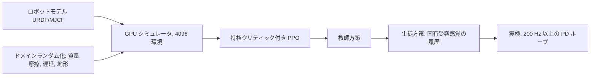

## なぜ重要なのか

[前回]({{ '/blog/2026/embodied-ai-01-robotics-foundations/' | relative_url }})は、どの制御器もモデルから手で設計しました。
自由空間で動くアームならそれで十分ですが、瓦礫の上を走る四脚ロボットや立方体を回す多指ハンドでは非常に難しくなります。
接触が 1 秒間に何百回も切り替わるからです。**強化学習**（reinforcement learning, RL）は手設計を最適化に置き換えます。報酬を
書き下し、シミュレータの中でロボットに何百万回も試行させ、得られた方策をハードウェアに移すのです。2019 年ごろから、この
レシピは移動制御器を作る標準的な方法になりました。そのアイデア（アドバンテージ、エントロピー、ドメインランダム化）は、
本シリーズの後半で扱う模倣学習、VLA のファインチューニング、世界モデルの学習にも繰り返し登場します。

**前提知識**

- 本シリーズ第 1 回（関節空間の PD 制御、行動空間）。
- 確率：期待値、対数微分トリック、ガウス分布。
- PyTorch の基本（autograd、`nn.Module`、オプティマイザ）。
- 世界モデルを知っている方へ：モデルベース RL は第 5 回と世界モデルシリーズで扱います。ここではモデルフリーに絞ります。

## 1. RL の問題設定

### マルコフ決定過程

MDP は組 $(\mathcal{S}, \mathcal{A}, P, r, \gamma, \rho_0)$ です。状態、行動、遷移ダイナミクス $$P(s' \mid s, a)$$、報酬 $r(s, a)$、
割引率 $\gamma \in [0, 1)$、初期状態分布 $\rho_0$ からなります。（確率的な）方策 $\pi_\theta(a \mid s)$ は軌道
$\tau = (s_0, a_0, s_1, a_1, \dots)$ を生成し、目的は期待割引収益です。

$$
J(\theta) = \mathbb{E}_{\tau\sim\pi_\theta}\left[\sum_{t=0}^{\infty} \gamma^t r(s_t, a_t)\right].
$$

実際のロボットは**部分観測**（POMDP）です。方策が見るのは完全な状態（正確な接触力や地面の摩擦）ではなく観測 $o_t$
（関節エンコーダ、IMU、画像）です。実践では観測履歴、再帰型ネットワーク、あるいは第 4 節の特権情報のトリックで対処します。

ロボットでは、モデル化の選択がアルゴリズムと同じくらい重要です。

| MDP の要素 | 脚ロボットでの典型的な選択 |
| --- | --- |
| 観測 | ベースの角速度、投影された重力、関節の位置と速度、直前の行動、速度指令、（高さマップ） |
| 行動 | 200 Hz〜1 kHz の PD ループへの関節位置目標 $q^{\text{des}}$。方策は 50 Hz |
| 報酬 | 指令速度への追従、トルク・関節加速度・行動の変化率・足の滑り・ベース姿勢へのペナルティ |
| エピソード | 20 秒、転倒（ベースの接地）で終了、初期状態と地形をランダム化 |

これらをまとめると、脚ロボットの RL システムの 1 ステップは図のようなループになります。方策はゆっくり動き、PD ループがその目標を高速にトルクへ変換し、多数の並列環境から集めた軌跡のバッチが PPO の更新に使われます。



### 価値関数とベルマン方程式

方策の状態価値と行動価値は

$$
V^\pi(s) = \mathbb{E}_\pi\left[\sum_{k\ge 0}\gamma^k r_{t+k} \,\middle\vert\, s_t = s\right], \qquad
Q^\pi(s,a) = \mathbb{E}_\pi\left[\sum_{k\ge 0}\gamma^k r_{t+k} \,\middle\vert\, s_t = s, a_t = a\right]
$$

で、**アドバンテージ**（advantage）$A^\pi(s,a) = Q^\pi(s,a) - V^\pi(s)$ は、行動 $a$ が方策の平均よりどれだけ良いかを測ります。
これらはベルマン期待方程式

$$
Q^\pi(s,a) = r(s,a) + \gamma\,\mathbb{E}_{s'\sim P,\,a'\sim\pi}\left[Q^\pi(s',a')\right]
$$

を満たし、最適行動価値はベルマン最適方程式 $$Q^{\ast}(s,a) = r + \gamma\,\mathbb{E}_{s'}[\max_{a'} Q^{\ast}(s',a')]$$ を満たします。
Q 学習や DQN（Mnih ら 2015）は後者を反復しますが、連続で高次元な行動空間での $\max$ は扱いにくいため、ロボティクスでは主に
**方策勾配**（policy gradient）法と**アクター・クリティック**（actor-critic）法が使われます。

小さく既知の MDP なら、ベルマン最適方程式は**価値反復**（value iteration）$V_{k+1}(s) = \max_a \sum_{s'} P(s'\mid s,a)\,[r + \gamma V_k(s')]$ で直接解けます。下の図とウィジェットは、価値が報酬から 1 回の掃引ごとに後ろ向きに広がっていく様子を示しています。





## 2. 方策勾配

### 方策勾配定理

$\nabla_\theta p_\theta(\tau) = p_\theta(\tau)\nabla_\theta\log p_\theta(\tau)$ と、ダイナミクスが $\theta$ に依存しないことを使うと、次が得られます
（Williams 1992、Sutton ら 2000）。

$$
\nabla_\theta J(\theta) = \mathbb{E}_{\pi_\theta}\left[\sum_t \nabla_\theta\log\pi_\theta(a_t\mid s_t)\, \hat A_t\right].
$$

ここで $\hat A_t$ は将来の収益（REINFORCE）、収益からベースライン $b(s_t)$ を引いたもの、あるいはアドバンテージの推定値です。
状態に依存するベースラインを引いても勾配は偏りませんが、分散は大きく下がります。直感的には、勾配は予想より良かった行動の
対数確率を上げ、それ以外を下げます。

連続制御では、方策は通常、対角ガウス $\pi_\theta(a\mid s) = \mathcal{N}(\mu_\theta(s), \mathrm{diag}(\sigma^2))$ で、$\log\sigma$ は状態に依存
しない学習パラメータです。

1 ステップの問題（バンディット）にすると更新が目に見えます。アドバンテージが正のサンプルはガウス分布の平均を引き寄せ、負のサンプルは押しのけます。更新を繰り返して最適点に着くと $\sigma$ も小さくなります。



### 一般化アドバンテージ推定

学習したクリティック $V_\phi$ を使って TD 誤差 $\delta_t = r_t + \gamma V_\phi(s_{t+1}) - V_\phi(s_t)$ を定義します。**GAE**（Schulman ら 2016）
は $k$ ステップのアドバンテージ推定を指数的に減衰する重みで平均します。

$$
\hat A_t^{\mathrm{GAE}(\gamma,\lambda)} = \sum_{l=0}^{\infty} (\gamma\lambda)^l\,\delta_{t+l}.
$$

$\lambda = 0$ は分散が小さいが偏りのある 1 ステップ TD アドバンテージ、$\lambda = 1$ は偏りがないが分散の大きいモンテカルロ
アドバンテージです。$\lambda \approx 0.95$ が通常の妥協点です。クリティックは目標値 $\hat R_t = \hat A_t + V_\phi(s_t)$ に回帰させます。

上段は、$\lambda$ が TD 残差を平均する範囲をどう決めるかを示しています。下段は、critic をわざと間違えた簡単な鎖状 MDP で、その結果生じるトレードオフを測ったものです。



### 信頼領域と PPO

素朴な方策勾配は壊れやすく、大きな 1 ステップで方策が崩壊すると、その後に集めるデータも役に立たなくなります。**TRPO**
（Schulman ら 2015）は新旧方策の KL ダイバージェンス制約のもとで代理目的関数を最大化します。**PPO**（Schulman ら 2017）は
1 次のトリックでその利点の大半を得ます。確率比 $\rho_t(\theta) = \pi_\theta(a_t\mid s_t)/\pi_{\theta_{\text{old}}}(a_t\mid s_t)$ を使って

$$
L^{\text{CLIP}}(\theta) = \mathbb{E}_t\left[\min\left(\rho_t(\theta)\hat A_t,\; \operatorname{clip}(\rho_t(\theta), 1-\epsilon, 1+\epsilon)\,\hat A_t\right)\right]
$$

を最大化します。通常 $\epsilon = 0.2$ です。$\min$ によってこれは悲観的な下界になります。比が目的を改善する方向に
$[1-\epsilon, 1+\epsilon]$ から出ると勾配が消えるので、それ以上動く動機がなくなります。そのおかげで PPO は各バッチをミニバッチ
SGD の複数エポックに再利用できます。完全な損失には価値損失と、任意でエントロピーボーナスを加えます。

$$
L(\theta,\phi) = -L^{\text{CLIP}}(\theta) + c_v\,\mathbb{E}_t\left[(V_\phi(s_t) - \hat R_t)^2\right] - c_e\,\mathbb{E}_t\left[\mathcal{H}(\pi_\theta(\cdot\mid s_t))\right].
$$

PPO はオンポリシー（on-policy）でサンプル効率は低いものの、単純で安定しており、並列化がきわめて容易です。1 枚の GPU で何千台
ものロボットをシミュレーションできるなら、サンプル効率よりも実時間のほうがはるかに重要です。だからこそ PPO は Isaac Lab や
legged_gym、そして大半の移動制御の論文でデフォルトになっています。

1 サンプルの $L^{\text{CLIP}}$ をプロットすると $\min$ の悲観性が分かります。さらに動くと得に見える領域でちょうど目的関数が平らになり、勾配が 0 になります。



### コンパクトな PyTorch の PPO

次のファイルは自己完結しています。アクター・クリティック、GAE、PPO の更新、そして 64 個の質点を原点へ動かすベクトル化された
トイタスク（到達タスクの代役）です。ノート PC の CPU で数分で動きます。

```python
import torch
import torch.nn as nn

class ActorCritic(nn.Module):
    def __init__(self, obs_dim, act_dim, hidden=64):
        super().__init__()
        self.pi = nn.Sequential(nn.Linear(obs_dim, hidden), nn.Tanh(),
                                nn.Linear(hidden, hidden), nn.Tanh(), nn.Linear(hidden, act_dim))
        self.v = nn.Sequential(nn.Linear(obs_dim, hidden), nn.Tanh(),
                               nn.Linear(hidden, hidden), nn.Tanh(), nn.Linear(hidden, 1))
        self.log_std = nn.Parameter(torch.full((act_dim,), -0.5))

    def dist(self, obs):
        return torch.distributions.Normal(self.pi(obs), self.log_std.exp())

def gae(rew, val, done, last_val, gamma=0.99, lam=0.95):
    """rew, val, done: [T, N] tensors (N parallel envs). Returns advantages and returns."""
    T = rew.shape[0]
    adv = torch.zeros_like(rew)
    next_val, running = last_val, torch.zeros_like(last_val)
    for t in reversed(range(T)):
        mask = 1.0 - done[t]
        delta = rew[t] + gamma * next_val * mask - val[t]
        running = delta + gamma * lam * mask * running
        adv[t] = running
        next_val = val[t]
    return adv, adv + val

def ppo_update(model, opt, obs, act, logp_old, adv, ret,
               clip=0.2, vf_coef=0.5, ent_coef=0.0, epochs=10, minibatch=256):
    """One PPO update on a flattened batch of B transitions."""
    adv = (adv - adv.mean()) / (adv.std() + 1e-8)
    B = obs.shape[0]
    for _ in range(epochs):
        for idx in torch.randperm(B).split(minibatch):
            d = model.dist(obs[idx])
            logp = d.log_prob(act[idx]).sum(-1)
            ratio = (logp - logp_old[idx]).exp()
            surr = torch.min(ratio * adv[idx],
                             ratio.clamp(1 - clip, 1 + clip) * adv[idx])
            v_loss = (model.v(obs[idx]).squeeze(-1) - ret[idx]).pow(2).mean()
            loss = -surr.mean() + vf_coef * v_loss - ent_coef * d.entropy().sum(-1).mean()
            opt.zero_grad()
            loss.backward()
            nn.utils.clip_grad_norm_(model.parameters(), 0.5)
            opt.step()

# --- a toy "reaching" task: a 2-D point mass must move to the origin ---
class PointReach:
    def __init__(self, n, horizon=50):
        self.n, self.H = n, horizon
        self.damp, self.gain = 0.9, 0.1               # nominal physics
    def reset(self):
        self.pos = torch.rand(self.n, 2) * 2 - 1
        self.vel = torch.zeros(self.n, 2)
        self.t = torch.zeros(self.n)
        return torch.cat([self.pos, self.vel], -1)
    def step(self, a):
        a = a.clamp(-1, 1)
        self.vel = self.damp * self.vel + self.gain * a  # simple damped dynamics
        self.pos = self.pos + 0.1 * self.vel
        self.t += 1
        rew = -self.pos.norm(dim=-1) - 0.01 * a.pow(2).sum(-1)
        done = (self.t >= self.H).float()
        if done.any():                                # auto-reset finished envs
            k = done.bool()
            self.pos[k] = torch.rand(int(k.sum()), 2) * 2 - 1
            self.vel[k] = 0.0
            self.t[k] = 0
        return torch.cat([self.pos, self.vel], -1), rew, done

torch.manual_seed(0)
env, T = PointReach(n=64), 128
model = ActorCritic(4, 2)
opt = torch.optim.Adam(model.parameters(), lr=3e-4)
obs = env.reset()
for it in range(150):
    buf = {k: [] for k in ["obs", "act", "logp", "rew", "val", "done"]}
    with torch.no_grad():
        for t in range(T):
            d = model.dist(obs)
            a = d.sample()
            buf["obs"].append(obs); buf["act"].append(a)
            buf["logp"].append(d.log_prob(a).sum(-1))
            buf["val"].append(model.v(obs).squeeze(-1))
            obs, r, done = env.step(a)
            buf["rew"].append(r); buf["done"].append(done)
        last_val = model.v(obs).squeeze(-1)
    b = {k: torch.stack(v) for k, v in buf.items()}            # [T, N, ...]
    adv, ret = gae(b["rew"], b["val"], b["done"], last_val)
    flat = lambda x: x.reshape(T * env.n, *x.shape[2:])
    ppo_update(model, opt, flat(b["obs"]), flat(b["act"]), flat(b["logp"]), flat(adv), flat(ret))
    if it % 25 == 0 or it == 149:
        print(f"iter {it:3d}  mean reward per step {b['rew'].mean():.3f}")
```

私の実行では、1 ステップあたりの平均報酬が約 $-0.89$（ランダムな行動）から約 $-0.1$（質点が原点に到達してとどまる）まで上がりました。
実践では重要なのに間違えやすい細部があります。

- **エピソード終端でのマスク。** `mask` は自動リセットをまたいだブートストラップを止めます。厳密には、**時間制限**による打ち切りでは
  $V(s_{T})$ からブートストラップすべきです（ロボットは失敗したわけではなく、観測をやめただけです）。legged_gym はタイムアウト時に
  最終状態の $\gamma V$ を報酬に加えて対処しています。トイコードではタイムアウトを終端として扱っているので、小さなバイアスがあります。
- **アドバンテージの正規化**、**勾配クリッピング**、**状態に依存しない log-std** は標準です。観測の正規化（移動平均・分散）は、単位が
  桁違いに異なる実機で重要になります。
- **行動のスケーリング。** ここではネットワークの出力を $[-1, 1]$ にクランプしています。ロボットでは通常スケールして名目の関節構成に
  加えます。$q^{\text{des}} = q_0 + k_a a_t$ です。

上のスクリプトをそのまま実行すると、図の学習曲線と学習済み方策の振る舞いが得られます。



## 3. Soft Actor-Critic

PPO は更新のたびにデータを捨てます。**オフポリシー**（off-policy）手法はリプレイバッファを持ち、サンプル効率がはるかに高いので、
サンプルが実機から来る場合に重要です。**SAC**（Haarnoja ら 2018）は最大エントロピー目的関数

$$
J(\pi) = \sum_t \mathbb{E}_{(s_t,a_t)\sim\pi}\left[r(s_t,a_t) + \alpha\,\mathcal{H}(\pi(\cdot\mid s_t))\right]
$$

を最適化し、タスクを解きながらも方策をできるだけランダムに保ちます。これにより探索が頑健になり、方策が 1 つの脆い解に潰れる
ことがありません。SAC は 2 つのソフト Q 関数 $Q_{\phi_1}, Q_{\phi_2}$ を学習し（TD3 と同様に、過大評価を防ぐため最小値を取ります）、
目標値は

$$
y = r + \gamma\left(\min_{j=1,2} Q_{\bar\phi_j}(s', \tilde a') - \alpha\log\pi_\theta(\tilde a'\mid s')\right), \qquad \tilde a' \sim \pi_\theta(\cdot\mid s')
$$

です。$\bar\phi$ はゆっくり更新される（Polyak 平均の）ターゲットネットワークです。アクターは tanh で押しつぶしたガウス分布で
**再パラメータ化トリック**を使い、$\tilde a = \tanh(\mu_\theta(s) + \sigma_\theta(s)\odot\xi)$、$\xi\sim\mathcal{N}(0, I)$ として

$$
L_\pi(\theta) = \mathbb{E}_{s\sim\mathcal{D},\,\xi}\left[\alpha\log\pi_\theta(\tilde a\mid s) - \min_j Q_{\phi_j}(s, \tilde a)\right]
$$

を最小化します。tanh は密度を変えるので $\log\pi(\tilde a\mid s) = \log\mathcal{N}(u;\mu,\sigma) - \sum_i\log(1-\tanh^2 u_i)$ となります。
続く論文（Haarnoja ら 2018b）は $\alpha$ を目標エントロピー（よく $-\dim\mathcal{A}$ を使います）に向けて自動調整し、実機の Minitaur
四脚ロボットで約 2 時間分の経験だけで直接歩行を学習できることを示しました。

| | PPO | SAC |
| --- | --- | --- |
| データ | オンポリシー、更新後に破棄 | オフポリシー、リプレイバッファ |
| サンプル効率 | 低い | 高い |
| 並列シミュレーション | 非常によくスケールする | 注意が必要（更新とデータの比） |
| 典型的な用途 | Sim-to-Real の移動制御、大規模並列シミュレーション | 実世界での RL、マニピュレーション、ファインチューニング |
| 探索 | ガウスノイズ + 任意のエントロピーボーナス | 最大エントロピー、自動温度調整 |

SAC には 2 つの図が役立ちます。エントロピーボーナスは貪欲な $\arg\max_a Q$ をボルツマン分布 $\pi \propto \exp(Q/\alpha)$（1 ステップ問題での最大エントロピー目的の最適方策）に変え、tanh による圧縮には上で示した密度の補正が必要です。



## 4. 報酬設計

報酬はタスクの仕様そのものであり、抜け穴はすべて見つけられてしまいます。よくあるパターンは次のとおりです。

- **密なタスク項**（例：速度追従の $$\exp(-\lVert v^{\text{cmd}}_{xy} - v_{xy}\rVert^2 / \sigma)$$）と、多数の小さな**正則化ペナルティ**
  （トルク、仕事率、関節加速度、行動の変化率 $\lVert a_t - a_{t-1}\rVert^2$、足の滑り、遊脚時間）。歩容を自然で転移可能にするのは
  このペナルティです。これがないと方策は細かく振動し、シミュレータは許してもモータは耐えられません。
- **ポテンシャルベースの報酬整形**（potential-based shaping、Ng、Harada、Russell、ICML 1999）：任意のポテンシャル $\Phi$ に対して
  $$F = \gamma\Phi(s') - \Phi(s)$$ を加えても最適方策が変わらないことが証明されています。他の整形項は最適方策を変えうるのです。
- **疎な報酬 + デモやカリキュラム**（マニピュレーション向け）：成功・失敗は定義しやすいものの探索が難しいので、デモ（第 4 回）、
  自動カリキュラム（Rudin らのように方策の上達に応じて地形の難しさを上げる）、ゴールの再ラベル付けを加えます。
- **データから得るスタイル報酬**：動作模倣（DeepMimic、Peng ら 2018）や敵対的モーション事前分布は、参照となるモーションキャプチャに
  「似ていること」を報酬にします。キャラクターアニメーションからロボティクスへの直接の架け橋です。
- **LLM が書く報酬**：Eureka（Ma ら 2024）は LLM に報酬のコードを書かせ、Isaac Gym で方策を学習し、学習統計を LLM にフィードバック
  して報酬を改良します。

## 5. Sim-to-Real 転移

シミュレーションで学習した方策は**リアリティギャップ**（reality gap）に直面します。間違った質量や摩擦、モデル化されていない
アクチュエータの動特性、遅延、センサノイズ、そしてレンダリング画像とまったく似ていない実画像です。主な道具は次のとおりです。

### ドメインランダム化

シミュレータを完全に正しくする代わりに、さまざまな形で**ランダムに間違わせ**、現実世界が単なるもう 1 つのサンプルに見えるように
します。Tobin ら（IROS 2017）は非写実的なレンダラでテクスチャ、照明、カメラ姿勢、妨害物体をランダム化し、実画像を 1 枚も使わずに、
実機上で平均約 1.5 cm の精度で物体を位置推定する検出器を学習しました。Peng ら（ICRA 2018）は**ダイナミクス**（質量、摩擦、減衰、
遅延）をランダム化し、現在のダイナミクスを暗黙に同定できる再帰型の方策を使いました。OpenAI の多指ハンドの研究（2018、2019）は
これを極限まで推し進め、方策の成功に応じて範囲を徐々に広げる自動ドメインランダム化を導入しました。

コードでは、ランダム化はリセット時に環境ごとの物理パラメータを再サンプルするだけです。上のトイタスクでは次のようになります。

```python
class RandomizedPointReach(PointReach):
    """Domain randomization: every env gets its own damping and actuator gain."""
    def reset(self):
        self.damp = torch.empty(self.n, 1).uniform_(0.8, 0.97)
        self.gain = torch.empty(self.n, 1).uniform_(0.05, 0.2)
        return super().reset()
```

`PointReach(n=64)` を `RandomizedPointReach(n=64)` に置き換えると、同じ PPO のループが、これらすべての「ロボット」で動く単一の方策を
学習します。（簡潔さのためにパラメータは `reset()` ごとに 1 回サンプルしています。完全な実装では、各環境が自動リセットされるたびに
再サンプルします。）代償は保守性です。範囲が広いほど方策は頑健になりますが、最適からは遠ざかります。

ここでは効果があるのでしょうか。図では上の PPO コードで両方のバージョンを学習し、物理パラメータのグリッド全体で評価しています。

{% include blog_figure.liquid path="assets/img/blog/embodied-ai/02-domain-randomization.svg" localized="true" caption="おもちゃのタスクで、実際の学習結果を使ってドメインランダム化を示したもの。上：各並列環境は枠内から自分の減衰とアクチュエータゲインを受け取ります。実機のパラメータは未知ですが、枠の中にあるはずです。下：決定的方策を物理パラメータのグリッド上で評価した 1 ステップあたり平均報酬（各点 256 個のランダムな初期状態、50 ステップ）。枠の中では 2 つのマップはほぼ同じです。公称点で $-0.132$ 対 $-0.135$、星の位置で $-0.180$ 対 $-0.185$、枠内の最悪値で $-0.233$ 対 $-0.235$ でした。このおもちゃのタスクの制御はパラメータにほとんど依存しないため、公称方策がすでに頑健なのです。報酬が崩れるのは枠の外の低ゲイン領域だけで、そこではクリップされた行動が弱すぎてどんな方策でも届きません。この図から身につけたい習慣は、公称点だけでなくパラメータ範囲全体で方策を評価することです。" %}

### システム同定とアクチュエータモデル

ランダム化は、大きな部分を正しく作ることの代わりにはなりません。Hwangbo ら（Science Robotics 2019）は**アクチュエータネットワーク**
（actuator network）を学習しました。これは、関節位置誤差と速度の短い履歴から、実際の直列弾性アクチュエータが出すトルクを予測する
MLP で、ANYmal で記録したデータで学習されています。これをシミュレータに組み込むとギャップの大半が埋まり、学習された方策は従来の
モデルベース制御器より速く走り、複雑な姿勢からの転倒復帰もできました。これは手設計の制御器では実現できなかったことです。

### 特権を持つ教師、生徒、適応

シミュレータは、ロボットが決して知ることのできない情報、すなわち正確な地形、摩擦、接触状態を知っています。その知識を使う
広く普及した方法があります。

- **非対称アクター・クリティック**（asymmetric actor-critic、Pinto ら RSS 2018）：クリティックはシミュレータの完全な状態を見て、
  アクターはロボットの観測だけを見ます。クリティックは展開時に捨てられるので、「ずる」をしても構いません。
- **教師・生徒蒸留**（Lee ら Science Robotics 2020）：まず特権情報を使って教師方策を学習し、次に固有受容感覚の履歴だけを見る
  生徒に教師を模倣させます。生徒は脚の感触から地形を推定することを学びます。これにより ANYmal は、学習中に一度も見たことのない
  泥、雪、瓦礫、草むらの上を歩けるようになりました。Miki ら（2022）はこれを拡張し、外界センシング（カメラと LiDAR からの高さマップ）
  と固有受容感覚をアテンションで融合しました。ロボットはスイスのエッツェル山（Mount Etzel）のハイキングコースを踏破しました。
- **Rapid Motor Adaptation**（Kumar ら RSS 2021）：特権的な環境パラメータを潜在的な「外的要因」ベクトルに符号化し、直近の状態と
  行動からそれをオンラインで推定する適応モジュールを学習します。

### 大規模並列シミュレーション

Rudin ら（CoRL 2021）は、Isaac Gym で 1 枚の GPU 上に何千もの環境を走らせ、ゲームに着想を得た地形カリキュラムと丁寧に調整した
PPO を組み合わせることで、平地の四脚方策を 4 分以内、起伏のある地形の方策を約 20 分で学習でき、その方策が実機の ANYmal に転移
することを示しました。公開された `legged_gym` は、人型ロボット（Radosavovic ら、Science Robotics 2024）を含む一世代の移動制御研究の
テンプレートになりました。教訓は、シミュレーションが安ければ単純なオンポリシーのアルゴリズムが勝つということです。



## 6. 移動制御の先へ

- **マニピュレーション。** ガイド付き方策探索で学習したエンドツーエンドの視覚運動方策（Levine ら JMLR 2016）、大規模な実データに
  よる QT-Opt の把持、Shadow ハンドによる手の中での物体の再配向（OpenAI 2018）。マニピュレーションは RL にとって移動よりも難しい
  問題です。報酬が疎で、重要な状態（物体の姿勢、接触）を知覚しにくいからです。そのため現在のマニピュレーションでは模倣学習
  （第 4 回）が主流になっています。
- **アジャイルな飛行。** チャンピオンレベルのドローンレース（Kaufmann ら Nature 2023）は、シミュレーションでの RL と、知覚と
  ダイナミクスのデータ駆動の残差モデルを組み合わせました。
- **基盤方策の RL ファインチューニング。** 模倣で事前学習した方策を、成功報酬や学習した報酬モデルを使って RL で改良することが
  増えています。本記事のアイデアはそのまま使えます。

## 試してみよう

**[Lab]({{ '/' | relative_url }}#lab)** の XPBD の布のデモは、サブステップと拘束の射影を備えた物理シミュレータで、RL エージェントが
その中で学習するのと同じ種類のエンジンです。布をドラッグすることは、頑健な方策が打ち消さなければならない外乱です。布の剛性と
質量をランダム化することを、ドメインランダム化として想像してみてください。

## 代表的な論文

| 論文 | 会議・論文誌 | 年 | リンク | 意義 |
| --- | --- | --- | --- | --- |
| Mnih et al., *Human-level control through deep reinforcement learning* | Nature | 2015 | [DOI](https://doi.org/10.1038/nature14236) | DQN、深層 RL の始まり |
| Schulman et al., *Trust region policy optimization* | ICML | 2015 | [arXiv](https://arxiv.org/abs/1502.05477) | KL 制約付きの方策更新 |
| Schulman et al., *High-dimensional continuous control using generalized advantage estimation* | ICLR | 2016 | [arXiv](https://arxiv.org/abs/1506.02438) | GAE |
| Levine et al., *End-to-end training of deep visuomotor policies* | JMLR | 2016 | [arXiv](https://arxiv.org/abs/1504.00702) | ピクセルからトルクへのマニピュレーション |
| Schulman et al., *Proximal policy optimization algorithms* | arXiv | 2017 | [arXiv](https://arxiv.org/abs/1707.06347) | PPO |
| Tobin et al., *Domain randomization for transferring deep neural networks from simulation to the real world* | IROS | 2017 | [arXiv](https://arxiv.org/abs/1703.06907) | 視覚のドメインランダム化 |
| Peng et al., *Sim-to-real transfer of robotic control with dynamics randomization* | ICRA | 2018 | [arXiv](https://arxiv.org/abs/1710.06537) | ダイナミクスのランダム化 |
| Pinto et al., *Asymmetric actor critic for image-based robot learning* | RSS | 2018 | [arXiv](https://arxiv.org/abs/1710.06542) | 特権クリティック |
| Haarnoja et al., *Soft actor-critic: off-policy maximum entropy deep RL with a stochastic actor* | ICML | 2018 | [arXiv](https://arxiv.org/abs/1801.01290) | SAC |
| Peng et al., *DeepMimic: example-guided deep RL of physics-based character skills* | ACM TOG (SIGGRAPH) | 2018 | [arXiv](https://arxiv.org/abs/1804.02717) | 動作模倣報酬、グラフィックスと RL の出会い |
| OpenAI et al., *Learning dexterous in-hand manipulation* | IJRR | 2020 | [arXiv](https://arxiv.org/abs/1808.00177) | 極端なドメインランダム化 |
| Hwangbo et al., *Learning agile and dynamic motor skills for legged robots* | Science Robotics | 2019 | [DOI](https://doi.org/10.1126/scirobotics.aau5872) | アクチュエータネット、ANYmal での RL |
| Lee et al., *Learning quadrupedal locomotion over challenging terrain* | Science Robotics | 2020 | [DOI](https://doi.org/10.1126/scirobotics.abc5986) | 教師・生徒による Sim-to-Real |
| Kumar et al., *RMA: Rapid motor adaptation for legged robots* | RSS | 2021 | [arXiv](https://arxiv.org/abs/2107.04034) | オンライン適応 |
| Rudin et al., *Learning to walk in minutes using massively parallel deep RL* | CoRL | 2021 | [arXiv](https://arxiv.org/abs/2109.11978) | GPU 並列 PPO、legged_gym |
| Miki et al., *Learning robust perceptive locomotion for quadrupedal robots in the wild* | Science Robotics | 2022 | [arXiv](https://arxiv.org/abs/2201.08117) | 外界センシング + 固有受容感覚 |
| Kaufmann et al., *Champion-level drone racing using deep reinforcement learning* | Nature | 2023 | [DOI](https://doi.org/10.1038/s41586-023-06419-4) | RL が人間のチャンピオンに勝利 |
| Ma et al., *Eureka: human-level reward design via coding large language models* | ICLR | 2024 | [arXiv](https://arxiv.org/abs/2310.12931) | LLM が書く報酬 |
| Radosavovic et al., *Real-world humanoid locomotion with reinforcement learning* | Science Robotics | 2024 | [arXiv](https://arxiv.org/abs/2303.03381) | 人型ロボットのための Transformer 方策 |

## 学習リソース

- R. Sutton、A. Barto『[*Reinforcement Learning: An Introduction*](http://incompleteideas.net/book/the-book-2nd.html)』第 2 版
  （MIT Press, 2018）。オンラインで無料公開されています。第 3〜6 章と第 13 章。
- OpenAI [Spinning Up in Deep RL](https://spinningup.openai.com)：方策勾配、PPO、SAC のわかりやすい導出と参照コード。
- S. Levine、CS 285 Deep Reinforcement Learning（UC Berkeley）。講義動画がオンラインで見られます。
- R. Tedrake『[*Underactuated Robotics*](https://underactuated.csail.mit.edu)』：RL と軌道最適化を制御理論の視点から。
- コード：[CleanRL](https://github.com/vwxyzjn/cleanrl)（単一ファイルの実装）、
  [Stable-Baselines3](https://github.com/DLR-RM/stable-baselines3)、
  [legged_gym](https://github.com/leggedrobotics/legged_gym) と [rsl_rl](https://github.com/leggedrobotics/rsl_rl)、
  [Isaac Lab](https://github.com/isaac-sim/IsaacLab)。

## 演習

1. $\nabla_\theta\log p_\theta(\tau)$ から方策勾配定理を導き、状態に依存するベースラインが偏りを生まないことを示しましょう。
2. PPO のコードで `gae` の `lam` を 0 と 1 にして学習曲線を比べましょう。次に `clip=10`（実質的にクリッピングなし）にして安定性を
   観察しましょう。
3. 時間制限によるバイアスを直しましょう。`PointReach.step` から `terminated` と `truncated` を別々に返し、打ち切りのときは最終観測の
   価値からブートストラップします。
4. `PointReach` で学習した方策を、極端なパラメータの `RandomizedPointReach` で評価し、ランダム化して学習した方策と比べましょう。
   真の減衰係数を観測に加え（「特権」入力）、どれだけ役立つかを調べましょう。
5. 同じタスクに SAC（リプレイバッファ、ツイン Q、tanh ガウス、自動 $\alpha$）を実装し、必要な環境ステップ数を PPO と比べましょう。

**次回：**[シミュレーションプラットフォーム]({{ '/blog/2026/embodied-ai-03-simulation-platforms/' | relative_url }})。
これらの学習がすべて行われる場所です。
