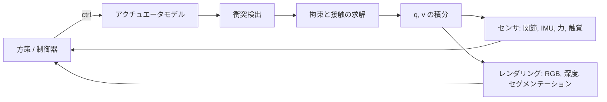

## なぜ重要なのか

[強化学習の回]({{ '/blog/2026/embodied-ai-02-reinforcement-learning-for-robots/' | relative_url }})は、数分で歩行を学習する方策で
終わりました。しかしそれは、ロボットの複製が何千台も並列にシミュレーションされていたからこそです。シミュレータと身体性 AI の
関係は、データセットとコンピュータビジョンの関係に似ています。シミュレータは学習データを生成し、ベンチマークを定義し、その誤差が
リアリティギャップになります。また、ロボティクスが**コンピュータグラフィックス**と最も直接に出会う場所でもあります。現代の
シミュレータは、より厳密な物理コアをもつゲームエンジンであり、[グラフィックスシリーズ]({{ '/blog/category/graphics/' | relative_url }})
の技術（ラスタライズ、レイトレーシング、BVH、位置ベース動力学）がその部品です。本記事では、シミュレータが何を計算するのかを説明し、
主要なプラットフォームを比較し、Python で MuJoCo を順を追って動かします。

**前提知識**

- 第 1 回と第 2 回（運動方程式、PD 制御、RL の学習ループ）。
- 基本的な数値積分（陽的オイラー法と半陰的オイラー法）。
- 任意：グラフィックスシリーズのラスタライズ、レイトレーシング、物理シミュレーションの記事。

## 1. ロボットシミュレータは何をしているか

どのシミュレータも、固定の時間刻み $\Delta t$（通常 1〜5 ms）で同じループを繰り返し、1 回の制御ステップの中に複数の「サブステップ」
（substep）を含むのが普通です。



### 剛体の動力学

ほとんどのロボット用エンジンは**一般化（縮約）座標**（generalized coordinates）を使います。状態は関節ベクトル $q$ とその速度 $v$ で、
動力学は第 1 回のマニピュレータの運動方程式です。

$$
M(q)\,\dot v + c(q, v) = \tau + J_c(q)^\top f_c .
$$

ここで $c$ はコリオリ力・遠心力・重力の項をまとめたもの、$J_c^\top f_c$ は接触力を関節空間に写したものです。関節の拘束は構成上
厳密に満たされ、$M$ と $c$ は Featherstone の $O(n)$ アルゴリズム（CRBA、RNEA、ABA）で計算されます。MuJoCo、Drake、Pinocchio、
RaiSim、PhysX のアーティキュレーションはこの方式です。一方、ゲームエンジンや多くのグラフィックスのソルバは**最大座標**
（maximal coordinates）を使います。各物体が 6 自由度の位置姿勢をもち、関節は物体間の拘束として扱われます。単純で並列化しやすい
反面、関節の拘束がずれていき、長い鎖では収束が遅くなります。

積分には通常**半陰的（シンプレクティック）オイラー法**を使います。$v_{t+1} = v_t + \Delta t\,\dot v_t$ のあと
$q_{t+1} = q_t \oplus \Delta t\, v_{t+1}$ です（$\oplus$ は自由関節のクォータニオンを扱います）。MuJoCo には減衰項の陰的積分や RK4 積分器も
あり、剛性の高い関節やアクチュエータでは陰的なオプションが必要になることがよくあります。

### 接触と摩擦

接触はシミュレータ間で最も違いが大きく、Sim-to-Real の問題の大半が生じる部分です。

1. **衝突検出。** ブロードフェーズ（broad phase、階層的境界ボリュームやスイープ・アンド・プルーン。まさにレイトレーシングで使う BVH
   の考え方です）で候補のペアを見つけ、ナローフェーズ（narrow phase）で接触点、法線、めり込み深さを計算します。凸形状には GJK/EPA
   や MPR を、基本形状のペア（球と平面、カプセル同士）には解析式を使います。非凸メッシュは通常、凸な部品に分解する（V-HACD、CoACD
   など）か、SDF で近似します。
2. **接触モデル。** 法線方向の力積 $\lambda_n$ とギャップ $\phi(q)$ をもつ接触に対して、理想的な剛体モデルは**相補性条件**
   （complementarity condition）です。

   $$
   0 \le \lambda_n \;\perp\; \phi(q) \ge 0 ,
   $$

   つまり、物体同士が触れて押し合うか、離れていて力がゼロかのどちらかです。クーロン摩擦はさらに**摩擦円錐**
   $\lVert \lambda_t \rVert \le \mu \lambda_n$ と最大散逸の原理を加えます。これを厳密に解くとステップごとに（非線形の）相補性問題になり、
   多くの場合、角錐の摩擦円錐で線形化して LCP（Stewart と Trinkle 1996、Anitescu と Potra 1997）とし、射影ガウス・ザイデル法（PGS）で
   解きます。
3. **MuJoCo の方式**（Todorov、ICRA 2014）は、厳密な相補性を**凸最適化**に緩和します。拘束力は摩擦円錐の制約のもとで 2 次の目的関数を
   最小化し、`solref` と `solimp` パラメータで制御されるわずかな柔らかさをもちます。凸性によって解は一意になり、動力学は滑らかで
   逆計算も可能になります（最適化や推定に便利です）。代償はわずかなめり込みと滑りです。下の例では 0.1 mm のめり込みが見られます。
4. **位置ベースの方式。** PBD と XPBD（Macklin ら 2016）は力をまったく使わず、位置を直接拘束に射影します。XPBD はコンプライアンス
   $\alpha$ を導入し、剛性が反復回数に依存しないようにします。拘束 $C(x) = 0$ に対して $\tilde\alpha = \alpha / \Delta t^2$ とすると、各反復で
   ラグランジュ乗数と位置を次のように更新します。

   $$
   \Delta\lambda = \frac{-C(x) - \tilde\alpha\,\lambda}{\nabla C\, M^{-1}\nabla C^\top + \tilde\alpha}, \qquad
   \Delta x = M^{-1}\nabla C^\top \Delta\lambda .
   $$

   ホームページの布のデモで動いているのがこれで、NVIDIA Flex や、Isaac と Genesis における布・ロープ・柔軟物体のシミュレーションの
   基礎にもなっています。

実践上の帰結として、接触パラメータ（摩擦、反発係数、柔らかさ）はランダム化すべき最重要項目の 1 つです。ソルバの反復を増やすより
時間刻みを小さくするほうが効果的なことが多く、薄い物体の把持や多数の接触（布、粒状体、ケーブル）はどのシミュレータでもいまだに
難しい問題です。

### アクチュエータとセンサ

実際の関節は理想的なトルク源ではありません。シミュレータは**アクチュエータ**をモデル化します。減速比付きの DC モータ、アーマチュア
（armature、反映されたロータ慣性で、小さく速い関節を強く安定化させます）、関節の減衰と摩擦、トルクと速度の制限、ゲイン付きの
位置サーボ、ときには学習したアクチュエータネットワーク（第 2 回）です。**センサ**はノイズと遅延をともなって状態を読み取ります。
関節エンコーダ、IMU（あるサイトの加速度計とジャイロ）、力・トルクセンサ、ジオメトリ上の触覚センサ、そしてカメラです。

### レンダリング

視覚ベースの方策には画像が必要です。選択肢は速度とリアリズムのトレードオフになります。

| レンダラ | 例 | 用途 |
| --- | --- | --- |
| ラスタライズ（OpenGL/Vulkan） | MuJoCo、SAPIEN、PyBullet、Habitat-Sim | 高速な RGB-D とセグメンテーション、数百万フレーム |
| バッチ GPU レンダラ | ManiSkill3、Madrona、MJX/MJWarp のバッチレンダラ | 視覚 RL のために何千ものカメラを並列に |
| リアルタイムのレイ/パストレーシング | Isaac Sim（RTX）、SAPIEN のレイトレーサ、Genesis | 写実的なデータ、合成データ生成 |
| ニューラル / ガウシアンスプラッティングのシーン | SplatSim、RoboGSim、Real-is-Sim（研究） | 実スキャンから再構成した写実的なデジタルツイン |

最後の行は、ニューラルレンダリングのシリーズがロボティクスと出会うところです。3D ガウシアンスプラッティング（3D Gaussian Splatting）
はスマートフォンの動画から実際の作業空間を再構成し、シミュレータがその中にロボットと物体をレンダリングします。これにより視覚面の
Sim-to-Real ギャップを縮められます。

### シーンとロボットの記述形式

- **URDF**（ROS）：リンク、関節、慣性、表示用と衝突用のメッシュ。広くサポートされていますが木構造しか表せず、拡張を除いて
  アクチュエータやセンサは含みません。
- **MJCF**（MuJoCo）：より表現力が高く、アクチュエータ、テンドン、センサ、等式拘束、デフォルト値などを含みます。
- **USD**（Pixar の Universal Scene Description。Omniverse/Isaac Sim で使用）：材質と物理スキーマを含む完全なシーン。グラフィックス
  パイプラインのシーングラフ形式が、そのままロボットの世界になります。

MuJoCo Menagerie のようなコレクションには、多くの市販ロボットの整備・検証済みモデルがそろっています。

## 2. プラットフォームの全体像

| プラットフォーム | 物理 | 強み | 典型的な用途 |
| --- | --- | --- | --- |
| **MuJoCo**（Google DeepMind、2022 年からオープンソース） | 一般化座標、凸なソフト接触 | 正確で CPU でも高速、MJX（JAX）と MuJoCo Warp（GPU）版、MuJoCo Playground | 制御研究、脚移動、多指ハンド、モデルベース RL |
| **Isaac Sim / Isaac Lab**（NVIDIA） | GPU 上の PhysX 5、RTX レンダリング、USD | 大規模並列、写実的なセンサ、豊富なロボットライブラリ | Sim-to-Real の移動とマニピュレーション、合成データ |
| **Habitat**（Meta） | Bullet ベース、レンダリング速度を重視 | スキャンした 3D 住宅（Matterport、HM3D）で毎秒数千フレーム、3.0 では人とアバター | ナビゲーション、再配置、身体性 QA、人とロボットの協調 |
| **SAPIEN / ManiSkill**（UCSD、Hillbot） | PhysX、ManiSkill3 では GPU 並列 | 関節物体（PartNet-Mobility）、高速なバッチレンダリング、多数のタスク | マニピュレーションのベンチマーク、視覚 RL、模倣学習 |
| **Genesis**（オープンソースの共同チーム、2024） | 複数ソルバ：剛体、MPM、SPH、FEM、PBD | 1 つのエンジンで多様な材質、Python ネイティブ、生成的データエンジンを予定 | 柔軟物体、流体、研究用プロトタイプ |
| **Drake**（TRI/MIT） | ハイドロエラスティック接触（hydroelastic contact）、最適化ツール | 厳密なモデル化、軌道最適化、システムフレームワーク | モデルベースの制御と計画 |
| **PyBullet** | Bullet、最大座標 + 縮約座標 | 単純で、古い論文では至るところで使用 | 教育、従来のベースライン |
| **Newton**（NVIDIA、Google DeepMind、Disney Research。Linux Foundation、2025） | GPU、NVIDIA Warp 上に構築、MuJoCo Warp を含む | 拡張可能な微分可能物理 | 次世代のロボット学習 |

知っておくと役立つ点をいくつか挙げます。

- **Isaac Gym**（Makoviychuk ら 2021）は、テンソルが GPU から一度も出ないエンドツーエンドの GPU シミュレーションと学習を初めて示しました。
  これは **Orbit**（Mittal ら 2023）へ、さらに Isaac Sim 上に構築された **Isaac Lab** へと発展しました。
- **MJX** は MuJoCo を JAX で再実装したもので、ワールドのバッチ全体を `vmap` して `jit` で GPU や TPU に載せられ、しかも微分可能です。
  **MuJoCo Warp** はより新しい GPU 実装で、接触の多いシーンでのスケーリングに優れます。**MuJoCo Playground**（2025）は、その上に
  移動とマニピュレーションの環境、そして Sim-to-Real のレシピをまとめたものです。
- **Habitat** は写実的にスキャンされた室内でのレンダリングのスループットに最適化されています。物理は単純でも画像がすべてという
  ナビゲーションでは、これが重要です。
- **ManiSkill3** はマニピュレーションのための GPU 並列シミュレーション*と*レンダリングに注力しており、環境ごとに異なる不均一なシーンも
  扱えます。

## 3. 微分可能シミュレーション

シミュレータが微分可能なら $\partial s_{t+1}/\partial s_t$ と $\partial s_{t+1}/\partial a_t$ が得られ、ロールアウト全体を逆伝播して方策を学習できます
（解析的方策勾配）。

$$
\nabla_\theta \sum_{t} r(s_t, a_t), \qquad s_{t+1} = f(s_t, \pi_\theta(s_t)) .
$$

フレームワークとしては **Brax**（JAX）、**MJX**、**DiffTaichi**、**NVIDIA Warp**、Genesis などがあります。実際には接触のせいで勾配は
不連続になったり誤解を招いたりします（わずかな変化で接触が生じて巨大な勾配が出ることもあれば、静止した接触では勾配がゼロになる
こともあります）。また長いホライズンでは、RNN と同じように勾配が爆発します。**SHAC**（Xu ら ICLR 2022）は、ロールアウトを短い窓に
区切り、学習したクリティックでブートストラップすることでこれを緩和します。微分可能シミュレーションが最も効果を発揮するのは、
システム同定（摩擦や質量を実際の軌道にフィットさせる）、柔軟物体や布、逆設計です。接触の多い脚移動では、大規模並列によるサンプリング
ベースの RL がたいてい今も勝ります。

## 4. ベンチマーク

| ベンチマーク | シミュレータ | 焦点 |
| --- | --- | --- |
| Meta-World（Yu ら CoRL 2019） | MuJoCo | マルチタスク・メタ RL のための 50 の卓上タスク |
| robosuite（Zhu ら 2020） | MuJoCo | モジュール式のマニピュレーションタスク。robomimic が使用 |
| RLBench（James ら RA-L 2020） | CoppeliaSim | デモ付きの 100 タスク、視覚ベース |
| Habitat ObjectNav / Rearrange（Savva ら 2019、Szot ら 2021） | Habitat | ナビゲーションと住宅内の再配置 |
| CALVIN（Mees ら RA-L 2022） | PyBullet | 長期の言語条件付きマニピュレーション |
| ManiSkill2 / ManiSkill3（Gu ら ICLR 2023、Tao ら 2024） | SAPIEN | 汎化可能なマニピュレーション、GPU 並列 |
| BEHAVIOR-1K（Li ら CoRL 2022） | OmniGibson（Isaac Sim） | 1,000 種類の日常的な家庭活動 |
| LIBERO（Liu ら NeurIPS 2023） | robosuite | 生涯学習、VLA 評価の標準 |
| SimplerEnv（Li ら CoRL 2024） | SAPIEN | 実世界の方策（RT-1、Octo、OpenVLA）のシミュレーションによる評価 |

繰り返し得られる教訓は、シミュレーションの成功率が実際の成功率と相関するのは、その目的のために作られ検証されたシミュレーションの
場合に限られる、ということです。SimplerEnv はこの相関を明示的に測っています。どのベンチマークに対しても問うべき良い習慣です。

## 5. 実践：Python で MuJoCo

`pip install mujoco` でエンジンと Python バインディングが入ります。次の例では、MJCF で 2 リンクアームと自由に動く箱を定義し、
PD 制御とバイアス補償でアームを目標に保持し、接触を調べます。

```python
import mujoco
import numpy as np

XML = """
<mujoco model="arm_and_box">
  <option timestep="0.002" gravity="0 0 -9.81"/>
  <worldbody>
    <light pos="0 0 3"/>
    <geom name="floor" type="plane" size="2 2 0.1"/>
    <body name="link1" pos="0 0 0.5">
      <joint name="shoulder" type="hinge" axis="0 1 0" damping="0.5"/>
      <geom type="capsule" fromto="0 0 0 0.5 0 0" size="0.04" mass="1"/>
      <body name="link2" pos="0.5 0 0">
        <joint name="elbow" type="hinge" axis="0 1 0" damping="0.5"/>
        <geom type="capsule" fromto="0 0 0 0.4 0 0" size="0.035" mass="0.6"/>
        <site name="ee" pos="0.4 0 0"/>
      </body>
    </body>
    <body name="box" pos="0.6 0.4 0.3">
      <freejoint/>
      <geom name="box" type="box" size="0.05 0.05 0.05" mass="0.2" friction="0.8 0.005 0.0001"/>
    </body>
  </worldbody>
  <actuator>
    <motor name="m_shoulder" joint="shoulder" gear="1" ctrlrange="-30 30"/>
    <motor name="m_elbow" joint="elbow" gear="1" ctrlrange="-30 30"/>
  </actuator>
  <sensor>
    <jointpos joint="shoulder"/>
    <jointpos joint="elbow"/>
    <framepos objtype="site" objname="ee"/>
  </sensor>
</mujoco>
"""

model = mujoco.MjModel.from_xml_string(XML)
data = mujoco.MjData(model)
print("nq", model.nq, "nv", model.nv, "nu", model.nu)   # 2 hinges + 1 free joint: nq=9, nv=8

q_ref = np.array([-0.6, 1.2])                # shoulder, elbow targets (rad)
Kp, Kd = 60.0, 4.0
arm = [model.joint("shoulder").qposadr[0], model.joint("elbow").qposadr[0]]
arm_v = [model.joint("shoulder").dofadr[0], model.joint("elbow").dofadr[0]]

for step in range(1500):                     # 3 s of simulated time
    q, qd = data.qpos[arm], data.qvel[arm_v]
    # PD + gravity/Coriolis compensation: qfrc_bias holds C(q,qd) qd + g(q)
    data.ctrl[:] = Kp * (q_ref - q) - Kd * qd + data.qfrc_bias[arm_v]
    mujoco.mj_step(model, data)

print("joint error", np.round(q_ref - data.qpos[arm], 4))
print("end-effector (sensor)", np.round(data.sensordata[2:5], 3))
print("box height", round(data.body("box").xpos[2], 4))   # resting on the floor at 0.05

# inspect contacts: which geoms touch and with what normal force
f = np.zeros(6)
for i in range(data.ncon):
    c = data.contact[i]
    mujoco.mj_contactForce(model, data, i, f)  # f[0] = normal force in the contact frame
    g1, g2 = model.geom(c.geom1).name, model.geom(c.geom2).name
    print(f"contact {g1}-{g2}: depth {c.dist:+.5f} m, normal force {f[0]:.3f} N")
```

出力（MuJoCo 3.3.7）：

```text
nq 9 nv 8 nu 2
joint error [0. 0.]
end-effector (sensor) [0.743 0.    0.556]
box height 0.0499
contact floor-box: depth -0.00011 m, normal force 0.490 N
contact floor-box: depth -0.00011 m, normal force 0.490 N
contact floor-box: depth -0.00011 m, normal force 0.491 N
contact floor-box: depth -0.00011 m, normal force 0.491 N
```

注目すべき点：

- `nq = 9` なのに `nv = 8` です。自由関節は位置と**クォータニオン**（7 つの数）を保存しますが、速度の自由度は 6 つしかありません。
  両者が一致すると仮定せず、必ず `qposadr` と `dofadr` でインデックスしましょう。
- `qfrc_bias` はちょうど $c(q, v)$ なので、この制御器は第 1 回の「PD + 重力補償」則そのもので、関節誤差はゼロになります。
- 箱は**4 つの接触点**で支えられ、法線力の合計は $4 \times 0.49 \approx 1.96$ N $= 0.2\,\text{kg}\times 9.81\,\text{m/s}^2$ です。小さな負の深さ
  （0.1 mm のめり込み）は MuJoCo のソフト接触の働きです。
- シーンを見るには `python -m mujoco.viewer` を実行してファイルを読み込むか、ループの中で `mujoco.viewer.launch_passive(model, data)`
  を呼びます。オフスクリーン画像（カメラ観測など）には `mujoco.Renderer(model, 240, 320)` を使います。ディスプレイのないマシンでは
  EGL などの OpenGL バックエンド（`MUJOCO_GL=egl`）が必要です。

### MJX によるバッチシミュレーション

同じモデルを MJX（`pip install mujoco-mjx`）でアクセラレータ上のワールドのバッチとして動かせます。上の例を `arm_and_box.py` として
保存し、次を実行します。

```python
import jax
import jax.numpy as jnp
import mujoco
from mujoco import mjx

from arm_and_box import XML                  # the MJCF string from the previous example

model = mujoco.MjModel.from_xml_string(XML)
mx = mjx.put_model(model)                    # copy the model to the accelerator

def rollout(qpos0):
    d = mjx.make_data(mx).replace(qpos=qpos0)
    def body(d, _):
        return mjx.step(mx, d), None
    d, _ = jax.lax.scan(body, d, None, length=500)
    return d.qpos

# 1024 worlds whose shoulder angle starts at different values
qpos0 = jnp.tile(jnp.array(model.qpos0), (1024, 1))
qpos0 = qpos0.at[:, 0].set(jnp.linspace(-1.0, 1.0, 1024))
final = jax.jit(jax.vmap(rollout))(qpos0)
print(final.shape)                           # (1024, 9)
```

`vmap` が単一ワールドのステップをバッチ化し、`jit` がコンパイルします。GPU 上では、これが「数分で移動方策を学習する」背後にある
パターンです。`mjx.step` は JAX で書かれているので、`rollout` に対する `jax.grad` も動きます。これが上で述べた微分可能シミュレーション
の使い方です（接触の勾配についての注意点はそのまま当てはまります）。`arm_and_box` をインポートすると CPU のシミュレーションも 1 回
実行されますが、ここでは問題ありません。

## 6. シミュレータの選び方

- **脚移動、Sim-to-Real、多数のロボットの並列化：** Isaac Lab、MuJoCo Playground（MJX / MuJoCo Warp）、Genesis。
- **器用な・精密な接触、モデルベース制御、システム同定：** MuJoCo、Drake。
- **視覚マニピュレーションのベンチマークと模倣学習：** ManiSkill3、robosuite/robomimic、LIBERO、RLBench。
- **人がいるナビゲーションと住宅規模のタスク：** Habitat 3.0、BEHAVIOR-1K（OmniGibson）。
- **変形物体、流体、布：** Genesis、Isaac Sim（PBD/FEM）、専用の XPBD や MPM のコード。

何を選ぶにしても、タスクにとって重要な部分は実機に対して検証しましょう。落下試験、振り子試験、記録した関節軌道、そして学習した
方策の実機での数回の試行です。

## 試してみよう

ホームページの **[Lab]({{ '/' | relative_url }}#lab)** を開き、**Cloth · XPBD** タブに切り替えてください。XPBD と多数のサブステップで
シミュレーションされた 40 x 40 粒子の布です。引っ張ったり、切ったり、裂けるまで伸ばしたりしてみましょう。見えている更新の 1 つ 1 つが、
距離拘束に適用された上の $\Delta\lambda$ の式です。サブステップを増やすと布が硬く安定になることに注目してください。ロボットの
シミュレータが小さな時間刻みを好むのと同じ理由です。隣のタブにはレンダリング側の例として、パストレーサとガウシアンスプラッティング
の世界があります。

## 代表的な論文

| 論文 | 会議・論文誌 | 年 | リンク | 意義 |
| --- | --- | --- | --- | --- |
| Todorov, Erez, Tassa, *MuJoCo: a physics engine for model-based control* | IROS | 2012 | [DOI](https://doi.org/10.1109/IROS.2012.6386109) | MuJoCo |
| Todorov, *Convex and analytically-invertible dynamics with contacts and constraints: theory and implementation in MuJoCo* | ICRA | 2014 | [DOI](https://doi.org/10.1109/ICRA.2014.6907751) | MuJoCo の凸接触モデル |
| Macklin, Müller, Chentanez, *XPBD: position-based simulation of compliant constrained dynamics* | MIG | 2016 | [DOI](https://doi.org/10.1145/2994258.2994272) | XPBD、ホームページの布のデモで使用 |
| Savva et al., *Habitat: a platform for embodied AI research* | ICCV | 2019 | [arXiv](https://arxiv.org/abs/1904.01201) | 高速で写実的な身体性シミュレーション |
| Hu et al., *DiffTaichi: differentiable programming for physical simulation* | ICLR | 2020 | [arXiv](https://arxiv.org/abs/1910.00935) | 微分可能シミュレーション言語 |
| Xiang et al., *SAPIEN: a simulated part-based interactive environment* | CVPR | 2020 | [arXiv](https://arxiv.org/abs/2003.08515) | 関節物体のシミュレーション |
| James et al., *RLBench: the robot learning benchmark and learning environment* | RA-L | 2020 | [arXiv](https://arxiv.org/abs/1909.12271) | マニピュレーションのベンチマーク |
| Makoviychuk et al., *Isaac Gym: high performance GPU-based physics simulation for robot learning* | NeurIPS D&B | 2021 | [arXiv](https://arxiv.org/abs/2108.10470) | エンドツーエンドの GPU シミュレーション |
| Freeman et al., *Brax: a differentiable physics engine for large scale rigid body simulation* | NeurIPS D&B | 2021 | [arXiv](https://arxiv.org/abs/2106.13281) | JAX による物理 |
| Szot et al., *Habitat 2.0: training home assistants to rearrange their habitat* | NeurIPS | 2021 | [arXiv](https://arxiv.org/abs/2106.14405) | インタラクティブな住宅内の再配置 |
| Xu et al., *Accelerated policy learning with parallel differentiable simulation* (SHAC) | ICLR | 2022 | [arXiv](https://arxiv.org/abs/2204.07137) | 微分可能シミュレーションを RL に役立てる |
| Gu et al., *ManiSkill2: a unified benchmark for generalizable manipulation skills* | ICLR | 2023 | [arXiv](https://arxiv.org/abs/2302.04659) | マニピュレーションのベンチマーク |
| Mittal et al., *Orbit: a unified simulation framework for interactive robot learning environments* | RA-L | 2023 | [arXiv](https://arxiv.org/abs/2301.04195) | Isaac Lab の前身 |
| Liu et al., *LIBERO: benchmarking knowledge transfer for lifelong robot learning* | NeurIPS D&B | 2023 | [arXiv](https://arxiv.org/abs/2306.03310) | 標準的な VLA ベンチマーク |
| Puig et al., *Habitat 3.0: a co-habitat for humans, avatars and robots* | ICLR | 2024 | [arXiv](https://arxiv.org/abs/2310.13724) | 人がループに入る |
| Li et al., *Evaluating real-world robot manipulation policies in simulation* (SimplerEnv) | CoRL | 2024 | [arXiv](https://arxiv.org/abs/2405.05941) | シミュレーションと実世界の相関 |
| Tao et al., *ManiSkill3: GPU parallelized robotics simulation and rendering for generalizable embodied AI* | RSS (demo) | 2025 | [arXiv](https://arxiv.org/abs/2410.00425) | GPU 並列のシミュレーションとレンダリング |
| Zakka et al., *MuJoCo Playground* | RSS (demo) | 2025 | [arXiv](https://arxiv.org/abs/2502.08844) | Sim-to-Real のレシピ付き MJX 環境 |
| Mittal et al., *Isaac Lab: a GPU-accelerated simulation framework for multi-modal robot learning* | arXiv | 2025 | [arXiv](https://arxiv.org/abs/2511.04831) | Isaac Lab の設計 |

## 学習リソース

- [MuJoCo のドキュメント](https://mujoco.readthedocs.io)。特に *Computation* の章（動力学、接触モデル、ソルバ）、
  [Python バインディング](https://mujoco.readthedocs.io/en/stable/python.html)、[MJX のページ](https://mujoco.readthedocs.io/en/stable/mjx.html)、
  そこからリンクされている公式の Colab チュートリアル。
- [MuJoCo Menagerie](https://github.com/google-deepmind/mujoco_menagerie)：整備されたロボットモデル集。
- [Isaac Lab](https://github.com/isaac-sim/IsaacLab) のドキュメントとチュートリアル、[ManiSkill](https://github.com/haosulab/ManiSkill)、
  [Habitat-Lab](https://github.com/facebookresearch/habitat-lab)、[Genesis](https://genesis-embodied-ai.github.io)、
  [Newton](https://github.com/newton-physics/newton)、[MuJoCo Warp](https://github.com/google-deepmind/mujoco_warp)。
- R. Tedrake『[*Robotic Manipulation*](https://manipulation.csail.mit.edu)』のシミュレーションと接触の章（Drake を使用）。
- R. Featherstone『*Rigid Body Dynamics Algorithms*』（Springer, 2008）、D. Stewart "Rigid-body dynamics with friction and impact"
  （SIAM Review 2000）。接触を相補性の観点から理解するために。
- M. Macklin と M. Müller による位置ベース動力学のチュートリアル、そしてグラフィックスシリーズの物理シミュレーションの記事。

## 演習

1. MuJoCo の例で箱の摩擦係数を 0.1 にし、床をわずかに傾けてください（平面を回転させます）。箱は何度で滑り始めるでしょうか。
   $\tan\theta = \mu$ と比べましょう。
2. `motor` アクチュエータを `position` アクチュエータ（`kp` ゲイン）に置き換え、`qfrc_bias` の項がある場合とない場合の追従誤差を
   比べましょう。純粋な位置サーボはなぜ垂れ下がるのでしょうか。
3. `mujoco.Renderer` を使って各制御ステップの後に 64 x 64 の深度画像をレンダリングし、CPU でのフレームレートを測りましょう。
4. 1024 個の MJX ワールドで箱の質量と摩擦をランダム化し（ワールドごとの値をバッチ化した `mjx.Model` に入れます）、押した後の箱の
   最終位置の分布をプロットしましょう。
5. NumPy で 1 次元の XPBD の鎖（10 粒子、距離拘束）を実装し、反復回数を増やすと通常の PBD では剛性が変わるのに、XPBD では変わらない
   ことを示しましょう。

**次回：**[模倣学習]({{ '/blog/2026/embodied-ai-04-imitation-learning/' | relative_url }})：報酬ではなくデモンストレーションから学びます。
