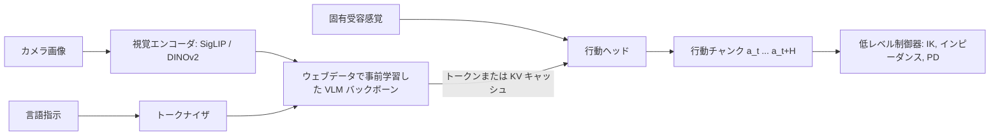
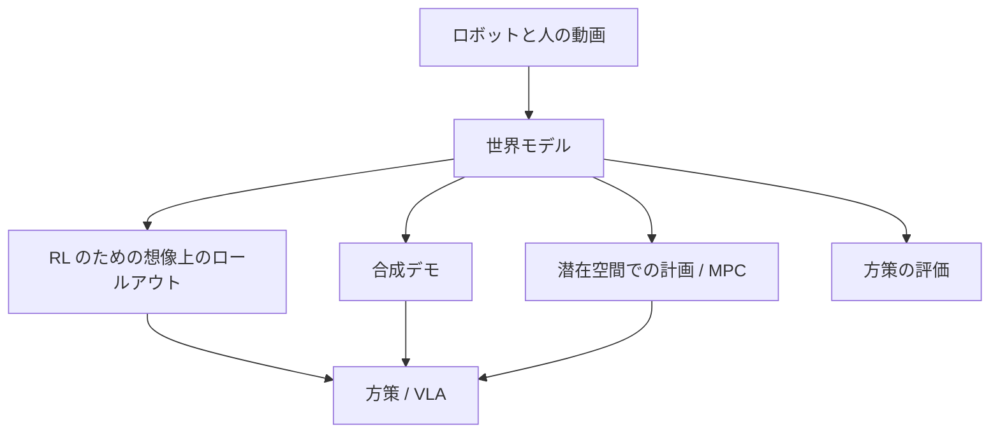

## なぜ重要なのか

[模倣学習]({{ '/blog/2026/embodied-ai-04-imitation-learning/' | relative_url }})では、数十回のデモからロボットに 1 つのスキルを
教えました。**Vision-Language-Action モデル**（VLA）が目指すのは、カメラ画像と自然言語の指示を受け取り、多くのタスク、シーン、
さらには異なるロボットの身体に対して行動を出力する単一の方策です。そのレシピは大規模言語モデルや視覚言語モデルから借りています。
インターネットで事前学習したモデルから始め、Open X-Embodiment のような大規模で多様なロボットデータセットで学習するのです。
2023 年以降、これは産業界と学術界のロボット学習の主要な方向になりました。本記事では主要なモデル、それらを分ける設計パターン、
評価方法、そして世界モデルがどこに位置づけられるかを説明します。

**前提知識**

- 第 1〜4 回、特にアクションチャンキングと拡散・フローの行動ヘッド（第 4 回）。
- Transformer と視覚言語モデル（ViT/SigLIP エンコーダ、LLM デコーダ、トークン化）。
- フローマッチングまたは拡散の基礎。[世界モデルシリーズ]({{ '/blog/category/world-models/' | relative_url }})では動画世界モデルと
  JEPA を詳しく扱います。

## 1. 言語条件付き方策から VLA へ

初期のシステムは言語と制御を分けていました。**SayCan**（Ahn ら CoRL 2022）は、LLM に固定のスキルライブラリから次のスキルを
提案させ、LLM のスコアに、そのスキルが現在の状態で成功しそうかを推定する学習済みの価値関数を掛け合わせました。これにより、
言語モデルがロボットに実際にできることに接地（grounding）されます。スキル自体は通常の言語条件付き方策でした。

**RT-1**（Brohan ら RSS 2023）は最初の大規模な「Robotics Transformer」です。13 台のモバイルマニピュレータで 17 か月かけて集めた、
700 以上のタスクにわたる約 13 万エピソードの実世界データで学習した方策です。指示の埋め込みで条件付けした FiLM 付き EfficientNet で
画像をトークン化し、TokenLearner で圧縮し、Transformer で約 3 Hz で**離散化された行動**（アーム、台車、モードの各次元を 256 ビン）を
出力します。RT-1 は、汎化を支配するのは巧妙なアルゴリズムではなくデータの規模と多様性であることを示しました。

**PaLM-E**（Driess ら ICML 2023）は逆の方向に進みました。連続的なセンサ観測（画像、状態推定）をトークンとして大規模言語モデルに
注入し、身体性の推論と計画のためにエンドツーエンドで学習します。最大のモデルは 5,620 億パラメータで、ロボットの計画タスクを学び
ながらも一般的な言語能力を保っていました。

**RT-2**（Brohan ら CoRL 2023）は 2 つの考えを統合し、VLA という言葉を生み出しました。大規模な視覚言語モデル（PaLI-X と PaLM-E）を
ファインチューニングし、ロボットの行動を**テキストトークンとして**出力させます。7 つの行動次元と終了フラグをそれぞれ 256 ビンに
離散化し、整数の列として書くのです。重要なのは、ロボットデータと元のウェブの視覚言語データで**共同ファインチューニング**
（co-fine-tuning）している点で、これによりモデルは意味的な知識を保ちます。RT-2 は、ロボットデータに一度も現れない概念を含む指示
（「バナナを 2 足す 1 の答えのところへ動かして」「絶滅した動物を拾って」）にも従えました。その知識はウェブから来ているからです。

## 2. オープンな汎用方策

| モデル | 年 | バックボーン | 行動出力 | データ | 備考 |
| --- | --- | --- | --- | --- | --- |
| Octo | 2024 | スクラッチから学習した Transformer（27M / 93M） | 拡散ヘッド、行動チャンク | OXE の 80 万軌道 | 柔軟な観測・ゴールのトークン、ファインチューニングが容易 |
| OpenVLA | 2024 | Llama 2 7B + DINOv2 + SigLIP（Prismatic VLM） | 256 ビンの行動トークン | OXE の 97 万エピソード | 重みを公開、29 タスクで RT-2-X（55B）を絶対値で 16.5% 上回る |
| RDT-1B | 2024 | 拡散 Transformer、1.2B | 統一行動空間上の拡散 | 複数ロボット、双腕中心 | 「物理的に解釈可能な統一行動空間」 |
| pi0 | 2024 | PaliGemma 3B + 300M の行動エキスパート | フローマッチング、50 ステップのチャンク | 大規模なクロスエンボディメントの混合 + OXE | 器用で長いタスク（洗濯物たたみ） |
| pi0.5 | 2025 | pi0 の系譜 | 離散（FAST）+ フローマッチングのエキスパート | ロボット + ウェブ + 高レベルのサブタスクデータ | 未知の家でキッチンや寝室を片付ける |
| GR00T N1 | 2025 | Eagle-2 VLM（System 2）+ 拡散 Transformer（System 1） | 高レートのフローマッチング | 実データ + 合成 + 人の動画の「データピラミッド」 | 人型ロボット向けのオープンモデル |
| Gemini Robotics | 2025 | Gemini 2.0 | 低遅延の行動デコーダ | 大規模な ALOHA 2 双腕データ + ウェブ | 身体性推論のための Gemini Robotics-ER も |
| SmolVLA | 2025 | 小型 VLM（全体で約 0.45B） | フローマッチングの行動エキスパート | コミュニティの LeRobot データセット | 一般向けハードウェアで動作 |

この記事のモデルと 5 節の世界モデルの研究を時間軸に並べると、2022 年以降この分野がいかに速く進んだかが分かります。



### Octo

Octo（Octo Model Team、RSS 2024）は、Open X-Embodiment の 80 万軌道で事前学習した Transformer ベースの方策です。観測（複数カメラ、
固有受容感覚）とタスク指定（言語またはゴール画像）はトークン化され、ブロック単位のアテンションをもつ Transformer で処理されます。
読み出しトークンが小さな**拡散ヘッド**に入り、行動チャンクを予測します。設計目標は適応性で、ファインチューニング時にトークナイザと
ヘッドを追加することで、新しいセンサや行動空間を加えられます。

### OpenVLA

OpenVLA（Kim ら CoRL 2024）はオープンソース版の RT-2 です。7B の Prismatic VLM（DINOv2 と SigLIP の特徴を融合した Llama 2）を
97 万エピソードでファインチューニングし、256 ビンの行動トークンを出力させます。これらのトークンは Llama の語彙で最も使われない
256 トークンを上書きしたものです。新しいロボットへの LoRA ファインチューニングが 1 枚の GPU でできること、そして DINOv2+SigLIP を
融合した視覚エンコーダが空間的推論に役立つことを示しました。**OpenVLA-OFT**（Kim ら RSS 2025）はその後、「最適化された
ファインチューニング」のレシピ（行動チャンクの並列デコード、L1 損失による連続行動）が成功率と推論速度の両方を大きく改善することを
見いだしました。

### pi0 と pi0.5

**pi0**（Black ら、Physical Intelligence、RSS 2025）は PaliGemma VLM に別個の**行動エキスパート**（action expert、約 3 億パラメータ）を
加えます。画像と言語は VLM を通り、行動エキスパートは固有受容感覚とノイズの乗った行動トークンを処理して VLM のトークンにアテンション
し、**フローマッチング**で学習されて $H = 50$ 個の連続行動からなるチャンクを出力します。これにより高周波の器用な制御（洗濯物たたみ、
テーブルの片付け、箱の組み立て）が可能になります。2 組の重みは mixture-of-experts のような Transformer を構成し、VLM のトークンは
行動トークンにアテンションしないので、VLM の知識が守られます。

**FAST**（Pertsch ら RSS 2025）は離散トークンを見直しました。行動チャンクを**離散コサイン変換**（DCT）で圧縮し、係数を量子化して
バイトペア符号化（BPE）を施します。滑らかなチャンクはわずかなトークンになり、自己回帰型の VLA を高周波のデータで学習できるように
なるうえ、拡散型のヘッドよりはるかに速く学習できます。

**pi0.5**（Physical Intelligence、CoRL 2025）は**オープンワールドでの汎化**を狙います。学習時に見たことのない家で、モバイル
マニピュレータがキッチンや寝室を片付けるのです。鍵となるのは**異種データでの共同学習**で、多くのロボットのデータ、ウェブデータ
（キャプション、VQA、物体検出）、高レベルの意味ラベルを混ぜて学習します。推論時には、モデルはまず高レベルのサブタスクをテキストで
予測し（「皿を持ち上げる」）、次にそのための低レベルの行動を予測します。これを 1 つのモデルで行います。著者らは、新しい家での性能が
学習に使った環境の数とともに向上すると報告しています。

### GR00T N1

NVIDIA の **GR00T N1**（2025）は人型ロボットのためのオープンな基盤モデルで、「速い思考と遅い思考」に着想を得た**デュアルシステム**
構成をとります。System 2 は視覚言語モジュール（Eagle-2 VLM）で、約 10 Hz でシーンと指示を解釈します。System 1 はフローマッチングで
学習した拡散 Transformer で、高いレート（論文では 120 Hz）でモータの行動を生成します。両者はエンドツーエンドで同時に学習されます。
学習には**データピラミッド**を使います。底辺にウェブと人の動画、中間にシミュレーションとニューラルな動画生成による合成データ、頂点に
実ロボットのデータです。人の動画や生成動画には行動ラベルがないので、潜在行動（latent action）や逆動力学による疑似ラベルを推定します。

### Gemini Robotics

Google DeepMind の **Gemini Robotics**（2025）は Gemini 2.0 の上に VLA を構築します。対になるモデル **Gemini Robotics-ER**（身体性推論、
embodied reasoning）は、ポインティング、物体検出、3D バウンディングボックス、軌道と把持の予測によって Gemini の空間理解を拡張します。
VLA 自体はクラウド上のバックボーンとローカルの行動デコーダに分かれていて遅延を低く保ち、報告では ALOHA 2 での長く器用なタスク、約 100 回
のデモによる新しい短いタスクへの素早い適応、新しいロボットの身体への適応が示されています。**Gemini Robotics 1.5**（技術報告、2025）は
行動の前の「思考」を加え、ある身体で学んだ動作を他の身体に転移します。

## 3. 設計パターン



VLM に行動を接続する 2 つの主要な方法を並べて描くと次のようになります。



### 行動の表現

主に 2 つの系統があります。

1. **離散的な行動トークン**（RT-1、RT-2、OpenVLA、FAST）。各次元 $a^{(j)}\in[\ell_j, u_j]$ をビン
   $b^{(j)} = \lfloor (a^{(j)}-\ell_j)/(u_j-\ell_j)\cdot 256\rfloor$ に写し、通常の次トークン交差エントロピーで学習します。利点：LLM の仕組みを
   そのまま再利用でき、カテゴリ出力は自然に多峰性を表せます。欠点：1 ステップ・1 次元ごとに 1 トークンなので、高周波のチャンクは
   長くなりデコードが遅くなります（FAST のように圧縮しない限り）。
2. **連続的な生成ヘッド**（Octo、pi0、GR00T、RDT）：拡散モデルやフローマッチングのモデルが、バックボーンの特徴を条件としてチャンク
   全体を予測します。利点：精密で滑らかで、長いチャンクでも少ない積分ステップで速く出力できます。欠点：追加のネットワークが必要で、
   行動の損失からの勾配が事前学習済みのバックボーンを乱すことがあります（Physical Intelligence の後続研究「knowledge insulation」は
   その勾配を止め、代わりに離散トークンでバックボーンを学習します）。

どちらも**アクションチャンキング**（第 4 回）と注意深い**正規化**（データセットごとの分位点。例えば 1 パーセンタイルと 99 パーセンタイルを
$\pm 1$ に写す）に頼っています。ロボットやデータセットによって単位や範囲が異なるからです。

次のコードは両方を示します。256 ビンのトークン化とその量子化誤差、そして FAST の考え方に沿った DCT による圧縮です。

```python
import numpy as np
from scipy.fft import dct, idct

# ---- RT-2 / OpenVLA style: 256 uniform bins per action dimension ----
def to_bins(a, low, high, n_bins=256):
    a = np.clip(a, low, high)
    return np.minimum(((a - low) / (high - low) * n_bins).astype(int), n_bins - 1)

def from_bins(b, low, high, n_bins=256):
    return low + (b + 0.5) * (high - low) / n_bins        # bin centers

# a smooth 7-D action chunk (xyz, rpy, gripper) at 50 Hz for 1 s
t = np.linspace(0, 1, 50)[:, None]
chunk = np.concatenate([0.05 * np.sin(2 * np.pi * t * [1, 0.5, 0.25]),
                        0.1 * np.cos(np.pi * t * [1, 2, 3]),
                        (t > 0.5).astype(float)], axis=1)  # [50, 7]
low, high = chunk.min(0) - 1e-3, chunk.max(0) + 1e-3     # per-dimension range (from the dataset)
tokens = to_bins(chunk, low, high)                        # [50, 7] integers -> 350 tokens
err = np.abs(from_bins(tokens, low, high) - chunk).max()
print(f"binning: {tokens.size} tokens, max error {err:.5f}")

# ---- FAST-style: DCT along time, quantize, keep the few non-zero coefficients ----
coef = dct(chunk, axis=0, norm="ortho")                   # [50, 7] frequency coefficients
for scale in [10.0, 50.0, 200.0]:
    q = np.round(coef * scale).astype(int)                # most high frequencies round to 0
    recon = idct(q / scale, axis=0, norm="ortho")
    print(f"DCT scale {scale:5.0f}: {np.count_nonzero(q):3d} non-zero of {q.size} coefficients, "
          f"mean error {np.abs(recon - chunk).mean():.4f}")
```

```text
binning: 350 tokens, max error 0.00096
DCT scale    10:  35 non-zero of 350 coefficients, mean error 0.0052
DCT scale    50:  42 non-zero of 350 coefficients, mean error 0.0016
DCT scale   200:  57 non-zero of 350 coefficients, mean error 0.0005
```

50 Hz で 1 秒のチャンクは、ステップごとのビン化では 350 トークンかかりますが、DCT 後の非ゼロ係数は数十個だけです。滑らかな動きは
エネルギーが低周波に集中するからです。FAST はこの疎な整数行列をさらにランレングス/BPE で符号化して短いトークン列にします。スケールは
圧縮率と精度のあいだのつまみです。

下の 2 つの図は、コードで作ったチャンクにとってこれらの数値が何を意味するかを示しています。まず 1 つの次元の 256 ビンのグリッド、次に DCT がチャンクのエネルギーをどこに集めるかです。





### フローマッチングの行動エキスパート

もう 1 つの系統は pi0 や GR00T 流で、バックボーンの特徴 $c$ を条件として、ガウスノイズを行動チャンクへ運ぶ速度場を学習します。
線形の経路 $A^t = (1-t)\,\epsilon + t\,A$ をとると、目標の速度は定数 $\frac{d}{dt}A^t = A - \epsilon$ で、損失は

$$
\mathcal{L}(\theta) = \mathbb{E}_{t\sim p(t),\,\epsilon\sim\mathcal{N}(0,I),\,(A,c)\sim\mathcal{D}}\left[\left\lVert v_\theta(A^t, t, c) - (A - \epsilon)\right\rVert^2\right]
$$

です。サンプリングでは $dA/dt = v_\theta$ を $t = 0$ から $t = 1$ まで、通常は約 10 ステップのオイラー法で積分します。（pi0 は同じ考え方を、
独自の時間の取り方と、ノイズの大きい時刻を重視するベータ分布型の $p(t)$ で使っています。）次のトイ例では、「左へ」と「右へ」という
2 つの指示の VLM 埋め込みの代わりにランダムなベクトルを使います。

```python
import math
import torch
import torch.nn as nn
import torch.nn.functional as F

torch.manual_seed(0)
H, A, C = 8, 2, 64           # chunk length, action dim, size of the "VLM" context embedding

class ActionExpert(nn.Module):
    """v_theta(A_t, t, c): predicts the flow velocity for a whole action chunk.
    pi0 uses a transformer "action expert" attending to the VLM's tokens; an MLP keeps this toy fast."""
    def __init__(self, hidden=256):
        super().__init__()
        self.net = nn.Sequential(nn.Linear(H * A + C + 32, hidden), nn.SiLU(),
                                 nn.Linear(hidden, hidden), nn.SiLU(),
                                 nn.Linear(hidden, hidden), nn.SiLU(),
                                 nn.Linear(hidden, H * A))
    def forward(self, a_t, t, c):
        freqs = torch.exp(torch.arange(16) * (-math.log(1000.0) / 16))
        emb = 1000 * t[:, None] * freqs[None]             # sinusoidal embedding of flow time
        x = torch.cat([a_t.flatten(1), c, emb.sin(), emb.cos()], -1)
        return self.net(x).view(-1, H, A)

def flow_matching_loss(model, actions, ctx):
    """Linear path from noise (t=0) to data (t=1); regress the constant velocity."""
    eps = torch.randn_like(actions)
    t = torch.rand(actions.shape[0])
    a_t = (1 - t)[:, None, None] * eps + t[:, None, None] * actions
    return F.mse_loss(model(a_t, t, ctx), actions - eps)

@torch.no_grad()
def sample(model, ctx, steps=10):
    a = torch.randn(ctx.shape[0], H, A)
    for i in range(steps):                                # forward Euler on da/dt = v
        t = torch.full((ctx.shape[0],), i / steps)
        a = a + model(a, t, ctx) / steps
    return a

# toy data: two instructions ("go left" / "go right") encoded as fixed context vectors
instr = torch.randn(2, C)
def batch(n):
    side = torch.randint(0, 2, (n,))
    tt = torch.linspace(0, 1, H)
    y = (side.float() * 2 - 1)[:, None] * torch.sin(math.pi * tt) * 0.5
    return torch.stack([tt.expand(n, H), y], -1), instr[side], side

model = ActionExpert()
opt = torch.optim.AdamW(model.parameters(), lr=1e-3)
for it in range(3000):
    act, ctx, _ = batch(128)
    loss = flow_matching_loss(model, act, ctx)
    opt.zero_grad(); loss.backward(); opt.step()
act, ctx, side = batch(512)
pred = sample(model, ctx)
ok = (torch.sign(pred[:, H // 2, 1]) == (side * 2 - 1)).float().mean()
print(f"final loss {loss.item():.4f}; follows the instruction in {ok:.1%} of samples; "
      f"chunk error {(pred - act).abs().mean():.3f}")
```

```text
final loss 0.0246; follows the instruction in 100.0% of samples; chunk error 0.018
```

小さなネットワークで 10 ステップのオイラー法を回すだけで、ノイズが各指示に対する正しいチャンクになります。実際の VLA では、
コンテキストはバックボーンのトークン（Transformer の行動エキスパートがアテンションする）で、チャンクは 50 ステップ・7〜30 以上の次元を
もち、指示の集合はオープンです。

10 回のオイラーステップを記録すると、フローの働きが見えます。ノイズのチャンクが（平均的には直線的に）それぞれの指示に合うチャンクへと運ばれていきます。



### クロスエンボディメント学習

データセットはロボット、カメラ、制御周波数、行動空間がそれぞれ異なります。よくある選択は次のとおりです。

- **共通の行動規約**。通常はエンドエフェクタの差分とグリッパで、データセットごとに正規化します。あるいは、各エンボディメントが自分の
  スロットを埋めるパディングされた「統一」行動ベクトル（RDT、pi0）に、エンボディメントやデータセットのトークンを加えます。
- **重み付きのデータ混合**。よく使われるデータセットの重みを下げ、多様なデータセットの重みを上げます。pi0.5 は、対象のロボットが
  1 台だけであっても、ウェブやロボット横断のデータが新しい環境での汎化を改善することを示しています。
- **行動のない人のデータと合成データ**（GR00T のデータピラミッド）。潜在行動モデルが連続するフレームから疑似行動を推定するので、
  動画から運動の事前知識を学べます。



### 階層と推論

長いタスクには計画が必要です。選択肢には、外部の LLM/VLM の計画器が VLA を呼び出す方式（SayCan 流）、1 つのモデルが行動の前に
サブタスクを予測する方式（pi0.5）、遅い推論器と速い実行器からなるデュアルシステム（GR00T N1、また Figure が公開で説明している
Helix）、そして行動の前にテキストやポインティング、ボックスで推論する「身体性の chain-of-thought」（Gemini Robotics-ER と 1.5）が
あります。

## 4. スケーリングと評価

VLA の評価は困難です。実機での 1 回の試行には人手で何分もかかり、成功はシーンの配置に左右され、シードや評価者による分散も
大きいからです。次のような慣行が生まれています。

- **汎化の軸**：視覚（新しい背景、照明、妨害物）、意味（新しい物体、新しい指示）、行動（新しい位置、新しい動作）、エンボディメント
  （新しいロボット）。RT-2 と OpenVLA はこれらの軸に沿って結果を報告しています。
- **標準化されたシミュレーションの代理指標**：ファインチューニングの比較には LIBERO、実際の Google ロボットや WidowX のデータで学習
  した方策には SimplerEnv（第 3 回）を使い、シミュレーションと実機の相関を明示的に測ります。
- **機関をまたいだブラインドの A/B 評価**とペア比較で、評価者のバイアスを減らします。
- **スケーリングの研究**：pi0.5 の環境数によるスケーリング、OXE のクロスエンボディメントの効果、GR00T の混合データは、シーンと
  エンボディメントの多様性が、単純なエピソード数と少なくとも同じくらい重要であることを示唆しています。言語モデルとは違い、
  ロボットの成功率についてはまだきれいなべき乗則がありません。

展開時の懸念はきわめて実践的です。推論の遅延（数 Hz でしか動かない 7B モデルにはチャンク化と非同期実行が必要）、ロボット上の計算資源、
低レベル制御器での安全制約、そして失敗の検出です。

## 5. ロボット学習のための世界モデル

**世界モデル**（world model）は、行動が与えられたときに観測がどう変化するかを予測します。詳しくは世界モデルシリーズで扱いますが、
ここではロボティクスとの主な接点を挙げます。

1. **RL のための学習されたシミュレータ。** Dreamer 系のエージェントは潜在空間のダイナミクスモデルを学習し、「想像」の中で方策を
   学習します。**DayDreamer**（Wu ら CoRL 2022）は約 1 時間の実世界でのやり取りだけで四脚ロボットにゼロから歩行を学ばせ、
   DreamerV3（Hafner ら、Nature 2025）はこのレシピを多くの領域に一般化しました。
2. **計画としての動画予測。** **UniPi**（Du ら NeurIPS 2023）はテキストの指示からタスクを実行する様子の動画を生成し、逆動力学モデルで
   行動を取り出します。**GR-1**（Wu ら ICLR 2024）は GPT 風のモデルを大規模な動画予測で事前学習し、行動と将来フレームを同時に予測する
   ようにファインチューニングします。
3. **動画から学ぶインタラクティブなシミュレータ。** **UniSim**（Yang ら ICLR 2024）は多様なデータから行動条件付きの動画シミュレータを
   学習し、それを使って方策や計画器を学習します。**Genie**（Bruce ら ICML 2024）はラベルのない動画から潜在行動を学習し、生成された
   世界を操作できるようにします。NVIDIA の **Cosmos** 世界基盤モデル（2025）は、ロボットや自動運転向けのシミュレータや合成データ
   生成器へと追加学習できるよう設計されています（GR00T の「ニューラル軌道」はその使い方の 1 つです）。
4. **潜在空間での計画。** **V-JEPA 2**（Assran ら、2025）は 100 万時間以上のインターネット動画で、同時埋め込み予測の目的関数により
   動画エンコーダを事前学習し、DROID の約 62 時間のラベルなしロボット動画で行動条件付きの予測器（V-JEPA 2-AC）を学習します。学習した
   潜在空間でゴール画像を使って計画することで、タスク固有のデータも報酬もなしに、2 つの研究室の Franka アームでゼロショットの
   ピック・アンド・プレースを実現しました。
5. **方策の評価。** 実機での評価は高価なので、行動条件付きの世界モデルは、方策が実機に届く前に順位付けする学習済みの評価器として
   使えます。ただし実際の結果に対して検証されていることが前提です。



未解決の問いは、1 つのモデルが両方を兼ねられるかどうかです。つまり、行動を予測する VLA であると同時に、その結果を予測する世界モデル
でもあり、互いを高め合うように同時に学習されるモデルです。2025 年の時点で、行動予測と将来フレームの予測を同時に学習するシステムが
すでにいくつか登場しています。

## 6. 未解決の問題

- **データ**：ロボットのデータはテキストや動画よりまだ桁違いに少なく、人の動画、シミュレーション、XR による遠隔操作（第 6 回）が
  主なてこです。
- **精度と接触**：VLA は意味や大まかな動作は得意ですが、ミリ単位の精度や力に敏感なマニピュレーションは苦手です。触覚センシングや
  力を考慮した行動空間が活発な研究領域です。
- **記憶と長いホライズン**：ほとんどの VLA は直近の 1〜2 フレームしか見ていません。
- **信頼性**：成功率 80% は論文では印象的でも、家庭では受け入れられません。展開から学ぶこと（RL ファインチューニング、介入）が次の
  フロンティアです。
- 研究室をまたいで再現可能な**評価**。

## 試してみよう

ホームページの **[Lab]({{ '/' | relative_url }}#lab)** には「Gaussian World」のデモがあります。世界を言葉で説明すると、約 20 万個の 3D
ガウシアンからなる編集可能なオープンワールドが構築され（学習モデルの代わりにキーワード駆動の手続き的生成器を使っています）、しかも
生きています。照明を変えたり、地形を彫ったり、中を歩いたりできます。上で述べた生成的世界モデルの小さな類似物です。XPBD の物理デモと
組み合わせると、長期的な姿が見えてきます。物理を備えた生成的な 3D 世界で、VLA が学習され評価されるのです。

## 代表的な論文

| 論文 | 会議・論文誌 | 年 | リンク | 意義 |
| --- | --- | --- | --- | --- |
| Ahn et al., *Do as I can, not as I say: grounding language in robotic affordances* (SayCan) | CoRL | 2022 | [arXiv](https://arxiv.org/abs/2204.01691) | 価値関数で接地された LLM の計画 |
| Reed et al., *A generalist agent* (Gato) | TMLR | 2022 | [arXiv](https://arxiv.org/abs/2205.06175) | ゲーム、キャプション、ロボットアームを 1 つの Transformer で |
| Wu et al., *DayDreamer: world models for physical robot learning* | CoRL | 2022 | [arXiv](https://arxiv.org/abs/2206.14176) | 実ロボットでの世界モデル RL |
| Brohan et al., *RT-1: Robotics Transformer for real-world control at scale* | RSS | 2023 | [arXiv](https://arxiv.org/abs/2212.06817) | 大規模な実世界のロボット Transformer |
| Jiang et al., *VIMA: robot manipulation with multimodal prompts* | ICML | 2023 | [arXiv](https://arxiv.org/abs/2210.03094) | マルチモーダルなタスクプロンプト |
| Driess et al., *PaLM-E: an embodied multimodal language model* | ICML | 2023 | [arXiv](https://arxiv.org/abs/2303.03378) | LLM の中のセンサトークン |
| Brohan et al., *RT-2: vision-language-action models transfer web knowledge to robotic control* | CoRL | 2023 | [arXiv](https://arxiv.org/abs/2307.15818) | 最初の VLA、行動をテキストトークンとして |
| Du et al., *Learning universal policies via text-guided video generation* (UniPi) | NeurIPS | 2023 | [arXiv](https://arxiv.org/abs/2302.00111) | 計画としての動画生成 |
| Bousmalis et al., *RoboCat: a self-improving generalist agent for robotic manipulation* | TMLR | 2023 | [arXiv](https://arxiv.org/abs/2306.11706) | エンボディメントをまたいだ自己改善 |
| Yang et al., *Learning interactive real-world simulators* (UniSim) | ICLR | 2024 | [arXiv](https://arxiv.org/abs/2310.06114) | 行動条件付きの動画シミュレータ |
| Wu et al., *Unleashing large-scale video generative pre-training for visual robot manipulation* (GR-1) | ICLR | 2024 | [arXiv](https://arxiv.org/abs/2312.13139) | 方策のための動画事前学習 |
| Bruce et al., *Genie: generative interactive environments* | ICML | 2024 | [arXiv](https://arxiv.org/abs/2402.15391) | ラベルなし動画からの潜在行動 |
| Octo Model Team, *Octo: an open-source generalist robot policy* | RSS | 2024 | [arXiv](https://arxiv.org/abs/2405.12213) | 拡散ヘッド付きのオープンな汎用方策 |
| Kim et al., *OpenVLA: an open-source vision-language-action model* | CoRL | 2024 | [arXiv](https://arxiv.org/abs/2406.09246) | オープンな 7B の VLA |
| Liu et al., *RDT-1B: a diffusion foundation model for bimanual manipulation* | ICLR | 2025 | [arXiv](https://arxiv.org/abs/2410.07864) | 拡散 Transformer の VLA |
| Black et al., *pi0: a vision-language-action flow model for general robot control* | RSS | 2025 | [arXiv](https://arxiv.org/abs/2410.24164) | フローマッチングの行動エキスパート |
| Pertsch et al., *FAST: efficient action tokenization for vision-language-action models* | RSS | 2025 | [arXiv](https://arxiv.org/abs/2501.09747) | DCT + BPE による行動トークン |
| NVIDIA, *Cosmos world foundation model platform for physical AI* | arXiv | 2025 | [arXiv](https://arxiv.org/abs/2501.03575) | ロボティクスのための世界基盤モデル |
| Kim et al., *Fine-tuning vision-language-action models: optimizing speed and success* (OpenVLA-OFT) | RSS | 2025 | [arXiv](https://arxiv.org/abs/2502.19645) | より良い VLA のファインチューニングのレシピ |
| NVIDIA, *GR00T N1: an open foundation model for generalist humanoid robots* | arXiv | 2025 | [arXiv](https://arxiv.org/abs/2503.14734) | デュアルシステムの人型ロボット VLA |
| Gemini Robotics Team, *Gemini Robotics: bringing AI into the physical world* | arXiv | 2025 | [arXiv](https://arxiv.org/abs/2503.20020) | Gemini 2.0 による VLA と身体性推論 |
| Physical Intelligence, *pi0.5: a vision-language-action model with open-world generalization* | CoRL | 2025 | [arXiv](https://arxiv.org/abs/2504.16054) | 未知の家のための共同学習 |
| Shukor et al., *SmolVLA: a vision-language-action model for affordable and efficient robotics* | arXiv | 2025 | [arXiv](https://arxiv.org/abs/2506.01844) | 小型のオープンな VLA |
| Assran et al., *V-JEPA 2: self-supervised video models enable understanding, prediction and planning* | arXiv | 2025 | [arXiv](https://arxiv.org/abs/2506.09985) | ゼロショット計画のための潜在世界モデル |
| Gemini Robotics Team, *Gemini Robotics 1.5* | arXiv | 2025 | [arXiv](https://arxiv.org/abs/2510.03342) | 考える VLA、動作の転移 |

## 学習リソース

- [OpenVLA のコード](https://github.com/openvla/openvla)と [openpi](https://github.com/Physical-Intelligence/openpi)（pi0 / pi0.5 の公開
  重みとファインチューニングのコード）。
- [LeRobot](https://github.com/huggingface/lerobot)：pi0、SmolVLA、ACT、Diffusion Policy を 1 つのライブラリで。
- [Octo](https://github.com/octo-models/octo) と [Isaac GR00T](https://github.com/NVIDIA/Isaac-GR00T)。
- RLDS 形式の [Open X-Embodiment](https://robotics-transformer-x.github.io) データセット。
- サーベイと講義：Stanford CS 224R（深層 RL とロボット学習）、CMU 16-831、そして Tedrake の
  『[*Robotic Manipulation*](https://manipulation.csail.mit.edu)』の関連章。

## 演習

1. 14 次元（双腕ロボット）・50 Hz・2 秒のチャンクに RT-2 流のビン化で何トークン必要かを計算し、上の 3 つのスケールでの FAST と比べましょう。
2. フローマッチングのトイ例を、コンテキストにノイズが含まれる（2 つの指示が部分的にしか区別できない）ように変えましょう。指示に
   従う割合はどう変わるでしょうか。さらに 1、2、5、10 ステップのオイラー法でサンプルしましょう。
3. MLP の行動エキスパートを、1 つのベクトルの代わりに 16 個の「VLM トークン」の列にアテンションする小さな Transformer に置き換えましょう。
   学習速度と精度はどう変わるでしょうか。
4. OpenVLA と pi0 の論文を読み、上の Mermaid 図と同じスタイルで両方のアーキテクチャを描きましょう。どの重みが事前学習済みで、
   どれがスクラッチから学習され、勾配がどこを流れるかを書き込みます。
5. あなたの研究室で VLA を評価するプロトコルを設計しましょう。汎化の軸、条件ごとの試行回数、成功率の信頼区間をどう推定するかを
   挙げます。

**次回：**[身体性 AI × XR・HCI]({{ '/blog/2026/embodied-ai-06-embodied-ai-meets-xr-and-hci/' | relative_url }})。人とヘッドセットと
ロボットが出会います。
