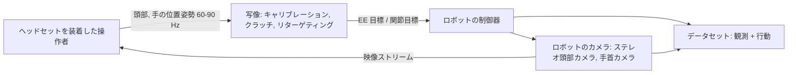
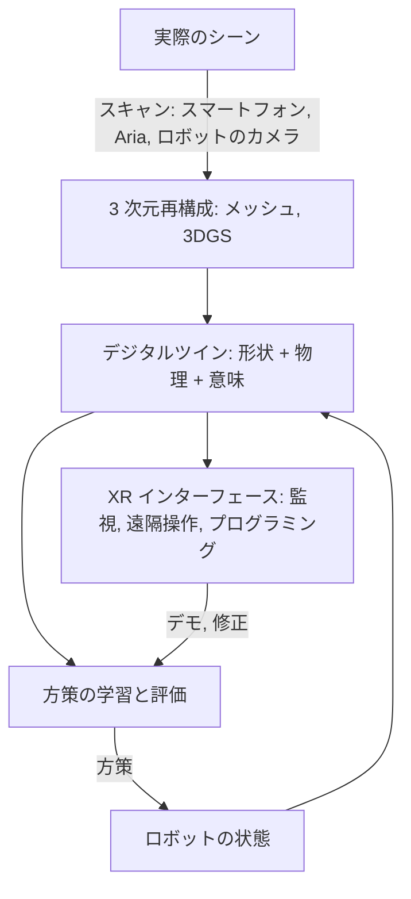

## なぜ重要なのか

本シリーズのどの記事も、実はひそかに人に頼っていました。模倣学習のデモは人間の操作者から来ます。VLA は人が作ったウェブ
データで事前学習され、人が集めたロボットデータでファインチューニングされます。世界モデルは人が撮った動画から学びます。そして
最終目標は、人とともに、人のために働くロボットです。拡張現実（XR：VR、AR、複合現実）とヒューマンコンピュータインタラクション
（human-computer interaction, HCI）は、まさにこうした人と機械のあいだのインターフェースを研究する分野です。
[VLA モデル]({{ '/blog/2026/embodied-ai-05-vision-language-action-models/' | relative_url }})に続くこの最終回では、身体性 AI における
人の側面を 4 つの役割から見ていきます。**動作データの源**としての人、**遠隔操作者**としての人、**協働者**としての人、そして
デジタルツインのような**インターフェースの利用者**としての人です。最後に、身体性 AI、世界モデル、AR/VR、HCI、グラフィックスが
交わるところの研究機会を挙げます。

**前提知識**

- 第 1 回（SE(3) 変換、IK）、第 4 回（模倣学習とデータ収集）、第 5 回（VLA、世界モデル）。
- VR/AR ヘッドセットの基本的な知識（6 自由度トラッキング、ハンドトラッキング、パススルー）。
- 身体モデル、レンダリング、デジタルツインの節では、グラフィックスの知識が役立ちます。

## 1. 人の動きを捉える

### センサ

| 技術 | 例 | 計測するもの | トレードオフ |
| --- | --- | --- | --- |
| 光学式マーカーモーキャプ | Vicon、OptiTrack | 3 次元のマーカー位置、サブミリ精度 | スタジオ限定、遮蔽、体にマーカーが必要 |
| 慣性式スーツ | Xsens 型の IMU スーツ | 各部位の姿勢 | 持ち運べるが、全体の位置がドリフトする |
| マーカーレスの視覚 | 多視点または単眼の姿勢推定 | 身体と手のキーポイント、メッシュのフィッティング | 安価だが精度が低く、遮蔽に弱い |
| XR ヘッドセット | Quest、Vision Pro、Project Aria | 頭部の 6 自由度、手（約 26 関節）、視線 | 一人称視点、リアルタイム、身体のトラッキングは限定的 |
| グローブとウェアラブル | データグローブ、触覚グローブ、筋電（EMG）バンド | 指の角度、接触圧、筋活動 | 手のデータが最も豊富だが、身体への負担がある |

### パラメトリックな身体モデルと手のモデル

生のキーポイントはノイズが多く不完全なので、グラフィックス流の**パラメトリックモデル**をフィットします。**SMPL**（Loper ら
SIGGRAPH Asia 2015）は、形状パラメータ $\beta$ と姿勢パラメータ $\theta$（24 関節の軸角回転）で身体メッシュを表します。

$$
M(\beta, \theta) = W\big(T_P(\beta, \theta),\, J(\beta),\, \theta,\, \mathcal{W}\big), \qquad
T_P(\beta, \theta) = \bar T + B_S(\beta) + B_P(\theta).
$$

ここで $\bar T$ はテンプレートメッシュ、$B_S$ と $B_P$ は学習された線形の形状ブレンドシェイプと姿勢補正ブレンドシェイプ、$J(\beta)$ は
関節位置を回帰し、$W$ は重み $\mathcal{W}$ による**線形ブレンドスキニング**（linear blend skinning）です。各頂点は関節の剛体変換
$G_k(\theta, J) \in SE(3)$ の重み付き和で変換されます。

$$
v_i' = \sum_{k} w_{ik}\, G_k(\theta, J)\, v_i .
$$

$G_k$ はまさに第 1 回の順運動学の連鎖です。人の身体モデルは、皮膚をかぶせた運動学的な木なのです。**MANO**（Romero ら SIGGRAPH Asia
2017）は同じことを手について行い、SMPL-X は身体、手、顔を統合しています。**AMASS**（Mahmood ら ICCV 2019）は多くのモーキャプ
データセットを SMPL のパラメータに統一したもので、人型ロボットの制御器を学習する際の人の動作データの標準的な供給源になっています。

線形ブレンドスキニングは、2 本のボーンを持つ 2 次元の帯で見ると簡単に分かります。



### 人の動きをロボットへリターゲティングする

人とロボットはリンク長、関節限界、自由度が異なるので、動きを**リターゲティング**（retargeting）する必要があります。通常はフレーム
ごとの最適化として定式化します。

$$
q^{\ast}_t = \arg\min_{q} \sum_{k} \left\lVert s\, p^{\text{human}}_k - p^{\text{robot}}_k(q) \right\rVert^2
+ \lambda_1 \lVert q - q^{\ast}_{t-1}\rVert^2 \quad \text{s.t. } q_{\min} \le q \le q_{\max}.
$$

選んだキーポイント（手首、肘、指先）をスケール $s$ で一致させながら、滑らかさと関節限界を保ちます。第 1 回の減衰最小二乗 IK か
小さな QP で解きます。多指ハンドでは、絶対位置よりも指先間の**相対ベクトル**（親指と人差し指の距離）を合わせることが重要です。
つまみ把持はそれで決まるからです。人型ロボットの全身リターゲティングではバランスも考えます。H2O と OmniH2O（He ら 2024）は AMASS の
動作を人型ロボットにリターゲティングし、実現不可能なものを除外して、シミュレーションで RL による追従方策を学習します。
**HumanPlus**（Fu ら CoRL 2024）は約 40 時間の人の動作データでこのような「シャドーイング」（shadowing）方策を学習し、人型ロボットが
1 台の RGB カメラだけで人の身体と手の動きをリアルタイムにまねられるようにし、そのシャドーイングのデータを模倣学習に使いました。

2 つの小さな実験で、この段落の前半と後半をそれぞれ示します。腕のキーポイントのリターゲティングと、つまみ動作で指先の相対ベクトルが重要な理由です。





## 2. 一人称視点データ：人の見方とやり方から学ぶ

人は 1 日に何十億回もマニピュレーションのタスクを行っています。一人称視点（egocentric）の動画は、それをロボットの頭部カメラや
手首カメラに近い視点から記録します。

- **Ego4D**（Grauman ら CVPR 2022）：9 か国 74 か所の 931 人の装着者による 3,670 時間の日常生活の動画。エピソード記憶、手と物体の
  インタラクション、予測などのベンチマーク付きです。
- **Ego-Exo4D**（CVPR 2024）：熟練した活動の、同期した一人称視点と三人称視点の映像と、3 次元の身体・手の姿勢。
- **Project Aria**（Meta、2023）：RGB カメラ、2 台の SLAM カメラ、2 台の視線追跡カメラ、IMU、7 つのマイクのアレイなどを備えた研究用の
  メガネと、機械知覚サービス（SLAM の軌道、視線、ハンドトラッキング）。**Aria Digital Twin**（ICCV 2023）は、Aria の記録をシーンと
  物体の完全なデジタル再構成と対応づけ、すべてのフレームに 3 次元の正解を与えます。
- **EgoDex**（Apple、ICLR 2026）：Apple Vision Pro で記録した 829 時間の一人称視点動画と、194 の卓上マニピュレーションタスクにおける
  3 次元の手と指のトラッキング。

ロボットでの使われ方：

1. **視覚表現。** R3M（Nair ら CoRL 2022）は、時間対比学習と動画・言語の目的関数で Ego4D 上の視覚エンコーダを事前学習し、下流の
   ロボット模倣のデータ効率を改善しました。
2. **人のプレイからの計画と事前知識。** MimicPlay（Wang ら CoRL 2023）は、安価な人のプレイ動画から高レベルの潜在的な計画を、少量の
   遠隔操作データから低レベルの制御器を学習します。
3. **人のデータをロボットのデータとして。** EgoMimic（Kareer ら ICRA 2025）は Aria グラスを装着した人を記録し、人の手の軌道を別の
   エンボディメントとして扱ってロボットのデータと共同学習します。DexCap（Wang ら RSS 2024）は持ち運べるモーキャプグローブと胸部
   カメラで器用な手のデータを集め、それをロボットハンドにリターゲティングします。
4. **動画からの潜在行動**。Genie や GR00T のデータピラミッド（第 5 回）のように、行動のない動画を学習信号に変えます。

**エンボディメントのギャップ**（embodiment gap）は依然として中心的な課題です。人の手はグリッパではなく、人の動画に映っているのは
ロボットではなく人です。手のマスキングやインペインティング、ロボットの運動学へのリターゲティング、カメラ視点の一致（頭部カメラ ≈
ロボットの頭部カメラ、手首カメラ ≈ UMI）が主な工夫です。

視点の議論は幾何学的なものです。同じ卓上の場面を頭部装着カメラと手首装着カメラのピンホールモデルに投影すると、2 つの観測がいかに違うかが分かります。



## 3. データ収集のための VR・AR 遠隔操作

ロボット学習のボトルネックはデモなので、遠隔操作のインターフェースがデータの量と質の両方を決めます。XR ヘッドセットは魅力的です。
もともと頭と手を高いレートでトラッキングしており、安価で、ステレオ映像も表示できるからです。



代表的なシステム：

- **深層模倣のための VR 遠隔操作**（Zhang ら ICRA 2018）は、民生用の VR で視覚運動方策のためのデモを集められることを早くに示しました。
- **Holo-Dex**（Arunachalam ら ICRA 2023）と **AnyTeleop**（Qin ら RSS 2023）は、トラッキングした人の手を多指ロボットハンドに写します。
  AnyTeleop は視覚ベースのハンドトラッカーで多くのアームとハンドに対応します。
- **Open-TeleVision**（Cheng ら CoRL 2024）は、操作者の頭の動きに能動的に追従する頭部カメラから**ステレオ**映像を送り、没入感のある
  一人称の知覚を与えます。Unitree H1 と Fourier GR1 の人型ロボットで、ステレオ配信は成功率と完了時間を改善し、能動カメラは制御を
  より速く滑らかにしました。
- **Bunny-VisionPro**（Ding ら IROS 2025）は、Apple Vision Pro による双腕の器用な遠隔操作に触覚フィードバックと衝突回避を加えます。
- **GELLO**（Wu ら IROS 2024）は低コストな代替手段で、ロボットアームの運動学を 3D プリントで再現したものです。関節空間のリーダー・
  フォロワー方式のほうが、自由空間でのハンドトラッキングより精密なことが多いと示しています。

### 写像のエンジニアリング

どの XR 遠隔操作システムでも、核となるのは SE(3) 変換の連鎖（第 1 回）と、いくらかの HCI です。典型的な設計は次のとおりです。

- ヘッドセットのトラッキング座標系とロボットのベースのあいだの**キャリブレーション** $T_{\text{robot},\text{headset}}$（マーカー、共有
  アンカー、あるいはパススルー映像で仮想ロボットを実ロボットに手作業で重ね合わせて求めます）。
- **クラッチ**（clutching、相対的な写像）：操作者がボタンを押している間、そのときの手とエンドエフェクタの位置姿勢を記憶し、その後の
  手の動きをそれらに対する相対量として適用します。操作者はボタンを離し、手を楽な位置に戻してから再び押せます。マウスを持ち上げて
  置き直すのと同じです。
- 精密な作業のための**動作スケーリング**（例：2:1）と、トラッキングの揺れの**フィルタリング**。HCI の古典である **1€ フィルタ**
  （Casiez、Roussel、Vogel、CHI 2012）は、速度に応じてカットオフ周波数が上がる 1 次のローパスフィルタです。手が止まっているときは
  揺れを取り除き、速く動くときは遅れをなくします。

```python
import numpy as np

class OneEuroFilter:
    """1 Euro filter (Casiez, Roussel, Vogel, CHI 2012): a speed-adaptive low-pass filter.
    Slow motion -> low cutoff (removes jitter); fast motion -> high cutoff (removes lag)."""
    def __init__(self, freq, min_cutoff=1.0, beta=0.05, d_cutoff=1.0):
        self.freq, self.min_cutoff, self.beta, self.d_cutoff = freq, min_cutoff, beta, d_cutoff
        self.x_prev, self.dx_prev = None, None

    def _alpha(self, cutoff):
        tau = 1.0 / (2 * np.pi * cutoff)
        return 1.0 / (1.0 + tau * self.freq)

    def __call__(self, x):
        if self.x_prev is None:
            self.x_prev, self.dx_prev = x, np.zeros_like(x)
            return x
        dx = (x - self.x_prev) * self.freq
        a_d = self._alpha(self.d_cutoff)
        dx_hat = a_d * dx + (1 - a_d) * self.dx_prev               # filtered speed
        cutoff = self.min_cutoff + self.beta * np.linalg.norm(dx_hat)
        a = self._alpha(cutoff)
        x_hat = a * x + (1 - a) * self.x_prev
        self.x_prev, self.dx_prev = x_hat, dx_hat
        return x_hat

def pose(R=np.eye(3), p=np.zeros(3)):
    T = np.eye(4); T[:3, :3] = R; T[:3, 3] = p
    return T

def rot_z(a):
    c, s = np.cos(a), np.sin(a)
    return np.array([[c, -s, 0], [s, c, 0], [0, 0, 1]])

class ClutchTeleop:
    """Relative (clutched) mapping from a VR hand/controller pose to a robot end-effector target.
    T_robot_headset is a calibration transform (headset tracking frame -> robot base frame)."""
    def __init__(self, T_robot_headset, scale=1.0):
        self.T_rh, self.scale = T_robot_headset, scale
        self.anchor_hand = self.anchor_ee = None

    def engage(self, T_h_hand, T_r_ee):             # clutch pressed: remember both poses
        self.anchor_hand = self.T_rh @ T_h_hand      # hand pose expressed in the robot frame
        self.anchor_ee = T_r_ee.copy()

    def target(self, T_h_hand):
        T_r_hand = self.T_rh @ T_h_hand
        dp = (T_r_hand[:3, 3] - self.anchor_hand[:3, 3]) * self.scale   # scaled translation
        dR = T_r_hand[:3, :3] @ self.anchor_hand[:3, :3].T              # rotation since engage
        return pose(dR @ self.anchor_ee[:3, :3], self.anchor_ee[:3, 3] + dp)

if __name__ == "__main__":
    rng = np.random.default_rng(0)
    freq = 90.0                                          # headset tracking rate (Hz)
    t = np.arange(0, 3, 1 / freq)
    # the operator moves the hand 20 cm along x in the headset frame, with 3 mm tracking jitter
    true = np.stack([0.2 * np.clip(t - 1, 0, 1), 0 * t, 0 * t], 1) + np.array([0.3, 1.2, -0.4])
    noisy = true + rng.normal(0, 0.003, true.shape)

    T_rh = pose(rot_z(np.pi / 2), np.array([0.5, 0.0, -0.8]))   # headset frame -> robot base
    teleop = ClutchTeleop(T_rh, scale=0.5)              # 2:1 motion scaling for precision
    ee0 = pose(p=np.array([0.4, 0.0, 0.3]))
    teleop.engage(pose(p=noisy[0]), ee0)
    f = OneEuroFilter(freq, min_cutoff=1.0, beta=5.0)
    raw = np.array([teleop.target(pose(p=x))[:3, 3] for x in noisy])
    filt = np.array([teleop.target(pose(p=f(x)))[:3, 3] for x in noisy])
    still = t < 1.0                                      # hand at rest
    print("jitter at rest  raw %.2f mm, filtered %.2f mm" %
          (1e3 * raw[still].std(0).max(), 1e3 * filt[still].std(0).max()))
    moving = (t > 1.0) & (t < 2.0)
    print("max |filtered - raw| while moving: %.1f mm" % (1e3 * np.abs(filt[moving] - raw[moving]).max()))
    print("final target", np.round(filt[-1], 3), "(expected [0.4, 0.1, 0.3])")
```

```text
jitter at rest  raw 1.61 mm, filtered 0.42 mm
max |filtered - raw| while moving: 6.9 mm
final target [0.4   0.099 0.299] (expected [0.4, 0.1, 0.3])
```

3 mm のトラッキングノイズは 2:1 のスケーリングで 1.6 mm に、1€ フィルタで約 0.4 mm になります。一方、ヘッドセットの $x$ 軸方向の
20 cm の手の動きは、ロボットの $y$ 軸方向の 10 cm に正しく変換されています（キャリブレーションに 90° の回転が含まれるためです）。
動いている間のずれ（約 7 mm。生の信号自体に残っているノイズも含みます）は、フィルタが滑らかさと引き換えにする遅れです。`beta` が
このトレードオフを決め、実際のユーザーと一緒にそれを調整すること自体が 1 つの HCI の実験です。得られた目標の位置姿勢は、第 1 回の
IK やインピーダンス制御器に送られます。

座標変換とフィルタリングという 2 つの効果は、同じ実行を図にすると判断しやすくなります。





### ヒューマンファクター

XR 遠隔操作はロボティクスの問題であると同時に、ヒューマンファクターの問題でもあります。

- **遅延。** ヘッドセットの motion-to-photon 遅延とロボットへの指令の遅延が積み重なります。およそ 100 ms を超えると操作者は遅くなり
  行き過ぎるようになり、頭の動きと映像が合わないと不快感が生じます。予測表示や、ロボットの映像のローカルでの再投影（VR の timewarp
  のようなもの）が役立ちます。
- **身体化と臨場感。** 自分の手があるところにロボットの手が見える（一人称、ステレオ、正しい縮尺）と遠隔操作は直感的になり、縮尺や
  視点が合わないとその感覚は壊れます。
- **触覚。** ほとんどの XR 遠隔操作は視覚だけです。振動による合図、リーダーアームからの力覚フィードバック、力の視覚的なオーバーレイ
  は、強すぎる把持力を減らします。
- **作業負荷とデータの質。** NASA-TLX による作業負荷、タスク時間、成功率は標準的な HCI の指標です。学習にとっては、デモの一貫性と
  滑らかさも重要です。方策に影響するからです（第 4 回）。
- **レンダリングの予算。** 高解像度のステレオ映像は高くつきます。視線追跡による**フォービエイテッドレンダリング**（foveated
  rendering）は、ユーザーが見ているところだけをフル解像度でシェーディングするもので、ヘッドセットで写実的なデジタルツインを表示する
  コストを下げる方法の 1 つです。

## 4. ヒューマンロボットインタラクション

ロボットが人のそばで働くようになると、インタラクションの質はタスクの成功と同じくらい重要になります。

- **可読性と予測可能性。** Dragan、Lee、Srinivasa（HRI 2013）は、*予測可能な*動作（ゴールを知っている観察者が予想する動作）と
  *可読な*動作（観察者がゴールを素早く推測できる動作）を区別し、可読性のために軌道を最適化する方法を示しました。目標の物体の方へ
  誇張して動くことで、意図が読み取りやすくなります。
- **共有自律**（shared autonomy）。ロボットは不完全な入力（ジョイスティック、視線、脳波）からユーザーのゴールを推定して支援し、
  ユーザーの指令と自律的な行動を混ぜ合わせます。XR ヘッドセットの視線は強力な意図の手がかりです。
- **意図の伝達。** AR では計画された軌道、ロボットがつかもうとしている物体、安全領域などを表示できます。これはロボットの動きや
  ライトだけよりも、たいていわかりやすいです。
- **安全と信頼。** 協働ロボットは出力と力を制限します（ISO/TS 15066 は身体部位ごとの限界値を定めています）。学習された方策には実行時の
  監視と安全な代替制御器が必要です。過信も不信もしない、適切に校正された信頼は HCI の中心的な関心事です。
- **言語によるインタラクション。** VLA によって言語が標準のインターフェースになると、曖昧さ、確認の対話、失敗の説明といった古典的な
  HCI の問題が生じます。

## 5. デジタルツインと複合現実インターフェース

**デジタルツイン**（digital twin）は、ロボットとその環境を同期した仮想の複製です。これは本ブログのすべてのシリーズをつなぎます。
3 次元再構成（ニューラルレンダリング）による形状、シミュレータ（第 3 回）による物理、世界モデル（第 5 回）による予測、そして XR での
表示です。

- **Real-to-Sim-to-Real。** RialTo（Torne ら RSS 2024）は、GUI を使ってスマートフォンのスキャンから実際のシーンのシミュレーションを
  作り、その「デジタルツイン」の中で模倣方策を RL でファインチューニングしてから実世界に戻し、頑健性を高めます。
- **ガウシアンスプラッティングのツイン。** SplatSim、RoboGSim、Real-is-Sim（2024〜2025 年のプレプリント）は、3D ガウシアン
  スプラッティングの再構成の中にロボットと物体をレンダリングし、写実的な学習と評価を行うことで、視覚面の Sim-to-Real ギャップを
  縮めます。
- **複合現実によるロボットのインターフェース。** Walker らの VAM-HRI サーベイ（ACM THRI 2023）は、ロボットの意図の表示から、AR での
  実演によるプログラミング、ツインを介した遠隔監視まで、HRI における仮想・拡張・複合現実の使い方を整理しています。
- **一人称視点のデジタルツイン。** Aria Digital Twin は同じ考え方を人について示しています。空間の完全な 3 次元モデルに、トラッキング
  された人と物体を加えたもので、世界モデルと支援ロボットの両方が必要とする種類の正解データです。



## 6. 研究の機会

この学際領域はまだ若く、大きく開かれています。身体性 AI、世界モデル、AR/VR、HCI、グラフィックスを組み合わせた方向性を挙げます。

1. **XR ネイティブのデータエンジン。** スループットとデータの質のために HCI の手法で設計された遠隔操作インターフェース。デモの一貫性に
   ついてのリアルタイムのフィードバック、自動的な分割と言語のアノテーション、方策が最も必要とするデモの能動的な要求。
2. **一人称視点の世界モデル。** 頭部装着型の動画（Aria、Vision Pro）で学習した行動条件付きの世界モデルで、人の手に対して世界がどう
   反応するかを予測します。AR による支援（「これを引いたらどうなる？」）にもロボットの計画にも使えます。
3. **エンボディメントのギャップを埋める。** 手と物体の接触や力も含めて、人の一人称視点のデモをロボットの行動に写すリターゲティングと
   表現学習。グラフィックスによる手と物体の再構成を教師信号として使います。
4. **VLA の複合現実による監督。** VLA の「意図」（予測したチャンク、アテンション、サブゴール）を AR で表示し、人がその場で修正し、
   その修正をオンライン学習に使います。
5. **写実的で物理を備えたデジタルツイン。** ガウシアンスプラッティングをシミュレーションや生成的世界モデルと融合し、ヘッドセットで
   効率よく（例えばフォービエイテッドで）レンダリングして、学習、評価、遠隔操作に使います。
6. 器用な遠隔操作と触覚データセットのための**触覚とマルチセンサリーのフィードバック**。
7. **人間中心の評価。** 成功率だけでなく、学習したロボットと空間を共有するときの可読性、作業負荷、信頼、快適さを測るベンチマーク。
8. **キャラクターとロボット。** 物理ベースのキャラクターアニメーション（DeepMimic、敵対的モーション事前分布）と人型ロボットの制御は、
   今や手法とデータを共有しています。VR のアバターと実世界の人型ロボットは、同じ動作モデルで動かせます。

地図にすると、上の 8 つの方向はすべて身体性 AI から出発し、ほかのどの分野を巻き込むかが異なります。



## 試してみよう

ホームページの **[Lab]({{ '/' | relative_url }}#lab)** には **Foveated Rendering** のデモがあります。カーソルが模擬的な視線で、シーンは
その周囲だけをフル解像度でレイマーチングし、外側は 1/2 と 1/4 の解像度で描きます。Apple Vision Pro や Meta Quest Pro のような視線
追跡付きのヘッドセットと同じ仕組みです。ロボットのステレオカメラやデジタルツインを、この方法で操作者に送ることを想像してみて
ください。**Gaussian World** タブは写実的なデジタルツインを作る 3DGS の表現を、**Cloth · XPBD** タブはそれに必要な物理を示しています。

## 代表的な論文

| 論文 | 会議・論文誌 | 年 | リンク | 意義 |
| --- | --- | --- | --- | --- |
| Casiez, Roussel, Vogel, *1€ filter: a simple speed-based low-pass filter for noisy input in interactive systems* | CHI | 2012 | - | トラッキング入力の標準的な揺れ除去フィルタ |
| Dragan, Lee, Srinivasa, *Legibility and predictability of robot motion* | HRI | 2013 | [DOI](https://doi.org/10.1109/HRI.2013.6483603) | 読み取れるロボットの意図 |
| Loper et al., *SMPL: a skinned multi-person linear model* | ACM TOG (SIGGRAPH Asia) | 2015 | [DOI](https://doi.org/10.1145/2816795.2818013) | 標準的な身体モデル |
| Romero, Tzionas, Black, *Embodied hands: modeling and capturing hands and bodies together* (MANO) | ACM TOG (SIGGRAPH Asia) | 2017 | [arXiv](https://arxiv.org/abs/2201.02610) | 標準的な手のモデル |
| Zhang et al., *Deep imitation learning for complex manipulation tasks from virtual reality teleoperation* | ICRA | 2018 | [arXiv](https://arxiv.org/abs/1710.04615) | 模倣のための VR 遠隔操作 |
| Mahmood et al., *AMASS: archive of motion capture as surface shapes* | ICCV | 2019 | [arXiv](https://arxiv.org/abs/1904.03278) | 統一された人の動作データ |
| Grauman et al., *Ego4D: around the world in 3,000 hours of egocentric video* | CVPR | 2022 | [arXiv](https://arxiv.org/abs/2110.07058) | 大規模な一人称視点データセット |
| Nair et al., *R3M: a universal visual representation for robot manipulation* | CoRL | 2022 | [arXiv](https://arxiv.org/abs/2203.12601) | 人の動画をロボットの視覚に |
| Arunachalam et al., *Holo-Dex: teaching dexterity with immersive mixed reality* | ICRA | 2023 | [arXiv](https://arxiv.org/abs/2210.06463) | ロボットハンドの MR 遠隔操作 |
| Qin et al., *AnyTeleop: a general vision-based dexterous robot arm-hand teleoperation system* | RSS | 2023 | [arXiv](https://arxiv.org/abs/2307.04577) | 視覚ベースの手の遠隔操作 |
| Walker et al., *Virtual, augmented, and mixed reality for human-robot interaction: a survey and virtual design element taxonomy* | ACM THRI | 2023 | [arXiv](https://arxiv.org/abs/2202.11249) | VAM-HRI のサーベイ |
| Meta Reality Labs Research, *Project Aria: a new tool for egocentric multi-modal AI research* | arXiv | 2023 | [arXiv](https://arxiv.org/abs/2308.13561) | 研究用メガネ |
| Pan et al., *Aria Digital Twin: a new benchmark dataset for egocentric 3D machine perception* | ICCV | 2023 | [arXiv](https://arxiv.org/abs/2306.06362) | 一人称視点のデジタルツイン |
| Wang et al., *MimicPlay: long-horizon imitation learning by watching human play* | CoRL | 2023 | [arXiv](https://arxiv.org/abs/2302.12422) | 人のプレイからの計画 |
| Grauman et al., *Ego-Exo4D: understanding skilled human activity from first- and third-person perspectives* | CVPR | 2024 | [arXiv](https://arxiv.org/abs/2311.18259) | 3 次元姿勢付きの一人称・三人称視点 |
| Wang et al., *DexCap: scalable and portable mocap data collection system for dexterous manipulation* | RSS | 2024 | [arXiv](https://arxiv.org/abs/2403.07788) | モーキャプグローブからロボットハンドへ |
| Torne et al., *Reconciling reality through simulation: a real-to-sim-to-real approach for robust manipulation* (RialTo) | RSS | 2024 | [arXiv](https://arxiv.org/abs/2403.03949) | 方策の頑健性のためのデジタルツイン |
| He et al., *Learning human-to-humanoid real-time whole-body teleoperation* (H2O) | IROS | 2024 | [arXiv](https://arxiv.org/abs/2403.04436) | RL による人型ロボットの遠隔操作 |
| Fu et al., *HumanPlus: humanoid shadowing and imitation from humans* | CoRL | 2024 | [arXiv](https://arxiv.org/abs/2406.10454) | 1 台の RGB カメラからのシャドーイング |
| He et al., *OmniH2O: universal and dexterous human-to-humanoid whole-body teleoperation and learning* | CoRL | 2024 | [arXiv](https://arxiv.org/abs/2406.08858) | VR と RGB による人型ロボットの遠隔操作 |
| Cheng et al., *Open-TeleVision: teleoperation with immersive active visual feedback* | CoRL | 2024 | [arXiv](https://arxiv.org/abs/2407.01512) | ステレオ・能動カメラの XR 遠隔操作 |
| Wu et al., *GELLO: a general, low-cost, and intuitive teleoperation framework for robot manipulators* | IROS | 2024 | [arXiv](https://arxiv.org/abs/2309.13037) | 低コストなリーダーアーム |
| Ding et al., *Bunny-VisionPro: real-time bimanual dexterous teleoperation for imitation learning* | IROS | 2025 | [arXiv](https://arxiv.org/abs/2407.03162) | 触覚付きの Vision Pro 遠隔操作 |
| Kareer et al., *EgoMimic: scaling imitation learning via egocentric video* | ICRA | 2025 | [arXiv](https://arxiv.org/abs/2410.24221) | 人を別のエンボディメントとして |
| Hoque et al., *EgoDex: learning dexterous manipulation from large-scale egocentric video* | ICLR | 2026 | [arXiv](https://arxiv.org/abs/2505.11709) | ハンドトラッキング付きの Vision Pro データセット |
| Qureshi et al., *SplatSim: zero-shot sim2real transfer of RGB manipulation policies using Gaussian splatting* | arXiv | 2024 | [arXiv](https://arxiv.org/abs/2409.10161) | 写実的なシミュレーションのための 3DGS |

## 学習リソース

- [Project Aria](https://www.projectaria.com) のツールとデータセット、[Ego4D](https://ego4d-data.org)。
- [SMPL](https://smpl.is.tue.mpg.de) と [MANO](https://mano.is.tue.mpg.de) のモデルページ、[AMASS](https://amass.is.tue.mpg.de)。
- [AnyTeleop のプロジェクトページ](https://yzqin.github.io/anyteleop/)。Open-TeleVision と GELLO の論文（上の表のリンク）から
  オープンソースのコードをたどれます。
- ACM/IEEE HRI 会議と VAM-HRI ワークショップシリーズ、インタラクション技術では ACM CHI と UIST、XR システムでは IEEE VR と ISMAR。
- 身体モデルとスキニングのグラフィックスの背景は本ブログのグラフィックスシリーズで、ヘッドセットでのレンダリングはホームページの
  フォービエイテッドレンダリングのデモで。

## 演習

1. 2 次元で 2 本のボーンからなる「腕」の線形ブレンドスキニングを実装し（頂点の帯と、2 つの関節変換を混ぜる重み）、肘をねじったときの
   「キャンディラッパー」アーチファクトを観察しましょう。SMPL の姿勢補正ブレンドシェイプはこれにどう対処しているでしょうか。
2. 滑らかさの項を入れた `ik_dls` を使い、人の肩・肘・手首の軌道（任意のモーキャプのクリップから）を第 1 回の平面 3 リンクアームへ
   写すリターゲティングの最適化器を書きましょう。位置を合わせる方法とリンクの方向を合わせる方法を比べます。
3. `ClutchTeleop` に回転のスケーリング（$\Delta R$ の軸角をスケールする）とデッドゾーンを加えましょう。1€ フィルタの `min_cutoff` と
   `beta` を調整し、揺れと遅れの関係をプロットしましょう。
4. XR 遠隔操作インターフェースの小さなユーザースタディを設計しましょう。2 つの条件（例：単眼とステレオの映像）、タスク、指標
   （成功率、時間、NASA-TLX、デモの滑らかさ）、参加者の人数を決めます。どんな結果を予想しますか。
5. 上の研究機会から 1 つ選び、1 ページの研究計画を書きましょう。問い、作るシステム、集めるデータ、評価の方法を含めます。

**この先へ：**これで身体性 AI シリーズは最終回です。[世界モデルシリーズ]({{ '/blog/category/world-models/' | relative_url }})では
ここで触れた予測モデルを詳しく扱い、[ロードマップの記事]({{ '/blog/category/roadmap/' | relative_url }})ではすべてのシリーズを
1 つの学習計画にまとめます。
