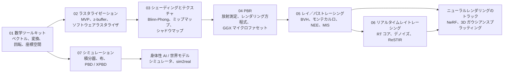
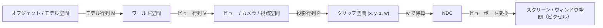

## なぜ重要か

コンピュータが描くあらゆる画像は、ゲームの 1 フレームでも、パストレーシングによる映画のショットでも、NeRF や 3D ガウシアンスプラッティング（3D Gaussian Splatting）のレンダリングでも、同じところから始まります。3D 空間の点を移動・回転させ、2D のピクセルグリッドに投影するのです。このシリーズではその仕組みをゼロから組み立て、研究レベルのレンダリングとシミュレーションまで進みます。そうすれば、後のニューラルレンダリングの記事も魔法ではなく自然な続きとして読めるようになります。この最初の記事では 2 つのことを行います。シリーズ全体の**ロードマップ**を示し、以降のすべての記事で使う**数学ツールキット**をまとめます。ベクトル、行列、同次座標、回転の表現、座標空間、そして法線の変換規則です。

## 前提知識

- 大学 1 年程度の線形代数：行列の積、逆行列、転置、行列式。
- Python の基本的なプログラミング。コードはすべて NumPy だけを使います。
- グラフィックスの予備知識は不要です。

## ロードマップ

コンピュータグラフィックスには、画像を作る大きな方法が 2 つと、物を動かす方法が 1 つあります。

- **ラスタライゼーション（rasterization）**は各三角形をスクリーンに投影し、それが覆うピクセルを塗りつぶします。GPU はまさにこのために作られており、ほぼすべてのリアルタイムアプリケーションを支えています。
- **レイトレーシング（ray tracing）**はカメラからシーンへレイを飛ばし、何に当たるかを調べます。モンテカルロ積分（Monte Carlo integration）と組み合わせると**パストレーシング（path tracing）**になり、光の輸送を物理的にシミュレートします。映画制作では標準的な手法です。
- **物理ベースシミュレーション（physically based simulation）**はシーンそのものを動かします。布、剛体、流体などです。同じソルバーがゲーム、VR、ロボティクスのシミュレータに登場します。

このトラックの 7 本の記事はこの構成に沿っています。



| 記事 | 中心となる問い | 読み終えたら作れるもの |
| --- | --- | --- |
| 01 数学ツールキット | 位置・方向・姿勢をどう記述するか？ | クォータニオン付きの変換ライブラリ |
| 02 ラスタライゼーション | 三角形はどうやってピクセルになるか？ | 約 150 行のソフトウェアラスタライザ |
| 03 シェーディングとテクスチャ | ピクセルは何色か？ | Blinn-Phong シェーディング、テクスチャフィルタリング、シャドウマップ |
| 04 物理ベースレンダリング | 光にとって「物理的に正しい」とは何か？ | GGX のメタリック・ラフネスシェーダ |
| 05 レイトレーシングとパストレーシング | レンダリング方程式をどう解くか？ | NEE と MIS を備えたモンテカルロパストレーサ |
| 06 リアルタイムレイトレーシング | それを 16 ms でどう行うか？ | RT ハードウェア、デノイザ、ReSTIR の理解 |
| 07 シミュレーション | 物をもっともらしく動かすには？ | XPBD の布ソルバー |

ニューラルレンダリングはこれらの上に直接成り立っています。NeRF はカメラレイに沿ったボリュームレンダリングです（第 05 回のレイ生成に、レイに沿った積分を加えたもの）。3D ガウシアンスプラッティングは異方性ガウシアンのためのラスタライザです（第 02 回の投影に、この記事のツールキットにある投影のヤコビアンを加えたもの）。ここにある 7 本の記事を理解すれば、それらの論文は読めるようになります。

## ベクトル：位置、方向、そして 2 つの積

グラフィックスでは、3D ベクトル $\mathbf{v} = (v_x, v_y, v_z)$ は 2 つの異なるものを意味しえます。**点**（位置）か**方向**（変位、速度、表面法線）です。格納の仕方は同じですが、変換のされ方が異なります。同次座標を使うとこの違いが明示的になります。

### 内積

$$
\mathbf{a}\cdot\mathbf{b} = a_x b_x + a_y b_y + a_z b_z = \lVert\mathbf{a}\rVert\,\lVert\mathbf{b}\rVert\cos\theta .
$$

内積（dot product）はあらゆるところに現れます。

- **角度とライティング。** 単位ベクトルでは $\mathbf{n}\cdot\mathbf{l} = \cos\theta$ であり、これは第 03 回のランバートシェーディング（Lambertian shading）の核心です。
- **射影。** 単位ベクトル $\hat{\mathbf{b}}$ 方向の $\mathbf{a}$ の成分は $(\mathbf{a}\cdot\hat{\mathbf{b}})\,\hat{\mathbf{b}}$ です。
- **表か裏か。** $(\mathbf{q}-\mathbf{p})\cdot\mathbf{n}$ の符号は、点 $\mathbf{q}$ が平面のどちら側にあるかを示します。背面カリング（back-face culling）とレイと平面の交差判定はどちらもこれを使います。

### 外積

$$
\mathbf{a}\times\mathbf{b} =
\begin{pmatrix} a_y b_z - a_z b_y \\ a_z b_x - a_x b_z \\ a_x b_y - a_y b_x \end{pmatrix},
\qquad
\lVert\mathbf{a}\times\mathbf{b}\rVert = \lVert\mathbf{a}\rVert\,\lVert\mathbf{b}\rVert\sin\theta .
$$

外積（cross product）の結果は両方の入力に垂直で、右手の法則に従い、その長さは $\mathbf{a}$ と $\mathbf{b}$ が張る平行四辺形の面積に等しくなります。したがって三角形 $(\mathbf{p}_0,\mathbf{p}_1,\mathbf{p}_2)$ の法線は $(\mathbf{p}_1-\mathbf{p}_0)\times(\mathbf{p}_2-\mathbf{p}_0)$ で、その長さの半分が三角形の面積です。頂点の順序（**ワインディング順序**、winding order）が法線の向きを決め、GPU はこれを使ってどの面が「表」かを判断します。

```python
import numpy as np

def normalize(v):
    return v / np.linalg.norm(v)

a = np.array([1.0, 2.0, 2.0])
b = np.array([3.0, 0.0, 4.0])

cos_theta = a @ b / (np.linalg.norm(a) * np.linalg.norm(b))
print("angle (deg):", np.degrees(np.arccos(cos_theta)))     # 42.83
proj = (a @ normalize(b)) * normalize(b)                       # projection of a onto b
print("projection:", proj)

# Triangle normal and area from the cross product
p0, p1, p2 = np.array([0., 0, 0]), np.array([1., 0, 0]), np.array([0., 1, 0])
c = np.cross(p1 - p0, p2 - p0)
print("normal:", normalize(c), "area:", 0.5 * np.linalg.norm(c))  # [0 0 1], 0.5

# Which side of the plane is a point on? sign of a dot product
q = np.array([0.2, 0.2, 0.5])
print("q above the triangle plane:", (q - p0) @ c > 0)         # True
```

後で役に立つ恒等式があります。スカラー三重積 $\mathbf{a}\cdot(\mathbf{b}\times\mathbf{c}) = \det[\mathbf{a}\ \mathbf{b}\ \mathbf{c}]$ は平行六面体の符号付き体積です。その 2D 版 $(b_x-a_x)(c_y-a_y)-(b_y-a_y)(c_x-a_x)$ が、第 02 回のラスタライザでピクセルが三角形の内側にあるかを判定する**エッジ関数**（edge function）です。

## 線形変換としての行列

$3\times 3$ 行列 $A$ は線形写像 $\mathbf{x}\mapsto A\mathbf{x}$ を定めます。行列を読む最良の方法は列ごとに見ることです。**列は基底ベクトルの像です**。

$$
A = \begin{pmatrix} \vert & \vert & \vert \\ A\mathbf{e}_x & A\mathbf{e}_y & A\mathbf{e}_z \\ \vert & \vert & \vert \end{pmatrix}.
$$

つまり、$x$ 軸をあるベクトル $\mathbf{r}$ に、$y$ 軸を $\mathbf{u}$ に、$z$ 軸を $\mathbf{f}$ に移す行列が欲しければ、その 3 つのベクトルを列に書き込むだけです。カメラ行列や接空間の座標系（第 03 回）はこうして作られます。

基本的な線形変換は次のとおりです。

- **スケール（scale）**：$S = \operatorname{diag}(s_x, s_y, s_z)$。$s_i$ が互いに異なる場合は**非一様**スケールであり、法線にとって重要になります（後述）。
- **座標軸まわりの回転（rotation）**：$R_x$、$R_y$、$R_z$（下に書き下します）。
- **せん断（shear）**：たとえば $x' = x + k\,y$。

$z$ 軸まわりに角度 $\theta$ だけ回転する行列は

$$
R_z(\theta) = \begin{pmatrix} \cos\theta & -\sin\theta & 0 \\ \sin\theta & \cos\theta & 0 \\ 0 & 0 & 1 \end{pmatrix}.
$$

$R_x$ と $R_y$ は他の平面で同じパターンを持ちます。$R_y$ の符号に注意してください。$R_y(\theta)$ は右上に $+\sin\theta$ を持ちます。$y$ 軸まわりの右手系の回転は $z$ を $x$ の方へ回すからです。

回転行列は行列式 $+1$ の**直交行列**です。$R^\top R = I$ なので $R^{-1} = R^\top$ です。行列式が $-1$ なら鏡映を意味し、三角形のワインディング順序が反転します。

変換は積によって合成され、**行列の積は可換ではありません**。列ベクトルの規約（このシリーズ、OpenGL、GLSL、NumPy のコード、ほとんどの論文が採用）では、最も右に書いた変換が最初に適用されます。$M = ABC$ は「$C$ を適用し、次に $B$、最後に $A$」という意味です。DirectX/HLSL ではしばしば行ベクトル $\mathbf{x}^\top M$ が使われ、すべてが転置されて順序は左から右に読みます。他の資料の式が「逆」に見えたら、どちらの規約を使っているかを確認してください。

## アフィン変換と同次座標

平行移動 $\mathbf{x}\mapsto\mathbf{x}+\mathbf{t}$ は線形ではない（原点を動かす）ので、どんな $3\times 3$ 行列でも表せません。一般の**アフィン変換**（affine transform）は $\mathbf{x}\mapsto A\mathbf{x}+\mathbf{t}$ です。同次座標（homogeneous coordinates）は 4 番目の座標 $w$ を追加することで、これを 1 つの行列にまとめます。

$$
\begin{pmatrix} \mathbf{x}' \\ 1 \end{pmatrix}
=
\begin{pmatrix} A & \mathbf{t} \\ \mathbf{0}^\top & 1 \end{pmatrix}
\begin{pmatrix} \mathbf{x} \\ 1 \end{pmatrix}.
$$

4 番目の座標が点と方向の区別を表します。

- **点**は $w = 1$ を持つので、平行移動されます。
- **方向**は $w = 0$ を持つので、平行移動の列にはゼロが掛かります。これは正しい振る舞いです。物体を動かしても矢印の向きは変わりません。
- 2 点の差（$w = 1 - 1 = 0$）は方向であり、点に方向を足すと点になります。2 つの点を足すと $w = 2$ になります。これは、重みの和が 1 になる加重平均の一部でない限り、その演算に意味がないことを示すヒントです。

より一般に、$w \neq 0$ の同次ベクトル $(x, y, z, w)$ は 3D の点 $(x/w, y/w, z/w)$ を表します。4 つの座標すべてに 0 でない定数を掛けても同じ点になります。これが**射影幾何**（projective geometry）の空間です。透視投影は最下行が $(0,0,0,1)$ でない $4\times 4$ 行列なので、奥行きに依存する $w$ を生み出します。その後の $w$ による**透視除算**（perspective divide）が「遠くのものほど小さく見える」効果を作ります。第 02 回でこの行列を導出します。Blinn と Newell（1978）は、クリッピングがこの除算の*前に*同次座標で行われなければならない理由を説明しました。第 02 回でもこの点を説明します。

### TRS の合成

ワールド内での物体の配置は、ほぼ必ず**平行移動・回転・スケール**の順に書かれます。

$$
M = T\,R\,S, \qquad M^{-1} = S^{-1} R^\top T^{-1}.
$$

右から左へ読むと、物体はまず自身の原点まわりにスケールされ、次に自身の原点まわりに回転され、最後に所定の位置へ移動されます。それ以外の順序では異なる、たいていは望ましくない結果になります。先に平行移動してから回転すると、物体は惑星のようにワールド原点のまわりを公転してしまいます。原点ではなくピボット $\mathbf{c}$ のまわりに回転するには、平行移動で共役をとります：$T(\mathbf{c})\,R\,T(-\mathbf{c})$。各因子に簡単な逆があるので、全体の逆も安価な閉じた形で求まります。シーングラフ（scene graph。手が腕に、腕が胴体につながっている）は、ルートからの経路に沿ってこうした行列を掛け合わせたものにすぎません。

```python
import numpy as np
np.set_printoptions(suppress=True, precision=4)

def translate(tx, ty, tz):
    M = np.eye(4); M[:3, 3] = [tx, ty, tz]; return M

def scale(sx, sy, sz):
    return np.diag([sx, sy, sz, 1.0])

def rotate_x(deg):
    c, s = np.cos(np.radians(deg)), np.sin(np.radians(deg))
    return np.array([[1, 0, 0, 0], [0, c, -s, 0], [0, s, c, 0], [0, 0, 0, 1.0]])

def rotate_y(deg):
    c, s = np.cos(np.radians(deg)), np.sin(np.radians(deg))
    return np.array([[c, 0, s, 0], [0, 1, 0, 0], [-s, 0, c, 0], [0, 0, 0, 1.0]])

def rotate_z(deg):
    c, s = np.cos(np.radians(deg)), np.sin(np.radians(deg))
    return np.array([[c, -s, 0, 0], [s, c, 0, 0], [0, 0, 1, 0], [0, 0, 0, 1.0]])

point = np.array([1.0, 0.0, 0.0, 1.0])       # w = 1: a position
direction = np.array([1.0, 0.0, 0.0, 0.0])   # w = 0: a direction

T, R, S = translate(5, 0, 0), rotate_z(90), scale(2, 2, 2)
M = T @ R @ S                                 # scale, then rotate, then translate
print("point:", M @ point)                   # [5. 2. 0. 1.]
print("direction:", M @ direction)           # [0. 2. 0. 0.]  (translation ignored)
print("other order:", (S @ R @ T) @ point)    # [0. 12. 0. 1.]  -- order matters

# Inverse of TRS without a general 4x4 inverse: S^-1 R^T T^-1
M_inv = scale(0.5, 0.5, 0.5) @ R.T @ translate(-5, 0, 0)
print("inverse ok:", np.allclose(M_inv @ M, np.eye(4)))

# Rotate 90 degrees about the pivot c = (1, 1, 0): T(c) R T(-c)
pivot = translate(1, 1, 0) @ rotate_z(90) @ translate(-1, -1, 0)
print("about pivot:", pivot @ np.array([2.0, 1.0, 0.0, 1.0]))  # [1. 2. 0. 1.]
```

以下のコード片はこれらのヘルパー関数を再利用するので、同じ Python セッションで実行してください。

## 回転の表現

回転はツールキットの中で最も難しい部分です。3D 回転の集合、すなわち群 $SO(3)$ は、ベクトル空間ではなく曲がった 3 次元空間だからです。どの表現も、少ないパラメータ数、合成のしやすさ、滑らかな補間、特異点がないこと、人間が編集しやすいこと、といった性質の間でトレードオフをしています。

### オイラー角とジンバルロック

オイラー角（Euler angles）は、回転を座標軸まわりの 3 回の回転として書きます。たとえば Z-Y-X 順序の（ヨー yaw、ピッチ pitch、ロール roll）は次のようになります。

$$
R(\psi,\theta,\phi) = R_z(\psi)\,R_y(\theta)\,R_x(\phi).
$$

直感的で、アニメーションツールが UI に表示するのもこの形式です。しかし**特異点**があります。$\theta = \pm 90^\circ$ では最初と最後の回転軸が一致し、式は $\psi - \phi$（$+90^\circ$ のとき）または $\psi + \phi$（$-90^\circ$ のとき）にしか依存しなくなります。自由度が 1 つ消えるのです。これが**ジンバルロック**（gimbal lock）で、慣性航法装置の物理的なジンバルに由来する名前です。入れ子になった 3 つのリングが揃うと、回転軸が 1 つ失われます。特異点の近くでは、姿勢のわずかな変化に角度の大きな変化が必要になることがあり、オイラー角を補間すると激しい回転が生じます。さらに有効な軸の順序は 12 通り（XYZ、ZYX、ZXZ、…）あり、それらを取り違えるのは典型的なバグです。

```python
# Euler angles (Z-Y-X order: R = Rz(yaw) Ry(pitch) Rx(roll)) and gimbal lock
def euler_zyx(yaw, pitch, roll):
    return rotate_z(yaw) @ rotate_y(pitch) @ rotate_x(roll)

A = euler_zyx(30, 90, 10)
B = euler_zyx(50, 90, 30)   # yaw and roll both +20: yaw - roll is unchanged
print("same matrix:", np.allclose(A, B))   # True: at pitch = 90 deg one DOF is lost

# Numerically: the Jacobian of the rotation w.r.t. (yaw, pitch, roll) loses rank
def jac_rank(yaw, pitch, roll, h=1e-4):
    f = lambda e: euler_zyx(*e)[:3, :3].ravel()
    e0 = np.array([yaw, pitch, roll], dtype=float)
    J = np.stack([(f(e0 + h * d) - f(e0 - h * d)) / (2 * h) for d in np.eye(3)], axis=1)
    return np.linalg.matrix_rank(J, tol=1e-6)

print("rank at pitch=40:", jac_rank(30, 40, 10))   # 3
print("rank at pitch=90:", jac_rank(30, 90, 10))   # 2
```

ヤコビアンのランク落ちこそが「自由度を失う」ことの正確な意味です。これは、オイラー角で姿勢を最適化すると（逆運動学、カメラキャリブレーション、姿勢推定などで）行き詰まることがある理由でもあります。

### 軸角とロドリゲスの公式

オイラーの回転定理によれば、すべての回転はある単位軸 $\mathbf{k}$ まわりのある角度 $\theta$ の回転です。ベクトル $\mathbf{v}$ の回転は**ロドリゲスの公式**（Rodrigues' formula）で与えられます。

$$
\mathbf{v}_{\text{rot}} = \mathbf{v}\cos\theta + (\mathbf{k}\times\mathbf{v})\sin\theta + \mathbf{k}\,(\mathbf{k}\cdot\mathbf{v})(1-\cos\theta).
$$

導出するには、$\mathbf{v}$ を $\mathbf{k}$ に平行な成分（動かない）と垂直な成分（$\mathbf{v}_\perp$ と $\mathbf{k}\times\mathbf{v}$ が張る平面内で $\theta$ だけ回転する）に分けます。$K\mathbf{v} = \mathbf{k}\times\mathbf{v}$ を満たす歪対称の「外積行列」$K$ を使って行列形式で書くと次のようになります。

$$
K = \begin{pmatrix} 0 & -k_z & k_y \\ k_z & 0 & -k_x \\ -k_y & k_x & 0 \end{pmatrix},
\qquad
R = I + \sin\theta\, K + (1-\cos\theta)\, K^2 .
$$

これはちょうど行列指数関数 $R = \exp(\theta K)$ です。3 次元ベクトル $\boldsymbol{\omega} = \theta\mathbf{k}$（**回転ベクトル**、rotation vector、あるいは**指数写像**、exponential map）は最小の 3 パラメータ表現で、$\lVert\boldsymbol{\omega}\rVert = 2\pi$ でのみ特異になります。そのため最適化や、回転を予測するニューラルネットワークでよく使われます（Grassia 1998 はグラフィックス分野の古典的な参考文献です）。逆写像には $\operatorname{tr}R = 1 + 2\cos\theta$ を使います。

```python
# Axis-angle -> rotation matrix (Rodrigues' formula)
def skew(k):
    return np.array([[0, -k[2], k[1]], [k[2], 0, -k[0]], [-k[1], k[0], 0]])

def rodrigues(axis, angle):
    k = axis / np.linalg.norm(axis)
    K = skew(k)
    return np.eye(3) + np.sin(angle) * K + (1 - np.cos(angle)) * (K @ K)

def matrix_to_axis_angle(R):
    angle = np.arccos(np.clip((np.trace(R) - 1) / 2, -1, 1))
    if angle < 1e-8:
        return np.array([1.0, 0, 0]), 0.0
    # valid for 0 < angle < pi; angle near pi needs a separate branch
    axis = np.array([R[2, 1] - R[1, 2], R[0, 2] - R[2, 0], R[1, 0] - R[0, 1]])
    return axis / (2 * np.sin(angle)), angle

R = rodrigues(np.array([0, 0, 1.0]), np.pi / 2)
print("matches rotate_z(90):", np.allclose(R, rotate_z(90)[:3, :3]))
axis, ang = matrix_to_axis_angle(rodrigues(np.array([1.0, 2, 3]), 0.7))
print("recovered:", axis, ang)   # [0.2673 0.5345 0.8018] 0.7
```

### クォータニオン

クォータニオン（quaternion、四元数）$q = w + x\,i + y\,j + z\,k$ は、ハミルトンの規則 $i^2 = j^2 = k^2 = ijk = -1$ を満たす 3 つの虚数単位で複素数を拡張したものです。スカラーとベクトルの組として $q = (w, \mathbf{v})$ と書きます。積は

$$
q_1 q_2 = \big(w_1 w_2 - \mathbf{v}_1\cdot\mathbf{v}_2,\;\; w_1\mathbf{v}_2 + w_2\mathbf{v}_1 + \mathbf{v}_1\times\mathbf{v}_2\big),
$$

で、回転と同じく結合的ですが可換ではありません。単位軸 $\mathbf{k}$ まわりの $\theta$ の回転は**単位クォータニオン**

$$
q = \Big(\cos\tfrac{\theta}{2},\; \sin\tfrac{\theta}{2}\,\mathbf{k}\Big),
$$

で表され、ベクトル $\mathbf{v}$ を純クォータニオン $p = (0, \mathbf{v})$ として「挟み込む」ことで回転させます。

$$
p' = q\,p\,q^{*}, \qquad q^{*} = (w, -\mathbf{v}).
$$

この挟み込みを展開すると、再びロドリゲスの公式が得られます。半角が現れるのはこのためで、$q$ が 2 回作用するからです。覚えておくべき事実をいくつか挙げます。

- **合成**は積です。「まず $q_a$、次に $q_b$」は $q_b q_a$ で、行列と同じく右から左の順序です。乗算は 16 回で済み、$3\times 3$ 行列の 27 回より少なくなります。
- **二重被覆**（double cover）：$q$ と $-q$ は同じ回転を表します。$\theta$ と $\theta + 2\pi$ は符号が逆のクォータニオンを与えるからです。補間では正しい符号を選ぶ必要があります。
- **ドリフト**：何度も掛け合わせると、丸め誤差によって $\lVert q\rVert \neq 1$ になります。クォータニオンの再正規化は簡単ですが、行列の再直交化はそうではありません。
- **ジンバルロックがない**：単位クォータニオンは 3 次元球面 $S^3$ をなし、特異点のない滑らかな空間です。

**Slerp**（球面線形補間、spherical linear interpolation、Shoemake 1985）は、2 つの単位クォータニオンの間の大円弧に沿って一定の角速度で移動します。

$$
\operatorname{slerp}(q_0, q_1; t) = \frac{\sin\big((1-t)\Omega\big)}{\sin\Omega}\,q_0 + \frac{\sin(t\Omega)}{\sin\Omega}\,q_1,
\qquad \cos\Omega = q_0\cdot q_1 .
$$

$q_0\cdot q_1 < 0$ の場合は、近い方の経路をとるために先に $q_1$ の符号を反転します。$\Omega$ が非常に小さいと $\sin\Omega\to 0$ となって式が数値的に不安定になるため、実装では正規化線形補間（**nlerp**）に切り替えます。nlerp は速度が一定ではありませんが、安価で可換であり、スキニングのように多くの回転をブレンドする場合には今でも良い選択です。

```python
# Quaternions stored as (w, x, y, z)
def q_from_axis_angle(axis, angle):
    k = axis / np.linalg.norm(axis)
    return np.concatenate([[np.cos(angle / 2)], np.sin(angle / 2) * k])

def q_mul(a, b):
    w1, v1 = a[0], a[1:]
    w2, v2 = b[0], b[1:]
    return np.concatenate([[w1 * w2 - v1 @ v2], w1 * v2 + w2 * v1 + np.cross(v1, v2)])

def q_conj(q):
    return np.concatenate([[q[0]], -q[1:]])

def q_rotate(q, v):
    return q_mul(q_mul(q, np.concatenate([[0.0], v])), q_conj(q))[1:]

def q_to_matrix(q):
    w, x, y, z = q
    return np.array([
        [1 - 2 * (y * y + z * z), 2 * (x * y - w * z), 2 * (x * z + w * y)],
        [2 * (x * y + w * z), 1 - 2 * (x * x + z * z), 2 * (y * z - w * x)],
        [2 * (x * z - w * y), 2 * (y * z + w * x), 1 - 2 * (x * x + y * y)]])

def slerp(q0, q1, t):
    d = q0 @ q1
    if d < 0:            # q and -q are the same rotation: take the short arc
        q1, d = -q1, -d
    if d > 0.9995:       # nearly parallel: normalized lerp is accurate and stable
        q = q0 + t * (q1 - q0)
        return q / np.linalg.norm(q)
    omega = np.arccos(d)
    return (np.sin((1 - t) * omega) * q0 + np.sin(t * omega) * q1) / np.sin(omega)

axis, angle = np.array([1.0, 2, 3]), 0.7
q = q_from_axis_angle(axis, angle)
v = np.array([0.3, -1.0, 2.0])
print("q p q* == Rodrigues:", np.allclose(q_rotate(q, v), rodrigues(axis, angle) @ v))
print("matrix ok:", np.allclose(q_to_matrix(q), rodrigues(axis, angle)))

# Composition: rotate by qa first, then qb  ->  qb * qa
qa = q_from_axis_angle(np.array([0, 0, 1.0]), np.pi / 2)
qb = q_from_axis_angle(np.array([1.0, 0, 0]), np.pi / 2)
print("compose:", np.allclose(q_to_matrix(q_mul(qb, qa)), q_to_matrix(qb) @ q_to_matrix(qa)))

# Slerp moves at constant angular speed
q0 = np.array([1.0, 0, 0, 0])
q1 = q_from_axis_angle(np.array([0, 1.0, 0]), np.radians(120))
for t in [0, 0.25, 0.5, 1]:
    qt = slerp(q0, q1, t)
    print(t, "angle from q0 (deg):", np.degrees(2 * np.arccos(np.clip(qt[0], -1, 1))))  # 0, 30, 60, 120
```

格納順序に注意してください。このコードは（Eigen のコンストラクタや多くの論文と同様に）$(w, x, y, z)$ と書きますが、GLM、Unity、SciPy は $(x, y, z, w)$ で格納します。両者を混同すると、気づかないうちに誤った回転になります。

### 表現の選び方

| 表現 | パラメータ | 合成 | 補間 | 特異点 | 典型的な用途 |
| --- | --- | --- | --- | --- | --- |
| 回転行列 | 9（制約 6 個） | 行列の積 | 不向き（lerp すると $SO(3)$ から外れる） | なし | GPU に送る最終的な変換 |
| オイラー角 | 3 | まず変換が必要 | 不向き | $\theta = \pm 90^\circ$ でジンバルロック | UI、アニメーションカーブ、乗り物の姿勢 |
| 軸角 / 回転ベクトル | 3 または 4 | まず変換が必要 | 小さなステップなら良好 | $\lVert\boldsymbol\omega\rVert = 2\pi$ で | 最適化、角速度、ネットワークの出力 |
| 単位クォータニオン | 4（制約 1 個） | クォータニオンの積 | Slerp / nlerp | なし（二重被覆 $q \equiv -q$） | アニメーション、物理、カメラの姿勢 |

回転を回帰するニューラルネットワークは特別なケースです。3 次元や 4 次元の表現はどれもどこかに不連続性を持ちます。そのため Zhou ら（CVPR 2019、*On the continuity of rotation representations in neural networks*）は連続な 6D 表現を提案しました。回転行列の 2 列をとり、グラム・シュミット法で再直交化するものです。姿勢推定やロボティクスで再び出会うことになります。

## 座標空間

頂点はピクセルになるまでに一連の座標系を通過します。各矢印は 1 つの行列（または 1 つの固定された操作）です。



| 空間 | 内容 | 典型的な規約（OpenGL） |
| --- | --- | --- |
| オブジェクト（モデル）空間 | モデリングツールで作成された座標。原点は物体のピボット | 任意 |
| ワールド空間 | すべての物体・光源・カメラが存在する共通の空間 | 右手系、$y$ が上（多くのエンジンは $z$ が上） |
| ビュー（カメラ、視点）空間 | カメラが原点にある | カメラは $-z$ を向き、$x$ が右、$y$ が上 |
| クリップ空間 | 投影の出力。まだ同次座標 | $-w \le x, y, z \le w$ のときに限り可視 |
| NDC（正規化デバイス座標） | $w$ で割った後 | 立方体 $[-1,1]^3$ |
| スクリーン（ウィンドウ）空間 | ピクセルと深度値 | 原点は左下、深度は $[0,1]$ |

規約は API によって異なります。Direct3D と Vulkan は NDC の深度に $[-1,1]$ ではなく $[0,1]$ を使います。Vulkan の NDC の $y$ 軸は下向きです。画像ライブラリは通常ピクセルの原点を左上に置きます。始めたばかりの頃のレンダリングのバグの多くは、ここでの符号や範囲の不一致から生じます。自分のコードベースの規約は一度きちんと書き留めておきましょう。

頂点シェーダは $\mathbf{p}_{\text{clip}} = P\,V\,M\,\mathbf{p}_{\text{obj}}$ を計算します。そのため $P V M$ は **MVP 行列**と呼ばれます。第 02 回で $P$ とビューポート変換を構築します。**ビュー行列** $V$ はカメラ自身のワールド変換の逆です。カメラが $\mathbf{e}$ にあり、正規直交な右・上・後ろの軸が $\mathbf{r}, \mathbf{u}, -\mathbf{f}$ であれば、そのワールド行列は $C = \begin{pmatrix} \mathbf{r} & \mathbf{u} & -\mathbf{f} & \mathbf{e} \\ 0 & 0 & 0 & 1 \end{pmatrix}$ です。回転部分が直交なので、その逆は

$$
V = C^{-1} = \begin{pmatrix} \mathbf{r}^\top & -\mathbf{r}\cdot\mathbf{e} \\ \mathbf{u}^\top & -\mathbf{u}\cdot\mathbf{e} \\ -\mathbf{f}^\top & \mathbf{f}\cdot\mathbf{e} \\ \mathbf{0}^\top & 1 \end{pmatrix}.
$$

おなじみの `lookAt(eye, target, up)` 関数はまさにこれを構築し、2 回の外積で正規直交基底を作ります。

```python
# Build a view (camera) matrix with look-at
def look_at(eye, target, up):
    f = target - eye
    f = f / np.linalg.norm(f)                       # forward
    r = np.cross(f, up); r = r / np.linalg.norm(r)  # right
    u = np.cross(r, f)                              # true up
    V = np.eye(4)
    V[0, :3], V[1, :3], V[2, :3] = r, u, -f         # rows = camera axes (camera looks down -z)
    V[:3, 3] = -V[:3, :3] @ eye                     # then translate by -eye
    return V

V = look_at(np.array([0, 0, 5.0]), np.zeros(3), np.array([0, 1.0, 0]))
print(V @ np.array([0, 0, 0, 1.0]))   # world origin is 5 units in front: [0 0 -5 1]
model = translate(1, 0, 0) @ rotate_y(45)
p_obj = np.array([0, 0, 1.0, 1.0])
p_view = V @ model @ p_obj            # object -> world -> view
print("view-space point:", p_view)
```

`up` が視線方向と平行になると（外積がゼロになり）`look_at` は破綻します。これはカメラ版のジンバルロックであり、たとえば別の `up` を選ぶなどして対処する必要があります。

同じ考え方はコンピュータビジョンでも別の名前で登場します。ビュー行列はカメラの**外部パラメータ**（extrinsics）$[R\,\vert\,\mathbf{t}]$ であり、投影とビューポート変換は**内部パラメータ**（intrinsics）$K$ の役割を果たします。OpenCV のカメラは $+z$ を向き $y$ が下向きで、OpenGL とは逆です。COLMAP の姿勢を NeRF やガウシアンスプラッティングのパイプラインに読み込むとき、両者の規約の変換は定番の作業です。

## 法線の変換：逆転置行列

表面法線は普通の方向ではありません。表面に垂直であることで定義されています。表面内にある接ベクトル $\mathbf{t}$ と法線 $\mathbf{n}$ をとり、$\mathbf{n}^\top\mathbf{t} = 0$ とします。線形部分 $M$（モデル行列の左上 $3\times 3$）で表面を変換すると、接ベクトルは $\mathbf{t}' = M\mathbf{t}$ になります。垂直性を保つような $\mathbf{n}' = G\mathbf{n}$ となる行列 $G$ が欲しいわけです。

$$
\mathbf{n}'^\top\mathbf{t}' = \mathbf{n}^\top G^\top M\,\mathbf{t} = 0 \quad\text{for all } \mathbf{t}\perp\mathbf{n}
\;\;\Longleftarrow\;\; G^\top M = I
\;\;\Longrightarrow\;\; G = \big(M^{-1}\big)^\top .
$$

つまり**法線は逆転置行列 $M^{-\top}$ で変換し**、その後に再正規化する必要があります。純粋な回転では $M^{-\top} = M$、一様スケールではスカラー倍を除いて $M$ なので、この違いが問題になるのは非一様スケールやせん断があるときだけです。そしてそれこそが、見苦しく見つけにくいライティングのバグを生むときです。実用的な変種として**余因子行列**（cofactor matrix）$\operatorname{cof}(M) = \det(M)\,M^{-\top}$ があり、その列は $M$ の列同士の外積です。除算が不要で、$M$ が特異でも使え、$\det M < 0$（鏡映を含む変換）のときにも法線を外向きに保ちます。

```python
# Normals must be transformed with the inverse transpose
M = (rotate_z(30) @ scale(3, 1, 1))[:3, :3]     # non-uniform scale
t = np.array([1.0, 1.0, 0.0]) / np.sqrt(2)       # tangent of a 45-degree line
n = np.array([-1.0, 1.0, 0.0]) / np.sqrt(2)      # its normal, n . t = 0

t2 = M @ t
n_wrong = M @ n
n_right = np.linalg.inv(M).T @ n
n_right /= np.linalg.norm(n_right)
print("M n       . M t =", n_wrong @ t2)         # != 0, no longer perpendicular
print("M^-T n    . M t =", n_right @ t2)         # 0 (up to rounding)

# Cofactor matrix: det(M) * M^-T, no inverse needed and correct even if det < 0
def cofactor(M):
    return np.stack([np.cross(M[:, 1], M[:, 2]),
                     np.cross(M[:, 2], M[:, 0]),
                     np.cross(M[:, 0], M[:, 1])], axis=1)
print("cofactor = det * inv^T:", np.allclose(cofactor(M), np.linalg.det(M) * np.linalg.inv(M).T))
```

レンダラでは、**法線行列**（normal matrix）$M^{-\top}$ を物体ごとに CPU で一度計算し、MVP 行列と一緒に頂点シェーダへ渡します。第 02 回と第 03 回の GLSL では `uNormalMatrix` として登場します。

この規則の根底には、物理ベースレンダリングや微分可能レンダリングで再び現れる、より一般的な考え方があります。法線は*コベクトル*（covector、接ベクトルに作用する線形汎関数）であり、コベクトルは逆転置で変換されます。勾配もコベクトルです。勾配の連鎖律が転置したヤコビアンを使うのはそのためです。

## 数値計算の習慣

いくつかの習慣を身につけておくと、以降の記事で何時間も節約できます。

- **比較にはイプシロンを使う。** 浮動小数点数の等価判定は決してしないでください。レイトレーシングのコードでは自己交差を避けるために小さなオフセット（シーン単位で $\sim 10^{-4}$）が必要で、第 03 回ではこれを「シャドウアクネ」（shadow acne）と呼びます。
- **再正規化する。** 補間された法線、累積されたクォータニオン、繰り返し掛け合わされた回転行列は、いずれもドリフトします。
- **閉じた形の逆を優先する**（$R^\top$、$S^{-1}R^\top T^{-1}$）。構造がわかっているときは汎用の `inv` を使わないようにします。
- **`float32` を意識して使う。** GPU は 32 ビット浮動小数点数で計算し、有効桁数は約 7 桁です。大きなワールド座標（惑星規模のシーンや、原点から遠いカメラ）では精度が失われます。エンジンはカメラ相対レンダリング（camera-relative rendering）でこれに対処します。

## 試してみよう

ホームページには[インタラクティブなラボ]({{ '/' | relative_url }}#lab)があります。そこにあるどのデモも、この記事のツールキットを使っています。パストレーサは正規直交なカメラ基底からカメラレイを作り、Gaussian World のデモはビュー行列と投影のヤコビアンで 3D 共分散行列を投影し、XPBD の布のデモは `lookAt` と透視投影の行列を JavaScript で手書きしています（`assets/js/lab.js`）。どのデモでもカメラを回してみて、どの行列が変化しているかを考えてみてください。

## 代表的な論文

| 論文 | 発表先 | 年 | リンク | 意義 |
| --- | --- | --- | --- | --- |
| Sutherland, *Sketchpad: A man-machine graphical communication system* | MIT 博士論文（ケンブリッジ大学テクニカルレポート UCAM-CL-TR-574 として再公開） | 1963 | [レポート](https://www.cl.cam.ac.uk/techreports/UCAM-CL-TR-574.html) | 描かれた物体の変換を含む、インタラクティブなコンピュータグラフィックスの出発点 |
| Blinn and Newell, *Clipping using homogeneous coordinates* | SIGGRAPH（Computer Graphics 12(3)） | 1978 | [SIGGRAPH history](https://history.siggraph.org/?p=103260) | クリッピングが透視除算の前に 4D のクリップ空間で行われる理由 |
| Shoemake, *Animating rotation with quaternion curves* | SIGGRAPH（Computer Graphics 19(3)） | 1985 | [DOI](https://doi.org/10.1145/325165.325242) | クォータニオンと slerp をコンピュータグラフィックスに導入 |
| Grassia, *Practical parameterization of rotations using the exponential map* | Journal of Graphics Tools 3(3) | 1998 | [DOI](https://doi.org/10.1080/10867651.1998.10487493) | 回転ベクトルをいつ使うべきか、そしてその特異点をどう扱うか |
| Kavan, Collins, Žára and O'Sullivan, *Geometric skinning with approximate dual quaternion blending* | ACM TOG 27(4) | 2008 | [DOI](https://doi.org/10.1145/1409625.1409627) | デュアルクォータニオンはクォータニオンを剛体変換に拡張する。スキニングにおける「キャンディラッパー」（candy-wrapper）アーティファクトの標準的な解決策 |

## 学習リソース

- **GAMES101：現代コンピュータグラフィックス入門**（Lingqi Yan）：第 2〜4 回の講義がまさにこの内容を扱っています。[講義ページ](https://sites.cs.ucsb.edu/~lingqi/teaching/games101.html)。
- **Berkeley CS184/284A**（Computer Graphics and Imaging）：[講義サイト](https://cs184.eecs.berkeley.edu/)。Stanford の **CS148** は範囲が近く、よりやさしい入門です。
- **3Blue1Brown『線形代数の本質』**（*Essence of Linear Algebra*）：「列は基底ベクトルの像」という直感をつかむには最良の視覚的教材です。[シリーズ](https://www.3blue1brown.com/topics/linear-algebra)。
- **Physically Based Rendering（PBRT）第 4 版**、第 3 章（Geometry and Transformations）。[pbr-book.org](https://pbr-book.org/) で無料公開されています。
- **Scratchapixel**：幾何、行列、座標系についてのレッスンが [scratchapixel.com](https://www.scratchapixel.com/) にあります。
- **LearnOpenGL** の「Transformations」と「Coordinate Systems」：[learnopengl.com](https://learnopengl.com/)。
- **Real-Time Rendering 第 4 版**（Akenine-Möller ら）、第 4 章「Transforms」。[書籍サイト](https://www.realtimerendering.com/)。

## 演習

1. 単位クォータニオンについて、$q\,(0,\mathbf{v})\,q^*$ がロドリゲスの公式を再現することを証明してください。さらに $-q$ でも同じ結果になることを示してください。
2. `matrix_to_quaternion(R)` を実装してください。最大の対角要素で分岐する数値的に安定な方法を使い、10,000 個のランダムな回転で `q_to_matrix(matrix_to_quaternion(R)) == R` を確かめてテストしてください。
3. yaw/pitch/roll が $(0^\circ, 0^\circ, 0^\circ)$ から $(170^\circ, 89^\circ, -170^\circ)$ へ向かう回転のアニメーションを 2 通りの方法で作ってください。オイラー角を線形補間する方法と、対応するクォータニオンを slerp する方法です。始点からの角距離を時間に対してプロットし、違いを説明してください。
4. $S = \operatorname{diag}(s_x, s_y, s_z)$ として、$M = R\,S$ の逆転置行列が $R\,S^{-1}$ に等しいことを示してください。表面が引き伸ばされる場所で法線が「押しつぶされる」理由を幾何学的に説明してください。
5. OpenCV のカメラ姿勢（$+z$ を向き、$y$ が下向き）を OpenGL のビュー行列（$-z$ を向き、$y$ が上向き）に変換する関数を書き、`look_at` で検証してください。

次回：[ラスタライゼーション]({{ '/blog/2026/graphics-02-rasterization/' | relative_url }})では MVP パイプラインをピクセルに変えます。透視投影行列を導出し、完全なソフトウェアラスタライザを書きます。
