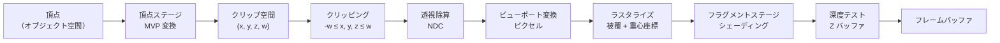

## なぜ重要なのか

これまでに目にしてきたリアルタイム映像のほぼすべては、ラスタライゼーション（rasterization）によって作られています。ゲーム、VR ヘッドセット、CAD ツール、そしてあらゆる 3D エディタのビューポートです。ラスタライゼーションは、*この三角形はどのピクセルを覆うのか、そして各ピクセルで最も手前にある面は何か* という一つの問いに、非常に高速に答えます。[前回の記事]({{ '/blog/2026/graphics-01-roadmap-and-math/' | relative_url }})では数学の道具箱（同次座標、変換、座標空間）を用意しました。今回はそれを実際に使い、レンダラーをゼロから完成させます。ここで学ぶ考え方はロードマップの後半で再び登場します。3D Gaussian Splatting は楕円体のラスタライザであり、微分可能ラスタライザ（differentiable rasterizer）はニューラルネットワークがメッシュの画像から学習するための手段です。

**前提知識**

- 行列、同次座標、そして第 1 回で扱ったオブジェクト → ワールド → ビュー → クリップ → NDC → スクリーンという座標の連鎖。
- NumPy の基本（ブロードキャスト、ブールマスク）。
- 任意：GPU の節のために、OpenGL / WebGL の「hello triangle」程度の経験。

## 1. パイプラインの全体像

ラスタライゼーションのパイプライン（pipeline）は、3D の三角形のリストを 2D 画像に変換します。以下の各段階は、私たちの Python コードにも GPU ハードウェアにも存在します。



頂点位置には**モデル・ビュー・プロジェクション**（model-view-projection, MVP）行列が掛けられます。

$$
\mathbf{p}_{\text{clip}} = P\,V\,M\,\mathbf{p}_{\text{obj}},
$$

ここで $M$ は物体をワールドに配置し、$V$ はワールドをカメラ座標系に移し（カメラは原点にあり $-z$ 方向を向きます。本記事を通して使う OpenGL の規約です）、$P$ は投影です。それ以降はすべて、三角形ごと・ピクセルごとに行われる固定機能（fixed-function）の処理です。

## 2. ビュー行列

カメラ位置 $\mathbf{e}$、注視点 $\mathbf{t}$、おおよその上方向 $\mathbf{u}_0$ が与えられたとき、カメラの正規直交基底を次のように作ります。

$$
\mathbf{f} = \frac{\mathbf{t}-\mathbf{e}}{\lVert\mathbf{t}-\mathbf{e}\rVert},\quad
\mathbf{s} = \frac{\mathbf{f}\times\mathbf{u}_0}{\lVert\mathbf{f}\times\mathbf{u}_0\rVert},\quad
\mathbf{u} = \mathbf{s}\times\mathbf{f}.
$$

カメラの右・上・後ろの軸は、それぞれ $\mathbf{s}$、$\mathbf{u}$、$-\mathbf{f}$ です。ビュー行列（view matrix）はカメラの配置の逆変換で、まず $-\mathbf{e}$ だけ平行移動し、次にワールドの軸をカメラの軸に回転させます。回転は正規直交なので逆行列は転置に等しく、$V$ の各行はそのままカメラの軸になります。

$$
V = \begin{bmatrix}
s_x & s_y & s_z & -\mathbf{s}\cdot\mathbf{e}\\
u_x & u_y & u_z & -\mathbf{u}\cdot\mathbf{e}\\
-f_x & -f_y & -f_z & \mathbf{f}\cdot\mathbf{e}\\
0 & 0 & 0 & 1
\end{bmatrix}.
$$

## 3. 透視投影行列の導出

### 3.1 相似な三角形

ピンホールカメラは、ビュー空間で $z<0$ の点 $(x, y, z)$ を、相似な三角形によって近クリップ面 $z=-n$ 上に写します。

$$
x' = \frac{n\,x}{-z},\qquad y' = \frac{n\,y}{-z}.
$$

この $-z$ による除算こそが、遠くのものを小さく見せます。行列は除算ができませんが、同次座標ならできます。出力の $w$ 成分を $-z$ にしておけば、後段の**透視除算**（perspective divide）$(x, y, z)/w$ が割り算を代わりにやってくれます。これで $P$ の最終行は $(0, 0, -1, 0)$ に決まります。

### 3.2 x と y の正規化

近クリップ面上の可視ウィンドウは $[-r, r]\times[-t, t]$ で、垂直視野角 $\theta_y$ に対して $t = n\tan(\theta_y/2)$、アスペクト比 $a = W/H$ に対して $r = a\,t$ です。このウィンドウが正規化デバイス座標（normalized device coordinates, NDC）の $[-1,1]^2$ に収まるようにしたいので、

$$
x_{\text{ndc}} = \frac{x'}{r} = \frac{n}{r}\cdot\frac{x}{-z},\qquad
y_{\text{ndc}} = \frac{n}{t}\cdot\frac{y}{-z}.
$$

$n/t = 1/\tan(\theta_y/2) =: c$ とおくと、$P$ の最初の 2 行は $(c/a, 0, 0, 0)$ と $(0, c, 0, 0)$ になります。

### 3.3 深度の写像

Z バッファのための深度値も必要です。その行は $(0, 0, A, B)$ の形でなければなりません（$x$ や $y$ には依存できません）。したがって除算後は

$$
z_{\text{ndc}} = \frac{A z + B}{-z}.
$$

$z=-n \mapsto -1$、$z=-f \mapsto +1$ を要求すると、

$$
\frac{-An + B}{n} = -1,\qquad \frac{-Af + B}{f} = 1
\;\;\Longrightarrow\;\;
A = \frac{f+n}{n-f},\quad B = \frac{2fn}{n-f}.
$$

（2 つの式 $-An+B=-n$ と $-Af+B=f$ を引き算すれば $A$ が得られ、代入すれば $B$ が求まります。）まとめると次のようになります。

$$
P = \begin{bmatrix}
\dfrac{c}{a} & 0 & 0 & 0\\[4pt]
0 & c & 0 & 0\\[4pt]
0 & 0 & \dfrac{f+n}{n-f} & \dfrac{2fn}{n-f}\\[4pt]
0 & 0 & -1 & 0
\end{bmatrix},\qquad c = \frac{1}{\tan(\theta_y/2)}.
$$

これはまさに `gluPerspective` や `glm::perspective` が生成する行列です。Direct3D と Vulkan は深度範囲として $[-1,1]$ ではなく $[0,1]$ を使い、Vulkan はさらに $y$ を反転させますが、導出は目標値が違うだけでまったく同じです。

### 3.4 深度は線形ではない

$w = -z$ として $z_{\text{ndc}} = -A + B/w$ であることに注意してください。これは $z$ ではなく $1/w$ について線形です。数値で確かめてみましょう。

```python
import numpy as np

def perspective(fovy_deg, aspect, n, f):
    t = 1.0 / np.tan(np.radians(fovy_deg) / 2)
    return np.array([[t / aspect, 0, 0, 0], [0, t, 0, 0],
                     [0, 0, (f + n) / (n - f), 2 * f * n / (n - f)], [0, 0, -1, 0]])

n, f = 0.1, 100.0
P = perspective(60, 16 / 9, n, f)
for z in (-n, -0.2, -1.0, -10.0, -f):
    c = P @ np.array([0.0, 0.0, z, 1.0])
    print(f"z_view = {z:7.1f}   w = {c[3]:6.1f}   z_ndc = {c[2] / c[3]: .6f}")
```

```text
z_view =    -0.1   w =    0.1   z_ndc = -1.000000
z_view =    -0.2   w =    0.2   z_ndc =  0.001001
z_view =    -1.0   w =    1.0   z_ndc =  0.801802
z_view =   -10.0   w =   10.0   z_ndc =  0.981982
z_view =  -100.0   w =  100.0   z_ndc =  1.000000
```

深度範囲全体の半分が、カメラから 0.1 〜 0.2 単位の間で使われてしまい、10 単位より遠いものはすべて最後の 2% を分け合っています。極端に小さな近クリップ面が遠方で**Z ファイティング**（z-fighting）を起こすのはこのためであり、現代のエンジンが *reversed-Z*（近くを 1、遠くを 0 に写し、浮動小数点の深度バッファと組み合わせることで、浮動小数点の精度分布と $1/w$ の精度分布を打ち消し合わせる手法）を使う理由でもあります。良い知らせは同じ事実の裏返しです。$z_{\text{ndc}}$ は $1/w$ のアフィン関数であり、$1/w$ はスクリーン空間でアフィンなので（第 6 節）、**深度はスクリーン上で線形に補間できます**。

## 4. クリッピング

投影後、点が見えるのは次の条件を満たすとき、かつそのときに限ります。

$$
-w \le x \le w,\qquad -w \le y \le w,\qquad -w \le z \le w.
$$

除算の*前に*クリッピング（clipping）するのには、しっかりした理由があります。カメラの後ろにある頂点は $w<0$ を持ち、負の $w$ で割ると投影中心を通して鏡映されてしまいます。頂点の一つがカメラの後ろにある三角形は、巨大で裏返ったおかしな図形として描かれてしまうのです。同次クリップ空間では 6 つの平面がすべて線形なので、クリッピングは線形補間の繰り返しにすぎません。

古典的なアルゴリズムは **Sutherland-Hodgman** で、多角形を一度に一つの平面でクリップします。符号付き距離が $d(\mathbf{p})$ の平面（近クリップ面なら $d = z + w$）に対し、多角形の辺 $(\mathbf{p}, \mathbf{q})$ をたどります。

- $\mathbf{p}$ が内側（$d(\mathbf{p}) \ge 0$）なら、それを残す。
- 辺が平面をまたぐなら、交点 $\mathbf{p} + t(\mathbf{q}-\mathbf{p})$、$t = d(\mathbf{p}) / (d(\mathbf{p}) - d(\mathbf{q}))$ を出力する。

頂点属性（色、UV）も同じ $t$ で補間します。クリップ空間はオブジェクト空間の線形な像なので、これで正しくなります。1 つの平面でクリップされた三角形は最大 4 頂点の多角形になり、それをファン（fan）状に三角形分割し直します。

実際に不可欠なのは**近クリップ面**だけです。側面の平面は*ガードバンド*（guard band）で置き換えられます。三角形のピクセル境界ボックスを画面内に制限するだけで、残りはエッジ関数が除外してくれます。GPU も同じで、三角形がラスタライザの固定小数点の範囲からはみ出す場合にのみ幾何学的なクリッピングを行います。（遠クリップ面も省略でき、そのフラグメントは深度テストに捨てさせればよいのです。）

## 5. ビューポート変換

$[-1,1]$ の NDC 座標は、幅 $W$、高さ $H$ の画像のピクセル座標に写されます。画像は 0 行目が一番上にあるので、$y$ を反転します。

$$
x_s = \frac{x_{\text{ndc}}+1}{2}\,W,\qquad
y_s = \frac{1-y_{\text{ndc}}}{2}\,H,\qquad
z_s = \frac{z_{\text{ndc}}+1}{2} \in [0,1].
$$

ピクセル $(i, j)$ は正方形 $[i, i+1)\times[j, j+1)$ を覆い、その中心 $(i+\tfrac12, j+\tfrac12)$ でサンプリングします。

## 6. 三角形のラスタライズ

### 6.1 エッジ関数

$\mathbf{a}$ から $\mathbf{b}$ への 2D の辺に対して、**エッジ関数**（edge function、Pineda, 1988）を次のように定義します。

$$
E_{ab}(\mathbf{p}) = (b_x - a_x)(p_y - a_y) - (b_y - a_y)(p_x - a_x),
$$

これは 2D の外積 $(\mathbf{b}-\mathbf{a})\times(\mathbf{p}-\mathbf{a})$ の z 成分です。y 軸が上向きの座標系では、$\mathbf{p}$ が有向辺の左側にあれば正、直線上なら 0、右側なら負になります。点が反時計回りの三角形 $(\mathbf{a}, \mathbf{b}, \mathbf{c})$ の内部にあるのは、$E_{ab}$、$E_{bc}$、$E_{ca}$ の 3 つがすべて非負のときです。

エッジ関数がハードウェアに最適なのは、次の 2 つの性質のためです。

1. $\mathbf{p}$ について**アフィン**です。右に 1 ピクセル進むと定数 $a_y - b_y$ が加わり、下に 1 ピクセル進むと $b_x - a_x$ が加わります。ラスタライザは加算だけで逐次的に評価することも、ピクセルのタイル全体を並列に評価することもできます。
2. 符号が向きも表します。$E_{ab}(\mathbf{c})$ は三角形の符号付き面積の 2 倍です。面積が負なら三角形はカメラに背を向けているので、**背面カリング**（back-face culling）はタダで手に入ります。

ピクセル座標では $y$ が下向きなので、すべての符号が反転します。そこで私たちのコードは符号を反転した式を使い、NDC で反時計回りの三角形（表面）の面積が正のままになるようにしています。

*境界の扱い：* 2 つの三角形が共有する辺のちょうど上にあるピクセル中心は、どちらか一方だけが描かなければなりません。そうでないと、ブレンディングやステンシルの効果で二重にカウントされます。ハードウェアは**トップレフトルール**（top-left rule）を使います。辺上のピクセルは、その辺が上辺か左辺である場合にのみ覆われているとみなします。私たちの単純な `>= 0` の判定はそうしたピクセルを 2 回描きますが、深度テスト付きの不透明なジオメトリでは問題になりません。

### 6.2 重心座標

エッジ関数を全体の面積で正規化すると、$\mathbf{p}$ の**重心座標**（barycentric coordinates）が得られます。

$$
\lambda_a = \frac{E_{bc}(\mathbf{p})}{E_{ab}(\mathbf{c})},\qquad
\lambda_b = \frac{E_{ca}(\mathbf{p})}{E_{ab}(\mathbf{c})},\qquad
\lambda_c = \frac{E_{ab}(\mathbf{p})}{E_{ab}(\mathbf{c})},\qquad
\lambda_a+\lambda_b+\lambda_c = 1.
$$

幾何学的には、$\lambda_a$ は $\mathbf{a}$ の対辺側にある部分三角形の面積を全体の面積で割ったものです。これらは $\mathbf{p} = \lambda_a\mathbf{a} + \lambda_b\mathbf{b} + \lambda_c\mathbf{c}$ を満たし、「内部にある」ことはすべての $\lambda \ge 0$ と同値です。つまり同じ 3 つの数が、ラスタライザが問う 2 つの質問、*このピクセルは覆われているか* と *ここで頂点属性をどう混ぜるか* の両方に答えてくれるのです。

### 6.3 パースペクティブ補正補間

ここが微妙なところです。上の $\lambda$ は**スクリーン空間**での重心座標です。しかし色や UV は **3D で**三角形上を線形に変化し、透視除算は線形ではありません。スクリーン空間の $\lambda$ で補間するとテクスチャが泳いだり曲がったりします。初代 PlayStation で有名なアーティファクトです。

$\beta_i$ をある表面上の点の本当の（3D の、つまりクリップ空間の）重心座標とすると、そのクリップ空間での位置は $\sum_i \beta_i \mathbf{P}_i$（$\mathbf{P}_i = (x_i, y_i, z_i, w_i)$）です。スクリーン上の位置は

$$
\mathbf{s} = \frac{\sum_i \beta_i (x_i, y_i)}{\sum_j \beta_j w_j}
= \sum_i \underbrace{\frac{\beta_i w_i}{\sum_j \beta_j w_j}}_{\lambda_i}\,\mathbf{s}_i,
\qquad \mathbf{s}_i = \frac{(x_i, y_i)}{w_i}.
$$

したがって $\lambda_i \propto \beta_i w_i$ であり、逆に解くと

$$
\beta_i = \frac{\lambda_i / w_i}{\sum_j \lambda_j / w_j}.
$$

手順は、$u/w$ と $1/w$ を**スクリーン空間で線形に**補間し、最後に割り算をすることです。特に $1/w = \sum_j \lambda_j / w_j$ はスクリーン空間でアフィンであり、これは 3.4 節で深度について使った事実です。効果はどれくらい大きいのでしょうか。端点の $w$ が $1$ と $10$ の線分を取り、画面上でそのちょうど中間にあるピクセルを見てみます。

```python
import numpy as np

w = np.array([1.0, 10.0])     # clip-space w (= -z_view) of the two endpoints
lam = np.array([0.5, 0.5])    # the pixel halfway between them on screen
beta = (lam / w) / (lam / w).sum()
print(beta.round(3))          # [0.909 0.091]
```

画面上の線分の真ん中にあるピクセルは、3D では線分の 9% しか進んでいません。素の $\lambda$ で補間してよい唯一の量は深度です。$z_{\text{ndc}}$ はもともとスクリーン空間でアフィンだからです。

### 6.4 Z バッファ

可視性を解決するために、ピクセルごとに 1 つの値を持つ**深度バッファ**（depth buffer）を用意し、$+\infty$（または 1）で初期化します。各フラグメント（fragment）について、その深度を保存されている値と比較し、より手前にある場合だけ色と深度を書き込みます。これが Z バッファ法で、Catmull（1974）と Straßer（1974）によってそれぞれ独立に提案されました。不透明な面に対しては描画順序に依存せず、メモリは $O(\text{ピクセル数})$ で済み、しかも自明に並列化できます。そのため、ハードウェアではソートに基づくあらゆる可視性アルゴリズムに勝ちました。弱点は、半透明にはやはりソート（または順序非依存半透明 OIT の工夫）が必要なことと、有限の精度が Z ファイティングを起こすこと（3.4 節）です。

## 7. エイリアシングとアンチエイリアシング

各ピクセルを 1 点だけでサンプリングすることは、無限に鋭いエッジを持つ信号の*点サンプリング*にあたります。サンプリング定理により、サンプリング周波数の半分を超える周波数は表現できず、**エイリアシング**（aliasing）として折り返されます。ギザギザのエッジ（ジャギー）、動いているときにちらつくエッジ、細かいテクスチャのモアレなどです。対策には次のものがあります。

- **SSAA（スーパーサンプリング、supersampling）**：$s\times s$ 倍の解像度でレンダリングし、各 $s\times s$ ブロックを平均（ボックスフィルタ）します。正しくて単純ですが、シェーディング・メモリ・帯域のコストが $s^2$ 倍になります。私たちのラスタライザでは `reshape(...).mean(...)` 1 行で実現しています。
- **MSAA（マルチサンプル、multisample）**：ピクセルごとに $N$ 個の被覆・深度サンプル（通常 4 個か 8 個、回転グリッド配置）を保存しますが、フラグメントシェーダは**ピクセルごと・三角形ごとに 1 回だけ**実行し、その結果を覆われたサンプルにコピーします。最後に *resolve* でサンプルを平均します。エッジは $N$ サンプル分の品質になり、内部のシェーディングコストは 1 倍のままです。MSAA が直すのは幾何学的なエッジだけで、面の内部のエイリアシング（スペキュラハイライト、高周波のテクスチャ）はテクスチャフィルタリング（次回）か、より多くのシェーディングで対処する必要があります。
- **ポストプロセスと時間方向の手法**（FXAA、SMAA、TAA、DLSS のような学習ベースのアップスケーラ）は最終画像に対して作用し、時間方向の手法では過去のフレームのサンプルも再利用します。遅延シェーディング（deferred shading）では MSAA が高価になるため、今日ではこちらが主流です。[第 6 回]({{ '/blog/2026/graphics-06-real-time-ray-tracing/' | relative_url }})で扱います。

## 8. NumPy による完全なソフトウェアラスタライザ

ここまでの内容は約 115 行に収まります。以下のレンダラーは、MVP で頂点を変換し、Sutherland-Hodgman で近クリップ面に対してクリップし、透視除算とビューポート変換を行い、各三角形の境界ボックス上でベクトル化したエッジ関数によってラスタライズし、属性をパースペクティブ補正で補間し、Z バッファで可視性を解決し、2×2 SSAA でアンチエイリアスをかけ、PPM 画像を書き出します（多くの画像ビューアで開けますし、`python -c "from PIL import Image; Image.open('persp.ppm').save('persp.png')"` で変換もできます）。

シーンは、40 × 40 のチェッカーボードの床に置かれた RGB カラーの立方体です。床はわざとカメラの後ろまで届く大きさにしてあるので、近クリップ面でのクリッピングが実際に働きます。クリッピングがなければ、プログラムはでたらめな図形を描いてしまいます。

```python
import numpy as np

# ---------- transforms ----------
def look_at(eye, target, up):
    f = target - eye; f = f / np.linalg.norm(f)          # forward
    s = np.cross(f, up); s = s / np.linalg.norm(s)        # right
    u = np.cross(s, f)                                    # true up
    V = np.eye(4)
    V[0, :3], V[1, :3], V[2, :3] = s, u, -f               # camera looks down -z
    V[:3, 3] = -V[:3, :3] @ eye
    return V

def perspective(fovy_deg, aspect, n, f):
    t = 1.0 / np.tan(np.radians(fovy_deg) / 2)
    return np.array([[t / aspect, 0, 0, 0],
                     [0, t, 0, 0],
                     [0, 0, (f + n) / (n - f), 2 * f * n / (n - f)],
                     [0, 0, -1, 0]])

def rot_y(deg):
    c, s = np.cos(np.radians(deg)), np.sin(np.radians(deg))
    return np.array([[c, 0, s, 0], [0, 1, 0, 0], [-s, 0, c, 0], [0, 0, 0, 1]])

# ---------- clipping against the near plane (z >= -w) ----------
def clip_near(poly):
    """poly: list of (clip_pos[4], attrs[k]). Sutherland-Hodgman, one plane."""
    out = []
    for i in range(len(poly)):
        (p, pa), (q, qa) = poly[i], poly[(i + 1) % len(poly)]
        dp, dq = p[2] + p[3], q[2] + q[3]                 # signed distance to plane
        if dp >= 0:
            out.append((p, pa))
        if (dp >= 0) != (dq >= 0):                        # edge crosses the plane
            t = dp / (dp - dq)
            out.append((p + t * (q - p), pa + t * (qa - pa)))
    return out

# ---------- rasterization ----------
def edge(a, b, px, py):
    # > 0 when p is to the right of a->b in y-down pixel coordinates
    return (px - a[0]) * (b[1] - a[1]) - (py - a[1]) * (b[0] - a[0])

def draw_triangle(clip, attrs, shade, color, depth, persp=True):
    H, W = depth.shape
    w = clip[:, 3]
    ndc = clip[:, :3] / w[:, None]                        # perspective divide
    sx = (ndc[:, 0] + 1) * 0.5 * W                        # viewport transform
    sy = (1 - ndc[:, 1]) * 0.5 * H
    sz = ndc[:, 2] * 0.5 + 0.5                            # depth in [0, 1]
    v = np.stack([sx, sy], 1)
    area = edge(v[0], v[1], v[2, 0], v[2, 1])
    if area <= 0:                                         # back-facing or degenerate
        return
    x0, x1 = max(int(np.floor(sx.min())), 0), min(int(np.ceil(sx.max())), W)
    y0, y1 = max(int(np.floor(sy.min())), 0), min(int(np.ceil(sy.max())), H)
    if x0 >= x1 or y0 >= y1:
        return
    px, py = np.meshgrid(np.arange(x0, x1) + 0.5, np.arange(y0, y1) + 0.5)  # pixel centers
    l0 = edge(v[1], v[2], px, py) / area                  # barycentric coordinates
    l1 = edge(v[2], v[0], px, py) / area
    l2 = edge(v[0], v[1], px, py) / area
    inside = (l0 >= 0) & (l1 >= 0) & (l2 >= 0)
    z = l0 * sz[0] + l1 * sz[1] + l2 * sz[2]              # z_ndc is affine in screen space
    zb = depth[y0:y1, x0:x1]
    mask = inside & (z < zb)                              # z-buffer test
    if not mask.any():
        return
    b = np.stack([l0[mask], l1[mask], l2[mask]], 1)       # (N, 3)
    if persp:                                             # perspective-correct weights
        b = b / w
        b = b / b.sum(1, keepdims=True)
    a = b @ attrs                                         # interpolated attributes (N, k)
    zb[mask] = z[mask]
    color[y0:y1, x0:x1][mask] = shade(a)

def render(meshes, mvp, W, H, ssaa=1, persp=True):
    Ws, Hs = W * ssaa, H * ssaa
    color = np.zeros((Hs, Ws, 3)); color[:] = (0.08, 0.09, 0.12)
    depth = np.full((Hs, Ws), np.inf)
    for verts, attrs, tris, shade, model in meshes:
        vh = np.c_[verts, np.ones(len(verts))] @ (mvp @ model).T   # vertex "shader"
        for tri in tris:
            poly = clip_near([(vh[i], attrs[i]) for i in tri])
            for k in range(1, len(poly) - 1):                       # fan-triangulate
                p = [poly[0], poly[k], poly[k + 1]]
                draw_triangle(np.array([q[0] for q in p]), np.array([q[1] for q in p]),
                              shade, color, depth, persp)
    # SSAA resolve: box-filter each ssaa x ssaa block down to one pixel
    return color.reshape(H, ssaa, W, ssaa, 3).mean((1, 3))

def save_ppm(path, img):
    img8 = (np.clip(img, 0, 1) ** (1 / 2.2) * 255 + 0.5).astype(np.uint8)
    with open(path, "wb") as f:
        f.write(b"P6 %d %d 255\n" % (img.shape[1], img.shape[0]))
        f.write(img8.tobytes())

# ---------- scene ----------
cube_v = np.array([[x, y, z] for z in (-.5, .5) for y in (-.5, .5) for x in (-.5, .5)], float)
cube_q = [(0, 2, 3, 1), (4, 5, 7, 6), (0, 1, 5, 4), (2, 6, 7, 3), (0, 4, 6, 2), (1, 3, 7, 5)]
cube_t = [t for a, b, c, d in cube_q for t in ((a, b, c), (a, c, d))]
S = 20.0                                                   # big floor: crosses the near plane
floor_v = np.array([[-S, 0, -S], [-S, 0, S], [S, 0, S], [S, 0, -S]])
floor_uv = np.array([[0, 0], [0, 2 * S], [2 * S, 2 * S], [2 * S, 0]], float)
checker = lambda uv: np.where(((np.floor(uv[:, 0]) + np.floor(uv[:, 1])) % 2)[:, None] > 0, 0.8, 0.2) * np.ones(3)
model_cube = np.array([[1, 0, 0, 0], [0, 1, 0, 0.5], [0, 0, 1, 0], [0, 0, 0, 1.]]) @ rot_y(30)

if __name__ == "__main__":
    W, H = 320, 240
    V = look_at(np.array([2.5, 1.6, 3.5]), np.array([0, 0.4, 0]), np.array([0, 1., 0]))
    P = perspective(60, W / H, 0.1, 100)
    meshes = [(floor_v, floor_uv, [(0, 1, 2), (0, 2, 3)], checker, np.eye(4)),
              (cube_v, cube_v + 0.5, cube_t, lambda c: c, model_cube)]
    save_ppm("persp.ppm", render(meshes, P @ V, W, H, ssaa=2))
    save_ppm("affine.ppm", render(meshes, P @ V, W, H, ssaa=2, persp=False))
    print("wrote persp.ppm and affine.ppm")
```

設計についていくつか補足します。

- **メッシュ**はタプル `(頂点, 頂点ごとの属性, 三角形, シェーディング関数, モデル行列)` です。立方体の属性は RGB の色（位置 + 0.5）で、床の属性は UV 座標です。UV は `checker` という「フラグメントシェーダ」がチェッカーボードに変換します。立方体の面は外側から見て反時計回りに並べてあるので、裏面は `area <= 0` の判定でカリングされます。
- **ベクトル化**：ピクセルごとにループする代わりに、各三角形がその境界ボックスを覆う NumPy のグリッド上で 3 つのエッジ関数を評価します。GPU がタイル内の多数のピクセルを一度に評価することのソフトウェア版です。
- **シェーディング前の深度テスト**：`shade` は Z テストを通過したフラグメントに対してだけ呼ばれます。GPU でいう *early-z* です。
- **ガンマ**：PPM の書き出しでは $1/2.2$ 乗をかけています。ディスプレイは sRGB でエンコードされた値を想定する一方、シェーディングの計算は線形空間で行うからです（以降の記事で詳しく扱います）。

実行すると同じシーンを 2 回レンダリングします。1 回はパースペクティブ補正補間、もう 1 回は素朴なスクリーン空間（アフィン）補間です。


左ではチェッカーボードが正しく地平線へ収束しています。右では、クリッピング後に数枚の巨大な三角形からなる床の UV がスクリーン空間で補間されるため、テクスチャが崩れてにじみ、目に見える継ぎ目が 1 本残るだけになります。立方体はどちらもほぼ同じに見えます。深度範囲が小さいからで、誤差は三角形上での $w$ の比が大きいほど大きくなります。パースペクティブ補正を持たない昔のハードウェアは、大きな三角形を細分割することでこの問題を隠していました。

NumPy で 320 × 240 を 2×2 SSAA でレンダリングしても 1 秒もかかりません。同じループを C++ で書けば毎秒数百万の三角形を処理でき、GPU はすべての段階が大規模に並列化されているため毎秒数十億のフラグメントを処理します。

## 9. GPU との対応

GPU のパイプラインは同じアルゴリズムで、そのうち 2 つの段階がプログラム可能になっています。

| 私たちのコード | GPU（OpenGL / Vulkan / Direct3D） | プログラム可能？ |
| --- | --- | --- |
| `verts @ (mvp @ model).T` | **頂点シェーダ**（vertex shader）が `gl_Position`（クリップ空間）を書き出す | はい |
| `clip_near`、ファン分割 | プリミティブアセンブリ、クリッピング、ガードバンド | いいえ |
| `w` による除算、ビューポート | 透視除算、ビューポート変換 | いいえ（設定可能） |
| `area <= 0` | 面カリング（`glCullFace`） | 設定可能 |
| グリッド上のエッジ関数 | ラスタライザ、ピクセルのタイル、トップレフトルール | いいえ |
| `b / w`、再正規化 | パースペクティブ補正された varying（既定は `smooth`） | 修飾子のみ |
| `shade(a)` | **フラグメント（ピクセル）シェーダ**（fragment shader） | はい |
| `z < zb` | 深度テスト、early-z、階層 Z | 設定可能 |
| SSAA `reshape().mean()` | MSAA のサンプル + resolve | 設定可能 |

カラーの立方体を描く最小の GLSL プログラムは、この 2 つのプログラム可能な段階だけです。

```glsl
// vertex shader
#version 330 core
layout(location = 0) in vec3 aPos;
layout(location = 1) in vec3 aColor;
uniform mat4 uModel;
uniform mat4 uView;
uniform mat4 uProj;
out vec3 vColor;            // a "varying": interpolated per fragment

void main() {
    vColor = aColor;
    gl_Position = uProj * uView * uModel * vec4(aPos, 1.0);   // clip space
}
```

```glsl
// fragment shader
#version 330 core
in vec3 vColor;             // perspective-correct by default
out vec4 fragColor;

void main() {
    fragColor = vec4(vColor, 1.0);
}
```

この 2 つの関数の間にあるもの、つまりクリッピング、除算、ビューポート、エッジ関数、重心座標、深度テストは、すべて私たちがいま手で書いた固定機能のハードウェアです。varying を `noperspective out vec3 vColor;`（フラグメントシェーダ側は `noperspective in`）と宣言すると、ハードウェアは上の図の右半分のようなアフィン補間に切り替わります。既定の `smooth` はパースペクティブ補正されています。

GPU の論文を読むときに役立つ事実をもう 2 つ挙げます。

- 実際の GPU は**タイル**（例えば 8 × 8 や 16 × 16 ピクセル）単位でラスタライズし、まずタイル全体をエッジ関数で判定します。そしてピクセルを **2 × 2 のクアッド**単位でシェーディングし、ハードウェアが UV の差分を取ってテクスチャの mip レベルを選べるようにしています（次回）。
- モバイル GPU は**タイルベース遅延レンダラ**（tile-based deferred renderer）です。まずすべての三角形を画面のタイルに振り分け（binning）、各タイルを完全にオンチップメモリ上でラスタライズすることで帯域を節約します。

## 10. ラスタライゼーションの先へ

ラスタライゼーションが答えるのは*一次可視性*（primary visibility）、つまりカメラが直接何を見ているかです。影、反射、間接光については何も知りません。リアルタイムエンジンは、それらをトリック（シャドウマップ、スクリーンスペース反射。次回）か、レイトレーシング（[第 5 回]({{ '/blog/2026/graphics-05-ray-and-path-tracing/' | relative_url }})と[第 6 回]({{ '/blog/2026/graphics-06-real-time-ray-tracing/' | relative_url }})）で補います。ラスタライゼーションは学習ベースのグラフィックスにとっても重要です。nvdiffrast のような微分可能ラスタライザは、画像をメッシュの頂点やテクスチャの微分可能な関数にしてくれます。そして 3D Gaussian Splatting は、三角形の代わりに何百万もの投影されたガウシアンをソートしてアルファブレンドする、タイルベースのラスタライザです。

## 試してみよう

ホームページの[ラボ]({{ '/' | relative_url }}#lab)のデモは、すべてここで説明した GPU パイプライン上で動いています。頂点シェーダが布のメッシュを変換し、Gaussian World はラスタライザでスプラットされ、パストレーサでさえフルスクリーンの三角形を 1 枚使って、フラグメントシェーダがピクセルごとに 1 回実行されるようにしています。

## 代表的な論文

| 論文 | 発表先 | 年 | リンク | 重要な理由 |
| --- | --- | --- | --- | --- |
| Sutherland & Hodgman, *Reentrant Polygon Clipping* | Communications of the ACM 17(1) | 1974 | [DOI](https://doi.org/10.1145/360767.360802) | 平面を 1 つずつクリップする。今なお標準的な多角形クリッピング |
| Catmull, *A Subdivision Algorithm for Computer Display of Curved Surfaces*（ユタ大学博士論文） | 博士論文 | 1974 | n/a | Z バッファ（とテクスチャマッピング）を導入 |
| Blinn & Newell, *Clipping Using Homogeneous Coordinates* | SIGGRAPH | 1978 | [SIGGRAPH history](https://history.siggraph.org/?p=103260) | 除算の前に 4D で $-w \le x \le w$ としてクリップすべき理由 |
| Pineda, *A Parallel Algorithm for Polygon Rasterization* | SIGGRAPH | 1988 | [SIGGRAPH history](https://history.siggraph.org/?p=119557) | エッジ関数。現代のあらゆるハードウェアラスタライザの基礎 |
| Heckbert & Moreton, *Interpolation for Polygon Texture Mapping and Shading* | State of the Art in Computer Graphics（Springer） | 1991 | n/a | パースペクティブ補正補間の明快な導出 |
| Akeley, *RealityEngine Graphics* | SIGGRAPH | 1993 | [SIGGRAPH history](https://history.siggraph.org/?p=118597) | ハードウェアによるマルチサンプルアンチエイリアシング。MSAA の祖先 |
| Olano & Greer, *Triangle Scan Conversion using 2D Homogeneous Coordinates* | Graphics Hardware (HWWS) | 1997 | [DOI](https://doi.org/10.1145/258694.258723) | 同次エッジ関数により明示的なクリッピングなしでラスタライズ |
| Laine & Karras, *High-Performance Software Rasterization on GPUs* | High-Performance Graphics | 2011 | [DOI](https://doi.org/10.1145/2018323.2018337) | CUDA による完全なソフトウェアパイプライン。ハードウェアが何をしているかがわかる |
| Laine et al., *Modular Primitives for High-Performance Differentiable Rendering*（nvdiffrast） | ACM TOG 39(6) / SIGGRAPH Asia | 2020 | [arXiv](https://arxiv.org/abs/2011.03277) | 逆レンダリングと学習のための微分可能ラスタライゼーション |
| Kerbl et al., *3D Gaussian Splatting for Real-Time Radiance Field Rendering* | ACM TOG 42(4) / SIGGRAPH | 2023 | [arXiv](https://arxiv.org/abs/2308.04079) | ガウシアンのためのタイルベースラスタライザ。ニューラルレンダリングへの橋渡し |

## 学習リソース

- **GAMES101**（Lingqi Yan）、第 5〜7 回でラスタライゼーション、アンチエイリアシング、Z バッファを扱います：[講義ページ](https://sites.cs.ucsb.edu/~lingqi/teaching/games101.html)。
- **Berkeley CS184**、課題 1 はスーパーサンプリング付きのラスタライザです：[cs184.eecs.berkeley.edu](https://cs184.eecs.berkeley.edu/)。
- **Scratchapixel**、「Rasterization: a practical implementation」：[レッスン](https://scratchapixel.com/lessons/3d-basic-rendering/rasterization-practical-implementation/overview-rasterization-algorithm.html)。
- **tinyrenderer**（Dmitry Sokolov）、講座形式で書かれた約 500 行の C++ ソフトウェアラスタライザ：[GitHub](https://github.com/ssloy/tinyrenderer)。
- **LearnOpenGL**、GPU 側（シェーダ、バッファ、深度テスト、MSAA）：[learnopengl.com](https://learnopengl.com/)。
- Fabian Giesen、「Triangle rasterization in practice」とその最適化に関する続編（The ryg blog、2013 年）。
- *Real-Time Rendering* 第 4 版（Akenine-Möller ほか）、グラフィックスパイプラインとハードウェアを扱う第 2〜3 章と第 23 章：[realtimerendering.com](https://www.realtimerendering.com/)。

## 演習

1. **Direct3D の行列を導出する。** 目標の深度範囲を $[0, 1]$ として 3.3 節をやり直し、3.4 節のコードで $A$ と $B$ を数値的に確認してください。次に reversed-Z（$n \mapsto 1$、$f \mapsto 0$）を実装し、同じ表を出力してみましょう。
2. **トップレフトルール。** 辺を共有する 2 つの三角形を加算ブレンディング（上書きではなく `color += 0.5`）で描き、明るい継ぎ目を観察してください。`draw_triangle` にトップレフトルールを実装して直しましょう。
3. **完全なクリッピング。** `clip_near` を 6 つの平面すべてに拡張し、画像が変わらないことを確かめてください（側面はガードバンドがすでに処理しています）。画像が変わるのはどんなときでしょうか。
4. **MSAA。** SSAA を 4× MSAA に置き換えてください。ピクセルごとに 4 つの深度・被覆サンプルを保持しつつ、`shade` はピクセルごと・三角形ごとに 1 回だけ呼びます。エッジの品質と `shade` の呼び出し回数を比較しましょう。
5. **法線の可視化。** 立方体に頂点ごとの法線を追加し、`0.5 * n + 0.5` を色として出力してください。そのうえで、法線はどの行列で変換すべきか（第 1 回の逆転置行列）を考えてみましょう。

**次回：** 三角形は見えるようになりましたが、まだ平坦です。[第 3 回]({{ '/blog/2026/graphics-03-shading-and-textures/' | relative_url }})では、Lambert と Blinn-Phong でライティングし、ミップマップ付きのテクスチャを加え、シャドウマップで影を落とします。
