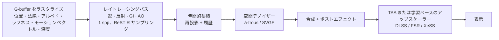

## なぜ重要なのか

[前回の記事]({{ '/blog/2026/graphics-05-ray-and-path-tracing/' | relative_url }})では、サンプルさえ十分にあれば正しい答えに収束するパストレーサーを作りました。オフラインレンダラーは 1 ピクセルに数千サンプルを費やせますが、60 fps のゲームでは*すべての処理*に約 16 ms しかなく、使えるのはおおよそ**1 フレーム・1 ピクセルあたり 1〜2 本のレイ**です。リアルタイムレイトレーシング（real-time ray tracing）とは、そのわずかなサンプルを最大限に生かす技術です。ハードウェアでサンプルを高速に追跡し、サンプリングで 1 本ごとを賢くし（ReSTIR）、再構成でピクセル間・フレーム間の情報を再利用します（時間的蓄積、SVGF、TAA、学習ベースのアップスケーラー）。これらの考え方はニューラルレンダリングにとっても重要です。視点や時間をまたいだ再利用、G-buffer に導かれたフィルタリング、オンライン学習する小さなネットワークは、NeRF や 3D Gaussian Splatting のパイプラインに再び登場します。

## 前提知識

- モンテカルロ推定量、重点サンプリング、MIS と NEE（[第 05 回]({{ '/blog/2026/graphics-05-ray-and-path-tracing/' | relative_url }})）。
- BVH とレイ–三角形交差判定（第 05 回）。
- ラスタライズパイプラインと G-buffer（[第 02 回]({{ '/blog/2026/graphics-02-rasterization/' | relative_url }})、[第 03 回]({{ '/blog/2026/graphics-03-shading-and-textures/' | relative_url }})）、およびレンダリング方程式と GGX（[第 04 回]({{ '/blog/2026/graphics-04-physically-based-rendering/' | relative_url }})）。

## 1. ハードウェアレイトレーシング

### 1.1 API モデル：DXR と Vulkan Ray Tracing

Microsoft は 2018 年に **DirectX Raytracing（DXR）**を発表し、Khronos は 2020 年にベンダー共通の **Vulkan Ray Tracing** 拡張（`VK_KHR_acceleration_structure`、`VK_KHR_ray_tracing_pipeline`、`VK_KHR_ray_query`）を最終決定しました。どちらも同じ抽象化を提供します。

1. **2 階層の加速構造（acceleration structure, AS）**。
   - **ボトムレベル AS（bottom-level AS, BLAS）**は 1 つのメッシュのジオメトリ（三角形またはプロシージャルな AABB）を保持し、ドライバーが構築する BVH です。
   - **トップレベル AS（top-level AS, TLAS）**は*インスタンス*を保持します。インスタンスは BLAS への参照に、3×4 のオブジェクト→ワールド変換、インスタンスマスク、ヒットグループのオフセットを加えたものです。
   - 剛体の動きだけなら TLAS の再構築で済み、インスタンス数が少ないので安価です。変形するメッシュでは、BLAS の**リフィット（refit）**（トポロジーを保ったままバウンディングボックスを更新）か、完全な**リビルド（rebuild）**（品質は高いが遅い）が必要です。フレームごとにどちらを選ぶかは、エンジンにおける古典的なトレードオフです。
2. 新しいシェーダーステージを持つ**レイトレーシングパイプライン**：
   - **レイ生成（ray generation）**：ピクセル（またはワークアイテム）ごとに 1 回起動され、`TraceRay` を呼び出します。
   - **交差（intersection）**：カスタムプリミティブ（球、カーブ）用です。三角形には組み込みのテストが使われます。
   - **エニーヒット（any-hit）**：候補となるヒットごとに呼ばれます。アルファテストを使う植生（`IgnoreHit()`）や、*何か*に当たったかだけを知りたいシャドウレイ（`AcceptHitAndEndSearch()`）に使います。
   - **クローゼストヒット（closest-hit）**：最も近いヒットをシェーディングし、さらにレイを飛ばすこともできます（再帰）。
   - **ミス（miss）**：何にも当たらなかったときに呼ばれ、空や環境光を返します。
3. **シェーダーバインディングテーブル（shader binding table, SBT）**：（インスタンス、ジオメトリ、レイの種類）を実行すべきヒットグループに対応付け、マテリアルごとに異なるシェーダーを走らせられるようにします。
4. **インラインレイトレーシング（inline ray tracing）**（DXR 1.1 の `RayQuery`、Vulkan の `VK_KHR_ray_query`）：パイプラインや SBT なしに、*任意の*シェーダーステージ（コンピュート、フラグメント）からレイを追跡できます。スケジューリングが単純なため、シャドウレイや AO レイではこちらが好まれることがよくあります。

下の図は、2 次元のおもちゃのシーンで 2 つのレベルを示しています。BLAS はメッシュごとにオブジェクト空間で一度だけ構築され、TLAS はそれを参照するインスタンスのワールド空間のバウンディングボックスの上に構築されます。



以下は、G-buffer からハードシャドウを計算する最小限の DXR（HLSL）の 3 点セット、つまりレイ生成・ミス・クローゼストヒットシェーダーです。

```hlsl
RaytracingAccelerationStructure gScene : register(t0);
Texture2D<float4> gPosition : register(t1);   // world position, w = 1 if valid
Texture2D<float4> gNormal   : register(t2);
RWTexture2D<float> gShadow  : register(u0);
cbuffer Light : register(b0) { float3 gLightPos; float gPad; };

struct ShadowPayload { float visible; };

[shader("raygeneration")]
void RayGen()
{
    uint2 p = DispatchRaysIndex().xy;
    float4 P = gPosition[p];
    if (P.w == 0) { gShadow[p] = 1; return; }
    float3 N = normalize(gNormal[p].xyz);
    float3 L = gLightPos - P.xyz;

    RayDesc ray;
    ray.Origin    = P.xyz + 1e-3 * N;           // offset to avoid self-intersection
    ray.Direction = normalize(L);
    ray.TMin      = 0.0;
    ray.TMax      = length(L) - 1e-3;

    ShadowPayload pl = { 0.0 };
    // shadow rays only need to know "is anything in the way?"
    TraceRay(gScene,
             RAY_FLAG_ACCEPT_FIRST_HIT_AND_END_SEARCH | RAY_FLAG_SKIP_CLOSEST_HIT_SHADER,
             0xFF, 0, 1, 0, ray, pl);
    gShadow[p] = pl.visible;
}

[shader("miss")]
void ShadowMiss(inout ShadowPayload pl) { pl.visible = 1.0; }

[shader("closesthit")]
void ShadowHit(inout ShadowPayload pl, in BuiltInTriangleIntersectionAttributes a)
{
    pl.visible = 0.0;   // not executed here (skipped by the flag), kept for completeness
}
```

`TraceRay` のフラグに続く引数は、順にインスタンスマスク、SBT のヒットグループオフセット、SBT のストライド（レイの種類の数）、ミスシェーダーのインデックス、レイ、ペイロードです。

### 1.2 RT コアは実際に何をしているのか

NVIDIA Turing（2018）以降、さらに AMD RDNA 2、Intel Arc、最近のモバイル GPU にも、[第 05 回]({{ '/blog/2026/graphics-05-ray-and-path-tracing/' | relative_url }})の 2 つの内側ループ、すなわち **BVH 走査中のレイ–ボックス判定**と**レイ–三角形判定**を実行する固定機能ユニットが搭載されています。どこまでをハードウェアで行うかはベンダーによって異なります（走査ループそのものをハードウェアで行うものもあれば、ボックス/三角形判定だけのものもあります）。いずれの場合も、シェーダーはプログラマブルコアで実行されます。実用上の帰結は次のとおりです。

- **ダイバージェンス（divergence）が最大の敵です。** 隣り合うピクセルの二次レイはランダムな方向に飛び、異なるマテリアルに当たり、異なるクローゼストヒットシェーダーを実行します。GPU は SIMD グループ（warp/wavefront）単位で実行するため、不揃いだとレーンが無駄になります。そこでハードウェアと API には**シェーダー実行の並べ替え（shader execution reordering）**（例：NVIDIA SER）が追加されており、これから実行するヒットシェーダーごとにスレッドを再グループ化します。
- **支配的なのは演算よりもメモリトラフィックであることが多い**です。コンパクトな BVH ノード、圧縮された BLAS、ヒットシェーダーを小さく保つことがいずれも効きます。
- **レイは予算です。** エンジンは、ラスタライズが最も苦手な部分、つまり面光源の影、反射、アンビエントオクルージョン、拡散グローバルイルミネーションにレイを使います。

## 2. ハイブリッドレンダリング

一次可視性は「カメラから出るレイ」です。ラスタライズはこれを正確かつ非常に高速に解けるので、ほぼすべてのリアルタイムレイトレーサーは**ハイブリッド（hybrid）**です。



これをうまく機能させる経験則が 2 つあります。

1. **デノイズの前に信号を分離します。** 拡散と鏡面の間接光は、ノイズも空間構造も大きく異なります。別々のバッファにトレースし、異なるパラメータでデノイズします。
2. **テクスチャをデモジュレート（demodulate）します。** フィルタリングの前にノイズの乗った放射照度をアルベドで割り、後で掛け戻します。こうするとフィルターが滑らかなライティングだけをぼかし、鋭いテクスチャの細部は残ります。

$$
\text{color} = \text{albedo}\cdot \underbrace{E}_{\text{filter this}},\qquad E \approx \frac{\text{noisy color}}{\max(\text{albedo},\epsilon)} .
$$

## 3. 時間的蓄積と再投影

カメラが静止していれば、フレームを単純に平均すればよく、$n$ フレーム後に分散は $\sigma^2/n$ まで下がります。物が動くときは、**現在のピクセルが前のフレームでどこにあったか**を見つけなければなりません。ラスタライザーはピクセルごとに**モーションベクトル（motion vector）**（同じ表面点の、現在と前フレームでの投影位置のスクリーン空間での差）を書き出します。

$$
\mathbf{u}_{\text{prev}} = \mathbf{u} - \mathbf{m}(\mathbf{u}),\qquad
\mathbf{m}(\mathbf{u}) = \pi\!\left(P_t V_t\, \mathbf{x}\right) - \pi\!\left(P_{t-1} V_{t-1} M_{t-1} M_t^{-1}\mathbf{x}\right),
$$

ここで $\pi$ は透視除算とビューポート変換、$M$ は物体のモデル行列です。履歴は $$\mathbf{u}_{\text{prev}}$$ で（サブピクセル位置からバイリニアに）取得されます。表面が一致しないとき、つまり**ディスオクルージョン（disocclusion）**のときには履歴を**棄却**します。深度の差が許容値を超える、法線が一致しない（$$\mathbf{n}\cdot\mathbf{n}_{\text{prev}} < \cos\theta_{\max}$$）、またはメッシュ/オブジェクト ID が異なる場合です。

下の図は、おもちゃの例で両方の場合を示しています。



受け入れられた履歴は**指数移動平均（exponential moving average, EMA）**で混合します。

$$
\bar{c}_t = (1-\alpha)\,\bar{c}_{t-1} + \alpha\, c_t, \qquad \alpha \approx 0.05\text{–}0.2 .
$$

分散 $\sigma^2$ の独立同分布な入力に対して、EMA の定常状態の分散は

$$
\operatorname{Var}[\bar c] = \sum_{k\ge0} \alpha^2 (1-\alpha)^{2k}\sigma^2 = \frac{\alpha}{2-\alpha}\,\sigma^2 ,
$$

となるので、$\alpha=0.2$ はおよそ 9 フレームの平均に相当します。その代償は、ライティングが変化したときの**遅れ**（ゴースト、ghosting）です。よく使われる改良として、ピクセルごとに**履歴長** $n$ を保持し、$\alpha = \max(1/n,\ \alpha_{\min})$ を使います。ディスオクルージョン直後のピクセル（$n=1$）は新しいサンプルをそのまま採用し、$n$ フレームの履歴を持つピクセルは真の累積平均になり、長い履歴では EMA に戻ります。

下の図に両方の効果が表れています。



## 4. 空間デノイズ

時間的再利用は、まさに助けが最も必要な場所、つまりディスオクルージョン直後、動く物体の上、変化するライティングの下で破綻します。**空間**フィルターは、「同じ種類の表面を見ている」隣接ピクセルから借りることでその穴を埋めます。

### 4.1 エッジを保つ à-trous ウェーブレット（Dammertz et al. 2010）

大きなガウスぼかしは高価です（ピクセルあたり $O(r^2)$ タップ）。**à-trous**（フランス語で「穴あき」）アルゴリズムは、同じ 5×5 の小さな B3 スプラインカーネル $h = \tfrac{1}{16}[1,4,6,4,1]$ を繰り返し適用することで大きなカーネルを近似します。レベル $i$ ではタップを $2^i$ ピクセル間隔に広げます。5 レベル（ステップ 1, 2, 4, 8, 16）で、ピクセルあたりわずか $5\times25$ タップで $125\times125$ ピクセルの範囲をカバーします。幾何学的なエッジをまたいでぼかさないよう、ピクセル $p$ の周りの各タップ $q$ には G-buffer から計算した**エッジ停止関数（edge-stopping function）**で重みを掛けます。

$$
\hat c_{i+1}(p) = \frac{\sum_{q} h_i(q)\, w(p,q)\, \hat c_i(q)}{\sum_q h_i(q)\, w(p,q)},\qquad
w = w_{\text{rt}}\cdot w_{\mathbf n}\cdot w_{\mathbf x},
$$

$$
w_{\text{rt}} = e^{-\frac{\lVert c_p - c_q\rVert^2}{\sigma_{\text{rt}}^2}},\quad
w_{\mathbf n} = e^{-\frac{\lVert \mathbf n_p - \mathbf n_q\rVert^2}{\sigma_{\mathbf n}^2}},\quad
w_{\mathbf x} = e^{-\frac{\lVert \mathbf x_p - \mathbf x_q\rVert^2}{\sigma_{\mathbf x}^2}} ,
$$

$\sigma_{\text{rt}}$ はレベルごとに半分にし、粗いレベルでもすでに平滑化された画像のエッジを尊重するようにします。多くの実装（下のコードやホームページのデモも含む）では、$w_{\mathbf n} = \max(0,\mathbf n_p\cdot\mathbf n_q)^{\sigma_{\mathbf n}}$ という変種を使い、ワールド座標の項の代わりに深度の項を使います。自己完結した NumPy 版は次のとおりです。

```python
import numpy as np

H = np.array([1, 4, 6, 4, 1]) / 16.0          # B3-spline kernel, separable 5x5


def atrous_level(c, nrm, z, step, s_c=0.5, s_n=128.0, s_z=1.0):
    """One edge-avoiding a-trous pass (Dammertz et al. 2010 style).
    c: (h,w,3) noisy color, nrm: (h,w,3) unit normals, z: (h,w) depth."""
    h, w, _ = c.shape
    acc = np.zeros_like(c)
    wsum = np.zeros((h, w, 1))
    for dy in range(-2, 3):
        for dx in range(-2, 3):
            # sample the neighbour 'step' pixels away (clamped at the border)
            ys = np.clip(np.arange(h) + dy * step, 0, h - 1)
            xs = np.clip(np.arange(w) + dx * step, 0, w - 1)
            cq, nq, zq = c[ys][:, xs], nrm[ys][:, xs], z[ys][:, xs]
            w_c = np.exp(-((c - cq) ** 2).sum(-1) / s_c**2)                  # color edge-stop
            w_n = np.maximum((nrm * nq).sum(-1), 0.0) ** s_n                 # normal edge-stop
            w_z = np.exp(-np.abs(z - zq) / (s_z * step + 1e-6))             # depth edge-stop
            wk = (H[dy + 2] * H[dx + 2] * w_c * w_n * w_z)[..., None]
            acc += wk * cq
            wsum += wk
    return acc / np.maximum(wsum, 1e-12)


def atrous(c, nrm, z, levels=5, s_c=4.0, **kw):
    for i in range(levels):                    # steps 1, 2, 4, 8, 16
        c = atrous_level(c, nrm, z, 2**i, s_c=s_c, **kw)
        s_c *= 0.5                             # tighten the color test each level
    return c


if __name__ == "__main__":
    rng = np.random.default_rng(1)
    h, w = 64, 96
    xx = np.mgrid[0:h, 0:w][1]
    left = xx < w // 2                                        # two "walls" meeting at an edge
    nrm = np.where(left[..., None], [1.0, 0.0, 0.0], [0.0, 0.0, 1.0])
    z = np.where(left, 2.0, 3.0)
    clean = np.where(left[..., None], [0.8, 0.3, 0.2], [0.2, 0.4, 0.8])
    noisy = clean * rng.exponential(1.0, (h, w, 1))           # 1-spp-like multiplicative noise
    out = atrous(noisy, nrm, z)
    rmse = lambda a: np.sqrt(((a - clean) ** 2).mean())
    print(f"RMSE noisy {rmse(noisy):.3f} -> filtered {rmse(out):.3f}")
    blur = atrous(noisy, nrm, z, s_n=0.0, s_z=1e9)            # no G-buffer guidance
    edge = lambda a: np.abs(a[:, w // 2 - 2:w // 2 + 2] - clean[:, w // 2 - 2:w // 2 + 2]).mean()
    print(f"error at the edge: guided {edge(out):.3f}, unguided {edge(blur):.3f}")
```

このおもちゃの画像では `RMSE noisy 0.523 -> filtered 0.101` と `error at the edge: guided 0.034, unguided 0.152` が出力されます。折れ目を鋭く保っているのは G-buffer の項です。

下の 1 枚目の図は 5×5 のタップがレベルごとに広がる様子を、2 枚目は上のスクリプトをそのまま実行した結果を示しています。





### 4.2 SVGF：時空間分散誘導フィルタリング（Schied et al. 2017）

素の à-trous の弱点は、色の許容値 $\sigma_{\text{rt}}$ が固定であることです。小さすぎるとノイズが残り、大きすぎると本物のライティングの細部（影の境界）が塗りつぶされます。**SVGF（spatiotemporal variance-guided filtering）**は、許容値を*局所的なノイズレベルに適応*させます。

1. デモジュレートした色*と*、輝度の最初の 2 つのモーメント $\mu_1 = \mathbb E[l]$、$\mu_2=\mathbb E[l^2]$ を**時間的に蓄積**します（第 3 節）。
2. **分散推定**：時間的モーメントから $\sigma^2_l = \mu_2 - \mu_1^2$ を求めます。履歴が短いピクセル（論文では 4 フレーム未満）では、代わりに 7×7 近傍から空間的に推定します。
3. **分散に導かれた à-trous**：5 レベルのフィルターで、輝度のエッジ停止関数にノイズの*標準偏差*を使います。

   $$
   w_l(p,q) = \exp\!\left(-\frac{\lvert l_p - l_q\rvert}{\sigma_l\sqrt{g_{3\times3}\!\left(\operatorname{Var}(l_p)\right)} + \epsilon}\right),
   $$

   ここで $g_{3\times3}$ は分散に対する小さなガウスの前置フィルター、$\sigma_l=4$ です。各レベルが信号をフィルタリングするので、分散も*二乗*した重みで一緒にフィルタリングします（独立なサンプルなら $\operatorname{Var}\big[\sum_q w_q c_q / \sum_q w_q\big] = \sum_q w_q^2\operatorname{Var}[c_q]/(\sum_q w_q)^2$）。その結果、ノイズの多い領域は強く平滑化され、収束した領域はそのまま残ります。法線の項は $\max(0,\mathbf n_p\cdot\mathbf n_q)^{\sigma_n}$（$\sigma_n=128$）で、深度の項は深度差を局所的な深度勾配で割ったもの、$\lvert z_p - z_q\rvert / (\sigma_z \lvert\nabla z\cdot(p-q)\rvert + \epsilon)$ です。

4. à-trous の最初のレベルの出力を次フレームの色の履歴としてフィードバックし、最後に TAA パスで残ったちらつきを取り除きます。

製品レベルのデノイザー（例：NVIDIA のオープンソースライブラリ NRD の ReBLUR と ReLAX。後者は SVGF 由来）は、信号ごとのチューニング、鏡面反射でのヒット距離を考慮したカーネル、アンチラグ（anti-lag）のヒューリスティクスでこの考え方を洗練させています。手設計の重みをネットワークで置き換える学習ベースのデノイザーも、いまでは一般的です。

## 5. ReSTIR：リザーバーに基づく時空間重点リサンプリング

デノイザーがきれいにできるのは、平均的には良いサンプルだけです。光源が何千もあると、1 ピクセル 1 本のシャドウレイを*一様に*選んだ光源へ向けても、ほとんどの場合まったく寄与しない光源に当たります。ReSTIR（Bitterli et al. 2020）は、同じレイ予算ではるかに良い光源を選びます。そのために、多数の安価な候補を**リサンプリング**し、それをピクセル間・フレーム間で**再利用**します。

### 5.1 リサンプル重点サンプリング（RIS）

$I=\int f(x)\,dx$ を推定したいとします。直接光の場合、光源上の点 $x$ について $f(x) = f_r\, L_e\, G\, V$ です。理想的な pdf は $f$ に比例しますが、$f$ には高価な可視性 $V$ が含まれます。RIS（resampled importance sampling, Talbot et al. 2005）は、安価な**ターゲット関数（target function）** $\hat p(x)\ge 0$、例えば $V$ を除いた $f$ を使います。正規化されている必要はありません。

1. サンプリングしやすい**ソース pdf（source pdf）** $p$ から $M$ 個の候補 $x_1,\dots,x_M$ を引きます（例：光源を一様に、またはパワーに比例して選ぶ）。
2. 各候補に**リサンプリング重み（resampling weight）** $w_i = \hat p(x_i)/p(x_i)$ を与えます。
3. 確率 $w_z / \sum_j w_j$ で候補 $y = x_z$ を 1 つ選びます。
4. 次のように推定します。

$$
\langle I\rangle_{\text{RIS}} = \frac{f(y)}{\hat p(y)} \cdot \underbrace{\frac{1}{M}\sum_{j=1}^{M} w_j}_{\text{estimate of } \int\hat p} \;=\; f(y)\,W,\qquad W = \frac{1}{\hat p(y)}\,\frac{1}{M}\sum_j w_j .
$$

**なぜ不偏なのか。** $Z_M = \tfrac1M\sum_j w_j$ と書きます。候補を条件とすれば、選択は離散的な重点サンプリングなので

$$
\mathbb E\big[f(y)W \,\big\vert\, x_{1..M}\big] = \sum_{z} \frac{w_z}{M Z_M}\cdot \frac{f(x_z)}{\hat p(x_z)}\, Z_M = \frac1M\sum_{z} \frac{f(x_z)}{p(x_z)} ,
$$

となり、これを候補について期待値をとると標準的な重点サンプリング推定量の平均、つまり $I$ になります。そのためには、$f(x)\ne0$ のところで $\hat p(x)>0$、かつ $\hat p>0$ のところで $p>0$ である必要があります。$M\to\infty$ では $y$ の分布は $\hat p/\int\hat p$ に近づくので、$W$ は選ばれたサンプルの $1/\text{pdf}$ のように振る舞います。ReSTIR ではこれを**不偏寄与重み（unbiased contribution weight）**と呼びます。トレースするシャドウレイは $y$ に対する**1 本**だけで、$M$ 個の候補のコストは $\hat p$ の評価だけです。

下の図は、この手順を 1 次元で示しています。



### 5.2 重み付きリザーバーサンプリング（WRS）

GPU ですべての候補を保存するのは不可能です。**重み付きリザーバーサンプリング（weighted reservoir sampling, WRS）**は、$O(1)$ のメモリでストリームから選択します。現在の選択 $y$、累積和 $w_{\text{sum}}$、個数 $M$ を保持し、重み $w_i$ の要素 $x_i$ が来たら（$w_i$ を加えたうえで）確率 $w_i/w_{\text{sum}}$ で $y$ を置き換えます。帰納法により、各要素が最終的に選ばれる確率は $w_i/\sum_j w_j$ となり、まさに RIS に必要なものです。

重要な性質：**2 つのリザーバーは候補を持たずにマージできます**。リザーバー $r$ の選択を重み $\hat p(y_r)\,W_r\,M_r$（ターゲット関数が同じなら $w_{\text{sum},r}$ に等しい）で新しいリザーバーに流し込み、$M$ を合計します。結果は、RIS が $\sum_r M_r$ 個すべての候補を見たかのように分布し、コストはリザーバーあたり 1 回のマージだけです。これが、ピクセル間・フレーム間の再利用を安価にしている点です。

### 5.3 時空間再利用

ピクセルごと・フレームごとに、ReSTIR DI は次を行います。

1. **初期候補**：$M\approx 32$ 個の光源サンプルを、$\hat p = $ 遮蔽なしの寄与としてリザーバーに流し込みます。
2. *（任意）* **可視性の再利用**：$y$ に対してシャドウレイを 1 本トレースし、遮蔽されていれば $W=0$ とします。これで遮蔽されたサンプルが近傍に広がりません。
3. **時間的再利用**：前フレームの再投影先ピクセルのリザーバーをマージします。その $M$ は現在の $M$ の小さな倍数（例：20 倍）にクランプし、古さを抑えます。
4. **空間的再利用**：ランダムに選んだ $k$ 個の近傍（例：半径 30 ピクセル内の 5 個）のリザーバーをマージし、深度や法線の差が大きすぎるものは棄却します。これは反復できます。
5. **シェーディング**：最終的な $y$ に対してシャドウレイを 1 本トレースし、寄与は $f(y)\,W$ です。

下の図はステップ 3 と 4 を示しています。



近傍のサンプルを*このピクセル*の $\hat p$ で重み付けし直すとき、それらは別の分布から引かれたものです。素朴な $1/M$ の重みは**バイアス**を生み、典型的には近傍のサンプルがここでは見えないエッジで暗くなります。不偏な版では $1/M$ の代わりに、自身の $\hat p_q(y)>0$ となる近傍だけを数える正規化 $1/Z$ を使います。近傍について MIS 風の重みを使うこともできます。Lin et al.（2022）の GRIS 理論はこれらの重みを一般化し、相関のあるサンプルや異なる領域をまたいで再利用されるサンプルも扱います。

以下は完全に実行可能なおもちゃの実験です。1 つのシェーディング点から、強度がきわめて不揃いな 4096 個の点光源が見えており、その一部は壁の陰にあります。一様な光源選択、候補 32 個の RIS、独立な 4 つの RIS リザーバーのマージを比較します。3 つとも不偏であるはずで、RIS の分散ははるかに小さいはずです。

```python
import numpy as np

rng = np.random.default_rng(0)

# --- a toy "many lights" scene: one shading point, N point lights on a plane above it
N = 4096
light_pos = np.c_[rng.uniform(-8, 8, N), rng.uniform(0.5, 4, N), rng.uniform(-8, 8, N)]
light_I = rng.lognormal(0.0, 1.0, N)          # very uneven intensities
x, n = np.zeros(3), np.array([0.0, 1.0, 0.0])  # shading point and its normal
occluder_x = 1.0                               # lights with 0 < x < 1.5 are "behind a wall"

d = light_pos - x
dist2 = (d * d).sum(1)
cos = np.maximum((d @ n) / np.sqrt(dist2), 0.0)
visible = ~((light_pos[:, 0] > 0) & (light_pos[:, 0] < 1.5 * occluder_x))

f = light_I * cos / dist2 * visible      # integrand: contribution of light i (Lambert, albedo/pi dropped)
p_hat = light_I * cos / dist2            # target function: same, but without the visibility ray
exact = f.sum()                          # "integral" = sum over all lights


class Reservoir:
    """Weighted reservoir sampling: keeps one sample y out of a stream."""
    def __init__(self):
        self.y, self.w_sum, self.M, self.W = -1, 0.0, 0, 0.0

    def update(self, x_i, w_i, u):
        self.w_sum += w_i
        self.M += 1
        if self.w_sum > 0 and u < w_i / self.w_sum:
            self.y = x_i


def ris_estimate(M, rng):
    r = Reservoir()
    for _ in range(M):
        i = rng.integers(N)              # source pdf p(i) = 1/N (uniform light pick)
        w = p_hat[i] / (1.0 / N)         # resampling weight w_i = p_hat / p
        r.update(i, w, rng.random())
    if r.y < 0 or p_hat[r.y] == 0:
        return r, 0.0
    r.W = r.w_sum / (r.M * p_hat[r.y])   # unbiased contribution weight
    return r, f[r.y] * r.W               # one shadow ray: f includes visibility


def combine(reservoirs, rng):
    """Merge reservoirs that share the same target p_hat (e.g. spatial reuse at one pixel)."""
    s = Reservoir()
    for r in reservoirs:
        if r.y >= 0:
            s.update(r.y, p_hat[r.y] * r.W * r.M, rng.random())
            s.M += r.M - 1               # update() added 1; total M is the sum of the inputs
        else:
            s.M += r.M
    if s.y < 0:
        return s, 0.0
    s.W = s.w_sum / (s.M * p_hat[s.y])
    return s, f[s.y] * s.W


trials = 20000
uni = np.array([f[i] * N for i in rng.integers(N, size=trials)])
ris = np.array([ris_estimate(32, rng)[1] for _ in range(trials)])
mrg = np.array([combine([ris_estimate(32, rng)[0] for _ in range(4)], rng)[1] for _ in range(trials // 4)])

print(f"exact             : {exact:.4f}")
for name, e in [("uniform, 1 cand. ", uni), ("RIS, M=32        ", ris), ("4 merged RIS (128)", mrg)]:
    print(f"{name}: mean {e.mean():.4f} +- {e.std() / np.sqrt(len(e)):.4f}   rel. std per sample {e.std() / exact:.2f}")
```

出力（ノート PC で数秒）：

```text
exact             : 94.9404
uniform, 1 cand. : mean 93.2393 +- 2.2691   rel. std per sample 3.38
RIS, M=32        : mean 95.9497 +- 0.6209   rel. std per sample 0.92
4 merged RIS (128): mean 92.6408 +- 0.9898   rel. std per sample 0.74
```

すべての平均が、標準誤差のおよそ 2 倍以内で厳密値と一致しています。$M=128$ の RIS 推定 200,000 回をベクトル化して実行すると $95.00 \pm 0.15$ になります。サンプルあたりの相対標準偏差は、候補 32 個で 3.4 から 0.9 に、マージ後は 0.74 に下がります。これが、ReSTIR が空間的再利用から「ただで」得る品質です。RIS では隠れた光源の問題は直せないことに注意してください。$\hat p$ が可視性を無視しているからで、これが可視性の再利用ステップが重要な理由です。

下の図は、さまざまな候補数でこの実験を繰り返したものです。



GPU 上では、リザーバーはフレームをまたいで保持されるバッファにピクセルごとに置かれる小さな構造体です。

```glsl
struct Reservoir {
    uint  y;      // selected light sample (index or packed position)
    float wSum;   // sum of resampling weights
    float M;      // number of candidates seen (float so it can be clamped/scaled)
    float W;      // unbiased contribution weight
};

bool updateReservoir(inout Reservoir r, uint xi, float wi, float u) {
    r.wSum += wi;
    r.M += 1.0;
    if (u * r.wSum < wi) { r.y = xi; return true; }
    return false;
}

// merge reservoir q (from a neighbour or the previous frame) into r;
// pHatHere is the target function of q.y evaluated at *this* pixel
void mergeReservoir(inout Reservoir r, Reservoir q, float pHatHere, float u) {
    float M0 = r.M;
    updateReservoir(r, q.y, pHatHere * q.W * q.M, u);
    r.M = M0 + q.M;
}

void finalizeReservoir(inout Reservoir r, float pHatY) {
    r.W = (pHatY > 0.0) ? r.wSum / (r.M * pHatY) : 0.0;  // biased 1/M variant
}
```

### 5.4 ReSTIR GI

ReSTIR GI（Ouyang et al. 2021）は同じ仕組みを**間接**光に適用します。各ピクセルの可視点 $x_v$ は BSDF サンプリングしたレイを 1 本飛ばして**サンプル点** $x_s$ に到達し、そこでの出射放射輝度 $L_o(x_s)$ を推定します（そこでも NEE やさらなるバウンスを行います）。リザーバーには*パス頂点* $(x_s, \mathbf n_s, L_o)$ を保存します。ターゲット関数は基本的に、そのパスに沿って到達する放射輝度の輝度値で、例えば $\hat p = \operatorname{lum}(L_o(x_s))$、あるいはそれに $x_v$ での BSDF とコサインを掛けたものです。ピクセル $r$ が近傍 $q$ のサンプルを再利用するときは、自分の可視点 $x_r$ を $x_s$ に*再接続（reconnect）*します。サンプルはもともと $x_q$ のまわりの立体角として生成されているので、その pdf はこの変数変換のヤコビアン（Jacobian）で変換しなければなりません。

$$
\lvert J_{q\to r}\rvert = \frac{\lvert\cos\phi_r\rvert}{\lvert\cos\phi_q\rvert}\cdot\frac{\lVert x_q - x_s\rVert^2}{\lVert x_r - x_s\rVert^2},
$$

ここで $\phi_q,\phi_r$ は、$\mathbf n_s$ と、$x_s$ から $x_q$、$x_r$ へ向かう方向とのなす角です。再利用したターゲット関数は $\lvert J\rvert$ で割り、ヤコビアンが極端なサンプルは棄却します。これにより、1 ピクセル 1 フレーム 1 サンプルのパストレース間接光が、デノイズ前の段階ではるかにきれいになります。それでも最終画像には ReSTIR GI もデノイザーを必要とします。後続の研究（ReSTIR PT、area ReSTIR、ボリューム向けの ReSTIR）は、再接続のアイデアをさらに一般化しています。



## 6. TAA と学習ベースのアップスケーリング

### 6.1 時間的アンチエイリアシング

リアルタイムレンダラーがディファードシェーディングと MSAA を両立できることはまれなので、アンチエイリアシングは**時間的に**、第 3 節と同じ再投影を使って行います。射影行列はフレームごとに異なるサブピクセルオフセットで**ジッター（jitter）**され（典型的には Halton(2,3) 列）、連続するフレームが各ピクセル内の異なる位置をサンプリングします。それらを EMA で混合すると、ピクセルの覆う領域を積分することになります。[第 02 回]({{ '/blog/2026/graphics-02-rasterization/' | relative_url }})のスーパーサンプリングを時間方向に分散させたものです。難しいのは無効な履歴です。Karis の 2014 年の講演 *High Quality Temporal Supersampling* は**近傍クランプ（neighbourhood clamping）**を広めました。履歴の色を、現在フレームの 3×3 近傍のバウンディングボックスにクランプ（または中心に向けてクリップ）し、多くの場合 YCoCg 空間で行います。現在の近傍にはあり得ない履歴の色（ゴースト）は引き戻されます。

```glsl
// history: reprojected color, cur: current frame color texture, uv: pixel center
vec3 taaResolve(sampler2D cur, vec3 history, vec2 uv, vec2 texel) {
    vec3 m1 = vec3(0.0), m2 = vec3(0.0);
    for (int y = -1; y <= 1; ++y)
        for (int x = -1; x <= 1; ++x) {
            vec3 c = texture(cur, uv + vec2(x, y) * texel).rgb;
            m1 += c; m2 += c * c;
        }
    vec3 mu = m1 / 9.0;
    vec3 sigma = sqrt(max(m2 / 9.0 - mu * mu, 0.0));
    vec3 lo = mu - 1.0 * sigma, hi = mu + 1.0 * sigma;   // box from mean +- 1 std
    vec3 h = clamp(history, lo, hi);
    vec3 c0 = texture(cur, uv).rgb;
    return mix(h, c0, 0.1);                               // alpha = 0.1
}
```

クランプは、ゴーストを減らす代わりに細い形状でのぼけやちらつきを招きます。このトレードオフが学習ベースの手法の動機になりました。

なぜランダムなジッターではなく低食い違い列を使うのでしょうか。下の図で測ってみます。



### 6.2 学習ベースのアップスケーリング（DLSS など）

低い内部解像度でレンダリングして**アップスケーリング（upscaling）**すると、レイとシェーディングのコストをおおよそピクセル数に比例して節約できます。NVIDIA の **DLSS**（2020 年のバージョン 2 以降）は、高いレベルで見れば、ヒューリスティックな履歴棄却と混合のルールを畳み込みネットワークで置き換えた TAA です。入力はジッターされた低解像度の色、深度、モーションベクトル、露出、そしてモーションベクトルでワープした前フレームの高解像度出力で、出力は高解像度のフレームです。後のバージョンでは、**フレーム生成（frame generation）**（オプティカルフローで追加のフレームを補間）と、第 4 節の手作業で調整したデノイザーをレイトレースデータで学習したネットワークで置き換える**レイ再構成（ray reconstruction）**が加わりました。AMD FSR（バージョン 1〜3 は手設計、FSR 4 は機械学習ベース）と Intel XeSS も同じ役割を果たします。私たちにとっての構造的な教訓は、現代のリアルタイム画像は、疎でジッターされ時間的に再利用されたサンプルから**再構成**されているということです。これは、ニューラルレンダリングが疎な視点からシーンを再構成するのとよく似ています。

## 7. ニューラル放射輝度キャッシュ

パストレーシングのコストとノイズの大半は、長いマルチバウンスの裾野に費やされます。**放射輝度キャッシュ（radiance cache）**は（近似的な）出射放射輝度 $L_o(\mathbf x,\omega)$ を保存し、パスを早めに打ち切って残りを参照できるようにします。古典的なキャッシュ（放射照度キャッシュ、DDGI のようなプローブグリッド）はコンパクトですが、細部をぼかしたり光漏れを起こしたりします。

**ニューラル放射輝度キャッシュ（neural radiance caching, NRC）**（Müller et al. 2021）は小さな MLP $\hat L_\theta(\mathbf x, \omega, \mathbf n, r, \alpha_d, \alpha_s)$ を使います。入力は位置、方向、表面法線、ラフネス、拡散/鏡面反射率で、入力エンコーディングを通してネットワークに渡され、出力は放射輝度です。

- **レンダリング**：各パスは短いプレフィックスだけトレースします。パスの広がり（spread）が十分大きくなり、キャッシュのぼけが見えなくなった時点でパスを終了してキャッシュを参照します。パスのスループットにキャッシュされた $\hat L_\theta$ を掛けます。
- **オンライン学習**：ごく一部のパスを、さらに数バウンス先まで延長します。それらが集めた放射輝度（その終端もまたキャッシュの参照です）が学習ターゲットになります。この「自己学習（self-training）」により、各パスを短く保ったまま、ネットワークがマルチバウンスの光を学習できます。毎フレーム数ステップの勾配更新を行うので、事前学習なしに動的なシーンに適応します。
- **速度**：ネットワークは小さく、「完全融合（fully fused）」された GPU MLP（tiny-cuda-nn の方式）で評価され、重みと活性化をオンチップメモリに保持します。



これはニューラルレンダリングのトラックの直接の祖先です。同じ完全融合 MLP と入力エンコーディングの仕組みは Instant-NGP に登場し、オンライン学習する放射輝度ネットワークは、概念的には*現在の*シーンの照明についての NeRF です。

## 試してみよう

[ホームページのラボ]({{ '/' | relative_url }}#lab)にある**パストレーサー**は完全に WebGL のフラグメントシェーダー上で動いており、この記事のいくつかの要素を体験できます。

- **Denoise** をオンにしてカメラや物体をドラッグしてみてください。操作中は、ピクセルあたりわずかなサンプルしか蓄積されていません。法線・深度・アルベドのバッファに導かれた 5 レベルのエッジ保存 **à-trous** フィルター（ステップ 1, 2, 4, 8, 16）が、4.1 節と同様に画像をきれいにします。オフにすると生の信号が見えます。
- 表示を **Final**、**Noisy**、**Albedo**、**Normal**、**Depth** の間で切り替えてみてください。後の 3 つが、エッジ停止重みを決める G-buffer です。法線や深度が跳ぶところでフィルターがエッジを保つ様子と、アルベドをテクスチャのデモジュレートに使う理由を観察してください。
- 光源を小さくして、**BSDF**、**NEE**、**MIS** を切り替えてみてください。より良いサンプリング（ReSTIR が大規模に取り組む問題そのもの）は、デノイザーがノイズを隠さなければならなくなる*前に*ノイズを減らします。
- カメラを静止させてみてください。プログレッシブな蓄積は、時間的蓄積（第 3 節）のカメラ静止時の極限であり、画像はノイズのない参照解に収束します。

## 代表的な論文

| 論文 | 会議・論文誌 | 年 | リンク | 意義 |
| --- | --- | --- | --- | --- |
| Talbot, Cline, Egbert. *Importance Resampling for Global Illumination* | EGSR | 2005 | [DOI](https://doi.org/10.2312/EGWR/EGSR05/139-146) | RIS をレンダリングに導入。ReSTIR の背後にある推定量 |
| Dammertz, Sewtz, Hanika, Lensch. *Edge-Avoiding À-Trous Wavelet Transform for fast Global Illumination Filtering* | HPG | 2010 | [DOI](https://doi.org/10.2312/EGGH/HPG10/067-075) | G-buffer に導かれたウェーブレットフィルター。多くのリアルタイムデノイザーの基礎 |
| Karis. *High Quality Temporal Supersampling* | SIGGRAPH Advances in Real-Time Rendering コース | 2014 | — | 近傍クランプ付きのジッター TAA を広めた |
| Schied et al. *Spatiotemporal Variance-Guided Filtering* (SVGF) | HPG | 2017 | [DOI](https://doi.org/10.1145/3105762.3105770) | 時間的モーメント → 分散 → 適応的 à-trous。リアルタイムの 1 spp パストレーシング |
| Bitterli et al. *Spatiotemporal Reservoir Resampling for Real-Time Ray Tracing with Dynamic Direct Lighting* (ReSTIR) | SIGGRAPH / ACM TOG 39(4) | 2020 | [DOI](https://doi.org/10.1145/3386569.3392481) | RIS + リザーバー + 時空間再利用で数百万の光源に対応 |
| Ouyang et al. *ReSTIR GI: Path Resampling for Real-Time Path Tracing* | HPG / Computer Graphics Forum 40(8) | 2021 | [DOI](https://doi.org/10.1111/cgf.14378) | 再接続のヤコビアンで ReSTIR を間接光に拡張 |
| Müller, Rousselle, Novák, Keller. *Real-time Neural Radiance Caching for Path Tracing* | SIGGRAPH / ACM TOG 40(4) | 2021 | [arXiv](https://arxiv.org/abs/2106.12372) | オンライン学習する MLP キャッシュ。ニューラルレンダリングへの架け橋 |
| Lin et al. *Generalized Resampled Importance Sampling: Foundations of ReSTIR* | SIGGRAPH / ACM TOG 41(4) | 2022 | [DOI](https://doi.org/10.1145/3528223.3530158) | 領域をまたぐ再利用と相関サンプルのための厳密な理論（GRIS） |
| Wyman et al. *A Gentle Introduction to ReSTIR: Path Reuse in Real-time* | SIGGRAPH Courses | 2023 | [DOI](https://doi.org/10.1145/3587423.3595511) | ReSTIR の理論と実践についての最良のチュートリアル |

## 学習リソース

- **GAMES202：高品質リアルタイムレンダリング**（Lingqi Yan）：リアルタイムの影、グローバルイルミネーション、PBR、そしてリアルタイムレイトレーシング/デノイズの講義。この記事の自然な副読本です。
- **Real-Time Rendering** 第 4 版（Akenine-Möller ほか）：レイトレーシング、TAA、アップスケーリングの章。
- **Ray Tracing Gems** I・II（NVIDIA による無料の電子書籍）：DXR、デノイズ、サンプリングについての実践的な章が多数あります。
- **PBRT**（Physically Based Rendering、[pbr-book.org](https://pbr-book.org/) で無料公開）でモンテカルロの基礎を固めましょう。
- **Microsoft DirectX の仕様**（DXR の仕様は [github.com/microsoft/DirectX-Specs](https://github.com/microsoft/DirectX-Specs) にあります）と Vulkan の仕様（`VK_KHR_ray_tracing_pipeline`、`VK_KHR_ray_query`）。
- オープンソースのコード：[NVIDIA NRD](https://github.com/NVIDIA-RTX/NRD)（リアルタイムデノイザー）と [NVIDIA RTXDI](https://github.com/NVIDIA-RTX/RTXDI)（製品レベルの ReSTIR DI/GI）。

## 演習

1. EMA の分散の式 $\operatorname{Var}[\bar c] = \frac{\alpha}{2-\alpha}\sigma^2$ を証明し、$\alpha_n = 1/n$ がちょうど累積平均を与えることを示してください。
2. RIS のスクリプトで、ソース pdf を $I_i$ に比例して光源を選ぶように変えてください（$w_i = \hat p/p$ の更新を忘れずに）。$M=1$ と $M=32$ で分散はどう変わるでしょうか。
3. *バイアスのある*空間的再利用を実装してください。*異なる*シェーディング点（異なる法線）について計算したリザーバーを素朴な $1/M$ の重みでマージし、バイアスを測定します。次に $1/Z$ の正規化で修正してください。
4. à-trous のスクリプトに分散推定（ノイズの乗った 8 つの「フレーム」での時間的モーメント）を加え、固定の色許容値を SVGF の輝度重みに置き換えてください。エッジでの誤差を比較しましょう。
5. ラボのパストレーサーで、デノイザーが本物の細部を目に見えてぼかしてしまう設定（小さな光源、光沢のある物体）を見つけてください。どのエッジ停止項が原因かを説明してください。

次回：[物理ベースシミュレーション]({{ '/blog/2026/graphics-07-physically-based-simulation/' | relative_url }})では、光のシミュレーションから物質のシミュレーションへ移ります。粒子、布、そして XPBD です。
