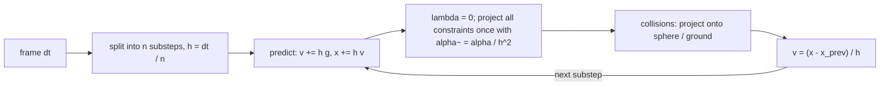

## なぜ重要か

ここまでのシリーズでは、光がシーンからどのように出ていくかを扱ってきました：[ラスタライゼーション]({{ '/blog/2026/graphics-02-rasterization/' | relative_url }})、[物理ベースシェーディング]({{ '/blog/2026/graphics-04-physically-based-rendering/' | relative_url }})、[パストレーシング]({{ '/blog/2026/graphics-05-ray-and-path-tracing/' | relative_url }})、そしてその[リアルタイム版]({{ '/blog/2026/graphics-06-real-time-ray-tracing/' | relative_url }})です。最後となる本記事では、シーンそのものがどう*動く*かを扱います。物理ベースアニメーション（physically based animation）は、ゲームや VR の布、映画の視覚効果、そしてますます、ロボット・身体性エージェント・世界モデルの学習データを生成するシミュレータを支えています。ここで紹介する手法（特に Position Based Dynamics と XPBD）は、まさにゲームエンジンの内部や、本サイトのホームページにある布のデモで使われているものです。

1 つの粒子から出発して NumPy で動く XPBD の布ソルバーを組み立て、陰的オイラー法から XPBD の更新式を導出し、その後で剛体と粒子ベースの流体を概観します。

## 前提知識

- ベクトル、勾配、連鎖律（[第 1 回]({{ '/blog/2026/graphics-01-roadmap-and-math/' | relative_url }})）。
- 基本的な常微分方程式：$\dot{\mathbf{x}} = \mathbf{v}$、$\dot{\mathbf{v}} = \mathbf{a}$。
- ニュートン法とラグランジュ乗数（考え方だけで十分です）。
- Python と NumPy。

## 1. シミュレーションループ

粒子系（particle system）は、位置 $\mathbf{x}_i$、速度 $\mathbf{v}_i$、質量 $m_i$ を持つ点の集合です。ニュートンの第 2 法則から常微分方程式（ordinary differential equations, ODE）の系が得られます。

$$
\dot{\mathbf{x}}_i = \mathbf{v}_i, \qquad m_i \dot{\mathbf{v}}_i = \mathbf{f}_i(\mathbf{x}, \mathbf{v}, t),
$$

ここで $\mathbf{f}_i$ は重力、バネ、抵抗、接触、ユーザーが加える力をまとめたものです。全粒子を並べて $\mathbf{x} \in \mathbb{R}^{3N}$ と書き、対角質量行列 $\mathbf{M}$ を使うと $\mathbf{M}\ddot{\mathbf{x}} = \mathbf{f}$ となります。**逆質量**（inverse mass）$w_i = 1/m_i$ で扱うと便利です。固定された（キネマティックな）粒子は単に $w_i = 0$ とすればよいからです。

リアルタイムシミュレータは、この ODE を時間刻み $\Delta t$（多くの場合 1 フレーム $1/60$ 秒で、さらにサブステップに分割）で進めます。面白いことはすべて、その 1 ステップを*どう*進めるかにあります。

## 2. 時間積分法

### 陽的・陰的・シンプレクティックオイラー法

最も単純な方式は、ステップの開始時点で力を評価します。

$$
\text{explicit Euler:}\quad \mathbf{x}^{n+1} = \mathbf{x}^n + \Delta t\, \mathbf{v}^n, \qquad \mathbf{v}^{n+1} = \mathbf{v}^n + \Delta t\, \mathbf{M}^{-1}\mathbf{f}(\mathbf{x}^n).
$$

**陰的（後退）オイラー法**（implicit / backward Euler）はステップの終了時点で力を評価するため、各ステップが（一般に非線形な）連立方程式になります。

$$
\text{implicit Euler:}\quad \mathbf{x}^{n+1} = \mathbf{x}^n + \Delta t\, \mathbf{v}^{n+1}, \qquad \mathbf{v}^{n+1} = \mathbf{v}^n + \Delta t\, \mathbf{M}^{-1}\mathbf{f}(\mathbf{x}^{n+1}).
$$

**シンプレクティック（半陰的）オイラー法**（symplectic / semi-implicit Euler）は、まず速度を更新し、その*新しい*速度で位置を更新します。

$$
\text{symplectic Euler:}\quad \mathbf{v}^{n+1} = \mathbf{v}^n + \Delta t\, \mathbf{M}^{-1}\mathbf{f}(\mathbf{x}^n), \qquad \mathbf{x}^{n+1} = \mathbf{x}^n + \Delta t\, \mathbf{v}^{n+1}.
$$

計算コストは陽的オイラー法と同じですが、振る舞いはまったく異なります。

理由を見るために、減衰のないバネ $m\ddot{x} = -kx$（固有角振動数 $\omega = \sqrt{k/m}$）を考えます。1 ステップを線形写像 $(x, v)^{n+1} = \mathbf{A}(x, v)^n$ と書くと、陽的オイラー法では

$$
\mathbf{A}_{\text{exp}} = \begin{pmatrix} 1 & \Delta t \\ -\omega^2 \Delta t & 1 \end{pmatrix}, \qquad \det \mathbf{A}_{\text{exp}} = 1 + \omega^2 \Delta t^2 > 1,
$$

となり、固有値の絶対値は $\sqrt{1+\omega^2\Delta t^2}$ です。つまり*どんな* $\Delta t$ でも、エネルギーは毎ステップ増加します。陰的オイラー法の固有値の絶対値は $1/\sqrt{1+\omega^2\Delta t^2} < 1$ で、無条件に安定ですが、運動を人工的に減衰させます。シンプレクティックオイラー法は $\det \mathbf{A} = 1$（位相空間の面積を保存）で、$\omega \Delta t < 2$ なら固有値は単位円上にあります。エネルギーはドリフトせず、真の値のまわりで振動します。

### Verlet 積分

**Störmer–Verlet** 積分は速度そのものを消去します。

$$
\mathbf{x}^{n+1} = 2\mathbf{x}^n - \mathbf{x}^{n-1} + \Delta t^2\, \mathbf{M}^{-1}\mathbf{f}(\mathbf{x}^n).
$$

2 次精度で、時間反転可能で、シンプレクティックです。速度が必要なら $(\mathbf{x}^{n+1}-\mathbf{x}^{n})/\Delta t$ のような差分から求めます。Jakobsen の GDC 2001 の講演 "Advanced Character Physics" は「Verlet + 拘束の射影」をゲームに広め、PBD の直接の祖先となりました。なお、後述の PBD ループ「シンプレクティックオイラー法で予測し、位置の変化から速度を求める」は、代数的には Verlet 型の位置更新そのものです。

### 実験

```python
import numpy as np

k, m, h, steps = 100.0, 1.0, 0.01, 2000          # spring stiffness, mass, time step
def energy(x, v): return 0.5 * m * v**2 + 0.5 * k * x**2

def explicit_euler(x, v):
    return x + h * v, v + h * (-k / m * x)

def symplectic_euler(x, v):
    v = v + h * (-k / m * x)                      # velocity first ...
    return x + h * v, v                           # ... then position with the new velocity

def implicit_euler(x, v):
    # solve x' = x + h v',  v' = v - h k/m x'  (linear, so closed form)
    A = np.array([[1.0, -h], [h * k / m, 1.0]])
    return tuple(np.linalg.solve(A, [x, v]))

def verlet(x, x_prev):
    a = -k / m * x
    return 2 * x - x_prev + h * h * a, x          # returns (x_next, x_current)

for name, f in [("explicit", explicit_euler), ("symplectic", symplectic_euler), ("implicit", implicit_euler)]:
    x, v = 1.0, 0.0
    for _ in range(steps):
        x, v = f(x, v)
    print(f"{name:10s} E/E0 = {energy(x, v) / energy(1.0, 0.0):.3f}")

x, xp = 1.0, 1.0 - 0.5 * h * h * k / m            # second-order start: x_{-1} = x0 - h v0 + h^2 a0 / 2
for _ in range(steps):
    x, xp = verlet(x, xp)
v = (x - xp) / h                                  # backward-difference velocity
print(f"{'verlet':10s} E/E0 = {energy(x, v) / energy(1.0, 0.0):.3f}")
```

20 秒間（$\omega\Delta t = 0.1$）シミュレーションすると、エネルギー比は陽的オイラー法で約 $4.4 \times 10^8$（つまり $1.01^{2000}$）、陰的オイラー法で $0.000$、シンプレクティックオイラー法と Verlet はどちらも約 $1.05$ と出力されます（有界な振動で、最後の桁は停止時の位相に依存します）。この表にゲーム物理の物語がすべて詰まっています。陽的オイラー法は発散し、陰的オイラー法は安定だがぐにゃぐにゃになり、シンプレクティックな手法は、ステップが最も硬い振動数に対して十分小さい限り、安価で素直に振る舞います。

## 3. 質点-バネによる布

古典的な布モデルは、格子状の粒子をバネでつなぎます。粒子 $a$ と $b$ の間の、自然長 $L_0$、剛性 $k_s$、減衰 $k_d$ のバネが $a$ に及ぼす力は

$$
\mathbf{f}_a = -\Big(k_s\big(\lVert\mathbf{x}_{ab}\rVert - L_0\big) + k_d\, (\mathbf{v}_a - \mathbf{v}_b)\cdot\hat{\mathbf{x}}_{ab}\Big)\, \hat{\mathbf{x}}_{ab}, \qquad \mathbf{x}_{ab} = \mathbf{x}_a - \mathbf{x}_b,
$$

で、$\mathbf{f}_b = -\mathbf{f}_a$ です。3 種類のバネで布らしい応答が得られます。

| バネ | 接続 | 抵抗するもの |
| --- | --- | --- |
| 構造（伸び）バネ | $(i,j)$–$(i+1,j)$ と $(i,j)$–$(i,j+1)$ | 縦糸・横糸方向の伸び |
| せん断バネ | 各格子セルの 2 本の対角線 | 面内のせん断 |
| 曲げバネ | $(i,j)$–$(i+2,j)$ と $(i,j)$–$(i,j+2)$ | 折れ曲がり（二面角による曲げの安価な代用） |

難しいのは**剛性**（stiffness）です。実際の布はほとんど伸びないので $k_s$ は大きくなければなりません。一方、陽的・シンプレクティック積分の安定な刻み幅はおおよそ $\Delta t \lesssim 2/\omega_{\max} \sim 2\sqrt{m/k_s}$ で、非常に小さくなってしまいます。Baraff と Witkin の "Large Steps in Cloth Simulation"（SIGGRAPH 1998）は、オフライン用途でこれを陰的オイラー法で解決しました。力を線形化し、各ステップで疎な線形系 $\big(\mathbf{M} - \Delta t\,\partial\mathbf{f}/\partial\mathbf{v} - \Delta t^2\,\partial\mathbf{f}/\partial\mathbf{x}\big)\Delta\mathbf{v} = \Delta t\,(\mathbf{f} + \Delta t\, \partial\mathbf{f}/\partial\mathbf{x}\, \mathbf{v})$ を共役勾配法で解きます。頑健ですが、実装とチューニングのコストが高い方法です。位置ベースの手法は別の道を進みます。

## 4. Position Based Dynamics（PBD）

Müller ら（2007）は、力を完全に省略し、位置に対する**拘束**（constraint）を直接扱うことを提案しました：$C_j(\mathbf{x}) = 0$（等式）または $C_j(\mathbf{x}) \ge 0$（不等式、例えば「床より上にいる」）。距離拘束なら $C(\mathbf{x}) = \lVert\mathbf{x}_a - \mathbf{x}_b\rVert - L_0$ です。

1 ステップのアルゴリズム：

1. **予測**：$\mathbf{v} \leftarrow \mathbf{v} + \Delta t\,\mathbf{M}^{-1}\mathbf{f}_{\text{ext}}$、$\;\mathbf{p} \leftarrow \mathbf{x} + \Delta t\,\mathbf{v}$。
2. **射影**：$\mathbf{p}$ 上で拘束を何回か反復して射影します（Gauss–Seidel：拘束を 1 つずつ処理し、すぐに位置を更新）。
3. **更新**：$\mathbf{v} \leftarrow (\mathbf{p} - \mathbf{x})/\Delta t$、$\;\mathbf{x} \leftarrow \mathbf{p}$。

### 1 つの拘束の射影

$C(\mathbf{p} + \Delta\mathbf{p}) = 0$ となる修正量 $\Delta\mathbf{p}$ を求めます。線形化すると $C(\mathbf{p}) + \nabla C(\mathbf{p})\,\Delta\mathbf{p} \approx 0$ です。並進・角運動量を保存するため、修正は質量で重み付けした勾配方向に選びます：$\Delta\mathbf{p} = \lambda\, \mathbf{M}^{-1}\nabla C^\top$（重い粒子ほど動きが小さい）。代入すると

$$
\lambda = \frac{-C(\mathbf{p})}{\nabla C\, \mathbf{M}^{-1} \nabla C^\top} = \frac{-C(\mathbf{p})}{\sum_i w_i \lVert\nabla_{\mathbf{p}_i} C\rVert^2}, \qquad \Delta\mathbf{p}_i = \lambda\, w_i \nabla_{\mathbf{p}_i} C^\top.
$$

距離拘束では $\nabla_{\mathbf{p}_a}C = \hat{\mathbf{n}}^\top$、$\nabla_{\mathbf{p}_b}C = -\hat{\mathbf{n}}^\top$（$\hat{\mathbf{n}} = (\mathbf{p}_a-\mathbf{p}_b)/\lVert\mathbf{p}_a-\mathbf{p}_b\rVert$）なので

$$
\Delta\mathbf{p}_a = -\frac{w_a}{w_a + w_b}\big(\lVert\mathbf{p}_a-\mathbf{p}_b\rVert - L_0\big)\hat{\mathbf{n}}, \qquad
\Delta\mathbf{p}_b = +\frac{w_b}{w_a + w_b}\big(\lVert\mathbf{p}_a-\mathbf{p}_b\rVert - L_0\big)\hat{\mathbf{n}}.
$$

PBD は無条件に安定です。力がなく幾何だけなので、硬い力を通じてエネルギーを注入することがありません。固定（$w=0$）、衝突、引き裂きも簡単に扱えます。

### 問題点：剛性が反復回数に依存する

拘束を「柔らかく」するため、元の PBD は各修正を係数 $k \in [0,1]$ でスケールします。$n$ 回反復後の残差はおよそ $(1-k)^n$ なので、実効的な剛性は $1-(1-k)^n$ となり、反復回数にも時間刻みにも依存します。計算時間を節約しようと反復回数を変えると、布が急にゴムのようになってしまいます。さらに $k$ には物理的な単位がありません。XPBD はまさにこの問題を解決します。

## 5. XPBD：コンプライアンス付き拘束の導出

Macklin、Müller、Chentanez（2016）は、PBD を弾性ポテンシャルの陰的時間積分と結びつけました。拘束ベクトル $\mathbf{C}(\mathbf{x})$ にエネルギー

$$
U(\mathbf{x}) = \tfrac{1}{2}\, \mathbf{C}(\mathbf{x})^\top \boldsymbol{\alpha}^{-1}\, \mathbf{C}(\mathbf{x}),
$$

を対応させます。ここで $\boldsymbol{\alpha}$ は対角の**コンプライアンス**（compliance）行列（剛性の逆数。例えば距離拘束では $\alpha = 1/k$、単位は m/N）です。弾性力は $\mathbf{f}_{\text{el}} = -\nabla U^\top = -\nabla\mathbf{C}^\top \boldsymbol{\alpha}^{-1}\mathbf{C}$ です。

**ステップ 1：位置レベルの陰的積分。** $\mathbf{M}\ddot{\mathbf{x}} = \mathbf{f}_{\text{el}}(\mathbf{x}) + \mathbf{f}_{\text{ext}}$ を、弾性力をステップ終了時に評価して離散化します。

$$
\mathbf{M}\,\frac{\mathbf{x}^{n+1} - 2\mathbf{x}^n + \mathbf{x}^{n-1}}{\Delta t^2} = -\nabla\mathbf{C}(\mathbf{x}^{n+1})^\top \boldsymbol{\alpha}^{-1}\mathbf{C}(\mathbf{x}^{n+1}) + \mathbf{f}_{\text{ext}}.
$$

**予測位置**（predicted position）$\tilde{\mathbf{x}} = 2\mathbf{x}^n - \mathbf{x}^{n-1} + \Delta t^2\mathbf{M}^{-1}\mathbf{f}_{\text{ext}} = \mathbf{x}^n + \Delta t\,\mathbf{v}^n + \Delta t^2\mathbf{M}^{-1}\mathbf{f}_{\text{ext}}$ と、**時間刻みでスケールしたコンプライアンス**

$$
\tilde{\boldsymbol{\alpha}} = \frac{\boldsymbol{\alpha}}{\Delta t^2}
$$

を定義します。

**ステップ 2：ラグランジュ乗数の導入。** $\boldsymbol{\lambda} = -\tilde{\boldsymbol{\alpha}}^{-1}\mathbf{C}(\mathbf{x})$ とおきます。運動方程式に $\Delta t^2$ を掛けると、1 ステップは次の 2 本の方程式になります。

$$
\mathbf{g}(\mathbf{x},\boldsymbol{\lambda}) = \mathbf{M}(\mathbf{x} - \tilde{\mathbf{x}}) - \nabla\mathbf{C}(\mathbf{x})^\top \boldsymbol{\lambda} = \mathbf{0},
\qquad
\mathbf{h}(\mathbf{x},\boldsymbol{\lambda}) = \mathbf{C}(\mathbf{x}) + \tilde{\boldsymbol{\alpha}}\,\boldsymbol{\lambda} = \mathbf{0}.
$$

$\tilde{\boldsymbol{\alpha}} = \mathbf{0}$（無限に硬い）なら 2 行目はハード拘束 $\mathbf{C}=\mathbf{0}$ になり、$\tilde{\boldsymbol{\alpha}} > 0$ なら拘束は、それが担う力に比例して破れることが許されます。

**ステップ 3：2 つの近似を入れたニュートン法。** 現在の反復値 $(\mathbf{x}_i, \boldsymbol{\lambda}_i)$ のまわりで線形化します。

$$
\begin{pmatrix} \mathbf{K} & -\nabla\mathbf{C}^\top \\ \nabla\mathbf{C} & \tilde{\boldsymbol{\alpha}} \end{pmatrix}
\begin{pmatrix} \Delta\mathbf{x} \\ \Delta\boldsymbol{\lambda} \end{pmatrix}
= -\begin{pmatrix} \mathbf{g}(\mathbf{x}_i,\boldsymbol{\lambda}_i) \\ \mathbf{h}(\mathbf{x}_i,\boldsymbol{\lambda}_i) \end{pmatrix},
\qquad \mathbf{K} = \mathbf{M} - \frac{\partial^2 \mathbf{C}^\top}{\partial \mathbf{x}^2}\boldsymbol{\lambda}.
$$

XPBD は 2 つの近似を行います：(i) $\mathbf{K} \approx \mathbf{M}$（幾何剛性（geometric stiffness）を無視）、(ii) $\mathbf{g} \approx \mathbf{0}$。2 つ目は最初の反復、すなわち $\mathbf{x}_0 = \tilde{\mathbf{x}}$、$\boldsymbol{\lambda}_0 = \mathbf{0}$ のときには厳密で、その後も小さいままです（運動量の保存もこれによって保たれます）。すると連立方程式は

$$
\mathbf{M}\Delta\mathbf{x} - \nabla\mathbf{C}^\top\Delta\boldsymbol{\lambda} = \mathbf{0}, \qquad
\nabla\mathbf{C}\,\Delta\mathbf{x} + \tilde{\boldsymbol{\alpha}}\,\Delta\boldsymbol{\lambda} = -\mathbf{C}(\mathbf{x}_i) - \tilde{\boldsymbol{\alpha}}\,\boldsymbol{\lambda}_i
$$

となります。

**ステップ 4：$\Delta\mathbf{x}$ の消去。** 1 本目から $\Delta\mathbf{x} = \mathbf{M}^{-1}\nabla\mathbf{C}^\top\Delta\boldsymbol{\lambda}$。これを 2 本目に代入するとシューア補元の系 $\big(\nabla\mathbf{C}\,\mathbf{M}^{-1}\nabla\mathbf{C}^\top + \tilde{\boldsymbol{\alpha}}\big)\Delta\boldsymbol{\lambda} = -\mathbf{C} - \tilde{\boldsymbol{\alpha}}\boldsymbol{\lambda}_i$ が得られます。これを Gauss–Seidel で拘束 $j$ ごとに解くと、XPBD の更新式になります。

$$
\boxed{\;\Delta\lambda_j = \frac{-C_j(\mathbf{x}_i) - \tilde{\alpha}_j\,\lambda_{ij}}{\nabla C_j\, \mathbf{M}^{-1}\nabla C_j^\top + \tilde{\alpha}_j}, \qquad
\lambda_{i+1,j} = \lambda_{ij} + \Delta\lambda_j, \qquad
\Delta\mathbf{x} = \mathbf{M}^{-1}\nabla C_j^\top\,\Delta\lambda_j.\;}
$$

距離拘束では $\nabla C\,\mathbf{M}^{-1}\nabla C^\top = w_a + w_b$ なので

$$
\Delta\lambda = \frac{-\big(\lVert\mathbf{x}_a-\mathbf{x}_b\rVert - L_0\big) - \tilde{\alpha}\,\lambda}{w_a + w_b + \tilde{\alpha}}, \qquad
\Delta\mathbf{x}_a = +w_a\,\Delta\lambda\,\hat{\mathbf{n}}, \qquad \Delta\mathbf{x}_b = -w_b\,\Delta\lambda\,\hat{\mathbf{n}}.
$$

3 つの補足：

- $\alpha = 0$ で $\lambda$ を使わなければ、これはちょうど $k = 1$ の PBD です。XPBD は PBD ソルバーへの 2 行の変更で済みます。拘束ごとに $\lambda$ を 1 つ保存し、2 か所に $\tilde{\alpha}$ を足すだけです。
- 結果を**反復回数に依存しない**ものにしているのは $-\tilde{\alpha}\lambda$ の項です。反復が収束するにつれ、ソルバーはどんどん硬くなるのではなく、物理的な剛性 $1/\alpha$ に対する陰的ステップの解に近づきます。さらに力の推定値もただで得られます：$\mathbf{f}_j = \nabla C_j^\top \lambda_j / \Delta t^2$。引き裂きや触覚提示に便利です。
- 減衰も同じ枠組みで加えられます（XPBD 論文はレイリー減衰版を導出しています）。実際には、少量の速度減衰や接触摩擦がよく使われます。

### Small steps

Macklin ら（2019）の "Small Steps in Physics Simulation" は、同じ計算量なら、1 フレームを $n$ 個の**サブステップ**（substep）に分けて各サブステップで XPBD の反復を **1 回**だけ行う方が、1 つの大きなステップで $n$ 回反復するより優れていることを示しました。$\Delta t$ が小さいほど $\tilde{\alpha}$ が硬い効果に対して相対的に大きくなり、上記の近似の誤差が減り（線形化がより正確になる）、多数の Gauss–Seidel 反復がもたらす人工的な減衰も大きく減ります。サブステップごとに 1 回だけ反復する場合、$\lambda$ は各サブステップの開始時に 0 にリセットされるので、更新式は $\Delta\lambda = -C/(w_a+w_b+\tilde{\alpha})$ に簡略化されます。

ループ全体：



## 6. NumPy による XPBD の布

Gauss–Seidel は本質的に逐次的です。各射影は、直前の射影で更新されたばかりの位置を使います。NumPy でベクトル化する（そして GPU で並列化する）ために、拘束グラフを**彩色**（graph coloring）し、同じ色の拘束が粒子を共有しないようにします。同じ色の中ではすべての射影が独立なので一度に実行でき、色は順番に処理するので、色の間では依然として Gauss–Seidel です。

```python
import numpy as np

def make_cloth(n=20, size=1.0, mass=0.2):
    """n x n particles in the x-y plane (total mass in kg), pinned at the two top corners."""
    i, j = np.meshgrid(np.arange(n), np.arange(n), indexing="xy")
    x = np.stack([i.ravel() / (n - 1) * size - size / 2,
                  -j.ravel() / (n - 1) * size,
                  np.zeros(n * n)], axis=1)
    w = np.full(n * n, n * n / mass)            # inverse masses 1/m_i
    w[[0, n - 1]] = 0.0                         # pinned corners: infinite mass
    pid = lambda a, b: b * n + a
    cons, kind = [], []                         # kind: 0 stretch, 1 shear, 2 bend
    for b in range(n):
        for a in range(n):
            if a + 1 < n: cons.append((pid(a, b), pid(a + 1, b))); kind.append(0)
            if b + 1 < n: cons.append((pid(a, b), pid(a, b + 1))); kind.append(0)
            if a + 1 < n and b + 1 < n:
                cons += [(pid(a, b), pid(a + 1, b + 1)), (pid(a + 1, b), pid(a, b + 1))]; kind += [1, 1]
            if a + 2 < n: cons.append((pid(a, b), pid(a + 2, b))); kind.append(2)
            if b + 2 < n: cons.append((pid(a, b), pid(a, b + 2))); kind.append(2)
    cons, kind = np.array(cons), np.array(kind)
    rest = np.linalg.norm(x[cons[:, 0]] - x[cons[:, 1]], axis=1)
    return x, np.zeros_like(x), w, cons, kind, rest

def color_constraints(cons, num_particles):
    """Greedy graph coloring: constraints of one color share no particle,
    so each color can be projected in parallel (vectorized) without races."""
    used = [set() for _ in range(num_particles)]
    color = np.empty(len(cons), dtype=int)
    for c, (a, b) in enumerate(cons):
        k = 0
        while k in used[a] or k in used[b]:
            k += 1
        color[c] = k
        used[a].add(k); used[b].add(k)
    return [np.flatnonzero(color == k) for k in range(color.max() + 1)]

def xpbd_substep(x, v, w, cons, rest, alpha, colors, h, iters=1,
                 g=np.array([0.0, -9.81, 0.0]), sphere=(np.array([0.0, -0.7, 0.2]), 0.25)):
    free = w > 0
    x_prev = x.copy()
    v[free] += h * g                            # 1. predict (symplectic Euler)
    x[free] += h * v[free]
    lam = np.zeros(len(cons))                   # 2. Lagrange multipliers, reset every substep
    alpha_t = alpha / h**2                      #    alpha~ = alpha / dt^2
    for _ in range(iters):
        for c in colors:                        # 3. Gauss-Seidel over colors
            a, b = cons[c, 0], cons[c, 1]
            d = x[a] - x[b]
            L = np.linalg.norm(d, axis=1)
            nrm = d / np.maximum(L, 1e-12)[:, None]   # grad_a C = n, grad_b C = -n
            C = L - rest[c]
            denom = w[a] + w[b] + alpha_t[c]
            dlam = np.where(denom > 0, (-C - alpha_t[c] * lam[c]) / np.maximum(denom, 1e-12), 0.0)
            lam[c] += dlam
            x[a] += (w[a] * dlam)[:, None] * nrm
            x[b] -= (w[b] * dlam)[:, None] * nrm
    center, r = sphere                          # 4. collisions as position projection
    d = x - center
    dist = np.linalg.norm(d, axis=1)
    hit = free & (dist < r)
    x[hit] = center + d[hit] / dist[hit, None] * r
    v[:] = (x - x_prev) / h                     # 5. velocity from positions
    v[~free] = 0.0
    return x, v

def stretch_report(x, cons, kind, rest):
    s = np.linalg.norm(x[cons[:, 0]] - x[cons[:, 1]], axis=1) / rest
    return s[kind == 0].mean(), s[kind == 0].max()

if __name__ == "__main__":
    n, frame_dt, substeps = 20, 1 / 60, 15
    h = frame_dt / substeps
    for compliance in [0.0, 1e-4, 1e-2]:        # stretch compliance alpha = 1/k (m/N); bending is softer
        x, v, w, cons, kind, rest = make_cloth(n)
        alpha = np.where(kind == 2, 1e-1, np.where(kind == 1, 4 * compliance, compliance))
        colors = color_constraints(cons, len(x))
        for frame in range(180):                # 3 seconds
            for _ in range(substeps):
                xpbd_substep(x, v, w, cons, rest, alpha, colors, h)
        mean_s, max_s = stretch_report(x, cons, kind, rest)
        ke = 0.5 * (v[w > 0] ** 2 / w[w > 0, None]).sum()
        print(f"alpha={compliance:7.0e}  colors={len(colors)}  stretch mean={mean_s:.4f} max={max_s:.4f}  KE={ke:.4f}  lowest y={x[:, 1].min():.3f}")
```

20 × 20 の布（粒子 400 個、拘束 2,202 個、13 色）を 2 つの角から吊るし、重力で落下させ、布の面と交差する球にかぶせます。NumPy 2.5 ではスクリプトの実行に約 9 秒かかり、次のように出力されます（伸び率 = 現在の長さ / 自然長、構造エッジについて集計）。

| 伸びのコンプライアンス $\alpha$（m/N） | 平均伸び率 | 最大伸び率 | 最下点 $y$ |
| --- | --- | --- | --- |
| $0$（伸びない） | 1.0011 | 1.026 | −1.002 |
| $10^{-4}$ | 1.0012 | 1.032 | −1.004 |
| $10^{-2}$ | 1.0067 | 1.183 | −1.039 |

最大の伸びは、全重量を支える 2 つの固定点の近くに生じます。$\alpha = 0$ でも、サブステップあたり 1 回の反復ではそこに数パーセントの残差が残り、サブステップを増やすと小さくなります。次に XPBD の性質を確かめましょう。最も柔らかい布（$\alpha = 10^{-2}$）を `iters=1`、`4`、`16` でそれぞれ 2 秒間動かすと、最大伸び率は 1.210、1.167、1.167 になります。剛性係数付きの PBD のように反復のたびに硬くなるのではなく、結果は材料の剛性に*収束*します。

実践上のメモ：

- 自然長、コンプライアンス、質量はすべて SI 単位なので、実際の布地のデータに合わせられます。伸びには $\alpha = 0$、曲げには小さな正の $\alpha$ を使うのがよいデフォルトです。
- 貪欲彩色は一度だけ行えば十分です。規則格子なら色をハードコードすることもできます（例えば $i$ が偶数の水平エッジ、次に奇数、……）。GPU では、彩色するか、平均化付きの Jacobi 変種（Position Based Fluids のように）を使います。
- Python のループは拘束ではなく色に対して回ります。より大きなメッシュでは、同じコードを NVIDIA Warp、Taichi、あるいはコンピュートシェーダに移しましょう。

## 7. 衝突

位置ベースのソルバーでは、衝突も単なる不等式拘束の 1 つです。中心 $\mathbf{c}$、半径 $r$ の球なら $C(\mathbf{x}) = \lVert\mathbf{x}-\mathbf{c}\rVert - r \ge 0$ で、これが破れていれば粒子を表面に射影します：$\mathbf{x} \leftarrow \mathbf{c} + r\,(\mathbf{x}-\mathbf{c})/\lVert\mathbf{x}-\mathbf{c}\rVert$。地面 $y \ge y_0$ はさらに簡単です。厚みのマージンを入れると、布が表面に視覚的に張り付くのを防げます。

実用的なソルバーはさらに次のものを加えます。

- **摩擦**（friction）：射影の後、（衝突物体に対する）接線方向の変位を、$\mu$ × 法線方向の修正量を上限として減らします（クーロン摩擦風）。
- **連続衝突判定**（continuous collision detection, CCD）：速い粒子はステップ間で薄い物体をすり抜けることがあります。軌跡をスイープするか、小さなサブステップに頼ります。
- **自己衝突**（self-collision）：布同士の接触には、粒子や三角形に対する空間ハッシュや BVH と、厚みの慎重な扱いが必要です。布シミュレーションで最も難しい部分の 1 つです。
- **動く衝突物体**は速度を伝えるべきです。速度は位置の変化から求めるので、動く球によって射影された粒子は自動的に押し動かされます。

## 8. 試してみよう

[ホームページ]({{ '/' | relative_url }}#lab)のインタラクティブラボにある **Cloth · XPBD** タブは、上で説明した方式そのものを JavaScript（`assets/js/lab.js`）で動かしています。

- 40 × 40 の粒子格子に、伸び（構造エッジ）、せん断（セルの対角線）、曲げ（1 つ飛ばしのエッジ）の距離拘束を張っています。最上段の一部の粒子が $w = 0$ で固定されています。
- 各フレームを **15 サブステップ**に分割し、各サブステップで全拘束に対して Gauss–Seidel を **1 回**だけ行い、$\lambda$ は実質的にサブステップごとにリセットされます。コード中の射影の行は $\Delta\mathbf{x} \propto (\lVert\mathbf{d}\rVert - L_0)/(w_a + w_b + \tilde{\alpha})$、つまり $\lambda = 0$ のときの枠囲みの式です。
- **Stiffness**（剛性）スライダーは対数スケールでコンプライアンスに対応します（伸びの $\alpha$ はおよそ $10^{-4.5}$ から $10^{-8.5}$ まで、せん断は 4 倍柔らかく、曲げは独自のより狭いスケール）。論文と同様に $h^2$ で割っています。
- **Tear**（引き裂き）：伸びまたはせん断の拘束が自然長の 190% を超えて引き伸ばされると削除され（それらのエッジにまたがる曲げ拘束も一緒に消えます）、メッシュのトポロジーが更新されます。**Cut**（切断）はスワイプした軌跡上の拘束を削除します。
- **Ball**（球）と地面は位置の射影による衝突で、接触時には安価な摩擦として追加の速度減衰をかけます。**Wind**（風）は表面法線方向に突風の力を加えます。**Grab**（つかむ）はドラッグ中の粒子を固定し（つかんでいる間 $w = 0$）、カーソルの方へ引き寄せます。

試してほしいこと：Stiffness を最小にして布が伸びやすくなる（けれども決して不安定にはならない）様子を見る、強く引っ張って引き裂く、風を切って、小さなステップのおかげで運動がわずかしか減衰しないことを観察する。

## 9. 1 ページでわかる剛体

剛体（rigid body）は 6 自由度を持ちます：重心 $\mathbf{x}$ と並進速度 $\mathbf{v}$、姿勢 $\mathbf{q}$（単位クォータニオン、[第 1 回]({{ '/blog/2026/graphics-01-roadmap-and-math/' | relative_url }})参照）と角速度 $\boldsymbol{\omega}$ です。**ニュートン–オイラー**（Newton–Euler）方程式は

$$
m\dot{\mathbf{v}} = \mathbf{f}, \qquad \mathbf{I}\dot{\boldsymbol{\omega}} + \boldsymbol{\omega}\times\mathbf{I}\boldsymbol{\omega} = \boldsymbol{\tau}, \qquad \dot{\mathbf{q}} = \tfrac{1}{2}\,(0, \boldsymbol{\omega})\otimes\mathbf{q},
$$

で、ワールド空間の慣性テンソルは $\mathbf{I} = \mathbf{R}\,\mathbf{I}_{\text{body}}\mathbf{R}^\top$ です。$\mathbf{q}$ を積分した後は正規化し直す必要があります。難しいのは**接触**（contact）です。接触を検出し（ブロードフェーズは BVH や sweep-and-prune、ナローフェーズは GJK/EPA や SAT）、非貫通条件とクーロン摩擦を解決します。古典的な手法は撃力ベースの手法と、射影 Gauss–Seidel で解く速度レベルの相補性問題（LCP）（"sequential impulses"）で、Bullet、PhysX、Box2D、MuJoCo 系のソルバーがそれぞれ異なる形で使っています。Müller ら（2020）は、XPBD が位置・角度拘束、関節、接触を伴う剛体にも拡張でき、サブステップと組み合わせると速度レベルのソルバーと互角で、しばしばより正確になることを示しました。

## 10. 流体：SPH と Position Based Fluids

**SPH**（Smoothed Particle Hydrodynamics、平滑化粒子流体力学）は、質量を持つ粒子で流体を表し、カーネルの和で場を推定します。台の半径 $h$ の平滑化カーネル $W(\mathbf{r}, h)$ を用いて

$$
\rho_i = \sum_j m_j\, W(\mathbf{x}_i - \mathbf{x}_j, h), \qquad
A(\mathbf{x}_i) \approx \sum_j \frac{m_j}{\rho_j} A_j\, W(\mathbf{x}_i - \mathbf{x}_j, h).
$$

Müller ら（2003）は SPH をグラフィックスでインタラクティブに動かせるようにしました。状態方程式 $p_i = k(\rho_i - \rho_0)$ から圧力を求め、対称化した圧力項 $\mathbf{f}_i^{p} = -\sum_j m_j \frac{p_i + p_j}{2\rho_j}\nabla W_{ij}$、粘性、表面張力を加えます。密度には Poly6 カーネル、圧力には Spiky カーネルの勾配、粘性には別のカーネルを使います。弱点は布と同じ剛性の問題で、非圧縮性に近づけるには大きな $k$、したがって非常に小さな時間刻みが必要です。

**Position Based Fluids（PBF）**（Macklin と Müller、2013）は PBD の考え方を適用します。各粒子に密度拘束

$$
C_i(\mathbf{x}) = \frac{\rho_i}{\rho_0} - 1 = 0,
$$

を課し、Jacobi 風の $\lambda_i = -C_i / \big(\sum_k \lVert\nabla_{\mathbf{x}_k} C_i\rVert^2 + \varepsilon\big)$ で解きます（緩和項 $\varepsilon$ がコンプライアンスの役割を果たします）。さらに粒子の凝集を防ぐ人工圧力項、渦度閉じ込め（vorticity confinement）、XSPH 粘性を加えます。大きなステップが使え、GPU 上でリアルタイムに動作します。

粒子以外では、**オイラー型**（Eulerian）の格子ソルバー（Stam の "Stable Fluids"、SIGGRAPH 1999：セミラグランジュ移流と圧力射影）が煙や炎の主流です。ハイブリッドな **FLIP/APIC** や**物質点法**（Material Point Method, MPM）は粒子と格子を組み合わせ、水、砂、雪を扱えます。Robert Bridson の *Fluid Simulation for Computer Graphics* が定番の入門書です。

## 11. ニューラルレンダリングと身体性 AI へのつながり

ここから 2 本の道が伸びています。1 つ目に、これらのソルバーの微分可能版（DiffXPBD、微分可能 MPM、NVIDIA Warp）により、勾配ベースの学習で材料やコントローラを調整でき、動的な 3D Gaussian Splatting の研究の中にはガウシアンを粒子ベースの物理と結合するものもあります。2 つ目に、ロボット学習はシミュレータ（MuJoCo、Isaac Sim、Genesis など）の中で行われ、その中核は上で説明した積分法・拘束ソルバー・接触モデルです。学習された世界モデルも、まさにこの種の物理をどれだけ再現できるかで評価されることがよくあります。

## 代表的な論文

| 論文 | 発表先 | 年 | リンク | 意義 |
| --- | --- | --- | --- | --- |
| Baraff & Witkin, *Large Steps in Cloth Simulation* | SIGGRAPH | 1998 | [DOI](https://doi.org/10.1145/280814.280821) | 硬い布のための陰的オイラー + 共役勾配法。オフライン手法の基準 |
| Stam, *Stable Fluids* | SIGGRAPH | 1999 | [DOI](https://doi.org/10.1145/311535.311548) | 無条件安定な格子流体（セミラグランジュ移流 + 射影） |
| Monaghan, *Smoothed Particle Hydrodynamics* | Annu. Rev. Astron. Astrophys. | 1992 | [DOI](https://doi.org/10.1146/annurev.aa.30.090192.002551) | SPH の古典的サーベイ |
| Müller, Charypar & Gross, *Particle-Based Fluid Simulation for Interactive Applications* | SCA | 2003 | [EG DL](https://diglib.eg.org/handle/10.2312/SCA.SCA03.154-159) | SPH をインタラクティブなグラフィックスに導入（カーネル、圧力、表面張力） |
| Müller, Heidelberger, Hennix & Ratcliff, *Position Based Dynamics* | J. Vis. Commun. Image Represent. | 2007 | [DOI](https://doi.org/10.1016/j.jvcir.2007.01.005) | 位置に対する拘束射影。無条件安定なゲーム物理 |
| Macklin & Müller, *Position Based Fluids* | ACM TOG (SIGGRAPH) | 2013 | [DOI](https://doi.org/10.1145/2461912.2461984) | PBD における密度拘束。リアルタイムの非圧縮流体 |
| Bender, Müller, Otaduy, Teschner & Macklin, *A Survey on Position-Based Simulation Methods in Computer Graphics* | Computer Graphics Forum | 2014 | [DOI](https://doi.org/10.1111/cgf.12346) | PBD 系手法の包括的サーベイ |
| Macklin, Müller & Chentanez, *XPBD: Position-Based Simulation of Compliant Constrained Dynamics* | MIG | 2016 | [DOI](https://doi.org/10.1145/2994258.2994272) | コンプライアンス + ラグランジュ乗数：反復回数に依存しない剛性 |
| Macklin, Storey, Lu, Terdiman, Chentanez, Jeschke & Müller, *Small Steps in Physics Simulation* | SCA | 2019 | [DOI](https://doi.org/10.1145/3309486.3340247) | 多数のサブステップ × 1 回の反復が多数回の反復に勝る |
| Müller, Macklin, Chentanez, Jeschke & Kim, *Detailed Rigid Body Simulation with Extended Position Based Dynamics* | SCA / CGF | 2020 | [DOI](https://doi.org/10.1111/cgf.14105) | 剛体・関節・接触への XPBD の適用 |

## 学習リソース

- **GAMES103**（Huamin Wang）：物理ベースアニメーション入門（中国語）。剛体、質点-バネと FEM による布、PBD、流体を扱います。
- Matthias Müller の **Ten Minute Physics**：短い動画と自己完結した JavaScript デモ。[布のレッスン](https://matthias-research.github.io/pages/tenMinutePhysics/14-cloth.html)は本記事の最適なお供です。
- Witkin & Baraff, *Physically Based Modeling*（SIGGRAPH コースノート）：粒子、陰的積分、拘束付き動力学、剛体。
- Robert Bridson, *Fluid Simulation for Computer Graphics*（CRC Press）。
- Berkeley **CS184** には布シミュレーションの課題（質点-バネ + Verlet）があります。結果を表示するためのレンダリング側は GAMES101 と *Real-Time Rendering* がカバーしています。
- コード：Jan Bender の [PositionBasedDynamics](https://github.com/InteractiveComputerGraphics/PositionBasedDynamics) ライブラリ、[NVIDIA Warp](https://github.com/NVIDIA/warp)、[Taichi](https://github.com/taichi-dev/taichi)、[MuJoCo](https://github.com/google-deepmind/mujoco)。

## 演習

1. $m\ddot{x} = -kx$ に対するシンプレクティックオイラー写像の固有値を導出し、$\omega\Delta t \le 2$ のときちょうど単位円上にあることを示してください。それを超えるとどうなりますか？
2. `xpbd_substep` の球との衝突にクーロン摩擦を加えてください。射影の後、`x - x_prev` の接線成分を $\min(1, \mu\, d_n / d_t)$ 倍に縮めます（$d_n$ はめり込み深さ、$d_t$ は接線方向の変位）。
3. 曲げの距離拘束を、隣接三角形間の二面角拘束（PBD 論文参照）に置き換え、しわの出方を比較してください。
4. 引き裂きを実装してください。$\lambda / h^2$（つまり力）がしきい値を超えたら伸び拘束を削除し、ホームページのデモで使われている長さベースの規則と比較します。
5. 近傍探索に一様格子を使い、上の密度拘束を用いた 2 次元の Position Based Fluids ソルバーを書いてください。箱の中の 2,000 粒子から始めましょう。

これでグラフィックスのトラックは完結です。次のトラックであるニューラルレンダリングでは、カメラと多視点幾何から出発して NeRF と 3D Gaussian Splatting まで進みます。この 7 回で学んだすべて（射影、ラスタライゼーション、放射輝度、サンプリング、さらには微分可能シミュレーション）が、そこで再び登場します。
