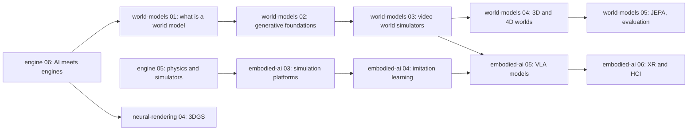

## なぜ重要か

これまでの 5 回で、フレームループからエンジンを組み立ててきました。[アーキテクチャ]({{ '/blog/2026/graphics-engine-01-anatomy-of-an-engine/' | relative_url }})、[GPU API とレンダーグラフ]({{ '/blog/2026/graphics-engine-02-gpu-apis-and-render-graphs/' | relative_url }})、[ミニエンジン]({{ '/blog/2026/graphics-engine-03-build-a-mini-engine/' | relative_url }})、[商用エンジン]({{ '/blog/2026/graphics-engine-04-inside-production-engines/' | relative_url }})、[物理とシミュレーション]({{ '/blog/2026/graphics-engine-05-physics-and-simulation-engines/' | relative_url }})です。それらの図の箱はどれも手書きのコードでした。2026 年には、その多くの箱の中にニューラルネットワークが入っています。アップスケーリングやフレーム生成のように発売済みのゲームに入っているものもあれば、ニューラルマテリアルやテクスチャ圧縮のように SDK の中で成熟しつつあるものもあります。さらに新しい種類のモデルである対話型の**世界モデル**（world models）は、プレイヤーの入力からフレーム全体を生成し、その下にエンジンはまったくありません。

この最終回では、その全体像を描きます。何が置き換えられ、何が補助され、何が実際に出荷され、何がまだ研究段階なのか。最後に[世界モデル]({{ '/blog/2026/world-models-01-what-is-a-world-model/' | relative_url }})と[身体性 AI]({{ '/blog/2026/embodied-ai-01-robotics-foundations/' | relative_url }})のシリーズへ橋渡しします。製品に関する記述はすべて **2026 年 11 月時点**のもので、公式の情報源を引用しています。この分野は毎月変わるからです。

## 前提知識

- リアルタイムパイプライン：G バッファ、テンポラルアンチエイリアス、レイトレーシング効果とデノイズ（[グラフィックス第 06 回]({{ '/blog/2026/graphics-06-real-time-ray-tracing/' | relative_url }})、[グラフィックス第 11 回]({{ '/blog/2026/graphics-11-real-time-rendering-techniques/' | relative_url }})）。
- 3D ガウシアンスプラッティング（[ニューラルレンダリング第 04 回]({{ '/blog/2026/neural-rendering-04-3d-gaussian-splatting/' | relative_url }})）。
- 深層学習の基礎：MLP、Transformer、拡散モデル（[世界モデル第 02 回]({{ '/blog/2026/world-models-02-generative-modeling-foundations/' | relative_url }})）。

## 1. スペクトル：従来手法からニューラルへ

エンジンの各コンポーネントを 4 段階の目盛りに置いてみると分かりやすくなります。

1. **従来手法**：手書きのアルゴリズム（ラスタライザ、シャドウマップ、PGS ソルバ）。
2. **ML 支援**：ネットワークが従来の段階を助けますが、取り外すこともできます。たとえばパストレース画像の ML デノイズや、TAA の入力を使う ML アップスケーラです。
3. **ハイブリッド**：ネットワークが、設計されたインタフェースを持つパイプラインの*部品*になります。シェーダ内でデコードするニューラルテクスチャ、実行中に学習する放射輝度キャッシュ、メッシュと並べて描くスプラットのシーンなどです。
4. **完全ニューラル**：ネットワーク*そのもの*がエンジンです。過去のフレームと行動を次のフレームに写像し、明示的な幾何、物理、ゲームロジックはありません。

次の図は、各エンジンコンポーネントをこの目盛りに置いたものです。1 行が 1 つのコンポーネントで、棒がどの列まで伸びているかが現在のニューラル化の段階を表します。



なぜ今なのでしょうか。3 つのことが重なりました。第一に、**すべての GPU にテンソル演算ハードウェアが載った**こと。RTX のテンソルコア、RDNA 4 の ML アクセラレータ、Intel の XMX ユニットは、小さな行列積をシェーダ ALU よりはるかに速く実行します。第二に、**画素コストの壁**。高フレームレートの 4K とパストレーシングは、GPU が 1 画素あたりに払える以上のコストがかかるので、画素を描くより再構成するほうが安くなりました。第三に、**生成モデル**が画像、動画、3D アセット、コードを実用的な品質で作れるようになったことです。この後は、図の上から下へとコンポーネントを順に見ていきます。

## 2. リアルタイムエンジンの中のニューラルレンダリング

### アップスケーリングとフレーム生成

**超解像**（super resolution）は、低い*内部*解像度（たとえば出力の幅と高さの 67%、つまり画素数で 45%）で描画し、現在のフレーム、モーションベクトル、深度、過去フレームの履歴から出力解像度を再構成します。これは、蓄積と補正のステップを学習モデルにしたテンポラルアンチエイリアス（TAA、[グラフィックス第 11 回]({{ '/blog/2026/graphics-11-real-time-rendering-techniques/' | relative_url }})）です。**フレーム生成**（frame generation）は、オプティカルフロー（optical flow）、モーションベクトル、2 枚の画像から、描画された 2 つのフレームの*間*に追加のフレームを合成します。**マルチフレーム生成**（multi-frame generation）はそれを複数枚挿入します。

2026 年 11 月時点の状況です（各社の発表より）。

| 技術 | 現在のバージョン | ニューラルな部分 | ハードウェア |
| --- | --- | --- | --- |
| **NVIDIA DLSS 4**（2025 年 1 月） | 超解像とレイ再構成（Ray Reconstruction）に Transformer モデル。**マルチフレーム生成**（MFG）は描画 1 フレームあたり最大 3 フレームを生成 | アップスケーリング、デノイズ、フレーム生成 | MFG：RTX 50。Transformer SR/RR：すべての RTX |
| **NVIDIA DLSS 4.5**（2026 年 1 月発表） | 第 2 世代 Transformer 超解像。**ダイナミック MFG** と **6X** モード（最大 5 フレーム生成）を 2026 年 3 月に提供。DLSS 4.5 レイ再構成は 2026 年 8 月から早期アクセス | 同上（より大きなモデル） | 6X とダイナミック MFG：RTX 50。SR：すべての RTX |
| **AMD FSR "Redstone"**（2025 年 12 月） | ML **アップスケーリング**（旧 FSR 4）、ML **フレーム生成**、**Ray Regeneration**（ML デノイズ）、**Radiance Caching**（技術プレビュー） | アップスケーリング、フレーム生成、デノイズ、ニューラル放射輝度キャッシュ | ML 機能：RDNA 4（Radeon RX 9000）。古い GPU には解析的なフォールバック |
| **Intel XeSS 3**（SDK 3.0、2026 年 3 月） | アップスケーリングとマルチフレーム生成（XeSS-MFG） | アップスケーリング、フレーム生成 | Arc GPU |

公式の情報源：[DLSS 4.5 の発表](https://www.nvidia.com/en-us/geforce/news/dlss-4-5-dynamic-multi-frame-gen-6x-2nd-gen-transformer-super-res/)、[DLSS 4.5 ダイナミック MFG の提供開始](https://www.nvidia.com/en-us/geforce/news/nvidia-app-dlss-4-5-dynamic-multi-frame-generation-available-now/)、[開発者向け AMD FSR Redstone](https://gpuopen.com/learn/amd-fsr-redstone-developers-neural-rendering/)、[XeSS のリリース](https://github.com/intel/xess/releases)。

次の図はアップスケーリングとフレーム生成を時間軸に並べたものです。灰色の矢印に比べて赤い矢印がどれだけ長いかに注目してください。



このトレードオフはモデルで見ると最も分かりやすくなります。ネイティブ解像度で 1 フレームを描画する GPU 時間を $t_n$ とし、解像度に依存しない部分 $t_f$ と画素数に比例する部分に分けます。軸ごとの解像度スケールを $s$、アップスケーラのコストを $t_u$、フレーム生成の倍率を $k$（1 はオフ）、生成フレーム 1 枚あたりのコストを $t_g$、CPU 時間を $t_c$（GPU とパイプライン化）とすると、

$$
t_{\text{gpu}} = t_f + (t_n - t_f)\,s^2 + t_u + (k-1)\,t_g, \qquad t_{\text{frame}} = \max(t_{\text{gpu}}, t_c),
$$

$$
\text{fps}_{\text{shown}} = \min\!\Big(\frac{1000\,k}{t_{\text{frame}}},\ f_{\text{refresh}}\Big), \qquad
L \approx t_c + t_{\text{gpu}} + [k>1]\,t_{\text{frame}} + \tfrac{1}{2}\,\frac{1000}{\text{fps}_{\text{shown}}}
$$

となります。記号の補足です。$t_{\text{gpu}}$ は描画 1 フレームあたりの GPU 時間の合計、$t_{\text{frame}}$ は連続する描画フレームの間隔（CPU と GPU はパイプライン化されているので遅いほうで決まります）、$f_{\text{refresh}}$ はディスプレイのリフレッシュレート（Hz）です。1000 はミリ秒を秒に換算する係数で、$1000/t_{\text{frame}}$ が描画フレームレート、それに $k$ を掛けると表示フレームレートになります。$t_u$ は $s<1$ のときだけ加えます（ネイティブ解像度ではアップスケーラは不要です）。$[k>1]$ は条件が成り立つとき 1、そうでなければ 0 になる指示関数です。

遅延 $L$（ms）は、入力を処理する CPU の仕事、GPU の仕事、$k > 1$ のとき補間のために保持する 1 フレーム、そして平均で半分の表示間隔を数えています。OS、ディスプレイ、NVIDIA Reflex などの技術は無視しているので、測定値ではなく説明のための例として扱ってください。

**計算例。** $t_n = 20$ ms（ネイティブで 50 fps）、$t_f = 2$ ms、$t_c = 4$ ms、$t\_u = t\_g = 1$ ms、リフレッシュレートの上限なしとします。

- ネイティブ、$k=1$：$t_{\text{gpu}} = 20$ ms なので 50 fps、$L = 4 + 20 + 10 = 34$ ms。
- $s = 0.67$、$k = 1$：$t_{\text{gpu}} = 2 + 18 \times 0.4489 + 1 = 11.08$ ms なので 90 fps、$L = 4 + 11.08 + 5.54 = 20.6$ ms。アップスケーリングでゲームは滑らかになり、*しかも*応答も速くなります。
- $s = 0.67$、$k = 4$：$t_{\text{gpu}} = 14.08$ ms で描画は 71 fps、**表示は 284 fps** ですが、$L = 4 + 14.08 + 14.08 + 1.76 = 33.9$ ms で、ネイティブ 50 fps と同じ遅延です。

同じモデルを Python で書くと次のとおりです。

```python
def frame_model(scale, k, t_native=20.0, t_fixed=2.0, t_up=1.0, t_gen=1.0, t_cpu=4.0, refresh=1e9):
    render = t_fixed + (t_native - t_fixed) * scale ** 2
    gpu = render + (t_up if scale < 0.999 else 0.0) + (k - 1) * t_gen
    frame = max(gpu, t_cpu)
    fps = min(k * 1000.0 / frame, refresh)
    latency = t_cpu + gpu + (frame if k > 1 else 0.0) + 0.5 * 1000.0 / fps
    return 1000.0 / frame, fps, latency          # rendered fps, displayed fps, latency (ms)

for scale, k in [(1.0, 1), (0.67, 1), (0.67, 4)]:
    print(scale, k, [round(v, 1) for v in frame_model(scale, k)])
```

次の図では、4 通りの $s$ について $k$ を 1 から 6 まで変え、表示 fps と遅延がどう変わるかを読み取ります。



このため各社はフレーム生成を遅延低減技術と組み合わせています（NVIDIA Reflex。完成したフレームを最新のマウス入力で再投影する Reflex 2 の「Frame Warp」は、[NVIDIA のページ](https://www.nvidia.com/en-us/geforce/technologies/reflex/)ではまだ近日提供とされています）。また、フレーム生成はすでにプレイ可能なベースフレームレートから使うことが推奨されています。ここでトレードオフを体感してみてください。



### ニューラル放射輝度キャッシュ

リアルタイムのパストレーシングには多数のバウンスが必要ですが、それでは高すぎます。**ニューラル放射輝度キャッシュ**（neural radiance cache, NRC、Müller et al., SIGGRAPH 2021）は、*ゲームの実行中に*小さな MLP を学習します。一部のパスを長く追跡して学習の目標値とし、ネットワークは出射放射輝度を位置、方向、マテリアルの関数として学びます。その他のパスはすべて 1〜2 回のバウンスで止め、代わりにキャッシュに問い合わせます。論文は 1080p で 1 フレームあたり約 2.6 ms と報告しています。これは[グラフィックス第 06 回]({{ '/blog/2026/graphics-06-real-time-ray-tracing/' | relative_url }})の放射照度キャッシュやプローブの学習版の親戚です。AMD の FSR Redstone の Radiance Caching も同じ考え方にもとづいています。

### ニューラルマテリアルとニューラルテクスチャ圧縮

映画品質の多層マテリアル（フレーク入りの車の塗装、コーティングされた布、陶磁器）は、多くのテクスチャ参照と長い BRDF の評価を必要とします。**Real-Time Neural Appearance Models**（Zeltner et al., SIGGRAPH 2024）は、多層 BRDF 全体を、潜在テクスチャと、シェーダの*中で*動く小さな MLP デコーダで置き換えます。著者らは、近似対象の非ニューラルな多層マテリアルより 1 桁以上速く評価できると報告しています。これはハイブリッドの部品です。エンジンは引き続きラスタライズやレイトレースを行い、マテリアルの評価をネットワークが担います。

**ニューラルテクスチャ圧縮**（neural texture compression, NTC、Vaidyanathan et al., SIGGRAPH 2023）は、マテリアルの*すべての*チャンネル（アルベド、法線、ラフネス、メタルネス、アンビエントオクルージョン）をまとめて圧縮します。マテリアルごとに低解像度の潜在特徴グリッドと小さな MLP を保存します。画素をシェーディングするときは、テクセルの UV で潜在量をサンプリングして MLP を実行し、全チャンネルを一度に出力します。テクセル単位で評価するので、動画コーデックにはないランダムアクセス性を保っています。論文のプロファイルは**画素・チャンネルあたり 0.2〜1.0 ビット**（bits per pixel per channel, BPPC）で、比較対象のブロック圧縮（BCn）のベースラインは約 **4 BPPC** です。そのベースラインと比べて、約 30% 少ないメモリで 16 倍のテクセルを保持できると報告しています。

次の図では、左半分がシェーダ内でのデコード、右半分が記憶容量の比較です。



**計算例。** チャンネル数はマテリアルセットによって異なります（図の模式図では 8 つ）。ここでは 4096 × 4096、9 チャンネルのマテリアルを仮定すると、$4096^2 \times 9 = 150{,}994{,}944$ チャンネル・テクセルです。4 BPPC なら $603{,}979{,}776$ ビット $= 72$ MiB、1.0 BPPC なら 18 MiB、0.2 BPPC なら 3.6 MiB です。マテリアルが数百あれば、この差はシーンが 8 GB の GPU に収まるかどうかを決めます。

```python
texels, channels = 4096 * 4096, 9
for name, bppc in [("BCn baseline", 4.0), ("NTC high", 1.0), ("NTC low", 0.2)]:
    print(f"{name:13s} {texels * channels * bppc / 8 / 2**20:6.1f} MiB")
```

代償は計算量です。テクスチャのサンプル 1 回ごとに、小さなネットワークの評価が必要になります。そこでシェーダの中のテンソルコアが登場します。

### ニューラルシェーダと cooperative vectors：API の状況

ピクセルシェーダの中で MLP を効率よく動かすには、シェーダが小さな行列ベクトル積をテンソルユニットに渡す必要があります。API はまだ固まっていません。

- **Vulkan** には、NVIDIA のサンプルが使うベンダー拡張 **`VK_NV_cooperative_vector`**（[仕様のソース](https://github.com/KhronosGroup/Vulkan-Docs/blob/main/appendices/VK_NV_cooperative_vector.adoc)）があります。
- **DirectX**：Microsoft は HLSL の「cooperative vectors」をプレビューしていましたが、[2025 年 9 月の記事](https://devblogs.microsoft.com/directx/shader-model-6-9-and-the-future-of-cooperative-vector/)で、この機能を Shader Model 6.9 には入れないと発表しました。代わりに、**Shader Model 6.10** に予定されている行列・ベクトルの統一設計（「LinAlg」）に置き換えられ、現在はプレビュー段階です。SM 6.9 自体は 2026 年 2 月にリリースされ、ロングベクトル、シェーダ実行の並べ替え、オパシティマイクロマップ、DXR 1.2 を含んでいます。
- **NVIDIA RTX Kit**（[概要](https://developer.nvidia.com/rtx-kit)）は RTX Neural Shaders とニューラルテクスチャ圧縮 SDK をまとめたもので、どちらもベータ扱いです。[RTXNTC SDK v0.10](https://github.com/NVIDIA-RTX/RTXNTC/releases) は DX12 SM 6.10 経由の推論を追加し、まだ製品には使わないよう警告しています。RTX Neural Materials は未リリースとされていました。

つまり 2026 年 11 月時点では、ニューラルなアップスケーリングとフレーム生成は数百本の発売済みゲームで使われています。ニューラルマテリアルとテクスチャ圧縮は成熟した研究でベータ版の SDK もありますが、標準のシェーダモデルでのサポートを待っている段階です。

## 3. エンジンの中のガウシアンスプラット

スプラット（[ニューラルレンダリング第 04 回]({{ '/blog/2026/neural-rendering-04-3d-gaussian-splatting/' | relative_url }})）がエンジンにとって魅力的なのは、ラスタライズ（投影、ソート、アルファブレンド）で描画でき、実行時にネットワークが要らないからです。撮影した実在の場所が、数時間でゲームに使える背景になります。ホームページの [Gaussian World デモ]({{ '/' | relative_url }}#lab)は WebGL 2 でスプラットを描画しており、[ニューラルレンダリング第 06 回]({{ '/blog/2026/neural-rendering-06-capture-to-vr-tutorial/' | relative_url }})では撮影から VR までを順に解説しています。

2026 年 11 月時点のエコシステムは次のとおりです。

- **標準**：Khronos は glTF 拡張 **`KHR_gaussian_splatting`** をリリース候補として [2026 年 2 月](https://www.khronos.org/news/archives/khronos-announces-gltf-gaussian-splatting-extension)に発表しました。[拡張の README](https://github.com/KhronosGroup/glTF/blob/main/extensions/2.0/Khronos/KHR_gaussian_splatting/README.md) では現在、状態が批准済み（ratified）となっています。Niantic のオープンな **SPZ** 形式（[リポジトリ](https://github.com/nianticlabs/spz)、MIT）は PLY より約 10 分の 1 の大きさで、圧縮スプラットに広く使われています。
- **Web**：PlayCanvas のエンジンはスプラットをネイティブに描画でき、LOD のストリーミングにも対応しています。オープンソースのエディタ **SuperSplat**（[リポジトリ](https://github.com/playcanvas/supersplat)）では、ブラウザで撮影結果を整理・編集できます。**Spark**（[sparkjs.dev](https://sparkjs.dev/)、World Labs 製）は three.js ベースのスプラットレンダラで、PLY や SPZ などを読み込めます。
- **ゲームエンジン**：公式のリリースノートを見る限り、Unreal、Unity、Godot に組み込みのスプラットレンダラはありません。プラグインは多数あります。Unity には Aras Pranckevičius の [UnityGaussianSplatting](https://github.com/aras-p/UnityGaussianSplatting)（MIT。作者はもう積極的には開発しないとしています）、Unreal には Luma や Volinga などのプラグイン、Godot にはコミュニティのアドオンがあります。

技術的な課題は**ハイブリッドレンダリング**（hybrid rendering）です。スプラットはメッシュ、ライト、影、ポストプロセスと共存しなければなりません。標準的な手順は図のとおりです。まずメッシュの G バッファを描き、スプラットを投影してソートし、メッシュの深度との深度テストを行って合成します。こうすると、キャラクターが撮影した彫像の*後ろ*を歩けます。スプラットはライティング済みで（色に撮影時の光が焼き込まれています）、正しい影も落としません。スプラットのリライティングと影は活発な研究テーマです（[ニューラルレンダリング第 05 回]({{ '/blog/2026/neural-rendering-05-3dgs-frontiers/' | relative_url }})）。



## 4. 生成コンテンツのパイプライン

### 画像やテキストから 3D へ

アセット制作はゲーム開発で最大のコストなので、3D 生成器は大きな注目を集めています。2026 年 11 月時点のオープンなモデルです。

| モデル | 組織 | 状況 | 出力 |
| --- | --- | --- | --- |
| **TRELLIS** | Microsoft | CVPR 2025（スポットライト）、[arXiv 2412.01506](https://arxiv.org/abs/2412.01506)。コードと重みは MIT | 構造化 3D 潜在表現。メッシュ、放射輝度場、ガウシアンにデコード |
| **TRELLIS.2** | Microsoft | プレプリント [arXiv 2512.14692](https://arxiv.org/abs/2512.14692)（2025 年 12 月）。4B パラメータのモデル | より高解像度の「O-Voxel」構造化潜在表現、PBR テクスチャ付きメッシュ |
| **Hunyuan3D 2.0 / 2.1** | Tencent | [arXiv 2501.12202](https://arxiv.org/abs/2501.12202)（2025 年 1 月）。2.1（[arXiv 2506.15442](https://arxiv.org/abs/2506.15442)、2025 年 6 月）は学習コードを含めて完全オープン | 形状モデル（3.3B）と PBR テクスチャの「Paint」モデル（2.1 では 2B） |
| **SAM 3D**（Objects、Body） | Meta | 2025 年 11 月、[arXiv 2511.16624](https://arxiv.org/abs/2511.16624)。重みは SAM License | 1 枚の画像から 3D の物体と人体 |
| **SPAR3D** | Stability AI | プレプリント [arXiv 2501.04689](https://arxiv.org/abs/2501.04689)（2025）。Stable Fast 3D がベース | 1 枚の画像からの高速なメッシュ生成と点群による編集 |

商用サービス（Meshy、Tripo、Hyper3D Rodin など）は、同様のモデルにリトポロジー、UV 展開、PBR ベイクを組み合わせて提供しています。エンジンにとって大事な問いは「メッシュを作れるか」ではなく、「**そのままゲームに使える**アセットを作れるか」です。妥当な三角形数のきれいなトポロジー、重なりのない UV、ライティングを焼き込んでいない個別の PBR マップ、正しいスケールとピボット、衝突用の代理形状、LOD が必要です（リメッシュと簡略化は[グラフィックス第 08 回]({{ '/blog/2026/graphics-08-geometry-processing/' | relative_url }})を参照）。2026 年時点で、生成アセットは小物、プロトタイプ、背景コンテンツなら実用段階ですが、主役のアセットや変形するものにはアーティストの手直しが必要です。

### マテリアル、モーション、プロシージャル生成

- **PBR テクスチャとマテリアル**：拡散モデルが、テキストや写真からタイル可能なアルベド、法線、ラフネスのマップを生成します（Adobe の Substance 3D ツールには Firefly ベースのテキストからテクスチャを作る機能があります）。Hunyuan3D の Paint モデルや TRELLIS.2 は PBR マップを直接出力します。
- **モーション**：**MDM**（Tevet et al., ICLR 2023、[arXiv 2209.14916](https://arxiv.org/abs/2209.14916)）などのテキストからモーションへの拡散モデルが骨格アニメーションを生成し、それが[第 05 回]({{ '/blog/2026/graphics-engine-05-physics-and-simulation-engines/' | relative_url }})のアニメーションランタイムに入ります。それ以外の部分は[グラフィックス第 09 回]({{ '/blog/2026/graphics-09-animation-and-characters/' | relative_url }})で扱っています。
- **プロシージャル生成と LLM**：LLM が幾何を直接作るのではなく、従来のプロシージャルシステム（Houdini のグラフ、Blender のスクリプト、レベルレイアウトの文法）に渡す*パラメータやコード*を書きます。出力は編集可能で決定的で、予算内に収まります。これがこのパターンが制作現場で好まれる理由です。

## 5. エンジンとエディタの中の LLM エージェント

**Model Context Protocol**（MCP。[2024 年 11 月に Anthropic がオープンソース化](https://www.anthropic.com/news/model-context-protocol)、[仕様](https://modelcontextprotocol.io/specification/2025-11-25)）を使うと、LLM はサーバが公開するツールを呼び出せます。*エディタ*の MCP サーバは、オブジェクトの作成、コンポーネントの編集、ゲームの実行、コンソールの読み取りといった操作を公開します。するとエージェントは、シーンを組み立て、スクリプトを書いて実行し、エラーを読んで直すことができます。公式のツールとコミュニティのプロジェクトは分けて考えましょう。

| 統合 | 公式か | 状況（2026 年 11 月） |
| --- | --- | --- |
| **Unity AI**（ask/plan/agent モードを持つ Assistant、MCP サーバ、ジェネレータ） | 公式 | オープンベータ、Unity 6 以降（[Unity のブログ](https://unity.com/blog/unity-ai-how-to-get-started)） |
| **Unreal Engine 5.8** の MCP プラグイン | 公式 | 実験的機能（[UE 5.8 リリースノート](https://dev.epicgames.com/documentation/en-us/unreal-engine/unreal-engine-5-8-release-notes)） |
| [unity-mcp](https://github.com/CoplayDev/unity-mcp)（Coplay） | コミュニティ。Unity とは無関係 | MIT |
| [godot-mcp](https://github.com/Coding-Solo/godot-mcp) | コミュニティ | MIT |
| [blender-mcp](https://github.com/ahujasid/blender-mcp) | コミュニティ。Blender 公式ではない | MIT。[Blender Foundation の声明](https://www.blender.org/news/upcoming-blender-development-fund-and-ai-policies/)によれば、Blender 本体には生成 AI は組み込まれておらず、その予定もない |

**AI NPC** は*プレイ中に*言語モデルを動かします。NVIDIA の ACE スタック（音声認識、小型言語モデル、音声合成、アニメーション）は **PUBG Ally** を動かしています。これは音声で指示できる AI のチームメイトで、[2026 年 6 月にパブリックベータ](https://www.nvidia.com/en-us/geforce/news/pubg-ally-ai-teammate-beta-available-now/)が行われました。メモリ 8 GB 以上の RTX GPU が必要で、音声認識と 2B パラメータの言語モデルを端末上で動かします。NVIDIA は Unreal Engine 5 プラグイン付きの [ACE Game Agent SDK](https://developer.nvidia.com/blog/build-on-device-ai-companions-with-the-nvidia-ace-game-agent-sdk-and-unreal-engine-5-plugins/) もベータで公開しています。難しいのはモデルではなく**インタフェース**の設計です。小さなモデルが固定のツールスキーマを通してゲームの行動を呼び出し、数百ミリ秒の遅延予算に収め、レンダリングと GPU を共有しなければなりません。

## 6. ニューラルゲームエンジンと対話型世界モデル

スペクトルの一番端では、エンジンが、過去のフレームとプレイヤーの行動から次のフレームを予測するネットワークに置き換わります。

$$
\mathbf{o}_{t+1} \sim p_\theta\big(\mathbf{o}_{t+1} \,\big\vert\, \mathbf{o}_{t-c+1:t},\ \mathbf{a}_{t-c+1:t}\big)
$$

ここで $\mathbf{o}\_t$ はフレーム（通常はオートエンコーダの潜在表現）、$\mathbf{a}\_t$ は行動（キー、マウス、カメラ姿勢、テキスト）、$c$ はコンテキスト長、$p\_\theta$ はパラメータ $\theta$ のネットワークが表す条件付き分布で、$\sim$ はそこからのサンプリングを意味します（同じ入力でも異なる次のフレームが得られます）。多くのモデルは**自己回帰型の動画拡散**（autoregressive video diffusion）モデルです。拡散モデルやフローモデルが、過去の潜在表現と行動のウィンドウを条件として次の潜在フレームを生成し、リアルタイムに届くようデノイズを数ステップまで蒸留しています。生成の仕組みは[世界モデル第 03 回]({{ '/blog/2026/world-models-03-video-world-simulators/' | relative_url }})、3D に一貫した世界の生成は[世界モデル第 04 回]({{ '/blog/2026/world-models-04-3d-and-4d-world-generation/' | relative_url }})で説明しています。ここではそれらを*エンジン*として見ます。

次の図は、これらのシステムをまず最初の公開日の順に並べたものです。2025 年後半から発表が急に密になっていることに注目してください。



2026 年 11 月時点の状況です（数値は情報源が明示しているものだけ）。

| システム | 開発元 | 状況 | 学習データ / 操作方法 | 公表されている性能 |
| --- | --- | --- | --- | --- |
| **DIAMOND** | Alonso et al. | NeurIPS 2024、[arXiv 2405.12399](https://arxiv.org/abs/2405.12399) | Atari、87 時間の CS:GO プレイ。キーボードとマウス | CS:GO モデルは RTX 3090 で約 10 fps |
| **GameNGen** | Valevski et al.（Google） | ICLR 2025、[arXiv 2408.14837](https://arxiv.org/abs/2408.14837) | DOOM、強化学習エージェントのプレイ記録。プレイヤー入力 | TPU 1 基で 20 fps |
| **Oasis** | Decart、Etched | [デモ、2024 年 10 月](https://oasis-model.github.io/) | Minecraft 風。キーボード | 20 fps |
| **Muse / WHAM** | Microsoft Research、Ninja Theory | Nature 2025、[DOI](https://doi.org/10.1038/s41586-025-08600-3) | 『Bleeding Edge』の約 7 年分のプレイ。コントローラ | 300 × 180 のフレーム。最大約 2 分を生成 |
| **Genie 2** | Google DeepMind | [ブログ、2024 年 12 月](https://deepmind.google/discover/blog/genie-2-a-large-scale-foundation-world-model/) | 大規模な動画データセット。キーボードとマウス | 最大 1 分程度一貫 |
| **Genie 3** | Google DeepMind | [ブログ、2025 年 8 月](https://deepmind.google/discover/blog/genie-3-a-new-frontier-for-world-models/)。2026 年 1 月から「Project Genie」として購読者に提供 | ナビゲーションとテキストによる「ワールドイベント」 | 720p、24 fps、数分間一貫 |
| **Matrix-Game 2.0 / 3.0** | Skywork | [arXiv 2508.13009](https://arxiv.org/abs/2508.13009)（2025 年 8 月）、[arXiv 2604.08995](https://arxiv.org/abs/2604.08995)（2026 年 4 月） | Unreal Engine と GTA5 の動画（2.0）、UE の合成データ、ゲーム、実写動画（3.0）。キーボード/マウス、姿勢 | 2.0：25 fps。3.0：720p、最大 40 fps（5B モデル） |
| **Hunyuan-GameCraft / -2** | Tencent | [arXiv 2506.17201](https://arxiv.org/abs/2506.17201)（2025 年 6 月）、[arXiv 2511.23429](https://arxiv.org/abs/2511.23429)（2025 年 11 月） | 100 本以上の AAA ゲームからの 100 万本以上の録画。キーボード/マウス、テキスト（2） | 記載なし |
| **Yan** | Tencent | [arXiv 2508.08601](https://arxiv.org/abs/2508.08601)（2025 年 8 月） | フレームごとの行動とテキストによる編集 | 1080p、60 fps |
| **HY-World 1.5（WorldPlay）** | Tencent | [arXiv 2512.14614](https://arxiv.org/abs/2512.14614)（2025 年 12 月）、コード公開 | キーボードとマウス。長期の記憶 | 720p、24 fps |
| **Dreamer 4** | Hafner、Yan、Lillicrap（Google DeepMind） | [arXiv 2509.24527](https://arxiv.org/abs/2509.24527)（2025 年 9 月） | Minecraft のオフラインデータ。エージェントはモデルの*中で*学習 | GPU 1 基でリアルタイム推論 |
| **RTFM** | World Labs | [リサーチプレビュー、2025 年 10 月](https://www.worldlabs.ai/blog/rtfm) | 姿勢付きフレームを空間メモリとして使用。カメラ | H100 1 基で対話的 |
| **Marble** | World Labs | [製品、2025 年 11 月](https://www.worldlabs.ai/blog/marble-world-model) | テキスト、画像、動画、レイアウト | フレームではなく永続的な 3D 世界（スプラット、メッシュ）を出力 |
| **Odyssey-2 Pro / Max** | Odyssey | [Odyssey-2 Max、2026 年 4 月](https://odyssey.systems/introducing-odyssey-2-max) | 一般的な動画と対話データ | リアルタイム、120 秒以上の生成（解像度と fps は記載なし） |
| **Runway GWM-1 / Worlds 2** | Runway | [GWM-1、2025 年 12 月](https://runway.com/research/introducing-runway-gwm-1)、[Worlds 2、2026 年 9 月](https://runway.com/research/introducing-gwm-worlds-2) | カメラの動き、テキストによる行動 | 720p、24 fps（Worlds 2）、最大 2 分（GWM-1） |
| **Genie 4** | Google DeepMind | [リサーチプレビュー、2026 年 10 月 27 日](https://deepmind.google/blog/genie-4-a-new-generation-of-world-simulation/) | キーボードとカメラ、Gemini によるテキストでの誘導、ネイティブな音声 | 記載なし |

次の図は表の数値をプロットしたもので、左は解像度とフレームレート、右は各情報源が主張する記憶や一貫性の持続時間です。



本シリーズのエンジンと比べるとどうでしょうか。

- **何を学ぶか**：レンダリング、物理、ゲームのルール、さらには他のプレイヤーの振る舞いまで、動画と行動から暗黙的に学びます。手で指定するものは何もありません。それが魅力（動画さえあればどんな世界でも作れる）であり、問題（何も保証されない）でもあります。
- **操作**：キーとマウスは学習された行動埋め込みに対応します。新しいシステムはテキスト（「雨を降らせて」）、カメラ姿勢、空間メモリを加えています。「3 番のドアを開ける」といった API はなく、編集はプロンプトや条件付けを通すしかありません。
- **フレームレートと遅延**：リアルタイムにするには、拡散モデルを数ステップに蒸留し、過去の活性をキャッシュし、しばしば専用ハードウェア（Oasis は Etched のチップ、GameNGen は TPU）を使います。1 フレームごとに大きなネットワークを評価するので、数ミリ秒で済むラスタライズと比べ、プレイヤー 1 人 1 時間あたりのエネルギーと配信コストは従来のエンジンよりはるかに高いままです。
- **記憶と一貫性**：コンテキストウィンドウが有限なので、世界はずれていきます。振り返ると部屋が変わっているかもしれません。対策は、より長いコンテキスト、姿勢付きの過去フレームを**空間メモリ**（spatial memory）として検索すること（RTFM、WorldPlay）、そして明示的な 3D の中間表現です（Marble はスプラットとメッシュを出力し、それを従来のエンジンが描画します）。
- **失敗のパターン**：物体の変形や消失、物理法則の破れ（めり込み、浮遊する物体）、長いロールアウトでの品質の劣化、行動の効果が遅れる・現れない、学習分布の外での劣化。

したがって 2026 年の現実的な姿は、置き換えではなく**融合**です。世界モデルはコンテンツ、プロトタイプ、学習環境を生成し、従来のエンジンは永続性、厳密なルール、安価なレンダリングを提供します。3D の出力（スプラット、メッシュ）が両者の橋渡しになります。

## 7. データ工場としてのエンジン

エンジンの最後の役割が、このシリーズと身体性 AI をつなぎます。世界モデルやロボットの方策のための**学習データ**を生成することです（[第 05 回]({{ '/blog/2026/graphics-engine-05-physics-and-simulation-engines/' | relative_url }})の第 10 節）。

- **シミュレーションと合成データ**：Omniverse Replicator（[ドキュメント](https://docs.omniverse.nvidia.com/extensions/latest/ext_replicator.html)）付きの Isaac Sim、Genesis、第 05 回の GPU シミュレータは、ラベル付きのフレームやロボットの軌道を何百万も描画します。Matrix-Game 3.0 は、データエンジンの一部として Unreal Engine の描画結果で明示的に学習しています。従来のエンジンが、いまやニューラルなエンジンの学習データを作っているのです。
- **世界基盤モデル**：NVIDIA の **Cosmos** プラットフォーム（[Agarwal et al., arXiv 2501.03575](https://arxiv.org/abs/2501.03575)）は、フィジカル AI 向けのオープンな動画世界モデルを提供しています。**Cosmos-Predict2.5** と **Cosmos-Transfer2.5**（[arXiv 2511.00062](https://arxiv.org/abs/2511.00062)）は未来の動画を予測し、シミュレータの描画結果（セグメンテーション、深度、エッジ）をフォトリアルな動画に変換します。これは、sim-to-real の*見た目*のギャップを、より良いレンダラではなく生成モデルで埋める方法です。2026 年 5 月には NVIDIA が **Cosmos 3** ファミリーを公開しました（[リポジトリ](https://github.com/NVIDIA/Cosmos)）。
- **合成されたロボット経験**：NVIDIA の [GR00T-Dreams ブループリント](https://nvidianews.nvidia.com/news/nvidia-powers-humanoid-robot-industry-with-cloud-to-robot-computing-platforms-for-physical-ai)は、ロボットに合わせて Cosmos モデルを追加学習し、1 枚の画像からタスクの動画を生成し、そこから行動を取り出します。**Cosmos Policy**（[arXiv 2601.16163](https://arxiv.org/abs/2601.16163)）は、動画世界モデルを直接ロボットの方策にファインチューニングします。

次の図では、データが矢印に沿ってシミュレータから実ロボットへ流れ、破線に沿って戻ってきます。



ここが引き継ぎの地点です。シミュレータの詳細は[身体性 AI 第 03 回]({{ '/blog/2026/embodied-ai-03-simulation-platforms/' | relative_url }})、このデータで学習される視覚・言語・行動モデルは[身体性 AI 第 05 回]({{ '/blog/2026/embodied-ai-05-vision-language-action-models/' | relative_url }})で扱います。

## 8. 未解決の問題と学習の道筋

2026 年末時点の未解決の問題です。

1. ニューラルエンジンの**制御性と永続性**：厳密なゲーム状態、セーブとロード、マルチプレイの一貫性、決定的なリプレイ。いずれも第 01 回のエンジンには簡単で、世界モデルには未解決です。
2. **コスト**：ラスタライズと比べたときの、ニューラルなフレームのプレイヤー 1 時間あたりのエネルギーと配信コスト。蒸留、キャッシュ、専用ハードウェア。
3. **再構成のアーティファクト**：フレーム生成のゴーストやディスオクルージョンの誤り、ニューラルマテリアルの時間的安定性、スプラットのリライティングと影。
4. ニューラルシェーダの**標準 API**（SM 6.10 の LinAlg、ベンダー横断の Vulkan 拡張）と標準フォーマット（`KHR_gaussian_splatting`、圧縮スプラットの拡張）。
5. **評価**：見た目の品質だけでなく、世界モデルの物理的な正しさと一貫性をどう測るか（[世界モデル第 05 回]({{ '/blog/2026/world-models-05-jepa-evaluation-and-open-problems/' | relative_url }})）。
6. **Sim-to-real**：生成的な「変換」モデルがより良いレンダラに勝るのはどんなときか。物理をでっち上げないことをどう保証するか。

このシリーズの終点から、このブログを通る学習の道筋です。



## 試してみよう

- 上のフレーム予算ウィジェットで、フレーム生成によって遅延がネイティブ描画*より悪く*なる設定と、アップスケーリングだけで最良の遅延が得られる設定を探してください。
- ホームページの [Gaussian World]({{ '/' | relative_url }}#lab) は、第 3 節のハイブリッドパイプラインがメッシュと合成している、ソートとブレンドによるスプラットレンダラです。
- `frame_model` を `refresh=144` で動かし、ディスプレイの上限によって $k$ を大きくしても意味がなくなる点を確かめてください。

## 代表的な論文

| 論文 | 掲載先 | 年 | リンク | 意義 |
| --- | --- | --- | --- | --- |
| Müller et al., *Real-time Neural Radiance Caching for Path Tracing* | ACM TOG（SIGGRAPH） | 2021 | [arXiv](https://arxiv.org/abs/2106.12372) | 多重バウンス GI のためのオンライン学習 MLP キャッシュ |
| Vaidyanathan et al., *Random-Access Neural Compression of Material Textures* | ACM TOG（SIGGRAPH） | 2023 | [arXiv](https://arxiv.org/abs/2305.17105) | 0.2〜1.0 BPPC のニューラルテクスチャ圧縮 |
| Kerbl et al., *3D Gaussian Splatting for Real-Time Radiance Field Rendering* | ACM TOG（SIGGRAPH） | 2023 | [DOI](https://doi.org/10.1145/3592433) | いまエンジンが取り込んでいるスプラット表現 |
| Tevet et al., *Human Motion Diffusion Model* | ICLR | 2023 | [arXiv](https://arxiv.org/abs/2209.14916) | テキストからモーションへの拡散モデル |
| Zeltner et al., *Real-Time Neural Appearance Models* | ACM TOG（SIGGRAPH） | 2024 | [プロジェクト](https://research.nvidia.com/labs/rtr/neural_appearance_models/) | シェーダ内のニューラル多層マテリアル |
| Alonso et al., *Diffusion for World Modeling: Visual Details Matter in Atari*（DIAMOND） | NeurIPS | 2024 | [arXiv](https://arxiv.org/abs/2405.12399) | 拡散世界モデル。プレイ可能な CS:GO |
| Valevski et al., *Diffusion Models Are Real-Time Game Engines*（GameNGen） | ICLR | 2025 | [arXiv](https://arxiv.org/abs/2408.14837) | 拡散モデルによるプレイ可能な DOOM |
| Kanervisto et al., *World and Human Action Models towards gameplay ideation*（Muse / WHAM） | Nature | 2025 | [DOI](https://doi.org/10.1038/s41586-025-08600-3) | ゲームプレイの発想支援のための商用ゲームの世界モデル |
| Xiang et al., *Structured 3D Latents for Scalable and Versatile 3D Generation*（TRELLIS） | CVPR | 2025 | [arXiv](https://arxiv.org/abs/2412.01506) | オープンな画像から 3D への基盤モデル |
| Agarwal et al., *Cosmos World Foundation Model Platform for Physical AI* | arXiv | 2025 | [arXiv](https://arxiv.org/abs/2501.03575) | ロボットと自動運転のためのオープンな世界基盤モデル |
| He et al., *Matrix-Game 2.0* | arXiv | 2025 | [arXiv](https://arxiv.org/abs/2508.13009) | オープンなリアルタイム対話型世界モデル |
| Hafner, Yan & Lillicrap, *Training Agents Inside of Scalable World Models*（Dreamer 4） | arXiv | 2025 | [arXiv](https://arxiv.org/abs/2509.24527) | 世界モデルの中だけで学習したエージェント |
| Sun et al., *WorldPlay: Towards Long-Term Geometric Consistency for Real-Time Interactive World Modeling*（HY-World 1.5） | arXiv | 2025 | [arXiv](https://arxiv.org/abs/2512.14614) | 長期記憶を持つリアルタイム世界モデル |
| Kim et al., *Cosmos Policy* | arXiv | 2026 | [arXiv](https://arxiv.org/abs/2601.16163) | ロボットの方策にファインチューニングした動画世界モデル |

## 学習リソース

- NVIDIA の [RTX Kit](https://developer.nvidia.com/rtx-kit) のサンプル（ニューラルシェーダ、テクスチャ圧縮）と AMD の [FSR Redstone の開発者向け記事](https://gpuopen.com/learn/amd-fsr-redstone-developers-neural-rendering/)：リアルタイムパイプラインの中のニューラル部品を最も具体的に見られます。
- API のロードマップについては、Microsoft の DirectX ブログの [Shader Model 6.9 と cooperative vectors](https://devblogs.microsoft.com/directx/shader-model-6-9-and-the-future-of-cooperative-vector/) の記事。
- スプラット：[SuperSplat](https://github.com/playcanvas/supersplat)、[Spark](https://sparkjs.dev/)、[UnityGaussianSplatting](https://github.com/aras-p/UnityGaussianSplatting)（読みやすくコメントの充実したコード）、[KHR_gaussian_splatting](https://github.com/KhronosGroup/glTF/blob/main/extensions/2.0/Khronos/KHR_gaussian_splatting/README.md) の仕様。
- 生成 3D：[TRELLIS](https://github.com/microsoft/TRELLIS) と [Hunyuan3D-2.1](https://github.com/Tencent-Hunyuan/Hunyuan3D-2.1) のリポジトリ。
- エージェント：[MCP の仕様](https://modelcontextprotocol.io/specification/2025-11-25)。エディタ操作がどのようにツールになるかは、[unity-mcp](https://github.com/CoplayDev/unity-mcp) のようなエディタ用 MCP サーバを読むと分かります。
- 世界モデル：[GameNGen](https://gamengen.github.io/) と [DIAMOND](https://diamond-wm.github.io/) のプロジェクトページ（DIAMOND のコードは手元で動かせます）、オープンな [HY-WorldPlay](https://github.com/Tencent-Hunyuan/HY-WorldPlay) のコード、そして本サイトの[世界モデルシリーズ]({{ '/blog/2026/world-models-01-what-is-a-world-model/' | relative_url }})。

## 演習

1. `frame_model`（ほかのパラメータは計算例と同じ）を使い、$t_n = 30$ ms のときに $k = 1$ で 60 fps に届く内部解像度スケールを求め、その遅延を $s = 1$、$k = 2$ の遅延と比べてください。
2. モデルにディスプレイのリフレッシュ上限と「フレームペーシング」の規則を加えてください。生成フレームが役に立つのは $k \cdot F \le R$（$F$ は描画フレームレート、$R$ はリフレッシュレート）のときだけです。描画が 70 fps のとき、144 Hz で最良の $k$ はいくつでしょうか。
3. 2048² で 9 チャンネルの異なるマテリアル 300 個を持つシーンのテクスチャメモリを、4 BPPC と 0.5 BPPC で計算してください。節約したメモリに追加でいくつのマテリアルが入るでしょうか。
4. 「指定位置にプレハブを生成する」と「マテリアルのパラメータを設定する」の擬似 MCP ツールスキーマ（名前、説明、JSON パラメータ）を書いてください。LLM の呼び出しを実行する前に、エディタはどんな検証をすべきでしょうか。
5. 表から世界モデルを 1 つ選び、永続性を試す実験を 3 つ挙げてください（たとえば、目をそらして戻す、ドアを開けて部屋を出る、出発点に戻る）。それぞれの場合に、従来のエンジンなら何が保証されるでしょうか。

<details markdown="1"><summary>ヒント</summary>

1. 60 fps は $t_{\text{gpu}} = 1000/60 \approx 16.7$ ms に当たるので、$2 + 28 s^2 + 1 = 16.7$ を $s$ について解きます（約 $0.70$）。遅延は約 $4 + 16.7 + 8.3 = 29$ ms です。$s = 1$、$k = 2$ では $t_{\text{gpu}} = 31$ ms、描画 32 fps（表示 65 fps）、遅延は約 $4 + 31 + 31 + 7.8 \approx 74$ ms です。
2. $k = 2$（140 fps）です。$k = 3$ ではリフレッシュレートを超え、追加のフレームは表示されません。
3. $300 \times 2048^2 \times 9 \times 4 / 8$ バイト $\approx 5.3$ GiB に対し約 $0.66$ GiB です。節約した 4.6 GiB には、0.5 BPPC で約 2,100 個のマテリアル（1 個 2.25 MiB）が追加で入ります。
4. プレハブが存在するか、位置がレベルの範囲内か、パラメータの型が合っているかを確認し、取り消し（Undo）の手順を必ず用意します。
5. 物体の同一性、状態の変化、位置の永続性です。従来のエンジンはそれらをシーンとゲーム状態に明示的に保存しています。

</details>

これでグラフィックスエンジンのシリーズは終わりです。ここからは、生成の側面を学ぶなら[世界モデルシリーズ]({{ '/blog/2026/world-models-01-what-is-a-world-model/' | relative_url }})へ、前回の記事で扱ったエンジンの中で学習するロボットについて学ぶなら[身体性 AI シリーズ]({{ '/blog/2026/embodied-ai-01-robotics-foundations/' | relative_url }})へ進んでください。
