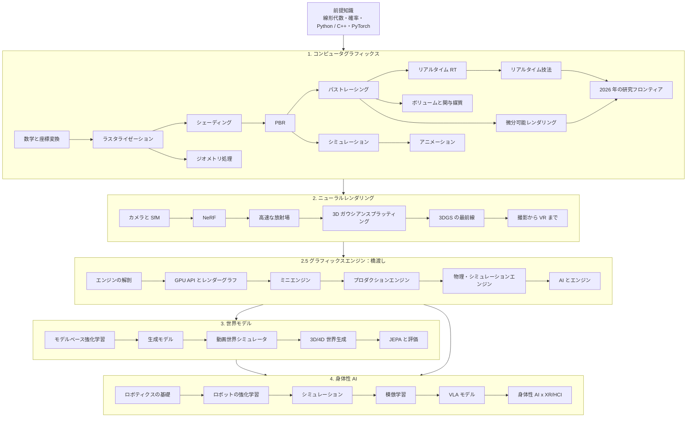

この記事はブログ全体の地図です。私は**身体性 AI、世界モデル、AR/VR、HCI、コンピュータグラフィックス**の交差点を研究している博士課程の学生です。これらの分野には、意外なほど一直線のストーリーがあります。まず画像がどのように作られるかを学び（グラフィックス）、写真からその過程を*逆算*する方法を学び（ニューラルレンダリング、3D ガウシアンスプラッティング）、世界がどう変化するかを*予測*するモデルを学び（世界モデル）、最後に世界の中に身体を置いて行動させます（身体性 AI）。

ブログはこの流れに沿った 5 つのシリーズと、日付入りの論文速報コラムで構成しています。4 つのシリーズはストーリーの各段階そのもので、5 つ目のグラフィックスエンジンのシリーズはそれらをつなぐ橋渡しです。ロボットを学習させるシミュレータも、世界モデルが向かいつつあるニューラルゲームエンジンも、中身はエンジンだからです。すべての記事に日本語・英語・中国語の 3 バージョンがあり、数式の導出、実行できる短いコード、そして SIGGRAPH、CVPR/ICCV/ECCV、NeurIPS/ICLR/ICML、CoRL/RSS などのトップ会議・論文誌の代表的な論文へのリンクを載せています。各分野には、リポジトリ内に整理された文献リストもあります。

## ステージ 0：前提知識

始める前にすべてを身につける必要はありませんが、いずれどれにも出会います。

- **線形代数**：ベクトル、行列、固有値分解、SVD。グラフィックスとビジョンの多くは $4\times 4$ 行列と最小二乗法です。
- **微積分と確率**：半球上の積分、期待値、モンテカルロ推定 $\hat I = \frac{1}{N}\sum_i f(x_i)/p(x_i)$、ガウス分布。
- **プログラミング**：ほとんどの記事で Python（NumPy、PyTorch）を使い、レンダリングでは GLSL と C++ も少し使います。

## ステージ 1：ゼロから学ぶコンピュータグラフィックス

画像がどのように作られるか：座標変換とラスタライゼーションから、物理ベースの光輸送とシミュレーションまで。この後のすべての土台です。NeRF はボリュームレンダリングであり、3DGS は微分可能なラスタライザであり、ロボットシミュレータは物理エンジンとレンダラーの組み合わせです。第 1〜7 章が中核です。第 8〜13 章ではジオメトリ、アニメーション、ボリューム、リアルタイム技法、微分可能レンダリングをさらに掘り下げ、最後に 2026 年の研究フロンティアを概観します。今すぐ読んでも、後のステージを終えてから戻ってきてもかまいません。

1. [ロードマップと数学の道具箱]({{ '/blog/2026/graphics-01-roadmap-and-math/' | relative_url }})
2. [ラスタライゼーション]({{ '/blog/2026/graphics-02-rasterization/' | relative_url }})
3. [シェーディングとテクスチャ]({{ '/blog/2026/graphics-03-shading-and-textures/' | relative_url }})
4. [物理ベースレンダリング]({{ '/blog/2026/graphics-04-physically-based-rendering/' | relative_url }})
5. [レイトレーシングとパストレーシング]({{ '/blog/2026/graphics-05-ray-and-path-tracing/' | relative_url }})
6. [リアルタイムレイトレーシング]({{ '/blog/2026/graphics-06-real-time-ray-tracing/' | relative_url }})
7. [物理ベースシミュレーション]({{ '/blog/2026/graphics-07-physically-based-simulation/' | relative_url }})
8. [ジオメトリ処理：メッシュ、曲率、平滑化、細分割、再構成]({{ '/blog/2026/graphics-08-geometry-processing/' | relative_url }})
9. [アニメーションとキャラクター：スプライン、回転、スキニング、IK、モーションマッチング、学習ベースのモーション]({{ '/blog/2026/graphics-09-animation-and-characters/' | relative_url }})
10. [ボリュームと関与媒質：霧・煙・雲・空・肌]({{ '/blog/2026/graphics-10-volumes-and-participating-media/' | relative_url }})
11. [リアルタイムレンダリングの技法：G-buffer、ソフトシャドウ、AO、反射、リアルタイム GI、トーンマッピング]({{ '/blog/2026/graphics-11-real-time-rendering-techniques/' | relative_url }})
12. [微分可能レンダリングと逆レンダリング：ピクセルを通る勾配]({{ '/blog/2026/graphics-12-differentiable-and-inverse-rendering/' | relative_url }})
13. [グラフィックス研究のフロンティア 2026：SIGGRAPH、SIGGRAPH Asia と最新プレプリントの動向]({{ '/blog/2026/graphics-13-research-frontiers-2026/' | relative_url }})

## ステージ 2：ニューラルレンダリングと 3D ガウシアンスプラッティング

レンダリングの過程を逆にたどります。写真からカメラを復元し、それらの写真を再現する放射場（NeRF）や 3D ガウシアンの集合（3DGS）をフィットさせます。これらの表現は、いまや AR/VR の 3D キャプチャや多くの 3D 世界生成システムの中核になっています。

1. [カメラと多視点幾何]({{ '/blog/2026/neural-rendering-01-cameras-and-multiview-geometry/' | relative_url }})
2. [NeRF]({{ '/blog/2026/neural-rendering-02-nerf/' | relative_url }})
3. [高速な放射場]({{ '/blog/2026/neural-rendering-03-fast-radiance-fields/' | relative_url }})
4. [3D ガウシアンスプラッティング]({{ '/blog/2026/neural-rendering-04-3d-gaussian-splatting/' | relative_url }})
5. [3DGS の最前線]({{ '/blog/2026/neural-rendering-05-3dgs-frontiers/' | relative_url }})
6. [撮影から VR まで：ハンズオン]({{ '/blog/2026/neural-rendering-06-capture-to-vr-tutorial/' | relative_url }})

## ステージ 2.5：グラフィックスエンジン（世界モデルと身体性 AI への橋渡し）

レンダラーは、ゲームループ、シーンデータ、GPU リソース、物理、ツールを備えたエンジンの中に置かれてはじめて、エージェントが暮らせる世界になります。このシリーズではその仕組みを開いて見ていきます。エンジンの全体構造と現代の GPU API から始め、自分の手で小さな WebGPU エンジンを作り、ゲームや VR を支えるプロダクションエンジン、そしてロボットシミュレータを兼ねる物理エンジンへと進みます。終点は次の 2 つのステージの出発点です。ロボットシミュレータはエンジンであり、ニューラルゲームエンジンは世界モデルなのです。

1. [ゲームエンジンの解剖：ループ、データ、ECS、ジョブ、ツール]({{ '/blog/2026/graphics-engine-01-anatomy-of-an-engine/' | relative_url }})
2. [現代の GPU API とレンダーグラフ]({{ '/blog/2026/graphics-engine-02-gpu-apis-and-render-graphs/' | relative_url }})
3. [ミニエンジンを作る: ブラウザ上の WebGPU、glTF、PBR、シャドウ、ECS]({{ '/blog/2026/graphics-engine-03-build-a-mini-engine/' | relative_url }})
4. [プロダクションエンジンの内部：Unreal Engine 5、Unity 6、Godot 4、Bevy ほか]({{ '/blog/2026/graphics-engine-04-inside-production-engines/' | relative_url }})
5. [物理・シミュレーションエンジン：ゲーム物理からロボットシミュレータへ]({{ '/blog/2026/graphics-engine-05-physics-and-simulation-engines/' | relative_url }})
6. [AI とグラフィックスエンジン：ニューラルレンダリング、生成コンテンツ、ニューラルゲームエンジン]({{ '/blog/2026/graphics-engine-06-ai-meets-graphics-engines/' | relative_url }})

## ステージ 3：世界モデル

世界を再構成することから、世界を*予測*することへ。計画のための潜在ダイナミクスモデル、生成モデルの道具箱（VAE、拡散モデル、フローマッチング、Transformer）、Genie のような動画世界シミュレータ、明示的な 3D/4D 世界生成、そして JEPA に代表される予測的表現学習の考え方を扱います。

1. [世界モデルとは何か]({{ '/blog/2026/world-models-01-what-is-a-world-model/' | relative_url }})
2. [生成モデルの基礎]({{ '/blog/2026/world-models-02-generative-modeling-foundations/' | relative_url }})
3. [動画世界シミュレータ]({{ '/blog/2026/world-models-03-video-world-simulators/' | relative_url }})
4. [3D・4D 世界生成]({{ '/blog/2026/world-models-04-3d-and-4d-world-generation/' | relative_url }})
5. [JEPA、評価、未解決問題]({{ '/blog/2026/world-models-05-jepa-evaluation-and-open-problems/' | relative_url }})

## ステージ 4：身体性 AI

モデルに身体を与えます。運動学と制御、強化学習と sim2real、シミュレータ、模倣学習、視覚・言語・行動（VLA）モデル、そして最後に身体性 AI が XR やヒューマンコンピュータインタラクションとどうつながるかを考えます。

1. [ロボティクスの基礎]({{ '/blog/2026/embodied-ai-01-robotics-foundations/' | relative_url }})
2. [ロボットのための強化学習]({{ '/blog/2026/embodied-ai-02-reinforcement-learning-for-robots/' | relative_url }})
3. [シミュレーション基盤]({{ '/blog/2026/embodied-ai-03-simulation-platforms/' | relative_url }})
4. [模倣学習]({{ '/blog/2026/embodied-ai-04-imitation-learning/' | relative_url }})
5. [視覚・言語・行動モデル]({{ '/blog/2026/embodied-ai-05-vision-language-action-models/' | relative_url }})
6. [身体性 AI と XR・HCI]({{ '/blog/2026/embodied-ai-06-embodied-ai-meets-xr-and-hci/' | relative_url }})

## 学習ペースの目安

| ステージ | 記事数 | 目安の期間 | マイルストーン |
| --- | --- | --- | --- |
| グラフィックス | 13 | 8〜11 週間（中核の第 1〜7 章：4〜6 週間） | ソフトウェアラスタライザと小さなパストレーサーを書く |
| ニューラルレンダリング | 6 | 3〜4 週間 | 自分で撮影したデータで 3DGS を学習し、VR で見る |
| グラフィックスエンジン | 6 | 3〜5 週間 | レンダーグラフを備えたミニ WebGPU エンジンを作り、1 フレームをプロファイルする |
| 世界モデル | 5 | 3〜4 週間 | 小さな潜在ダイナミクスモデルか DDPM を学習する |
| 身体性 AI | 6 | 4〜6 週間 | シミュレーションでデモンストレーションから方策を学習する |

## 触ってみる

トップページの[インタラクティブラボ]({{ '/' | relative_url }}#lab)には、このブログのために作ったデモがあります。GPU パストレーサー（GGX、NEE + MIS、à-trous デノイズ）、*ガウシアンワールド*（編集・再ライティングできる 3D ガウシアンのオープンワールド）、XPBD 布シミュレーション、視線追跡型の中心窩レンダリングです。各記事では、関係するデモへのリンクを適宜載せています。

## 新しい論文を追いかける

各シリーズは基礎を説明し、日付入りの**論文速報**コラムがそれを最新の状態に保ちます。各号は決まった期間を対象に、最近の論文を 6 つのカテゴリ（グラフィックス、グラフィックスエンジンとリアルタイム、ニューラルレンダリング、世界モデル、身体性 AI、HCI/XR）に分けて集め、それぞれについて何をするのか、どう動くのか、何が新しいのか、各シリーズとどうつながるのかを書いています。第 1 号は [2026 年 10〜11 月]({{ '/blog/2026/paper-digest-01-2026-oct-nov/' | relative_url }})で、2026 年 10 月 1 日から 11 月 2 日までに初めて公開された 42 本の論文を収録しています。

## カテゴリから探す

[グラフィックス]({{ '/blog/category/graphics/' | relative_url }}) · [ニューラルレンダリング]({{ '/blog/category/neural-rendering/' | relative_url }}) · [グラフィックスエンジン]({{ '/blog/category/graphics-engine/' | relative_url }}) · [世界モデル]({{ '/blog/category/world-models/' | relative_url }}) · [身体性 AI]({{ '/blog/category/embodied-ai/' | relative_url }}) · [論文速報]({{ '/blog/category/paper-digest/' | relative_url }})

学びながらシリーズを少しずつ広げていきます。誤りの指摘や提案を歓迎します。
