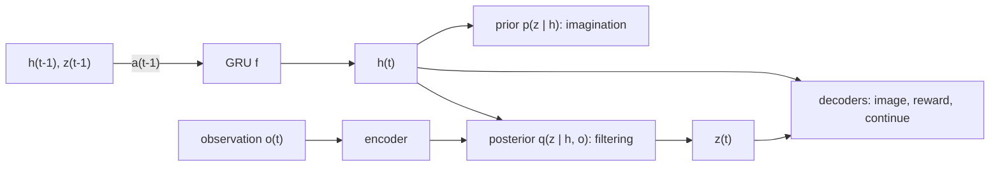

## なぜ重要か

「世界モデル（world model）」は、AI の分野で最も多義的に使われる用語の一つになっています。Atari のフレームを夢見る再帰型ネットワークにも、Sora のような動画生成器にも、3D シーン生成器にも、さらには LeCun が提案したアーキテクチャにおける抽象的な予測モジュールにも、この言葉が使われます。大規模な生成システム（本シリーズの第 2〜4 回）を見ていく前に、このアイデアがどこから来たのかを理解しておくことには大きな価値があります。その起源は **モデルベース強化学習（model-based reinforcement learning）** です。そこでの世界モデルとは、単に「次に何が起こるか」を予測する学習済みの予測器であり、プランニングに使ったり、方策を「想像の中で」訓練したりするために用いられます。グラフィックスやニューラルレンダリングの分野から来た方（本ブログの [ニューラルレンダリング連載]({{ '/blog/category/neural-rendering/' | relative_url }}) を参照）は、世界モデルを *データから学習されたレンダラーとシミュレータの組み合わせ* であり、行動を与えて問い合わせることができるもの、と考えるとよいでしょう。

この第 1 回では、シリーズ全体で使う語彙を整理します。MDP、Dyna、潜在ダイナミクス、PlaNet/Dreamer の RSSM、想像による訓練、そして MuZero の価値等価モデルです。

## 前提知識

- 深層学習の基礎（MLP、RNN/GRU、誤差逆伝播法、Adam）と PyTorch。
- 確率：期待値、ガウス分布、KL ダイバージェンス（KL divergence）。
- 必須ではありませんが役立つもの：強化学習の基本ループ（状態、行動、報酬、方策）。必要な部分は本文で復習します。

## 1. 「世界モデル」とは何を指すのか？

このアイデアは深層学習よりも古いものです。1943 年、心理学者の Kenneth Craik は、心は外界の「小規模なモデル（small-scale model）」を持っており、行動する前にそれを使って選択肢を試しているのだと提唱しました。機械学習では、環境の微分可能なモデルを学習し、それを通してプランニングを行う 1990 年代初頭の Schmidhuber の研究や、Sutton の Dyna アーキテクチャ（1991）が、この直観をアルゴリズムへと落とし込みました。

実用的な定義としては次のものが便利です。

> **世界モデル** とは、世界（のうち関係する部分）がどのように変化するかを、通常はエージェントの行動を条件として予測する学習済みモデルであり、ロールアウトすることで「もし〜ならどうなるか？」という問いに答えられるものです。

数式で書くと、最も一般的な形は学習された遷移分布です。

$$
p_\theta(s_{t+1}, r_{t} \mid s_t, a_t) \quad\text{or, from raw observations,}\quad p_\theta(o_{t+1} \mid o_{\le t}, a_{\le t}).
$$

「世界モデル」と呼ばれる多くのシステムは、次の 3 つの問いによって区別できます。

| 問い | 選択肢 | 例 |
| --- | --- | --- |
| 何を予測するか？ | ピクセル / トークン、潜在状態、タスクに関係する量のみ（報酬、価値） | GameNGen（ピクセル）、Dreamer（潜在）、MuZero（価値等価） |
| 行動を条件とするか？ | する（インタラクティブ）/ しない（受動的な動画予測） | Genie、UniSim（する）；無条件の動画モデル（しない） |
| 何に使うか？ | プランニング、想像の中での方策学習、データ生成 / シミュレーション、表現学習 | MuZero（プランニング）、Dreamer（想像）、Cosmos（合成データ）、V-JEPA（表現） |

本記事が扱うのは各行の一番左の列、すなわち制御を支えるために訓練されたコンパクトな潜在モデルです。第 3〜4 回では大規模な生成型シミュレータに移り、第 5 回では JEPA とともに潜在予測へと戻ります。

## 2. MDP とモデルベースの考え方

### 2.1 マルコフ決定過程

**マルコフ決定過程（Markov decision process, MDP）** は組 $(\mathcal{S}, \mathcal{A}, P, R, \gamma)$ です。それぞれ状態、行動、遷移確率 $P(s^\prime \mid s, a)$、報酬関数 $R(s, a)$、割引率 $\gamma \in [0, 1)$ を表します。方策（policy）$\pi(a \mid s)$ は収益（return）$G_t = \sum_{k \ge 0} \gamma^k r_{t+k}$ と、次の価値関数（value function）を定めます。

$$
V^\pi(s) = \mathbb{E}_\pi\left[G_t \mid s_t = s\right], \qquad
Q^\pi(s, a) = \mathbb{E}_\pi\left[G_t \mid s_t = s, a_t = a\right].
$$

最適行動価値関数は **ベルマン最適方程式（Bellman optimality equation）** を満たします。

$$
Q^\ast(s, a) = R(s, a) + \gamma \sum_{s'} P(s' \mid s, a) \max_{a'} Q^\ast(s', a').
$$

$P$ と $R$ が *既知* であれば、動的計画法（価値反復, value iteration）でこれを解くことができます。しかし現実のエージェントは通常それらを知りません。エージェントが完全な状態を明らかにしない観測 $o_t$（たとえばカメラ画像）しか受け取らない場合、それは **部分観測マルコフ決定過程（partially observable MDP, POMDP）** になります。このときエージェントには、履歴 $o_{\le t}, a_{\lt t}$ を要約する *信念（belief）* あるいは学習された潜在状態が必要です。これはまさに、後述する PlaNet や Dreamer における再帰的な潜在状態の役割です。

### 2.2 モデルフリーとモデルベース

- **モデルフリー強化学習（model-free RL）**（Q 学習、PPO、SAC）は、実際の遷移から価値関数や方策を直接学習します。
- **モデルベース強化学習** はさらに $\hat P_\theta, \hat R_\theta$ を学習し、それを使ってプランニング（行動系列の探索）を行ったり、追加の訓練データを生成したりします。

モデルベース強化学習の利点は **サンプル効率（sample efficiency）** にあります。一度観測した遷移をモデルを通して何度も「再生」でき、さらにモデルは一度も訪れていない状態にも汎化できます。古典的な危険は **モデル誤差の累積（compounding model error）** です。1 ステップの誤差 $\epsilon$ は長さ $H$ のロールアウトの中で増大し、さらにモデルに対して最適化された方策は、モデルが誤っていて楽観的になっている状態を積極的に探しにいきます（モデルの悪用, model exploitation）。以下で紹介する手法のほぼすべての設計判断は、この 2 つの問題に対する防御策です。

### 2.3 Dyna：学習、プランニング、反応

Sutton の **Dyna** アーキテクチャ（Sutton, "Dyna, an integrated architecture for learning, planning, and reacting", SIGART Bulletin 2(4), 1991）は、「想像の中での訓練」のひな形です。エージェントは次の処理を交互に行います。

1. 実環境で **行動** し、通常の Q 学習の更新を行う。
2. **モデル学習**：観測した遷移 $(s, a) \to (r, s^\prime)$ を記憶する。
3. **プランニング**：$n$ 回にわたり、過去に見た $(s, a)$ をサンプルし、モデルに $(r, s^\prime)$ を問い合わせ、この *シミュレートされた* 遷移に対して同じ Q 学習の更新を行う。

以下は、壁のある小さなグリッドワールド上の表形式 Dyna-Q です。NumPy で 1 秒ほどで実行できます。

```python
import numpy as np

# 6x9 gridworld (Sutton & Barto's Dyna maze): S = start, G = goal, # = wall
MAZE = ["........G",
        "..#....#.",
        "S.#....#.",
        "..#....#.",
        ".....#...",
        "........."]
H, W = len(MAZE), len(MAZE[0])
ACTIONS = [(-1, 0), (1, 0), (0, -1), (0, 1)]  # up, down, left, right
start = next((r, c) for r in range(H) for c in range(W) if MAZE[r][c] == "S")

def step(s, a):
    r, c = s[0] + ACTIONS[a][0], s[1] + ACTIONS[a][1]
    if not (0 <= r < H and 0 <= c < W) or MAZE[r][c] == "#":
        r, c = s                       # bump into wall: stay
    done = MAZE[r][c] == "G"
    return (r, c), float(done), done

def dyna_q(n_planning, episodes=50, alpha=0.1, gamma=0.95, eps=0.1, seed=0):
    rng = np.random.default_rng(seed)
    Q = np.zeros((H, W, 4))
    model = {}                         # (s, a) -> (r, s', done): a deterministic learned model
    steps_per_episode = []
    for _ in range(episodes):
        s, done, n = start, False, 0
        while not done:
            if rng.random() < eps:
                a = int(rng.integers(4))
            else:                      # greedy with random tie-breaking
                q = Q[s]
                a = int(rng.choice(np.flatnonzero(q == q.max())))
            s2, r, done = step(s, a)
            # (1) direct RL update from real experience
            Q[s][a] += alpha * (r + gamma * (0.0 if done else Q[s2].max()) - Q[s][a])
            # (2) model learning
            model[(s, a)] = (r, s2, done)
            # (3) planning: replay simulated transitions from the model
            keys = list(model.keys())
            for _ in range(n_planning):
                ps, pa = keys[rng.integers(len(keys))]
                pr, ps2, pdone = model[(ps, pa)]
                target = pr + gamma * (0.0 if pdone else Q[ps2].max())
                Q[ps][pa] += alpha * (target - Q[ps][pa])
            s, n = s2, n + 1
        steps_per_episode.append(n)
    return steps_per_episode

for n in [0, 5, 50]:
    steps = dyna_q(n)
    print(f"n_planning={n:2d}  steps in episodes 2-10: {steps[1:10]}")
```

`n_planning=0`（素の Q 学習）では、報酬をスタート地点まで伝播させるのに多くのエピソードが必要です。一方、実ステップ 1 回あたり 50 回のプランニングを行うと、わずか数エピソードで短い経路を見つけます。これが世界モデルの約束を縮図にしたものです。すなわち **実データは高価で、想像データは安価** だということです。以降の内容はすべて、ルックアップテーブル `model` を汎化可能なニューラルネットワークに、表形式の Q をニューラルなアクターとクリティックに置き換えたものです。

## 3. 「World Models」（Ha & Schmidhuber, 2018）

Ha と Schmidhuber の論文（[arXiv:1803.10122](https://arxiv.org/abs/1803.10122)。NeurIPS 2018 版のタイトルは "Recurrent World Models Facilitate Policy Evolution"）はこの用語を広め、印象的なインタラクティブ記事も公開されました。エージェントは 3 つの部分から構成されます。

- **V（vision）**：各 64x64 フレーム $o_t$ を小さな潜在変数 $z_t$ に圧縮する VAE（VAE は [第 2 回]({{ '/blog/2026/world-models-02-generative-modeling-foundations/' | relative_url }}) で導出します）。
- **M（memory）**：$p(z_{t+1} \mid a_t, z_t, h_t)$ を混合ガウス分布としてモデル化する **MDN-RNN**。ここで $h_t$ は LSTM の隠れ状態です。
- **C（controller）**：小さな線形方策 $a_t = W_c [z_t; h_t] + b_c$。進化戦略（evolution strategy）の CMA-ES で訓練されます。

パラメータのほぼすべてが報酬なしで訓練される V と M にあるため、コントローラはブラックボックス最適化が可能なほど小さくなります。CarRacing では 100 回の試行で平均スコア 906 $\pm$ 21 が報告されており、VizDoom の "Take Cover" では M が生成した **夢の中だけで** コントローラを訓練し、それを実際のゲームに移しています。この論文から得られる 2 つの教訓は、その後のすべての研究で繰り返し現れます。

1. 学習されたモデルは **悪用されうる**：コントローラは、夢の中では敵が決して撃ってこないような敵対的な方策を見つけました。Ha と Schmidhuber は MDN のサンプリング **温度（temperature）** $\tau$ を上げることでこれに対処しました。夢をより確率的にし、悪用されにくくしたのです。
2. **表現**（V）、**ダイナミクス**（M）、**行動**（C）を分離するのは強力な分解ですが、V をピクセル再構成損失で訓練すると、タスクには重要でないかもしれない細部に容量を費やすことになります。第 5 回でこの批判を再び取り上げます。

## 4. PlaNet と再帰型状態空間モデル（RSSM）

**PlaNet**（Hafner et al., "Learning Latent Dynamics for Planning from Pixels", ICML 2019, [arXiv:1811.04551](https://arxiv.org/abs/1811.04551)）は、ダイナミクスを表現と *同時に* 学習し、潜在空間で直接プランニングを行いました。その主要な貢献は **再帰型状態空間モデル（recurrent state-space model, RSSM）** であり、これは今でも DreamerV3 の骨格となっています。

### 4.1 なぜ決定論的な状態と確率的な状態の両方が必要なのか？

純粋に決定論的な RNN は、複数のありうる未来を表現できません。一方、純粋に確率的な状態空間モデルは、各ステップでノイズが注入されるため、多数のステップにわたって情報を記憶し続けるのが困難です。RSSM は潜在状態を決定論的な部分 $h_t$ と確率的な部分 $z_t$ に分割します。

$$
\begin{aligned}
\text{deterministic state:}\quad & h_t = f_\theta(h_{t-1}, z_{t-1}, a_{t-1}) \quad \text{(a GRU)}\\
\text{prior (transition):}\quad & \hat z_t \sim p_\theta(\hat z_t \mid h_t)\\
\text{posterior (representation):}\quad & z_t \sim q_\theta(z_t \mid h_t, o_t)\\
\text{decoders:}\quad & \hat o_t \sim p_\theta(o_t \mid h_t, z_t), \quad \hat r_t \sim p_\theta(r_t \mid h_t, z_t).
\end{aligned}
$$

**事前分布（prior）** こそが世界モデルの本体です。観測を *見ずに* 次の潜在状態を予測するため、想像の中でロールアウトするのはこちらです。**事後分布（posterior）** は現在の画像も参照するフィルタであり、訓練中に実際に何が起きたかを事前分布に教えます。



### 4.2 訓練目的関数

RSSM は系列版の VAE です。観測系列の対数尤度にイェンセンの不等式（Jensen's inequality）を適用し、事後分布を変分分布として用いると、証拠下界（evidence lower bound, ELBO）が得られます。

$$
\ln p_\theta(o_{1:T}, r_{1:T} \mid a_{1:T})
\;\ge\;
\sum_{t=1}^{T} \Big(
\underbrace{\mathbb{E}_{q}\big[\ln p_\theta(o_t \mid h_t, z_t) + \ln p_\theta(r_t \mid h_t, z_t)\big]}_{\text{reconstruction}}
\;-\;
\underbrace{\mathbb{E}_{q}\big[\mathrm{KL}\big(q_\theta(z_t \mid h_t, o_t)\,\Vert\, p_\theta(z_t \mid h_t)\big)\big]}_{\text{make the prior predict the posterior}}
\Big).
$$

重要なのは KL 項です。この項は、事後分布が画像から推論する潜在状態を、過去の情報だけから予測するように遷移事前分布を訓練します。PlaNet はさらに **潜在オーバーシューティング（latent overshooting）** も提案しました。これはこの KL の多ステップ版で、数ステップ先の予測について事前分布を正則化するものです（Dreamer では後に廃止されました）。

### 4.3 CEM によるプランニング

PlaNet には方策ネットワークがありません。実環境の各ステップで、潜在空間上で **交差エントロピー法（cross-entropy method, CEM）** を実行します。対角ガウス分布から長さ $H$ の行動系列を $J$ 本サンプルし、それぞれを事前分布でロールアウトし、予測報酬の総和で評価し、上位 $K$ 本にガウス分布を当てはめ直すという手順を数回繰り返し、平均の最初の行動を実行します。これは *モデル予測制御（model-predictive control, MPC）* です。うまく機能しますが、毎ステップ探索を行うのはコストが高く、プランニングの視野（horizon）によってどれだけ先の報酬まで見通せるかが制限されます。

## 5. Dreamer：潜在空間での想像による行動学習

### 5.1 DreamerV1

**Dreamer**（Hafner et al., "Dream to Control: Learning Behaviors by Latent Imagination", ICLR 2020, [arXiv:1912.01603](https://arxiv.org/abs/1912.01603)）は RSSM を維持しつつ、オンラインのプランニングを **想像された軌道のみで訓練されるアクター・クリティック（actor-critic）** に置き換えました。ループは交互に実行される 3 つのフェーズからなります。

1. 現在のアクターで実経験を **収集** し、リプレイバッファに格納する。
2. **世界モデルの学習**：系列をサンプルし、上記の ELBO で RSSM を訓練する。
3. **想像の中での行動学習**：バッチ中の事後状態を起点とし、アクターの行動を用いて *事前分布* を $H = 15$ ステップロールアウトし、報酬を予測して、アクターとクリティックを更新する。

クリティック $v_\psi(s_t)$ は **$\lambda$ 収益（lambda-returns）** に向けて訓練されます。これはあらゆる長さの $n$ ステップ収益を混合したもので、（クリティック由来の）バイアスと（長いモデルロールアウト由来の）分散のトレードオフを取ります。

$$
V^\lambda_t = \hat r_t + \gamma \Big( (1-\lambda)\, v_\psi(s_{t+1}) + \lambda\, V^\lambda_{t+1} \Big),
\qquad V^\lambda_H = v_\psi(s_H).
$$

鍵となる工夫はアクターの訓練方法です。世界モデル、報酬ヘッド、クリティックはすべて微分可能なので、Dreamer は **学習されたダイナミクスを通して解析的な勾配を逆伝播** させ、アクターの再パラメータ化された行動まで届けることで $\sum_t V^\lambda_t$ を最大化します。

$$
\max_\phi \; \mathbb{E}\Big[\sum_{t=0}^{H-1} V^\lambda_t\Big],
\qquad a_t = \pi_\phi(s_t) \text{ sampled with the reparameterization trick.}
$$

クリティックは想像の視野の先まで見通すため、PlaNet のプランナーの主要な制約が取り除かれます。

### 5.2 DreamerV2：離散潜在変数

**DreamerV2**（Hafner et al., "Mastering Atari with Discrete World Models", ICLR 2021, [arXiv:2010.02193](https://arxiv.org/abs/2010.02193)）は、別途訓練した世界モデルの中で行動を学習することで、Atari ベンチマークにおいて人間レベルの性能に到達した最初のエージェントです。重要だった変更点は 2 つあります。

- **カテゴリカル潜在変数（categorical latents）**：$z_t$ は 32 クラスずつの 32 個のカテゴリカル変数からなるベクトルで、ストレートスルー勾配（straight-through gradients）を用いてサンプルされます。カテゴリカル分布は多峰的な次状態分布を表現でき、ガウス分布よりもフィットさせやすいようでした。
- **KL バランシング（KL balancing）**：KL 項は、事前分布を事後分布に近づけるように訓練すると同時に、事後分布を事前分布に向けて正則化します。DreamerV2 は勾配停止（stop-gradient）$\mathrm{sg}(\cdot)$ を用いて、この 2 方向に異なる重みを付けます。

$$
\mathcal{L}_{\mathrm{KL}} = \alpha\, \mathrm{KL}\big(\mathrm{sg}(q) \,\Vert\, p\big) + (1-\alpha)\, \mathrm{KL}\big(q \,\Vert\, \mathrm{sg}(p)\big), \qquad \alpha = 0.8,
$$

これにより、事前分布は素早く学習し、一方で表現は訓練の不十分な事前分布に引き寄せられずに済みます。

### 5.3 DreamerV3：単一のハイパーパラメータ設定

**DreamerV3**（Hafner et al., "Mastering Diverse Domains through World Models", [arXiv:2301.04104](https://arxiv.org/abs/2301.04104)；"Mastering diverse control tasks through world models" として *Nature* 640, 2025 に掲載, [doi:10.1038/s41586-025-08744-2](https://doi.org/10.1038/s41586-025-08744-2)）のテーマは **頑健性（robustness）** です。Atari から連続制御、Minecraft まで 150 を超えるタスクで単一の設定を用い、Minecraft では人間のデータやカリキュラムなしにゼロからダイヤモンドを収集した最初のアルゴリズムとなりました。主な要素は、どんな世界モデルにも再利用できる正規化の工夫です。

- **Symlog 予測（symlog predictions）**：デコーダや報酬ヘッドは $\mathrm{symlog}(x) = \mathrm{sign}(x)\ln(\lvert x\rvert + 1)$ を予測します。これにより、スケールが大きく異なる目標値（0.01 の報酬や 1000 の報酬）でも同程度の大きさの勾配が得られます。逆変換は $\mathrm{symexp}(x) = \mathrm{sign}(x)(\exp(\lvert x\rvert) - 1)$ です。
- 報酬と価値に対する **Two-hot 離散回帰（two-hot discrete regression）**：スカラーの目標値を、固定された（symexp 間隔の）グリッド上の隣接する 2 つのビンに振り分け、ネットワークを交差エントロピーで訓練します。これは多峰的で裾の重い収益に対して頑健です。
- **フリービット付き KL（KL with free bits）**：ダイナミクス損失と表現損失は 1 nat を下限としてクリップされ（$\max(1, \mathrm{KL})$）、重みは $\beta_{\mathrm{dyn}} = 0.5$、$\beta_{\mathrm{rep}} = 0.1$ です。これにより、すでによく予測できている潜在変数にモデルが容量を浪費しなくなります。
- アクターのための **収益正規化（return normalization）**：アドバンテージを $\max(1, S)$ で割ります。ここで $S$ は収益の 5 パーセンタイルと 95 パーセンタイルの間の幅です。これにより、エントロピーボーナスが報酬のスケールによらず一貫した意味を持ちます。
- **Unimix カテゴリカル（unimix categoricals）**：カテゴリカル分布に 1% の一様確率を混ぜることで、確率ゼロのスパイクや無限大の KL を回避します。

公式コード：[github.com/danijar/dreamerv3](https://github.com/danijar/dreamerv3)。

## 6. MuZero：重要なことだけを予測するモデル

**MuZero**（Schrittwieser et al., "Mastering Atari, Go, Chess and Shogi by Planning with a Learned Model", *Nature* 588, 2020, [arXiv:1911.08265](https://arxiv.org/abs/1911.08265), [doi:10.1038/s41586-020-03051-4](https://doi.org/10.1038/s41586-020-03051-4)）は、Ha & Schmidhuber とは正反対の立場を取ります。すなわち、観測を一切再構成しません。MuZero は 3 つの関数を学習します。

$$
s^0 = h_\theta(o_1, \dots, o_t), \qquad
(r^k, s^k) = g_\theta(s^{k-1}, a^k), \qquad
(\mathbf{p}^k, v^k) = f_\theta(s^k),
$$

それぞれ表現関数、ダイナミクス関数、予測（方策と価値）関数です。隠れ状態 $s^k$ には意味論的な制約が一切課されません。実際に取られた行動に沿って $K$ ステップ展開した後に、予測された報酬、価値、方策がそれぞれの目標値と一致するようにだけ訓練されます。

$$
\mathcal{L}_t(\theta) = \sum_{k=0}^{K} \Big[\ell^r(u_{t+k}, r^k) + \ell^v(z_{t+k}, v^k) + \ell^p(\boldsymbol{\pi}_{t+k}, \mathbf{p}^k)\Big] + c\,\lVert\theta\rVert^2,
$$

ここで $u$ は観測された報酬、$z$ はブートストラップされた価値の目標値、$\boldsymbol{\pi}$ は学習済みモデルの中で実行された **モンテカルロ木探索（Monte Carlo tree search, MCTS）** の訪問回数分布です。このようなモデルは **価値等価（value-equivalent）** と呼ばれます。プランニングに関係する量についてだけ実環境と一致していればよいのです。MuZero はルールを与えられることなく囲碁、チェス、将棋で AlphaZero に匹敵し、Atari では当時の最高性能を達成しました。

Dreamer と MuZero は、本シリーズを通じて繰り返し現れる議論の両極を示しています。世界モデルは世界を **再構成** すべきなのか（ピクセルを再構成すれば、シミュレータとしても使え、人間が中身を確認することもできます）、それとも意思決定に必要な **抽象的な量だけを予測** すればよいのか、という議論です。第 5 回では JEPA とともにこの論点を取り上げます。

## 7. その他のモデルベース手法の見取り図

| 系統 | アイデア | 代表的な研究 |
| --- | --- | --- |
| 確率的アンサンブル + MPC | 確率的 MLP のアンサンブルで認識論的不確実性を捉える；CEM によるプランニング | PETS (Chua et al., NeurIPS 2018) |
| モデルフリー強化学習のための短いモデルロールアウト | 実状態から短いロールアウトを分岐させて誤差の累積を抑える；それを用いて SAC を訓練 | MBPO (Janner et al., NeurIPS 2019) |
| 価値付きの潜在 MPC | 暗黙的な（デコーダを持たない）潜在モデル、MPPI プランニングと学習された価値の組み合わせ、多数のタスクへスケール | TD-MPC2 (Hansen et al., ICLR 2024) |
| トークン世界モデル | 離散オートエンコーダ + 自己回帰トランスフォーマーを世界モデルとして用いる | IRIS (Micheli et al., ICLR 2023) |
| 拡散世界モデル | 拡散モデルで次フレームを予測する；エージェントはその中で訓練される | DIAMOND (Alonso et al., NeurIPS 2024) |

IRIS と DIAMOND は、本シリーズの残りへの橋渡しです。ダイナミクスモデルが強力な **生成** モデル（自己回帰トランスフォーマー、拡散モデル）になると、世界モデルそのものが *プレイ* できるものになります。Counter-Strike のプレイ映像で訓練された DIAMOND のモデルは、すでに小さなニューラルゲームエンジンであり、GameNGen や Genie（第 3 回）の先駆けとなっています。

## 8. コード：PyTorch による RSSM のステップと想像ロールアウト

以下のスニペットは、ベクトル観測上での Dreamer のレシピをコンパクトかつ実行可能な形でスケッチしたものです（そのため CPU 上で数秒で実行できます）。RSSM（`img_step` = 事前分布、`obs_step` = 事後分布）、KL バランシングとフリービットを用いた世界モデルの損失、事後状態からの想像ロールアウト、$\lambda$ 収益、そしてアクター/クリティックの更新を含みます。分かりやすさのため、DreamerV3 の symlog/two-hot ヘッドと収益正規化は省略しています。

```python
import torch
import torch.nn as nn
import torch.nn.functional as F
import torch.distributions as td

class RSSM(nn.Module):
    """Recurrent state-space model with Gaussian stochastic state (PlaNet / DreamerV1 style)."""
    def __init__(self, embed_dim, action_dim, deter=128, stoch=16, hidden=128):
        super().__init__()
        self.deter, self.stoch = deter, stoch
        self.inp = nn.Linear(stoch + action_dim, hidden)
        self.gru = nn.GRUCell(hidden, deter)
        self.prior_net = nn.Sequential(nn.Linear(deter, hidden), nn.ELU(), nn.Linear(hidden, 2 * stoch))
        self.post_net = nn.Sequential(nn.Linear(deter + embed_dim, hidden), nn.ELU(), nn.Linear(hidden, 2 * stoch))

    def initial(self, batch):
        return torch.zeros(batch, self.deter), torch.zeros(batch, self.stoch)

    @staticmethod
    def dist(stats):
        mean, std = stats.chunk(2, dim=-1)
        return td.Independent(td.Normal(mean, F.softplus(std) + 0.1), 1)

    def img_step(self, h, z, a):
        """Prior: predict the next state from the past only (used for imagination)."""
        x = F.elu(self.inp(torch.cat([z, a], -1)))
        h = self.gru(x, h)
        prior = self.dist(self.prior_net(h))
        return h, prior.rsample(), prior

    def obs_step(self, h, z, a, embed):
        """Posterior: also look at the current observation embedding (used for filtering)."""
        h, _, prior = self.img_step(h, z, a)
        post = self.dist(self.post_net(torch.cat([h, embed], -1)))
        return h, post.rsample(), post, prior

def mlp(i, o, hidden=128):
    return nn.Sequential(nn.Linear(i, hidden), nn.ELU(), nn.Linear(hidden, hidden), nn.ELU(), nn.Linear(hidden, o))

def kl_balanced(post, prior, alpha=0.8, free_nats=1.0):
    """DreamerV2-style KL balancing with free bits (detach = stop-gradient)."""
    sg = lambda d: td.Independent(td.Normal(d.base_dist.loc.detach(), d.base_dist.scale.detach()), 1)
    kl_dyn = td.kl_divergence(sg(post), prior)   # trains the prior
    kl_rep = td.kl_divergence(post, sg(prior))   # regularizes the posterior
    return alpha * kl_dyn.clamp(min=free_nats).mean() + (1 - alpha) * kl_rep.clamp(min=free_nats).mean()

def lambda_return(rewards, values, gamma=0.99, lam=0.95):
    """rewards: [H, N] for steps 0..H-1, values: [H+1, N] for states 0..H. Returns [H, N]."""
    out, last = [], values[-1]
    for t in reversed(range(rewards.shape[0])):
        last = rewards[t] + gamma * ((1 - lam) * values[t + 1] + lam * last)
        out.append(last)
    return torch.stack(out[::-1])

# ----- toy setup -----
torch.manual_seed(0)
B, T, H = 16, 32, 15                    # batch, sequence length, imagination horizon
obs_dim, act_dim, embed_dim = 64, 4, 64
rssm = RSSM(embed_dim, act_dim)
encoder, decoder = mlp(obs_dim, embed_dim), mlp(rssm.deter + rssm.stoch, obs_dim)
reward_head = mlp(rssm.deter + rssm.stoch, 1)
actor, critic = mlp(rssm.deter + rssm.stoch, 2 * act_dim), mlp(rssm.deter + rssm.stoch, 1)
wm_params = [*rssm.parameters(), *encoder.parameters(), *decoder.parameters(), *reward_head.parameters()]
wm_opt = torch.optim.Adam(wm_params, lr=3e-4)
actor_opt = torch.optim.Adam(actor.parameters(), lr=8e-5)
critic_opt = torch.optim.Adam(critic.parameters(), lr=8e-5)

# a fake replay batch: observations, previous actions, rewards
obs = torch.randn(B, T, obs_dim)
act = torch.rand(B, T, act_dim) * 2 - 1
rew = torch.randn(B, T)

def policy(feat):
    mean, std = actor(feat).chunk(2, -1)
    base = td.Normal(mean, F.softplus(std) + 1e-3)
    return torch.tanh(base.rsample()), base.entropy().sum(-1)  # reparameterized action in [-1, 1]

for it in range(3):
    # ---- 1) world-model learning: filter the sequence with the posterior ----
    h, z = rssm.initial(B)
    embed = encoder(obs)
    feats, kl = [], 0.0
    for t in range(T):
        h, z, post, prior = rssm.obs_step(h, z, act[:, t], embed[:, t])
        feats.append(torch.cat([h, z], -1))
        kl = kl + kl_balanced(post, prior)
    feats = torch.stack(feats, 1)                                   # [B, T, deter+stoch]
    recon = F.mse_loss(decoder(feats), obs)
    rew_loss = F.mse_loss(reward_head(feats).squeeze(-1), rew)
    wm_loss = recon + rew_loss + kl / T
    wm_opt.zero_grad(); wm_loss.backward(); wm_opt.step()

    # ---- 2) imagination: roll out the prior from every posterior state ----
    start = feats.detach().reshape(B * T, -1)
    h, z = start[:, :rssm.deter], start[:, rssm.deter:]
    traj, ents = [start], []
    for _ in range(H):
        a, ent = policy(traj[-1])
        h, z, _ = rssm.img_step(h, z, a)
        traj.append(torch.cat([h, z], -1))
        ents.append(ent)
    traj = torch.stack(traj)                                        # [H+1, N, F]
    rewards = reward_head(traj[1:]).squeeze(-1)                     # reward of entering s_{t+1}
    values = critic(traj).squeeze(-1)                               # [H+1, N]
    returns = lambda_return(rewards, values)                        # [H, N]

    # ---- 3) actor: maximize lambda-returns by backprop through the dynamics ----
    actor_loss = -returns.mean() - 1e-4 * torch.stack(ents).mean()
    actor_opt.zero_grad(); actor_loss.backward(); actor_opt.step()

    # ---- 4) critic: regress values of (detached) imagined states onto (detached) returns ----
    critic_loss = F.mse_loss(critic(traj[:-1].detach()).squeeze(-1), returns.detach())
    critic_opt.zero_grad(); critic_loss.backward(); critic_opt.step()
    print(f"iter {it}: wm {wm_loss.item():.3f}  actor {actor_loss.item():.3f}  critic {critic_loss.item():.3f}")
```

注目すべき点をいくつか挙げます。

- **想像は実系列の事後状態から開始します**。そのためロールアウトは現実的な状況から始まり、$H$ ステップの間だけ正確であればよいのです。これは MBPO と同じ「短い分岐ロールアウト」の考え方です。
- **勾配の経路**：アクターの損失は `rssm.img_step`、`reward_head`、`critic` を通ってアクターまで逆伝播しますが、ステップを進めるのは `actor_opt` だけです。世界モデルは自身の損失によってのみ更新され（流れ込んだ余分な勾配は次の反復の `wm_opt.zero_grad()` で消去されます）、クリティックは回帰損失によってのみ更新されます。
- 実際の実装では、想像上の収益を割り引くための **継続フラグ（continue flag）**（エピソード終了）も予測し、ゆっくり更新される **ターゲットクリティック（target critic）** を使い、MSE ヘッドを DreamerV3 の symlog/two-hot ヘッドに置き換えることになるでしょう。

## 9. ここまでのまとめ

| | Ha & Schmidhuber | PlaNet | Dreamer V1-V3 | MuZero |
| --- | --- | --- | --- | --- |
| 潜在状態 | VAE $z$ + LSTM $h$ | RSSM | RSSM（ガウス、その後カテゴリカル） | 抽象的な $s^k$ |
| ピクセルを再構成するか？ | する | する | する | しない |
| 行動の獲得 | 線形コントローラに対する進化戦略（CMA-ES） | CEM によるプランニング | 想像の中でのアクター・クリティック | モデル内での MCTS |
| 主な教訓 | 方策は夢の中で訓練できる | 潜在ダイナミクスとプランニングの同時学習 | 解析的勾配を用いた想像はスケールする | 価値に関係する予測だけで十分 |

これらのモデルは小規模でタスク特化型であり、環境ごとにゼロから訓練されます。続く 2 回では、ダイナミクスモデルがインターネット規模の生成モデルに置き換えられたときに何が起きたかを追います。まずはそのための道具立て（VAE、トークナイザ、トランスフォーマー、拡散モデル、フローマッチング）、次に Genie や GameNGen といった動画ベースの世界シミュレータです。

## 代表的な論文

| 論文 | 会議・論文誌 | 年 | リンク | 重要な理由 |
| --- | --- | --- | --- | --- |
| Dyna, an integrated architecture for learning, planning, and reacting (Sutton) | SIGART Bulletin | 1991 | （リンクなし） | シミュレートされた経験による訓練のひな形 |
| World Models / Recurrent World Models Facilitate Policy Evolution (Ha, Schmidhuber) | NeurIPS | 2018 | [arXiv:1803.10122](https://arxiv.org/abs/1803.10122) | V-M-C 分解；夢の中で訓練された方策 |
| Deep RL in a Handful of Trials using Probabilistic Dynamics Models (PETS, Chua et al.) | NeurIPS | 2018 | [arXiv:1805.12114](https://arxiv.org/abs/1805.12114) | モデルベース制御のための不確実性を考慮したアンサンブル |
| When to Trust Your Model: Model-Based Policy Optimization (MBPO, Janner et al.) | NeurIPS | 2019 | [arXiv:1906.08253](https://arxiv.org/abs/1906.08253) | 誤差の累積に対抗する短い分岐ロールアウト |
| Learning Latent Dynamics for Planning from Pixels (PlaNet, Hafner et al.) | ICML | 2019 | [arXiv:1811.04551](https://arxiv.org/abs/1811.04551) | RSSM；潜在空間でのプランニング |
| Dream to Control (Dreamer, Hafner et al.) | ICLR | 2020 | [arXiv:1912.01603](https://arxiv.org/abs/1912.01603) | ダイナミクスを通した逆伝播による、想像の中でのアクター・クリティック |
| Mastering Atari with Discrete World Models (DreamerV2) | ICLR | 2021 | [arXiv:2010.02193](https://arxiv.org/abs/2010.02193) | カテゴリカル潜在変数、KL バランシング、Atari で人間レベル |
| Mastering diverse control tasks through world models (DreamerV3) | Nature | 2025 | [doi:10.1038/s41586-025-08744-2](https://doi.org/10.1038/s41586-025-08744-2) | 150 以上のタスクに単一の設定；Minecraft でのダイヤモンド収集 |
| Mastering Atari, Go, Chess and Shogi by Planning with a Learned Model (MuZero) | Nature | 2020 | [arXiv:1911.08265](https://arxiv.org/abs/1911.08265) | 価値等価モデル + MCTS |
| Transformers are Sample-Efficient World Models (IRIS, Micheli et al.) | ICLR | 2023 | [arXiv:2209.00588](https://arxiv.org/abs/2209.00588) | 離散トークン + トランスフォーマーによるダイナミクス |
| TD-MPC2: Scalable, Robust World Models for Continuous Control (Hansen et al.) | ICLR | 2024 | [arXiv:2310.16828](https://arxiv.org/abs/2310.16828) | デコーダを持たない潜在 MPC の大規模化 |
| Diffusion for World Modeling: Visual Details Matter in Atari (DIAMOND, Alonso et al.) | NeurIPS | 2024 | [arXiv:2405.12399](https://arxiv.org/abs/2405.12399) | ダイナミクスモデルとしての拡散モデル；プレイ可能な CS:GO モデル |

## 学習リソース

- Sutton & Barto, *Reinforcement Learning: An Introduction*（第 2 版, 2018）、第 8 章 "Planning and Learning with Tabular Methods"（Dyna）：[incompleteideas.net/book/the-book-2nd.html](http://incompleteideas.net/book/the-book-2nd.html)。
- Ha & Schmidhuber によるインタラクティブ記事：[worldmodels.github.io](https://worldmodels.github.io/)。
- Danijar Hafner のコード：[DreamerV3](https://github.com/danijar/dreamerv3)。読みやすい PyTorch 版が欲しい場合は、コミュニティによる再実装を探し、公式の JAX コードと照らし合わせてください。
- Hansen らの [TD-MPC2 のコード](https://github.com/nicklashansen/tdmpc2) と Alonso らの [DIAMOND のコード](https://github.com/eloialonso/diamond)。
- VAE と ELBO の背景知識：S. Prince, *Understanding Deep Learning*（MIT Press, 2023）、[udlbook.github.io/udlbook](https://udlbook.github.io/udlbook/) で無料公開されています。また Stanford の [CS236 Deep Generative Models](https://deepgenerativemodels.github.io/) も参考になります。

## 演習

1. Dyna-Q のスクリプトを実行し、`n_planning` が {0, 5, 50} のそれぞれについてエピソードあたりのステップ数をプロットしてください。次に、エピソード 25 の後で迷路を変更してください（近道を開けます）。Dyna-Q の適応が遅いのはなぜでしょうか。また、Dyna-Q+ の探索ボーナスはそれをどのように解決するでしょうか。
2. 4.2 節の RSSM の ELBO を、因数分解された事後分布 $\prod_t q(z_t \mid h_t, o_t)$ を用いて、$\ln \int p(o_{1:T}, z_{1:T} \mid a_{1:T})\, dz_{1:T}$ から出発してイェンセンの不等式により導出してください。
3. PyTorch のスケッチにおいて、ガウス型の確率的状態を、ストレートスルー勾配（`one_hot + probs - probs.detach()`）を用いた 8 クラスのカテゴリカル変数 8 個に置き換えてください。`kl_balanced` では何が変わるでしょうか。
4. `lambda_return` で `lam=0` と `lam=1` を設定してください。それぞれどの推定量に対応し、システムのどの部分（クリティックか世界モデルか）を信頼していることになるでしょうか。
5. MuZero は観測を一切再構成しません。報酬が非常にスパースな場合について、この選択の利点を 1 つ、失敗モードを 1 つ挙げてください。

**次回：** [第 2 回]({{ '/blog/2026/world-models-02-generative-modeling-foundations/' | relative_url }}) では、現代の世界モデルを構成する生成モデルの道具立て、すなわち VAE、VQ トークナイザ、自己回帰トランスフォーマー、拡散モデル、フローマッチングを構築します。
