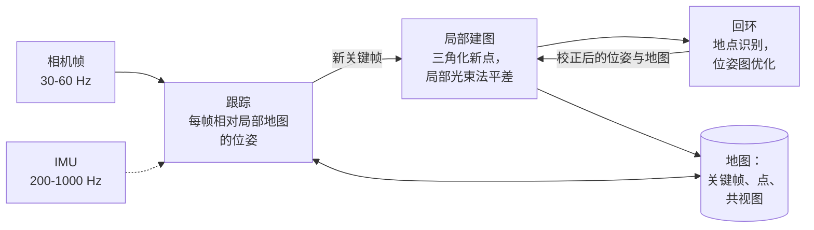

## 为什么重要

[第 05 篇]({{ '/blog/2026/3d-vision-05-multi-view-geometry-and-bundle-adjustment/' | relative_url }})解决了运动恢复结构（Structure-from-Motion）：给定一堆照片，一次性求出所有相机和点，想花多少时间都可以。机器人、无人机或 AR 头显面对的是更难的版本：图像一帧一帧地到来，每秒 30 帧甚至更多；当前帧的位姿必须*立刻*得到，只有几毫秒，用来控制电机或把虚拟物体画在正确的位置；而地图必须在几分钟乃至几小时的运动中保持一致。这就是**同时定位与建图（Simultaneous Localization and Mapping，SLAM）**：仅凭传感器自身的测量，在线估计传感器的轨迹以及周围环境的地图。

本文从第一性原理出发构建视觉 SLAM。我们从定义这个问题的现象——**漂移（drift）**——讲起，把 SLAM 表述为**因子图（factor graph）**上的概率推断。然后看每个系统的两半：**前端（front end）**（视觉里程计，基于特征或直接法）和**后端（back end）**（$SE(3)$ 上的位姿图优化，并用鲁棒核对付错误回环）。中间我们补充刚好够用的李群知识，以便正确地优化位姿，并介绍如何用**视觉词袋（bag of visual words）**检测回环。最后一部分讨论滤波与优化之争（EKF、MSCKF、滑动窗口），以及使用 IMU 预积分的**视觉惯性里程计（visual-inertial odometry，VIO）**，并以一次真实系统巡礼收尾：从 ORB-SLAM3、VINS-Mono 到 DROID-SLAM、MASt3R-SLAM 和高斯泼溅 SLAM。每个算法都在一个玩具问题上实际运行，文中引用的数字都来自运行结果。

## 预备知识

- [第 01 篇]({{ '/blog/2026/3d-vision-01-image-formation-and-camera-models/' | relative_url }})的相机模型与约定：$P = K[R \mid \mathbf t]$、OpenCV 相机坐标系、$T\_{w2c}$ 与 $T\_{c2w}$。
- [第 02 篇]({{ '/blog/2026/3d-vision-02-camera-calibration/' | relative_url }})中的高斯-牛顿与 Levenberg-Marquardt（第 4.2 节），以及相机-IMU 标定（第 9 节）。
- [第 03 篇]({{ '/blog/2026/3d-vision-03-features-and-matching/' | relative_url }})中的特征、RANSAC 和光流。
- 两视图几何（[第 04 篇]({{ '/blog/2026/3d-vision-04-two-view-geometry/' | relative_url }})）以及 PnP 与光束法平差（[第 05 篇]({{ '/blog/2026/3d-vision-05-multi-view-geometry-and-bundle-adjustment/' | relative_url }})）。我们把它们当作积木使用，不再重新推导。
- 刚体变换与 $SE(3)$：[具身智能第 1 篇]({{ '/blog/2026/embodied-ai-01-robotics-foundations/' | relative_url }})。下面第 4 节补充优化所需的内容。
- 基础概率：高斯分布、贝叶斯公式、负对数似然。

**记号。** 与第 01 篇相同，相机外参 $(R, \mathbf t)$ 把世界点变换到 OpenCV 相机坐标系（$x$ 向右，$y$ 向下，$z$ 向前）。在 SLAM 中，把相机 $i$ 的**位姿（pose）**存成相机到世界的变换更方便：

$$
T_i = T_{wc_i} = T_{c2w} = \begin{pmatrix} R^\top & \mathbf C \\ \mathbf 0^\top & 1 \end{pmatrix} \in SE(3),
$$

它的平移是相机中心 $\mathbf C$，旋转矩阵的各列是相机坐标轴在世界坐标中的表示。从相机 $i$ 看相机 $j$ 的相对位姿是 $T\_i^{-1} T\_j$。全文所说的"位姿"都指这个 $T\_i$。

## 1. 问题：定位、建图与漂移

### 1.1 互相依赖的两个问题

如果已经有地图（带描述子的三维点），对新图像定位就是带 RANSAC 的 PnP（第 05 篇）。如果已经有相机位姿，建图就是三角化（第 04 篇）。SLAM 两者都没有：地图由位姿构建，而位姿又由地图估计。把两者一起求解，正是 SLAM 中 "S"（同时）的含义。经典的概率表述可以追溯到 Smith、Self 和 Cheeseman 关于不确定空间关系的工作（1990）；SLAM 这个缩写本身出现于 20 世纪 90 年代中期，Durrant-Whyte 和 Bailey 的两部分教程（2006）综述了以滤波为主的经典时期。Cadena 等人（2016）给出了本文采用的现代视角。

### 1.2 里程计会漂移，漂移有多快

跟踪相机最简单的办法是**里程计（odometry）**：估计相邻帧之间的运动，再把这些运动串起来。每一步都会带来一点误差，误差不断累积。累积得有多快？设想一个机器人笔直前进，每步 1 m，每步的测量都有一点噪声：要么每步有 $\sigma\_d$ 的距离误差，要么每步有 $\sigma\_\theta$ 的航向误差。

距离误差只是简单相加。$n$ 步之后，误差是 $n$ 个独立项之和，标准差为 $\sigma\_d\sqrt n$，即**随机游走（random walk）**。

航向误差要糟糕得多，因为错误的航向会污染*之后*的每一步。第 $k$ 步之后的航向误差是 $\theta\_k = \sum\_{i \le k}\epsilon\_i$，这一步因此侧向偏移约 $\theta\_k$ 米。$n$ 步之后的侧向误差为 $y\_n \approx \sum\_{k=1}^n \theta\_k = \sum\_{i=1}^n (n - i + 1)\,\epsilon\_i$，其方差为

$$
\operatorname{Var}(y_n) \approx \sigma_\theta^2 \sum_{m=1}^{n} m^2 = \sigma_\theta^2\,\frac{n(n+1)(2n+1)}{6} \approx \frac{\sigma_\theta^2\, n^3}{3}.
$$

误差按 $n^{3/2}$ 增长，而不是 $\sqrt n$。旋转误差相当于杠杆臂。

```python
import numpy as np


def dead_reckon(n, sigma_d, sigma_th, trials, rng, step=1.0):
    """Integrate n odometry steps of a robot driving straight ahead. Each step moves `step`
    metres with noise sigma_d and turns by a noisy angle (sigma_th). Returns the end-point
    errors of all trials (the true end point is (n * step, 0))."""
    th = np.cumsum(rng.normal(0, sigma_th, (trials, n)), axis=1)       # heading after each step
    d = step + rng.normal(0, sigma_d, (trials, n))
    x, y = (d * np.cos(th)).sum(1), (d * np.sin(th)).sum(1)
    return np.hypot(x - n * step, y)


rng = np.random.default_rng(0)
for n in (10, 100, 1000):
    e_d = dead_reckon(n, 0.02, 0.0, 2000, rng)                 # only distance noise (2 cm/step)
    e_th = dead_reckon(n, 0.0, np.deg2rad(0.5), 2000, rng)     # only heading noise (0.5 deg/step)
    print(f"n = {n:4d}: RMS error, distance noise {np.sqrt(np.mean(e_d**2)):7.3f} m"
          f" (theory {0.02 * np.sqrt(n):6.3f}),  heading noise {np.sqrt(np.mean(e_th**2)):7.2f} m"
          f" (theory {np.deg2rad(0.5) * np.sqrt(n * (n + 1) * (2 * n + 1) / 6):6.2f})")
```

```text
n =   10: RMS error, distance noise   0.063 m (theory  0.063),  heading noise    0.17 m (theory   0.17)
n =  100: RMS error, distance noise   0.194 m (theory  0.200),  heading noise    5.02 m (theory   5.08)
n = 1000: RMS error, distance noise   0.635 m (theory  0.632),  heading noise  156.49 m (theory 159.45)
```

每步仅 0.5° 的航向误差，100 m 之后就让机器人偏离 5 m，1 km 之后偏离 156 m；而每步 2 cm 的距离噪声在同样 1 km 中只造成 0.6 m 的误差。



这是 SLAM 的核心事实。无论来自轮子、IMU 还是相机，里程计的漂移都是无界的。唯一的办法是认出曾经到过的地方，并利用这个**回环（loop closure）**把整条轨迹拉回一致。本文其余部分讲的就是如何正确而高效地做到这一点。

### 1.3 视觉 SLAM 系统的解剖

几乎所有现代系统都沿用 PTAM（Klein 和 Murray，2007）的组织方式，它首先把跟踪与建图拆成两个并行线程：



- **前端**把像素变成几何约束：检测并跟踪特征（或直接对齐像素），估计每帧的运动，决定哪些帧成为**关键帧（keyframe）**，并寻找回环候选。
- **后端**把约束变成估计：通过关键帧窗口上的局部光束法平差，以及回环之后的位姿图优化，来优化位姿和地图。
- **关键帧**让这一切负担得起。30 Hz 的相机每分钟产生 1800 帧，大多数几乎一模一样。只有带来新信息的帧（视差足够、新点足够多，或者剩下可跟踪的点太少）才成为关键帧，也只有关键帧进入昂贵的优化。例如 ORB-SLAM 会大方地插入关键帧，之后再剔除那些点几乎都被其他关键帧看到的关键帧。

## 2. 把 SLAM 看作因子图上的 MAP 推断

### 2.1 从贝叶斯公式到最小二乘

把所有未知量（位姿、路标，可能还有速度和传感器零偏）记为 $\mathcal X$，所有测量记为 $\mathcal Z = \lbrace \mathbf z\_1, \dots, \mathbf z\_K \rbrace$。每个测量通过带高斯噪声的**测量模型**依赖于少数几个变量 $\mathcal X\_k \subset \mathcal X$：

$$
\mathbf z_k = h_k(\mathcal X_k) + \boldsymbol\epsilon_k, \qquad \boldsymbol\epsilon_k \sim \mathcal N(\mathbf 0, \Sigma_k).
$$

对重投影而言，$h\_k$ 把路标 $j$ 投影到相机 $i$（第 01 篇）；对里程计测量而言，它是相对位姿 $T\_i^{-1}T\_j$；对 GPS 定位而言，它是某个位姿的位置。**最大后验（maximum a posteriori，MAP）**估计是在给定全部测量时最可能的 $\mathcal X$。由贝叶斯公式，并且因为不同测量的噪声相互独立，

$$
\mathcal X^\star = \arg\max_{\mathcal X}\; p(\mathcal X \mid \mathcal Z)
= \arg\max_{\mathcal X}\; p(\mathcal X) \prod_{k=1}^K p(\mathbf z_k \mid \mathcal X_k).
$$

每个高斯似然为 $p(\mathbf z\_k \mid \mathcal X\_k) \propto \exp\big(-\tfrac12 \lVert h\_k(\mathcal X\_k) - \mathbf z\_k \rVert^2\_{\Sigma\_k}\big)$，其中**马氏范数（Mahalanobis norm）**为 $\lVert \mathbf e \rVert^2\_\Sigma = \mathbf e^\top \Sigma^{-1}\mathbf e$。取负对数把乘积变成求和，MAP 问题就变成**非线性最小二乘**：

$$
\mathcal X^\star = \arg\min_{\mathcal X} \sum_{k} \big\lVert h_k(\mathcal X_k) - \mathbf z_k \big\rVert^2_{\Sigma_k}
= \arg\min_{\mathcal X} \sum_k \mathbf r_k^\top \Omega_k\, \mathbf r_k ,
$$

其中 $\mathbf r\_k = h\_k(\mathcal X\_k) - \mathbf z\_k$ 是**残差（residual）**，$\Omega\_k = \Sigma\_k^{-1}$ 是它的**信息矩阵（information matrix）**。先验 $p(\mathcal X)$ 若为高斯，也只是同样形式的另一项。这与第 02 篇标定中"最大似然即最小二乘"的步骤相同，只是变量多得多。

我们用高斯-牛顿法求解（第 02 篇第 4.2 节）：在当前估计处线性化每个残差，$\mathbf r\_k(\mathcal X \oplus \boldsymbol\delta) \approx \mathbf r\_k + J\_k\boldsymbol\delta$，然后求解正规方程

$$
\underbrace{\Big(\sum_k J_k^\top \Omega_k J_k\Big)}_{H}\;\boldsymbol\delta = -\underbrace{\sum_k J_k^\top \Omega_k\,\mathbf r_k}_{\mathbf g}.
$$

$H$ 是整个问题的（近似）**信息矩阵**；在最优点处，$H^{-1}$ 近似估计的协方差。$\oplus$ 是"用 $\boldsymbol\delta$ 更新变量"的占位符，对位姿而言它不是普通的加法（第 4 节）。

### 2.2 因子图

**因子图**把这个求和画出来。它是一个二部图：每个未知量对应一个**变量节点**，每一项 $\mathbf r\_k^\top\Omega\_k\mathbf r\_k$（等价地，每个概率因子 $p(\mathbf z\_k \mid \mathcal X\_k)$）对应一个**因子节点**，因子节点恰好连接到该项所依赖的变量。图*就是*问题本身：增加一个测量就增加一个因子；边缘化一个变量就删除一个节点；$H$ 的稀疏性就是图的邻接关系。Dellaert 和 Kaess 的专著（2017）完全用这种语言发展 SLAM，而 GTSAM、g2o（Kümmerle 等，2011）和 Ceres 等库在实践中都是因子图求解器。

稀疏性的来由：$J\_k$ 只在因子 $k$ 的变量所对应的列上非零，因此 $J\_k^\top\Omega\_k J\_k$ 只在 $a$ 和 $b$ 都属于因子 $k$ 的块 $(a, b)$ 上非零。**$H$ 的块 $(a, b)$ 非零，当且仅当变量 $a$ 和 $b$ 共享某个因子。**

### 2.3 一维的算例

在引入位姿和旋转之前，先看一个可以手算的玩具。机器人沿一条直线依次经过位置 $x\_0, x\_1, x\_2$，并看到位于 $l$ 的一个路标。测量如下：

- 先验 $x\_0 = 0$，$\sigma = 0.01$（它固定原点）；
- 里程计 $x\_1 - x\_0 = 1.1$ 和 $x\_2 - x\_1 = 1.1$，$\sigma = 0.1$；
- 从第一个位置看路标的偏移 $l - x\_0 = 3.0$，从最后一个位置看 $l - x\_2 = 1.0$，$\sigma = 0.05$。

仅凭里程计，$x\_2 = 2.2$；两次路标测量合起来则说 $x\_2 = 3.0 - 1.0 = 2.0$。每个因子都是线性的，$\mathbf a\_k^\top \mathbf x = b\_k + \epsilon\_k$，所以问题就是一次加权线性最小二乘。把每一行除以其 $\sigma$（**白化，whitening**），就变成普通最小二乘。

```python
# State x = (x0, x1, x2, l): three robot positions on a line and one landmark.
# Every factor is linear: a row a with a @ x = b + noise of standard deviation s.
factors = [  # (row a,               b,    s,    name)
    (np.array([1., 0, 0, 0]),   0.0, 0.01, "prior x0 = 0"),
    (np.array([-1., 1, 0, 0]),  1.1, 0.10, "odometry x1 - x0"),
    (np.array([0., -1, 1, 0]),  1.1, 0.10, "odometry x2 - x1"),
    (np.array([-1., 0, 0, 1]),  3.0, 0.05, "landmark l - x0"),
    (np.array([0., 0, -1, 1]),  1.0, 0.05, "landmark l - x2"),
]
A = np.array([a / s for a, b, s, _ in factors])       # whitened Jacobian
b = np.array([b / s for a, b, s, _ in factors])       # whitened measurements
H = A.T @ A                                           # information matrix
x_map = np.linalg.solve(H, A.T @ b)                   # MAP = weighted least squares
cov = np.linalg.inv(H)
x_odo = np.array([0.0, 1.1, 2.2, 3.0])                # odometry only (and l from x0)
print("MAP estimate  :", x_map.round(4))
print("odometry only :", x_odo)
print("std devs      :", np.sqrt(np.diag(cov)).round(4))
print("H zero pattern:\n", (np.abs(H) > 1e-12).astype(int))
```

```text
MAP estimate  : [0.   1.02 2.04 3.02]
odometry only : [0.  1.1 2.2 3. ]
std devs      : [0.01   0.0781 0.064  0.0485]
H zero pattern:
 [[1 1 0 1]
 [1 1 1 0]
 [0 1 1 1]
 [1 0 1 1]]
```

路标起到了一个微型回环的作用。从 $x\_2$ 再次看到它，把 $x\_2$ 从 2.2 拉回到 2.04，校正量分摊到两步里程计上（$x\_1 = 1.02$，而不是 1.1）。里程计的可信度低于路标测量（$\sigma$ 为 0.1 对 0.05），所以结果更接近路标的结论，但并不等于它。再看不确定度：只受里程计约束的 $x\_1$ 最不确定（0.078）；$x\_2$ 离原点更远，却更确定（0.064），因为路标测量直接约束了它。



### 2.4 稀疏性，以及边缘化对它做了什么

真实问题有成千上万个位姿和几十万个点，因此 $H$ 的结构决定了什么是负担得起的。把变量按先位姿、后路标排列：

$$
H = \begin{pmatrix} H_{xx} & H_{xl} \\ H_{lx} & H_{ll} \end{pmatrix}.
$$

在完整问题（"完全平滑"，full smoothing）中，$H\_{xx}$ 是块三对角的（里程计连接相邻位姿），$H\_{ll}$ 是块对角的（路标之间从不共享因子），$H\_{xl}$ 把每个位姿与它看到的路标相连。要去掉一些变量，就对它们做**边缘化（marginalization）**。对信息形式的高斯分布，去掉 $d$ 之后保留变量 $k$ 的边缘分布，其信息矩阵等于**舒尔补（Schur complement）**

$$
H_{kk}^{\text{marg}} = H_{kk} - H_{kd}\,H_{dd}^{-1}\,H_{dk}.
$$

（原因：从正规方程中消去 $\boldsymbol\delta\_d$。第二个块行给出 $\boldsymbol\delta\_d = H\_{dd}^{-1}(-\mathbf g\_d - H\_{dk}\boldsymbol\delta\_k)$，代入第一个块行，剩下的恰好就是这个矩阵。）减去的那一项会把所有"都与某个被删变量相连"的保留变量两两连起来。这就是**填充（fill-in）**，而删掉哪些变量决定了填充有多少：

- 删去**路标**（光束法平差的舒尔技巧就是这样做的，见第 05 篇）：$H\_{ll}$ 是块对角的，求逆很便宜。看到同一路标的两个位姿会连起来，得到**约化相机系统（reduced camera system）**，仍然相当稀疏。
- 删去**过去的位姿**，只保留当前位姿和路标（**EKF-SLAM 滤波器**每一步都这样做）：里程计链把所有过去的位姿连在一起，于是沿途看到的每一对路标都连了起来，矩阵完全被填满。

```python
def schur_marginalize(H, keep, drop):
    """Information matrix of the variables `keep` after marginalizing out `drop`:
    H_kk - H_kd H_dd^-1 H_dk (the Schur complement)."""
    Hkk, Hkd, Hdd = H[np.ix_(keep, keep)], H[np.ix_(keep, drop)], H[np.ix_(drop, drop)]
    return Hkk - Hkd @ np.linalg.solve(Hdd, Hkd.T)


def toy_slam_information(n_poses=20, n_lm=30, fov=3, seed=0):
    """Scalar 'information pattern' of a toy SLAM problem: poses in a chain (odometry), each pose
    observing the landmarks within `fov` index steps of its own position along the path."""
    rng = np.random.default_rng(seed)
    n = n_poses + n_lm
    H = np.eye(n) * 1e-3
    def add(i, j, w):                                  # a factor between variables i and j
        H[i, i] += w; H[j, j] += w; H[i, j] -= w; H[j, i] -= w
    for k in range(n_poses - 1):
        add(k, k + 1, 1.0 + rng.random())              # odometry
    for k in range(n_poses):
        c = k * n_lm / n_poses
        for m in range(n_lm):
            if abs(m - c) <= fov:
                add(k, n_poses + m, 0.5 + rng.random())   # observation of landmark m
    H[0, 0] += 10.0                                    # prior on the first pose (the gauge)
    return H


H_toy = toy_slam_information()
P, L = list(range(20)), list(range(20, 50))                      # pose and landmark indices
H_filter = schur_marginalize(H_toy, keep=[19] + L, drop=P[:-1])   # EKF-SLAM: only the last pose
H_rcs = schur_marginalize(H_toy, keep=P, drop=L)                    # BA: reduced camera system
nnz = lambda M: int((np.abs(M) > 1e-12 * np.abs(M).max()).sum())     # count nonzeros (relative threshold)
print("full smoothing:", H_toy.shape, "nonzeros", nnz(H_toy), f"({nnz(H_toy) / H_toy.size:.0%})")
print("filter (last pose + landmarks):", H_filter.shape, "nonzeros", nnz(H_filter),
      f"({nnz(H_filter) / H_filter.size:.0%})")
print("poses only (landmarks marginalized):", H_rcs.shape, "nonzeros", nnz(H_rcs),
      f"({nnz(H_rcs) / H_rcs.size:.0%})")
```

```text
full smoothing: (50, 50) nonzeros 334 (13%)
filter (last pose + landmarks): (31, 31) nonzeros 923 (96%)
poses only (landmarks marginalized): (20, 20) nonzeros 144 (36%)
```

{% include blog_figure.liquid path="assets/img/blog/3d-vision/06-marginalization.svg" caption="一个玩具问题信息矩阵的非零模式（黑色）：20 个位姿 $x$ 和 30 个路标 $l$，每个位姿看到附近的路标。(a) 完全平滑，按 [位姿 | 路标] 排列：位姿块三对角，路标块对角，位姿-路标块呈带状；13% 非零。(b) 边缘化路标之后（光束法平差的约化相机系统）：共享路标的位姿连了起来；一条带，36% 非零。(c) 像滤波器那样边缘化所有过去的位姿之后：几乎每一对路标都连了起来，96% 非零。剩下的少数白色格子并不是精确的零：它们把最前面的路标与最后面的路标以及最后一个位姿联系起来，这种耦合沿整条里程计链传递后已衰减到阈值（最大元素的 $10^{-12}$）以下。" %}

这张图是第 7 节"滤波还是平滑"之争的精髓。滤波器让状态保持很小，但状态的信息矩阵变得稠密；平滑器保留更多变量，但矩阵保持稀疏，而有 $10^5$ 个变量的稀疏系统，求解代价可能比有 $10^3$ 个变量的稠密系统还低。

## 3. 前端：视觉里程计

**视觉里程计（visual odometry，VO）**从图像逐帧估计相机运动。它是没有回环的 SLAM：局部准确，全局漂移。它分为两大类。

### 3.1 基于特征（间接法）的 VO

基于特征的方法先把每幅图像压缩成一组带描述子的关键点（第 03 篇），然后只在这些点上做几何。一个典型的跟踪流程（PTAM 和 ORB-SLAM 的风格）如下：

1. **初始化。** 从视差足够的头两帧，用本质矩阵（对平面或低视差场景用单应）估计相对位姿，并三角化出初始地图（第 04 篇）。单目时尺度是任意的，通常把中位深度或第一条基线设为 1 来固定它。
2. **跟踪。** 预测新帧的位姿（例如用匀速模型），把局部地图点投影到新帧，在投影附近搜索匹配，再通过最小化这些匹配的重投影误差来精化位姿。这就是**仅运动的光束法平差（motion-only bundle adjustment）**：PnP 之后接几步带鲁棒核的高斯-牛顿（第 05 篇）。若跟踪丢失，则通过地点识别（第 6 节）在所有关键帧中**重定位（relocalize）**。
3. **关键帧决策。** 若该帧跟踪到的地图点太少、看到的新内容很多，或离上一个关键帧很远，就把它设为关键帧。
4. **局部建图。** 对新关键帧，与其邻居三角化新点，然后在该关键帧、与它共视的关键帧以及它们的点上运行**局部光束法平差**，更远的关键帧保持固定。很少被再次观测到的点会被删除。

**共视图（covisibility graph）**（关键帧为节点，两个关键帧共享足够多的点时连一条边）决定了"局部"的含义。间接法对大运动和光照变化很鲁棒，因为描述子能在大位移下匹配，而且对亮度相当不变；它们也自然地提供了用于重定位和回环的地图。不过，它们丢掉了关键点以外的一切：无纹理的墙、边缘和平缓的渐变毫无贡献。

### 3.2 直接法 VO：对齐像素而不是特征

直接法跳过关键点，最小化**光度误差（photometric error）**：对应像素处图像亮度之差。取参考关键帧 $i$ 中逆深度 $d\_{\mathbf u}$ 已知的像素 $\mathbf u$，把它反投影，变换到帧 $j$，再投影：

$$
\mathbf u' = \pi\big(T_{ji}\,\pi^{-1}(\mathbf u, d_{\mathbf u})\big), \qquad T_{ji} = T_j^{-1}T_i,
\qquad
r_{\mathbf u} = I_j(\mathbf u') - I_i(\mathbf u),
$$

其中 $\pi$ 是第 01 篇的相机投影，$\pi^{-1}(\mathbf u, d) = K^{-1}\tilde{\mathbf u}/d$ 是反投影。位姿通过对 $\sum\_{\mathbf u}\rho(r\_{\mathbf u}^2)$ 做高斯-牛顿求得。设 $\mathbf X = (X, Y, Z)$ 是该点在帧 $j$ 中的坐标，并施加一个小运动 $T\_{ji} \leftarrow \mathrm{Exp}(\boldsymbol\xi)\,T\_{ji}$（第 4 节），链式法则把单个残差的雅可比写成三个熟悉部分的乘积：

$$
\frac{\partial r_{\mathbf u}}{\partial \boldsymbol\xi}
= \underbrace{\nabla I_j(\mathbf u')}_{1\times 2\ \text{image gradient}}\;
\underbrace{\begin{pmatrix} f_x/Z & 0 & -f_x X/Z^2 \\ 0 & f_y/Z & -f_y Y/Z^2 \end{pmatrix}}_{\partial\pi/\partial\mathbf X}\;
\underbrace{\begin{pmatrix} I_3 & -[\mathbf X]_\times \end{pmatrix}}_{\partial\mathbf X/\partial\boldsymbol\xi}.
$$

关键在于图像梯度（image gradient）。只有在图像*沿运动方向*有纹理的地方，残差才会变化：光流的孔径问题（第 03 篇第 8 节）再次出现。这也是直接法只能从接近真值的初值收敛的原因。光度代价非常非凸，每一处重复纹理都对应一个局部极小，因此要在图像金字塔上由粗到细地最小化，与金字塔 Lucas-Kanade 完全一样。

下面的代码在最简单的情形下展示这一效应：一条一维"图像行"平移了 $s^\star = 13$ 像素，只有一个未知量 $s$。

```python
from scipy import ndimage as ndi

def make_signal(n=400, seed=0, width=5):
    """A 1D 'image row': random intensity steps every `width` pixels, slightly blurred."""
    rng = np.random.default_rng(seed)
    steps = np.repeat(rng.uniform(0, 1, n // width + 1), width)[:n]
    return ndi.gaussian_filter1d(steps, 1.0)


def sample(I, x):
    return np.interp(x, np.arange(len(I)), I)


def align_1d(I_ref, I_cur, s0=0.0, sigmas=(0.0,), iters=15, margin=40):
    """Gauss-Newton on the photometric error E(s) = sum_x (I_cur(x + s) - I_ref(x))^2,
    coarse to fine: each stage blurs both signals with the given sigma (0 = no blur)."""
    s, xs = s0, np.arange(margin, len(I_ref) - margin, dtype=float)
    for sg in sigmas:
        R = ndi.gaussian_filter1d(I_ref, sg) if sg > 0 else I_ref
        C = ndi.gaussian_filter1d(I_cur, sg) if sg > 0 else I_cur
        G = np.gradient(C)                                # dI_cur / dx
        for _ in range(iters):
            r = sample(C, xs + s) - sample(R, xs)         # photometric residuals
            J = sample(G, xs + s)                         # d r / d s
            s -= (J @ r) / (J @ J)                        # Gauss-Newton step (1 unknown)
    return s


I_ref = make_signal()
s_true = 13.0
I_cur = sample(I_ref, np.arange(400) - s_true) + np.random.default_rng(4).normal(0, 0.01, 400)
print("single level from s = 0  :", round(align_1d(I_ref, I_cur), 3))
print("pyramid 8, 4, 2, 1, 0    :", round(align_1d(I_ref, I_cur, sigmas=(8, 4, 2, 1, 0)), 3))
print("single level from s = 10 :", round(align_1d(I_ref, I_cur, s0=10.0), 3))
```

```text
single level from s = 0  : 1.924
pyramid 8, 4, 2, 1, 0    : 12.989
single level from s = 10 : 12.989
```

在清晰信号上从 $s = 0$ 出发，高斯-牛顿始终到不了 $s^\star$ 附近：代码中 15 次迭代后停在 $s = 1.92$，继续迭代则缓慢爬到 $s = 2.3$ 附近的一个虚假局部极小（见下图 (c)）；从 $s = 10$ 出发则能找到 $s^\star$。使用模糊金字塔后，从 $s = 0$ 出发也能找到 $s^\star$：模糊后的代价只有一个宽谷，而每个更细的层级都从下一层的收敛域内出发。统计 $-10$ 到 $35$ 之间的整数初值：清晰信号从 46 个中的 13 个（7 到 19）收敛；先用 $\sigma = 2$ 模糊再用清晰信号，从 19 个（4 到 22）收敛；先用 $\sigma = 8$ 模糊，则全部 46 个都收敛。



各种直接法的区别在于使用哪些像素以及如何对亮度建模：

- **稠密**方法使用每个像素。DTAM（Newcombe、Lovegrove 和 Davison，2011）在 GPU 上为每个关键帧估计稠密深度图，并以此为基准跟踪。
- **半稠密**方法，例如 **LSD-SLAM**（Engel、Schöps 和 Cremers，ECCV 2014），只使用梯度足够大的像素，并为每个像素保留一个概率化的逆深度。LSD-SLAM 在 $SE(3)$ 上把新帧对当前关键帧做跟踪，而关键帧之间用直接的 $\mathrm{Sim}(3)$ 对齐，从而能检测并校正尺度漂移，并且在 CPU 上运行。
- **稀疏**直接法使用几千个分布良好的像素。**DSO**（Engel、Koltun 和 Cremers，TPAMI 2018）在关键帧滑动窗口中联合优化位姿、逆深度以及每帧的亮度参数（一种光度光束法平差）。它的关键观察是：只有经过**光度标定（photometric calibration）**——曝光时间 $t$、相机的非线性响应函数和镜头渐晕——光度误差才有意义。DSO 中帧 $i$ 的点 $\mathbf p$ 在帧 $j$ 中被观测时，残差比较的是 $I\_j[\mathbf p'] - b\_j$ 与 $\frac{t\_j e^{a\_j}}{t\_i e^{a\_i}}\big(I\_i[\mathbf p] - b\_i\big)$，其中 $a$ 和 $b$ 是每帧估计的仿射亮度校正；残差在 $\mathbf p$ 周围一小块像素模式上计算，并使用 Huber 范数。DSO 是纯里程计：没有回环。
- **半直接**方法，例如 **SVO**（Forster、Pizzoli 和 Scaramuzza，ICRA 2014），为了速度直接对齐小图像块，再用类似特征的重投影误差精化。

直接法利用了图像中更多的信息（边缘、弱纹理），在光度模型成立时非常精确。但它们在快速运动、卷帘快门（第 01 篇第 3.5 节）、未标定的自动曝光和大视角变化下很脆弱。基于特征的方法恰好相反。学习式系统（第 9 节）试图兼取两者之长。

### 3.3 单目相机的尺度问题

仅凭图像，单目相机只能在一个未知的全局尺度下恢复轨迹和地图（第 04 篇）：把所有距离和所有平移都加倍，所有图像都不变。更糟的是，尺度在过程中甚至不一致。地图的每一块新内容都由前一块三角化而来，尺度误差会像第 1.2 节的航向误差一样累积：这就是**尺度漂移（scale drift）**。单目系统闭合回环时，轨迹两端不仅位姿不一致，尺度也可能不一致。因此单目系统用**相似变换** $\mathrm{Sim}(3)$（旋转、平移和尺度，7 个自由度）而不是 $SE(3)$ 来闭合回环，这由 Strasdat、Montiel 和 Davison（2010）提出，并被 LSD-SLAM 和 ORB-SLAM 采用。双目、RGB-D 和 IMU 测量让尺度变得可观，这时 $SE(3)$ 就足够了。

## 4. 把位姿当作优化变量：够用的李群知识

### 4.1 为什么不能直接给旋转加一个 $\boldsymbol\delta$

高斯-牛顿法计算一个更新向量 $\boldsymbol\delta$ 并把它加到变量上。旋转矩阵有 9 个元素却只有 3 个自由度；加上一个 $3\times3$ 的更新会破坏正交性。欧拉角有奇异性（万向节锁），四元数用 4 个数表示 3 个自由度。每个 SLAM 后端都采用的标准做法是：把位姿保存为矩阵，并通过**指数映射（exponential map）**施加更新——切空间中的最小 3 维向量（旋转）或 6 维向量（位姿）被映射到群上。Solà、Deray 和 Atchuthan 的"微型李理论"（2018）是最好的简明参考；我们需要四件工具。

**工具 1：$SO(3)$ 的指数与对数。** 旋转向量 $\boldsymbol\phi = \theta\,\mathbf k$（轴 $\mathbf k$，角 $\theta$）通过 Rodrigues 公式（第 02 篇）映射为旋转，对数是它的逆：

$$
\mathrm{Exp}(\boldsymbol\phi) = I + \frac{\sin\theta}{\theta}[\boldsymbol\phi]_\times + \frac{1 - \cos\theta}{\theta^2}[\boldsymbol\phi]_\times^2,
\qquad
\theta = \arccos\frac{\operatorname{tr}R - 1}{2},\quad \mathrm{Log}(R) = \frac{\theta}{2\sin\theta}\begin{pmatrix} R_{32}-R_{23} \\ R_{13}-R_{31} \\ R_{21}-R_{12}\end{pmatrix}.
$$

这里 $[\boldsymbol\phi]\_\times$ 是满足 $[\boldsymbol\phi]\_\times\mathbf v = \boldsymbol\phi \times \mathbf v$ 的反对称矩阵。

**工具 2：$SE(3)$ 的指数。** 位姿切向量 $\boldsymbol\xi = (\boldsymbol\rho, \boldsymbol\phi) \in \mathbb R^6$（平移部分在前）映射为

$$
\mathrm{Exp}(\boldsymbol\xi) = \begin{pmatrix} \mathrm{Exp}(\boldsymbol\phi) & J_l(\boldsymbol\phi)\,\boldsymbol\rho \\ \mathbf 0^\top & 1\end{pmatrix},
\qquad
J_l(\boldsymbol\phi) = I + \frac{1-\cos\theta}{\theta^2}[\boldsymbol\phi]_\times + \frac{\theta - \sin\theta}{\theta^3}[\boldsymbol\phi]_\times^2 .
$$

平移并不是 $\boldsymbol\rho$ 本身：$\mathrm{Exp}(\boldsymbol\xi)$ 是沿**螺旋运动（screw）**移动的结果（以恒定速率同时旋转和平移，持续单位时间），而 $SO(3)$ 的**左雅可比（left Jacobian）** $J\_l$ 计入了运动过程中的旋转。具身智能第 1 篇画出了这种螺旋运动。

**工具 3：扰动以及 $\oplus$、$\ominus$。** 我们把更新写成**右扰动（right perturbation）**，即在位姿自身（机体）坐标系中表达的小运动：

$$
T \oplus \boldsymbol\delta = T\,\mathrm{Exp}(\boldsymbol\delta), \qquad T_a \ominus T_b = \mathrm{Log}(T_b^{-1}T_a) \in \mathbb R^6 .
$$

第 2.1 节的高斯-牛顿更新变成 $T\_i \leftarrow T\_i\,\mathrm{Exp}(\boldsymbol\delta\_i)$，这是一种**收缩映射（retraction）**：结果总是合法的位姿。（在世界坐标系中的左扰动 $\mathrm{Exp}(\boldsymbol\delta)\,T$ 同样可行，库只需保持一致即可。第 3.2 节直接对齐的雅可比用的就是 $T\_{ji}$ 的左扰动。）

**工具 4：伴随（adjoint）。** 把扰动从位姿的一侧移到另一侧需要**伴随矩阵**：

$$
T\,\mathrm{Exp}(\boldsymbol\xi)\,T^{-1} = \mathrm{Exp}(\mathrm{Ad}_T\,\boldsymbol\xi), \qquad
\mathrm{Ad}_T = \begin{pmatrix} R & [\mathbf t]_\times R \\ 0 & R\end{pmatrix} \quad\text{for } T = \begin{pmatrix} R & \mathbf t \\ \mathbf 0^\top & 1\end{pmatrix}.
$$

最后，指数的乘积不是和的指数，但对小的 $\boldsymbol\delta$，在一阶近似下几乎如此（Baker-Campbell-Hausdorff 公式）：

$$
\mathrm{Log}\big(\mathrm{Exp}(\boldsymbol\xi)\,\mathrm{Exp}(\boldsymbol\delta)\big) \approx \boldsymbol\xi + J_r^{-1}(\boldsymbol\xi)\,\boldsymbol\delta,
\qquad J_r^{-1}(\boldsymbol\xi) \approx I + \tfrac12\,\mathrm{ad}(\boldsymbol\xi),
$$

其中 $J\_r$ 是 $SE(3)$ 的右雅可比，$\mathrm{ad}(\boldsymbol\xi) = \begin{pmatrix} [\boldsymbol\phi]\_\times & [\boldsymbol\rho]\_\times \\\\ 0 & [\boldsymbol\phi]\_\times\end{pmatrix}$。第二个近似在 $\boldsymbol\xi$ 很小时成立，对一个近乎一致的图的残差而言正是如此。

```python
def hat(w):
    return np.array([[0, -w[2], w[1]], [w[2], 0, -w[0]], [-w[1], w[0], 0]])


def so3_exp(w):
    th = np.linalg.norm(w)
    if th < 1e-10:
        return np.eye(3) + hat(w)
    K = hat(w / th)
    return np.eye(3) + np.sin(th) * K + (1 - np.cos(th)) * K @ K        # Rodrigues


def so3_log(R):
    c = np.clip((np.trace(R) - 1) / 2, -1, 1)
    th = np.arccos(c)
    v = np.array([R[2, 1] - R[1, 2], R[0, 2] - R[2, 0], R[1, 0] - R[0, 1]])
    if th < 1e-10:
        return v / 2
    if th > np.pi - 1e-6:                     # near 180 deg: (R + I) / 2 = k k^T
        B = (R + np.eye(3)) / 2
        i = np.argmax(np.diag(B))
        return th * B[:, i] / np.sqrt(B[i, i])
    return th / (2 * np.sin(th)) * v


def so3_left_jacobian(w):
    th = np.linalg.norm(w)
    K = hat(w)
    if th < 1e-8:
        return np.eye(3) + 0.5 * K
    return (np.eye(3) + (1 - np.cos(th)) / th**2 * K + (th - np.sin(th)) / th**3 * K @ K)


def se3_exp(xi):
    """xi = (rho, phi) -> 4x4 pose. The translation is V(phi) rho, not rho itself."""
    T = np.eye(4)
    T[:3, :3] = so3_exp(xi[3:])
    T[:3, 3] = so3_left_jacobian(xi[3:]) @ xi[:3]
    return T


def se3_log(T):
    phi = so3_log(T[:3, :3])
    rho = np.linalg.solve(so3_left_jacobian(phi), T[:3, 3])
    return np.r_[rho, phi]


def se3_inv(T):
    Ti = np.eye(4)
    Ti[:3, :3] = T[:3, :3].T
    Ti[:3, 3] = -T[:3, :3].T @ T[:3, 3]
    return Ti


def se3_adjoint(T):
    """Ad_T with xi = (rho, phi):  T Exp(xi) T^-1 = Exp(Ad_T xi)."""
    R, t = T[:3, :3], T[:3, 3]
    Ad = np.zeros((6, 6))
    Ad[:3, :3] = R; Ad[3:, 3:] = R; Ad[:3, 3:] = hat(t) @ R
    return Ad


xi = np.array([0.3, -0.2, 0.5, 0.4, 0.1, -0.7])
T = se3_exp(xi)
print("log(exp(xi)) == xi:", np.allclose(se3_log(T), xi))
print("translation of exp(xi):", T[:3, 3].round(4), " vs rho:", xi[:3])
A_ = se3_exp(np.array([0.1, 0.2, -0.1, 0.05, -0.02, 0.03]))
d = np.array([0.01, -0.02, 0.01, 0.02, 0.01, -0.01])
print("adjoint check:", np.allclose(A_ @ se3_exp(d) @ se3_inv(A_), se3_exp(se3_adjoint(A_) @ d)))
```

往返 $\mathrm{Log}(\mathrm{Exp}(\boldsymbol\xi)) = \boldsymbol\xi$ 成立（`True`）；$\mathrm{Exp}(\boldsymbol\xi)$ 的平移是 $(0.2094, -0.3767, 0.423)$，由于 0.81 rad 的旋转，它明显不同于 $\boldsymbol\rho = (0.3, -0.2, 0.5)$；伴随恒等式也成立（`True`）。

## 5. 后端：位姿图优化

### 5.1 从完整 SLAM 到位姿图

完整的因子图包含每一个路标。为了大尺度的一致性，往往可以把它们去掉：边缘化每个局部窗口的路标（第 2.4 节），或者直接测量关键帧之间的**相对位姿**，保留一个以关键帧位姿为节点、以相对位姿测量 $Z\_{ij} \approx T\_i^{-1}T\_j$（信息矩阵 $\Omega\_{ij}$）为边的图。里程计给出相邻关键帧之间的边；回环给出相距很远的关键帧之间的边。这个**位姿图（pose graph）**与完整问题相比非常小（每个关键帧 6 个数，而不是每个点 3 个数），系统在闭合回环后立即优化的就是它。ORB-SLAM 的**本质图（essential graph）**就是这样的位姿图：共视图的一棵生成树，加上回环边，再加上强共视边。位姿图优化之后，地图点随其关键帧一起移动，之后可以在后台再做一次全局光束法平差。

### 5.2 $SE(3)$ 上的残差与雅可比

一条边的残差在切空间中度量当前相对位姿与测量值相差多远：

$$
\mathbf r_{ij} = \mathrm{Log}\big(Z_{ij}^{-1}\,T_i^{-1}T_j\big) \in \mathbb R^6,
\qquad
E = \sum_{(i,j)} \mathbf r_{ij}^\top\,\Omega_{ij}\,\mathbf r_{ij}.
$$

当位姿与测量一致时 $\mathbf r\_{ij} = \mathbf 0$。为求雅可比，对每个位姿施加右扰动。记 $E\_{ij} = Z\_{ij}^{-1}T\_i^{-1}T\_j = \mathrm{Exp}(\mathbf r\_{ij})$。

- **对 $T\_j$：** $Z\_{ij}^{-1}T\_i^{-1}T\_j\,\mathrm{Exp}(\boldsymbol\delta\_j) = E\_{ij}\,\mathrm{Exp}(\boldsymbol\delta\_j)$，由 BCH 近似，$\mathbf r\_{ij} \to \mathbf r\_{ij} + J\_r^{-1}(\mathbf r\_{ij})\boldsymbol\delta\_j$。
- **对 $T\_i$：** $(T\_i\mathrm{Exp}(\boldsymbol\delta\_i))^{-1} = \mathrm{Exp}(-\boldsymbol\delta\_i)T\_i^{-1}$。用伴随把扰动移到右端：$Z\_{ij}^{-1}\mathrm{Exp}(-\boldsymbol\delta\_i)T\_i^{-1}T\_j = E\_{ij}\,\mathrm{Exp}\big(-\mathrm{Ad}\_{T\_j^{-1}T\_i}\,\boldsymbol\delta\_i\big)$。

合起来：

$$
\frac{\partial \mathbf r_{ij}}{\partial \boldsymbol\delta_j} = J_r^{-1}(\mathbf r_{ij}),
\qquad
\frac{\partial \mathbf r_{ij}}{\partial \boldsymbol\delta_i} = -J_r^{-1}(\mathbf r_{ij})\,\mathrm{Ad}_{T_j^{-1}T_i},
\qquad
J_r^{-1}(\mathbf r) \approx I + \tfrac12\mathrm{ad}(\mathbf r).
$$

每条边向 $H$ 贡献四个 $6\times6$ 块（位于 $(i,i)$、$(i,j)$、$(j,i)$、$(j,j)$），因此 $H$ 的稀疏性与图完全相同，用稀疏 Cholesky 分解即可求解正规方程。下面的代码是一个完整的高斯-牛顿位姿图优化器，大约 50 行，带有一个可选的鲁棒核（第 5.6 节解释）。

```python
import scipy.sparse as sp
import scipy.sparse.linalg as spla


def ad_se3(xi):
    """The small adjoint ad(xi) of se(3), xi = (rho, phi)."""
    M = np.zeros((6, 6))
    M[:3, :3] = hat(xi[3:]); M[3:, 3:] = hat(xi[3:]); M[:3, 3:] = hat(xi[:3])
    return M


def edge_residual(Ti, Tj, Zij):
    """r = Log(Z_ij^-1 T_i^-1 T_j): zero when the poses agree with the measurement."""
    return se3_log(se3_inv(Zij) @ se3_inv(Ti) @ Tj)


def edge_jacobians(Ti, Tj, r):
    """Jacobians of r w.r.t. right perturbations T_i Exp(d_i) and T_j Exp(d_j).
    Uses J_r^-1(r) ~ I + ad(r)/2, accurate to second order in the (small) residual."""
    Jr_inv = np.eye(6) + 0.5 * ad_se3(r)
    Jj = Jr_inv
    Ji = -Jr_inv @ se3_adjoint(se3_inv(Tj) @ Ti)
    return Ji, Jj


def optimize_pose_graph(T, edges, iters=10, kernel=None, c=1.0, verbose=False):
    """Gauss-Newton on sum_e w(e) r_e^T Omega_e r_e over poses T (list of 4x4), with pose 0 fixed.
    edges: list of (i, j, Z_ij, Omega_ij). kernel='cauchy' turns on IRLS with scale c."""
    T = [t.copy() for t in T]
    n = len(T)
    history = []
    for it in range(iters):
        rows, cols, vals = [], [], []
        g = np.zeros(6 * n)
        cost = 0.0
        for i, j, Z, Om in edges:
            r = edge_residual(T[i], T[j], Z)
            e2 = r @ Om @ r                                   # squared Mahalanobis error
            w = 1.0 / (1.0 + e2 / c**2) if kernel == "cauchy" else 1.0
            cost += c**2 * np.log1p(e2 / c**2) if kernel == "cauchy" else e2
            Ji, Jj = edge_jacobians(T[i], T[j], r)
            for a, Ja in ((i, Ji), (j, Jj)):
                g[6 * a:6 * a + 6] += w * Ja.T @ Om @ r
                for bb, Jb in ((i, Ji), (j, Jj)):
                    blk = w * Ja.T @ Om @ Jb
                    rr, cc = np.meshgrid(np.arange(6 * a, 6 * a + 6), np.arange(6 * bb, 6 * bb + 6), indexing="ij")
                    rows.append(rr.ravel()); cols.append(cc.ravel()); vals.append(blk.ravel())
        history.append(cost)
        Hs = sp.csc_matrix((np.concatenate(vals), (np.concatenate(rows), np.concatenate(cols))),
                           shape=(6 * n, 6 * n))
        dx = np.zeros(6 * n)
        dx[6:] = spla.spsolve(Hs[6:, 6:], -g[6:])            # gauge: pose 0 stays fixed
        for a in range(1, n):
            T[a] = T[a] @ se3_exp(dx[6 * a:6 * a + 6])        # retraction on SE(3)
        if verbose:
            print(f"iter {it}: cost {cost:.4g}, |dx| {np.linalg.norm(dx):.2e}")
        if np.linalg.norm(dx) < 1e-8:
            break
    return T, history
```

解析雅可比很容易写错，所以在一条随机边上用有限差分检查它：

```python
rng = np.random.default_rng(1)
Ti, Tj = se3_exp(rng.normal(0, 1, 6)), se3_exp(rng.normal(0, 1, 6))
Z = se3_inv(Ti) @ Tj @ se3_exp(rng.normal(0, 0.05, 6))           # a slightly inconsistent edge
r0 = edge_residual(Ti, Tj, Z)
Ji, Jj = edge_jacobians(Ti, Tj, r0)
eps = 1e-6
Ji_num = np.array([(edge_residual(Ti @ se3_exp(eps * e), Tj, Z) - r0) / eps for e in np.eye(6)]).T
Jj_num = np.array([(edge_residual(Ti, Tj @ se3_exp(eps * e), Z) - r0) / eps for e in np.eye(6)]).T
print(f"|r| = {np.linalg.norm(r0):.3f};  max Jacobian error: J_i {np.abs(Ji - Ji_num).max():.1e},"
      f" J_j {np.abs(Jj - Jj_num).max():.1e}")
```

对范数为 0.056 的残差，$J\_i$ 的最大差异为 $1.6\times10^{-4}$，$J\_j$ 为 $1.9\times10^{-4}$。这正是 $J\_r^{-1}$ 被忽略的二阶项的预期大小（量级为 $\lVert\mathbf r\rVert^2/12 \approx 2.6\times10^{-4}$），并不是 bug。高斯-牛顿能容忍这样小的雅可比误差；它们改变的是通往极小点的路径，而不是极小点本身。

### 5.3 规范自由度

代价 $E$ 只依赖于*相对*位姿。如果把每个位姿都用同一个刚体变换 $G$ 移动，$T\_i \to G\,T\_i$，那么每个 $T\_i^{-1}T\_j$ 都不变，$E$ 也不变。问题有 6 个曲率恰好为零的方向（$\mathrm{Sim}(3)$ 图有 7 个），$H$ 是奇异的，正规方程没有唯一解。这就是第 05 篇在光束法平差中遇到的**规范自由度（gauge freedom）**。上面使用的最简单的办法是固定第一个位姿（从 $H$ 中删去它的行和列）。在它上面加一个先验因子，或者加一个 GPS 位置先验，也能"软"地起到同样作用。

### 5.4 地面机器人闭合回环

下面的运行模拟一个装着前视相机的地面机器人，沿 24 m × 12 m 的圆角矩形绕行两圈，共 200 个位姿，平均间隔 0.65 m（转角处更密，直边中段更稀）。相邻位姿之间的里程计在每个轴上有 2 cm 和 0.6° 的噪声。每第八个位姿查询一次地点识别；如果机器人与 20 步以前（不含第 20 步）的某个位姿相距不到 1 m，就加入一条噪声为 5 cm 和 1° 的回环边。初值来自航位推算（dead reckoning）。

```python
def camera_pose(p, forward, up=np.array([0.0, 0.0, 1.0])):
    """T_wc of an OpenCV camera at p looking along `forward` (x right, y down, z forward)."""
    f = forward / np.linalg.norm(forward)
    r = np.cross(f, up); r /= np.linalg.norm(r)       # right = forward x up
    T = np.eye(4)
    T[:3, :3] = np.c_[r, np.cross(f, r), f]            # columns: camera axes in the world
    T[:3, 3] = p
    return T


def simulate_pose_graph(path, sig_odo, sig_loop, loop_radius=1.0, min_gap=20, stride=8, seed=0):
    """Ground-truth poses along `path` (k x 3 points), noisy odometry between consecutive poses,
    and, every `stride` poses, a loop-closure edge to the nearest pose at least min_gap steps older
    if it is closer than loop_radius.
    sig_* = (sigma_rho [m], sigma_phi [rad]). Returns truth, dead-reckoned initial guess, edges."""
    rng = np.random.default_rng(seed)
    fwd = np.gradient(path, axis=0)
    truth = [camera_pose(p, f) for p, f in zip(path, fwd)]
    def measure(i, j, sig):
        noise = np.r_[rng.normal(0, sig[0], 3), rng.normal(0, sig[1], 3)]
        Z = se3_inv(truth[i]) @ truth[j] @ se3_exp(noise)
        Om = np.diag(np.r_[np.full(3, sig[0] ** -2), np.full(3, sig[1] ** -2)])
        return (i, j, Z, Om)
    edges = [measure(i, i + 1, sig_odo) for i in range(len(path) - 1)]
    init = [truth[0]]
    for i, j, Z, Om in edges:
        init.append(init[-1] @ Z)                          # dead reckoning: chain the odometry
    for j in range(min_gap + 1, len(path), stride):        # a place-recognition query every `stride`
        dist = np.linalg.norm(path[:j - min_gap] - path[j], axis=1)
        if dist.min() < loop_radius:
            edges.append(measure(int(dist.argmin()), j, sig_loop))
    return truth, init, edges


def ate_rmse(est, truth):
    """Absolute trajectory error: RMS distance between estimated and true camera centres."""
    d = np.array([e[:3, 3] - t[:3, 3] for e, t in zip(est, truth)])
    return np.sqrt(np.mean(np.sum(d ** 2, 1)))


# a ground robot: two laps of a 24 m x 12 m rounded rectangle, poses 0.65 m apart on average
s = np.linspace(0, 2, 200, endpoint=False) * 2 * np.pi
path_2d = np.c_[12 * np.sign(np.cos(s)) * np.abs(np.cos(s)) ** 0.4,
                6 * np.sign(np.sin(s)) * np.abs(np.sin(s)) ** 0.4,
                np.zeros_like(s)]
truth, init, edges = simulate_pose_graph(path_2d, sig_odo=(0.02, np.deg2rad(0.6)),
                                         sig_loop=(0.05, np.deg2rad(1.0)))
n_loop = len(edges) - (len(truth) - 1)
print(f"{len(truth)} poses, {len(truth) - 1} odometry edges, {n_loop} loop closures")
est, hist = optimize_pose_graph(init, edges, iters=10)
print(f"ATE: dead reckoning {ate_rmse(init, truth):.3f} m -> optimized {ate_rmse(est, truth):.3f} m")
print("cost per iteration:", np.array(hist[:6]).round(1))
```

```text
200 poses, 199 odometry edges, 13 loop closures
ATE: dead reckoning 2.702 m -> optimized 0.319 m
cost per iteration: [29824.3   171.3    81.6    81.6    81.6    81.6]
```

13 个回环把位置误差的 RMS（ATE，第 10 节）从 2.70 m 降到 0.32 m。高斯-牛顿只需两次迭代：代价从 29824 降到 171，再到 81.6，然后保持不变。最终代价是一个有用的合理性检查。在最优点处，一个一致的图的代价应接近其自由度数，即残差分量数减去未知量数：$(199 + 13)\times 6 - 199\times 6 = 78$，而我们得到 81.6。若最终代价远高于此，说明噪声模型过于乐观，或者存在外点。



在下面的小部件中亲自试一试。它在 $SE(2)$（平面位姿 $x, y, \theta$，每个位姿 3 个自由度）上运行同样的算法，机器人走一个"8"字再加四分之一圈。



### 5.5 三维中的无人机

优化器里没有任何东西是平面的。下一次运行是一架无人机绕 16 m × 10 m 的椭圆飞三圈，同时缓慢地上升和下降 1.5 m（三圈内共四次），因此各圈只在少数几处相交；240 个位姿，里程计噪声 2 cm 和 0.5°，回环半径 0.8 m。

```python
# a drone: three laps of a 16 m x 10 m ellipse, climbing and descending 1.5 m four times
s = np.linspace(0, 3, 240, endpoint=False) * 2 * np.pi
path_3d = np.c_[8 * np.cos(s), 5 * np.sin(s), 2.0 + 1.5 * np.sin(s / 1.5) ** 2]
truth3, init3, edges3 = simulate_pose_graph(path_3d, sig_odo=(0.02, np.deg2rad(0.5)),
                                            sig_loop=(0.05, np.deg2rad(1.0)), loop_radius=0.8,
                                            stride=6, seed=2)
est3, hist3 = optimize_pose_graph(init3, edges3, iters=10)
rot_err = lambda A, B: np.rad2deg(np.linalg.norm(so3_log(A[:3, :3].T @ B[:3, :3])))
print(f"{len(truth3)} poses, {len(edges3) - len(truth3) + 1} loop closures, {len(hist3)} iterations")
print(f"ATE {ate_rmse(init3, truth3):.3f} m -> {ate_rmse(est3, truth3):.3f} m;"
      f" max rotation error {max(rot_err(a, b) for a, b in zip(init3, truth3)):.2f} deg"
      f" -> {max(rot_err(a, b) for a, b in zip(est3, truth3)):.2f} deg")
```

```text
240 poses, 13 loop closures, 7 iterations
ATE 1.368 m -> 0.330 m; max rotation error 19.76 deg -> 5.47 deg
```



图中 (c) 包含一个实用的教训。优化之前，误差随行驶距离增长；优化之后，误差不再增长，但也没有消失。剩下的大部分是整张地图的平滑错位，而不是局部变形。位姿 0 被固定，地图只通过本身带噪声的里程计和回环与它相连，所以整张地图可以整体略微平移和转动。回环让地图与自身一致，而不是与世界一致。第 10.1 节表明，最佳拟合对齐能去除这类误差的大部分（0.330 m → 0.074 m）。一般而言，回环在其两端附近对轨迹的约束最强：回环稀疏时，回环之间以及最后一个回环之后的那段轨迹，好坏只取决于里程计。

### 5.6 错误回环与鲁棒核

地点识别永远不完美。走廊、办公楼层和停车场里都有看起来一模一样的地方。一个错误的回环，如果被赋予和正确回环相同的置信度，就能毁掉整张地图，因为最小二乘没有"外点"的概念：14 m 不一致的二次代价是巨大的，优化器会扭曲一切来减小它。

标准的补救办法是**鲁棒核（robust kernel）**（第 05 篇在光束法平差中用了同样的工具）。把每一项 $e^2 = \mathbf r^\top\Omega\mathbf r$ 换成 $\rho(e^2)$，一个对大误差增长更慢的函数。对尺度为 $c$ 的 **Cauchy** 核，

$$
\rho(e^2) = c^2\log\big(1 + e^2/c^2\big), \qquad w(e^2) = \rho'(e^2) = \frac{1}{1 + e^2/c^2}.
$$

用高斯-牛顿最小化 $\sum\rho(e\_k^2)$，等价于**迭代重加权最小二乘（iteratively reweighted least squares，IRLS）**：每次迭代根据每条边当前的误差计算其权重 $w$，然后求解加权正规方程。马氏误差为 $c$ 的边得到一半权重；$10c$ 的边只得到约 1%。上面的代码在 `kernel="cauchy"` 时正是这样做的。

```python
i_bad, j_bad = 25, 170                    # two different places that "look the same"
Z_bad = np.eye(4); Z_bad[:3, 3] = [0.0, 0.0, 0.5]
edges_bad = edges + [(i_bad, j_bad, Z_bad, edges[-1][3])]
est_l2, hist_l2 = optimize_pose_graph(init, edges_bad, iters=100)
print(f"L2 with the false loop: {len(hist_l2)} iterations, cost {hist_l2[0]:.0f} -> {hist_l2[-1]:.0f}")
est_ca, _ = optimize_pose_graph(init, edges_bad, iters=15, kernel="cauchy", c=3.0)
def edge_err(T, e):
    r = edge_residual(T[e[0]], T[e[1]], e[2]); return np.sqrt(r @ e[3] @ r)
print(f"false loop between places {np.linalg.norm(path_2d[i_bad] - path_2d[j_bad]):.1f} m apart")
print(f"one false loop closure, L2:     ATE {ate_rmse(est_l2, truth):.3f} m")
print(f"one false loop closure, Cauchy: ATE {ate_rmse(est_ca, truth):.3f} m,"
      f" weight of the false edge {1 / (1 + edge_err(est_ca, edges_bad[-1])**2 / 9):.2e}")
```

```text
L2 with the false loop: 100 iterations, cost 198946 -> 19372
false loop between places 14.1 m apart
one false loop closure, L2:     ATE 13.251 m
one false loop closure, Cauchy: ATE 0.321 m, weight of the false edge 4.43e-05
```



有两点需要注意。第一，鲁棒核让代价变得非凸，因此好的初值很重要；在这次运行中航位推算已经足够好，但一个与严重漂移的估计*相容*的错误回环可能会存活下来。第二，尺度 $c$ 必须以马氏误差为单位设定：这里 $c = 3$ 意味着"三倍标准差的误差得到一半权重"。更有原则的后端把外点剔除显式化：**可切换约束（switchable constraints）**（Sünderhauf 和 Protzel，IROS 2012）为每条回环边配一个开关变量，优化器可以付出一定代价把它关掉，于是与图中其余部分不一致的边会在优化过程中被关掉；**动态协方差缩放（dynamic covariance scaling）**（Agarwal 等，ICRA 2013）是它的闭式版本；**渐进非凸（graduated non-convexity）**依次求解一系列越来越鲁棒的问题。前端同样有帮助：对回环候选做几何验证（第 6.2 节），并要求若干次连续一致的检测。

## 6. 回环检测：我来过这里吗？

### 6.1 用视觉词袋做地点识别

通过匹配描述子把当前图像与每一个过去的关键帧比较，运行几分钟之后就要花上几秒。因此系统先用一种借自文本检索的图像检索技术，廉价地取出少数**候选**：**视觉词袋**（Sivic 和 Zisserman 的 "Video Google"，ICCV 2003）。

1. **词典。** 离线地对训练图像中的数百万个描述子做聚类，例如用 k-means。每个聚类中心是一个**视觉单词（visual word）**。Nistér 和 Stewénius（CVPR 2006）把词典建成一棵树——分支因子为 $k$、深度为 $L$ 的层次 k-means——这样一个描述子只需 $kL$ 次比较就能被分配到 $k^L$ 个单词之一（$k = 10$、$L = 6$ 时为一百万个）。**DBoW2**（Gálvez-López 和 Tardós，TRO 2012）对二值描述子（BRIEF、ORB）做同样的事，被 ORB-SLAM 和 VINS-Mono 使用。
2. **图像向量。** 一幅图像变成单词上的直方图，用 **tf-idf** 加权：词频 $\mathrm{tf}\_w$（图像中被分配到单词 $w$ 的特征所占比例）乘以逆文档频率 $\mathrm{idf}\_w = \log(N / n\_w)$，其中 $N$ 幅数据库图像中有 $n\_w$ 幅包含 $w$。到处都出现的单词（某种常见的角点）权重接近零；稀有而有辨识度的单词占主导。
3. **打分。** 比较归一化的向量，用余弦相似度或 L1 得分。**倒排索引（inverted index）**为每个单词列出包含它的图像，因此只会访问与查询共享单词的图像。
4. **归一化。** 原始得分取决于场景有多少纹理。因此 DBoW2 把候选的得分除以当前图像与上一幅图像之间的得分——这是可以期望的最佳匹配——并接受超过阈值的候选。

下面的模拟为每个地点分配一组 80 个特征单词（相邻地点共享一部分），每帧再加入 40 个从高度偏斜（Zipf）分布中抽取的"杂乱"单词，并让机器人走一条重访 40 个早先地点的路线。

```python
def simulate_bow(place_seq, n_words=2000, words_per_place=80, clutter=40, seed=0):
    """Each place owns a random set of visual words; neighbouring places share some of them.
    A frame at place p sees 70% of its pool plus `clutter` frequent words (Zipf-distributed)."""
    rng = np.random.default_rng(seed)
    n_places = max(place_seq) + 1
    own = [rng.choice(n_words, words_per_place, replace=False) for _ in range(n_places)]
    zipf = 1.0 / np.arange(1, n_words + 1); zipf /= zipf.sum()
    frames = []
    for p in place_seq:
        pool = np.r_[own[p], own[max(p - 1, 0)][:words_per_place // 4],
                     own[min(p + 1, n_places - 1)][:words_per_place // 4]]
        seen = pool[rng.random(len(pool)) < 0.7]
        frames.append(np.r_[seen, rng.choice(n_words, clutter, p=zipf)])
    return frames, n_words


def tfidf_vectors(frames, n_words):
    """Rows: L2-normalized tf-idf vectors, idf_w = log(N / n_w) over the N frames."""
    tf = np.array([np.bincount(f, minlength=n_words) for f in frames], float)
    tf /= tf.sum(1, keepdims=True)
    n_w = np.maximum((tf > 0).sum(0), 1)
    v = tf * np.log(len(frames) / n_w)
    return v / np.linalg.norm(v, axis=1, keepdims=True)


# the robot drives through places 0..69, explores 70..99, revisits 15..54, then explores 100..119
place_seq = list(range(70)) + list(range(70, 100)) + list(range(15, 55)) + list(range(100, 120))
frames, n_words = simulate_bow(place_seq)
V = tfidf_vectors(frames, n_words)
S = V @ V.T                                               # cosine similarity of all frame pairs
hits, false_hits, missed = 0, 0, 0
for t in range(31, len(frames)):
    older = np.arange(t - 30)                             # ignore the last 30 frames
    k = older[np.argmax(S[t, older])]
    score = S[t, k] / S[t, t - 1]                         # normalized by the previous frame (DBoW2)
    revisit = place_seq[t] in place_seq[:t - 30]
    if score > 1.0:
        if abs(place_seq[k] - place_seq[t]) <= 1: hits += 1
        else: false_hits += 1
    elif revisit:
        missed += 1
print(f"{len(frames)} frames: {hits} correct loop detections, {false_hits} false, {missed} missed")
print(f"mean similarity: same place {np.mean([S[t, place_seq.index(place_seq[t])] for t in range(100, 140)]):.3f},"
      f" neighbouring frame {np.mean([S[t, t - 1] for t in range(1, len(frames))]):.3f},"
      f" unrelated {np.mean(S[100:140, 70:100]):.3f}")
```

```text
160 frames: 41 correct loop detections, 0 false, 0 missed
mean similarity: same place 0.560, neighbouring frame 0.207, unrelated 0.050
```

全部 40 个重访帧都被检测出来，没有误检。第 41 个检测是第 140 帧，即重访之后的第一帧：它匹配到地点 99，是它自己所在地点 100 的邻居，共享四分之一的单词，所以与其说是错误，不如说是"差一点"。不过要注意归一化在重访两端的表现。第 100 帧和第 140 帧紧跟在路线的跳变之后，它们的上一帧毫不相关，归一化得分因此猛增（分别约为 10 和 5）。所以真实系统还要求**时间一致性**：在信任一个候选之前，需要若干次连续且一致的检测。



### 6.2 从候选到回环边

检索命中只是一个假设。把它变成一条边需要：

1. **匹配特征**：在当前关键帧与候选（及其共视邻居）之间匹配，用词典做粗过滤：只比较被分配到同一单词或树的同一节点的描述子。
2. **几何验证**：用 RANSAC（第 03 篇）估计两幅图像之间的基础矩阵或本质矩阵；更好的做法是，由于两者都有三维点，做 3D-3D 或 3D-2D 对齐。单目系统在这里估计一个 $\mathrm{Sim}(3)$ 变换，它同时测出了累积的尺度漂移。
3. **接受**：只有在足够多的内点支持时才接受，并且（在 ORB-SLAM 中）候选还要与之前关键帧的候选一致。
4. **校正**：融合回环两侧重复的地图点，加入回环边，优化位姿图（第 5 节），并可选地在后台线程中运行全局光束法平差。

基于手工特征的词袋难以应对外观的剧烈变化：白天与黑夜、四季更替、从相反方向看同一条街。**学习得到的全局描述子**，例如 NetVLAD（Arandjelović 等，CVPR 2016），把 CNN 特征聚合成每幅图像一个向量，并训练使同一地点的图像彼此接近。它们广泛用于大规模视觉定位，也越来越多地用在 SLAM 内部。

## 7. 滤波与优化

### 7.1 EKF-SLAM

第一个实时单相机 SLAM 系统 **MonoSLAM**（Davison，ICCV 2003；期刊版 Davison 等，TPAMI 2007）是一个**扩展卡尔曼滤波器（extended Kalman filter）**。状态是当前相机位姿和速度加上所有路标位置，$\mathbf s = (\mathbf x, \mathbf l\_1, \dots, \mathbf l\_M)$，带有均值和完整的协方差 $\Sigma$。每一帧做两件事：

- **预测：** 用运动模型传播相机，$\mathbf s \leftarrow f(\mathbf s)$，$\Sigma \leftarrow F\Sigma F^\top + Q$。
- **更新：** 对每个被观测的路标，设预测测量为 $h(\mathbf s)$、雅可比为 $H\_k$，计算增益 $K = \Sigma H\_k^\top(H\_k\Sigma H\_k^\top + R)^{-1}$，然后更新 $\mathbf s \leftarrow \mathbf s + K(\mathbf z - h(\mathbf s))$，$\Sigma \leftarrow (I - KH\_k)\Sigma$。

这正是第 2.4 节"边缘化每一个过去位姿"的策略，只是写成协方差形式。协方差是稠密的，因此每次更新的代价为 $O(M^2)$，这让 MonoSLAM 的地图只有一百个左右的路标。还有一个更隐蔽的问题：每个测量只在当时的估计处线性化一次，之后再也不重新审视。线性化误差被永久地固化下来；而且由于同一量的不同测量在不同的点上线性化，滤波器可能在不可观方向（例如全局偏航）上获得虚假的信息，变得**不一致（inconsistent）**（过于自信）。

### 7.2 为什么要滤波？

Strasdat、Montiel 和 Davison 在 "Visual SLAM: why filter?"（Image and Vision Computing，2012）中恰恰问了这个问题。他们在相同的计算预算下比较了滤波与关键帧光束法平差，结论是关键帧优化在单位计算时间内给出最高的精度。原因正是我们已经见过的：优化保持问题的稀疏性（第 2.4 节的图），每帧使用多得多的特征，并且能在估计改进时**重新线性化**每一个约束。自 PTAM 和这项分析以来，视觉 SLAM 的主流一直是基于优化的。滤波器主要在计算能力很有限的设备上的视觉惯性里程计中仍然流行，尤其是第 7.4 节的 MSCKF 一族。

### 7.3 滑动窗口优化与边缘化

完全平滑器会无限增长。**滑动窗口**估计器（OKVIS、VINS-Mono、DSO）只优化最近的关键帧及其路标。当一个关键帧离开窗口时，并不是简单地删掉它，因为那会丢掉它的信息；而是对它做**边缘化**：第 2.4 节的舒尔补把它的因子变成剩余变量上的一个高斯**先验因子（prior factor）**。边缘化会产生填充，所以系统会仔细选择边缘化什么（例如 VINS-Mono 对非关键帧直接丢弃其视觉测量而不是边缘化，其 IMU 测量则保留在预积分中，以保持先验稀疏）。先验在边缘化那一刻被线性化；为了保持一致，之后这个先验中剩余变量的雅可比必须在同一个点上求值：这就是**首次估计雅可比（first-estimate Jacobian，FEJ）**技术。

### 7.4 MSCKF：没有路标的滤波器

**多状态约束卡尔曼滤波器（multi-state constraint Kalman filter）**（Mourikis 和 Roumeliotis，ICRA 2007）是一个用于视觉惯性导航的巧妙滤波器，它完全避开了稠密的路标协方差。它的状态包含当前 IMU 状态加上一个过去相机位姿的滑动窗口（"克隆"），没有路标。当一条特征轨迹结束时，用窗口三角化出特征的三维位置 $\mathbf p\_f$，把它在所有看到它的位姿中的重投影残差堆叠起来并线性化：

$$
\mathbf r = H_x\,\tilde{\mathbf x} + H_f\,\tilde{\mathbf p}_f + \mathbf n .
$$

特征误差 $\tilde{\mathbf p}\_f$ 未知，并且与位姿相关。左乘一个矩阵 $N^\top$，其各行张成 $H\_f$ 的**左零空间**（$N^\top H\_f = 0$；对 $m$ 次观测，$H\_f$ 是 $2m\times 3$ 的，所以 $N$ 有 $2m-3$ 列）：

$$
N^\top\mathbf r = N^\top H_x\,\tilde{\mathbf x} + N^\top\mathbf n .
$$

特征消失了，剩下的是只关于位姿的标准 EKF 更新：一个在看到该特征的那些位姿*之间*的约束，"多状态约束"之名由此而来。代价与特征数成线性关系，MSCKF 及其后继（带 FEJ 和可观性约束的变体）在手机和头显上运行。它很好地说明了：以正确的顺序做边缘化是高效的。

## 8. 视觉惯性里程计

### 8.1 IMU 测量什么

**惯性测量单元（inertial measurement unit，IMU）**包含一个陀螺仪和一个加速度计，以数百赫兹采样。设物体的姿态为 $R$（机体到世界）、速度为 $\mathbf v$、位置为 $\mathbf p$，世界坐标系中重力为 $\mathbf g = (0, 0, -9.81)$，则测量为

$$
\tilde{\boldsymbol\omega} = \boldsymbol\omega + \mathbf b_g + \boldsymbol\eta_g,
\qquad
\tilde{\mathbf a} = R^\top(\mathbf a - \mathbf g) + \mathbf b_a + \boldsymbol\eta_a .
$$

陀螺仪测量机体坐标系中的角速度 $\boldsymbol\omega$；加速度计测量**比力（specific force）**，即加速度*减去重力*，同样在机体坐标系中（静止放在桌上的加速度计读数为向上 $+9.81$）。两者都有缓慢变化的**零偏（bias）** $\mathbf b\_g$、$\mathbf b\_a$（建模为随机游走）以及白噪声 $\boldsymbol\eta$。运动学方程为 $\dot R = R[\boldsymbol\omega]\_\times$，$\dot{\mathbf v} = \mathbf a$，$\dot{\mathbf p} = \mathbf v$。

两种传感器互补。相机给出关于场景的精确且不漂移的信息，但在快速运动、模糊或无纹理时会失效，而且单目时没有尺度。IMU 在任何速度下、在黑暗中都能工作，它测量重力（因此横滚和俯仰是绝对的）以及度量尺度的加速度（因此尺度变得可观），但单独使用时漂移得非常快。

### 8.2 单独的 IMU 漂移得有多快

对 IMU 积分两次得到位置（**捷联（strapdown）**积分）就是航位推算，而第 1.2 节的算术在这里变得更糟。恒定的加速度计零偏 $b\_a$ 积分两次后成为 $\tfrac12 b\_a t^2$ 的位置误差。绕水平轴的陀螺零偏 $b\_g$ 让估计的姿态倾斜 $b\_g t$，于是重力的一部分 $g\sin(b\_g t) \approx g\,b\_g t$ 表现为水平加速度，积分两次得到 $\tfrac16 g\,b\_g t^3$。

```python
g = np.array([0.0, 0.0, -9.81])                           # gravity in the world frame (z up)


def right_jacobian_so3(w):
    return so3_left_jacobian(-w)


def imu_trajectory(t, spin=True):
    """A smooth hand-held motion: position p(t), velocity, acceleration and body rotation R(t).
    With spin=False the body keeps a constant, level orientation."""
    w0 = 0.8
    p = np.c_[np.cos(w0 * t), 0.6 * np.sin(w0 * t), 0.2 * np.sin(2 * w0 * t)]
    v = np.c_[-w0 * np.sin(w0 * t), 0.6 * w0 * np.cos(w0 * t), 0.4 * w0 * np.cos(2 * w0 * t)]
    a = np.c_[-w0**2 * np.cos(w0 * t), -0.6 * w0**2 * np.sin(w0 * t), -0.8 * w0**2 * np.sin(2 * w0 * t)]
    rv = np.c_[0.3 * np.sin(0.7 * t), 0.2 * np.sin(0.5 * t + 1), 0.5 * t] * spin   # rotation vector
    R = np.array([so3_exp(r) for r in rv])
    return p, v, a, R


def simulate_imu(dt=0.005, T_end=10.0, bg=np.zeros(3), ba=np.zeros(3), sg=0.0, sa=0.0, spin=True, seed=0):
    """Ideal IMU readings plus constant biases and white noise: gyro w_m = w + bg + n_g,
    accelerometer a_m = R^T (a - g) + ba + n_a (specific force, body frame)."""
    rng = np.random.default_rng(seed)
    t = np.arange(0, T_end + dt / 2, dt)
    p, v, a, R = imu_trajectory(t, spin)
    w_body = np.array([so3_log(R[k].T @ R[k + 1]) / dt for k in range(len(t) - 1)])
    f_body = np.einsum("kji,kj->ki", R[:-1], a[:-1] - g)
    w_m = w_body + bg + rng.normal(0, sg / np.sqrt(dt), w_body.shape)
    a_m = f_body + ba + rng.normal(0, sa / np.sqrt(dt), f_body.shape)
    return t, p, v, R, w_m, a_m


def integrate_imu(R0, v0, p0, w_m, a_m, dt):
    """Strapdown dead reckoning in the world frame (what you get with an IMU and nothing else)."""
    R, v, p = R0.copy(), v0.copy(), p0.copy()
    P = [p.copy()]
    for w, f in zip(w_m, a_m):
        acc = R @ f + g
        p = p + v * dt + 0.5 * acc * dt**2
        v = v + acc * dt
        R = R @ so3_exp(w * dt)
        P.append(p.copy())
    return np.array(P)


dt = 0.005
for name, kw, theory in [("noise only", dict(sg=1.7e-4, sa=2e-3), None),
                         ("accel bias 0.05 m/s^2", dict(ba=np.array([0.05, 0, 0])), 0.5 * 0.05 * 10**2),
                         ("gyro bias 0.5 deg/s", dict(bg=np.deg2rad([0.5, 0, 0])),
                          9.81 * np.deg2rad(0.5) * 10**3 / 6)]:
    t, p, v, R, w_m, a_m = simulate_imu(dt=dt, spin=False, **kw)      # level body, no rotation
    P = integrate_imu(R[0], v[0], p[0], w_m, a_m, dt)
    e = np.linalg.norm(P - p, axis=1)
    msg = f"  (theory {theory:.1f} m)" if theory else ""
    print(f"{name:22s}: position error after 1 s {e[200]:.3f} m, after 10 s {e[-1]:.2f} m{msg}")
```

```text
noise only            : position error after 1 s 0.002 m, after 10 s 0.33 m
accel bias 0.05 m/s^2 : position error after 1 s 0.025 m, after 10 s 2.49 m  (theory 2.5 m)
gyro bias 0.5 deg/s   : position error after 1 s 0.013 m, after 10 s 14.25 m  (theory 14.3 m)
```

这里使用的噪声密度（陀螺仪 $1.7\times10^{-4}$ rad/s/$\sqrt{\text{Hz}}$，加速度计 $2\times10^{-3}$ m/s²/$\sqrt{\text{Hz}}$）是 MEMS IMU 的典型值。即使零偏完全准确，10 s 后位置也偏了三分之一米。每秒半度的陀螺零偏——对未标定的 MEMS 陀螺仪并不罕见——让位置偏离 14 m。IMU 在零点几秒内非常出色，一分钟之后则毫无用处，这与相机恰好相反。

### 8.3 IMU 预积分

为了在因子图中融合两者，我们希望在相邻关键帧 $i$ 和 $j$ 之间有一个 IMU 因子。两者通常相隔 50-100 ms，中间有几十个 IMU 样本。从 $i$ 时刻的状态出发积分这些样本，得到

$$
\begin{aligned}
R_j &= R_i \prod_{k=i}^{j-1}\mathrm{Exp}\big((\tilde{\boldsymbol\omega}_k - \mathbf b_g)\Delta t\big),\\
\mathbf v_j &= \mathbf v_i + \mathbf g\,\Delta t_{ij} + \sum_{k=i}^{j-1} R_k\,(\tilde{\mathbf a}_k - \mathbf b_a)\,\Delta t,\\
\mathbf p_j &= \mathbf p_i + \mathbf v_i\,\Delta t_{ij} + \tfrac12\mathbf g\,\Delta t_{ij}^2 + \sum_{k=i}^{j-1}\Big[(\mathbf v_k - \mathbf v_i - \mathbf g (t_k - t_i))\Delta t + \tfrac12 R_k(\tilde{\mathbf a}_k - \mathbf b_a)\Delta t^2\Big],
\end{aligned}
$$

其中 $\Delta t\_{ij} = t\_j - t\_i$。问题在于求和中的 $R\_k$ 依赖于 $R\_i$。优化器每改变一次 $R\_i$ 的估计，所有样本都得重新积分。**预积分（preintegration）**的技巧（Lupton 和 Sukkarieh，TRO 2012；Forster 等在流形上的版本，TRO 2017）是把所有依赖 $i$ 时刻状态的量移到左边，并把其余部分表达在 $i$ 的机体坐标系中：

$$
\begin{aligned}
\Delta R_{ij} &\doteq R_i^\top R_j = \prod_{k=i}^{j-1}\mathrm{Exp}\big((\tilde{\boldsymbol\omega}_k - \mathbf b_g)\Delta t\big),\\
\Delta\mathbf v_{ij} &\doteq R_i^\top\big(\mathbf v_j - \mathbf v_i - \mathbf g\,\Delta t_{ij}\big) = \sum_{k=i}^{j-1}\Delta R_{ik}(\tilde{\mathbf a}_k - \mathbf b_a)\Delta t,\\
\Delta\mathbf p_{ij} &\doteq R_i^\top\big(\mathbf p_j - \mathbf p_i - \mathbf v_i\Delta t_{ij} - \tfrac12\mathbf g\,\Delta t_{ij}^2\big) = \sum_{k=i}^{j-1}\Big[\Delta\mathbf v_{ik}\Delta t + \tfrac12\Delta R_{ik}(\tilde{\mathbf a}_k - \mathbf b_a)\Delta t^2\Big].
\end{aligned}
$$

右边只包含 IMU 样本和零偏。它们在样本到达时计算一次，给出三个关于相对运动的"伪测量"。左边是 $i$ 和 $j$ 时刻状态的函数，IMU 因子的残差就是它们的差：

$$
\mathbf r_{\Delta R} = \mathrm{Log}\big(\Delta R_{ij}^\top R_i^\top R_j\big),\quad
\mathbf r_{\Delta v} = R_i^\top(\mathbf v_j - \mathbf v_i - \mathbf g\Delta t_{ij}) - \Delta\mathbf v_{ij},\quad
\mathbf r_{\Delta p} = R_i^\top(\mathbf p_j - \mathbf p_i - \mathbf v_i\Delta t_{ij} - \tfrac12\mathbf g\Delta t_{ij}^2) - \Delta\mathbf p_{ij}.
$$

它们的协方差由 IMU 噪声密度与增量一起传播。还剩一个依赖：增量依赖于**零偏**，而零偏也在被估计。每当零偏估计改变就重新积分会失去预积分的意义，因此改为一阶校正：

$$
\Delta\mathbf p_{ij}(\mathbf b + \delta\mathbf b) \approx \Delta\mathbf p_{ij}(\mathbf b) + \frac{\partial\Delta\mathbf p_{ij}}{\partial\mathbf b_g}\delta\mathbf b_g + \frac{\partial\Delta\mathbf p_{ij}}{\partial\mathbf b_a}\delta\mathbf b_a ,
\qquad
\Delta R_{ij}(\mathbf b_g + \delta\mathbf b_g) \approx \Delta R_{ij}\,\mathrm{Exp}\Big(\frac{\partial\Delta R_{ij}}{\partial\mathbf b_g}\delta\mathbf b_g\Big),
$$

（$\Delta\mathbf v$ 同理），其中零偏雅可比在样本上满足简单的递推。代码把增量和雅可比一起累积。

```python
def preintegrate(w_m, a_m, dt, bg=np.zeros(3), ba=np.zeros(3)):
    """Delta R, Delta v, Delta p between two keyframes (body frame of the first one, gravity and
    initial velocity left out), and their Jacobians w.r.t. the biases (Forster et al. 2017)."""
    dR, dv, dp = np.eye(3), np.zeros(3), np.zeros(3)
    dR_bg, dv_bg, dv_ba, dp_bg, dp_ba = (np.zeros((3, 3)) for _ in range(5))
    for w, f in zip(w_m, a_m):
        wc, fc = w - bg, f - ba
        # Jacobians first: they use the values of dR, dv at step k
        dp_ba += dv_ba * dt - 0.5 * dR * dt**2
        dp_bg += dv_bg * dt - 0.5 * dR @ hat(fc) @ dR_bg * dt**2
        dv_ba += -dR * dt
        dv_bg += -dR @ hat(fc) @ dR_bg * dt
        dR_bg = so3_exp(wc * dt).T @ dR_bg - right_jacobian_so3(wc * dt) * dt
        # then the deltas
        dp = dp + dv * dt + 0.5 * dR @ fc * dt**2
        dv = dv + dR @ fc * dt
        dR = dR @ so3_exp(wc * dt)
    return dR, dv, dp, dict(dR_bg=dR_bg, dv_bg=dv_bg, dv_ba=dv_ba, dp_bg=dp_bg, dp_ba=dp_ba)


# preintegration between two keyframes 0.5 s apart (samples 400..500), noise-free IMU
t, p, v, R, w_m, a_m = simulate_imu(dt=dt)
i, j = 400, 500
Dt = (j - i) * dt
dR, dv, dp, Jb = preintegrate(w_m[i:j], a_m[i:j], dt)
dR_true = R[i].T @ R[j]
dv_true = R[i].T @ (v[j] - v[i] - g * Dt)
dp_true = R[i].T @ (p[j] - p[i] - v[i] * Dt - 0.5 * g * Dt**2)
print(f"preintegration errors: rotation {np.rad2deg(np.linalg.norm(so3_log(dR.T @ dR_true))):.1e} deg,"
      f" velocity {np.linalg.norm(dv - dv_true):.1e} m/s, position {np.linalg.norm(dp - dp_true):.1e} m")

# bias update: first-order correction versus re-integrating from scratch
dbg, dba = np.deg2rad([0.3, -0.2, 0.4]), np.array([0.04, -0.03, 0.02])
dR2, dv2, dp2, _ = preintegrate(w_m[i:j], a_m[i:j], dt, bg=dbg, ba=dba)
dp_lin = dp + Jb["dp_bg"] @ dbg + Jb["dp_ba"] @ dba
dR_lin = dR @ so3_exp(Jb["dR_bg"] @ dbg)
print(f"bias change: Delta p moves {1000 * np.linalg.norm(dp2 - dp):.2f} mm; first-order update error"
      f" {1000 * np.linalg.norm(dp_lin - dp2):.4f} mm; rotation error"
      f" {np.rad2deg(np.linalg.norm(so3_log(dR_lin.T @ dR2))):.1e} deg")
```

```text
preintegration errors: rotation 1.0e-14 deg, velocity 1.1e-03 m/s, position 2.9e-04 m
bias change: Delta p moves 6.75 mm; first-order update error 0.0044 mm; rotation error 2.0e-05 deg
```

在一边旋转一边加速的测试运动上（这次 `spin=True`），预积分增量重现了真实的相对运动：旋转是精确的（模拟的陀螺样本是精确的有限差分），速度和位置分别精确到 1 mm/s 和 0.3 mm。这点残差来自只在每个 5 ms 步长的开头采样加速度，任何 200 Hz 的积分器都会有同样的离散化误差。一个现实的零偏变化让 $\Delta\mathbf p$ 移动 6.75 mm，而一阶更新以 0.0044 mm 的误差重现了重新积分的结果。

{% include blog_figure.liquid path="assets/img/blog/3d-vision/06-imu.svg" localized="true" caption="(a) 仅用 IMU 的航位推算的位置误差（200 Hz，机体保持水平，10 s），双对数坐标。只有白噪声（灰色）：10 s 后 0.33 m。0.05 m/s² 的加速度计零偏（蓝色）符合 $\tfrac12 b\_a t^2$（点线），10 s 后 2.49 m。0.5°/s 的陀螺零偏（红色）使机体倾斜，把重力漏进水平方向：$\tfrac16 g\,b\_g t^3$，10 s 后 14.3 m。(b) 0.5 s 预积分 $\Delta\mathbf p$ 的零偏校正。零偏变化为 $k$ 乘以 $(\delta\mathbf b\_g, \delta\mathbf b\_a) = ((0.3, -0.2, 0.4)°/\mathrm{s}, (0.04, -0.03, 0.02)\ \mathrm{m/s^2})$。不更新时（红色）误差就是全部变化量，与 $k$ 成线性；一阶更新（紫色）留下的误差按 $k^2$ 增长，$k = 1$ 时为 $4.4\ \mu$m（虚线）。" %}

### 8.4 合起来：紧耦合 VIO

**紧耦合（tightly coupled）** VIO 估计器在关键帧滑动窗口上优化一个包含三类项的代价：

$$
\min_{\mathcal X}\;
\underbrace{\lVert \mathbf r_{\text{prior}}\rVert^2}_{\text{marginalization}}
+ \sum_{(i,j)}\underbrace{\lVert \mathbf r_{\text{IMU}}(\mathbf x_i, \mathbf x_j)\rVert^2_{\Sigma_{ij}}}_{\text{preintegrated IMU}}
+ \sum_{(l,i)} \rho\Big(\underbrace{\lVert \mathbf r_{\text{cam}}(\mathbf x_i, \mathbf l_l)\rVert^2_{\Sigma_c}}_{\text{reprojection}}\Big),
$$

其中每个关键帧状态 $\mathbf x\_i = (R\_i, \mathbf p\_i, \mathbf v\_i, \mathbf b\_{g,i}, \mathbf b\_{a,i})$ 有 15 个自由度，相机残差使用按第 02 篇第 9 节标定的相机-IMU 外参和时间偏移。（"松耦合"系统则融合一个独立 VO 和一个 IMU 滤波器的输出；它们更简单，但会损失信息。）**OKVIS**（Leutenegger 等，IJRR 2015）和 **VINS-Mono**（Qin、Li 和 Shen，TRO 2018）是经典的基于优化的系统；基于 MSCKF 的系统是它们在滤波阵营的对应物。

VIO 中有三个主导性的实际问题：

- **初始化。** 优化器需要重力方向、速度、尺度和零偏的初始猜测。VINS-Mono 先运行一段短的纯视觉 SfM，再把它与预积分的 IMU 对齐，求解尺度、重力和速度。ORB-SLAM3 在视觉轨迹上求解一个纯惯性的 MAP 问题，其摘要强调即使在 IMU 初始化阶段也依赖 MAP 估计。
- **可观性。** 有了相机和 IMU，全局位置（3 个自由度）和绕重力的旋转（偏航，1 个自由度）仍是**不可观**的：把整个世界平移或绕竖直轴旋转，测量都不会改变。横滚和俯仰通过重力可观，尺度通过加速度计可观，前提是运动的加速度不恒定（匀速运动时尺度不可观）。这就是为什么 VINS-Mono 的全局位姿图对每个关键帧只有 **4 个自由度**（位置和偏航）：横滚和俯仰已经由重力固定，回环时无需校正。
- **激励与时间同步。** 只有当传感器旋转并加速时，零偏和尺度才能被很好地估计；在笔直高速公路上行驶的汽车是困难情形。相机与 IMU 之间几毫秒的时间偏移很重要（第 02 篇第 9 节），卷帘快门也是如此。

## 9. 真实系统巡礼

### 9.1 里程碑

| 系统 | 年份 | 传感器 | 前端 | 后端 | 回环 |
| --- | --- | --- | --- | --- | --- |
| MonoSLAM（Davison 等） | 2007 | 单目 | 稀疏图像块，主动搜索 | EKF | — |
| PTAM（Klein、Murray） | 2007 | 单目 | FAST 角点，图像块跟踪 | 并行线程中的关键帧 BA | 仅重定位 |
| MSCKF（Mourikis、Roumeliotis） | 2007 | 单目 + IMU | 特征轨迹 | 带位姿克隆的 EKF | — |
| LSD-SLAM（Engel 等） | 2014 | 单目 | 直接法，半稠密 | $\mathrm{Sim}(3)$ 位姿图 | 有 |
| ORB-SLAM（Mur-Artal 等） | 2015 | 单目 | ORB | 局部 BA，本质图 | DBoW2，$\mathrm{Sim}(3)$ |
| OKVIS（Leutenegger 等） | 2015 | 双目 + IMU | 关键点 | 滑动窗口优化 | — |
| DSO（Engel 等） | 2018 | 单目 | 直接法，稀疏，光度标定 | 窗口化光度 BA | —（里程计） |
| VINS-Mono（Qin 等） | 2018 | 单目 + IMU | KLT 轨迹 | 滑动窗口，预积分 | DBoW2，4 自由度位姿图 |
| ORB-SLAM3（Campos 等） | 2021 | 单目、双目、RGB-D，± IMU，针孔与鱼眼 | ORB | 带 IMU 的局部 BA，MAP 初始化 | DBoW2，多地图合并（Atlas） |
| DROID-SLAM（Teed、Deng） | 2021 | 单目、双目、RGB-D | 学习的稠密光流（循环更新） | 可微稠密 BA 层 | 近邻边，全局 BA |
| DPVO（Teed 等） | 2023 | 单目 | 学习的稀疏图像块 | 可微 BA | —（里程计） |
| MASt3R-SLAM（Murai 等） | 2025 | 单目 | MASt3R 两视图点图 | 二阶全局优化 | 有 |
| VGGT-SLAM（Maggio 等） | 2025 | 单目，未标定 | VGGT 子图 | $\mathrm{SL}(4)$ 上的优化 | 有 |

### 9.2 再细看 ORB-SLAM3

**ORB-SLAM**（Mur-Artal、Montiel 和 Tardós，TRO 2015）是基于特征设计的最完整体现，其第三版（Campos 等，TRO 2021）是常用的基线。它运行三个线程。**跟踪**线程把 ORB 特征与局部地图匹配，并优化每一帧的位姿；有 IMU 时，预积分因子也加入优化。**局部建图**线程插入关键帧、三角化并剔除点，运行局部 BA（有 IMU 时为视觉惯性 BA）。**回环**线程查询 DBoW2，对候选做几何验证，融合重复的点，优化本质图，然后启动全局 BA。它的 **Atlas** 维护多张互不相连的地图：跟踪丢失时开始一张新地图，之后若地点识别命中把两张地图联系起来，就把它们合并。同样的 ORB 特征被用于一切（跟踪、建图、重定位、回环），这让系统保持一致。在作者的评测中，其视觉惯性版本比他们对比的此前方法精确数倍。

### 9.3 学习式 SLAM

**DROID-SLAM**（Teed 和 Deng，NeurIPS 2021）用一个由 RAFT 光流模型（第 03 篇第 8.3 节）衍生的循环网络取代手工前端。对帧图的每条边，它预测一个稠密光流校正和逐像素置信度。随后一个**可微稠密光束法平差层**用高斯-牛顿和对深度的舒尔补，求解最能解释该光流的位姿和逐像素逆深度——正是本文和第 05 篇的那套机制。网络通过 BA 层在合成数据（TartanAir）上端到端训练，作者报告相对早期方法误差大幅降低，灾难性失败也少得多。**DPVO**（Teed、Lipson 和 Deng，NeurIPS 2023）保留"循环更新 + BA"的设计，但跟踪稀疏图像块而不是稠密光流。作者报告其精度优于 DROID 的里程计，内存只用三分之一，平均速度约快三倍。

最新的系统建立在[第 09 篇]({{ '/blog/2026/3d-vision-09-3d-reconstruction-classic-to-feed-forward/' | relative_url }})的前馈三维基础模型之上。截至 2026 年 11 月，两个有代表性的已发表例子：

- **MASt3R-SLAM**（Murai、Dexheimer 和 Davison，CVPR 2025）把 MASt3R 的两视图点图用作先验。它做点图匹配、带局部融合的相机跟踪、带回环的图构建以及二阶全局优化，速度约为每秒 15 帧，并给出全局一致的位姿和稠密几何。作者报告，在已知标定时，对系统做一个简单修改即可在多个基准上达到最先进的精度。
- **VGGT-SLAM**（Maggio、Lim 和 Carlone，NeurIPS 2025）把 VGGT 重建的子图拼接起来。由于未标定的视图只能把重建确定到一个 15 自由度的射影变换，它用在 $\mathrm{SL}(4)$ 流形上优化的单应而不是相似变换来对齐子图，并带有回环。这是第 5.3 节规范自由度的最一般形式。

### 9.4 稠密、神经与高斯 SLAM

经典系统产生稀疏地图：适合定位，却不适合渲染、碰撞检测或交互。稠密 SLAM 在此之外构建完整的表面模型：面向 RGB-D 传感器的 KinectFusion 式 TSDF 体（第 07 篇讲 TSDF 融合）、面元（surfel），以及 2021 年以来的神经场（iMAP，ICCV 2021；NICE-SLAM，CVPR 2022）和三维高斯。**高斯泼溅 SLAM**（SplaTAM 和 MonoGS，均为 CVPR 2024）交替进行跟踪（相对冻结地图的渲染优化位姿）和建图（在关键帧上优化高斯），全部通过可微光栅化器完成。MonoGS 在 $SE(3)$ 上推导了光度误差对位姿的雅可比——也就是第 3.2 节直接法的雅可比，只是用光栅化器代替了图像变换。[神经渲染第 5 篇]({{ '/blog/2026/neural-rendering-05-3dgs-frontiers/' | relative_url }})介绍了这些系统；表示方式的取舍是[第 08 篇]({{ '/blog/2026/3d-vision-08-3d-representations/' | relative_url }})的主题。

## 10. 评估 SLAM

### 10.1 轨迹指标

随 TUM RGB-D 基准（Sturm 等，IROS 2012）引入的两个指标是标准：

- **绝对轨迹误差（absolute trajectory error，ATE）：** 把估计轨迹与真值对齐，然后取位置差的 RMS。它衡量全局一致性。
- **相对位姿误差（relative pose error，RPE）：** 在固定间隔（一秒，或 100 m）上比较估计与真值的相对运动。它衡量局部漂移，并且对远处单个糟糕的回环不敏感。KITTI 里程计基准报告 100 到 800 m 各段上的平移误差百分比。

对齐方式取决于系统能观测到什么。双目和 RGB-D 系统用 $SE(3)$ 变换对齐，VIO 用 4 个自由度（位置和偏航），单目系统用 $\mathrm{Sim}(3)$，因为它们的尺度是任意的。两个点集之间的闭式最小二乘相似变换出自 Umeyama（TPAMI 1991）：

```python
def umeyama(X, Y, with_scale=True):
    """s, R, t minimizing sum ||Y_k - (s R X_k + t)||^2 (Umeyama 1991); X, Y are n x 3."""
    mx, my = X.mean(0), Y.mean(0)
    Xc, Yc = X - mx, Y - my
    U, D, Vt = np.linalg.svd(Yc.T @ Xc / len(X))
    S = np.diag([1, 1, np.sign(np.linalg.det(U @ Vt))])     # no reflections
    R = U @ S @ Vt
    s = np.trace(np.diag(D) @ S) / Xc.var(0).sum() if with_scale else 1.0
    return s, R, my - s * R @ mx


# a monocular estimate lives in its own frame and scale: simulate one from est3
P_true = np.array([T[:3, 3] for T in truth3])
P_est = np.array([T[:3, 3] for T in est3])
Rg = so3_exp(np.array([0.2, -0.4, 1.0]))
P_mono = 0.37 * P_est @ Rg.T + np.array([3.0, -1.0, 0.5])
s_, R_, t_ = umeyama(P_mono, P_true)
ate = lambda P: np.sqrt(np.mean(np.sum((P - P_true) ** 2, 1)))
print(f"ATE without alignment {ate(P_mono):.2f} m;  Sim(3)-aligned {ate(s_ * P_mono @ R_.T + t_):.3f} m"
      f" (scale {s_:.3f} = 1/{1 / s_:.2f})")
```

```text
ATE without alignment 6.69 m;  Sim(3)-aligned 0.074 m (scale 2.713 = 1/0.37)
```

模拟单目结果的尺度恢复到 0.4% 以内（2.713，而 $1/0.37 = 2.703$）；这点差别来自估计本身剩余的误差，对齐只能尽量拟合它。注意，对齐后的 ATE 为 0.074 m，小于第 5.5 节同一条轨迹的 0.330 m。那里位姿 0 被固定在真值上，而通过带噪声的里程计和回环与它相连的地图整体略有平移和转动；最佳拟合对齐去除了这类全局误差。**报告 ATE 时务必说明使用的是哪种对齐。** 把 $SE(3)$ 对齐的数字与 $\mathrm{Sim}(3)$ 对齐的数字放在一起比较，是论文中常见的错误。

### 10.2 数据集

- **TUM RGB-D**（Sturm 等，2012）：在办公室和工业厅中录制的 39 个序列，Kinect 彩色和深度图像，640×480、30 Hz，动作捕捉真值，以及参考评估工具。
- **EuRoC MAV**（Burri 等，IJRR 2016）：来自微型飞行器的 11 个序列，双目图像和同步的 IMU，真值来自激光跟踪仪或动作捕捉；标准的 VIO 基准，从慢速飞行到带运动模糊的快速飞行。
- **KITTI 里程计**（Geiger 等，CVPR 2012）：双目驾驶序列，GPS/INS 真值，按长距离分段的相对误差评分。
- **TartanAir**（合成的、照片级真实感，运动和光照困难），广泛用于训练 DROID-SLAM 等学习式系统。

## 动手试试

- 第 5.4 节的**位姿图小部件**。把航向噪声设为 3°，观察轨迹比 10 cm 距离噪声时漂移得多多少（第 1.2 节）。只在一个地方手动添加回环，看误差气泡留在哪里。然后插入两个错误回环，比较 L2 与 Cauchy。
- 按顺序运行代码片段：它们构成一个完整脚本，打印出各段代码输出中的数字。图形脚本 `bin/figures/3d-vision/vision3d_06.py` 逐字包含了这些代码，并且还会打印正文和图注中引用的其余少数数字（收敛域、位姿间隔、归一化得分）。
- 主页上的[交互实验室]({{ '/' | relative_url }}#lab)从你操控的相机位姿渲染场景。SLAM 解决的是逆问题：仅凭图像恢复那个位姿。

## 代表性论文

| 论文 | 会议/期刊 | 年份 | 链接 | 意义 |
| --- | --- | --- | --- | --- |
| Video Google: a text retrieval approach to object matching in videos (Sivic, Zisserman) | ICCV | 2003 | — | 带 tf-idf 和倒排文件的视觉词袋 |
| MonoSLAM: real-time single camera SLAM (Davison, Reid, Molton, Stasse) | TPAMI | 2007 | [DOI](https://doi.org/10.1109/TPAMI.2007.1049) | 第一个实时单目 SLAM，基于 EKF |
| Parallel tracking and mapping for small AR workspaces (Klein, Murray) | ISMAR | 2007 | [DOI](https://doi.org/10.1109/ISMAR.2007.4538852) | 跟踪与建图并行；关键帧 BA |
| A multi-state constraint Kalman filter for vision-aided inertial navigation (Mourikis, Roumeliotis) | ICRA | 2007 | [DOI](https://doi.org/10.1109/ROBOT.2007.364024) | MSCKF：零空间投影，没有路标的滤波器 |
| g2o: a general framework for graph optimization (Kümmerle et al.) | ICRA | 2011 | [DOI](https://doi.org/10.1109/ICRA.2011.5979949) | 标准的开源位姿图与 BA 求解器 |
| Visual-inertial-aided navigation for high-dynamic motion in built environments without initial conditions (Lupton, Sukkarieh) | IEEE TRO | 2012 | [DOI](https://doi.org/10.1109/TRO.2011.2170332) | IMU 预积分 |
| Bags of binary words for fast place recognition in image sequences (Gálvez-López, Tardós) | IEEE TRO | 2012 | [DOI](https://doi.org/10.1109/TRO.2012.2197158) | DBoW2，ORB-SLAM 和 VINS-Mono 的回环检测器 |
| iSAM2: incremental smoothing and mapping using the Bayes tree (Kaess et al.) | IJRR | 2012 | — | 增量式因子图优化 |
| Visual SLAM: why filter? (Strasdat, Montiel, Davison) | Image and Vision Computing | 2012 | — | 单位计算量下关键帧优化胜过滤波 |
| Switchable constraints for robust pose graph SLAM (Sünderhauf, Protzel) | IROS | 2012 | [DOI](https://doi.org/10.1109/IROS.2012.6385590) | 对抗错误回环的鲁棒后端 |
| A benchmark for the evaluation of RGB-D SLAM systems (Sturm et al.) | IROS | 2012 | [DOI](https://doi.org/10.1109/IROS.2012.6385773) | TUM RGB-D；ATE 和 RPE |
| LSD-SLAM: large-scale direct monocular SLAM (Engel, Schöps, Cremers) | ECCV | 2014 | [DOI](https://doi.org/10.1007/978-3-319-10605-2_54) | 使用 $\mathrm{Sim}(3)$ 的半稠密直接法 SLAM |
| ORB-SLAM: a versatile and accurate monocular SLAM system (Mur-Artal, Montiel, Tardós) | IEEE TRO | 2015 | [arXiv](https://arxiv.org/abs/1502.00956) | 基于特征的 SLAM：共视图与本质图 |
| The EuRoC micro aerial vehicle datasets (Burri et al.) | IJRR | 2016 | [DOI](https://doi.org/10.1177/0278364915620033) | 标准 VIO 基准 |
| Past, present, and future of simultaneous localization and mapping (Cadena et al.) | IEEE TRO | 2016 | [arXiv](https://arxiv.org/abs/1606.05830) | 因子图时代的综述 |
| On-manifold preintegration for real-time visual-inertial odometry (Forster, Carlone, Dellaert, Scaramuzza) | IEEE TRO | 2017 | [arXiv](https://arxiv.org/abs/1512.02363) | $SO(3)$ 上的预积分与零偏雅可比 |
| Factor graphs for robot perception (Dellaert, Kaess) | Foundations and Trends in Robotics | 2017 | [DOI](https://doi.org/10.1561/2300000043) | 以因子图视角讲 SLAM 的专著 |
| Direct sparse odometry (Engel, Koltun, Cremers) | TPAMI | 2018 | [arXiv](https://arxiv.org/abs/1607.02565) | 带光度标定的稀疏直接法 VO |
| VINS-Mono: a robust and versatile monocular visual-inertial state estimator (Qin, Li, Shen) | IEEE TRO | 2018 | [arXiv](https://arxiv.org/abs/1708.03852) | 基于优化的 VIO，4 自由度位姿图 |
| A micro Lie theory for state estimation in robotics (Solà, Deray, Atchuthan) | arXiv 预印本 | 2018 | [arXiv](https://arxiv.org/abs/1812.01537) | 第 4 节的李群工具箱 |
| ORB-SLAM3 (Campos, Elvira, Gómez Rodríguez, Montiel, Tardós) | IEEE TRO | 2021 | [arXiv](https://arxiv.org/abs/2007.11898) | 视觉、视觉惯性与多地图 SLAM |
| DROID-SLAM (Teed, Deng) | NeurIPS | 2021 | [arXiv](https://arxiv.org/abs/2108.10869) | 循环稠密光流加可微 BA 层 |
| Deep patch visual odometry (Teed, Lipson, Deng) | NeurIPS | 2023 | [arXiv](https://arxiv.org/abs/2208.04726) | 稀疏的学习式 VO |
| MASt3R-SLAM (Murai, Dexheimer, Davison) | CVPR（已发表） | 2025 | [arXiv](https://arxiv.org/abs/2412.12392) | 基于两视图三维先验的实时稠密 SLAM |
| VGGT-SLAM (Maggio, Lim, Carlone) | NeurIPS（已发表） | 2025 | [arXiv](https://arxiv.org/abs/2505.12549) | 在 $\mathrm{SL}(4)$ 上做射影对齐的子图 SLAM |

## 学习资源

- C. Cadena 等，"Past, present, and future of SLAM"（2016）：先读它，了解整个领域的地图。
- F. Dellaert 和 M. Kaess，*Factor Graphs for Robot Perception*（2017），以及 GTSAM 库和教程。
- T. Barfoot，*State Estimation for Robotics*（Cambridge University Press，第 2 版 2024）：用一套统一记号讲李群、滤波和批量估计。
- J. Solà、J. Deray 和 D. Atchuthan，"A micro Lie theory for state estimation in robotics"（2018），以及 `manif` 库。
- G. Grisetti、R. Kümmerle、C. Stachniss 和 W. Burgard，"A tutorial on graph-based SLAM"（IEEE Intelligent Transportation Systems Magazine，2010）：小部件中使用的 $SE(2)$ 雅可比。
- 高翔、张涛等，《视觉 SLAM 十四讲》（中文，配有开源代码；英文版以 *Introduction to Visual SLAM* 出版）：一条实用的、以代码为先的路径，贯穿 VO、BA 和位姿图。
- 值得阅读的开源系统：ORB-SLAM3、VINS-Mono 和 VINS-Fusion、DSO、OpenVINS（一个 MSCKF 家族的 VIO）、DROID-SLAM，以及评估工具 `evo`。

## 练习

1. 证明第 1.2 节的侧向误差在一阶近似下为 $y\_n = \sum\_i (n - i + 1)\epsilon\_i$，并推导其方差。如果机器人走的是圆而不是直线，结果会怎样变化？

   <details markdown="1"><summary>提示</summary>

   第 $k$ 步以航向 $\theta\_k = \sum\_{i\le k}\epsilon\_i$ 走出，小角度下其侧向分量为 $\sin\theta\_k \approx \theta\_k$。对 $k$ 求和，收集每个 $\epsilon\_i$ 的系数：它出现在第 $i, \dots, n$ 步中。方差为 $\sigma\_\theta^2\sum\_{m=1}^n m^2$。在圆上，航向误差旋转的是剩余的弧而不是一段直线；误差不再是纯侧向的，但只要 $n$ 远小于一整圈，它仍按 $n^{3/2}$ 增长。
   </details>

2. 在第 2.3 节的一维例子中，去掉因子 $l - x\_2 = 1.0$，重新计算 MAP 估计和标准差。然后加入第二个路标，只从 $x\_1$ 和 $x\_2$ 观测它。$H$ 的哪些元素变为非零？

   <details markdown="1"><summary>提示</summary>

   没有第二次观测时，路标只"挂"在 $x\_0$ 上，所以估计就是纯里程计 $(0, 1.1, 2.2, 3.0)$，$x\_2$ 的标准差增大到 $\sqrt{0.01^2 + 2\cdot 0.1^2} \approx 0.142$。从 $x\_1$ 和 $x\_2$ 看到的新路标 $l'$ 增加一行一列，在 $(x\_1, l')$、$(x\_2, l')$ 和 $(l', l')$ 处非零，并加到 $(x\_1, x\_1)$ 和 $(x\_2, x\_2)$ 元素上。
   </details>

3. 推导位姿图残差对**左**扰动 $T\_i \leftarrow \mathrm{Exp}(\boldsymbol\delta\_i)T\_i$ 的雅可比，并用第 5.2 节的有限差分代码数值验证。

   <details markdown="1"><summary>提示</summary>

   $T\_i^{-1} \to T\_i^{-1}\mathrm{Exp}(-\boldsymbol\delta\_i)$。写成 $Z^{-1}T\_i^{-1}\mathrm{Exp}(-\boldsymbol\delta\_i)T\_j = E\,\big(T\_j^{-1}\mathrm{Exp}(-\boldsymbol\delta\_i)T\_j\big) = E\,\mathrm{Exp}(-\mathrm{Ad}\_{T\_j^{-1}}\boldsymbol\delta\_i)$，所以 $\partial\mathbf r/\partial\boldsymbol\delta\_i = -J\_r^{-1}(\mathbf r)\,\mathrm{Ad}\_{T\_j^{-1}}$。验证时用 `se3_exp(eps * e) @ Ti` 施加扰动。
   </details>

4. 用 $c = 1$ 和 $c = 30$ 重复第 5.6 节的鲁棒核实验，并把错误回环从一个增加到五个。Cauchy 核何时失效？为什么初值很重要？

   <details markdown="1"><summary>提示</summary>

   $c$ 很大时，核几乎是二次的，错误边保持很大的权重。$c$ 很小时，连正确的回环一开始也会被降权，因为航位推算让它们的误差同样很大，于是优化器可能永远无法把回环拉拢。在每次迭代后打印所有回环边的权重，就能看到这一过程。
   </details>

5. 用 `preintegrate` 数值地说明：$\Delta R$ 的一阶零偏更新误差随零偏变化二次增长，与图中的 $\Delta\mathbf p$ 一样。然后估计：对每个轴 1°/s 的陀螺仪零偏变化，预积分区间可以多长，$\Delta\mathbf p$ 的一阶更新误差才达到 1 mm。为什么只改变加速度计零偏永远达不到这个误差？

   <details markdown="1"><summary>提示</summary>

   把 `dbg` 乘以 $k$，比较 `dR @ so3_exp(Jb["dR_bg"] @ (k * dbg))` 与 `bg = k * dbg` 时的重新积分结果；两者之差的角度应按 $k^2$ 变化。对于区间长度，用越来越大的 `m` 重复 `j = i + m`（答案在 1 到 2 秒之间）。加速度计零偏线性地进入 $\Delta\mathbf v$ 和 $\Delta\mathbf p$，因为 $\Delta R$ 与它无关，所以它的一阶修正是精确的；二阶误差来自陀螺仪零偏，经由它在区间内附加的旋转。
   </details>

**下一篇：**[深度估计与多视图立体]({{ '/blog/2026/3d-vision-07-depth-estimation-and-multi-view-stereo/' | relative_url }})：有了 SLAM 或 SfM 给出的位姿，为每个像素计算深度（从平面扫描和 PatchMatch 到学习式与单目深度），并把深度图融合成一个表面。
