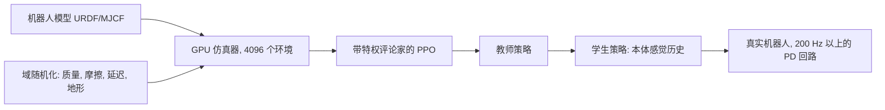

## 为什么重要

在[上一篇]({{ '/blog/2026/embodied-ai-01-robotics-foundations/' | relative_url }})中，每个控制器都是根据模型手工设计的。
这对在自由空间中运动的机械臂行得通，但对在碎石上奔跑的四足机器人、或者转动方块的灵巧手就非常困难了，因为接触每秒要
通断数百次。**强化学习**（reinforcement learning, RL）用优化取代手工设计：写下一个奖励，让机器人在仿真器里尝试数百万次，
再把得到的策略迁移到硬件上。大约从 2019 年起，这套配方已成为构建运动控制器的标准方法，而它的思想（优势函数、熵、
域随机化）在本系列后面的模仿学习、VLA 微调和世界模型训练中还会反复出现。

**前置知识**

- 本系列第 1 篇（关节空间 PD 控制、动作空间）。
- 概率：期望、对数导数技巧、高斯分布。
- PyTorch 基础（autograd、`nn.Module`、优化器）。
- 如果你了解世界模型：基于模型的 RL 会在第 5 篇和世界模型系列中出现，本篇只讨论无模型方法。

## 1. RL 问题

### 马尔可夫决策过程

MDP 是一个元组 $(\mathcal{S}, \mathcal{A}, P, r, \gamma, \rho_0)$：状态、动作、转移动力学 $$P(s' \mid s, a)$$、奖励 $r(s, a)$、
折扣 $\gamma \in [0, 1)$ 和初始状态分布 $\rho_0$。一个（随机）策略 $\pi_\theta(a \mid s)$ 产生轨迹
$\tau = (s_0, a_0, s_1, a_1, \dots)$，目标是期望折扣回报

$$
J(\theta) = \mathbb{E}_{\tau\sim\pi_\theta}\left[\sum_{t=0}^{\infty} \gamma^t r(s_t, a_t)\right].
$$

真实机器人是**部分可观测**的（POMDP）：策略看到的是观测 $o_t$（关节编码器、IMU、图像），而不是完整状态（精确的接触力、
地面摩擦）。实践中用观测历史、循环网络，或第 4 节中的特权信息技巧来处理。

对机器人来说，建模选择和算法同样重要：

| MDP 要素 | 腿式机器人的典型选择 |
| --- | --- |
| 观测 | 基座角速度、投影重力、关节位置与速度、上一步动作、速度指令、（高度图） |
| 动作 | 给 200 Hz 到 1 kHz PD 回路的关节位置目标 $q^{\text{des}}$；策略运行在 50 Hz |
| 奖励 | 跟踪指令速度，惩罚力矩、关节加速度、动作变化率、足部打滑、基座姿态 |
| 回合 | 20 s，摔倒（基座触地）时终止，随机化初始状态与地形 |

把这些放在一起，腿式机器人 RL 系统的一步就是下图中的回路：策略以较低频率运行，PD 回路以高频把它的目标转成力矩，来自大量并行环境的成批轨迹再送入 PPO 更新。



### 价值函数与贝尔曼方程

策略的状态价值与动作价值为

$$
V^\pi(s) = \mathbb{E}_\pi\left[\sum_{k\ge 0}\gamma^k r_{t+k} \,\middle\vert\, s_t = s\right], \qquad
Q^\pi(s,a) = \mathbb{E}_\pi\left[\sum_{k\ge 0}\gamma^k r_{t+k} \,\middle\vert\, s_t = s, a_t = a\right],
$$

**优势函数**（advantage）$A^\pi(s,a) = Q^\pi(s,a) - V^\pi(s)$ 衡量动作 $a$ 比策略的平均水平好多少。它们满足贝尔曼期望方程

$$
Q^\pi(s,a) = r(s,a) + \gamma\,\mathbb{E}_{s'\sim P,\,a'\sim\pi}\left[Q^\pi(s',a')\right],
$$

而最优动作价值满足贝尔曼最优方程 $$Q^{\ast}(s,a) = r + \gamma\,\mathbb{E}_{s'}[\max_{a'} Q^{\ast}(s',a')]$$。Q 学习和 DQN（Mnih 等 2015）
迭代的是后者，但在连续高维动作空间上取 $\max$ 很别扭，所以机器人领域主要使用**策略梯度**（policy gradient）和
**演员-评论家**（actor-critic）方法。

对于已知的小型 MDP，可以用**价值迭代**（value iteration）直接求解贝尔曼最优方程：$V_{k+1}(s) = \max_a \sum_{s'} P(s'\mid s,a)\,[r + \gamma V_k(s')]$。下图和下面的交互组件展示了价值如何从奖励处一轮一轮地向后传播。





## 2. 策略梯度

### 策略梯度定理

利用 $\nabla_\theta p_\theta(\tau) = p_\theta(\tau)\nabla_\theta\log p_\theta(\tau)$ 以及动力学不依赖于 $\theta$ 这一事实，可以得到
（Williams 1992；Sutton 等 2000）

$$
\nabla_\theta J(\theta) = \mathbb{E}_{\pi_\theta}\left[\sum_t \nabla_\theta\log\pi_\theta(a_t\mid s_t)\, \hat A_t\right],
$$

其中 $\hat A_t$ 可以是未来回报（REINFORCE）、回报减去基线 $b(s_t)$，或者优势估计。减去与状态相关的基线不会使梯度有偏，
却能大幅降低方差。直观地说，梯度会提高结果好于预期的动作的对数概率，降低其他动作的对数概率。

对连续控制，策略通常是对角高斯 $\pi_\theta(a\mid s) = \mathcal{N}(\mu_\theta(s), \mathrm{diag}(\sigma^2))$，其中 $\log\sigma$ 与状态无关、
由学习得到。

一个单步问题（老虎机）能把这个更新直观地画出来。优势为正的样本把高斯的均值拉向自己，优势为负的样本把它推开；反复迭代后，一旦策略找到最优点，$\sigma$ 也会缩小：



### 广义优势估计

有了学习的评论家 $V_\phi$，定义 TD 残差 $\delta_t = r_t + \gamma V_\phi(s_{t+1}) - V_\phi(s_t)$。**GAE**（Schulman 等 2016）用指数衰减
权重对 $k$ 步优势估计取平均：

$$
\hat A_t^{\mathrm{GAE}(\gamma,\lambda)} = \sum_{l=0}^{\infty} (\gamma\lambda)^l\,\delta_{t+l}.
$$

$\lambda = 0$ 得到低方差但有偏的一步 TD 优势；$\lambda = 1$ 得到无偏但高方差的蒙特卡洛优势。$\lambda \approx 0.95$ 是常用的折中。
评论家回归到目标 $\hat R_t = \hat A_t + V_\phi(s_t)$。

上图展示了 $\lambda$ 如何决定 TD 残差的平均范围。下图在一个评论家（critic）被故意设错的玩具链上测量了由此带来的权衡：



### 信赖域与 PPO

朴素的策略梯度很脆弱：一步走得太大就可能让策略崩溃，此后收集的数据也就毫无用处。**TRPO**（Schulman 等 2015）在新旧策略
之间 KL 散度约束下最大化一个替代目标。**PPO**（Schulman 等 2017）用一个一阶技巧获得了大部分好处。记概率比
$\rho_t(\theta) = \pi_\theta(a_t\mid s_t)/\pi_{\theta_{\text{old}}}(a_t\mid s_t)$，它最大化

$$
L^{\text{CLIP}}(\theta) = \mathbb{E}_t\left[\min\left(\rho_t(\theta)\hat A_t,\; \operatorname{clip}(\rho_t(\theta), 1-\epsilon, 1+\epsilon)\,\hat A_t\right)\right],
$$

通常取 $\epsilon = 0.2$。$\min$ 使它成为一个悲观的下界：一旦概率比朝着改进目标的方向离开 $[1-\epsilon, 1+\epsilon]$，梯度就消失，
于是没有继续移动的动力。这让 PPO 可以把每批数据重复用于多轮小批量 SGD。完整损失再加上价值损失和可选的熵奖励：

$$
L(\theta,\phi) = -L^{\text{CLIP}}(\theta) + c_v\,\mathbb{E}_t\left[(V_\phi(s_t) - \hat R_t)^2\right] - c_e\,\mathbb{E}_t\left[\mathcal{H}(\pi_\theta(\cdot\mid s_t))\right].
$$

PPO 是同策略（on-policy）的，样本效率低，但它简单、稳定、极易并行。当一块 GPU 上有成千上万个仿真机器人时，样本效率远不如
墙钟时间重要，这就是 PPO 成为 Isaac Lab、legged_gym 以及大多数运动控制论文默认算法的原因。

把单个样本的 $L^{\text{CLIP}}$ 画出来，就能看到 $\min$ 的“悲观”：恰恰在继续移动看起来有利的地方，目标变平，梯度为零。



### 紧凑的 PyTorch PPO

下面的文件是自包含的：一个演员-评论家网络、GAE、PPO 更新，以及一个向量化的玩具任务，其中 64 个质点必须移动到原点
（相当于一个到达任务的替身）。在笔记本 CPU 上几分钟就能跑完。

```python
import torch
import torch.nn as nn

class ActorCritic(nn.Module):
    def __init__(self, obs_dim, act_dim, hidden=64):
        super().__init__()
        self.pi = nn.Sequential(nn.Linear(obs_dim, hidden), nn.Tanh(),
                                nn.Linear(hidden, hidden), nn.Tanh(), nn.Linear(hidden, act_dim))
        self.v = nn.Sequential(nn.Linear(obs_dim, hidden), nn.Tanh(),
                               nn.Linear(hidden, hidden), nn.Tanh(), nn.Linear(hidden, 1))
        self.log_std = nn.Parameter(torch.full((act_dim,), -0.5))

    def dist(self, obs):
        return torch.distributions.Normal(self.pi(obs), self.log_std.exp())

def gae(rew, val, done, last_val, gamma=0.99, lam=0.95):
    """rew, val, done: [T, N] tensors (N parallel envs). Returns advantages and returns."""
    T = rew.shape[0]
    adv = torch.zeros_like(rew)
    next_val, running = last_val, torch.zeros_like(last_val)
    for t in reversed(range(T)):
        mask = 1.0 - done[t]
        delta = rew[t] + gamma * next_val * mask - val[t]
        running = delta + gamma * lam * mask * running
        adv[t] = running
        next_val = val[t]
    return adv, adv + val

def ppo_update(model, opt, obs, act, logp_old, adv, ret,
               clip=0.2, vf_coef=0.5, ent_coef=0.0, epochs=10, minibatch=256):
    """One PPO update on a flattened batch of B transitions."""
    adv = (adv - adv.mean()) / (adv.std() + 1e-8)
    B = obs.shape[0]
    for _ in range(epochs):
        for idx in torch.randperm(B).split(minibatch):
            d = model.dist(obs[idx])
            logp = d.log_prob(act[idx]).sum(-1)
            ratio = (logp - logp_old[idx]).exp()
            surr = torch.min(ratio * adv[idx],
                             ratio.clamp(1 - clip, 1 + clip) * adv[idx])
            v_loss = (model.v(obs[idx]).squeeze(-1) - ret[idx]).pow(2).mean()
            loss = -surr.mean() + vf_coef * v_loss - ent_coef * d.entropy().sum(-1).mean()
            opt.zero_grad()
            loss.backward()
            nn.utils.clip_grad_norm_(model.parameters(), 0.5)
            opt.step()

# --- a toy "reaching" task: a 2-D point mass must move to the origin ---
class PointReach:
    def __init__(self, n, horizon=50):
        self.n, self.H = n, horizon
        self.damp, self.gain = 0.9, 0.1               # nominal physics
    def reset(self):
        self.pos = torch.rand(self.n, 2) * 2 - 1
        self.vel = torch.zeros(self.n, 2)
        self.t = torch.zeros(self.n)
        return torch.cat([self.pos, self.vel], -1)
    def step(self, a):
        a = a.clamp(-1, 1)
        self.vel = self.damp * self.vel + self.gain * a  # simple damped dynamics
        self.pos = self.pos + 0.1 * self.vel
        self.t += 1
        rew = -self.pos.norm(dim=-1) - 0.01 * a.pow(2).sum(-1)
        done = (self.t >= self.H).float()
        if done.any():                                # auto-reset finished envs
            k = done.bool()
            self.pos[k] = torch.rand(int(k.sum()), 2) * 2 - 1
            self.vel[k] = 0.0
            self.t[k] = 0
        return torch.cat([self.pos, self.vel], -1), rew, done

torch.manual_seed(0)
env, T = PointReach(n=64), 128
model = ActorCritic(4, 2)
opt = torch.optim.Adam(model.parameters(), lr=3e-4)
obs = env.reset()
for it in range(150):
    buf = {k: [] for k in ["obs", "act", "logp", "rew", "val", "done"]}
    with torch.no_grad():
        for t in range(T):
            d = model.dist(obs)
            a = d.sample()
            buf["obs"].append(obs); buf["act"].append(a)
            buf["logp"].append(d.log_prob(a).sum(-1))
            buf["val"].append(model.v(obs).squeeze(-1))
            obs, r, done = env.step(a)
            buf["rew"].append(r); buf["done"].append(done)
        last_val = model.v(obs).squeeze(-1)
    b = {k: torch.stack(v) for k, v in buf.items()}            # [T, N, ...]
    adv, ret = gae(b["rew"], b["val"], b["done"], last_val)
    flat = lambda x: x.reshape(T * env.n, *x.shape[2:])
    ppo_update(model, opt, flat(b["obs"]), flat(b["act"]), flat(b["logp"]), flat(adv), flat(ret))
    if it % 25 == 0 or it == 149:
        print(f"iter {it:3d}  mean reward per step {b['rew'].mean():.3f}")
```

在我的运行中，每步平均奖励从约 $-0.89$（随机动作）上升到约 $-0.1$（质点到达原点并停住）。实践中很重要又很容易出错的细节：

- **回合结束时的掩码。** `mask` 阻止在自动重置处继续自举。严格来说，**时间限制**造成的截断仍应从 $V(s_{T})$ 自举（机器人并没有
  失败，只是我们不再观察了）；legged_gym 的做法是在超时时把最终状态的 $\gamma V$ 加到奖励上。玩具代码把超时当作终止，带来
  少许偏差。
- **优势归一化**、**梯度裁剪**和**与状态无关的 log-std** 都是标准做法；观测归一化（滑动均值/方差）在真实机器人上很重要，因为
  各物理量的单位可能相差几个数量级。
- **动作缩放。** 这里网络输出被截断到 $[-1, 1]$；在机器人上通常会缩放后加到名义关节构型上，$q^{\text{des}} = q_0 + k_a a_t$。

原封不动地运行上面的脚本，就得到下图的学习曲线，以及训练后策略的行为：



## 3. Soft Actor-Critic

PPO 每次更新后就丢弃数据。**异策略**（off-policy）方法保留一个经验回放缓冲区，样本效率高得多，这在样本来自真实机器人时
非常关键。**SAC**（Haarnoja 等 2018）优化最大熵目标

$$
J(\pi) = \sum_t \mathbb{E}_{(s_t,a_t)\sim\pi}\left[r(s_t,a_t) + \alpha\,\mathcal{H}(\pi(\cdot\mid s_t))\right],
$$

在完成任务的同时让策略尽可能随机。这带来稳健的探索，并且策略不会坍缩到某一个脆弱的解上。SAC 学习两个软 Q 函数
$Q_{\phi_1}, Q_{\phi_2}$（像 TD3 一样取最小值以对抗过估计），目标为

$$
y = r + \gamma\left(\min_{j=1,2} Q_{\bar\phi_j}(s', \tilde a') - \alpha\log\pi_\theta(\tilde a'\mid s')\right), \qquad \tilde a' \sim \pi_\theta(\cdot\mid s'),
$$

其中 $\bar\phi$ 是缓慢更新（Polyak 平均）的目标网络。演员使用 tanh 压缩高斯的**重参数化技巧**，
$\tilde a = \tanh(\mu_\theta(s) + \sigma_\theta(s)\odot\xi)$，$\xi\sim\mathcal{N}(0, I)$，并最小化

$$
L_\pi(\theta) = \mathbb{E}_{s\sim\mathcal{D},\,\xi}\left[\alpha\log\pi_\theta(\tilde a\mid s) - \min_j Q_{\phi_j}(s, \tilde a)\right].
$$

tanh 改变了概率密度，因此 $\log\pi(\tilde a\mid s) = \log\mathcal{N}(u;\mu,\sigma) - \sum_i\log(1-\tanh^2 u_i)$。后续论文（Haarnoja 等 2018b）
还会把 $\alpha$ 自动调向目标熵（常取 $-\dim\mathcal{A}$），并展示了在真实的 Minitaur 四足机器人上直接学会行走，只用了约两小时的经验。

| | PPO | SAC |
| --- | --- | --- |
| 数据 | 同策略，更新后丢弃 | 异策略，回放缓冲区 |
| 样本效率 | 低 | 高 |
| 并行仿真 | 扩展性极好 | 需要注意（更新与数据之比） |
| 典型用途 | 仿真到现实的运动控制，大规模并行仿真 | 真实世界 RL、操作、微调 |
| 探索 | 高斯噪声 + 可选的熵奖励 | 最大熵，自动温度 |

理解 SAC 有两张图很有帮助。熵奖励把贪心的 $\arg\max_a Q$ 变成玻尔兹曼分布 $\pi \propto \exp(Q/\alpha)$（单步问题中最大熵目标的最优策略），而 tanh 压缩需要上面给出的密度修正：



## 4. 奖励设计

奖励就是任务的规格说明，任何漏洞都会被找到。常见模式：

- **稠密的任务项**（例如速度跟踪用 $$\exp(-\lVert v^{\text{cmd}}_{xy} - v_{xy}\rVert^2 / \sigma)$$）加上许多小的**正则化惩罚**（力矩、功率、
  关节加速度、动作变化率 $\lVert a_t - a_{t-1}\rVert^2$、足部打滑、腾空时间）。正是这些惩罚让步态看起来自然且可迁移；没有它们，
  策略会高频抖动，仿真器能容忍，电机却受不了。
- **基于势的奖励塑形**（potential-based shaping，Ng、Harada 与 Russell，ICML 1999）：对任意势函数 $\Phi$ 加上 $$F = \gamma\Phi(s') - \Phi(s)$$，
  可以证明不改变最优策略，而其他塑形项则可能改变它。
- **稀疏奖励加示范或课程**，用于操作任务：成功/失败容易定义，却难以探索，于是加入示范（第 4 篇）、自动课程（如 Rudin 等的
  做法，随策略进步提高地形难度）或目标重标记。
- **来自数据的风格奖励**：动作模仿（DeepMimic，Peng 等 2018）或对抗运动先验会奖励策略"看起来像"参考动作捕捉数据，
  这是从角色动画通往机器人的一座直接桥梁。
- **LLM 编写的奖励**：Eureka（Ma 等 2024）让 LLM 编写奖励代码，在 Isaac Gym 中训练策略，再把训练统计反馈给 LLM 以改进奖励。

## 5. 仿真到现实迁移

在仿真中训练的策略要面对**现实差距**（reality gap）：错误的质量和摩擦、未建模的执行器动力学、延迟、传感器噪声，以及与渲染
图像毫不相像的真实图像。主要工具如下。

### 域随机化

与其让仿真器完全正确，不如让它以多种方式**随机地出错**，使真实世界看起来只不过是又一个样本。Tobin 等（IROS 2017）在一个
非照片级的渲染器中随机化纹理、光照、相机位姿和干扰物，训练出的物体检测器在没有任何真实图像的情况下，在真实机器人上的
定位误差平均约为 1.5 cm。Peng 等（ICRA 2018）随机化**动力学**（质量、摩擦、阻尼、延迟），并使用能隐式辨识当前动力学的
循环策略。OpenAI 的灵巧手工作（2018、2019）把它推向极致，提出自动域随机化，随策略成功而逐步扩大范围。

在代码中，随机化只是在重置时为每个环境重新采样物理参数。在上面的玩具任务中：

```python
class RandomizedPointReach(PointReach):
    """Domain randomization: every env gets its own damping and actuator gain."""
    def reset(self):
        self.damp = torch.empty(self.n, 1).uniform_(0.8, 0.97)
        self.gain = torch.empty(self.n, 1).uniform_(0.05, 0.2)
        return super().reset()
```

把 `PointReach(n=64)` 换成 `RandomizedPointReach(n=64)`，同样的 PPO 循环就能学到一个对所有这些"机器人"都有效的单一策略。
（为简洁起见，参数在每次 `reset()` 时采样一次；完整实现会在每个环境自动重置时重新采样。）代价是保守性：范围越宽，策略越
稳健，但也越不最优。

在这里它有帮助吗？下图用上面的 PPO 代码分别训练两个版本，并在一整张物理参数网格上评估它们：



### 系统辨识与执行器模型

随机化不能代替把大的方面做对。Hwangbo 等（Science Robotics 2019）训练了一个**执行器网络**（actuator network），这是一个 MLP，
把一小段关节位置误差和速度的历史映射为真实串联弹性执行器输出的力矩，训练数据采自 ANYmal。把它接入仿真器后，大部分
差距被弥合；学到的策略跑得比此前基于模型的控制器更快，还能在复杂姿态下从摔倒中恢复，这是手工设计的控制器没有做到的。

### 特权教师、学生与自适应

仿真器知道机器人永远无法知道的东西：精确的地形、摩擦、接触状态。利用这些知识有两类流行做法：

- **非对称演员-评论家**（asymmetric actor-critic，Pinto 等 RSS 2018）：评论家看到完整的仿真状态，而演员只看到机器人的观测。
  部署时评论家会被丢弃，所以它"作弊"也无妨。
- **教师-学生蒸馏**（Lee 等 Science Robotics 2020）：先用特权信息训练教师策略，再训练一个只看本体感觉历史的学生去模仿教师。
  学生学会通过腿部的"手感"推断地形。这让 ANYmal 能走过训练中从未见过的泥地、雪地、碎石和植被。Miki 等（2022）进一步
  用基于注意力的方式融合外部感知（由相机和 LiDAR 得到的高度图）与本体感觉，机器人完成了瑞士 Etzel 山的一条徒步路线。
- **快速运动自适应**（Rapid Motor Adaptation，Kumar 等 RSS 2021）：把特权的环境参数编码为一个隐式"外在因素"向量，并训练
  一个自适应模块，根据最近的状态和动作在线估计它。

### 大规模并行仿真

Rudin 等（CoRL 2021）表明，借助 Isaac Gym 在单块 GPU 上运行数千个环境，配合受游戏启发的地形课程和精心调参的 PPO，
可以在四分钟内训练出平地上的四足策略，在大约二十分钟内训练出崎岖地形上的策略，并且策略能迁移到真实的 ANYmal 上。
他们开源的 `legged_gym` 成了一代运动控制工作的模板，包括人形机器人（Radosavovic 等，Science Robotics 2024）。
启示是：当仿真很便宜时，简单的同策略算法胜出。



## 6. 运动控制之外

- **操作。** 用引导策略搜索训练的端到端视觉运动策略（Levine 等 JMLR 2016）；基于大规模真实数据的 QT-Opt 抓取；用 Shadow
  手完成的手内重定向（OpenAI 2018）。对 RL 来说，操作比运动更难，因为奖励稀疏，相关状态（物体位姿、接触）难以感知，这也是
  如今操作任务以模仿学习（第 4 篇）为主的原因。
- **敏捷飞行。** 冠军级无人机竞速（Kaufmann 等 Nature 2023）把仿真中的 RL 与数据驱动的感知和动力学残差模型结合起来。
- **基础策略的 RL 微调。** RL 越来越多地被用来改进由模仿预训练的策略，使用成功奖励或学习得到的奖励模型；本文的思想可以
  直接沿用。

## 动手试试

**[Lab]({{ '/' | relative_url }}#lab)** 中的 XPBD 布料演示是一个带子步与约束投影的物理仿真器，正是 RL 智能体在其中训练的那类引擎。
拖动布料就是一个稳健策略必须抵抗的扰动；把随机化布料的刚度和质量想象成域随机化即可。

## 代表性论文

| 论文 | 会议/期刊 | 年份 | 链接 | 意义 |
| --- | --- | --- | --- | --- |
| Mnih et al., *Human-level control through deep reinforcement learning* | Nature | 2015 | [DOI](https://doi.org/10.1038/nature14236) | DQN，深度 RL 的起点 |
| Schulman et al., *Trust region policy optimization* | ICML | 2015 | [arXiv](https://arxiv.org/abs/1502.05477) | KL 约束的策略更新 |
| Schulman et al., *High-dimensional continuous control using generalized advantage estimation* | ICLR | 2016 | [arXiv](https://arxiv.org/abs/1506.02438) | GAE |
| Levine et al., *End-to-end training of deep visuomotor policies* | JMLR | 2016 | [arXiv](https://arxiv.org/abs/1504.00702) | 从像素到力矩的操作 |
| Schulman et al., *Proximal policy optimization algorithms* | arXiv | 2017 | [arXiv](https://arxiv.org/abs/1707.06347) | PPO |
| Tobin et al., *Domain randomization for transferring deep neural networks from simulation to the real world* | IROS | 2017 | [arXiv](https://arxiv.org/abs/1703.06907) | 视觉域随机化 |
| Peng et al., *Sim-to-real transfer of robotic control with dynamics randomization* | ICRA | 2018 | [arXiv](https://arxiv.org/abs/1710.06537) | 动力学随机化 |
| Pinto et al., *Asymmetric actor critic for image-based robot learning* | RSS | 2018 | [arXiv](https://arxiv.org/abs/1710.06542) | 特权评论家 |
| Haarnoja et al., *Soft actor-critic: off-policy maximum entropy deep RL with a stochastic actor* | ICML | 2018 | [arXiv](https://arxiv.org/abs/1801.01290) | SAC |
| Peng et al., *DeepMimic: example-guided deep RL of physics-based character skills* | ACM TOG (SIGGRAPH) | 2018 | [arXiv](https://arxiv.org/abs/1804.02717) | 动作模仿奖励，图形学与 RL 相遇 |
| OpenAI et al., *Learning dexterous in-hand manipulation* | IJRR | 2020 | [arXiv](https://arxiv.org/abs/1808.00177) | 极致的域随机化 |
| Hwangbo et al., *Learning agile and dynamic motor skills for legged robots* | Science Robotics | 2019 | [DOI](https://doi.org/10.1126/scirobotics.aau5872) | 执行器网络，ANYmal 上的 RL |
| Lee et al., *Learning quadrupedal locomotion over challenging terrain* | Science Robotics | 2020 | [DOI](https://doi.org/10.1126/scirobotics.abc5986) | 教师-学生仿真到现实 |
| Kumar et al., *RMA: Rapid motor adaptation for legged robots* | RSS | 2021 | [arXiv](https://arxiv.org/abs/2107.04034) | 在线自适应 |
| Rudin et al., *Learning to walk in minutes using massively parallel deep RL* | CoRL | 2021 | [arXiv](https://arxiv.org/abs/2109.11978) | GPU 并行 PPO，legged_gym |
| Miki et al., *Learning robust perceptive locomotion for quadrupedal robots in the wild* | Science Robotics | 2022 | [arXiv](https://arxiv.org/abs/2201.08117) | 外部感知 + 本体感觉 |
| Kaufmann et al., *Champion-level drone racing using deep reinforcement learning* | Nature | 2023 | [DOI](https://doi.org/10.1038/s41586-023-06419-4) | RL 击败人类冠军 |
| Ma et al., *Eureka: human-level reward design via coding large language models* | ICLR | 2024 | [arXiv](https://arxiv.org/abs/2310.12931) | LLM 编写奖励 |
| Radosavovic et al., *Real-world humanoid locomotion with reinforcement learning* | Science Robotics | 2024 | [arXiv](https://arxiv.org/abs/2303.03381) | 人形机器人的 Transformer 策略 |

## 学习资源

- R. Sutton 与 A. Barto，[*Reinforcement Learning: An Introduction*](http://incompleteideas.net/book/the-book-2nd.html)，第 2 版
  （MIT Press, 2018），可免费在线阅读。重点读第 3 到 6 章和第 13 章。
- OpenAI [Spinning Up in Deep RL](https://spinningup.openai.com)：对策略梯度、PPO、SAC 的清晰推导与参考代码。
- S. Levine，CS 285 深度强化学习（UC Berkeley），讲座视频在线可看。
- R. Tedrake，[*Underactuated Robotics*](https://underactuated.csail.mit.edu)：从控制论视角看 RL 和轨迹优化。
- 代码：[CleanRL](https://github.com/vwxyzjn/cleanrl)（单文件实现）、
  [Stable-Baselines3](https://github.com/DLR-RM/stable-baselines3)、
  [legged_gym](https://github.com/leggedrobotics/legged_gym) 与 [rsl_rl](https://github.com/leggedrobotics/rsl_rl)、
  [Isaac Lab](https://github.com/isaac-sim/IsaacLab)。

## 练习

1. 从 $\nabla_\theta\log p_\theta(\tau)$ 推导策略梯度定理，并证明与状态相关的基线不会引入偏差。
2. 在 PPO 代码中把 `gae` 的 `lam` 分别设为 0 和 1，比较学习曲线。再把 `clip` 设为 10（相当于不裁剪），观察稳定性。
3. 修正时间限制带来的偏差：让 `PointReach.step` 分别返回 `terminated` 和 `truncated` 标志，并在截断时从最终观测的价值自举。
4. 在 `PointReach` 上训练，然后在参数取极端值的 `RandomizedPointReach` 上评估，并与用随机化训练的策略比较。把真实阻尼加入
   观测（"特权"输入），看看能帮多少。
5. 为同一任务实现 SAC（回放缓冲区、双 Q、tanh 高斯、自动 $\alpha$），并比较它与 PPO 所需的环境步数。

**下一篇：**[仿真平台]({{ '/blog/2026/embodied-ai-03-simulation-platforms/' | relative_url }})，所有这些训练发生的地方。
