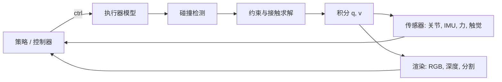

## 为什么重要

[强化学习那一篇]({{ '/blog/2026/embodied-ai-02-reinforcement-learning-for-robots/' | relative_url }})以几分钟学会行走的策略收尾，
但那只是因为成千上万个机器人副本在并行仿真。仿真器之于具身智能，就像数据集之于计算机视觉：它们生成训练数据、定义基准，
而它们的误差就变成了现实差距。仿真器也是机器人学与**计算机图形学**最直接相遇的地方。现代仿真器就是一个物理内核更严格的
游戏引擎，[图形学系列]({{ '/blog/category/graphics/' | relative_url }})中的技术（光栅化、光线追踪、BVH、基于位置的动力学）
都是它的积木。本文解释仿真器计算什么，比较主要平台，并用 Python 逐步演示 MuJoCo。

**前置知识**

- 第 1、2 篇（运动方程、PD 控制、RL 训练循环）。
- 基本的数值积分（显式与半隐式欧拉法）。
- 可选：图形学系列中关于光栅化、光线追踪和物理仿真的文章。

## 1. 机器人仿真器做什么

每个仿真器都以固定时间步长 $\Delta t$（通常 1 到 5 ms）重复同一个循环，一个控制步通常包含若干个"子步"（substep）：



### 刚体动力学

大多数机器人引擎使用**广义（约化）坐标**（generalized coordinates）：状态是关节向量 $q$ 及其速度 $v$，动力学就是第 1 篇中的
机械臂方程

$$
M(q)\,\dot v + c(q, v) = \tau + J_c(q)^\top f_c ,
$$

其中 $c$ 汇总了科氏力、离心力和重力项，$J_c^\top f_c$ 把接触力映射到关节空间。关节约束天然被精确满足，$M$ 和 $c$ 用
Featherstone 的 $O(n)$ 算法（CRBA、RNEA、ABA）计算。MuJoCo、Drake、Pinocchio、RaiSim 以及 PhysX 的 articulation 都这样工作。
游戏引擎和许多图形学求解器则使用**最大坐标**（maximal coordinates）：每个物体有自己的 6 自由度位姿，关节是物体间的约束。
这样更简单、易于并行，但关节约束会漂移，长链收敛缓慢。

积分通常采用**半隐式（辛）欧拉法**：$v_{t+1} = v_t + \Delta t\,\dot v_t$，然后 $q_{t+1} = q_t \oplus \Delta t\, v_{t+1}$（其中 $\oplus$ 处理
自由关节的四元数）。MuJoCo 还提供对阻尼项的隐式积分和 RK4 积分器；刚度大的关节和执行器常常需要隐式选项。

### 接触与摩擦

接触是各仿真器差异最大的地方，也是大多数仿真到现实问题的来源。

1. **碰撞检测。** 宽阶段（broad phase，层次包围盒或扫描剪枝，正是光线追踪里的 BVH 思想）找出候选对；窄阶段（narrow phase）
   对凸形状用 GJK/EPA 或 MPR、对基本形状对（球-平面、胶囊-胶囊）用解析公式，计算接触点、法向和穿透深度。非凸网格通常被
   分解为凸块（如 V-HACD、CoACD）或用 SDF 近似。
2. **接触模型。** 对法向冲量为 $\lambda_n$、间隙为 $\phi(q)$ 的接触，理想刚体模型是**互补条件**（complementarity condition）

   $$
   0 \le \lambda_n \;\perp\; \phi(q) \ge 0 ,
   $$

   即要么两物体接触并相互推挤，要么分离且力为零。库仑摩擦再加上**摩擦锥** $\lVert \lambda_t \rVert \le \mu \lambda_n$ 和最大耗散原理。
   精确求解它每步得到一个（非线性）互补问题，常用棱锥形摩擦锥线性化为 LCP（Stewart 与 Trinkle 1996；Anitescu 与 Potra 1997），
   并用投影高斯-赛德尔（PGS）求解。
3. **MuJoCo 的做法**（Todorov，ICRA 2014）把硬互补松弛为一个**凸优化**：约束力在摩擦锥约束下最小化一个二次目标，并带有由
   `solref` 和 `solimp` 参数控制的少量软性。凸性带来唯一解和光滑、可逆的动力学（对优化与估计很有用），代价是少量穿透和滑移。
   在下面的例子中你会看到 0.1 mm 的穿透。
4. **基于位置的方法。** PBD 与 XPBD（Macklin 等 2016）完全跳过力，直接把位置投影到约束上。XPBD 引入柔度 $\alpha$，使刚度与
   迭代次数无关：对约束 $C(x) = 0$，令 $\tilde\alpha = \alpha / \Delta t^2$，每次迭代按下式更新拉格朗日乘子和位置

   $$
   \Delta\lambda = \frac{-C(x) - \tilde\alpha\,\lambda}{\nabla C\, M^{-1}\nabla C^\top + \tilde\alpha}, \qquad
   \Delta x = M^{-1}\nabla C^\top \Delta\lambda .
   $$

   主页上的布料演示运行的正是它，它也是 NVIDIA Flex 以及 Isaac 和 Genesis 中布料、绳索和软体仿真的基础。

实际后果：接触参数（摩擦、恢复系数、软性）是最需要随机化的量之一；减小时间步长往往比增加求解迭代更有效；而用薄物体抓取或
处理大量接触（布料、颗粒介质、线缆）在所有仿真器里都仍然困难。

### 执行器与传感器

真实关节不是理想的力矩源。仿真器会建模**执行器**：带减速比的直流电机、电枢惯量（armature，即折算的转子惯量，对小而快的
关节有很强的稳定作用）、关节阻尼与摩擦、力矩与速度限制、带增益的位置伺服，有时还有学习得到的执行器网络（第 2 篇）。
**传感器**带噪声和延迟地读取状态：关节编码器、IMU（某个 site 的加速度计与陀螺仪）、力/力矩传感器、几何体上的触觉传感器，
以及相机。

### 渲染

基于视觉的策略需要图像。各种方案在速度和真实感之间权衡：

| 渲染器 | 例子 | 用途 |
| --- | --- | --- |
| 光栅化（OpenGL/Vulkan） | MuJoCo、SAPIEN、PyBullet、Habitat-Sim | 快速的 RGB-D 与分割，数百万帧 |
| 批量 GPU 渲染器 | ManiSkill3、Madrona、MJX/MJWarp 批量渲染器 | 为视觉 RL 并行渲染数千个相机 |
| 实时光线/路径追踪 | Isaac Sim（RTX）、SAPIEN 光线追踪器、Genesis | 照片级数据，合成数据生成 |
| 神经 / 高斯泼溅场景 | SplatSim、RoboGSim、Real-is-Sim（研究） | 从真实扫描重建的照片级数字孪生 |

最后一行就是神经渲染系列与机器人学的交汇处：3D 高斯泼溅（3D Gaussian Splatting）从一段手机视频重建真实工作空间，
仿真器在其中渲染机器人和物体，从而缩小视觉上的仿真到现实差距。

### 场景与机器人描述格式

- **URDF**（ROS）：连杆、关节、惯量、视觉与碰撞网格；支持广泛，但只能表示树结构，除扩展外不含执行器和传感器。
- **MJCF**（MuJoCo）：更丰富，包括执行器、腱、传感器、等式约束和默认值。
- **USD**（Pixar 的通用场景描述，Omniverse/Isaac Sim 使用）：带材质和物理模式的完整场景。图形管线的场景图格式变成了机器人的世界。

MuJoCo Menagerie 等合集提供了许多商用机器人经过整理和测试的模型。

## 2. 平台概览

| 平台 | 物理 | 优势 | 典型用途 |
| --- | --- | --- | --- |
| **MuJoCo**（Google DeepMind，2022 年起开源） | 广义坐标，凸软接触 | 精确，CPU 上快，有 MJX（JAX）与 MuJoCo Warp（GPU）变体，MuJoCo Playground | 控制研究、腿式运动、灵巧手、基于模型的 RL |
| **Isaac Sim / Isaac Lab**（NVIDIA） | GPU 上的 PhysX 5，RTX 渲染，USD | 大规模并行，照片级传感器，丰富的机器人库 | 仿真到现实的运动与操作，合成数据 |
| **Habitat**（Meta） | 基于 Bullet，侧重渲染速度 | 在扫描的 3D 家庭场景（Matterport、HM3D）中每秒数千帧，3.0 版加入人和虚拟化身 | 导航、重排、具身问答、人机协作 |
| **SAPIEN / ManiSkill**（UCSD、Hillbot） | PhysX，ManiSkill3 支持 GPU 并行 | 铰接物体（PartNet-Mobility）、快速批量渲染、任务丰富 | 操作基准、视觉 RL、模仿学习 |
| **Genesis**（开源联合团队，2024） | 多求解器：刚体、MPM、SPH、FEM、PBD | 一个引擎支持多种材料，原生 Python，计划提供生成式数据引擎 | 软体、流体、研究原型 |
| **Drake**（TRI/MIT） | 水弹性接触（hydroelastic contact），优化工具 | 严谨的建模、轨迹优化、系统框架 | 基于模型的控制与规划 |
| **PyBullet** | Bullet，最大坐标 + 约化坐标 | 简单，旧论文中随处可见 | 教学、传统基线 |
| **Newton**（NVIDIA、Google DeepMind、Disney Research；Linux 基金会，2025） | GPU，基于 NVIDIA Warp，包含 MuJoCo Warp | 可扩展的可微物理 | 下一代机器人学习 |

值得了解的一些细节：

- **Isaac Gym**（Makoviychuk 等 2021）首次展示了端到端的 GPU 仿真与训练，张量从不离开 GPU。它后来演化为 **Orbit**
  （Mittal 等 2023），再到建立在 Isaac Sim 之上的 **Isaac Lab**。
- **MJX** 用 JAX 重新实现了 MuJoCo，可以把一整批世界 `vmap` 并 `jit` 到 GPU 或 TPU 上，并且可微；**MuJoCo Warp** 是更新的 GPU
  实现，在接触丰富的场景中扩展性更好。**MuJoCo Playground**（2025）在其上打包了运动和操作环境以及仿真到现实的配方。
- **Habitat** 针对照片级扫描室内场景的渲染吞吐量做了优化，这对导航很重要：导航中的物理很简单，但图像就是一切。
- **ManiSkill3** 专注于操作任务的 GPU 并行仿真*与*渲染，包括每个环境各不相同的异构场景。

## 3. 可微仿真

如果仿真器可微，就能得到 $\partial s_{t+1}/\partial s_t$ 和 $\partial s_{t+1}/\partial a_t$，于是可以通过对整条轨迹反向传播来训练策略
（解析策略梯度）：

$$
\nabla_\theta \sum_{t} r(s_t, a_t), \qquad s_{t+1} = f(s_t, \pi_\theta(s_t)) .
$$

相关框架有 **Brax**（JAX）、**MJX**、**DiffTaichi**、**NVIDIA Warp** 以及 Genesis。实践中接触会让梯度不连续或具有误导性（微小变化
可能让一个接触出现并产生巨大梯度，静止接触则可能给出零梯度），而长时域会像 RNN 那样产生梯度爆炸。**SHAC**（Xu 等 ICLR 2022）
把轨迹截断为短窗口，并用学习的评论家自举，从而缓解这一问题。可微仿真最有说服力的应用是系统辨识（把摩擦和质量拟合到真实
轨迹）、软体和布料以及逆向设计；对于接触丰富的腿式运动，大规模并行的基于采样的 RL 通常仍然胜出。

## 4. 基准

| 基准 | 仿真器 | 侧重点 |
| --- | --- | --- |
| Meta-World（Yu 等 CoRL 2019） | MuJoCo | 50 个桌面任务，用于多任务与元 RL |
| robosuite（Zhu 等 2020） | MuJoCo | 模块化操作任务；robomimic 使用它 |
| RLBench（James 等 RA-L 2020） | CoppeliaSim | 100 个带示范的任务，基于视觉 |
| Habitat ObjectNav / Rearrange（Savva 等 2019；Szot 等 2021） | Habitat | 导航与家庭重排 |
| CALVIN（Mees 等 RA-L 2022） | PyBullet | 长时程、语言条件的操作 |
| ManiSkill2 / ManiSkill3（Gu 等 ICLR 2023；Tao 等 2024） | SAPIEN | 可泛化的操作，GPU 并行 |
| BEHAVIOR-1K（Li 等 CoRL 2022） | OmniGibson（Isaac Sim） | 1000 种日常家庭活动 |
| LIBERO（Liu 等 NeurIPS 2023） | robosuite | 终身学习，VLA 评测的标准 |
| SimplerEnv（Li 等 CoRL 2024） | SAPIEN | 在仿真中评估真实世界策略（RT-1、Octo、OpenVLA） |

一个反复出现的教训：只有当仿真为该目的专门构建并验证过时，仿真成功率才与真实成功率相关。SimplerEnv 明确测量了这种相关性，
面对任何基准都值得这样问一问。

## 5. 动手：用 Python 使用 MuJoCo

`pip install mujoco` 会安装引擎和 Python 绑定。下面的例子用 MJCF 定义一个二连杆机械臂和一个自由的箱子，用 PD 控制加偏置补偿
把手臂保持在目标位置，并检查接触。

```python
import mujoco
import numpy as np

XML = """
<mujoco model="arm_and_box">
  <option timestep="0.002" gravity="0 0 -9.81"/>
  <worldbody>
    <light pos="0 0 3"/>
    <geom name="floor" type="plane" size="2 2 0.1"/>
    <body name="link1" pos="0 0 0.5">
      <joint name="shoulder" type="hinge" axis="0 1 0" damping="0.5"/>
      <geom type="capsule" fromto="0 0 0 0.5 0 0" size="0.04" mass="1"/>
      <body name="link2" pos="0.5 0 0">
        <joint name="elbow" type="hinge" axis="0 1 0" damping="0.5"/>
        <geom type="capsule" fromto="0 0 0 0.4 0 0" size="0.035" mass="0.6"/>
        <site name="ee" pos="0.4 0 0"/>
      </body>
    </body>
    <body name="box" pos="0.6 0.4 0.3">
      <freejoint/>
      <geom name="box" type="box" size="0.05 0.05 0.05" mass="0.2" friction="0.8 0.005 0.0001"/>
    </body>
  </worldbody>
  <actuator>
    <motor name="m_shoulder" joint="shoulder" gear="1" ctrlrange="-30 30"/>
    <motor name="m_elbow" joint="elbow" gear="1" ctrlrange="-30 30"/>
  </actuator>
  <sensor>
    <jointpos joint="shoulder"/>
    <jointpos joint="elbow"/>
    <framepos objtype="site" objname="ee"/>
  </sensor>
</mujoco>
"""

model = mujoco.MjModel.from_xml_string(XML)
data = mujoco.MjData(model)
print("nq", model.nq, "nv", model.nv, "nu", model.nu)   # 2 hinges + 1 free joint: nq=9, nv=8

q_ref = np.array([-0.6, 1.2])                # shoulder, elbow targets (rad)
Kp, Kd = 60.0, 4.0
arm = [model.joint("shoulder").qposadr[0], model.joint("elbow").qposadr[0]]
arm_v = [model.joint("shoulder").dofadr[0], model.joint("elbow").dofadr[0]]

for step in range(1500):                     # 3 s of simulated time
    q, qd = data.qpos[arm], data.qvel[arm_v]
    # PD + gravity/Coriolis compensation: qfrc_bias holds C(q,qd) qd + g(q)
    data.ctrl[:] = Kp * (q_ref - q) - Kd * qd + data.qfrc_bias[arm_v]
    mujoco.mj_step(model, data)

print("joint error", np.round(q_ref - data.qpos[arm], 4))
print("end-effector (sensor)", np.round(data.sensordata[2:5], 3))
print("box height", round(data.body("box").xpos[2], 4))   # resting on the floor at 0.05

# inspect contacts: which geoms touch and with what normal force
f = np.zeros(6)
for i in range(data.ncon):
    c = data.contact[i]
    mujoco.mj_contactForce(model, data, i, f)  # f[0] = normal force in the contact frame
    g1, g2 = model.geom(c.geom1).name, model.geom(c.geom2).name
    print(f"contact {g1}-{g2}: depth {c.dist:+.5f} m, normal force {f[0]:.3f} N")
```

输出（MuJoCo 3.3.7）：

```text
nq 9 nv 8 nu 2
joint error [0. 0.]
end-effector (sensor) [0.743 0.    0.556]
box height 0.0499
contact floor-box: depth -0.00011 m, normal force 0.490 N
contact floor-box: depth -0.00011 m, normal force 0.490 N
contact floor-box: depth -0.00011 m, normal force 0.491 N
contact floor-box: depth -0.00011 m, normal force 0.491 N
```

需要注意的地方：

- `nq = 9` 但 `nv = 8`：自由关节存储一个位置和一个**四元数**（7 个数），但只有 6 个速度自由度。始终用 `qposadr` 和 `dofadr`
  索引，不要假定它们一致。
- `qfrc_bias` 正是 $c(q, v)$，所以这个控制器就是第 1 篇中的"PD + 重力补偿"律，关节误差趋于零。
- 箱子靠**四个接触点**支撑，法向力之和为 $4 \times 0.49 \approx 1.96$ N $= 0.2\,\text{kg}\times 9.81\,\text{m/s}^2$。微小的负深度（0.1 mm 穿透）
  正是 MuJoCo 软接触在起作用。
- 要看场景，可以运行 `python -m mujoco.viewer` 并加载文件，或在循环中调用 `mujoco.viewer.launch_passive(model, data)`。要离屏获取
  图像（例如相机观测），使用 `mujoco.Renderer(model, 240, 320)`，在无显示器的机器上它需要 EGL 等 OpenGL 后端（`MUJOCO_GL=egl`）。

### 用 MJX 批量仿真

同一个模型可以用 MJX（`pip install mujoco-mjx`）在加速器上作为一批世界运行。把上面的例子保存为 `arm_and_box.py`，然后：

```python
import jax
import jax.numpy as jnp
import mujoco
from mujoco import mjx

from arm_and_box import XML                  # the MJCF string from the previous example

model = mujoco.MjModel.from_xml_string(XML)
mx = mjx.put_model(model)                    # copy the model to the accelerator

def rollout(qpos0):
    d = mjx.make_data(mx).replace(qpos=qpos0)
    def body(d, _):
        return mjx.step(mx, d), None
    d, _ = jax.lax.scan(body, d, None, length=500)
    return d.qpos

# 1024 worlds whose shoulder angle starts at different values
qpos0 = jnp.tile(jnp.array(model.qpos0), (1024, 1))
qpos0 = qpos0.at[:, 0].set(jnp.linspace(-1.0, 1.0, 1024))
final = jax.jit(jax.vmap(rollout))(qpos0)
print(final.shape)                           # (1024, 9)
```

`vmap` 把单世界的步进变成批量步进，`jit` 负责编译；在 GPU 上，这就是"几分钟训练出运动策略"背后的模式。由于 `mjx.step` 用 JAX
编写，对 `rollout` 使用 `jax.grad` 同样可行，这就是上面所说的可微仿真用法（但要注意接触梯度的问题）。导入 `arm_and_box` 时也会
运行一次它的 CPU 仿真，在这里无伤大雅。

## 6. 如何选择仿真器

- **腿式运动、仿真到现实、大量机器人并行：** Isaac Lab、MuJoCo Playground（MJX / MuJoCo Warp）、Genesis。
- **灵巧或精确接触、基于模型的控制、系统辨识：** MuJoCo、Drake。
- **视觉操作基准与模仿学习：** ManiSkill3、robosuite/robomimic、LIBERO、RLBench。
- **有人参与的导航与家庭尺度任务：** Habitat 3.0、BEHAVIOR-1K（OmniGibson）。
- **可变形体、流体、布料：** Genesis、Isaac Sim（PBD/FEM）、专门的 XPBD 或 MPM 代码。

无论选择哪个，都要针对真实机器人验证对你的任务重要的部分：跌落测试、摆动测试、录制的关节轨迹，以及训练后策略的少量真实运行。

## 动手试试

打开主页的 **[Lab]({{ '/' | relative_url }}#lab)**，切换到 **Cloth · XPBD** 标签页：一块用 XPBD 和许多子步仿真的 40 x 40 粒子布料。
拉它、剪它、把它拉到撕裂。你看到的每一次更新，都是上面的 $\Delta\lambda$ 公式作用在距离约束上。注意子步越多，布料越硬、越稳定；
这和机器人仿真器偏爱小时间步长是同一个原因。相邻的标签页展示了渲染那一侧：一个路径追踪器和一个高斯泼溅世界。

## 代表性论文

| 论文 | 会议/期刊 | 年份 | 链接 | 意义 |
| --- | --- | --- | --- | --- |
| Todorov, Erez, Tassa, *MuJoCo: a physics engine for model-based control* | IROS | 2012 | [DOI](https://doi.org/10.1109/IROS.2012.6386109) | MuJoCo |
| Todorov, *Convex and analytically-invertible dynamics with contacts and constraints: theory and implementation in MuJoCo* | ICRA | 2014 | [DOI](https://doi.org/10.1109/ICRA.2014.6907751) | MuJoCo 的凸接触模型 |
| Macklin, Müller, Chentanez, *XPBD: position-based simulation of compliant constrained dynamics* | MIG | 2016 | [DOI](https://doi.org/10.1145/2994258.2994272) | XPBD，主页布料演示所用 |
| Savva et al., *Habitat: a platform for embodied AI research* | ICCV | 2019 | [arXiv](https://arxiv.org/abs/1904.01201) | 快速照片级具身仿真 |
| Hu et al., *DiffTaichi: differentiable programming for physical simulation* | ICLR | 2020 | [arXiv](https://arxiv.org/abs/1910.00935) | 可微仿真语言 |
| Xiang et al., *SAPIEN: a simulated part-based interactive environment* | CVPR | 2020 | [arXiv](https://arxiv.org/abs/2003.08515) | 铰接物体仿真 |
| James et al., *RLBench: the robot learning benchmark and learning environment* | RA-L | 2020 | [arXiv](https://arxiv.org/abs/1909.12271) | 操作基准 |
| Makoviychuk et al., *Isaac Gym: high performance GPU-based physics simulation for robot learning* | NeurIPS D&B | 2021 | [arXiv](https://arxiv.org/abs/2108.10470) | 端到端 GPU 仿真 |
| Freeman et al., *Brax: a differentiable physics engine for large scale rigid body simulation* | NeurIPS D&B | 2021 | [arXiv](https://arxiv.org/abs/2106.13281) | JAX 物理引擎 |
| Szot et al., *Habitat 2.0: training home assistants to rearrange their habitat* | NeurIPS | 2021 | [arXiv](https://arxiv.org/abs/2106.14405) | 可交互的家庭重排 |
| Xu et al., *Accelerated policy learning with parallel differentiable simulation* (SHAC) | ICLR | 2022 | [arXiv](https://arxiv.org/abs/2204.07137) | 让可微仿真真正服务于 RL |
| Gu et al., *ManiSkill2: a unified benchmark for generalizable manipulation skills* | ICLR | 2023 | [arXiv](https://arxiv.org/abs/2302.04659) | 操作基准 |
| Mittal et al., *Orbit: a unified simulation framework for interactive robot learning environments* | RA-L | 2023 | [arXiv](https://arxiv.org/abs/2301.04195) | Isaac Lab 的前身 |
| Liu et al., *LIBERO: benchmarking knowledge transfer for lifelong robot learning* | NeurIPS D&B | 2023 | [arXiv](https://arxiv.org/abs/2306.03310) | 标准 VLA 基准 |
| Puig et al., *Habitat 3.0: a co-habitat for humans, avatars and robots* | ICLR | 2024 | [arXiv](https://arxiv.org/abs/2310.13724) | 人在回路中 |
| Li et al., *Evaluating real-world robot manipulation policies in simulation* (SimplerEnv) | CoRL | 2024 | [arXiv](https://arxiv.org/abs/2405.05941) | 仿真与现实的相关性 |
| Tao et al., *ManiSkill3: GPU parallelized robotics simulation and rendering for generalizable embodied AI* | RSS (demo) | 2025 | [arXiv](https://arxiv.org/abs/2410.00425) | GPU 并行仿真与渲染 |
| Zakka et al., *MuJoCo Playground* | RSS (demo) | 2025 | [arXiv](https://arxiv.org/abs/2502.08844) | 带仿真到现实配方的 MJX 环境 |
| Mittal et al., *Isaac Lab: a GPU-accelerated simulation framework for multi-modal robot learning* | arXiv | 2025 | [arXiv](https://arxiv.org/abs/2511.04831) | Isaac Lab 的设计 |

## 学习资源

- [MuJoCo 文档](https://mujoco.readthedocs.io)，尤其是 *Computation* 一章（动力学、接触模型、求解器）、
  [Python 绑定](https://mujoco.readthedocs.io/en/stable/python.html)、[MJX 页面](https://mujoco.readthedocs.io/en/stable/mjx.html)
  以及其中链接的官方 Colab 教程。
- [MuJoCo Menagerie](https://github.com/google-deepmind/mujoco_menagerie)：精选的机器人模型。
- [Isaac Lab](https://github.com/isaac-sim/IsaacLab) 文档与教程；[ManiSkill](https://github.com/haosulab/ManiSkill)；
  [Habitat-Lab](https://github.com/facebookresearch/habitat-lab)；[Genesis](https://genesis-embodied-ai.github.io)；
  [Newton](https://github.com/newton-physics/newton)；[MuJoCo Warp](https://github.com/google-deepmind/mujoco_warp)。
- R. Tedrake，[*Robotic Manipulation*](https://manipulation.csail.mit.edu) 中关于仿真与接触的章节（使用 Drake）。
- R. Featherstone，*Rigid Body Dynamics Algorithms*（Springer, 2008）；D. Stewart，"Rigid-body dynamics with friction and impact"，
  SIAM Review 2000，从互补的角度理解接触。
- M. Macklin 与 M. Müller 的基于位置的动力学教程，以及图形学系列中的物理仿真文章。

## 练习

1. 在 MuJoCo 例子中把箱子的摩擦系数改为 0.1，并让地面略微倾斜（旋转平面）。箱子在多大角度开始滑动？与 $\tan\theta = \mu$ 比较。
2. 把 `motor` 执行器换成 `position` 执行器（`kp` 增益），比较有无 `qfrc_bias` 项时的跟踪误差。为什么纯位置伺服会下垂？
3. 用 `mujoco.Renderer` 在每个控制步之后渲染一张 64 x 64 的深度图，并测量 CPU 上的帧率。
4. 在 1024 个 MJX 世界中随机化箱子的质量和摩擦（把每个世界的值放进批量化的 `mjx.Model`），画出推一下之后箱子最终位置的分布。
5. 用 NumPy 实现一个一维 XPBD 链（10 个粒子，距离约束），并证明增加迭代次数会改变普通 PBD 的刚度，却不会改变 XPBD 的刚度。

**下一篇：**[模仿学习]({{ '/blog/2026/embodied-ai-04-imitation-learning/' | relative_url }})：从示范而不是奖励中学习。
