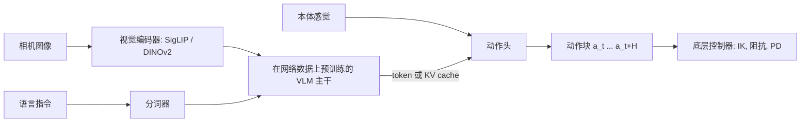
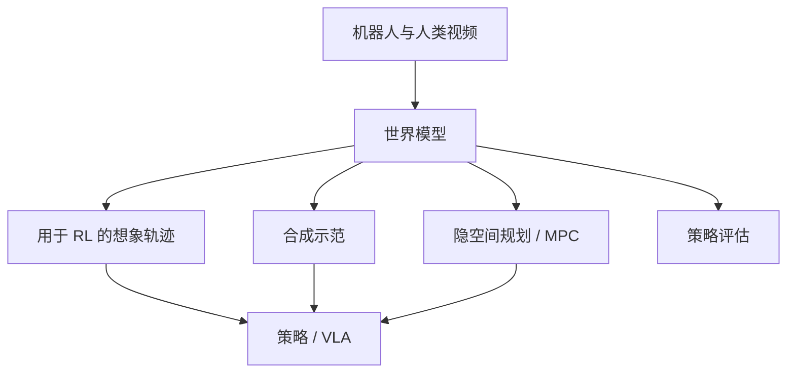

## 为什么重要

[模仿学习]({{ '/blog/2026/embodied-ai-04-imitation-learning/' | relative_url }})能用几十条示范教会机器人一项技能。
**视觉-语言-动作模型**（Vision-Language-Action model, VLA）的目标则是一个单一策略：输入相机图像和自然语言指令，为许多任务、
场景乃至不同的机器人本体输出动作。其配方借鉴了大型语言模型和视觉-语言模型：从在互联网上预训练的模型出发，再在 Open
X-Embodiment 这类大规模、异构的机器人数据集上训练。自 2023 年起，这已成为工业界和学术界机器人学习的主要方向。本文介绍主要
模型、区分它们的设计模式、评测方式，以及世界模型在其中的位置。

**前置知识**

- 第 1 到 4 篇，尤其是动作分块和扩散/流动作头（第 4 篇）。
- Transformer 与视觉-语言模型（ViT/SigLIP 编码器、LLM 解码器、分词）。
- 流匹配或扩散的基础。[世界模型系列]({{ '/blog/category/world-models/' | relative_url }})会深入讨论视频世界模型与 JEPA。

## 1. 从语言条件策略到 VLA

早期系统把语言和控制分开。**SayCan**（Ahn 等 CoRL 2022）用 LLM 从固定技能库中提出下一个技能，并把 LLM 的得分乘以一个学习
得到的价值函数——它估计该技能在当前状态下能否成功——从而把语言模型落地到机器人实际能做的事情上。技能本身是普通的语言条件策略。

**RT-1**（Brohan 等 RSS 2023）是第一个大型"机器人 Transformer"：一个在约 13 万条真实世界回合上训练的策略，覆盖 700 多个任务，
由 13 台移动操作机器人在 17 个月内采集。它用以指令嵌入为条件的 FiLM EfficientNet 对图像分词，用 TokenLearner 压缩，再用
Transformer 以约 3 Hz 输出**离散化动作**（手臂、底盘和模式的每个维度 256 个箱）。RT-1 表明，主导泛化能力的是数据规模和多样性，
而不是精巧的算法。

**PaLM-E**（Driess 等 ICML 2023）走了另一条路：把连续的传感器观测（图像、状态估计）作为 token 注入大型语言模型，端到端地训练它
做具身推理和规划。最大的版本有 5620 亿参数，在学会机器人规划任务的同时保留了通用的语言能力。

**RT-2**（Brohan 等 CoRL 2023）把两种思路合二为一，并提出了 VLA 这个术语。它微调大型视觉-语言模型（PaLI-X 和 PaLM-E），让它们
**以文本 token 的形式**输出机器人动作：7 个动作维度加一个终止标志各自离散化为 256 个箱，写成一串整数。关键在于它在机器人数据和
原有的网络视觉-语言数据上**联合微调**（co-fine-tuning），因此模型保留了语义知识。RT-2 能遵循涉及机器人数据中从未出现的概念的
指令（"把香蕉移到二加一之和那里"、"捡起已灭绝的动物"），因为这些知识来自网络。

## 2. 开放的通用策略

| 模型 | 年份 | 主干 | 动作输出 | 数据 | 备注 |
| --- | --- | --- | --- | --- | --- |
| Octo | 2024 | 从零训练的 Transformer（27M / 93M） | 扩散头，动作块 | 80 万条 OXE 轨迹 | 灵活的观测与目标 token，易于微调 |
| OpenVLA | 2024 | Llama 2 7B + DINOv2 + SigLIP（Prismatic VLM） | 256 箱动作 token | 97 万条 OXE 回合 | 开放权重；在 29 个任务上绝对成功率比 RT-2-X（55B）高 16.5% |
| RDT-1B | 2024 | 扩散 Transformer，1.2B | 统一动作空间上的扩散 | 多机器人，侧重双臂 | "物理可解释的统一动作空间" |
| pi0 | 2024 | PaliGemma 3B + 300M 动作专家 | 流匹配，50 步动作块 | 大规模跨本体混合数据 + OXE | 灵巧的长时程任务（叠衣服） |
| pi0.5 | 2025 | pi0 系列 | 离散（FAST）+ 流匹配专家 | 机器人 + 网络 + 高层子任务数据 | 在未见过的家庭中打扫厨房和卧室 |
| GR00T N1 | 2025 | Eagle-2 VLM（System 2）+ 扩散 Transformer（System 1） | 高频率的流匹配 | 真实 + 合成 + 人类视频的"数据金字塔" | 面向人形机器人的开放模型 |
| Gemini Robotics | 2025 | Gemini 2.0 | 低延迟动作解码器 | 大规模 ALOHA 2 双臂数据 + 网络数据 | 另有用于具身推理的 Gemini Robotics-ER |
| SmolVLA | 2025 | 小型 VLM（总计约 0.45B） | 流匹配动作专家 | 社区 LeRobot 数据集 | 可在消费级硬件上运行 |

### Octo

Octo（Octo Model Team，RSS 2024）是一个在 Open X-Embodiment 的 80 万条轨迹上预训练的基于 Transformer 的策略。观测（多路相机、
本体感觉）和任务规格（语言或目标图像）被分词后，由一个使用分块注意力的 Transformer 处理；读出 token 送入一个小型**扩散头**，
预测动作块。它的设计目标是可适配性：微调时可以通过增加分词器和输出头来接入新的传感器或动作空间。

### OpenVLA

OpenVLA（Kim 等 CoRL 2024）是开源版的 RT-2：一个 7B 的 Prismatic VLM（Llama 2 加上融合的 DINOv2 与 SigLIP 特征），在 97 万条回合上
微调以输出 256 箱动作 token，这些 token 覆盖了 Llama 词表中最少使用的 256 个 token。它表明，用 LoRA 微调到新机器人只需一块 GPU，
而且融合 DINOv2+SigLIP 的视觉编码器有助于空间推理。**OpenVLA-OFT**（Kim 等 RSS 2025）后来发现，一套"优化微调"配方（并行解码
动作块、使用 L1 损失的连续动作）能大幅提升成功率和推理速度。

### pi0 与 pi0.5

**pi0**（Black 等，Physical Intelligence，RSS 2025）在 PaliGemma VLM 之外增加了一个独立的**动作专家**（action expert，约 3 亿参数）。
图像和语言经过 VLM；动作专家处理本体感觉和带噪声的动作 token，关注 VLM 的 token，并用**流匹配**训练以输出 $H = 50$ 个连续动作组成
的动作块，从而实现高频率的灵巧控制（叠衣服、收拾餐桌、组装纸箱）。两套权重构成一个类似混合专家的 Transformer：VLM 的 token 从不
关注动作 token，因此 VLM 的知识得到保护。

**FAST**（Pertsch 等 RSS 2025）重新审视了离散 token：它用**离散余弦变换**（DCT）压缩动作块，量化系数，再做字节对编码（BPE）。
平滑的动作块只变成少量 token，使自回归 VLA 能在高频数据上训练，而且训练速度比扩散式动作头快得多。

**pi0.5**（Physical Intelligence，CoRL 2025）瞄准**开放世界泛化**：一台移动操作机器人在训练时从未见过的家庭中打扫厨房和卧室。它的
关键在于**异构数据联合训练**：来自多种机器人的数据、网络数据（图像描述、VQA、目标检测）以及高层语义标注。推理时，模型先用文本
预测一个高层子任务（"拿起盘子"），再为它预测底层动作，全部在一个模型内完成。作者报告，在新家庭中的表现随不同训练环境数量的增加
而提升。

### GR00T N1

NVIDIA 的 **GR00T N1**（2025）是面向人形机器人的开放基础模型，采用受"快思考与慢思考"启发的**双系统**架构：System 2 是视觉-语言
模块（Eagle-2 VLM），以约 10 Hz 理解场景和指令；System 1 是用流匹配训练的扩散 Transformer，以高频率生成运动动作（论文报告为
120 Hz）。两者端到端联合训练。训练使用一个**数据金字塔**：底层是网络和人类视频，中间是来自仿真和神经视频生成的合成数据，顶层是
真实机器人数据。人类视频和生成视频没有动作标签，因此要为它们推断潜在动作（latent action）或逆动力学伪标签。

### Gemini Robotics

Google DeepMind 的 **Gemini Robotics**（2025）在 Gemini 2.0 之上构建了 VLA。配套模型 **Gemini Robotics-ER**（具身推理，embodied
reasoning）用指点、目标检测、3D 包围盒、轨迹和抓取预测扩展了 Gemini 的空间理解能力。VLA 本身拆分为云端的主干和本地的动作解码器，
以保持低延迟；报告展示了在 ALOHA 2 上的长时程灵巧任务、用约 100 条示范快速适应新的短任务，以及适应新的机器人本体。
**Gemini Robotics 1.5**（技术报告，2025）加入了行动前的"思考"，并能把在一种本体上学到的运动迁移到其他本体。

## 3. 设计模式



### 动作表示

主要有两类：

1. **离散动作 token**（RT-1、RT-2、OpenVLA、FAST）。每个维度 $a^{(j)}\in[\ell_j, u_j]$ 映射到一个箱
   $b^{(j)} = \lfloor (a^{(j)}-\ell_j)/(u_j-\ell_j)\cdot 256\rfloor$，模型用常规的下一 token 交叉熵训练。优点：原封不动地复用 LLM 机制；类别输出天然
   支持多模态。缺点：每步每维一个 token，使高频动作块又长又解码缓慢，除非进行压缩（FAST）。
2. **连续生成式动作头**（Octo、pi0、GR00T、RDT）：一个扩散或流匹配模型以主干特征为条件预测整个动作块。优点：精确、平滑，
   对长动作块只需少量积分步，速度快。缺点：多了一个网络，而且动作损失的梯度可能扰乱预训练主干（Physical Intelligence 后来关于
   "知识隔离"（knowledge insulation）的工作阻断了这些梯度，改用离散 token 训练主干）。

两者都依赖**动作分块**（第 4 篇）和细致的**归一化**（按数据集的分位数，例如把第 1 和第 99 百分位映射到 $\pm 1$），因为不同机器人和
数据集的单位与范围各不相同。

下面的代码同时展示两者：256 箱分词及其量化误差，以及 FAST 思路下的 DCT 压缩。

```python
import numpy as np
from scipy.fft import dct, idct

# ---- RT-2 / OpenVLA style: 256 uniform bins per action dimension ----
def to_bins(a, low, high, n_bins=256):
    a = np.clip(a, low, high)
    return np.minimum(((a - low) / (high - low) * n_bins).astype(int), n_bins - 1)

def from_bins(b, low, high, n_bins=256):
    return low + (b + 0.5) * (high - low) / n_bins        # bin centers

# a smooth 7-D action chunk (xyz, rpy, gripper) at 50 Hz for 1 s
t = np.linspace(0, 1, 50)[:, None]
chunk = np.concatenate([0.05 * np.sin(2 * np.pi * t * [1, 0.5, 0.25]),
                        0.1 * np.cos(np.pi * t * [1, 2, 3]),
                        (t > 0.5).astype(float)], axis=1)  # [50, 7]
low, high = chunk.min(0) - 1e-3, chunk.max(0) + 1e-3     # per-dimension range (from the dataset)
tokens = to_bins(chunk, low, high)                        # [50, 7] integers -> 350 tokens
err = np.abs(from_bins(tokens, low, high) - chunk).max()
print(f"binning: {tokens.size} tokens, max error {err:.5f}")

# ---- FAST-style: DCT along time, quantize, keep the few non-zero coefficients ----
coef = dct(chunk, axis=0, norm="ortho")                   # [50, 7] frequency coefficients
for scale in [10.0, 50.0, 200.0]:
    q = np.round(coef * scale).astype(int)                # most high frequencies round to 0
    recon = idct(q / scale, axis=0, norm="ortho")
    print(f"DCT scale {scale:5.0f}: {np.count_nonzero(q):3d} non-zero of {q.size} coefficients, "
          f"mean error {np.abs(recon - chunk).mean():.4f}")
```

```text
binning: 350 tokens, max error 0.00096
DCT scale    10:  35 non-zero of 350 coefficients, mean error 0.0052
DCT scale    50:  42 non-zero of 350 coefficients, mean error 0.0016
DCT scale   200:  57 non-zero of 350 coefficients, mean error 0.0005
```

一个 50 Hz、1 秒的动作块，按步分箱需要 350 个 token，而 DCT 后只有几十个非零系数，因为平滑运动的能量集中在低频。FAST 随后对这个
稀疏整数矩阵做游程/BPE 编码，得到一个短 token 序列；缩放系数就是在压缩率与精度之间调节的旋钮。

### 流匹配动作专家

另一类方法，以 pi0 和 GR00T 为代表，学习一个以主干特征 $c$ 为条件、把高斯噪声输运到动作块的速度场。取线性路径
$A^t = (1-t)\,\epsilon + t\,A$，目标速度是常数 $\frac{d}{dt}A^t = A - \epsilon$，损失为

$$
\mathcal{L}(\theta) = \mathbb{E}_{t\sim p(t),\,\epsilon\sim\mathcal{N}(0,I),\,(A,c)\sim\mathcal{D}}\left[\left\lVert v_\theta(A^t, t, c) - (A - \epsilon)\right\rVert^2\right].
$$

采样时从 $t = 0$ 到 $t = 1$ 积分 $dA/dt = v_\theta$，通常用约 10 个欧拉步。（pi0 使用同样的思想，但有自己的时间约定，并用一个偏向
噪声较大时间步的 Beta 形分布 $p(t)$。）在下面的玩具例子中，一个随机向量代替了两条指令"向左"和"向右"的 VLM 嵌入：

```python
import math
import torch
import torch.nn as nn
import torch.nn.functional as F

torch.manual_seed(0)
H, A, C = 8, 2, 64           # chunk length, action dim, size of the "VLM" context embedding

class ActionExpert(nn.Module):
    """v_theta(A_t, t, c): predicts the flow velocity for a whole action chunk.
    pi0 uses a transformer "action expert" attending to the VLM's tokens; an MLP keeps this toy fast."""
    def __init__(self, hidden=256):
        super().__init__()
        self.net = nn.Sequential(nn.Linear(H * A + C + 32, hidden), nn.SiLU(),
                                 nn.Linear(hidden, hidden), nn.SiLU(),
                                 nn.Linear(hidden, hidden), nn.SiLU(),
                                 nn.Linear(hidden, H * A))
    def forward(self, a_t, t, c):
        freqs = torch.exp(torch.arange(16) * (-math.log(1000.0) / 16))
        emb = 1000 * t[:, None] * freqs[None]             # sinusoidal embedding of flow time
        x = torch.cat([a_t.flatten(1), c, emb.sin(), emb.cos()], -1)
        return self.net(x).view(-1, H, A)

def flow_matching_loss(model, actions, ctx):
    """Linear path from noise (t=0) to data (t=1); regress the constant velocity."""
    eps = torch.randn_like(actions)
    t = torch.rand(actions.shape[0])
    a_t = (1 - t)[:, None, None] * eps + t[:, None, None] * actions
    return F.mse_loss(model(a_t, t, ctx), actions - eps)

@torch.no_grad()
def sample(model, ctx, steps=10):
    a = torch.randn(ctx.shape[0], H, A)
    for i in range(steps):                                # forward Euler on da/dt = v
        t = torch.full((ctx.shape[0],), i / steps)
        a = a + model(a, t, ctx) / steps
    return a

# toy data: two instructions ("go left" / "go right") encoded as fixed context vectors
instr = torch.randn(2, C)
def batch(n):
    side = torch.randint(0, 2, (n,))
    tt = torch.linspace(0, 1, H)
    y = (side.float() * 2 - 1)[:, None] * torch.sin(math.pi * tt) * 0.5
    return torch.stack([tt.expand(n, H), y], -1), instr[side], side

model = ActionExpert()
opt = torch.optim.AdamW(model.parameters(), lr=1e-3)
for it in range(3000):
    act, ctx, _ = batch(128)
    loss = flow_matching_loss(model, act, ctx)
    opt.zero_grad(); loss.backward(); opt.step()
act, ctx, side = batch(512)
pred = sample(model, ctx)
ok = (torch.sign(pred[:, H // 2, 1]) == (side * 2 - 1)).float().mean()
print(f"final loss {loss.item():.4f}; follows the instruction in {ok:.1%} of samples; "
      f"chunk error {(pred - act).abs().mean():.3f}")
```

```text
final loss 0.0246; follows the instruction in 100.0% of samples; chunk error 0.018
```

一个小网络走 10 个欧拉步，就能为每条指令把噪声变成正确的动作块。在真实的 VLA 中，上下文是主干的 token（由 Transformer 动作专家
关注），动作块有 50 步、7 到 30 多个维度，而指令集是开放的。

### 跨本体训练

数据集在机器人、相机、控制频率和动作空间上各不相同。常见的选择：

- **共享的动作约定**，通常是末端执行器增量加夹爪，按数据集归一化；或者使用一个补齐的"统一"动作向量，每种本体填写自己的槽位
  （RDT、pi0），再加上本体或数据集 token。
- **带权重的数据混合**：大量使用的数据集降权，多样化的数据集升权；pi0.5 表明，即使只针对一个目标机器人，网络数据和跨机器人数据
  也能提升在新环境中的泛化能力。
- **没有动作的人类数据和合成数据**（GR00T 的数据金字塔）：潜在动作模型从相邻帧推断伪动作，使视频能传授运动先验。

### 层级与推理

长任务需要规划。可选方案包括：外部 LLM/VLM 规划器调用 VLA（SayCan 式）；一个模型在动作之前先预测子任务（pi0.5）；由慢速推理器和
快速执行器组成的双系统设计（GR00T N1，以及 Figure 公开介绍的 Helix）；以及在行动前用文本或指点、包围盒进行推理的"具身思维链"
（Gemini Robotics-ER 与 1.5）。

## 4. 规模化与评测

评测 VLA 很难：每次真实运行都要花费数分钟的人力，成功与否取决于场景布置，而不同随机种子和评测者之间的方差很大。逐渐形成的做法：

- **泛化维度**：视觉（新背景、光照、干扰物）、语义（新物体、新指令）、行为（新位置、新动作）以及本体（新机器人）。RT-2 和
  OpenVLA 都按这些维度报告结果。
- **标准化的仿真代理**：用 LIBERO 比较微调效果，用 SimplerEnv（第 3 篇）评估在真实 Google 机器人和 WidowX 数据上训练的策略，并明确
  测量仿真与现实的相关性。
- **跨机构的盲 A/B 评测**和成对比较，以减少评测者偏差。
- **规模化研究**：pi0.5 的环境数量扩展、OXE 的跨本体收益和 GR00T 的数据混合都表明，场景和本体的多样性至少和原始回合数一样重要。
  与语言模型不同，我们还没有关于机器人成功率的清晰幂律。

部署方面的问题非常实际：推理延迟（每秒只能跑几次的 7B 模型需要动作分块和异步执行）、机器人上的算力、底层控制器中的安全约束，
以及失败检测。

## 5. 用于机器人学习的世界模型

**世界模型**（world model）预测观测在给定动作下如何演化。世界模型系列会深入讨论它们；这里列出它们与机器人学相遇的主要方式：

1. **用于 RL 的学习型仿真器。** Dreamer 式智能体学习一个隐空间动力学模型，并在"想象"中训练策略。**DayDreamer**（Wu 等 CoRL 2022）
   只用约一小时的真实交互就让四足机器人从零学会行走，DreamerV3（Hafner 等，Nature 2025）把这一配方推广到多个领域。
2. **把视频预测当作规划。** **UniPi**（Du 等 NeurIPS 2023）根据文本指令生成任务完成过程的视频，再用逆动力学模型提取动作。
   **GR-1**（Wu 等 ICLR 2024）在大规模视频预测上预训练一个 GPT 式模型，再微调使其联合预测动作和未来帧。
3. **从视频中学到的交互式仿真器。** **UniSim**（Yang 等 ICLR 2024）从多样数据中学习一个动作条件视频仿真器，并用它训练策略和
   规划器；**Genie**（Bruce 等 ICML 2024）从无标签视频中学习潜在动作，使生成的世界可以被控制。NVIDIA 的 **Cosmos** 世界基础模型
   （2025）被设计为可以后训练成面向机器人和自动驾驶的仿真器与合成数据生成器（GR00T 的"神经轨迹"就是一种用法）。
4. **隐空间规划。** **V-JEPA 2**（Assran 等，2025）用联合嵌入预测目标在超过一百万小时的互联网视频上预训练视频编码器，然后在来自
   DROID 的约 62 小时无标签机器人视频上训练一个动作条件预测器（V-JEPA 2-AC）。在学到的隐空间中以目标图像进行规划，实现了在两个
   实验室的 Franka 机械臂上零样本抓取放置，无需任务特定数据或奖励。
5. **策略评估。** 由于真实评测昂贵，动作条件世界模型可以充当学习得到的评估器，在策略上真机之前对它们排序——前提是它已对照真实
   结果验证过。



悬而未决的问题是：能否让一个模型同时兼任两者——既是预测动作的 VLA，又是预测动作后果的世界模型——并联合训练，使两者相互促进。
2025 年已有若干系统同时训练动作预测和未来帧预测。

## 6. 开放问题

- **数据**：机器人数据仍比文本或视频少几个数量级；人类视频、仿真和 XR 遥操作（第 6 篇）是主要杠杆。
- **精度与接触**：VLA 擅长语义和粗略运动，对毫米级精度、力敏感的操作则较弱；触觉感知和力感知的动作空间是活跃的研究方向。
- **记忆与长时程**：大多数 VLA 只看最近的一两帧。
- **可靠性**：80% 的成功率在论文里令人印象深刻，在家庭中却不可接受；从部署中学习（RL 微调、人工介入）是下一个前沿。
- 可在不同实验室间复现的**评测**。

## 动手试试

主页 **[Lab]({{ '/' | relative_url }}#lab)** 中有一个"Gaussian World"演示：描述一个世界，就会构建出一个由约 20 万个 3D 高斯组成的
可编辑开放世界（由一个关键词驱动的程序化生成器代替学习模型），而且它是"活"的：可以重新打光、塑形、在其中行走。它是上面那些
生成式世界模型的一个迷你版。结合 XPBD 物理演示，它暗示了长远的图景：带物理的生成式三维世界，VLA 在其中被训练和评估。

## 代表性论文

| 论文 | 会议/期刊 | 年份 | 链接 | 意义 |
| --- | --- | --- | --- | --- |
| Ahn et al., *Do as I can, not as I say: grounding language in robotic affordances* (SayCan) | CoRL | 2022 | [arXiv](https://arxiv.org/abs/2204.01691) | 由价值函数落地的 LLM 规划 |
| Reed et al., *A generalist agent* (Gato) | TMLR | 2022 | [arXiv](https://arxiv.org/abs/2205.06175) | 一个 Transformer 兼顾游戏、图像描述和机械臂 |
| Wu et al., *DayDreamer: world models for physical robot learning* | CoRL | 2022 | [arXiv](https://arxiv.org/abs/2206.14176) | 真实机器人上的世界模型 RL |
| Brohan et al., *RT-1: Robotics Transformer for real-world control at scale* | RSS | 2023 | [arXiv](https://arxiv.org/abs/2212.06817) | 大规模真实世界机器人 Transformer |
| Jiang et al., *VIMA: robot manipulation with multimodal prompts* | ICML | 2023 | [arXiv](https://arxiv.org/abs/2210.03094) | 多模态任务提示 |
| Driess et al., *PaLM-E: an embodied multimodal language model* | ICML | 2023 | [arXiv](https://arxiv.org/abs/2303.03378) | LLM 中的传感器 token |
| Brohan et al., *RT-2: vision-language-action models transfer web knowledge to robotic control* | CoRL | 2023 | [arXiv](https://arxiv.org/abs/2307.15818) | 第一个 VLA，动作即文本 token |
| Du et al., *Learning universal policies via text-guided video generation* (UniPi) | NeurIPS | 2023 | [arXiv](https://arxiv.org/abs/2302.00111) | 视频生成即规划 |
| Bousmalis et al., *RoboCat: a self-improving generalist agent for robotic manipulation* | TMLR | 2023 | [arXiv](https://arxiv.org/abs/2306.11706) | 跨本体的自我改进 |
| Yang et al., *Learning interactive real-world simulators* (UniSim) | ICLR | 2024 | [arXiv](https://arxiv.org/abs/2310.06114) | 动作条件视频仿真器 |
| Wu et al., *Unleashing large-scale video generative pre-training for visual robot manipulation* (GR-1) | ICLR | 2024 | [arXiv](https://arxiv.org/abs/2312.13139) | 面向策略的视频预训练 |
| Bruce et al., *Genie: generative interactive environments* | ICML | 2024 | [arXiv](https://arxiv.org/abs/2402.15391) | 从无标签视频中学习潜在动作 |
| Octo Model Team, *Octo: an open-source generalist robot policy* | RSS | 2024 | [arXiv](https://arxiv.org/abs/2405.12213) | 带扩散头的开放通用策略 |
| Kim et al., *OpenVLA: an open-source vision-language-action model* | CoRL | 2024 | [arXiv](https://arxiv.org/abs/2406.09246) | 开放的 7B VLA |
| Liu et al., *RDT-1B: a diffusion foundation model for bimanual manipulation* | ICLR | 2025 | [arXiv](https://arxiv.org/abs/2410.07864) | 扩散 Transformer VLA |
| Black et al., *pi0: a vision-language-action flow model for general robot control* | RSS | 2025 | [arXiv](https://arxiv.org/abs/2410.24164) | 流匹配动作专家 |
| Pertsch et al., *FAST: efficient action tokenization for vision-language-action models* | RSS | 2025 | [arXiv](https://arxiv.org/abs/2501.09747) | DCT + BPE 动作 token |
| NVIDIA, *Cosmos world foundation model platform for physical AI* | arXiv | 2025 | [arXiv](https://arxiv.org/abs/2501.03575) | 面向机器人的世界基础模型 |
| Kim et al., *Fine-tuning vision-language-action models: optimizing speed and success* (OpenVLA-OFT) | RSS | 2025 | [arXiv](https://arxiv.org/abs/2502.19645) | 更好的 VLA 微调配方 |
| NVIDIA, *GR00T N1: an open foundation model for generalist humanoid robots* | arXiv | 2025 | [arXiv](https://arxiv.org/abs/2503.14734) | 双系统人形机器人 VLA |
| Gemini Robotics Team, *Gemini Robotics: bringing AI into the physical world* | arXiv | 2025 | [arXiv](https://arxiv.org/abs/2503.20020) | 基于 Gemini 2.0 的 VLA 与具身推理 |
| Physical Intelligence, *pi0.5: a vision-language-action model with open-world generalization* | CoRL | 2025 | [arXiv](https://arxiv.org/abs/2504.16054) | 面向未见家庭的联合训练 |
| Shukor et al., *SmolVLA: a vision-language-action model for affordable and efficient robotics* | arXiv | 2025 | [arXiv](https://arxiv.org/abs/2506.01844) | 小型开放 VLA |
| Assran et al., *V-JEPA 2: self-supervised video models enable understanding, prediction and planning* | arXiv | 2025 | [arXiv](https://arxiv.org/abs/2506.09985) | 用于零样本规划的隐空间世界模型 |
| Gemini Robotics Team, *Gemini Robotics 1.5* | arXiv | 2025 | [arXiv](https://arxiv.org/abs/2510.03342) | 会思考的 VLA，运动迁移 |

## 学习资源

- [OpenVLA 代码](https://github.com/openvla/openvla)与 [openpi](https://github.com/Physical-Intelligence/openpi)（开放的 pi0 / pi0.5 权重
  与微调代码）。
- [LeRobot](https://github.com/huggingface/lerobot)：一个库里集成了 pi0、SmolVLA、ACT 与 Diffusion Policy。
- [Octo](https://github.com/octo-models/octo) 与 [Isaac GR00T](https://github.com/NVIDIA/Isaac-GR00T)。
- RLDS 格式的 [Open X-Embodiment](https://robotics-transformer-x.github.io) 数据集。
- 综述与课程：Stanford CS 224R（深度 RL 与机器人学习）、CMU 16-831，以及 Tedrake
  [*Robotic Manipulation*](https://manipulation.csail.mit.edu) 中的相关章节。

## 练习

1. 计算对一个 14 维（双臂机器人）、50 Hz、2 秒的动作块，RT-2 式分箱需要多少 token，并与上面三种缩放下的 FAST 比较。
2. 修改流匹配玩具例子，让上下文含有噪声（两条指令只能部分区分）。指令遵循率如何变化？然后分别用 1、2、5、10 个欧拉步采样。
3. 把 MLP 动作专家换成一个关注 16 个"VLM token"序列（而不是单个向量）的小型 Transformer。训练速度和精度有什么变化？
4. 阅读 OpenVLA 和 pi0 的论文，用与上面 Mermaid 图相同的风格画出两者的架构。标出哪些权重是预训练的、哪些是从零训练的，以及
   梯度从哪里流过。
5. 为你实验室中的 VLA 设计一个评测方案：列出泛化维度、每个条件的试验次数，以及如何估计成功率的置信区间。

**下一篇：**[具身智能遇上 XR 与 HCI]({{ '/blog/2026/embodied-ai-06-embodied-ai-meets-xr-and-hci/' | relative_url }})，人、头显与机器人
在这里相遇。
