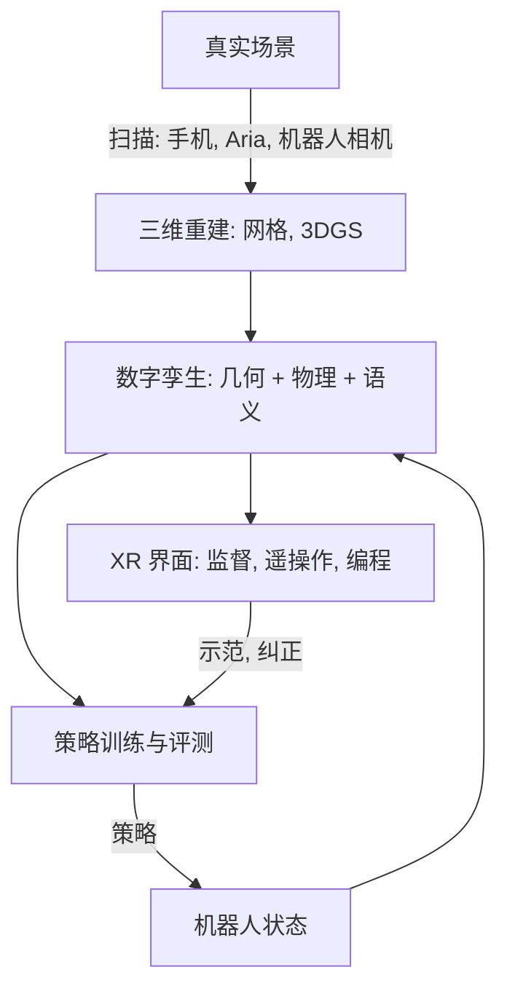

## 为什么重要

本系列的每一篇其实都悄悄依赖着人。模仿学习的示范来自人类遥操作员；VLA 在人类创造的网络数据上预训练，再在人类采集的机器人
数据上微调；世界模型从人们录制的视频中学习；而最终目标是与人一起、为人工作的机器人。扩展现实（XR：VR、AR 与混合现实）和
人机交互（human-computer interaction, HCI）正是研究人与机器之间这些接口的学科。继
[VLA 模型]({{ '/blog/2026/embodied-ai-05-vision-language-action-models/' | relative_url }})之后，这最后一篇从四种角色来看具身智能中
人的一面：作为**动作数据来源**的人、作为**遥操作员**的人、作为**协作者**的人，以及作为数字孪生等**界面使用者**的人。最后讨论
具身智能、世界模型、AR/VR、HCI 与图形学交汇处的研究机会。

**前置知识**

- 第 1 篇（SE(3) 变换、IK）、第 4 篇（模仿学习与数据采集）和第 5 篇（VLA、世界模型）。
- 对 VR/AR 头显有基本了解（6 自由度追踪、手部追踪、视频透视）。
- 图形学背景对人体模型、渲染和数字孪生几节有帮助。

## 1. 捕捉人体运动

### 传感器

| 技术 | 例子 | 测量内容 | 权衡 |
| --- | --- | --- | --- |
| 光学标记点动捕 | Vicon、OptiTrack | 三维标记点位置，亚毫米级 | 仅限工作室，有遮挡，需在身体上贴标记点 |
| 惯性动捕服 | Xsens 式 IMU 动捕服 | 各肢段的姿态 | 便携，全局位置会漂移 |
| 无标记视觉 | 多视角或单目姿态估计 | 身体与手部关键点、网格拟合 | 便宜，精度较低，难以应对遮挡 |
| XR 头显 | Quest、Vision Pro、Project Aria | 头部 6 自由度、手部（约 26 个关节）、眼动 | 第一人称，实时，身体追踪有限 |
| 手套与可穿戴设备 | 数据手套、触觉手套、肌电（EMG）手环 | 手指角度、接触压力、肌肉活动 | 手部数据最丰富，但有侵入性 |

### 参数化人体与手部模型

原始关键点有噪声且不完整，因此会拟合图形学风格的**参数化模型**。**SMPL**（Loper 等 SIGGRAPH Asia 2015）用形状参数 $\beta$ 和
姿态参数 $\theta$（24 个关节的轴角旋转）表示人体网格：

$$
M(\beta, \theta) = W\big(T_P(\beta, \theta),\, J(\beta),\, \theta,\, \mathcal{W}\big), \qquad
T_P(\beta, \theta) = \bar T + B_S(\beta) + B_P(\theta),
$$

其中 $\bar T$ 是模板网格，$B_S$ 和 $B_P$ 是学习得到的线性形状混合形状与姿态矫正混合形状，$J(\beta)$ 回归关节位置，$W$ 是权重为
$\mathcal{W}$ 的**线性混合蒙皮**（linear blend skinning）：每个顶点按各关节刚体变换 $G_k(\theta, J) \in SE(3)$ 的加权和变换，

$$
v_i' = \sum_{k} w_{ik}\, G_k(\theta, J)\, v_i .
$$

$G_k$ 正是第 1 篇中的正运动学链：人体模型就是一棵带蒙皮的运动学树。**MANO**（Romero 等 SIGGRAPH Asia 2017）对手做同样的事，
SMPL-X 则把身体、手和面部结合在一起。**AMASS**（Mahmood 等 ICCV 2019）把许多动捕数据集统一为 SMPL 参数，是训练人形机器人
控制器时人体运动数据的标准来源。

### 把人体运动重定向到机器人

人和机器人在连杆长度、关节限位和自由度上都不同，因此运动必须经过**重定向**（retargeting）。常见的做法是逐帧优化：

$$
q^{\ast}_t = \arg\min_{q} \sum_{k} \left\lVert s\, p^{\text{human}}_k - p^{\text{robot}}_k(q) \right\rVert^2
+ \lambda_1 \lVert q - q^{\ast}_{t-1}\rVert^2 \quad \text{s.t. } q_{\min} \le q \le q_{\max},
$$

以缩放系数 $s$ 匹配选定的关键点（手腕、肘部、指尖），同时保持平滑并满足关节限位。它可以用第 1 篇的阻尼最小二乘 IK 或一个
小型 QP 求解。对灵巧手而言，匹配指尖之间的**相对向量**（拇指到食指的距离）比匹配绝对位置更重要，因为捏取抓握取决于它。
人形机器人的全身重定向还要考虑平衡：H2O 和 OmniH2O（He 等 2024）把 AMASS 动作重定向到人形机器人上，过滤掉不可行的动作，并在
仿真中训练一个 RL 跟踪策略；**HumanPlus**（Fu 等 CoRL 2024）在约 40 小时的人体运动数据上训练了这样一个"影随"（shadowing）
策略，然后让人形机器人仅凭一个 RGB 相机实时模仿人的身体和手部动作，并用影随数据做模仿学习。

## 2. 第一人称数据：从人如何看与做中学习

人类每天要完成数十亿次操作任务，而第一人称（egocentric）视频从接近机器人头部或腕部相机的视角记录下了它们。

- **Ego4D**（Grauman 等 CVPR 2022）：来自 9 个国家 74 个地点的 931 位佩戴者的 3,670 小时日常生活视频，配有情景记忆、手-物交互和
  预测等基准。
- **Ego-Exo4D**（CVPR 2024）：熟练活动的同步第一人称与第三人称视角，附带三维身体与手部姿态。
- **Project Aria**（Meta，2023）：一款研究用眼镜，带有一个 RGB 相机、两个 SLAM 相机、两个眼动追踪相机、IMU、七麦克风阵列等，
  另提供机器感知服务（SLAM 轨迹、视线、手部追踪）。**Aria Digital Twin**（ICCV 2023）把 Aria 录制与场景和物体的完整数字重建配对，
  为每一帧提供三维真值。
- **EgoDex**（Apple，ICLR 2026）：用 Apple Vision Pro 录制的 829 小时第一人称视频，并配有 194 个桌面操作任务的三维手部与手指追踪。

机器人如何利用它们：

1. **视觉表征。** R3M（Nair 等 CoRL 2022）用时间对比和视频-语言目标在 Ego4D 上预训练视觉编码器，提高了下游机器人模仿的数据效率。
2. **从人类游玩中获得规划与先验。** MimicPlay（Wang 等 CoRL 2023）从廉价的人类游玩视频中学习高层隐式规划，从少量遥操作数据中
   学习底层控制器。
3. **把人类数据当作机器人数据。** EgoMimic（Kareer 等 ICRA 2025）记录佩戴 Aria 眼镜的人，把人手轨迹当作另一种本体，与机器人数据
   联合训练；DexCap（Wang 等 RSS 2024）用便携动捕手套加胸前相机采集灵巧手数据，再重定向到机器人手上。
4. **从视频中学习潜在动作**，如 Genie 和 GR00T 的数据金字塔（第 5 篇），把没有动作的视频变成训练信号。

**本体差距**（embodiment gap）仍是核心挑战：人手不是夹爪，人类视频里拍到的是人而不是机器人。遮挡或修补手部、重定向到机器人
运动学、匹配相机视角（头部相机 ≈ 机器人头部相机，腕部相机 ≈ UMI）是主要技巧。

## 3. 用于数据采集的 VR 与 AR 遥操作

由于机器人学习的瓶颈在示范，遥操作界面同时决定了数据的数量和质量。XR 头显很有吸引力：它们本来就以高频率追踪头和手，价格
便宜，还能显示立体视频。


代表性系统：

- **用于深度模仿的 VR 遥操作**（Zhang 等 ICRA 2018）很早就表明，消费级 VR 可以为视觉运动策略采集示范。
- **Holo-Dex**（Arunachalam 等 ICRA 2023）和 **AnyTeleop**（Qin 等 RSS 2023）把追踪到的人手映射到多指机器人手上，AnyTeleop 基于
  视觉手部追踪器，支持多种机械臂和机械手。
- **Open-TeleVision**（Cheng 等 CoRL 2024）从一个主动跟随操作员头部运动的头戴相机传输**立体**视频，提供沉浸式的第一人称感知；
  在 Unitree H1 和 Fourier GR1 人形机器人上，立体传输提高了成功率、缩短了完成时间，主动相机则让控制更快更平滑。
- **Bunny-VisionPro**（Ding 等 IROS 2025）为基于 Apple Vision Pro 的双臂灵巧遥操作加入了触觉反馈和碰撞规避。
- **GELLO**（Wu 等 IROS 2024）是低成本的替代方案：3D 打印的机械臂运动学复制品，表明关节空间的主从设备往往比自由空间的手部
  追踪更精确。

### 映射的工程实现

任何 XR 遥操作系统的核心都是一串 SE(3) 变换（第 1 篇）加上一些 HCI。典型设计：

- 头显追踪坐标系与机器人基座之间的**标定** $T_{\text{robot},\text{headset}}$（来自标记、共享锚点，或在视频透视中把虚拟机器人与真实
  机器人手动对齐）。
- **离合**（clutching，相对映射）：操作员按住按钮时，记录当前的手部位姿和末端位姿，之后的手部运动相对于它们施加。操作员可以
  松开按钮，把手移回舒适的位置再重新接合，就像抬起鼠标一样。
- 用于精细操作的**运动缩放**（例如 2:1）以及对追踪抖动的**滤波**。**1€ 滤波器**（Casiez、Roussel 与 Vogel，CHI 2012）是 HCI 的经典
  之作，它是一个截止频率随速度升高的一阶低通滤波器，因此手静止时能去除抖动，手快速移动时能消除滞后。

```python
import numpy as np

class OneEuroFilter:
    """1 Euro filter (Casiez, Roussel, Vogel, CHI 2012): a speed-adaptive low-pass filter.
    Slow motion -> low cutoff (removes jitter); fast motion -> high cutoff (removes lag)."""
    def __init__(self, freq, min_cutoff=1.0, beta=0.05, d_cutoff=1.0):
        self.freq, self.min_cutoff, self.beta, self.d_cutoff = freq, min_cutoff, beta, d_cutoff
        self.x_prev, self.dx_prev = None, None

    def _alpha(self, cutoff):
        tau = 1.0 / (2 * np.pi * cutoff)
        return 1.0 / (1.0 + tau * self.freq)

    def __call__(self, x):
        if self.x_prev is None:
            self.x_prev, self.dx_prev = x, np.zeros_like(x)
            return x
        dx = (x - self.x_prev) * self.freq
        a_d = self._alpha(self.d_cutoff)
        dx_hat = a_d * dx + (1 - a_d) * self.dx_prev               # filtered speed
        cutoff = self.min_cutoff + self.beta * np.linalg.norm(dx_hat)
        a = self._alpha(cutoff)
        x_hat = a * x + (1 - a) * self.x_prev
        self.x_prev, self.dx_prev = x_hat, dx_hat
        return x_hat

def pose(R=np.eye(3), p=np.zeros(3)):
    T = np.eye(4); T[:3, :3] = R; T[:3, 3] = p
    return T

def rot_z(a):
    c, s = np.cos(a), np.sin(a)
    return np.array([[c, -s, 0], [s, c, 0], [0, 0, 1]])

class ClutchTeleop:
    """Relative (clutched) mapping from a VR hand/controller pose to a robot end-effector target.
    T_robot_headset is a calibration transform (headset tracking frame -> robot base frame)."""
    def __init__(self, T_robot_headset, scale=1.0):
        self.T_rh, self.scale = T_robot_headset, scale
        self.anchor_hand = self.anchor_ee = None

    def engage(self, T_h_hand, T_r_ee):             # clutch pressed: remember both poses
        self.anchor_hand = self.T_rh @ T_h_hand      # hand pose expressed in the robot frame
        self.anchor_ee = T_r_ee.copy()

    def target(self, T_h_hand):
        T_r_hand = self.T_rh @ T_h_hand
        dp = (T_r_hand[:3, 3] - self.anchor_hand[:3, 3]) * self.scale   # scaled translation
        dR = T_r_hand[:3, :3] @ self.anchor_hand[:3, :3].T              # rotation since engage
        return pose(dR @ self.anchor_ee[:3, :3], self.anchor_ee[:3, 3] + dp)

if __name__ == "__main__":
    rng = np.random.default_rng(0)
    freq = 90.0                                          # headset tracking rate (Hz)
    t = np.arange(0, 3, 1 / freq)
    # the operator moves the hand 20 cm along x in the headset frame, with 3 mm tracking jitter
    true = np.stack([0.2 * np.clip(t - 1, 0, 1), 0 * t, 0 * t], 1) + np.array([0.3, 1.2, -0.4])
    noisy = true + rng.normal(0, 0.003, true.shape)

    T_rh = pose(rot_z(np.pi / 2), np.array([0.5, 0.0, -0.8]))   # headset frame -> robot base
    teleop = ClutchTeleop(T_rh, scale=0.5)              # 2:1 motion scaling for precision
    ee0 = pose(p=np.array([0.4, 0.0, 0.3]))
    teleop.engage(pose(p=noisy[0]), ee0)
    f = OneEuroFilter(freq, min_cutoff=1.0, beta=5.0)
    raw = np.array([teleop.target(pose(p=x))[:3, 3] for x in noisy])
    filt = np.array([teleop.target(pose(p=f(x)))[:3, 3] for x in noisy])
    still = t < 1.0                                      # hand at rest
    print("jitter at rest  raw %.2f mm, filtered %.2f mm" %
          (1e3 * raw[still].std(0).max(), 1e3 * filt[still].std(0).max()))
    moving = (t > 1.0) & (t < 2.0)
    print("max |filtered - raw| while moving: %.1f mm" % (1e3 * np.abs(filt[moving] - raw[moving]).max()))
    print("final target", np.round(filt[-1], 3), "(expected [0.4, 0.1, 0.3])")
```

```text
jitter at rest  raw 1.61 mm, filtered 0.42 mm
max |filtered - raw| while moving: 6.9 mm
final target [0.4   0.099 0.299] (expected [0.4, 0.1, 0.3])
```

3 mm 的追踪噪声经过 2:1 缩放后变成 1.6 mm，经过 1€ 滤波器后约为 0.4 mm；同时沿头显 $x$ 轴的 20 cm 手部运动正确地变成了沿机器人
$y$ 轴的 10 cm（标定包含 90° 旋转）。运动过程中的偏差（约 7 mm，其中包括原始信号本身仍带有的噪声）就是滤波器为平滑而付出的滞后；
`beta` 控制这一权衡，而和真实用户一起调节它本身就是一个 HCI 实验。得到的目标位姿再发送给第 1 篇中的 IK 或阻抗控制器。

### 人因

XR 遥操作既是机器人问题，也是人因问题：

- **延迟。** 头显中的运动到光子（motion-to-photon）延迟与发往机器人的指令延迟叠加；超过大约 100 ms，操作员会放慢速度并出现
  过冲，而头部运动与视频不匹配会引起不适。预测显示和对机器人视频做本地重投影（类似 VR 中的 timewarp）会有帮助。
- **具身感与临场感。** 在自己双手所在的位置看到机器人的手（第一人称、立体、比例正确）会让遥操作变得直观；比例或视角不匹配则会
  破坏这种感觉。
- **触觉。** 大多数 XR 遥操作只有视觉。振动提示、主臂的力反馈或视觉化的力叠加可以减少过大的抓握力。
- **工作负荷与数据质量。** NASA-TLX 工作负荷、任务时间和成功率是标准的 HCI 指标；对学习而言，示范的一致性和平滑度也很重要，
  因为它们会影响策略（第 4 篇）。
- **渲染预算。** 高分辨率立体视频流代价高昂。基于眼动追踪的**注视点渲染**（foveated rendering）只在用户注视的地方以全分辨率着色，
  是降低在头显中显示照片级数字孪生成本的一种方式。

## 4. 人机交互

一旦机器人在人身边工作，交互质量就和任务成功同样重要：

- **可读性与可预测性。** Dragan、Lee 与 Srinivasa（HRI 2013）区分了*可预测*的运动（观察者在已知目标时所预期的运动）和*可读*的
  运动（让观察者能快速推断目标的运动），并展示了如何为可读性优化轨迹。朝目标物体夸张地运动可以让意图更易读懂。
- **共享自主**（shared autonomy）。机器人从不完整的输入（摇杆、视线、脑电）推断用户的目标并提供协助，把用户指令与自主动作融合。
  XR 头显提供的视线是很强的意图信号。
- **传达意图。** AR 可以显示规划好的轨迹、机器人将要抓取的物体或安全区域，这通常比仅靠机器人运动或灯光更清楚。
- **安全与信任。** 协作机器人会限制功率和力（ISO/TS 15066 给出了各身体部位的限值）；学习得到的策略需要运行时监控器和安全的后备
  控制器。经过校准的信任——既不过度依赖也不过度不信任——是 HCI 的核心关切。
- **语言交互。** VLA 让语言成为默认界面，这带来了经典的 HCI 问题：歧义、澄清对话以及解释失败。

## 5. 数字孪生与混合现实界面

**数字孪生**（digital twin）是机器人及其环境的一个同步的虚拟副本。它连接了本博客的所有系列：来自三维重建（神经渲染）的几何、
来自仿真器（第 3 篇）的物理、来自世界模型（第 5 篇）的预测，以及在 XR 中的显示。

- **现实-仿真-现实。** RialTo（Torne 等 RSS 2024）借助一个 GUI，从手机扫描构建真实场景的仿真，在这个"数字孪生"中用 RL 微调模仿
  策略，再迁移回现实，从而提高稳健性。
- **高斯泼溅孪生。** SplatSim、RoboGSim 和 Real-is-Sim（2024 到 2025 年的预印本）在 3D 高斯泼溅重建中渲染机器人和物体，用于照片级
  的训练和评测，缩小视觉上的仿真到现实差距。
- **混合现实机器人界面。** Walker 等的 VAM-HRI 综述（ACM THRI 2023）梳理了虚拟、增强与混合现实在 HRI 中的用法，从显示机器人意图、
  在 AR 中示教编程，到通过孪生体进行远程监督。
- **第一人称数字孪生。** Aria Digital Twin 把同样的思路用于人：一个空间的完整三维模型加上被追踪的人和物体，这正是世界模型和辅助
  机器人都需要的真值。



## 6. 研究机会

这个交叉领域还很年轻，空间广阔。结合具身智能、世界模型、AR/VR、HCI 与图形学的方向：

1. **XR 原生的数据引擎。** 用 HCI 方法设计、兼顾吞吐量与数据质量的遥操作界面：对示范一致性给出实时反馈，自动分段和语言标注，
   并主动请求策略最需要的示范。
2. **第一人称世界模型。** 在头戴视频（Aria、Vision Pro）上训练的动作条件世界模型，预测世界如何响应人的双手，既可用于 AR 辅助
   （"如果我拉这个会怎样？"），也可用于机器人规划。
3. **弥合本体差距。** 把人类第一人称示范映射为机器人动作的重定向与表征学习，包括手-物接触与力，并以基于图形学的手-物重建作为
   监督。
4. **对 VLA 的混合现实监督。** 在 AR 中显示 VLA 的"意图"（预测的动作块、注意力、子目标），让人就地纠正，并把这些纠正用于在线学习。
5. **照片级、物理化的数字孪生。** 把高斯泼溅与仿真和生成式世界模型融合，并在头显中高效渲染（例如注视点渲染），用于训练、评测和
   远程操作。
6. 面向灵巧遥操作和触觉数据集的**触觉与多感官反馈**。
7. **以人为中心的评测。** 不仅测量成功率，还测量人与学习型机器人共处时的可读性、工作负荷、信任和舒适度的基准。
8. **角色与机器人。** 基于物理的角色动画（DeepMimic、对抗运动先验）与人形机器人控制如今共享方法和数据；VR 中的虚拟化身和现实中的
   人形机器人可以由同一套运动模型驱动。

## 动手试试

主页 **[Lab]({{ '/' | relative_url }}#lab)** 有一个 **Foveated Rendering**（注视点渲染）演示：你的光标就是模拟的视线，场景只在其周围
以全分辨率做光线步进，更远处则以 1/2 和 1/4 分辨率渲染，就像 Apple Vision Pro 和 Meta Quest Pro 这类带眼动追踪的头显那样。想象
用这种方式把机器人的立体相机画面或数字孪生传给操作员。**Gaussian World** 标签页展示了构建照片级数字孪生所用的 3DGS 表示，
**Cloth · XPBD** 标签页则展示了它们所需的那类物理。

## 代表性论文

| 论文 | 会议/期刊 | 年份 | 链接 | 意义 |
| --- | --- | --- | --- | --- |
| Casiez, Roussel, Vogel, *1€ filter: a simple speed-based low-pass filter for noisy input in interactive systems* | CHI | 2012 | - | 追踪输入的标准抖动滤波器 |
| Dragan, Lee, Srinivasa, *Legibility and predictability of robot motion* | HRI | 2013 | [DOI](https://doi.org/10.1109/HRI.2013.6483603) | 可读的机器人意图 |
| Loper et al., *SMPL: a skinned multi-person linear model* | ACM TOG (SIGGRAPH Asia) | 2015 | [DOI](https://doi.org/10.1145/2816795.2818013) | 标准人体模型 |
| Romero, Tzionas, Black, *Embodied hands: modeling and capturing hands and bodies together* (MANO) | ACM TOG (SIGGRAPH Asia) | 2017 | [arXiv](https://arxiv.org/abs/2201.02610) | 标准手部模型 |
| Zhang et al., *Deep imitation learning for complex manipulation tasks from virtual reality teleoperation* | ICRA | 2018 | [arXiv](https://arxiv.org/abs/1710.04615) | 用于模仿的 VR 遥操作 |
| Mahmood et al., *AMASS: archive of motion capture as surface shapes* | ICCV | 2019 | [arXiv](https://arxiv.org/abs/1904.03278) | 统一的人体运动数据 |
| Grauman et al., *Ego4D: around the world in 3,000 hours of egocentric video* | CVPR | 2022 | [arXiv](https://arxiv.org/abs/2110.07058) | 大规模第一人称数据集 |
| Nair et al., *R3M: a universal visual representation for robot manipulation* | CoRL | 2022 | [arXiv](https://arxiv.org/abs/2203.12601) | 用人类视频训练机器人视觉 |
| Arunachalam et al., *Holo-Dex: teaching dexterity with immersive mixed reality* | ICRA | 2023 | [arXiv](https://arxiv.org/abs/2210.06463) | 机器人手的 MR 遥操作 |
| Qin et al., *AnyTeleop: a general vision-based dexterous robot arm-hand teleoperation system* | RSS | 2023 | [arXiv](https://arxiv.org/abs/2307.04577) | 基于视觉的手部遥操作 |
| Walker et al., *Virtual, augmented, and mixed reality for human-robot interaction: a survey and virtual design element taxonomy* | ACM THRI | 2023 | [arXiv](https://arxiv.org/abs/2202.11249) | VAM-HRI 综述 |
| Meta Reality Labs Research, *Project Aria: a new tool for egocentric multi-modal AI research* | arXiv | 2023 | [arXiv](https://arxiv.org/abs/2308.13561) | 研究用眼镜 |
| Pan et al., *Aria Digital Twin: a new benchmark dataset for egocentric 3D machine perception* | ICCV | 2023 | [arXiv](https://arxiv.org/abs/2306.06362) | 第一人称数字孪生 |
| Wang et al., *MimicPlay: long-horizon imitation learning by watching human play* | CoRL | 2023 | [arXiv](https://arxiv.org/abs/2302.12422) | 从人类游玩中得到规划 |
| Grauman et al., *Ego-Exo4D: understanding skilled human activity from first- and third-person perspectives* | CVPR | 2024 | [arXiv](https://arxiv.org/abs/2311.18259) | 带三维姿态的第一与第三人称视角 |
| Wang et al., *DexCap: scalable and portable mocap data collection system for dexterous manipulation* | RSS | 2024 | [arXiv](https://arxiv.org/abs/2403.07788) | 从动捕手套到机器人手 |
| Torne et al., *Reconciling reality through simulation: a real-to-sim-to-real approach for robust manipulation* (RialTo) | RSS | 2024 | [arXiv](https://arxiv.org/abs/2403.03949) | 用数字孪生提升策略稳健性 |
| He et al., *Learning human-to-humanoid real-time whole-body teleoperation* (H2O) | IROS | 2024 | [arXiv](https://arxiv.org/abs/2403.04436) | 基于 RL 的人形机器人遥操作 |
| Fu et al., *HumanPlus: humanoid shadowing and imitation from humans* | CoRL | 2024 | [arXiv](https://arxiv.org/abs/2406.10454) | 单 RGB 相机的影随 |
| He et al., *OmniH2O: universal and dexterous human-to-humanoid whole-body teleoperation and learning* | CoRL | 2024 | [arXiv](https://arxiv.org/abs/2406.08858) | VR 与 RGB 的人形遥操作 |
| Cheng et al., *Open-TeleVision: teleoperation with immersive active visual feedback* | CoRL | 2024 | [arXiv](https://arxiv.org/abs/2407.01512) | 立体、主动相机的 XR 遥操作 |
| Wu et al., *GELLO: a general, low-cost, and intuitive teleoperation framework for robot manipulators* | IROS | 2024 | [arXiv](https://arxiv.org/abs/2309.13037) | 低成本主臂 |
| Ding et al., *Bunny-VisionPro: real-time bimanual dexterous teleoperation for imitation learning* | IROS | 2025 | [arXiv](https://arxiv.org/abs/2407.03162) | 带触觉的 Vision Pro 遥操作 |
| Kareer et al., *EgoMimic: scaling imitation learning via egocentric video* | ICRA | 2025 | [arXiv](https://arxiv.org/abs/2410.24221) | 把人当作另一种本体 |
| Hoque et al., *EgoDex: learning dexterous manipulation from large-scale egocentric video* | ICLR | 2026 | [arXiv](https://arxiv.org/abs/2505.11709) | 带手部追踪的 Vision Pro 数据集 |
| Qureshi et al., *SplatSim: zero-shot sim2real transfer of RGB manipulation policies using Gaussian splatting* | arXiv | 2024 | [arXiv](https://arxiv.org/abs/2409.10161) | 用 3DGS 做照片级仿真 |

## 学习资源

- [Project Aria](https://www.projectaria.com) 的工具与数据集；[Ego4D](https://ego4d-data.org)。
- [SMPL](https://smpl.is.tue.mpg.de) 与 [MANO](https://mano.is.tue.mpg.de) 的模型页面；[AMASS](https://amass.is.tue.mpg.de)。
- [AnyTeleop 项目主页](https://yzqin.github.io/anyteleop/)；Open-TeleVision 和 GELLO 的论文（见上表链接）给出了它们的开源代码。
- ACM/IEEE HRI 会议与 VAM-HRI 研讨会系列；交互技术方面的 ACM CHI 与 UIST；XR 系统方面的 IEEE VR 与 ISMAR。
- 人体模型与蒙皮的图形学背景：本博客的图形学系列；头显中的渲染：主页上的注视点渲染演示。

## 练习

1. 在二维中为一个两骨骼的"手臂"实现线性混合蒙皮（一条顶点带，权重混合两个关节变换），观察肘部扭转时的"糖纸"伪影。SMPL 的
   姿态矫正混合形状是如何解决它的？
2. 编写一个重定向优化器，用带平滑项的 `ik_dls` 把人体的肩-肘-腕轨迹（来自任意动捕片段）映射到第 1 篇的平面三连杆机械臂上。
   比较匹配位置与匹配连杆方向两种做法。
3. 为 `ClutchTeleop` 加入旋转缩放（缩放 $\Delta R$ 的轴角）和死区。调节 1€ 滤波器的 `min_cutoff` 与 `beta`，画出抖动与滞后的关系。
4. 为一个 XR 遥操作界面设计一个小型用户研究：两种条件（例如单目与立体视频）、任务、指标（成功率、时间、NASA-TLX、示范平滑度）
   以及参与者人数。你预期会看到什么结果？
5. 从上面的研究机会中选一个，写一页研究计划：问题、你要构建的系统、要采集的数据，以及如何评估。

**接下来：**这是具身智能系列的最后一篇。[世界模型系列]({{ '/blog/category/world-models/' | relative_url }})会深入探讨这里提到的
预测模型，而[路线图文章]({{ '/blog/category/roadmap/' | relative_url }})会把所有系列串成一份学习计划。
