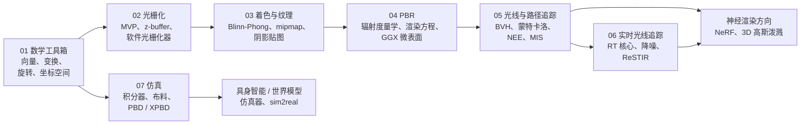
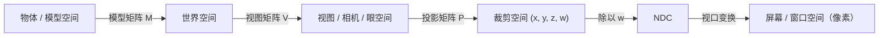

## 为什么重要

计算机绘制的每一幅图像，无论是游戏的一帧、路径追踪的电影镜头、NeRF，还是 3D 高斯泼溅（3D Gaussian Splatting）的渲染结果，都以同样的方式开始：三维空间中的点被平移、旋转，再投影到二维的像素网格上。本系列从零开始搭建这套机制，并一直推进到研究级别的渲染与仿真，让之后关于神经渲染的文章读起来像是自然的延续，而不是魔法。这第一篇做两件事：给出整个系列的**路线图**，并整理之后每篇文章都会用到的**数学工具箱**：向量、矩阵、齐次坐标、旋转表示、坐标空间，以及法线变换规则。

## 前置知识

- 大学一年级程度的线性代数：矩阵乘法、逆、转置、行列式。
- 基本的 Python 编程。所有代码只用 NumPy。
- 不需要任何图形学背景。

## 路线图

计算机图形学有两大成像方式，以及一种让物体动起来的方式：

- **光栅化（rasterization）**把每个三角形投影到屏幕上，并填充它覆盖的像素。GPU 正是为此而设计的，几乎所有实时应用都靠它驱动。
- **光线追踪（ray tracing）**从相机向场景发射光线，询问它们击中了什么。与蒙特卡洛积分（Monte Carlo integration）结合后就成为**路径追踪（path tracing）**，它以物理方式模拟光的传输，是电影行业的标准。
- **基于物理的仿真（physically based simulation）**让场景本身动起来：布料、刚体、流体。同样的求解器出现在游戏、VR 和机器人仿真器中。

本方向的七篇文章遵循这一结构：



| 文章 | 核心问题 | 读完后你能做出什么 |
| --- | --- | --- |
| 01 数学工具箱 | 如何描述位置、方向和朝向？ | 一个带四元数的变换库 |
| 02 光栅化 | 三角形如何变成像素？ | 一个约 150 行的软件光栅化器 |
| 03 着色与纹理 | 一个像素是什么颜色？ | Blinn-Phong 着色、纹理过滤、阴影贴图 |
| 04 基于物理的渲染 | 对光而言，“物理正确”意味着什么？ | 一个 GGX 金属度-粗糙度着色器 |
| 05 光线与路径追踪 | 如何求解渲染方程？ | 一个带 NEE 和 MIS 的蒙特卡洛路径追踪器 |
| 06 实时光线追踪 | 如何在 16 ms 内完成？ | 理解 RT 硬件、降噪器和 ReSTIR |
| 07 仿真 | 如何让物体的运动真实可信？ | 一个 XPBD 布料求解器 |

神经渲染直接建立在这些内容之上。NeRF 是沿相机光线的体渲染（第 05 篇的光线生成，再加上沿光线的积分）。3D 高斯泼溅是针对各向异性高斯的光栅化器（第 02 篇的投影，再加上本篇工具箱中的投影雅可比矩阵）。只要理解了这里的七篇文章，那些论文就能读懂。

## 向量：位置、方向与两种乘积

在图形学中，一个三维向量 $\mathbf{v} = (v_x, v_y, v_z)$ 可以表示两种不同的东西：**点**（位置）或**方向**（位移、速度、表面法线）。它们的存储方式相同，但变换方式不同。齐次坐标会让这种区别变得明确。

### 点积

$$
\mathbf{a}\cdot\mathbf{b} = a_x b_x + a_y b_y + a_z b_z = \lVert\mathbf{a}\rVert\,\lVert\mathbf{b}\rVert\cos\theta .
$$

点积（dot product）无处不在：

- **角度与光照。** 对单位向量，$\mathbf{n}\cdot\mathbf{l} = \cos\theta$，这是第 03 篇中朗伯着色（Lambertian shading）的核心。
- **投影。** $\mathbf{a}$ 在单位向量 $\hat{\mathbf{b}}$ 方向上的分量是 $(\mathbf{a}\cdot\hat{\mathbf{b}})\,\hat{\mathbf{b}}$。
- **正面还是背面。** $(\mathbf{q}-\mathbf{p})\cdot\mathbf{n}$ 的符号告诉我们点 $\mathbf{q}$ 位于平面的哪一侧。背面剔除（back-face culling）和光线-平面求交都用到它。

### 叉积

$$
\mathbf{a}\times\mathbf{b} =
\begin{pmatrix} a_y b_z - a_z b_y \\ a_z b_x - a_x b_z \\ a_x b_y - a_y b_x \end{pmatrix},
\qquad
\lVert\mathbf{a}\times\mathbf{b}\rVert = \lVert\mathbf{a}\rVert\,\lVert\mathbf{b}\rVert\sin\theta .
$$

叉积（cross product）的结果同时垂直于两个输入，遵循右手定则，其长度等于 $\mathbf{a}$ 和 $\mathbf{b}$ 张成的平行四边形面积。因此三角形 $(\mathbf{p}_0,\mathbf{p}_1,\mathbf{p}_2)$ 的法线是 $(\mathbf{p}_1-\mathbf{p}_0)\times(\mathbf{p}_2-\mathbf{p}_0)$，其长度的一半就是三角形的面积。顶点的顺序（**环绕顺序**，winding order）决定法线指向哪一侧，GPU 正是据此判断哪些面是“正面”。

```python
import numpy as np

def normalize(v):
    return v / np.linalg.norm(v)

a = np.array([1.0, 2.0, 2.0])
b = np.array([3.0, 0.0, 4.0])

cos_theta = a @ b / (np.linalg.norm(a) * np.linalg.norm(b))
print("angle (deg):", np.degrees(np.arccos(cos_theta)))     # 42.83
proj = (a @ normalize(b)) * normalize(b)                       # projection of a onto b
print("projection:", proj)

# Triangle normal and area from the cross product
p0, p1, p2 = np.array([0., 0, 0]), np.array([1., 0, 0]), np.array([0., 1, 0])
c = np.cross(p1 - p0, p2 - p0)
print("normal:", normalize(c), "area:", 0.5 * np.linalg.norm(c))  # [0 0 1], 0.5

# Which side of the plane is a point on? sign of a dot product
q = np.array([0.2, 0.2, 0.5])
print("q above the triangle plane:", (q - p0) @ c > 0)         # True
```

一个之后会用到的恒等式：三重积 $\mathbf{a}\cdot(\mathbf{b}\times\mathbf{c}) = \det[\mathbf{a}\ \mathbf{b}\ \mathbf{c}]$ 是平行六面体的有向体积。它的二维版本 $(b_x-a_x)(c_y-a_y)-(b_y-a_y)(c_x-a_x)$ 就是第 02 篇的光栅化器用来测试像素是否在三角形内部的**边函数**（edge function）。

## 作为线性变换的矩阵

一个 $3\times 3$ 矩阵 $A$ 定义了一个线性映射 $\mathbf{x}\mapsto A\mathbf{x}$。阅读矩阵最好的方式是逐列来看：**列就是基向量的像**。

$$
A = \begin{pmatrix} \vert & \vert & \vert \\ A\mathbf{e}_x & A\mathbf{e}_y & A\mathbf{e}_z \\ \vert & \vert & \vert \end{pmatrix}.
$$

所以，如果你想要一个把 $x$ 轴映射到某个向量 $\mathbf{r}$、把 $y$ 轴映射到 $\mathbf{u}$、把 $z$ 轴映射到 $\mathbf{f}$ 的矩阵，只需把这三个向量写进各列即可。相机矩阵和切线坐标系（第 03 篇）就是这样构造的。

基本的线性变换有：

- **缩放（scale）**：$S = \operatorname{diag}(s_x, s_y, s_z)$。如果各个 $s_i$ 不相等，就是**非均匀**缩放，这对法线很重要（见下文）。
- **绕坐标轴旋转（rotation）**：$R_x$、$R_y$、$R_z$（下面写出）。
- **切变（shear）**：例如 $x' = x + k\,y$。

绕 $z$ 轴旋转角度 $\theta$ 的矩阵为

$$
R_z(\theta) = \begin{pmatrix} \cos\theta & -\sin\theta & 0 \\ \sin\theta & \cos\theta & 0 \\ 0 & 0 & 1 \end{pmatrix}.
$$

$R_x$ 和 $R_y$ 在其他平面上具有相同的模式。注意 $R_y$ 的符号：$R_y(\theta)$ 的右上角是 $+\sin\theta$，因为绕 $y$ 轴的右手旋转把 $z$ 转向 $x$。

旋转矩阵是行列式为 $+1$ 的**正交矩阵**：$R^\top R = I$，所以 $R^{-1} = R^\top$。行列式为 $-1$ 意味着反射，它会翻转三角形的环绕顺序。

变换通过乘法复合，而**矩阵乘法不满足交换律**。在列向量约定下（本系列、OpenGL、GLSL、NumPy 代码和大多数论文都采用这一约定），写在最右边的变换最先被应用：$M = ABC$ 意味着“先应用 $C$，再 $B$，最后 $A$”。DirectX/HLSL 常用行向量 $\mathbf{x}^\top M$，此时一切都被转置，顺序从左往右读。每当来自其他资料的公式看起来“反了”，先检查它用的是哪种约定。

## 仿射变换与齐次坐标

平移 $\mathbf{x}\mapsto\mathbf{x}+\mathbf{t}$ 不是线性的（它移动了原点），因此没有任何 $3\times 3$ 矩阵能做到。一般的**仿射变换**（affine transform）是 $\mathbf{x}\mapsto A\mathbf{x}+\mathbf{t}$。齐次坐标（homogeneous coordinates）通过追加第四个坐标 $w$，把它折叠进一个矩阵：

$$
\begin{pmatrix} \mathbf{x}' \\ 1 \end{pmatrix}
=
\begin{pmatrix} A & \mathbf{t} \\ \mathbf{0}^\top & 1 \end{pmatrix}
\begin{pmatrix} \mathbf{x} \\ 1 \end{pmatrix}.
$$

第四个坐标编码了点与方向的区别：

- **点**的 $w = 1$，所以会被平移。
- **方向**的 $w = 0$，所以平移列乘以零。这是正确的：移动一个物体不会改变箭头指向的方向。
- 两点之差（$w = 1 - 1 = 0$）是一个方向，点加方向仍是点。两个点相加得到 $w = 2$，这提示我们该运算没有意义，除非它是权重和为一的加权平均的一部分。

更一般地，$w \neq 0$ 的齐次向量 $(x, y, z, w)$ 表示三维点 $(x/w, y/w, z/w)$。把四个坐标同时乘以任意非零常数，得到的是同一个点。这就是**射影几何**（projective geometry）的空间。透视投影是一个底行不为 $(0,0,0,1)$ 的 $4\times 4$ 矩阵，因此它产生的 $w$ 依赖于深度。之后除以 $w$ 的**透视除法**（perspective divide）产生了“远处的东西看起来更小”的效果。第 02 篇会推导这个矩阵。Blinn 和 Newell（1978）解释了为什么裁剪必须在这次除法*之前*、在齐次坐标中进行，第 02 篇也会讲到这一点。

### TRS 复合

物体在世界中的摆放几乎总是写成**平移 · 旋转 · 缩放**：

$$
M = T\,R\,S, \qquad M^{-1} = S^{-1} R^\top T^{-1}.
$$

从右往左读：物体先绕自身原点缩放，再绕自身原点旋转，最后移动到它的位置。任何其他顺序都会给出不同的、通常并不想要的结果：先平移再旋转，会让物体像行星一样绕世界原点公转。要绕枢轴点 $\mathbf{c}$ 而不是原点旋转，就用平移进行共轭：$T(\mathbf{c})\,R\,T(-\mathbf{c})$。由于每个因子都有简单的逆，整体的逆也有廉价的闭式解。场景图（scene graph，手连在手臂上，手臂连在身体上）不过是沿着从根节点出发的路径把这样的矩阵依次相乘。

```python
import numpy as np
np.set_printoptions(suppress=True, precision=4)

def translate(tx, ty, tz):
    M = np.eye(4); M[:3, 3] = [tx, ty, tz]; return M

def scale(sx, sy, sz):
    return np.diag([sx, sy, sz, 1.0])

def rotate_x(deg):
    c, s = np.cos(np.radians(deg)), np.sin(np.radians(deg))
    return np.array([[1, 0, 0, 0], [0, c, -s, 0], [0, s, c, 0], [0, 0, 0, 1.0]])

def rotate_y(deg):
    c, s = np.cos(np.radians(deg)), np.sin(np.radians(deg))
    return np.array([[c, 0, s, 0], [0, 1, 0, 0], [-s, 0, c, 0], [0, 0, 0, 1.0]])

def rotate_z(deg):
    c, s = np.cos(np.radians(deg)), np.sin(np.radians(deg))
    return np.array([[c, -s, 0, 0], [s, c, 0, 0], [0, 0, 1, 0], [0, 0, 0, 1.0]])

point = np.array([1.0, 0.0, 0.0, 1.0])       # w = 1: a position
direction = np.array([1.0, 0.0, 0.0, 0.0])   # w = 0: a direction

T, R, S = translate(5, 0, 0), rotate_z(90), scale(2, 2, 2)
M = T @ R @ S                                 # scale, then rotate, then translate
print("point:", M @ point)                   # [5. 2. 0. 1.]
print("direction:", M @ direction)           # [0. 2. 0. 0.]  (translation ignored)
print("other order:", (S @ R @ T) @ point)    # [0. 12. 0. 1.]  -- order matters

# Inverse of TRS without a general 4x4 inverse: S^-1 R^T T^-1
M_inv = scale(0.5, 0.5, 0.5) @ R.T @ translate(-5, 0, 0)
print("inverse ok:", np.allclose(M_inv @ M, np.eye(4)))

# Rotate 90 degrees about the pivot c = (1, 1, 0): T(c) R T(-c)
pivot = translate(1, 1, 0) @ rotate_z(90) @ translate(-1, -1, 0)
print("about pivot:", pivot @ np.array([2.0, 1.0, 0.0, 1.0]))  # [1. 2. 0. 1.]
```

下面的代码片段会复用这些辅助函数，所以请在同一个 Python 会话中运行。

## 旋转的表示

旋转是工具箱中最难的部分，因为三维旋转的集合，即群 $SO(3)$，是一个弯曲的三维空间，而不是向量空间。每种表示都要在以下性质之间取舍：参数少、易于复合、插值平滑、没有奇异点，以及便于人类编辑。

### 欧拉角与万向节锁

欧拉角（Euler angles）把一个旋转写成绕坐标轴的三次旋转，例如按 Z-Y-X 顺序的（偏航 yaw，俯仰 pitch，滚转 roll）：

$$
R(\psi,\theta,\phi) = R_z(\psi)\,R_y(\theta)\,R_x(\phi).
$$

它们直观，也是动画工具在界面中显示的形式。但它们有一个**奇异点**。在 $\theta = \pm 90^\circ$ 时，第一个和最后一个旋转轴重合，公式只依赖于 $\psi - \phi$（$+90^\circ$ 时）或 $\psi + \phi$（$-90^\circ$ 时）。一个自由度消失了。这就是**万向节锁**（gimbal lock），名字来自惯性导航装置中的物理万向节：三个嵌套的环可能对齐，从而失去一个旋转轴。在奇异点附近，朝向的微小变化可能需要角度的巨大变化，所以对欧拉角插值会产生剧烈的旋转。此外还有 12 种合法的轴顺序（XYZ、ZYX、ZXZ……），把它们搞混是经典的 bug。

```python
# Euler angles (Z-Y-X order: R = Rz(yaw) Ry(pitch) Rx(roll)) and gimbal lock
def euler_zyx(yaw, pitch, roll):
    return rotate_z(yaw) @ rotate_y(pitch) @ rotate_x(roll)

A = euler_zyx(30, 90, 10)
B = euler_zyx(50, 90, 30)   # yaw and roll both +20: yaw - roll is unchanged
print("same matrix:", np.allclose(A, B))   # True: at pitch = 90 deg one DOF is lost

# Numerically: the Jacobian of the rotation w.r.t. (yaw, pitch, roll) loses rank
def jac_rank(yaw, pitch, roll, h=1e-4):
    f = lambda e: euler_zyx(*e)[:3, :3].ravel()
    e0 = np.array([yaw, pitch, roll], dtype=float)
    J = np.stack([(f(e0 + h * d) - f(e0 - h * d)) / (2 * h) for d in np.eye(3)], axis=1)
    return np.linalg.matrix_rank(J, tol=1e-6)

print("rank at pitch=40:", jac_rank(30, 40, 10))   # 3
print("rank at pitch=90:", jac_rank(30, 90, 10))   # 2
```

雅可比矩阵的秩下降，正是“失去一个自由度”的精确含义。这也是为什么用欧拉角优化朝向（在逆运动学、相机标定或姿态估计中）可能会卡住。

### 轴角与罗德里格斯公式

欧拉旋转定理指出，每个旋转都是绕某个单位轴 $\mathbf{k}$ 旋转某个角度 $\theta$。旋转向量 $\mathbf{v}$ 由**罗德里格斯公式**（Rodrigues' formula）给出：

$$
\mathbf{v}_{\text{rot}} = \mathbf{v}\cos\theta + (\mathbf{k}\times\mathbf{v})\sin\theta + \mathbf{k}\,(\mathbf{k}\cdot\mathbf{v})(1-\cos\theta).
$$

推导方法是把 $\mathbf{v}$ 分解为平行于 $\mathbf{k}$ 的部分（它不动）和垂直部分（它在 $\mathbf{v}_\perp$ 与 $\mathbf{k}\times\mathbf{v}$ 张成的平面内旋转 $\theta$）。写成矩阵形式，借助满足 $K\mathbf{v} = \mathbf{k}\times\mathbf{v}$ 的反对称“叉积矩阵” $K$：

$$
K = \begin{pmatrix} 0 & -k_z & k_y \\ k_z & 0 & -k_x \\ -k_y & k_x & 0 \end{pmatrix},
\qquad
R = I + \sin\theta\, K + (1-\cos\theta)\, K^2 .
$$

这恰好是矩阵指数 $R = \exp(\theta K)$。三维向量 $\boldsymbol{\omega} = \theta\mathbf{k}$（**旋转向量**，rotation vector，或称**指数映射**，exponential map）是一种最小的三参数表示，只在 $\lVert\boldsymbol{\omega}\rVert = 2\pi$ 处奇异。这使它在优化以及预测旋转的神经网络中很受欢迎（Grassia 1998 是图形学中的经典参考）。逆映射利用 $\operatorname{tr}R = 1 + 2\cos\theta$。

```python
# Axis-angle -> rotation matrix (Rodrigues' formula)
def skew(k):
    return np.array([[0, -k[2], k[1]], [k[2], 0, -k[0]], [-k[1], k[0], 0]])

def rodrigues(axis, angle):
    k = axis / np.linalg.norm(axis)
    K = skew(k)
    return np.eye(3) + np.sin(angle) * K + (1 - np.cos(angle)) * (K @ K)

def matrix_to_axis_angle(R):
    angle = np.arccos(np.clip((np.trace(R) - 1) / 2, -1, 1))
    if angle < 1e-8:
        return np.array([1.0, 0, 0]), 0.0
    # valid for 0 < angle < pi; angle near pi needs a separate branch
    axis = np.array([R[2, 1] - R[1, 2], R[0, 2] - R[2, 0], R[1, 0] - R[0, 1]])
    return axis / (2 * np.sin(angle)), angle

R = rodrigues(np.array([0, 0, 1.0]), np.pi / 2)
print("matches rotate_z(90):", np.allclose(R, rotate_z(90)[:3, :3]))
axis, ang = matrix_to_axis_angle(rodrigues(np.array([1.0, 2, 3]), 0.7))
print("recovered:", axis, ang)   # [0.2673 0.5345 0.8018] 0.7
```

### 四元数

四元数（quaternion）$q = w + x\,i + y\,j + z\,k$ 用三个满足哈密顿规则 $i^2 = j^2 = k^2 = ijk = -1$ 的虚数单位扩展了复数。把它写成标量加向量的形式 $q = (w, \mathbf{v})$。乘积为

$$
q_1 q_2 = \big(w_1 w_2 - \mathbf{v}_1\cdot\mathbf{v}_2,\;\; w_1\mathbf{v}_2 + w_2\mathbf{v}_1 + \mathbf{v}_1\times\mathbf{v}_2\big),
$$

它满足结合律但不满足交换律，和旋转一样。绕单位轴 $\mathbf{k}$ 旋转 $\theta$ 对应**单位四元数**

$$
q = \Big(\cos\tfrac{\theta}{2},\; \sin\tfrac{\theta}{2}\,\mathbf{k}\Big),
$$

它把向量 $\mathbf{v}$ 当作纯四元数 $p = (0, \mathbf{v})$ “夹”在中间来旋转：

$$
p' = q\,p\,q^{*}, \qquad q^{*} = (w, -\mathbf{v}).
$$

展开这个“夹心”，又会得到罗德里格斯公式。这就是半角出现的原因：$q$ 作用了两次。一些值得记住的事实：

- **复合**就是乘法：“先 $q_a$，再 $q_b$”是 $q_b q_a$，与矩阵一样是从右往左的顺序。它需要 16 次乘法，而 $3\times 3$ 矩阵需要 27 次。
- **双重覆盖**（double cover）：$q$ 和 $-q$ 表示同一个旋转，因为 $\theta$ 和 $\theta + 2\pi$ 给出互为相反数的四元数。插值时必须选对符号。
- **漂移**：多次相乘之后，舍入误差会使 $\lVert q\rVert \neq 1$。重新归一化四元数很简单，而重新正交化一个矩阵则不然。
- **没有万向节锁**：单位四元数构成三维球面 $S^3$，这是一个没有奇异点的光滑空间。

**Slerp**（球面线性插值，spherical linear interpolation，Shoemake 1985）沿两个单位四元数之间的大圆弧以恒定角速度移动：

$$
\operatorname{slerp}(q_0, q_1; t) = \frac{\sin\big((1-t)\Omega\big)}{\sin\Omega}\,q_0 + \frac{\sin(t\Omega)}{\sin\Omega}\,q_1,
\qquad \cos\Omega = q_0\cdot q_1 .
$$

如果 $q_0\cdot q_1 < 0$，先把 $q_1$ 取反，以便走较短的那条路。当 $\Omega$ 很小时，$\sin\Omega\to 0$，公式在数值上变得不稳定，因此实现会退回到归一化线性插值（**nlerp**）。nlerp 的速度不恒定，但它廉价、满足交换律，用于混合多个旋转（例如蒙皮）时仍然是好选择。

```python
# Quaternions stored as (w, x, y, z)
def q_from_axis_angle(axis, angle):
    k = axis / np.linalg.norm(axis)
    return np.concatenate([[np.cos(angle / 2)], np.sin(angle / 2) * k])

def q_mul(a, b):
    w1, v1 = a[0], a[1:]
    w2, v2 = b[0], b[1:]
    return np.concatenate([[w1 * w2 - v1 @ v2], w1 * v2 + w2 * v1 + np.cross(v1, v2)])

def q_conj(q):
    return np.concatenate([[q[0]], -q[1:]])

def q_rotate(q, v):
    return q_mul(q_mul(q, np.concatenate([[0.0], v])), q_conj(q))[1:]

def q_to_matrix(q):
    w, x, y, z = q
    return np.array([
        [1 - 2 * (y * y + z * z), 2 * (x * y - w * z), 2 * (x * z + w * y)],
        [2 * (x * y + w * z), 1 - 2 * (x * x + z * z), 2 * (y * z - w * x)],
        [2 * (x * z - w * y), 2 * (y * z + w * x), 1 - 2 * (x * x + y * y)]])

def slerp(q0, q1, t):
    d = q0 @ q1
    if d < 0:            # q and -q are the same rotation: take the short arc
        q1, d = -q1, -d
    if d > 0.9995:       # nearly parallel: normalized lerp is accurate and stable
        q = q0 + t * (q1 - q0)
        return q / np.linalg.norm(q)
    omega = np.arccos(d)
    return (np.sin((1 - t) * omega) * q0 + np.sin(t * omega) * q1) / np.sin(omega)

axis, angle = np.array([1.0, 2, 3]), 0.7
q = q_from_axis_angle(axis, angle)
v = np.array([0.3, -1.0, 2.0])
print("q p q* == Rodrigues:", np.allclose(q_rotate(q, v), rodrigues(axis, angle) @ v))
print("matrix ok:", np.allclose(q_to_matrix(q), rodrigues(axis, angle)))

# Composition: rotate by qa first, then qb  ->  qb * qa
qa = q_from_axis_angle(np.array([0, 0, 1.0]), np.pi / 2)
qb = q_from_axis_angle(np.array([1.0, 0, 0]), np.pi / 2)
print("compose:", np.allclose(q_to_matrix(q_mul(qb, qa)), q_to_matrix(qb) @ q_to_matrix(qa)))

# Slerp moves at constant angular speed
q0 = np.array([1.0, 0, 0, 0])
q1 = q_from_axis_angle(np.array([0, 1.0, 0]), np.radians(120))
for t in [0, 0.25, 0.5, 1]:
    qt = slerp(q0, q1, t)
    print(t, "angle from q0 (deg):", np.degrees(2 * np.arccos(np.clip(qt[0], -1, 1))))  # 0, 30, 60, 120
```

注意存储顺序：这段代码（与 Eigen 的构造函数和许多论文一样）写作 $(w, x, y, z)$，而 GLM、Unity 和 SciPy 存储为 $(x, y, z, w)$。把两者混用会悄无声息地得到错误的旋转。

### 如何选择表示

| 表示 | 参数 | 复合 | 插值 | 奇异性 | 典型用途 |
| --- | --- | --- | --- | --- | --- |
| 旋转矩阵 | 9（6 个约束） | 矩阵乘积 | 差（lerp 会离开 $SO(3)$） | 无 | 最终送往 GPU 的变换 |
| 欧拉角 | 3 | 需先转换 | 差 | $\theta = \pm 90^\circ$ 处万向节锁 | 界面、动画曲线、载具姿态 |
| 轴角 / 旋转向量 | 3 或 4 | 需先转换 | 小步长时尚可 | 在 $\lVert\boldsymbol\omega\rVert = 2\pi$ 处 | 优化、角速度、网络输出 |
| 单位四元数 | 4（1 个约束） | 四元数乘积 | Slerp / nlerp | 无（双重覆盖 $q \equiv -q$） | 动画、物理、相机朝向 |

回归旋转的神经网络是一个特例。每一种三维或四维表示在某处都存在不连续性，因此 Zhou 等人（CVPR 2019，*On the continuity of rotation representations in neural networks*）提出了一种连续的 6D 表示：取旋转矩阵的两列，再用 Gram-Schmidt 重新正交化。在姿态估计和机器人学中你还会再次遇到它。

## 坐标空间

一个顶点在变成像素之前，要经过一连串坐标系。每个箭头是一个矩阵（或一个固定的操作）：



| 空间 | 含义 | 典型约定（OpenGL） |
| --- | --- | --- |
| 物体（模型）空间 | 在建模工具中编写的坐标，原点位于物体的枢轴点 | 任意 |
| 世界空间 | 所有物体、光源和相机共处的共享空间 | 右手系，$y$ 朝上（许多引擎用 $z$ 朝上） |
| 视图（相机、眼）空间 | 相机位于原点 | 相机朝 $-z$ 看，$x$ 向右，$y$ 向上 |
| 裁剪空间 | 投影的输出，仍是齐次坐标 | 当且仅当 $-w \le x, y, z \le w$ 时可见 |
| NDC（标准化设备坐标） | 除以 $w$ 之后 | 立方体 $[-1,1]^3$ |
| 屏幕（窗口）空间 | 像素加深度值 | 原点在左下角，深度在 $[0,1]$ |

不同 API 的约定不同。Direct3D 和 Vulkan 的 NDC 深度范围是 $[0,1]$ 而不是 $[-1,1]$。Vulkan 的 NDC $y$ 轴朝下。图像库通常把像素原点放在左上角。刚入门时的大多数渲染 bug 都来自这里的符号或范围不匹配，所以请把你代码库的约定写下来，一次写清楚。

顶点着色器计算 $\mathbf{p}_{\text{clip}} = P\,V\,M\,\mathbf{p}_{\text{obj}}$，因此 $P V M$ 被称为 **MVP 矩阵**。第 02 篇会构造 $P$ 和视口变换。**视图矩阵** $V$ 是相机自身世界变换的逆。如果相机位于 $\mathbf{e}$，其正交归一的右/上/后方向轴为 $\mathbf{r}, \mathbf{u}, -\mathbf{f}$，那么它的世界矩阵是 $C = \begin{pmatrix} \mathbf{r} & \mathbf{u} & -\mathbf{f} & \mathbf{e} \\ 0 & 0 & 0 & 1 \end{pmatrix}$。由于旋转部分是正交的，其逆为

$$
V = C^{-1} = \begin{pmatrix} \mathbf{r}^\top & -\mathbf{r}\cdot\mathbf{e} \\ \mathbf{u}^\top & -\mathbf{u}\cdot\mathbf{e} \\ -\mathbf{f}^\top & \mathbf{f}\cdot\mathbf{e} \\ \mathbf{0}^\top & 1 \end{pmatrix}.
$$

熟悉的 `lookAt(eye, target, up)` 函数构造的正是这个矩阵，它用两次叉积来构建正交归一基：

```python
# Build a view (camera) matrix with look-at
def look_at(eye, target, up):
    f = target - eye
    f = f / np.linalg.norm(f)                       # forward
    r = np.cross(f, up); r = r / np.linalg.norm(r)  # right
    u = np.cross(r, f)                              # true up
    V = np.eye(4)
    V[0, :3], V[1, :3], V[2, :3] = r, u, -f         # rows = camera axes (camera looks down -z)
    V[:3, 3] = -V[:3, :3] @ eye                     # then translate by -eye
    return V

V = look_at(np.array([0, 0, 5.0]), np.zeros(3), np.array([0, 1.0, 0]))
print(V @ np.array([0, 0, 0, 1.0]))   # world origin is 5 units in front: [0 0 -5 1]
model = translate(1, 0, 0) @ rotate_y(45)
p_obj = np.array([0, 0, 1.0, 1.0])
p_view = V @ model @ p_obj            # object -> world -> view
print("view-space point:", p_view)
```

当 `up` 与观察方向平行时（叉积为零），`look_at` 会失效。这是相机版本的万向节锁，必须处理，例如换一个 `up`。

同样的思想在计算机视觉中以不同的名字再次出现。视图矩阵就是相机的**外参**（extrinsics）$[R\,\vert\,\mathbf{t}]$，而投影加视口变换扮演**内参**（intrinsics）$K$ 的角色。OpenCV 的相机朝 $+z$ 看、$y$ 朝下，与 OpenGL 相反。在把 COLMAP 位姿加载进 NeRF 或高斯泼溅流程时，在两种约定之间转换是例行步骤。

## 法线的变换：逆转置

表面法线不是普通的方向，它的定义是垂直于表面。取位于表面内的切向量 $\mathbf{t}$ 和法线 $\mathbf{n}$，满足 $\mathbf{n}^\top\mathbf{t} = 0$。用线性部分 $M$（模型矩阵左上角的 $3\times 3$）变换表面之后，切向量变为 $\mathbf{t}' = M\mathbf{t}$。我们想要一个矩阵 $G$，使 $\mathbf{n}' = G\mathbf{n}$ 并保持垂直关系：

$$
\mathbf{n}'^\top\mathbf{t}' = \mathbf{n}^\top G^\top M\,\mathbf{t} = 0 \quad\text{for all } \mathbf{t}\perp\mathbf{n}
\;\;\Longleftarrow\;\; G^\top M = I
\;\;\Longrightarrow\;\; G = \big(M^{-1}\big)^\top .
$$

所以**法线按逆转置 $M^{-\top}$ 变换**，之后还需要重新归一化。对纯旋转有 $M^{-\top} = M$，对均匀缩放它与 $M$ 只差一个标量，所以这个区别只在非均匀缩放或切变时才重要，而那恰恰是它造成难看又难查的光照 bug 的时候。一个实用的变体是**余子式矩阵**（cofactor matrix）$\operatorname{cof}(M) = \det(M)\,M^{-\top}$，它的各列是 $M$ 各列的叉积。它不需要除法，即使 $M$ 奇异也能用，并且在 $\det M < 0$（镜像变换）时仍让法线朝外。

```python
# Normals must be transformed with the inverse transpose
M = (rotate_z(30) @ scale(3, 1, 1))[:3, :3]     # non-uniform scale
t = np.array([1.0, 1.0, 0.0]) / np.sqrt(2)       # tangent of a 45-degree line
n = np.array([-1.0, 1.0, 0.0]) / np.sqrt(2)      # its normal, n . t = 0

t2 = M @ t
n_wrong = M @ n
n_right = np.linalg.inv(M).T @ n
n_right /= np.linalg.norm(n_right)
print("M n       . M t =", n_wrong @ t2)         # != 0, no longer perpendicular
print("M^-T n    . M t =", n_right @ t2)         # 0 (up to rounding)

# Cofactor matrix: det(M) * M^-T, no inverse needed and correct even if det < 0
def cofactor(M):
    return np.stack([np.cross(M[:, 1], M[:, 2]),
                     np.cross(M[:, 2], M[:, 0]),
                     np.cross(M[:, 0], M[:, 1])], axis=1)
print("cofactor = det * inv^T:", np.allclose(cofactor(M), np.linalg.det(M) * np.linalg.inv(M).T))
```

在渲染器中，你在 CPU 上为每个物体计算一次**法线矩阵**（normal matrix）$M^{-\top}$，并与 MVP 矩阵一起传给顶点着色器。在第 02 和 03 篇的 GLSL 中，你会看到它以 `uNormalMatrix` 的形式出现。

这条规则背后有一个更一般的思想，它会在基于物理的渲染和可微渲染中再次出现。法线是*余向量*（covector，作用于切向量的线性泛函），而余向量按逆转置变换。梯度也是余向量，这就是为什么梯度的链式法则使用转置的雅可比矩阵。

## 数值习惯

几个习惯能在之后的文章中为你节省大量时间：

- **比较时使用 epsilon。** 永远不要判断浮点数是否相等。光线追踪代码需要一个小偏移（场景单位下约 $10^{-4}$）来避免自相交，这在第 03 篇中被称为“阴影痤疮”（shadow acne）。
- **重新归一化。** 插值得到的法线、累积的四元数以及反复相乘的旋转矩阵都会漂移。
- **优先使用闭式逆**（$R^\top$、$S^{-1}R^\top T^{-1}$），在你知道结构时不要用通用的 `inv`。
- **有意识地使用 `float32`。** GPU 以 32 位浮点数计算，大约只有 7 位有效数字。很大的世界坐标（行星尺度的场景、远离原点的相机）会损失精度。引擎用相对相机渲染（camera-relative rendering）来解决这个问题。

## 动手试试

主页上有一个[交互实验室]({{ '/' | relative_url }}#lab)。那里的每个演示都用到了本篇的工具箱：路径追踪器从正交归一的相机基构造相机光线；Gaussian World 演示用视图矩阵和投影的雅可比矩阵来投影三维协方差矩阵；XPBD 布料演示则在 JavaScript 中手写了 `lookAt` 和透视矩阵（`assets/js/lab.js`）。在任意一个演示中旋转相机，想一想是哪个矩阵在变化。

## 代表性论文

| 论文 | 发表 | 年份 | 链接 | 意义 |
| --- | --- | --- | --- | --- |
| Sutherland, *Sketchpad: A man-machine graphical communication system* | MIT 博士论文（以剑桥技术报告 UCAM-CL-TR-574 重新发布） | 1963 | [报告](https://www.cl.cam.ac.uk/techreports/UCAM-CL-TR-574.html) | 交互式计算机图形学的起点，包含对所绘物体的变换 |
| Blinn and Newell, *Clipping using homogeneous coordinates* | SIGGRAPH（Computer Graphics 12(3)） | 1978 | [SIGGRAPH history](https://history.siggraph.org/?p=103260) | 为什么裁剪要在透视除法之前、在四维裁剪空间中进行 |
| Shoemake, *Animating rotation with quaternion curves* | SIGGRAPH（Computer Graphics 19(3)） | 1985 | [DOI](https://doi.org/10.1145/325165.325242) | 把四元数和 slerp 引入计算机图形学 |
| Grassia, *Practical parameterization of rotations using the exponential map* | Journal of Graphics Tools 3(3) | 1998 | [DOI](https://doi.org/10.1080/10867651.1998.10487493) | 何时使用旋转向量，以及如何处理它的奇异性 |
| Kavan, Collins, Žára and O'Sullivan, *Geometric skinning with approximate dual quaternion blending* | ACM TOG 27(4) | 2008 | [DOI](https://doi.org/10.1145/1409625.1409627) | 对偶四元数把四元数扩展到刚体变换，是解决蒙皮中“糖果纸”（candy-wrapper）瑕疵的标准方法 |

## 学习资源

- **GAMES101：现代计算机图形学入门**（闫令琪）：第 2-4 讲正好覆盖本篇内容。[课程主页](https://sites.cs.ucsb.edu/~lingqi/teaching/games101.html)。
- **Berkeley CS184/284A**（Computer Graphics and Imaging）：[课程网站](https://cs184.eecs.berkeley.edu/)。Stanford **CS148** 是范围相近、更平缓的入门课。
- **3Blue1Brown《线性代数的本质》**（*Essence of Linear Algebra*）：对“列是基向量的像”最好的可视化直觉。[系列视频](https://www.3blue1brown.com/topics/linear-algebra)。
- **Physically Based Rendering（PBRT）第 4 版**，第 3 章（Geometry and Transformations），可在 [pbr-book.org](https://pbr-book.org/) 免费在线阅读。
- **Scratchapixel**：关于几何、矩阵和坐标系的课程，见 [scratchapixel.com](https://www.scratchapixel.com/)。
- **LearnOpenGL** 的 “Transformations” 和 “Coordinate Systems” 两章：[learnopengl.com](https://learnopengl.com/)。
- **Real-Time Rendering 第 4 版**（Akenine-Möller 等），第 4 章 “Transforms”。[书籍网站](https://www.realtimerendering.com/)。

## 练习

1. 证明对单位四元数，$q\,(0,\mathbf{v})\,q^*$ 重现了罗德里格斯公式。再证明 $-q$ 给出相同的结果。
2. 实现 `matrix_to_quaternion(R)`。使用按最大对角元素分支的数值稳定版本，并在 10,000 个随机旋转上检查 `q_to_matrix(matrix_to_quaternion(R)) == R` 来测试它。
3. 用两种方式制作从 yaw/pitch/roll $(0^\circ, 0^\circ, 0^\circ)$ 到 $(170^\circ, 89^\circ, -170^\circ)$ 的旋转动画：线性插值欧拉角，以及对相应的四元数做 slerp。画出与起点的角距离随时间的变化，并解释差异。
4. 证明 $M = R\,S$（其中 $S = \operatorname{diag}(s_x, s_y, s_z)$）的逆转置等于 $R\,S^{-1}$。从几何上解释为什么表面被拉伸的地方法线会被“压扁”。
5. 写一个函数，把 OpenCV 相机位姿（朝 $+z$ 看、$y$ 朝下）转换为 OpenGL 视图矩阵（朝 $-z$ 看、$y$ 朝上），并用 `look_at` 验证。

下一篇：[光栅化]({{ '/blog/2026/graphics-02-rasterization/' | relative_url }})把 MVP 流水线变成像素。我们会推导透视投影矩阵，并写出一个完整的软件光栅化器。
