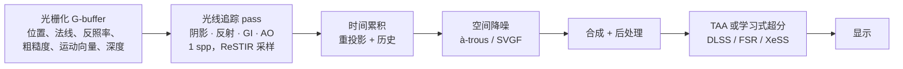

## 为什么重要

在[上一篇]({{ '/blog/2026/graphics-05-ray-and-path-tracing/' | relative_url }})中，我们写了一个路径追踪器，只要样本足够多，它就会收敛到正确答案。离线渲染器可以给每个像素花上几千个样本；而一款 60 fps 的游戏，*所有工作*加起来只有约 16 ms，大致只够**每帧每像素一到两条光线**。实时光线追踪（real-time ray tracing）就是让这寥寥几个样本发挥最大作用的艺术：用硬件把它们追踪得飞快，用采样让每个样本更“聪明”（ReSTIR），再用重建技术在像素之间、帧与帧之间复用信息（时间累积、SVGF、TAA、学习式超分）。这些思想对神经渲染同样重要：跨视角与跨时间的复用、G-buffer 引导的滤波、在线训练的小网络，都会在 NeRF 与 3D Gaussian Splatting 的管线中再次出现。

## 前置知识

- 蒙特卡洛估计量、重要性采样、MIS 与 NEE（[第 05 篇]({{ '/blog/2026/graphics-05-ray-and-path-tracing/' | relative_url }})）。
- BVH 与光线–三角形求交（第 05 篇）。
- 光栅化管线与 G-buffer（[第 02 篇]({{ '/blog/2026/graphics-02-rasterization/' | relative_url }})、[第 03 篇]({{ '/blog/2026/graphics-03-shading-and-textures/' | relative_url }})），以及渲染方程与 GGX（[第 04 篇]({{ '/blog/2026/graphics-04-physically-based-rendering/' | relative_url }})）。

## 1. 硬件光线追踪

### 1.1 API 模型：DXR 与 Vulkan Ray Tracing

微软于 2018 年发布了 **DirectX Raytracing（DXR）**，Khronos 则在 2020 年定稿了跨厂商的 **Vulkan Ray Tracing** 扩展（`VK_KHR_acceleration_structure`、`VK_KHR_ray_tracing_pipeline`、`VK_KHR_ray_query`）。两者提供的是同一套抽象：

1. **两级加速结构（acceleration structure，AS）**。
   - **底层加速结构（bottom-level AS，BLAS）**保存一个网格的几何（三角形或程序化 AABB），本质是由驱动构建的 BVH。
   - **顶层加速结构（top-level AS，TLAS）**保存*实例*：一个 BLAS 引用，加上一个 3×4 的物体到世界变换、实例掩码和命中组偏移。
   - 刚体运动只需重建 TLAS，由于实例数量少，这很便宜。变形网格则需要对 BLAS 做**refit**（更新包围盒、保持拓扑）或完整**rebuild**（质量更好但更慢）。每帧在两者间如何取舍，是引擎中的经典权衡。
2. **光线追踪管线**及新的着色器阶段：
   - **光线生成（ray generation）**：每个像素（或每个工作项）调用一次，在其中调用 `TraceRay`。
   - **相交（intersection）**：用于自定义图元（球、曲线）；三角形使用内置测试。
   - **任意命中（any-hit）**：对每个候选命中调用；用于 alpha 测试的植被（`IgnoreHit()`），或只需知道“有没有命中”的阴影光线（`AcceptHitAndEndSearch()`）。
   - **最近命中（closest-hit）**：对最近的交点着色，可以继续发射光线（递归）。
   - **未命中（miss）**：没有命中时调用，返回天空/环境光。
3. **着色器绑定表（shader binding table，SBT）**：把（实例、几何、光线类型）映射到要执行的命中组，使不同材质可以运行不同的着色器。
4. **内联光线追踪（inline ray tracing）**（DXR 1.1 的 `RayQuery`、Vulkan 的 `VK_KHR_ray_query`）：可以在*任意*着色器阶段（计算、片元）中追踪光线，无需管线和 SBT。由于调度更简单，阴影和 AO 光线常常优先使用它。

下图在一个二维玩具场景里展示了这两层结构：每个网格在物体空间里只构建一次 BLAS，TLAS 则建立在引用它们的实例的世界空间包围盒之上。



下面是一个最小的 DXR（HLSL）三件套：光线生成、未命中和最近命中着色器，用于从 G-buffer 计算硬阴影：

```hlsl
RaytracingAccelerationStructure gScene : register(t0);
Texture2D<float4> gPosition : register(t1);   // world position, w = 1 if valid
Texture2D<float4> gNormal   : register(t2);
RWTexture2D<float> gShadow  : register(u0);
cbuffer Light : register(b0) { float3 gLightPos; float gPad; };

struct ShadowPayload { float visible; };

[shader("raygeneration")]
void RayGen()
{
    uint2 p = DispatchRaysIndex().xy;
    float4 P = gPosition[p];
    if (P.w == 0) { gShadow[p] = 1; return; }
    float3 N = normalize(gNormal[p].xyz);
    float3 L = gLightPos - P.xyz;

    RayDesc ray;
    ray.Origin    = P.xyz + 1e-3 * N;           // offset to avoid self-intersection
    ray.Direction = normalize(L);
    ray.TMin      = 0.0;
    ray.TMax      = length(L) - 1e-3;

    ShadowPayload pl = { 0.0 };
    // shadow rays only need to know "is anything in the way?"
    TraceRay(gScene,
             RAY_FLAG_ACCEPT_FIRST_HIT_AND_END_SEARCH | RAY_FLAG_SKIP_CLOSEST_HIT_SHADER,
             0xFF, 0, 1, 0, ray, pl);
    gShadow[p] = pl.visible;
}

[shader("miss")]
void ShadowMiss(inout ShadowPayload pl) { pl.visible = 1.0; }

[shader("closesthit")]
void ShadowHit(inout ShadowPayload pl, in BuiltInTriangleIntersectionAttributes a)
{
    pl.visible = 0.0;   // not executed here (skipped by the flag), kept for completeness
}
```

`TraceRay` 中标志位之后的参数依次是：实例掩码、SBT 命中组偏移、SBT 步长（光线类型数）、未命中着色器索引、光线和 payload。

### 1.2 RT Core 到底做了什么

从 NVIDIA Turing（2018）开始，后来的 AMD RDNA 2、Intel Arc 以及较新的移动 GPU，都加入了固定功能单元，用来执行[第 05 篇]({{ '/blog/2026/graphics-05-ray-and-path-tracing/' | relative_url }})中的两个内层循环：**BVH 遍历中的光线–包围盒测试**和**光线–三角形测试**。各厂商放进硬件的部分不同（有的连遍历循环本身也由硬件完成，有的只做包围盒/三角形测试）。无论哪种情况，你的着色器仍由可编程核心执行。实际影响如下：

- **发散（divergence）是大敌。** 相邻像素的次级光线方向随机，会击中不同材质、运行不同的最近命中着色器。GPU 以 SIMD 组（warp/wavefront）执行，不一致性会浪费通道。因此硬件和 API 加入了**着色器执行重排（shader execution reordering）**（如 NVIDIA SER），按线程即将运行的命中着色器重新分组。
- **主导开销的通常是访存，而不是算术**：紧凑的 BVH 节点、压缩的 BLAS、保持命中着色器短小都有帮助。
- **光线是预算。** 引擎把光线花在光栅化最弱的地方：面光源阴影、反射、环境光遮蔽和漫反射全局光照。

## 2. 混合渲染

主可见性就是“从相机出发的光线”。光栅化能精确且极快地回答这个问题，因此几乎所有实时光线追踪器都是**混合式（hybrid）**的：



有两条经验法则让它行之有效：

1. **降噪前先分离信号。** 漫反射与镜面间接光的噪声和空间结构差异很大。它们被追踪到不同的缓冲区，并用不同参数分别降噪。
2. **对纹理去调制（demodulate）。** 滤波前把带噪的辐照度除以反照率，滤波后再乘回去。这样滤波器只模糊平滑的光照，而不会抹掉锐利的纹理细节：

$$
\text{color} = \text{albedo}\cdot \underbrace{E}_{\text{filter this}},\qquad E \approx \frac{\text{noisy color}}{\max(\text{albedo},\epsilon)} .
$$

## 3. 时间累积与重投影

如果相机静止，直接对各帧求平均即可：$n$ 帧之后方差降为 $\sigma^2/n$。一旦有物体运动，我们就必须找到**当前像素在上一帧中的位置**。光栅化器为每个像素写入一个**运动向量（motion vector）**（同一表面点在当前帧与上一帧投影位置之间的屏幕空间差）：

$$
\mathbf{u}_{\text{prev}} = \mathbf{u} - \mathbf{m}(\mathbf{u}),\qquad
\mathbf{m}(\mathbf{u}) = \pi\!\left(P_t V_t\, \mathbf{x}\right) - \pi\!\left(P_{t-1} V_{t-1} M_{t-1} M_t^{-1}\mathbf{x}\right),
$$

其中 $\pi$ 是透视除法加视口变换，$M$ 是物体的模型矩阵。历史值在 $$\mathbf{u}_{\text{prev}}$$ 处（以双线性方式，在亚像素位置）取出。当两个表面不一致时，即发生**去遮挡（disocclusion）**时，历史会被**拒绝**：深度差超过阈值、法线不一致（$$\mathbf{n}\cdot\mathbf{n}_{\text{prev}} < \cos\theta_{\max}$$），或者网格/物体 id 不同。

下图用一个玩具例子展示了这两种情况。



被接受的历史通过**指数移动平均（exponential moving average，EMA）**混合：

$$
\bar{c}_t = (1-\alpha)\,\bar{c}_{t-1} + \alpha\, c_t, \qquad \alpha \approx 0.05\text{–}0.2 .
$$

对于方差为 $\sigma^2$ 的独立同分布输入，EMA 的稳态方差为

$$
\operatorname{Var}[\bar c] = \sum_{k\ge0} \alpha^2 (1-\alpha)^{2k}\sigma^2 = \frac{\alpha}{2-\alpha}\,\sigma^2 ,
$$

因此 $\alpha=0.2$ 的效果大约相当于平均 9 帧。代价是光照变化时的**滞后**（拖影，ghosting）。一种常见改进是为每个像素记录**历史长度** $n$，并使用 $\alpha = \max(1/n,\ \alpha_{\min})$。刚刚去遮挡的像素（$n=1$）完全采用新样本；有 $n$ 帧历史的像素是真正的累计平均；历史很长时则退化为 EMA。

下图展示了这两种效应。



## 4. 空间降噪

时间复用恰恰在我们最需要帮助的地方失效：刚去遮挡时、运动物体上以及光照变化时。**空间**滤波器通过借用“看到同类表面”的相邻像素来填补这个空缺。

### 4.1 边缘保持的 à-trous 小波（Dammertz et al. 2010）

大的高斯模糊很昂贵（每像素 $O(r^2)$ 个采样）。**à-trous**（法语“带孔的”）算法用同一个 5×5 的 B3 样条小核 $h = \tfrac{1}{16}[1,4,6,4,1]$ 反复滤波来近似大核，第 $i$ 层的采样点彼此相隔 $2^i$ 个像素。五层（步长 1、2、4、8、16）只需每像素 $5\times25$ 次采样，就能覆盖 $125\times125$ 像素的范围。为了避免跨几何边缘模糊，像素 $p$ 周围的每个采样 $q$ 都会乘上由 G-buffer 计算的**边缘停止函数（edge-stopping function）**：

$$
\hat c_{i+1}(p) = \frac{\sum_{q} h_i(q)\, w(p,q)\, \hat c_i(q)}{\sum_q h_i(q)\, w(p,q)},\qquad
w = w_{\text{rt}}\cdot w_{\mathbf n}\cdot w_{\mathbf x},
$$

$$
w_{\text{rt}} = e^{-\frac{\lVert c_p - c_q\rVert^2}{\sigma_{\text{rt}}^2}},\quad
w_{\mathbf n} = e^{-\frac{\lVert \mathbf n_p - \mathbf n_q\rVert^2}{\sigma_{\mathbf n}^2}},\quad
w_{\mathbf x} = e^{-\frac{\lVert \mathbf x_p - \mathbf x_q\rVert^2}{\sigma_{\mathbf x}^2}} ,
$$

其中 $\sigma_{\text{rt}}$ 每层减半，使粗层级尊重已平滑图像中的边缘。许多实现（包括下面的代码和主页演示）使用变体 $w_{\mathbf n} = \max(0,\mathbf n_p\cdot\mathbf n_q)^{\sigma_{\mathbf n}}$，并用深度项代替世界坐标项。一个自包含的 NumPy 版本：

```python
import numpy as np

H = np.array([1, 4, 6, 4, 1]) / 16.0          # B3-spline kernel, separable 5x5


def atrous_level(c, nrm, z, step, s_c=0.5, s_n=128.0, s_z=1.0):
    """One edge-avoiding a-trous pass (Dammertz et al. 2010 style).
    c: (h,w,3) noisy color, nrm: (h,w,3) unit normals, z: (h,w) depth."""
    h, w, _ = c.shape
    acc = np.zeros_like(c)
    wsum = np.zeros((h, w, 1))
    for dy in range(-2, 3):
        for dx in range(-2, 3):
            # sample the neighbour 'step' pixels away (clamped at the border)
            ys = np.clip(np.arange(h) + dy * step, 0, h - 1)
            xs = np.clip(np.arange(w) + dx * step, 0, w - 1)
            cq, nq, zq = c[ys][:, xs], nrm[ys][:, xs], z[ys][:, xs]
            w_c = np.exp(-((c - cq) ** 2).sum(-1) / s_c**2)                  # color edge-stop
            w_n = np.maximum((nrm * nq).sum(-1), 0.0) ** s_n                 # normal edge-stop
            w_z = np.exp(-np.abs(z - zq) / (s_z * step + 1e-6))             # depth edge-stop
            wk = (H[dy + 2] * H[dx + 2] * w_c * w_n * w_z)[..., None]
            acc += wk * cq
            wsum += wk
    return acc / np.maximum(wsum, 1e-12)


def atrous(c, nrm, z, levels=5, s_c=4.0, **kw):
    for i in range(levels):                    # steps 1, 2, 4, 8, 16
        c = atrous_level(c, nrm, z, 2**i, s_c=s_c, **kw)
        s_c *= 0.5                             # tighten the color test each level
    return c


if __name__ == "__main__":
    rng = np.random.default_rng(1)
    h, w = 64, 96
    xx = np.mgrid[0:h, 0:w][1]
    left = xx < w // 2                                        # two "walls" meeting at an edge
    nrm = np.where(left[..., None], [1.0, 0.0, 0.0], [0.0, 0.0, 1.0])
    z = np.where(left, 2.0, 3.0)
    clean = np.where(left[..., None], [0.8, 0.3, 0.2], [0.2, 0.4, 0.8])
    noisy = clean * rng.exponential(1.0, (h, w, 1))           # 1-spp-like multiplicative noise
    out = atrous(noisy, nrm, z)
    rmse = lambda a: np.sqrt(((a - clean) ** 2).mean())
    print(f"RMSE noisy {rmse(noisy):.3f} -> filtered {rmse(out):.3f}")
    blur = atrous(noisy, nrm, z, s_n=0.0, s_z=1e9)            # no G-buffer guidance
    edge = lambda a: np.abs(a[:, w // 2 - 2:w // 2 + 2] - clean[:, w // 2 - 2:w // 2 + 2]).mean()
    print(f"error at the edge: guided {edge(out):.3f}, unguided {edge(blur):.3f}")
```

在这张玩具图像上，它输出 `RMSE noisy 0.523 -> filtered 0.101` 和 `error at the edge: guided 0.034, unguided 0.152`：正是 G-buffer 项让折角保持锐利。

下面第一张图展示 5×5 的采样点如何逐级散开；第二张图运行的正是上面的脚本。





### 4.2 SVGF：时空方差引导滤波（Schied et al. 2017）

普通 à-trous 的弱点在于颜色容差 $\sigma_{\text{rt}}$ 是固定的。太小，噪声残留；太大，真实的光照细节（阴影边缘）会被抹掉。**SVGF（spatiotemporal variance-guided filtering）**让容差*自适应于局部噪声水平*：

1. 对去调制后的颜色*以及*亮度的前两阶矩 $\mu_1 = \mathbb E[l]$、$\mu_2=\mathbb E[l^2]$ 做**时间累积**（第 3 节）。
2. **方差估计**：由时间矩计算 $\sigma^2_l = \mu_2 - \mu_1^2$。对于历史较短的像素（论文中为少于 4 帧），改为在 7×7 邻域内做空间估计。
3. **方差引导的 à-trous**：五层滤波，其中亮度的边缘停止函数使用噪声的*标准差*：

   $$
   w_l(p,q) = \exp\!\left(-\frac{\lvert l_p - l_q\rvert}{\sigma_l\sqrt{g_{3\times3}\!\left(\operatorname{Var}(l_p)\right)} + \epsilon}\right),
   $$

   其中 $g_{3\times3}$ 是对方差的小高斯预滤波，$\sigma_l=4$。由于每一层都在滤波信号，方差也随之用*平方*权重一起滤波（对独立样本，$\operatorname{Var}\big[\sum_q w_q c_q / \sum_q w_q\big] = \sum_q w_q^2\operatorname{Var}[c_q]/(\sum_q w_q)^2$）。于是噪声大的区域被大力平滑，已收敛的区域则保持不动。法线项为 $\max(0,\mathbf n_p\cdot\mathbf n_q)^{\sigma_n}$（$\sigma_n=128$），深度项则用局部深度梯度来归一化深度差：$\lvert z_p - z_q\rvert / (\sigma_z \lvert\nabla z\cdot(p-q)\rvert + \epsilon)$。

4. 第一层 à-trous 的输出被回馈为下一帧的颜色历史，最后再用一遍 TAA 去除残余闪烁。

生产级降噪器（如 NVIDIA 开源的 NRD 库：ReBLUR、ReLAX，后者源自 SVGF）在此基础上做了改进：按信号分别调参、对镜面反射使用感知命中距离的核，以及抗滞后（anti-lag）启发式。用神经网络取代手工设计权重的学习式降噪器如今也已很常见。

## 5. ReSTIR：基于蓄水池的时空重要性重采样

降噪器只能清理“平均而言还不错”的样本。场景中有成千上万盏灯时，每像素一条阴影光线如果瞄准一盏*均匀*选出的灯，几乎总会选中一盏毫无贡献的灯。ReSTIR（Bitterli et al. 2020）在相同的光线预算下选出好得多的灯。它的做法是对许多廉价候选进行**重采样**，并在像素与帧之间**复用**它们。

### 5.1 重采样重要性采样（RIS）

我们要估计 $I=\int f(x)\,dx$。对直接光照而言，$f(x) = f_r\, L_e\, G\, V$，积分域是光源上的点 $x$。理想的 pdf 与 $f$ 成正比，但 $f$ 包含昂贵的可见性 $V$。RIS（resampled importance sampling，Talbot et al. 2005）使用一个廉价的**目标函数（target function）** $\hat p(x)\ge 0$，例如去掉 $V$ 的 $f$。它不需要归一化。

1. 从一个容易采样的**源 pdf（source pdf）** $p$ 中抽取 $M$ 个候选 $x_1,\dots,x_M$（例如均匀地或按功率选灯）。
2. 给每个候选赋予**重采样权重（resampling weight）** $w_i = \hat p(x_i)/p(x_i)$。
3. 以概率 $w_z / \sum_j w_j$ 选出一个候选 $y = x_z$。
4. 估计

$$
\langle I\rangle_{\text{RIS}} = \frac{f(y)}{\hat p(y)} \cdot \underbrace{\frac{1}{M}\sum_{j=1}^{M} w_j}_{\text{estimate of } \int\hat p} \;=\; f(y)\,W,\qquad W = \frac{1}{\hat p(y)}\,\frac{1}{M}\sum_j w_j .
$$

**为什么是无偏的。** 记 $Z_M = \tfrac1M\sum_j w_j$。在给定候选的条件下，选择过程是一次离散的重要性采样，因此

$$
\mathbb E\big[f(y)W \,\big\vert\, x_{1..M}\big] = \sum_{z} \frac{w_z}{M Z_M}\cdot \frac{f(x_z)}{\hat p(x_z)}\, Z_M = \frac1M\sum_{z} \frac{f(x_z)}{p(x_z)} ,
$$

它对候选取期望，就是标准重要性采样估计量的平均，也就是 $I$。这要求在 $f(x)\ne0$ 处有 $\hat p(x)>0$，并且在 $\hat p>0$ 处有 $p>0$。当 $M\to\infty$ 时，$y$ 的分布趋近 $\hat p/\int\hat p$，因此 $W$ 起到了被选样本 $1/\text{pdf}$ 的作用。ReSTIR 称之为**无偏贡献权重（unbiased contribution weight）**。只需为 $y$ 追踪**一条**阴影光线；$M$ 个候选的代价只是若干次 $\hat p$ 求值。

下图在一维中演示了这个过程。



### 5.2 加权蓄水池采样（WRS）

在 GPU 上不可能存储全部候选。**加权蓄水池采样（weighted reservoir sampling，WRS）**用 $O(1)$ 的内存从数据流中做选择。它维护当前选中的 $y$、累计和 $w_{\text{sum}}$ 以及计数 $M$。当权重为 $w_i$ 的元素 $x_i$ 到来时（先加上 $w_i$），以概率 $w_i/w_{\text{sum}}$ 替换 $y$。由归纳法可知，每个元素最终被选中的概率是 $w_i/\sum_j w_j$，正是 RIS 所需要的。

关键性质：**两个蓄水池可以在不保留候选的情况下合并**。把蓄水池 $r$ 选中的样本以权重 $\hat p(y_r)\,W_r\,M_r$（目标函数相同时，它等于 $w_{\text{sum},r}$）喂给一个新的蓄水池，并把各自的 $M$ 相加。结果的分布就如同 RIS 看过了全部 $\sum_r M_r$ 个候选，而代价只是每个蓄水池一次合并。正是这一点让跨像素、跨帧复用变得廉价。

### 5.3 时空复用

对每个像素、每一帧，ReSTIR DI：

1. **初始候选**：$M\approx 32$ 个光源样本，以 $\hat p = $ 无遮挡贡献流入一个蓄水池。
2. *（可选）* **可见性复用**：为 $y$ 追踪一条阴影光线；若被遮挡则令 $W=0$，从而被遮挡的样本不会扩散给邻居。
3. **时间复用**：合并上一帧重投影像素的蓄水池。其 $M$ 被限制为当前 $M$ 的一个小倍数（例如 20 倍），以限制样本的陈旧程度。
4. **空间复用**：合并 $k$ 个随机邻居的蓄水池（例如 30 像素半径内的 5 个），并拒绝深度或法线差异过大的邻居。这一步可以迭代。
5. **着色**：为最终的 $y$ 追踪一条阴影光线，贡献为 $f(y)\,W$。

下图示意了第 3 步和第 4 步。



当邻居的样本用*本像素*的 $\hat p$ 重新加权时，它们其实来自另一个分布。此时朴素的 $1/M$ 权重会产生**偏差**，通常表现为边缘变暗：邻居的样本在这里不可见。无偏版本用归一化因子 $1/Z$ 代替 $1/M$，其中只计入那些自身 $\hat p_q(y)>0$ 的邻居；也可以对邻居使用 MIS 式的权重。Lin et al.（2022）的 GRIS 理论推广了这些权重，并覆盖了相关样本以及跨不同域复用的样本。

下面是一个完整、可运行的玩具实验。一个着色点能看到 4096 个强度极不均匀的点光源，其中一些被墙挡住。我们比较均匀选灯、32 个候选的 RIS，以及合并四个独立 RIS 蓄水池的结果。三者都应当无偏；RIS 的方差应当小得多。

```python
import numpy as np

rng = np.random.default_rng(0)

# --- a toy "many lights" scene: one shading point, N point lights on a plane above it
N = 4096
light_pos = np.c_[rng.uniform(-8, 8, N), rng.uniform(0.5, 4, N), rng.uniform(-8, 8, N)]
light_I = rng.lognormal(0.0, 1.0, N)          # very uneven intensities
x, n = np.zeros(3), np.array([0.0, 1.0, 0.0])  # shading point and its normal
occluder_x = 1.0                               # lights with 0 < x < 1.5 are "behind a wall"

d = light_pos - x
dist2 = (d * d).sum(1)
cos = np.maximum((d @ n) / np.sqrt(dist2), 0.0)
visible = ~((light_pos[:, 0] > 0) & (light_pos[:, 0] < 1.5 * occluder_x))

f = light_I * cos / dist2 * visible      # integrand: contribution of light i (Lambert, albedo/pi dropped)
p_hat = light_I * cos / dist2            # target function: same, but without the visibility ray
exact = f.sum()                          # "integral" = sum over all lights


class Reservoir:
    """Weighted reservoir sampling: keeps one sample y out of a stream."""
    def __init__(self):
        self.y, self.w_sum, self.M, self.W = -1, 0.0, 0, 0.0

    def update(self, x_i, w_i, u):
        self.w_sum += w_i
        self.M += 1
        if self.w_sum > 0 and u < w_i / self.w_sum:
            self.y = x_i


def ris_estimate(M, rng):
    r = Reservoir()
    for _ in range(M):
        i = rng.integers(N)              # source pdf p(i) = 1/N (uniform light pick)
        w = p_hat[i] / (1.0 / N)         # resampling weight w_i = p_hat / p
        r.update(i, w, rng.random())
    if r.y < 0 or p_hat[r.y] == 0:
        return r, 0.0
    r.W = r.w_sum / (r.M * p_hat[r.y])   # unbiased contribution weight
    return r, f[r.y] * r.W               # one shadow ray: f includes visibility


def combine(reservoirs, rng):
    """Merge reservoirs that share the same target p_hat (e.g. spatial reuse at one pixel)."""
    s = Reservoir()
    for r in reservoirs:
        if r.y >= 0:
            s.update(r.y, p_hat[r.y] * r.W * r.M, rng.random())
            s.M += r.M - 1               # update() added 1; total M is the sum of the inputs
        else:
            s.M += r.M
    if s.y < 0:
        return s, 0.0
    s.W = s.w_sum / (s.M * p_hat[s.y])
    return s, f[s.y] * s.W


trials = 20000
uni = np.array([f[i] * N for i in rng.integers(N, size=trials)])
ris = np.array([ris_estimate(32, rng)[1] for _ in range(trials)])
mrg = np.array([combine([ris_estimate(32, rng)[0] for _ in range(4)], rng)[1] for _ in range(trials // 4)])

print(f"exact             : {exact:.4f}")
for name, e in [("uniform, 1 cand. ", uni), ("RIS, M=32        ", ris), ("4 merged RIS (128)", mrg)]:
    print(f"{name}: mean {e.mean():.4f} +- {e.std() / np.sqrt(len(e)):.4f}   rel. std per sample {e.std() / exact:.2f}")
```

输出（在笔记本电脑上耗时几秒）：

```text
exact             : 94.9404
uniform, 1 cand. : mean 93.2393 +- 2.2691   rel. std per sample 3.38
RIS, M=32        : mean 95.9497 +- 0.6209   rel. std per sample 0.92
4 merged RIS (128): mean 92.6408 +- 0.9898   rel. std per sample 0.74
```

所有均值都在大约两个标准误差内与精确值吻合。用 200,000 次 $M=128$ 的向量化 RIS 估计，得到 $95.00 \pm 0.15$。每样本的相对标准差在 32 个候选时从 3.4 降到 0.9，合并后进一步降到 0.74。这就是 ReSTIR 从空间复用中“免费”得到的质量。注意，RIS 无法修正被遮挡的灯，因为 $\hat p$ 忽略了可见性；这正是可见性复用一步的重要之处。

下图对许多不同的候选数重复了这个实验。



在 GPU 上，蓄水池是一个很小的结构体，按像素存放在跨帧保留的缓冲区中：

```glsl
struct Reservoir {
    uint  y;      // selected light sample (index or packed position)
    float wSum;   // sum of resampling weights
    float M;      // number of candidates seen (float so it can be clamped/scaled)
    float W;      // unbiased contribution weight
};

bool updateReservoir(inout Reservoir r, uint xi, float wi, float u) {
    r.wSum += wi;
    r.M += 1.0;
    if (u * r.wSum < wi) { r.y = xi; return true; }
    return false;
}

// merge reservoir q (from a neighbour or the previous frame) into r;
// pHatHere is the target function of q.y evaluated at *this* pixel
void mergeReservoir(inout Reservoir r, Reservoir q, float pHatHere, float u) {
    float M0 = r.M;
    updateReservoir(r, q.y, pHatHere * q.W * q.M, u);
    r.M = M0 + q.M;
}

void finalizeReservoir(inout Reservoir r, float pHatY) {
    r.W = (pHatY > 0.0) ? r.wSum / (r.M * pHatY) : 0.0;  // biased 1/M variant
}
```

### 5.4 ReSTIR GI

ReSTIR GI（Ouyang et al. 2021）把同一套机制用于**间接**光照。每个像素的可见点 $x_v$ 发射一条按 BSDF 采样的光线，到达一个**样本点** $x_s$，并估计那里的出射辐亮度 $L_o(x_s)$（它自己再做 NEE 和后续弹射）。蓄水池存储的是*路径顶点* $(x_s, \mathbf n_s, L_o)$。目标函数基本上是沿该路径到达的辐亮度的亮度值，例如 $\hat p = \operatorname{lum}(L_o(x_s))$，或者再乘上 $x_v$ 处的 BSDF 与余弦。当像素 $r$ 复用邻居 $q$ 的样本时，它把自己的可见点 $x_r$ *重新连接（reconnect）*到 $x_s$。由于该样本原本是在 $x_q$ 周围按立体角生成的，其 pdf 必须用这一变量替换的雅可比行列式（Jacobian）进行转换：

$$
\lvert J_{q\to r}\rvert = \frac{\lvert\cos\phi_r\rvert}{\lvert\cos\phi_q\rvert}\cdot\frac{\lVert x_q - x_s\rVert^2}{\lVert x_r - x_s\rVert^2},
$$

其中 $\phi_q,\phi_r$ 是 $\mathbf n_s$ 与从 $x_s$ 指向 $x_q$、$x_r$ 的方向之间的夹角。复用时目标函数要除以 $\lvert J\rvert$，雅可比值极端的样本会被拒绝。这样，每像素每帧一个样本的路径追踪间接光照，在降噪之前就已经干净得多。ReSTIR GI 的最终图像仍然依赖降噪器。后续工作（ReSTIR PT、area ReSTIR、体积中的 ReSTIR）进一步推广了重新连接的思想。



## 6. TAA 与学习式超分

### 6.1 时间抗锯齿

实时渲染器很少能在延迟着色的同时负担 MSAA，因此抗锯齿以**时间**方式完成，所用的重投影与第 3 节相同。投影矩阵每帧被**抖动（jitter）**一个不同的亚像素偏移（典型做法是 Halton(2,3) 序列），使相继各帧采样每个像素内部的不同位置。用 EMA 把它们混合起来，就是对像素覆盖区域做积分：也就是[第 02 篇]({{ '/blog/2026/graphics-02-rasterization/' | relative_url }})中的超采样，只是摊到了时间上。难点在于无效的历史。Karis 2014 年的报告 *High Quality Temporal Supersampling* 推广了**邻域钳制（neighbourhood clamping）**：把历史颜色钳制（或朝中心裁剪）到当前帧 3×3 邻域的包围盒内，通常在 YCoCg 空间中进行。一个不可能出现在当前邻域里的历史颜色（拖影）会被拉回：

```glsl
// history: reprojected color, cur: current frame color texture, uv: pixel center
vec3 taaResolve(sampler2D cur, vec3 history, vec2 uv, vec2 texel) {
    vec3 m1 = vec3(0.0), m2 = vec3(0.0);
    for (int y = -1; y <= 1; ++y)
        for (int x = -1; x <= 1; ++x) {
            vec3 c = texture(cur, uv + vec2(x, y) * texel).rgb;
            m1 += c; m2 += c * c;
        }
    vec3 mu = m1 / 9.0;
    vec3 sigma = sqrt(max(m2 / 9.0 - mu * mu, 0.0));
    vec3 lo = mu - 1.0 * sigma, hi = mu + 1.0 * sigma;   // box from mean +- 1 std
    vec3 h = clamp(history, lo, hi);
    vec3 c0 = texture(cur, uv).rgb;
    return mix(h, c0, 0.1);                               // alpha = 0.1
}
```

钳制以细小特征上的一些模糊和闪烁为代价换来了更少的拖影。正是这种权衡推动了学习式方法。

为什么用低差异序列而不是随机抖动？下图做了测量。



### 6.2 学习式超分（DLSS 等）

以较低的内部分辨率渲染再**超分（upscaling）**，节省的光线与着色开销大致与像素数成正比。NVIDIA 的 **DLSS**（自 2020 年的 2.0 版起），从高层看就是一个 TAA：其中启发式的历史拒绝与混合规则被一个卷积网络取代。输入是抖动的低分辨率颜色、深度、运动向量和曝光，加上按运动向量扭曲后的上一帧高分辨率输出；输出是高分辨率帧。后续版本加入了**帧生成（frame generation）**（借助光流插出额外的帧）以及**光线重建（ray reconstruction）**，后者用一个在光线追踪数据上训练的网络取代第 4 节中手工调参的降噪器。AMD FSR（1–3 版为手工设计，FSR 4 基于机器学习）和 Intel XeSS 扮演着同样的角色。对我们来说，结构上的启示是：现代实时图像是从稀疏、抖动、时间复用的样本中**重建**出来的，这与神经渲染从稀疏视角重建场景非常相似。

## 7. 神经辐射缓存

路径追踪的大部分开销和噪声都花在了漫长的多次弹射尾部。**辐射缓存（radiance cache）**存储（近似的）出射辐亮度 $L_o(\mathbf x,\omega)$，使路径可以提前终止，剩余部分直接查表。经典缓存（辐照度缓存、DDGI 等探针网格）很紧凑，但会模糊细节或漏光。

**神经辐射缓存（neural radiance caching，NRC）**（Müller et al. 2021）使用一个小型 MLP $\hat L_\theta(\mathbf x, \omega, \mathbf n, r, \alpha_d, \alpha_s)$。它的输入是位置、方向、表面法线、粗糙度以及漫反射/镜面反射率，经过输入编码后送入网络，输出是辐亮度。

- **渲染**：每条路径只追踪一段很短的前缀。当路径的扩散范围（spread）大到缓存的模糊不再可见时，就终止路径并查询缓存。路径通量乘以缓存的 $\hat L_\theta$。
- **在线训练**：一小部分路径会再多延伸几次弹射。它们收集到的辐亮度（其末端本身也是一次缓存查询）作为训练目标。这种“自训练（self-training）”让网络在每条路径都很短的情况下学到多次弹射的光照。每帧做几步梯度更新，因此缓存无需预训练即可适应动态场景。
- **速度**：网络很小，由“全融合（fully fused）”的 GPU MLP（tiny-cuda-nn 的做法）求值，权重和激活都保存在片上存储中。



这是神经渲染系列的直接前身。同样的全融合 MLP 与输入编码机制出现在 Instant-NGP 中，而一个在线训练的辐射网络在概念上就是一个关于*当前*场景光照的 NeRF。

## 动手试试

[主页实验室]({{ '/' | relative_url }}#lab)中的**路径追踪器**完全运行在 WebGL 片元着色器中，演示了本文的若干要点：

- 打开 **Denoise** 并拖动相机或物体。交互时每个像素只累积了少量样本。一个由法线、深度和反照率缓冲区引导的 5 层边缘保持 **à-trous** 滤波器（步长 1、2、4、8、16）会清理图像，与 4.1 节一致。关掉它可以看到原始信号。
- 在 **Final**、**Noisy**、**Albedo**、**Normal** 和 **Depth** 之间切换视图。后三者就是驱动边缘停止权重的 G-buffer。观察滤波器如何在法线或深度跳变处保持边缘，以及为何用反照率对纹理去调制。
- 缩小光源，并在 **BSDF**、**NEE** 和 **MIS** 之间切换。更好的采样（ReSTIR 在大规模上要解决的正是这个问题）在降噪器不得不掩盖噪声*之前*就把噪声压了下去。
- 让相机保持静止：渐进累积就是时间累积（第 3 节）在相机静止时的极限，图像会收敛到无噪声的参考结果。

## 代表性论文

| 论文 | 会议/期刊 | 年份 | 链接 | 意义 |
| --- | --- | --- | --- | --- |
| Talbot, Cline, Egbert. *Importance Resampling for Global Illumination* | EGSR | 2005 | [DOI](https://doi.org/10.2312/EGWR/EGSR05/139-146) | 把 RIS 引入渲染，是 ReSTIR 背后的估计量 |
| Dammertz, Sewtz, Hanika, Lensch. *Edge-Avoiding À-Trous Wavelet Transform for fast Global Illumination Filtering* | HPG | 2010 | [DOI](https://doi.org/10.2312/EGGH/HPG10/067-075) | G-buffer 引导的小波滤波；大多数实时降噪器的基础 |
| Karis. *High Quality Temporal Supersampling* | SIGGRAPH Advances in Real-Time Rendering 课程 | 2014 | — | 推广了带邻域钳制的抖动 TAA |
| Schied et al. *Spatiotemporal Variance-Guided Filtering* (SVGF) | HPG | 2017 | [DOI](https://doi.org/10.1145/3105762.3105770) | 时间矩 → 方差 → 自适应 à-trous；实时的 1 spp 路径追踪 |
| Bitterli et al. *Spatiotemporal Reservoir Resampling for Real-Time Ray Tracing with Dynamic Direct Lighting* (ReSTIR) | SIGGRAPH / ACM TOG 39(4) | 2020 | [DOI](https://doi.org/10.1145/3386569.3392481) | RIS + 蓄水池 + 时空复用，支持数百万光源 |
| Ouyang et al. *ReSTIR GI: Path Resampling for Real-Time Path Tracing* | HPG / Computer Graphics Forum 40(8) | 2021 | [DOI](https://doi.org/10.1111/cgf.14378) | 借助重新连接雅可比把 ReSTIR 推广到间接光照 |
| Müller, Rousselle, Novák, Keller. *Real-time Neural Radiance Caching for Path Tracing* | SIGGRAPH / ACM TOG 40(4) | 2021 | [arXiv](https://arxiv.org/abs/2106.12372) | 在线训练的 MLP 缓存；通往神经渲染的桥梁 |
| Lin et al. *Generalized Resampled Importance Sampling: Foundations of ReSTIR* | SIGGRAPH / ACM TOG 41(4) | 2022 | [DOI](https://doi.org/10.1145/3528223.3530158) | 为跨域复用与相关样本提供严格理论（GRIS） |
| Wyman et al. *A Gentle Introduction to ReSTIR: Path Reuse in Real-time* | SIGGRAPH Courses | 2023 | [DOI](https://doi.org/10.1145/3587423.3595511) | 讲解 ReSTIR 理论与实践的最佳教程 |

## 学习资源

- **GAMES202：高质量实时渲染**（闫令琪）：实时阴影、全局光照、PBR，以及实时光线追踪/降噪的课程。它是本文的天然配套课程。
- **Real-Time Rendering**，第 4 版（Akenine-Möller 等）：关于光线追踪、TAA 与超分的章节。
- **Ray Tracing Gems** I 和 II（NVIDIA 提供的免费电子书）：大量关于 DXR、降噪和采样的实用章节。
- **PBRT**（Physically Based Rendering，可在 [pbr-book.org](https://pbr-book.org/) 免费在线阅读），打好蒙特卡洛基础。
- **微软 DirectX 规范**（DXR 规范位于 [github.com/microsoft/DirectX-Specs](https://github.com/microsoft/DirectX-Specs)）以及 Vulkan 规范（`VK_KHR_ray_tracing_pipeline`、`VK_KHR_ray_query`）。
- 开源代码：[NVIDIA NRD](https://github.com/NVIDIA-RTX/NRD)（实时降噪器）和 [NVIDIA RTXDI](https://github.com/NVIDIA-RTX/RTXDI)（生产级 ReSTIR DI/GI）。

## 练习

1. 证明 EMA 方差公式 $\operatorname{Var}[\bar c] = \frac{\alpha}{2-\alpha}\sigma^2$，并说明 $\alpha_n = 1/n$ 恰好给出累计平均。
2. 在 RIS 脚本中，把源 pdf 改为按 $I_i$ 成比例选灯（记得更新 $w_i = \hat p/p$）。$M=1$ 和 $M=32$ 时方差如何变化？
3. 实现*有偏*的空间复用：用朴素的 $1/M$ 权重合并为*不同*着色点（不同法线）计算的蓄水池，并测量偏差。然后用 $1/Z$ 归一化修正它。
4. 为 à-trous 脚本加入方差估计（在 8 个带噪“帧”上计算时间矩），并用 SVGF 的亮度权重替换固定的颜色容差。比较边缘误差。
5. 在实验室的路径追踪器中，找到一种设置（小光源、光泽物体），使降噪器明显模糊了真实细节。解释是哪一个边缘停止项造成的。

下一篇：[基于物理的模拟]({{ '/blog/2026/graphics-07-physically-based-simulation/' | relative_url }})，我们将从模拟光转向模拟物质：粒子、布料与 XPBD。
