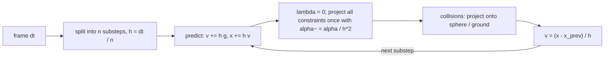

## 为什么重要

到目前为止，本系列讨论的都是光如何离开场景：[光栅化]({{ '/blog/2026/graphics-02-rasterization/' | relative_url }})、[基于物理的着色]({{ '/blog/2026/graphics-04-physically-based-rendering/' | relative_url }})、[路径追踪]({{ '/blog/2026/graphics-05-ray-and-path-tracing/' | relative_url }})及其[实时版本]({{ '/blog/2026/graphics-06-real-time-ray-tracing/' | relative_url }})。最后这一篇讨论场景本身如何*运动*。基于物理的动画（physically based animation）驱动着游戏和 VR 中的布料、电影中的视觉特效，也越来越多地驱动着为机器人、具身智能体和世界模型生成训练数据的模拟器。这里介绍的方法（尤其是基于位置的动力学和 XPBD）正是你在游戏引擎里、以及本站主页布料演示中能看到的那些方法。

我们将从单个粒子出发，一步步搭建一个可以在 NumPy 中运行的 XPBD 布料求解器，从隐式欧拉法推导出 XPBD 的更新公式，然后概览刚体与基于粒子的流体。

## 前置知识

- 向量、梯度与链式法则（[第 1 篇]({{ '/blog/2026/graphics-01-roadmap-and-math/' | relative_url }})）。
- 基础常微分方程：$\dot{\mathbf{x}} = \mathbf{v}$，$\dot{\mathbf{v}} = \mathbf{a}$。
- 牛顿法与拉格朗日乘子（只需了解思想）。
- Python 与 NumPy。

## 1. 模拟循环

粒子系统（particle system）是一组点，每个点具有位置 $\mathbf{x}_i$、速度 $\mathbf{v}_i$ 和质量 $m_i$。牛顿第二定律给出一组常微分方程（ordinary differential equations, ODE）

$$
\dot{\mathbf{x}}_i = \mathbf{v}_i, \qquad m_i \dot{\mathbf{v}}_i = \mathbf{f}_i(\mathbf{x}, \mathbf{v}, t),
$$

其中 $\mathbf{f}_i$ 汇总了重力、弹簧力、阻力、接触力和用户施加的力。把所有粒子堆叠起来，记 $\mathbf{x} \in \mathbb{R}^{3N}$，并使用对角质量矩阵 $\mathbf{M}$，于是 $\mathbf{M}\ddot{\mathbf{x}} = \mathbf{f}$。使用**逆质量**（inverse mass）$w_i = 1/m_i$ 会更方便：被固定的（运动学）粒子只需令 $w_i = 0$。

实时模拟器以时间步长 $\Delta t$ 推进这个 ODE（通常每帧 $1/60$ 秒，并再拆分为若干子步）。所有有趣之处都在于*如何*迈出这一步。

## 2. 时间积分器

### 显式、隐式与辛欧拉法

最简单的方案在时间步开始时计算力：

$$
\text{explicit Euler:}\quad \mathbf{x}^{n+1} = \mathbf{x}^n + \Delta t\, \mathbf{v}^n, \qquad \mathbf{v}^{n+1} = \mathbf{v}^n + \Delta t\, \mathbf{M}^{-1}\mathbf{f}(\mathbf{x}^n).
$$

**隐式（后向）欧拉法**（implicit / backward Euler）在时间步结束时计算力，这使得每一步都变成一个（一般为非线性的）方程组：

$$
\text{implicit Euler:}\quad \mathbf{x}^{n+1} = \mathbf{x}^n + \Delta t\, \mathbf{v}^{n+1}, \qquad \mathbf{v}^{n+1} = \mathbf{v}^n + \Delta t\, \mathbf{M}^{-1}\mathbf{f}(\mathbf{x}^{n+1}).
$$

**辛（半隐式）欧拉法**（symplectic / semi-implicit Euler）先更新速度，再用*新*速度更新位置：

$$
\text{symplectic Euler:}\quad \mathbf{v}^{n+1} = \mathbf{v}^n + \Delta t\, \mathbf{M}^{-1}\mathbf{f}(\mathbf{x}^n), \qquad \mathbf{x}^{n+1} = \mathbf{x}^n + \Delta t\, \mathbf{v}^{n+1}.
$$

它的计算量与显式欧拉法相同，行为却截然不同。

为了理解原因，考虑一个无阻尼弹簧 $m\ddot{x} = -kx$，其固有频率为 $\omega = \sqrt{k/m}$。把一步写成线性映射 $(x, v)^{n+1} = \mathbf{A}(x, v)^n$，显式欧拉法有

$$
\mathbf{A}_{\text{exp}} = \begin{pmatrix} 1 & \Delta t \\ -\omega^2 \Delta t & 1 \end{pmatrix}, \qquad \det \mathbf{A}_{\text{exp}} = 1 + \omega^2 \Delta t^2 > 1,
$$

因此其特征值的模为 $\sqrt{1+\omega^2\Delta t^2}$，能量每一步都在增长，而且对*任意* $\Delta t$ 都如此。隐式欧拉法的特征值模为 $1/\sqrt{1+\omega^2\Delta t^2} < 1$：它无条件稳定，但会人为地衰减运动。辛欧拉法满足 $\det \mathbf{A} = 1$（保持相空间面积），并且当 $\omega \Delta t < 2$ 时特征值位于单位圆上：能量在真实值附近振荡，而不会漂移。

### Verlet 积分

**Störmer–Verlet** 积分完全消去了速度：

$$
\mathbf{x}^{n+1} = 2\mathbf{x}^n - \mathbf{x}^{n-1} + \Delta t^2\, \mathbf{M}^{-1}\mathbf{f}(\mathbf{x}^n).
$$

它具有二阶精度、时间可逆且是辛的；如果需要速度，可以用差分得到，例如 $(\mathbf{x}^{n+1}-\mathbf{x}^{n})/\Delta t$。Jakobsen 在 GDC 2001 的演讲 "Advanced Character Physics" 让"Verlet + 约束投影"在游戏中流行起来，它是 PBD 的直接前身。注意，下文的 PBD 循环"先用辛欧拉法预测，再由位置变化推出速度"，在代数上就是一种 Verlet 式的位置更新。

### 一个实验

```python
import numpy as np

k, m, h, steps = 100.0, 1.0, 0.01, 2000          # spring stiffness, mass, time step
def energy(x, v): return 0.5 * m * v**2 + 0.5 * k * x**2

def explicit_euler(x, v):
    return x + h * v, v + h * (-k / m * x)

def symplectic_euler(x, v):
    v = v + h * (-k / m * x)                      # velocity first ...
    return x + h * v, v                           # ... then position with the new velocity

def implicit_euler(x, v):
    # solve x' = x + h v',  v' = v - h k/m x'  (linear, so closed form)
    A = np.array([[1.0, -h], [h * k / m, 1.0]])
    return tuple(np.linalg.solve(A, [x, v]))

def verlet(x, x_prev):
    a = -k / m * x
    return 2 * x - x_prev + h * h * a, x          # returns (x_next, x_current)

for name, f in [("explicit", explicit_euler), ("symplectic", symplectic_euler), ("implicit", implicit_euler)]:
    x, v = 1.0, 0.0
    for _ in range(steps):
        x, v = f(x, v)
    print(f"{name:10s} E/E0 = {energy(x, v) / energy(1.0, 0.0):.3f}")

x, xp = 1.0, 1.0 - 0.5 * h * h * k / m            # second-order start: x_{-1} = x0 - h v0 + h^2 a0 / 2
for _ in range(steps):
    x, xp = verlet(x, xp)
v = (x - xp) / h                                  # backward-difference velocity
print(f"{'verlet':10s} E/E0 = {energy(x, v) / energy(1.0, 0.0):.3f}")
```

模拟 20 秒后（$\omega\Delta t = 0.1$），程序输出的能量比为：显式欧拉法约 $4.4 \times 10^8$（即 $1.01^{2000}$），隐式欧拉法 $0.000$，辛欧拉法和 Verlet 都约为 $1.05$（有界振荡；最后几位数字取决于停止时刻的相位）。这一张表就道尽了游戏物理的全部故事：显式欧拉法会爆炸，隐式欧拉法稳定但"软塌塌"，辛方法既便宜又表现良好——只要步长相对于最高频率足够小。

## 3. 质点-弹簧布料

经典的布料模型用弹簧连接网格上的粒子。粒子 $a$ 与 $b$ 之间的弹簧，静止长度为 $L_0$，刚度为 $k_s$，阻尼为 $k_d$，它对 $a$ 施加的力为

$$
\mathbf{f}_a = -\Big(k_s\big(\lVert\mathbf{x}_{ab}\rVert - L_0\big) + k_d\, (\mathbf{v}_a - \mathbf{v}_b)\cdot\hat{\mathbf{x}}_{ab}\Big)\, \hat{\mathbf{x}}_{ab}, \qquad \mathbf{x}_{ab} = \mathbf{x}_a - \mathbf{x}_b,
$$

且 $\mathbf{f}_b = -\mathbf{f}_a$。三种弹簧共同产生类似织物的响应：

| 弹簧 | 连接 | 抵抗 |
| --- | --- | --- |
| 结构（拉伸）弹簧 | $(i,j)$–$(i+1,j)$ 和 $(i,j)$–$(i,j+1)$ | 沿经向与纬向的拉伸 |
| 剪切弹簧 | 每个网格单元的两条对角线 | 面内剪切 |
| 弯曲弹簧 | $(i,j)$–$(i+2,j)$ 和 $(i,j)$–$(i,j+2)$ | 折叠（二面角弯曲的廉价替代） |

难点在于**刚度**（stiffness）。真实布料几乎不可拉伸，所以 $k_s$ 必须很大；而显式或辛积分的稳定步长大致满足 $\Delta t \lesssim 2/\omega_{\max} \sim 2\sqrt{m/k_s}$，会变得极小。Baraff 和 Witkin 的 "Large Steps in Cloth Simulation"（SIGGRAPH 1998）用隐式欧拉法在离线场景中解决了这个问题：将力线性化，每步用共轭梯度法求解一个稀疏线性系统 $\big(\mathbf{M} - \Delta t\,\partial\mathbf{f}/\partial\mathbf{v} - \Delta t^2\,\partial\mathbf{f}/\partial\mathbf{x}\big)\Delta\mathbf{v} = \Delta t\,(\mathbf{f} + \Delta t\, \partial\mathbf{f}/\partial\mathbf{x}\, \mathbf{v})$。这种方法鲁棒，但实现和调参代价都很高。基于位置的方法走了另一条路。

## 4. 基于位置的动力学（PBD）

Müller 等人（2007）提出完全跳过力，直接处理位置上的**约束**（constraint）：$C_j(\mathbf{x}) = 0$（等式约束）或 $C_j(\mathbf{x}) \ge 0$（不等式约束，例如"保持在地面之上"）。对于距离约束，$C(\mathbf{x}) = \lVert\mathbf{x}_a - \mathbf{x}_b\rVert - L_0$。

每一步的算法：

1. **预测**：$\mathbf{v} \leftarrow \mathbf{v} + \Delta t\,\mathbf{M}^{-1}\mathbf{f}_{\text{ext}}$，$\;\mathbf{p} \leftarrow \mathbf{x} + \Delta t\,\mathbf{v}$。
2. **投影**：在 $\mathbf{p}$ 上迭代若干次投影约束（Gauss–Seidel：一次处理一个约束，并立即更新位置）。
3. **更新**：$\mathbf{v} \leftarrow (\mathbf{p} - \mathbf{x})/\Delta t$，$\;\mathbf{x} \leftarrow \mathbf{p}$。

### 投影单个约束

我们要找一个修正量 $\Delta\mathbf{p}$，使 $C(\mathbf{p} + \Delta\mathbf{p}) = 0$。线性化得 $C(\mathbf{p}) + \nabla C(\mathbf{p})\,\Delta\mathbf{p} \approx 0$。为了守恒线动量和角动量，修正沿质量加权的梯度方向选取：$\Delta\mathbf{p} = \lambda\, \mathbf{M}^{-1}\nabla C^\top$（越重的粒子移动越少）。代入得

$$
\lambda = \frac{-C(\mathbf{p})}{\nabla C\, \mathbf{M}^{-1} \nabla C^\top} = \frac{-C(\mathbf{p})}{\sum_i w_i \lVert\nabla_{\mathbf{p}_i} C\rVert^2}, \qquad \Delta\mathbf{p}_i = \lambda\, w_i \nabla_{\mathbf{p}_i} C^\top.
$$

对于距离约束，$\nabla_{\mathbf{p}_a}C = \hat{\mathbf{n}}^\top$，$\nabla_{\mathbf{p}_b}C = -\hat{\mathbf{n}}^\top$，其中 $\hat{\mathbf{n}} = (\mathbf{p}_a-\mathbf{p}_b)/\lVert\mathbf{p}_a-\mathbf{p}_b\rVert$，因此

$$
\Delta\mathbf{p}_a = -\frac{w_a}{w_a + w_b}\big(\lVert\mathbf{p}_a-\mathbf{p}_b\rVert - L_0\big)\hat{\mathbf{n}}, \qquad
\Delta\mathbf{p}_b = +\frac{w_b}{w_a + w_b}\big(\lVert\mathbf{p}_a-\mathbf{p}_b\rVert - L_0\big)\hat{\mathbf{n}}.
$$

PBD 是无条件稳定的：它永远不会通过刚性力注入能量，因为根本没有力，只有几何。固定点（$w=0$）、碰撞和撕裂都能轻松处理。

### 问题：刚度依赖于迭代次数

为了让约束变"软"，原始 PBD 用一个系数 $k \in [0,1]$ 缩放每次修正。$n$ 次迭代后残余误差约为 $(1-k)^n$，因此有效刚度为 $1-(1-k)^n$：它依赖于迭代次数，也依赖于时间步长。为了节省时间而改变迭代次数，布料就会突然变得像橡胶一样。此外，$k$ 也没有任何物理单位。XPBD 恰好解决了这个问题。

## 5. XPBD：柔度约束的推导

Macklin、Müller 和 Chentanez（2016）把 PBD 与弹性势能的隐式时间积分联系了起来。为约束向量 $\mathbf{C}(\mathbf{x})$ 关联能量

$$
U(\mathbf{x}) = \tfrac{1}{2}\, \mathbf{C}(\mathbf{x})^\top \boldsymbol{\alpha}^{-1}\, \mathbf{C}(\mathbf{x}),
$$

其中 $\boldsymbol{\alpha}$ 是对角的**柔度**（compliance）矩阵（刚度的倒数，例如对距离约束 $\alpha = 1/k$，单位 m/N）。弹性力为 $\mathbf{f}_{\text{el}} = -\nabla U^\top = -\nabla\mathbf{C}^\top \boldsymbol{\alpha}^{-1}\mathbf{C}$。

**第 1 步：位置层面的隐式积分。** 将 $\mathbf{M}\ddot{\mathbf{x}} = \mathbf{f}_{\text{el}}(\mathbf{x}) + \mathbf{f}_{\text{ext}}$ 离散化，并在时间步末尾计算弹性力：

$$
\mathbf{M}\,\frac{\mathbf{x}^{n+1} - 2\mathbf{x}^n + \mathbf{x}^{n-1}}{\Delta t^2} = -\nabla\mathbf{C}(\mathbf{x}^{n+1})^\top \boldsymbol{\alpha}^{-1}\mathbf{C}(\mathbf{x}^{n+1}) + \mathbf{f}_{\text{ext}}.
$$

定义**预测位置**（predicted position）$\tilde{\mathbf{x}} = 2\mathbf{x}^n - \mathbf{x}^{n-1} + \Delta t^2\mathbf{M}^{-1}\mathbf{f}_{\text{ext}} = \mathbf{x}^n + \Delta t\,\mathbf{v}^n + \Delta t^2\mathbf{M}^{-1}\mathbf{f}_{\text{ext}}$，以及**按时间步缩放的柔度**

$$
\tilde{\boldsymbol{\alpha}} = \frac{\boldsymbol{\alpha}}{\Delta t^2}.
$$

**第 2 步：引入拉格朗日乘子。** 令 $\boldsymbol{\lambda} = -\tilde{\boldsymbol{\alpha}}^{-1}\mathbf{C}(\mathbf{x})$。将运动方程乘以 $\Delta t^2$，这一步就变成一对方程

$$
\mathbf{g}(\mathbf{x},\boldsymbol{\lambda}) = \mathbf{M}(\mathbf{x} - \tilde{\mathbf{x}}) - \nabla\mathbf{C}(\mathbf{x})^\top \boldsymbol{\lambda} = \mathbf{0},
\qquad
\mathbf{h}(\mathbf{x},\boldsymbol{\lambda}) = \mathbf{C}(\mathbf{x}) + \tilde{\boldsymbol{\alpha}}\,\boldsymbol{\lambda} = \mathbf{0}.
$$

当 $\tilde{\boldsymbol{\alpha}} = \mathbf{0}$（无限刚）时，第二行变为硬约束 $\mathbf{C}=\mathbf{0}$；当 $\tilde{\boldsymbol{\alpha}} > 0$ 时，约束允许被违反，违反量与其承受的力成正比。

**第 3 步：带两个近似的牛顿步。** 在当前迭代点 $(\mathbf{x}_i, \boldsymbol{\lambda}_i)$ 处线性化：

$$
\begin{pmatrix} \mathbf{K} & -\nabla\mathbf{C}^\top \\ \nabla\mathbf{C} & \tilde{\boldsymbol{\alpha}} \end{pmatrix}
\begin{pmatrix} \Delta\mathbf{x} \\ \Delta\boldsymbol{\lambda} \end{pmatrix}
= -\begin{pmatrix} \mathbf{g}(\mathbf{x}_i,\boldsymbol{\lambda}_i) \\ \mathbf{h}(\mathbf{x}_i,\boldsymbol{\lambda}_i) \end{pmatrix},
\qquad \mathbf{K} = \mathbf{M} - \frac{\partial^2 \mathbf{C}^\top}{\partial \mathbf{x}^2}\boldsymbol{\lambda}.
$$

XPBD 做了两个近似：(i) $\mathbf{K} \approx \mathbf{M}$，即忽略几何刚度（geometric stiffness）；(ii) $\mathbf{g} \approx \mathbf{0}$。第二个近似在第一次迭代时是精确的——此时 $\mathbf{x}_0 = \tilde{\mathbf{x}}$、$\boldsymbol{\lambda}_0 = \mathbf{0}$——之后也保持很小（它同时保证了动量守恒）。于是方程组变为

$$
\mathbf{M}\Delta\mathbf{x} - \nabla\mathbf{C}^\top\Delta\boldsymbol{\lambda} = \mathbf{0}, \qquad
\nabla\mathbf{C}\,\Delta\mathbf{x} + \tilde{\boldsymbol{\alpha}}\,\Delta\boldsymbol{\lambda} = -\mathbf{C}(\mathbf{x}_i) - \tilde{\boldsymbol{\alpha}}\,\boldsymbol{\lambda}_i.
$$

**第 4 步：消去 $\Delta\mathbf{x}$。** 由第一个方程得 $\Delta\mathbf{x} = \mathbf{M}^{-1}\nabla\mathbf{C}^\top\Delta\boldsymbol{\lambda}$；代入第二个方程得到 Schur 补系统 $\big(\nabla\mathbf{C}\,\mathbf{M}^{-1}\nabla\mathbf{C}^\top + \tilde{\boldsymbol{\alpha}}\big)\Delta\boldsymbol{\lambda} = -\mathbf{C} - \tilde{\boldsymbol{\alpha}}\boldsymbol{\lambda}_i$。用 Gauss–Seidel 逐个约束 $j$ 求解，就得到 XPBD 的更新公式：

$$
\boxed{\;\Delta\lambda_j = \frac{-C_j(\mathbf{x}_i) - \tilde{\alpha}_j\,\lambda_{ij}}{\nabla C_j\, \mathbf{M}^{-1}\nabla C_j^\top + \tilde{\alpha}_j}, \qquad
\lambda_{i+1,j} = \lambda_{ij} + \Delta\lambda_j, \qquad
\Delta\mathbf{x} = \mathbf{M}^{-1}\nabla C_j^\top\,\Delta\lambda_j.\;}
$$

对于距离约束，$\nabla C\,\mathbf{M}^{-1}\nabla C^\top = w_a + w_b$，因此

$$
\Delta\lambda = \frac{-\big(\lVert\mathbf{x}_a-\mathbf{x}_b\rVert - L_0\big) - \tilde{\alpha}\,\lambda}{w_a + w_b + \tilde{\alpha}}, \qquad
\Delta\mathbf{x}_a = +w_a\,\Delta\lambda\,\hat{\mathbf{n}}, \qquad \Delta\mathbf{x}_b = -w_b\,\Delta\lambda\,\hat{\mathbf{n}}.
$$

三点说明：

- 当 $\alpha = 0$ 且不使用 $\lambda$ 时，这恰好就是 $k = 1$ 的 PBD。XPBD 对 PBD 求解器只需两行改动：为每个约束存储一个 $\lambda$，并在两处加上 $\tilde{\alpha}$。
- 正是 $-\tilde{\alpha}\lambda$ 这一项使结果**与迭代次数无关**：随着迭代收敛，求解器逼近的是物理刚度为 $1/\alpha$ 的隐式步的解，而不是越来越刚。它还免费提供了力的估计：$\mathbf{f}_j = \nabla C_j^\top \lambda_j / \Delta t^2$，可用于撕裂或触觉反馈。
- 阻尼也可以在同一框架中加入（XPBD 论文推导了 Rayleigh 阻尼的变体）；实践中常用少量速度阻尼或接触摩擦。

### 小步长（Small steps）

Macklin 等人（2019）在 "Small Steps in Physics Simulation" 中观察到：在固定计算预算下，把一帧分成 $n$ 个**子步**（substep）、每个子步只做**一次** XPBD 迭代，要优于用一个大步做 $n$ 次迭代。更小的 $\Delta t$ 使 $\tilde{\alpha}$ 相对于刚性效应更大，减小了上述近似的误差（线性化更准确），并大大减少了多次 Gauss–Seidel 迭代引入的人工阻尼。每个子步只迭代一次时，$\lambda$ 在每个子步开始时重置为零，更新公式简化为 $\Delta\lambda = -C/(w_a+w_b+\tilde{\alpha})$。

完整的循环：



## 6. 用 NumPy 实现 XPBD 布料

Gauss–Seidel 本质上是串行的：每次投影都使用前一次刚刚更新的位置。为了在 NumPy 中向量化（以及在 GPU 上并行化），我们对约束图进行**着色**（graph coloring），使同一颜色的约束不共享任何粒子。同一颜色内的所有投影相互独立，可以同时执行；不同颜色依次执行，因此在颜色之间仍然是 Gauss–Seidel。

```python
import numpy as np

def make_cloth(n=20, size=1.0, mass=0.2):
    """n x n particles in the x-y plane (total mass in kg), pinned at the two top corners."""
    i, j = np.meshgrid(np.arange(n), np.arange(n), indexing="xy")
    x = np.stack([i.ravel() / (n - 1) * size - size / 2,
                  -j.ravel() / (n - 1) * size,
                  np.zeros(n * n)], axis=1)
    w = np.full(n * n, n * n / mass)            # inverse masses 1/m_i
    w[[0, n - 1]] = 0.0                         # pinned corners: infinite mass
    pid = lambda a, b: b * n + a
    cons, kind = [], []                         # kind: 0 stretch, 1 shear, 2 bend
    for b in range(n):
        for a in range(n):
            if a + 1 < n: cons.append((pid(a, b), pid(a + 1, b))); kind.append(0)
            if b + 1 < n: cons.append((pid(a, b), pid(a, b + 1))); kind.append(0)
            if a + 1 < n and b + 1 < n:
                cons += [(pid(a, b), pid(a + 1, b + 1)), (pid(a + 1, b), pid(a, b + 1))]; kind += [1, 1]
            if a + 2 < n: cons.append((pid(a, b), pid(a + 2, b))); kind.append(2)
            if b + 2 < n: cons.append((pid(a, b), pid(a, b + 2))); kind.append(2)
    cons, kind = np.array(cons), np.array(kind)
    rest = np.linalg.norm(x[cons[:, 0]] - x[cons[:, 1]], axis=1)
    return x, np.zeros_like(x), w, cons, kind, rest

def color_constraints(cons, num_particles):
    """Greedy graph coloring: constraints of one color share no particle,
    so each color can be projected in parallel (vectorized) without races."""
    used = [set() for _ in range(num_particles)]
    color = np.empty(len(cons), dtype=int)
    for c, (a, b) in enumerate(cons):
        k = 0
        while k in used[a] or k in used[b]:
            k += 1
        color[c] = k
        used[a].add(k); used[b].add(k)
    return [np.flatnonzero(color == k) for k in range(color.max() + 1)]

def xpbd_substep(x, v, w, cons, rest, alpha, colors, h, iters=1,
                 g=np.array([0.0, -9.81, 0.0]), sphere=(np.array([0.0, -0.7, 0.2]), 0.25)):
    free = w > 0
    x_prev = x.copy()
    v[free] += h * g                            # 1. predict (symplectic Euler)
    x[free] += h * v[free]
    lam = np.zeros(len(cons))                   # 2. Lagrange multipliers, reset every substep
    alpha_t = alpha / h**2                      #    alpha~ = alpha / dt^2
    for _ in range(iters):
        for c in colors:                        # 3. Gauss-Seidel over colors
            a, b = cons[c, 0], cons[c, 1]
            d = x[a] - x[b]
            L = np.linalg.norm(d, axis=1)
            nrm = d / np.maximum(L, 1e-12)[:, None]   # grad_a C = n, grad_b C = -n
            C = L - rest[c]
            denom = w[a] + w[b] + alpha_t[c]
            dlam = np.where(denom > 0, (-C - alpha_t[c] * lam[c]) / np.maximum(denom, 1e-12), 0.0)
            lam[c] += dlam
            x[a] += (w[a] * dlam)[:, None] * nrm
            x[b] -= (w[b] * dlam)[:, None] * nrm
    center, r = sphere                          # 4. collisions as position projection
    d = x - center
    dist = np.linalg.norm(d, axis=1)
    hit = free & (dist < r)
    x[hit] = center + d[hit] / dist[hit, None] * r
    v[:] = (x - x_prev) / h                     # 5. velocity from positions
    v[~free] = 0.0
    return x, v

def stretch_report(x, cons, kind, rest):
    s = np.linalg.norm(x[cons[:, 0]] - x[cons[:, 1]], axis=1) / rest
    return s[kind == 0].mean(), s[kind == 0].max()

if __name__ == "__main__":
    n, frame_dt, substeps = 20, 1 / 60, 15
    h = frame_dt / substeps
    for compliance in [0.0, 1e-4, 1e-2]:        # stretch compliance alpha = 1/k (m/N); bending is softer
        x, v, w, cons, kind, rest = make_cloth(n)
        alpha = np.where(kind == 2, 1e-1, np.where(kind == 1, 4 * compliance, compliance))
        colors = color_constraints(cons, len(x))
        for frame in range(180):                # 3 seconds
            for _ in range(substeps):
                xpbd_substep(x, v, w, cons, rest, alpha, colors, h)
        mean_s, max_s = stretch_report(x, cons, kind, rest)
        ke = 0.5 * (v[w > 0] ** 2 / w[w > 0, None]).sum()
        print(f"alpha={compliance:7.0e}  colors={len(colors)}  stretch mean={mean_s:.4f} max={max_s:.4f}  KE={ke:.4f}  lowest y={x[:, 1].min():.3f}")
```

一块 20 × 20 的布料（400 个粒子、2,202 个约束、13 种颜色）从两个角悬挂，在重力作用下落下，并披覆在一个与其平面相交的球上。在 NumPy 2.5 上该脚本运行约 9 秒，输出如下（拉伸比 = 当前长度 / 静止长度，统计结构边）：

| 拉伸柔度 $\alpha$（m/N） | 平均拉伸 | 最大拉伸 | 最低点 $y$ |
| --- | --- | --- | --- |
| $0$（不可伸长） | 1.0011 | 1.026 | −1.002 |
| $10^{-4}$ | 1.0012 | 1.032 | −1.004 |
| $10^{-2}$ | 1.0067 | 1.183 | −1.039 |

最大拉伸出现在两个固定角附近，它们承受了全部重量。即使 $\alpha = 0$，每个子步只迭代一次也会在那里留下几个百分点的残差；增加子步数可以减小它。现在来看 XPBD 的特性：用 `iters=1`、`4` 和 `16` 分别运行最软的布料（$\alpha = 10^{-2}$）2 秒，其最大拉伸分别为 1.210、1.167 和 1.167：结果*收敛*到材料本身的刚度，而不是像带刚度系数的 PBD 那样随每次迭代变得更刚。

实践要点：

- 静止长度、柔度和质量都使用国际单位制，因此可以匹配真实织物的数据。对拉伸取 $\alpha = 0$、对弯曲取一个较小的正 $\alpha$，是不错的默认值。
- 贪心着色只需做一次。对于规则网格，也可以把颜色写死（例如先处理 $i$ 为偶数的水平边，再处理奇数的……）。在 GPU 上，可以着色，也可以使用带平均的 Jacobi 变体（如 Position Based Fluids 中那样）。
- Python 循环的是颜色而不是约束；对于更大的网格，可以把同样的代码迁移到 NVIDIA Warp、Taichi 或计算着色器上。

## 7. 碰撞

在基于位置的求解器中，碰撞只是另一个不等式约束。对于球心为 $\mathbf{c}$、半径为 $r$ 的球，$C(\mathbf{x}) = \lVert\mathbf{x}-\mathbf{c}\rVert - r \ge 0$；若被违反，就把粒子投影到球面上：$\mathbf{x} \leftarrow \mathbf{c} + r\,(\mathbf{x}-\mathbf{c})/\lVert\mathbf{x}-\mathbf{c}\rVert$。地面 $y \ge y_0$ 更简单。加一个厚度余量可以避免布料在视觉上贴住表面。

生产级求解器还会在此基础上加入：

- **摩擦**（friction）：投影之后，减少（相对碰撞体的）切向位移，减少量以 $\mu$ 乘以法向修正量为上限（类似库仑摩擦）。
- **连续碰撞检测**（continuous collision detection, CCD）：快速运动的粒子可能在两步之间穿过薄物体；要么扫掠轨迹，要么依赖小子步。
- **自碰撞**（self-collision）：布料与布料的接触需要在粒子或三角形上建立空间哈希或 BVH，并仔细处理厚度；这是布料模拟中最难的部分之一。
- **运动的碰撞体**应当传递速度：由于速度由位置变化推出，被运动的球投影的粒子会自动被推着走。

## 8. 动手试试

[主页]({{ '/' | relative_url }}#lab)交互实验室的 **Cloth · XPBD** 标签页用 JavaScript（`assets/js/lab.js`）运行的正是上述方案：

- 40 × 40 的粒子网格，带有拉伸（结构边）、剪切（单元对角线）和弯曲（隔一个点的边）三类距离约束；顶行的部分粒子以 $w = 0$ 固定。
- 每帧被拆成 **15 个子步**，每个子步对所有约束做**一次** Gauss–Seidel 遍历，$\lambda$ 实际上在每个子步都被重置。代码中的投影语句是 $\Delta\mathbf{x} \propto (\lVert\mathbf{d}\rVert - L_0)/(w_a + w_b + \tilde{\alpha})$，即 $\lambda = 0$ 时的方框公式。
- **Stiffness**（刚度）滑块以对数尺度映射到柔度（拉伸的 $\alpha$ 从约 $10^{-4.5}$ 到 $10^{-8.5}$，剪切软 4 倍，弯曲使用自己的、范围更窄的尺度），并像论文中那样除以 $h^2$。
- **Tear**（撕裂）：当拉伸或剪切约束被拉长到超过静止长度的 190% 时将其删除（跨越这些边的弯曲约束也随之删除），网格拓扑随之更新。**Cut**（剪切工具）会删除你划过路径上的约束。
- **Ball**（球）和地面通过位置投影处理碰撞，接触时额外施加速度阻尼作为廉价的摩擦。**Wind**（风）沿表面法线施加阵风力。**Grab**（抓取）会固定你拖动的粒子（按住期间 $w = 0$）并把它拉向光标。

可以尝试：把 Stiffness 调到最低，观察布料变得有弹性（但永远不会不稳定）；用力拉扯把它撕开；关掉风，观察到得益于小步长，运动只受到很轻的阻尼。

## 9. 一页讲完刚体

刚体（rigid body）有 6 个自由度：质心 $\mathbf{x}$ 及线速度 $\mathbf{v}$，姿态 $\mathbf{q}$（单位四元数，见[第 1 篇]({{ '/blog/2026/graphics-01-roadmap-and-math/' | relative_url }})）及角速度 $\boldsymbol{\omega}$。**牛顿–欧拉**（Newton–Euler）方程为

$$
m\dot{\mathbf{v}} = \mathbf{f}, \qquad \mathbf{I}\dot{\boldsymbol{\omega}} + \boldsymbol{\omega}\times\mathbf{I}\boldsymbol{\omega} = \boldsymbol{\tau}, \qquad \dot{\mathbf{q}} = \tfrac{1}{2}\,(0, \boldsymbol{\omega})\otimes\mathbf{q},
$$

其中世界空间的惯性张量为 $\mathbf{I} = \mathbf{R}\,\mathbf{I}_{\text{body}}\mathbf{R}^\top$。积分 $\mathbf{q}$ 之后必须重新归一化。难点在于**接触**（contact）：先检测接触（粗检测阶段用 BVH 或 sweep-and-prune，细检测阶段用 GJK/EPA 或 SAT），再处理不穿透条件和库仑摩擦。经典做法是基于冲量的方法，以及用投影 Gauss–Seidel 求解的速度层面互补问题（LCP）（"sequential impulses"），Bullet、PhysX、Box2D 以及 MuJoCo 类求解器以不同形式使用它们。Müller 等人（2020）展示了 XPBD 可以扩展到刚体，处理位置与角度约束、关节和接触；配合子步后，它可以与速度层面的求解器竞争，而且往往更精确。

## 10. 流体：SPH 与 Position Based Fluids

**光滑粒子流体动力学**（Smoothed Particle Hydrodynamics, SPH）用携带质量的粒子表示流体，并通过核函数求和来估计场。设光滑核 $W(\mathbf{r}, h)$ 的支撑半径为 $h$，则

$$
\rho_i = \sum_j m_j\, W(\mathbf{x}_i - \mathbf{x}_j, h), \qquad
A(\mathbf{x}_i) \approx \sum_j \frac{m_j}{\rho_j} A_j\, W(\mathbf{x}_i - \mathbf{x}_j, h).
$$

Müller 等人（2003）让 SPH 在图形学中实现了交互式运行：由状态方程 $p_i = k(\rho_i - \rho_0)$ 得到压强，对称的压力 $\mathbf{f}_i^{p} = -\sum_j m_j \frac{p_i + p_j}{2\rho_j}\nabla W_{ij}$，再加上粘性和表面张力；密度使用 Poly6 核，压力使用 Spiky 核的梯度，粘性使用另一个专门的核。它的弱点是与布料相同的刚度问题：接近不可压缩需要很大的 $k$，因而需要极小的时间步。

**Position Based Fluids（PBF）**（Macklin 和 Müller，2013）应用了 PBD 的思想：为每个粒子建立密度约束

$$
C_i(\mathbf{x}) = \frac{\rho_i}{\rho_0} - 1 = 0,
$$

用 Jacobi 式的 $\lambda_i = -C_i / \big(\sum_k \lVert\nabla_{\mathbf{x}_k} C_i\rVert^2 + \varepsilon\big)$ 求解（松弛项 $\varepsilon$ 起到柔度的作用），再加上抑制粒子聚团的人工压力项、涡度约束（vorticity confinement）和 XSPH 粘性。它允许大步长，并能在 GPU 上实时运行。

粒子之外：**欧拉**（Eulerian）网格求解器（Stam 的 "Stable Fluids"，SIGGRAPH 1999：半拉格朗日平流加压力投影）主导了烟雾和火焰的模拟；混合方法 **FLIP/APIC** 和**物质点法**（Material Point Method, MPM）结合粒子与网格，可处理水、沙和雪。Robert Bridson 的书 *Fluid Simulation for Computer Graphics* 是标准入门读物。

## 11. 与神经渲染和具身智能的联系

从这里出发有两条线索。第一，这些求解器的可微版本（DiffXPBD、可微 MPM、NVIDIA Warp）让基于梯度的学习可以调节材料或控制器，一些动态 3D 高斯泼溅工作也把高斯与基于粒子的物理耦合起来。第二，机器人学习生活在模拟器中（MuJoCo、Isaac Sim、Genesis 等），它们的核心正是上面介绍的积分器、约束求解器和接触模型；而学习到的世界模型，也常常以能否再现这类物理来评估。

## 代表性论文

| 论文 | 发表 | 年份 | 链接 | 意义 |
| --- | --- | --- | --- | --- |
| Baraff & Witkin, *Large Steps in Cloth Simulation* | SIGGRAPH | 1998 | [DOI](https://doi.org/10.1145/280814.280821) | 用隐式欧拉 + 共轭梯度处理刚性布料；离线方法的标杆 |
| Stam, *Stable Fluids* | SIGGRAPH | 1999 | [DOI](https://doi.org/10.1145/311535.311548) | 无条件稳定的网格流体（半拉格朗日平流 + 投影） |
| Monaghan, *Smoothed Particle Hydrodynamics* | Annu. Rev. Astron. Astrophys. | 1992 | [DOI](https://doi.org/10.1146/annurev.aa.30.090192.002551) | SPH 经典综述 |
| Müller, Charypar & Gross, *Particle-Based Fluid Simulation for Interactive Applications* | SCA | 2003 | [EG DL](https://diglib.eg.org/handle/10.2312/SCA.SCA03.154-159) | 把 SPH 带入交互式图形学（核函数、压力、表面张力） |
| Müller, Heidelberger, Hennix & Ratcliff, *Position Based Dynamics* | J. Vis. Commun. Image Represent. | 2007 | [DOI](https://doi.org/10.1016/j.jvcir.2007.01.005) | 在位置上做约束投影；无条件稳定的游戏物理 |
| Macklin & Müller, *Position Based Fluids* | ACM TOG (SIGGRAPH) | 2013 | [DOI](https://doi.org/10.1145/2461912.2461984) | PBD 中的密度约束；实时不可压缩流体 |
| Bender, Müller, Otaduy, Teschner & Macklin, *A Survey on Position-Based Simulation Methods in Computer Graphics* | Computer Graphics Forum | 2014 | [DOI](https://doi.org/10.1111/cgf.12346) | PBD 家族方法的全面综述 |
| Macklin, Müller & Chentanez, *XPBD: Position-Based Simulation of Compliant Constrained Dynamics* | MIG | 2016 | [DOI](https://doi.org/10.1145/2994258.2994272) | 柔度 + 拉格朗日乘子：与迭代次数无关的刚度 |
| Macklin, Storey, Lu, Terdiman, Chentanez, Jeschke & Müller, *Small Steps in Physics Simulation* | SCA | 2019 | [DOI](https://doi.org/10.1145/3309486.3340247) | 多个子步各迭代一次，优于多次迭代 |
| Müller, Macklin, Chentanez, Jeschke & Kim, *Detailed Rigid Body Simulation with Extended Position Based Dynamics* | SCA / CGF | 2020 | [DOI](https://doi.org/10.1111/cgf.14105) | 将 XPBD 用于刚体、关节和接触 |

## 学习资源

- **GAMES103**（王华民）：基于物理的计算机动画入门（中文），涵盖刚体、质点-弹簧与有限元布料、PBD 和流体。
- Matthias Müller 的 **Ten Minute Physics**：短视频配合自包含的 JavaScript 演示；其中的[布料课程](https://matthias-research.github.io/pages/tenMinutePhysics/14-cloth.html)是本文的绝佳配套。
- Witkin & Baraff，*Physically Based Modeling*（SIGGRAPH 课程讲义）：粒子、隐式积分、约束动力学、刚体。
- Robert Bridson，*Fluid Simulation for Computer Graphics*（CRC Press）。
- Berkeley **CS184** 有一个布料模拟作业（质点-弹簧 + Verlet）；GAMES101 和 *Real-Time Rendering* 覆盖了显示结果所需的渲染部分。
- 代码：Jan Bender 的 [PositionBasedDynamics](https://github.com/InteractiveComputerGraphics/PositionBasedDynamics) 库、[NVIDIA Warp](https://github.com/NVIDIA/warp)、[Taichi](https://github.com/taichi-dev/taichi)、[MuJoCo](https://github.com/google-deepmind/mujoco)。

## 练习

1. 推导 $m\ddot{x} = -kx$ 的辛欧拉映射的特征值，并证明它们恰好在 $\omega\Delta t \le 2$ 时位于单位圆上。超过这个值会发生什么？
2. 为 `xpbd_substep` 中的球体碰撞加入库仑摩擦：投影之后，把 `x - x_prev` 的切向分量按 $\min(1, \mu\, d_n / d_t)$ 缩小，其中 $d_n$ 为穿透深度，$d_t$ 为切向位移。
3. 用相邻三角形之间的二面角约束替换弯曲距离约束（参见 PBD 论文），比较褶皱的效果。
4. 实现撕裂：当 $\lambda / h^2$（即力）超过阈值时删除拉伸约束，并与主页演示中基于长度的规则进行比较。
5. 编写一个二维 Position Based Fluids 求解器，用均匀网格做邻域搜索，并使用上面的密度约束；从盒子里的 2,000 个粒子开始。

图形学系列到此结束。下一个系列——神经渲染——将从相机与多视几何出发，一直讲到 NeRF 和 3D 高斯泼溅（3D Gaussian Splatting）；这七篇中的一切（投影、光栅化、辐射度、采样，乃至可微模拟）都会在那里再次出现。
