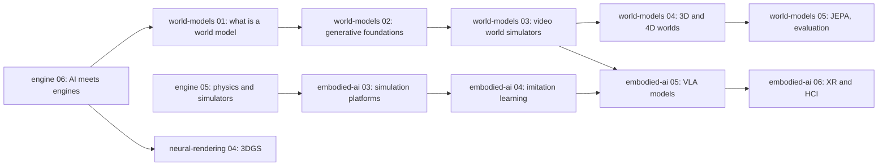

## 为什么重要

前五篇从帧循环开始一步步搭建了引擎：[架构]({{ '/blog/2026/graphics-engine-01-anatomy-of-an-engine/' | relative_url }})、[GPU API 与渲染图]({{ '/blog/2026/graphics-engine-02-gpu-apis-and-render-graphs/' | relative_url }})、[迷你引擎]({{ '/blog/2026/graphics-engine-03-build-a-mini-engine/' | relative_url }})、[生产级引擎]({{ '/blog/2026/graphics-engine-04-inside-production-engines/' | relative_url }})以及[物理与仿真]({{ '/blog/2026/graphics-engine-05-physics-and-simulation-engines/' | relative_url }})。那些图中的每个方框都是手写的代码。到了 2026 年，神经网络已经进入其中许多方框。有的已经出现在发售的游戏中，例如超分辨率和帧生成；有的正在 SDK 中逐渐成熟，例如神经材质和纹理压缩。还有一类新模型，即交互式**世界模型**（world models），它根据玩家输入生成整帧画面，底下根本没有引擎。

这最后一篇描绘这幅版图：哪些被取代了，哪些得到了辅助，哪些真正发布了，哪些仍是研究。文末把你交给[世界模型]({{ '/blog/2026/world-models-01-what-is-a-world-model/' | relative_url }})与[具身智能]({{ '/blog/2026/embodied-ai-01-robotics-foundations/' | relative_url }})系列。所有与产品有关的内容都标注为**截至 2026 年 11 月**，并引用官方来源，因为这个领域每个月都在变化。

## 前置知识

- 实时管线：G-buffer、时间性抗锯齿、光线追踪效果与降噪（[图形学第 06 篇]({{ '/blog/2026/graphics-06-real-time-ray-tracing/' | relative_url }})、[图形学第 11 篇]({{ '/blog/2026/graphics-11-real-time-rendering-techniques/' | relative_url }})）。
- 3D 高斯泼溅（[神经渲染第 04 篇]({{ '/blog/2026/neural-rendering-04-3d-gaussian-splatting/' | relative_url }})）。
- 深度学习基础：MLP、Transformer、扩散模型（[世界模型第 02 篇]({{ '/blog/2026/world-models-02-generative-modeling-foundations/' | relative_url }})）。

## 1. 光谱：从经典到神经

把每个引擎组件放到一个四级刻度上会很有帮助：

1. **经典**：手写算法（光栅化器、阴影贴图、PGS 求解器）。
2. **ML 辅助**：网络帮助一个经典阶段，但可以去掉，例如对路径追踪图像做 ML 降噪，或者基于 TAA 输入的 ML 超分。
3. **混合**：网络是管线中的一个*组件*，有工程化的接口：在着色器中解码的神经纹理、运行时在线训练的辐射缓存、与网格一起绘制的泼溅场景。
4. **完全神经**：网络*就是*引擎。它把过去的帧和动作映射为下一帧，没有显式的几何、物理或游戏逻辑。



为什么是现在？三件事同时到位。第一，**每块 GPU 都有张量硬件**：RTX 张量核心、RDNA 4 的 ML 加速器、Intel XMX 单元执行小矩阵乘法远快于着色器 ALU。第二，**像素代价之墙**：高帧率 4K 加路径追踪，每个像素的代价远超 GPU 的承受能力，于是重建像素比渲染像素更便宜。第三，**生成模型**如今能以可用的质量生成图像、视频、3D 资产和代码。本文其余部分按图中从下到上的顺序逐一讨论这些组件。

## 2. 实时引擎中的神经渲染

### 超分辨率与帧生成

**超分辨率**（super resolution）以较低的*内部*分辨率渲染（例如输出宽高的 67%，即 45% 的像素），再根据当前帧、运动矢量、深度和过去帧的历史重建输出分辨率。它就是把累积和校正步骤换成学习模型的时间性抗锯齿（TAA，见[图形学第 11 篇]({{ '/blog/2026/graphics-11-real-time-rendering-techniques/' | relative_url }})）。**帧生成**（frame generation）根据光流、运动矢量和前后两张图像，在两个渲染帧*之间*合成额外的帧。**多帧生成**（multi-frame generation）则插入多帧。

截至 2026 年 11 月的现状，来自各厂商的公告：

| 技术 | 当前版本 | 神经化的部分 | 硬件 |
| --- | --- | --- | --- |
| **NVIDIA DLSS 4**（2025 年 1 月） | 超分辨率与光线重建（Ray Reconstruction）采用 Transformer 模型；**多帧生成**（MFG）每个渲染帧最多生成 3 帧 | 超分、降噪、帧生成 | MFG：RTX 50；Transformer SR/RR：所有 RTX |
| **NVIDIA DLSS 4.5**（2026 年 1 月发布消息） | 第二代 Transformer 超分辨率；**动态 MFG** 与 **6X** 模式（最多生成 5 帧），2026 年 3 月推出；DLSS 4.5 光线重建自 2026 年 8 月起抢先体验 | 同上，模型更大 | 6X 与动态 MFG：RTX 50；SR：所有 RTX |
| **AMD FSR "Redstone"**（2025 年 12 月） | ML **超分**（原 FSR 4）、ML **帧生成**、**Ray Regeneration**（ML 降噪）以及 **Radiance Caching**（技术预览） | 超分、帧生成、降噪、神经辐射缓存 | ML 功能：RDNA 4（Radeon RX 9000）；旧 GPU 使用解析式回退方案 |
| **Intel XeSS 3**（SDK 3.0，2026 年 3 月） | 超分加多帧生成（XeSS-MFG） | 超分、帧生成 | Arc GPU |

官方来源：[DLSS 4.5 发布消息](https://www.nvidia.com/en-us/geforce/news/dlss-4-5-dynamic-multi-frame-gen-6x-2nd-gen-transformer-super-res/)、[DLSS 4.5 动态 MFG 上线](https://www.nvidia.com/en-us/geforce/news/nvidia-app-dlss-4-5-dynamic-multi-frame-generation-available-now/)、[面向开发者的 AMD FSR Redstone](https://gpuopen.com/learn/amd-fsr-redstone-developers-neural-rendering/)、[XeSS 发布页](https://github.com/intel/xess/releases)。



用一个模型最容易看清这种取舍。设 $t_n$ 为原生分辨率下渲染一帧的 GPU 时间，把它分成与分辨率无关的部分 $t_f$ 和与像素数成正比的部分。设每轴分辨率缩放为 $s$，超分代价为 $t_u$，帧生成倍数为 $k$（1 表示关闭），每个生成帧代价为 $t_g$，CPU 时间为 $t_c$（与 GPU 流水并行）：

$$
t_{\text{gpu}} = t_f + (t_n - t_f)\,s^2 + t_u + (k-1)\,t_g, \qquad t_{\text{frame}} = \max(t_{\text{gpu}}, t_c),
$$

$$
\text{fps}_{\text{shown}} = \min\!\Big(\frac{1000\,k}{t_{\text{frame}}},\ f_{\text{refresh}}\Big), \qquad
L \approx t_c + t_{\text{gpu}} + [k>1]\,t_{\text{frame}} + \tfrac{1}{2}\,\frac{1000}{\text{fps}_{\text{shown}}}.
$$

延迟 $L$（单位 ms）包括处理输入的 CPU 工作、GPU 工作、$k > 1$ 时为插值而多保留的一帧，以及平均半个显示间隔。它忽略了操作系统、显示器以及 NVIDIA Reflex 之类的技术，所以只能当作示意，而不是测量值。

**算例。** 取 $t_n = 20$ ms（原生 50 fps），$t_f = 2$ ms，$t_c = 4$ ms，$t_u = t_g = 1$ ms，不限刷新率：

- 原生，$k=1$：$t_{\text{gpu}} = 20$ ms，即 50 fps，$L = 4 + 20 + 10 = 34$ ms。
- $s = 0.67$，$k = 1$：$t_{\text{gpu}} = 2 + 18 \times 0.4489 + 1 = 11.08$ ms，即 90 fps，$L = 4 + 11.08 + 5.54 = 20.6$ ms。超分让游戏既更流畅*又*响应更快。
- $s = 0.67$，$k = 4$：$t_{\text{gpu}} = 14.08$ ms，渲染 71 fps，**显示 284 fps**，但 $L = 4 + 14.08 + 14.08 + 1.76 = 33.9$ ms，与原生 50 fps 的延迟相同。

同一个模型的 Python 版本：

```python
def frame_model(scale, k, t_native=20.0, t_fixed=2.0, t_up=1.0, t_gen=1.0, t_cpu=4.0, refresh=1e9):
    render = t_fixed + (t_native - t_fixed) * scale ** 2
    gpu = render + (t_up if scale < 0.999 else 0.0) + (k - 1) * t_gen
    frame = max(gpu, t_cpu)
    fps = min(k * 1000.0 / frame, refresh)
    latency = t_cpu + gpu + (frame if k > 1 else 0.0) + 0.5 * 1000.0 / fps
    return 1000.0 / frame, fps, latency          # rendered fps, displayed fps, latency (ms)

for scale, k in [(1.0, 1), (0.67, 1), (0.67, 4)]:
    print(scale, k, [round(v, 1) for v in frame_model(scale, k)])
```



这就是厂商把帧生成与降低延迟的技术配套使用的原因（NVIDIA Reflex；Reflex 2 的 "Frame Warp" 用最新的鼠标输入对已完成的帧做重投影，在 [NVIDIA 的页面](https://www.nvidia.com/en-us/geforce/technologies/reflex/)上仍标为即将推出）。这也是为什么建议在基础帧率已经可玩的前提下才开启帧生成。在这里亲手体验这些取舍：



### 神经辐射缓存

实时路径追踪需要多次弹射，代价太高。**神经辐射缓存**（neural radiance cache, NRC；Müller et al.，SIGGRAPH 2021）在*游戏运行时*训练一个小 MLP：少数路径追踪得更长，用来提供训练目标，网络学习出射辐射度关于位置、方向和材质的函数。其余所有路径在一两次弹射后停止，转而查询缓存。论文报告在 1080p 下每帧约 2.6 ms。它是[图形学第 06 篇]({{ '/blog/2026/graphics-06-real-time-ray-tracing/' | relative_url }})中辐照度缓存和探针的学习版亲戚。AMD FSR Redstone 中的 Radiance Caching 遵循同样的思路。

### 神经材质与神经纹理压缩

电影级的分层材质（带闪片的车漆、涂层织物、陶瓷）需要大量纹理查询和冗长的 BRDF 计算。**Real-Time Neural Appearance Models**（Zeltner et al.，SIGGRAPH 2024）用一张潜变量纹理加一个在着色器*内部*运行的小 MLP 解码器取代整个分层 BRDF。作者报告其求值速度比被近似的非神经分层材质快一个数量级以上。这是一个混合组件：引擎仍然做光栅化或光线追踪，由网络来计算材质。

**神经纹理压缩**（neural texture compression, NTC；Vaidyanathan et al.，SIGGRAPH 2023）把材质的*所有*通道（反照率、法线、粗糙度、金属度、环境光遮蔽）一起压缩。它为每个材质存储低分辨率的潜特征网格和一个极小的 MLP。着色一个像素时，着色器在该纹素的 UV 处采样潜变量并运行 MLP，一次输出所有通道。因为按纹素求值，它保留了随机访问能力，这是视频编解码器做不到的。论文中的配置为**每像素每通道 0.2 到 1.0 比特**（bits per pixel per channel, BPPC），而其块压缩（BCn）基线约为 **4 BPPC**。论文报告，与该基线相比，它能以约少 30% 的内存存储 16 倍的纹素。



**算例。** 一个 4096 × 4096、9 通道的材质有 $4096^2 \times 9 = 150{,}994{,}944$ 个通道-纹素。4 BPPC 时为 $603{,}979{,}776$ 比特 $= 72$ MiB；1.0 BPPC 时为 18 MiB；0.2 BPPC 时为 3.6 MiB。乘以几百种材质，这个差距决定了场景能否装进 8 GB 的 GPU。

```python
texels, channels = 4096 * 4096, 9
for name, bppc in [("BCn baseline", 4.0), ("NTC high", 1.0), ("NTC low", 0.2)]:
    print(f"{name:13s} {texels * channels * bppc / 8 / 2**20:6.1f} MiB")
```

代价是计算：每次纹理采样都变成一次小网络的求值。这就需要着色器中的张量核心。

### 神经着色器与 cooperative vectors：API 现状

要在像素着色器中高效运行 MLP，着色器必须把小的矩阵-向量乘交给张量单元。相关 API 仍在定型：

- **Vulkan** 有厂商扩展 **`VK_NV_cooperative_vector`**（[规范源文件](https://github.com/KhronosGroup/Vulkan-Docs/blob/main/appendices/VK_NV_cooperative_vector.adoc)），NVIDIA 的示例使用它。
- **DirectX**：微软曾为 HLSL 预览 "cooperative vectors"，但[其 2025 年 9 月的文章](https://devblogs.microsoft.com/directx/shader-model-6-9-and-the-future-of-cooperative-vector/)宣布该功能不会进入 Shader Model 6.9，而是由计划在 **Shader Model 6.10** 中提供的统一矩阵/向量（"LinAlg"）设计取代，后者目前处于预览阶段。SM 6.9 本身于 2026 年 2 月发布，包含长向量、着色器执行重排序、不透明度微贴图和 DXR 1.2。
- **NVIDIA RTX Kit**（[概览](https://developer.nvidia.com/rtx-kit)）打包了 RTX Neural Shaders 和神经纹理压缩 SDK，二者都标为 beta。[RTXNTC SDK v0.10](https://github.com/NVIDIA-RTX/RTXNTC/releases) 增加了通过 DX12 SM 6.10 路径的推理，并提醒尚不可用于发售的产品。RTX Neural Materials 被列为尚未发布。

所以截至 2026 年 11 月：神经超分和帧生成已用于数百款发售的游戏；神经材质和纹理压缩是成熟的研究，有 beta SDK，正在等待标准着色器模型的支持。

## 3. 引擎中的高斯泼溅

泼溅（[神经渲染第 04 篇]({{ '/blog/2026/neural-rendering-04-3d-gaussian-splatting/' | relative_url }})）对引擎很有吸引力，因为它通过光栅化（投影、排序、alpha 混合）渲染，运行时不需要网络。实地采集的真实场所几小时内就能变成可用于游戏的背景。主页的 [Gaussian World 演示]({{ '/' | relative_url }}#lab)用 WebGL 2 渲染泼溅，[神经渲染第 06 篇]({{ '/blog/2026/neural-rendering-06-capture-to-vr-tutorial/' | relative_url }})讲解了从采集到 VR 的完整流程。

截至 2026 年 11 月的生态：

- **标准**：Khronos 于 [2026 年 2 月](https://www.khronos.org/news/archives/khronos-announces-gltf-gaussian-splatting-extension)以候选发布版的形式公布了 glTF 扩展 **`KHR_gaussian_splatting`**；[扩展的 README](https://github.com/KhronosGroup/glTF/blob/main/extensions/2.0/Khronos/KHR_gaussian_splatting/README.md) 现在把其状态标为已批准（ratified）。Niantic 的开放格式 **SPZ**（[仓库](https://github.com/nianticlabs/spz)，MIT）比 PLY 小约 10 倍，被广泛用于压缩泼溅。
- **Web**：PlayCanvas 引擎原生渲染泼溅，包括流式加载的细节层次（LOD）；其开源编辑器 **SuperSplat**（[仓库](https://github.com/playcanvas/supersplat)）可以在浏览器中清理和编辑采集结果。**Spark**（[sparkjs.dev](https://sparkjs.dev/)，来自 World Labs）是一个基于 three.js 的泼溅渲染器，可读取 PLY、SPZ 等格式。
- **游戏引擎**：从官方说明来看，Unreal、Unity 和 Godot 都没有内置的泼溅渲染器，但有许多插件：Unity 有 Aras Pranckevičius 的 [UnityGaussianSplatting](https://github.com/aras-p/UnityGaussianSplatting)（MIT；作者表示不再积极开发）；Unreal 有 Luma、Volinga 等的插件；Godot 有社区插件。

工程上的难点是**混合渲染**：泼溅必须与网格、灯光、阴影和后处理共存。标准做法如图所示：先渲染网格的 G-buffer；投影并排序泼溅；再以网格深度做深度测试进行合成，这样角色就可以走到采集来的雕像*后面*。泼溅是预照明的（其颜色烘焙了采集时的光照），也投射不出正确的阴影。为泼溅重新打光和生成阴影是活跃的研究课题（[神经渲染第 05 篇]({{ '/blog/2026/neural-rendering-05-3dgs-frontiers/' | relative_url }})）。



## 4. 生成式内容管线

### 从图像和文本到 3D

资产制作是游戏生产中最大的成本，因此 3D 生成器备受关注。截至 2026 年 11 月的开放模型：

| 模型 | 机构 | 现状 | 输出 |
| --- | --- | --- | --- |
| **TRELLIS** | Microsoft | CVPR 2025（spotlight），[arXiv 2412.01506](https://arxiv.org/abs/2412.01506)；代码和权重为 MIT | 结构化 3D 潜变量，可解码为网格、辐射场或高斯 |
| **TRELLIS.2** | Microsoft | 预印本 [arXiv 2512.14692](https://arxiv.org/abs/2512.14692)（2025 年 12 月）；4B 参数模型 | 更高分辨率的 "O-Voxel" 结构化潜变量，带 PBR 纹理的网格 |
| **Hunyuan3D 2.0 / 2.1** | 腾讯 | [arXiv 2501.12202](https://arxiv.org/abs/2501.12202)（2025 年 1 月）；2.1（[arXiv 2506.15442](https://arxiv.org/abs/2506.15442)，2025 年 6 月）完全开源，含训练代码 | 形状模型（3.3B）+ PBR 纹理 "Paint" 模型（2.1 中为 2B） |
| **SAM 3D**（Objects、Body） | Meta | 2025 年 11 月，[arXiv 2511.16624](https://arxiv.org/abs/2511.16624)；权重采用 SAM License | 从单张图像生成 3D 物体和人体 |
| **SPAR3D** | Stability AI | 预印本 [arXiv 2501.04689](https://arxiv.org/abs/2501.04689)（2025），基于 Stable Fast 3D | 快速的单图网格生成，支持点云编辑 |

商业服务（Meshy、Tripo、Hyper3D Rodin 等）把类似模型与重拓扑、UV 展开和 PBR 烘焙封装在一起。在引擎中，真正有用的问题不是"它能生成网格吗？"，而是"它能生成**可直接用于游戏**的资产吗？"：合理三角形预算下的干净拓扑、没有重叠的 UV、不含烘焙光照的独立 PBR 贴图、正确的尺度和枢轴点、碰撞代理以及细节层次（重网格化与简化见[图形学第 08 篇]({{ '/blog/2026/graphics-08-geometry-processing/' | relative_url }})）。截至 2026 年，生成的资产可以直接用于道具、原型和背景内容，而主角资产和任何会变形的东西仍需要美术清理。

### 材质、动作与程序化生成

- **PBR 纹理与材质**：扩散模型可以从文本或照片生成可平铺的反照率、法线和粗糙度贴图（Adobe 的 Substance 3D 工具提供基于 Firefly 的文本生成纹理功能）。Hunyuan3D 的 Paint 模型和 TRELLIS.2 直接输出 PBR 贴图。
- **动作**：**MDM**（Tevet et al.，ICLR 2023，[arXiv 2209.14916](https://arxiv.org/abs/2209.14916)）等文本到动作的扩散模型生成骨骼动画，送入[第 05 篇]({{ '/blog/2026/graphics-engine-05-physics-and-simulation-engines/' | relative_url }})的动画运行时；其余内容见[图形学第 09 篇]({{ '/blog/2026/graphics-09-animation-and-characters/' | relative_url }})。
- **程序化生成 + LLM**：LLM 不直接生成几何，而是为经典的程序化系统（Houdini 节点图、Blender 脚本、关卡布局语法）编写*参数或代码*。输出保持可编辑、确定，并且在预算之内，这就是这种模式在生产中流行的原因。

## 5. 引擎与编辑器中的 LLM 智能体

**模型上下文协议**（Model Context Protocol, MCP；[由 Anthropic 于 2024 年 11 月开源](https://www.anthropic.com/news/model-context-protocol)，[规范](https://modelcontextprotocol.io/specification/2025-11-25)）让 LLM 能够调用服务器暴露的工具。*编辑器* MCP 服务器暴露创建对象、编辑组件、运行游戏、读取控制台等操作。这样智能体就能搭建场景、编写脚本、运行它、读取报错并修复。要区分官方工具和社区项目：

| 集成 | 是否官方 | 现状（2026 年 11 月） |
| --- | --- | --- |
| **Unity AI**（带 ask/plan/agent 模式的 Assistant、MCP 服务器、生成器） | 官方 | 公开测试版，Unity 6 及以上（[Unity 博客](https://unity.com/blog/unity-ai-how-to-get-started)） |
| **Unreal Engine 5.8** MCP 插件 | 官方 | 实验性（[UE 5.8 发布说明](https://dev.epicgames.com/documentation/en-us/unreal-engine/unreal-engine-5-8-release-notes)） |
| [unity-mcp](https://github.com/CoplayDev/unity-mcp)（Coplay） | 社区，与 Unity 无关联 | MIT |
| [godot-mcp](https://github.com/Coding-Solo/godot-mcp) | 社区 | MIT |
| [blender-mcp](https://github.com/ahujasid/blender-mcp) | 社区，并非 Blender 官方制作 | MIT；[Blender 基金会声明](https://www.blender.org/news/upcoming-blender-development-fund-and-ai-policies/) Blender 本身没有集成也不计划集成生成式 AI |

**AI NPC** 在*游戏运行时*运行语言模型。NVIDIA 的 ACE 技术栈（语音识别、小语言模型、文本转语音、动画）驱动了 **PUBG Ally**：一个语音控制的 AI 队友，于 [2026 年 6 月公开测试](https://www.nvidia.com/en-us/geforce/news/pubg-ally-ai-teammate-beta-available-now/)，要求显存至少 8 GB 的 RTX GPU，在本地运行语音转文本和一个 2B 参数的语言模型。NVIDIA 还发布了带 Unreal Engine 5 插件的 [ACE Game Agent SDK](https://developer.nvidia.com/blog/build-on-device-ai-companions-with-the-nvidia-ace-game-agent-sdk-and-unreal-engine-5-plugins/) beta 版。困难的工程不在模型，而在**接口**：小模型必须通过固定的工具模式调用游戏动作，保持在几百毫秒的延迟预算内，并与渲染共享 GPU。

## 6. 神经游戏引擎与交互式世界模型

在光谱的最远端，引擎被一个网络取代，它根据过去的帧和玩家的动作预测下一帧：

$$
\mathbf{o}_{t+1} \sim p_\theta\big(\mathbf{o}_{t+1} \,\big\vert\, \mathbf{o}_{t-c+1:t},\ \mathbf{a}_{t-c+1:t}\big),
$$

其中 $\mathbf{o}_t$ 是一帧（通常是自编码器的潜变量），$\mathbf{a}_t$ 是动作（按键、鼠标、相机位姿或文本），$c$ 是上下文长度。大多数模型是**自回归视频扩散**模型：扩散或流模型以过去潜变量和动作的窗口为条件，生成下一个潜变量帧，并被蒸馏到只需几步去噪以达到实时。生成机制见[世界模型第 03 篇]({{ '/blog/2026/world-models-03-video-world-simulators/' | relative_url }})，3D 一致的世界生成见[世界模型第 04 篇]({{ '/blog/2026/world-models-04-3d-and-4d-world-generation/' | relative_url }})。这里我们把它们当作*引擎*来看。



截至 2026 年 11 月（只列出来源明确给出的数字）：

| 系统 | 机构 | 现状 | 训练数据 / 控制方式 | 声明的性能 |
| --- | --- | --- | --- | --- |
| **DIAMOND** | Alonso et al. | NeurIPS 2024，[arXiv 2405.12399](https://arxiv.org/abs/2405.12399) | Atari；87 小时 CS:GO 游戏录像；键盘和鼠标 | CS:GO 模型在 RTX 3090 上约 10 fps |
| **GameNGen** | Valevski et al.（Google） | ICLR 2025，[arXiv 2408.14837](https://arxiv.org/abs/2408.14837) | DOOM，强化学习智能体的游戏录像；玩家输入 | 单个 TPU 上 20 fps |
| **Oasis** | Decart、Etched | [演示，2024 年 10 月](https://oasis-model.github.io/) | 类 Minecraft；键盘 | 20 fps |
| **Muse / WHAM** | Microsoft Research、Ninja Theory | Nature 2025，[DOI](https://doi.org/10.1038/s41586-025-08600-3) | 《Bleeding Edge》，约 7 年的游戏数据；手柄 | 300 × 180 帧；最多生成约 2 分钟 |
| **Genie 2** | Google DeepMind | [博客，2024 年 12 月](https://deepmind.google/discover/blog/genie-2-a-large-scale-foundation-world-model/) | 大规模视频数据集；键盘和鼠标 | 最长约一分钟保持一致 |
| **Genie 3** | Google DeepMind | [博客，2025 年 8 月](https://deepmind.google/discover/blog/genie-3-a-new-frontier-for-world-models/)；自 2026 年 1 月起以 "Project Genie" 向订阅用户开放 | 导航 + 文本"世界事件" | 720p、24 fps，可保持几分钟一致 |
| **Matrix-Game 2.0 / 3.0** | Skywork（昆仑万维） | [arXiv 2508.13009](https://arxiv.org/abs/2508.13009)（2025 年 8 月）；[arXiv 2604.08995](https://arxiv.org/abs/2604.08995)（2026 年 4 月） | Unreal Engine + GTA5 视频（2.0）；UE 合成数据 + 游戏 + 真实视频（3.0）；键鼠、位姿 | 2.0：25 fps；3.0：720p，最高 40 fps（5B 模型） |
| **Hunyuan-GameCraft / -2** | 腾讯 | [arXiv 2506.17201](https://arxiv.org/abs/2506.17201)（2025 年 6 月）；[arXiv 2511.23429](https://arxiv.org/abs/2511.23429)（2025 年 11 月） | 来自 100 多款 AAA 游戏的 100 万段以上录像；键鼠，文本（2） | 未说明 |
| **Yan** | 腾讯 | [arXiv 2508.08601](https://arxiv.org/abs/2508.08601)（2025 年 8 月） | 逐帧动作 + 文本编辑 | 1080p、60 fps |
| **HY-World 1.5（WorldPlay）** | 腾讯 | [arXiv 2512.14614](https://arxiv.org/abs/2512.14614)（2025 年 12 月），代码开源 | 键盘和鼠标；长时程记忆 | 720p、24 fps |
| **Dreamer 4** | Hafner、Yan、Lillicrap（Google DeepMind） | [arXiv 2509.24527](https://arxiv.org/abs/2509.24527)（2025 年 9 月） | Minecraft 离线数据；智能体完全在模型*内部*训练 | 单 GPU 实时推理 |
| **RTFM** | World Labs | [研究预览，2025 年 10 月](https://www.worldlabs.ai/blog/rtfm) | 以带位姿的帧作为空间记忆；相机 | 单个 H100 上可交互 |
| **Marble** | World Labs | [产品，2025 年 11 月](https://www.worldlabs.ai/blog/marble-world-model) | 文本、图像、视频、布局 | 导出持久的 3D 世界（泼溅、网格），而非逐帧画面 |
| **Odyssey-2 Pro / Max** | Odyssey | [Odyssey-2 Max，2026 年 4 月](https://odyssey.systems/introducing-odyssey-2-max) | 通用视频 + 交互数据 | 2 Pro：720p、22 fps |
| **Runway GWM-1 / Worlds 2** | Runway | [GWM-1，2025 年 12 月](https://runway.com/research/introducing-runway-gwm-1)；[Worlds 2，2026 年 9 月](https://runway.com/research/introducing-gwm-worlds-2) | 相机运动、文本动作 | 720p、24 fps（Worlds 2），最长 2 分钟（GWM-1） |
| **Genie 4** | Google DeepMind | [研究预览，2026 年 10 月 27 日](https://deepmind.google/blog/genie-4-a-new-generation-of-world-simulation/) | 键盘和相机，通过 Gemini 进行文本引导，原生音频 | 未说明 |



它们与本系列的引擎相比如何？

- **学到了什么**：渲染、物理、游戏规则，甚至其他玩家的行为，都从视频加动作中隐式学到。没有任何东西是手工指定的。这既是吸引力所在（只要有视频，就能得到任何世界），也是问题所在（没有任何保证）。
- **控制**：按键和鼠标映射为学习得到的动作嵌入。较新的系统加入了文本（"让它下雨"）、相机位姿或空间记忆。没有"把 3 号门设为打开"这样的 API，编辑只能通过提示或条件输入进行。
- **帧率与延迟**：实时运行需要把扩散模型蒸馏到少数几步、缓存过去的激活，并且常常依赖定制硬件（Oasis 用 Etched 的芯片，GameNGen 用 TPU）。每一帧都要做一次大型网络求值，而光栅化只要几毫秒，所以每玩家小时的能耗和服务成本仍远高于经典引擎。
- **记忆与一致性**：有限的上下文窗口意味着世界会漂移：转过身去，房间可能已经变了。补救办法包括更长的上下文、把带位姿的过去帧作为**空间记忆**检索出来（RTFM、WorldPlay），以及显式的 3D 中间表示（Marble 导出泼溅和网格，再由经典引擎渲染）。
- **失败模式**：物体变形或消失，违反物理（相互穿透、物体漂浮），长时间推演中的质量漂移，动作效果延迟或无效，以及在训练分布之外的退化。

所以 2026 年的现实图景是**融合**而不是取代。世界模型生成内容、原型和训练环境。经典引擎提供持久性、精确规则和廉价的渲染。3D 输出（泼溅、网格）是两者之间的桥梁。

## 7. 引擎作为数据工厂

引擎的最后一个角色把本系列和具身智能连接起来：为世界模型和机器人策略生成**训练数据**（[第 05 篇]({{ '/blog/2026/graphics-engine-05-physics-and-simulation-engines/' | relative_url }})第 10 节）。

- **仿真与合成数据**：带 Omniverse Replicator 的 Isaac Sim（[文档](https://docs.omniverse.nvidia.com/extensions/latest/ext_replicator.html)）、Genesis 以及第 05 篇中的 GPU 模拟器，能渲染数百万带标注的帧和机器人轨迹。Matrix-Game 3.0 明确把 Unreal Engine 的渲染结果作为其数据引擎的一部分进行训练：经典引擎如今在为神经引擎生产训练数据。
- **世界基础模型**：NVIDIA 的 **Cosmos** 平台（[Agarwal et al.，arXiv 2501.03575](https://arxiv.org/abs/2501.03575)）提供面向物理 AI 的开放视频世界模型。**Cosmos-Predict2.5** 和 **Cosmos-Transfer2.5**（[arXiv 2511.00062](https://arxiv.org/abs/2511.00062)）预测未来视频，并把模拟器的渲染结果（分割、深度、边缘）转换为照片级视频。这是用生成模型而不是更好的渲染器来弥合 sim-to-real 的*外观*差距。2026 年 5 月，NVIDIA 发布了 **Cosmos 3** 系列（[仓库](https://github.com/NVIDIA/Cosmos)）。
- **合成的机器人经验**：NVIDIA 的 [GR00T-Dreams 蓝图](https://nvidianews.nvidia.com/news/nvidia-powers-humanoid-robot-industry-with-cloud-to-robot-computing-platforms-for-physical-ai)在特定机器人上对 Cosmos 模型做后训练，从单张图像生成任务视频，并从中提取动作。**Cosmos Policy**（[arXiv 2601.16163](https://arxiv.org/abs/2601.16163)）则把视频世界模型直接微调为机器人策略。



这里就是交接点。模拟器的深入介绍见[具身智能第 03 篇]({{ '/blog/2026/embodied-ai-03-simulation-platforms/' | relative_url }})，用这些数据训练的视觉-语言-动作模型见[具身智能第 05 篇]({{ '/blog/2026/embodied-ai-05-vision-language-action-models/' | relative_url }})。

## 8. 开放问题与学习路径

截至 2026 年末的开放问题：

1. 神经引擎的**可控性与持久性**：精确的游戏状态、存档与读档、多人一致性、确定性回放。这些对第 01 篇的引擎来说很容易，对世界模型来说尚未解决。
2. **成本**：与光栅化相比，神经帧每玩家小时的能耗和服务成本；蒸馏、缓存和专用硬件。
3. **重建伪影**：帧生成中的鬼影和去遮挡错误；神经材质的时间稳定性；泼溅的重新打光与阴影。
4. 神经着色器的**标准 API**（SM 6.10 LinAlg、跨厂商的 Vulkan 扩展）和标准格式（`KHR_gaussian_splatting`、压缩泼溅扩展）。
5. **评估**：如何衡量世界模型的物理正确性和一致性，而不只是视觉质量（[世界模型第 05 篇]({{ '/blog/2026/world-models-05-jepa-evaluation-and-open-problems/' | relative_url }})）。
6. **Sim-to-real**：生成式"迁移"模型何时优于更好的渲染器？如何确保它们不会臆造物理？

从本系列的终点出发，穿过本博客的学习路径：



## 动手试试

- 上面的帧预算小部件：找出帧生成使延迟*比*原生渲染更差的设置，以及仅靠超分就能获得最佳延迟的设置。
- 主页的 [Gaussian World]({{ '/' | relative_url }}#lab) 展示了排序加混合的泼溅渲染器，第 3 节的混合管线就是把它与网格合成。
- 用 `refresh=144` 运行 `frame_model`，看看显示上限在哪里让更大的 $k$ 失去意义。

## 代表性论文

| 论文 | 发表于 | 年份 | 链接 | 意义 |
| --- | --- | --- | --- | --- |
| Müller et al., *Real-time Neural Radiance Caching for Path Tracing* | ACM TOG（SIGGRAPH） | 2021 | [arXiv](https://arxiv.org/abs/2106.12372) | 用于多次弹射全局光照的在线训练 MLP 缓存 |
| Vaidyanathan et al., *Random-Access Neural Compression of Material Textures* | ACM TOG（SIGGRAPH） | 2023 | [arXiv](https://arxiv.org/abs/2305.17105) | 0.2-1.0 BPPC 的神经纹理压缩 |
| Kerbl et al., *3D Gaussian Splatting for Real-Time Radiance Field Rendering* | ACM TOG（SIGGRAPH） | 2023 | [DOI](https://doi.org/10.1145/3592433) | 如今被引擎导入的泼溅表示 |
| Tevet et al., *Human Motion Diffusion Model* | ICLR | 2023 | [arXiv](https://arxiv.org/abs/2209.14916) | 文本到动作的扩散模型 |
| Zeltner et al., *Real-Time Neural Appearance Models* | ACM TOG（SIGGRAPH） | 2024 | [项目页](https://research.nvidia.com/labs/rtr/neural_appearance_models/) | 着色器内部的神经分层材质 |
| Alonso et al., *Diffusion for World Modeling: Visual Details Matter in Atari*（DIAMOND） | NeurIPS | 2024 | [arXiv](https://arxiv.org/abs/2405.12399) | 扩散世界模型；可玩的 CS:GO |
| Valevski et al., *Diffusion Models Are Real-Time Game Engines*（GameNGen） | ICLR | 2025 | [arXiv](https://arxiv.org/abs/2408.14837) | 由扩散模型实现的可玩 DOOM |
| Kanervisto et al., *World and Human Action Models towards gameplay ideation*（Muse / WHAM） | Nature | 2025 | [DOI](https://doi.org/10.1038/s41586-025-08600-3) | 用于玩法构思的商业游戏世界模型 |
| Xiang et al., *Structured 3D Latents for Scalable and Versatile 3D Generation*（TRELLIS） | CVPR | 2025 | [arXiv](https://arxiv.org/abs/2412.01506) | 开放的图像到 3D 基础模型 |
| Agarwal et al., *Cosmos World Foundation Model Platform for Physical AI* | arXiv | 2025 | [arXiv](https://arxiv.org/abs/2501.03575) | 面向机器人和自动驾驶的开放世界基础模型 |
| He et al., *Matrix-Game 2.0* | arXiv | 2025 | [arXiv](https://arxiv.org/abs/2508.13009) | 开放的实时交互世界模型 |
| Hafner, Yan & Lillicrap, *Training Agents Inside of Scalable World Models*（Dreamer 4） | arXiv | 2025 | [arXiv](https://arxiv.org/abs/2509.24527) | 完全在世界模型内部训练的智能体 |
| Sun et al., *WorldPlay*（HY-World 1.5） | arXiv | 2025 | [arXiv](https://arxiv.org/abs/2512.14614) | 带长时程记忆的实时世界模型 |
| Kim et al., *Cosmos Policy* | arXiv | 2026 | [arXiv](https://arxiv.org/abs/2601.16163) | 微调为机器人策略的视频世界模型 |

## 学习资源

- NVIDIA [RTX Kit](https://developer.nvidia.com/rtx-kit) 示例（神经着色器、纹理压缩）和 AMD 的 [FSR Redstone 开发者文章](https://gpuopen.com/learn/amd-fsr-redstone-developers-neural-rendering/)：实时管线中神经组件最具体的样子。
- 微软 DirectX 博客中关于 [Shader Model 6.9 与 cooperative vectors](https://devblogs.microsoft.com/directx/shader-model-6-9-and-the-future-of-cooperative-vector/) 的文章，了解 API 路线图。
- 泼溅：[SuperSplat](https://github.com/playcanvas/supersplat)、[Spark](https://sparkjs.dev/)、[UnityGaussianSplatting](https://github.com/aras-p/UnityGaussianSplatting)（可读性好、注释充分的代码）、[KHR_gaussian_splatting](https://github.com/KhronosGroup/glTF/blob/main/extensions/2.0/Khronos/KHR_gaussian_splatting/README.md) 规范。
- 生成式 3D：[TRELLIS](https://github.com/microsoft/TRELLIS) 与 [Hunyuan3D-2.1](https://github.com/Tencent-Hunyuan/Hunyuan3D-2.1) 仓库。
- 智能体：[MCP 规范](https://modelcontextprotocol.io/specification/2025-11-25)；阅读一个编辑器 MCP 服务器（如 [unity-mcp](https://github.com/CoplayDev/unity-mcp)），看看编辑器操作如何变成工具。
- 世界模型：[GameNGen](https://gamengen.github.io/) 与 [DIAMOND](https://diamond-wm.github.io/) 项目页（DIAMOND 的代码可以在本地运行）、开源的 [HY-WorldPlay](https://github.com/Tencent-Hunyuan/HY-WorldPlay) 代码，以及本站的[世界模型系列]({{ '/blog/2026/world-models-01-what-is-a-world-model/' | relative_url }})。

## 练习

1. 用 `frame_model`，对 $t_n = 30$ ms 求出 $k = 1$ 达到 60 fps 时的内部分辨率缩放，并把它的延迟与 $s = 1$、$k = 2$ 的延迟比较。
2. 给模型加上显示刷新率上限和"帧节奏"规则：只有当 $k \cdot \text{fps}_{\text{rendered}} \le f_{\text{refresh}}$ 时生成帧才有用。渲染帧率为 70 fps 时，144 Hz 下最好的 $k$ 是多少？
3. 计算一个场景的纹理内存：300 种互不相同的 2048² 材质，每种 9 个通道，分别按 4 BPPC 和 0.5 BPPC 计算。节省下来的内存能多装多少种材质？
4. 为"在某位置生成预制体"和"设置材质参数"写一个伪 MCP 工具模式（名称、描述、JSON 参数）。在执行 LLM 的调用之前，编辑器应当做哪些校验？
5. 从表中选一个世界模型，列出三个检验持久性的实验（例如：移开视线再看回来；打开一扇门并离开房间；回到起始位置）。在每种情况下，经典引擎能保证什么？

<details markdown="1"><summary>提示</summary>

1. 解 $2 + 28 s^2 + 1 = 16.7$ 得 $s$（约 $0.70$）；延迟约为 $4 + 16.7 + 8.3 = 29$ ms。$s = 1$、$k = 2$ 时：$t_{\text{gpu}} = 31$ ms，渲染 32 fps（显示 65 fps），延迟约 $4 + 31 + 31 + 7.8 \approx 74$ ms。2. $k = 2$（140 fps）；$k = 3$ 会超过刷新率，多出的帧永远不会被显示。3. $300 \times 2048^2 \times 9 \times 4 / 8$ 字节 $\approx 5.3$ GiB，对比约 $0.66$ GiB；节省的 4.6 GiB 在 0.5 BPPC 下可以多装约 2,100 种材质（每种 2.25 MiB）。4. 检查预制体是否存在、位置是否在关卡边界内、参数类型是否匹配；并要求提供撤销步骤。5. 物体身份、状态变化和位置的持久性；经典引擎把它们显式保存在场景和游戏状态中。

</details>

本系列到此结束。接下来，可以沿着[世界模型系列]({{ '/blog/2026/world-models-01-what-is-a-world-model/' | relative_url }})了解生成的一面，或者沿着[具身智能系列]({{ '/blog/2026/embodied-ai-01-robotics-foundations/' | relative_url }})了解在上一篇的引擎中学习的机器人。
