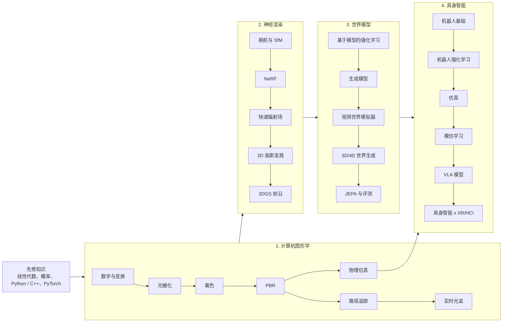

这篇文章是整个博客的地图。我是一名博士生，研究方向在**具身智能、世界模型、AR/VR、人机交互和计算机图形学**的交叉处。这些领域其实共享一条相当线性的主线：先学习图像是如何形成的（图形学），再学习如何从照片*反推*这个过程（神经渲染、3D 高斯泼溅），然后学习*预测*世界如何演化的模型（世界模型），最后把一个身体放进世界，让它行动（具身智能）。

博客按这条主线组织成四个系列。每篇文章都有中文、英文、日文三个版本，写出完整的数学推导，附上可运行的小段代码，并给出 SIGGRAPH、CVPR/ICCV/ECCV、NeurIPS/ICLR/ICML、CoRL/RSS 等顶会顶刊的代表论文链接。每个方向在仓库里还有一份整理好的阅读清单。

## 阶段 0：先修知识

不需要全部学完再开始，但这些内容迟早都会遇到：

- **线性代数**：向量、矩阵、特征分解、SVD。图形学和视觉的很多内容就是 $4\times 4$ 矩阵和最小二乘。
- **微积分与概率**：半球上的积分、期望、蒙特卡洛估计 $\hat I = \frac{1}{N}\sum_i f(x_i)/p(x_i)$、高斯分布。
- **编程**：大多数文章使用 Python（NumPy、PyTorch），渲染部分会用到一些 GLSL 和 C++。

## 阶段 1：从零开始的计算机图形学

图像是如何生成的：从坐标变换、光栅化，到基于物理的光传输和仿真。这是后面所有内容的基础——NeRF 本质上是体渲染，3DGS 是一个可微的光栅化器，机器人仿真器就是物理引擎加渲染器。

1. [学习路线与数学工具]({{ '/blog/2026/graphics-01-roadmap-and-math/' | relative_url }})
2. [光栅化]({{ '/blog/2026/graphics-02-rasterization/' | relative_url }})
3. [着色与纹理]({{ '/blog/2026/graphics-03-shading-and-textures/' | relative_url }})
4. [基于物理的渲染]({{ '/blog/2026/graphics-04-physically-based-rendering/' | relative_url }})
5. [光线追踪与路径追踪]({{ '/blog/2026/graphics-05-ray-and-path-tracing/' | relative_url }})
6. [实时光线追踪]({{ '/blog/2026/graphics-06-real-time-ray-tracing/' | relative_url }})
7. [基于物理的仿真]({{ '/blog/2026/graphics-07-physically-based-simulation/' | relative_url }})

## 阶段 2：神经渲染与 3D 高斯泼溅

把渲染过程反过来：先从照片中恢复相机，再拟合一个能复现这些照片的辐射场（NeRF）或一组 3D 高斯（3DGS）。这些表示如今是 AR/VR 三维采集以及许多 3D 世界生成系统的核心。

1. [相机与多视图几何]({{ '/blog/2026/neural-rendering-01-cameras-and-multiview-geometry/' | relative_url }})
2. [NeRF]({{ '/blog/2026/neural-rendering-02-nerf/' | relative_url }})
3. [快速辐射场]({{ '/blog/2026/neural-rendering-03-fast-radiance-fields/' | relative_url }})
4. [3D 高斯泼溅]({{ '/blog/2026/neural-rendering-04-3d-gaussian-splatting/' | relative_url }})
5. [3DGS 前沿]({{ '/blog/2026/neural-rendering-05-3dgs-frontiers/' | relative_url }})
6. [从采集到 VR：动手教程]({{ '/blog/2026/neural-rendering-06-capture-to-vr-tutorial/' | relative_url }})

## 阶段 3：世界模型

从重建世界到*预测*世界：用于规划的隐空间动力学模型，生成模型工具箱（VAE、扩散模型、流匹配、Transformer），Genie 这类视频世界模拟器，显式的 3D/4D 世界生成，以及 JEPA 所代表的预测式表征学习观点。

1. [什么是世界模型？]({{ '/blog/2026/world-models-01-what-is-a-world-model/' | relative_url }})
2. [生成模型基础]({{ '/blog/2026/world-models-02-generative-modeling-foundations/' | relative_url }})
3. [视频世界模拟器]({{ '/blog/2026/world-models-03-video-world-simulators/' | relative_url }})
4. [3D 与 4D 世界生成]({{ '/blog/2026/world-models-04-3d-and-4d-world-generation/' | relative_url }})
5. [JEPA、评测与开放问题]({{ '/blog/2026/world-models-05-jepa-evaluation-and-open-problems/' | relative_url }})

## 阶段 4：具身智能

给模型一个身体：运动学与控制、强化学习与 sim2real、仿真器、模仿学习、视觉-语言-动作模型，最后讨论具身智能如何与 XR 和人机交互结合。

1. [机器人学基础]({{ '/blog/2026/embodied-ai-01-robotics-foundations/' | relative_url }})
2. [面向机器人的强化学习]({{ '/blog/2026/embodied-ai-02-reinforcement-learning-for-robots/' | relative_url }})
3. [仿真平台]({{ '/blog/2026/embodied-ai-03-simulation-platforms/' | relative_url }})
4. [模仿学习]({{ '/blog/2026/embodied-ai-04-imitation-learning/' | relative_url }})
5. [视觉-语言-动作模型]({{ '/blog/2026/embodied-ai-05-vision-language-action-models/' | relative_url }})
6. [具身智能遇上 XR 与 HCI]({{ '/blog/2026/embodied-ai-06-embodied-ai-meets-xr-and-hci/' | relative_url }})

## 建议进度

| 阶段 | 篇数 | 建议时间 | 里程碑 |
| --- | --- | --- | --- |
| 图形学 | 7 | 4-6 周 | 写出一个软件光栅化器和一个小型路径追踪器 |
| 神经渲染 | 6 | 3-4 周 | 用自己拍摄的数据训练 3DGS，并在 VR 中查看 |
| 世界模型 | 5 | 3-4 周 | 训练一个小型隐空间动力学模型或 DDPM |
| 具身智能 | 6 | 4-6 周 | 在仿真中用示范数据训练一个策略 |

## 动手玩一玩

主页上有一个[交互实验室]({{ '/' | relative_url }}#lab)，里面的 demo 都是为这个博客写的：GPU 路径追踪器（GGX、NEE + MIS、à-trous 降噪）、*高斯世界*（可编辑、可重新打光的 3D 高斯开放世界）、XPBD 布料仿真，以及眼动追踪注视点渲染。文章中会在合适的地方链接对应的 demo。

## 按分类浏览

[图形学]({{ '/blog/category/graphics/' | relative_url }}) · [神经渲染]({{ '/blog/category/neural-rendering/' | relative_url }}) · [世界模型]({{ '/blog/category/world-models/' | relative_url }}) · [具身智能]({{ '/blog/category/embodied-ai/' | relative_url }})

我会边学边持续扩展这些系列，欢迎指正和建议。
