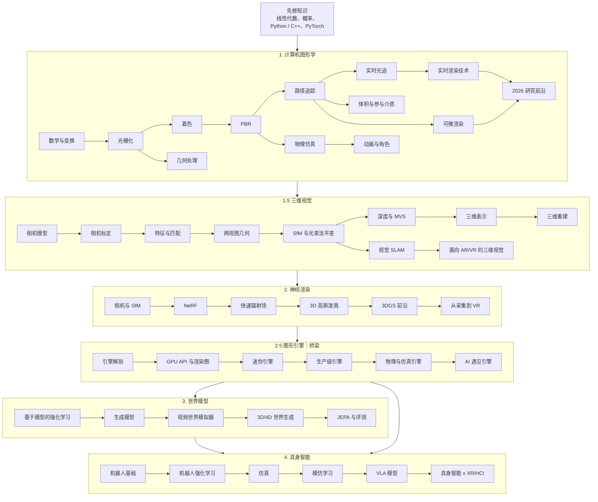

这篇文章是整个博客的地图。我是一名博士生，研究方向在**具身智能、世界模型、AR/VR、人机交互和计算机图形学**的交叉处。这些领域其实共享一条相当线性的主线：先学习图像是如何形成的（图形学），再学习如何从照片*反推*这个过程（先是三维视觉，然后是神经渲染与 3D 高斯泼溅），然后学习*预测*世界如何演化的模型（世界模型），最后把一个身体放进世界，让它行动（具身智能）。

博客按这条主线组织成六个系列，外加一个按日期更新的论文速递专栏。其中五个系列就是主线上的五个阶段；第六个系列讲图形引擎，是连接它们的桥梁，因为训练机器人的仿真器和世界模型正在演变成的神经游戏引擎，底层都是引擎。每篇文章都有中文、英文、日文三个版本，写出完整的数学推导，附上可运行的小段代码，并给出 SIGGRAPH、CVPR/ICCV/ECCV、NeurIPS/ICLR/ICML、CoRL/RSS 等顶会顶刊的代表论文链接。每个方向在仓库里还有一份整理好的阅读清单。

## 阶段 0：先修知识

不需要全部学完再开始，但这些内容迟早都会遇到：

- **线性代数**：向量、矩阵、特征分解、SVD。图形学和视觉的很多内容就是 $4\times 4$ 矩阵和最小二乘。
- **微积分与概率**：半球上的积分、期望、蒙特卡洛估计 $\hat I = \frac{1}{N}\sum_i f(x_i)/p(x_i)$、高斯分布。
- **编程**：大多数文章使用 Python（NumPy、PyTorch），渲染部分会用到一些 GLSL 和 C++。

## 阶段 1：从零开始的计算机图形学

图像是如何生成的：从坐标变换、光栅化，到基于物理的光传输和仿真。这是后面所有内容的基础——NeRF 本质上是体渲染，3DGS 是一个可微的光栅化器，机器人仿真器就是物理引擎加渲染器。第 1-7 章是核心部分。第 8-13 章进一步深入几何、动画、体积、实时渲染技术和可微渲染，最后综述 2026 年的研究前沿；你可以现在就读，也可以学完后面的阶段再回来。

1. [学习路线与数学工具]({{ '/blog/2026/graphics-01-roadmap-and-math/' | relative_url }})
2. [光栅化]({{ '/blog/2026/graphics-02-rasterization/' | relative_url }})
3. [着色与纹理]({{ '/blog/2026/graphics-03-shading-and-textures/' | relative_url }})
4. [基于物理的渲染]({{ '/blog/2026/graphics-04-physically-based-rendering/' | relative_url }})
5. [光线追踪与路径追踪]({{ '/blog/2026/graphics-05-ray-and-path-tracing/' | relative_url }})
6. [实时光线追踪]({{ '/blog/2026/graphics-06-real-time-ray-tracing/' | relative_url }})
7. [基于物理的仿真]({{ '/blog/2026/graphics-07-physically-based-simulation/' | relative_url }})
8. [几何处理：网格、曲率、平滑、细分与重建]({{ '/blog/2026/graphics-08-geometry-processing/' | relative_url }})
9. [动画与角色：样条、旋转、蒙皮、IK、运动匹配与学习型运动]({{ '/blog/2026/graphics-09-animation-and-characters/' | relative_url }})
10. [体积与参与介质：雾、烟、云、天空与皮肤]({{ '/blog/2026/graphics-10-volumes-and-participating-media/' | relative_url }})
11. [实时渲染技术：G-buffer、软阴影、AO、反射、实时全局光照与色调映射]({{ '/blog/2026/graphics-11-real-time-rendering-techniques/' | relative_url }})
12. [可微渲染与逆向渲染：穿过像素的梯度]({{ '/blog/2026/graphics-12-differentiable-and-inverse-rendering/' | relative_url }})
13. [2026 年图形学研究前沿：SIGGRAPH、SIGGRAPH Asia 与最新预印本在做什么]({{ '/blog/2026/graphics-13-research-frontiers-2026/' | relative_url }})

## 阶段 1.5：三维视觉

图形学从场景走到图像；三维视觉则反过来，从图像走回几何。给定一组照片，它恢复拍摄这些照片的相机（内参、畸变和位姿）、照片之间的对应关系，以及它们所看到的三维结构。这正是神经渲染默认已经拥有的输入：NeRF 和 3DGS 都在 COLMAP 给出的位姿上训练，3DGS 还从 SfM 点云开始。先学这一阶段，那些位姿就不再是黑箱，而是你能够计算、检验，并在采集失败时排查的东西；SLAM、世界模型和具身智能也都建立在同一套几何之上。第 1-5 篇是核心，从相机模型讲到光束法平差；第 6-10 篇把它扩展到实时跟踪、稠密深度、三维表示、三维重建和 AR/VR。

1. [成像与相机模型]({{ '/blog/2026/3d-vision-01-image-formation-and-camera-models/' | relative_url }})：齐次坐标、针孔相机 $P = K[R \mid \mathbf t]$、镜头畸变，以及 OpenCV、OpenGL、COLMAP 和 NeRF 的坐标约定。
2. [相机标定]({{ '/blog/2026/3d-vision-02-camera-calibration/' | relative_url }})：用单应矩阵和张正友方法从棋盘格估计 $K$ 和畸变，并根据重投影误差和参数不确定度判断结果是否可信。
3. [特征与匹配]({{ '/blog/2026/3d-vision-03-features-and-matching/' | relative_url }})：用角点、SIFT、ORB 和学习式匹配器在两幅图像中找到同一个点，并用 RANSAC 剔除错误匹配。
4. [两视图几何]({{ '/blog/2026/3d-vision-04-two-view-geometry/' | relative_url }})：本质矩阵与基础矩阵、相对位姿、三角化，以及从校正后的双目图像对得到深度。
5. [多视图几何与光束法平差]({{ '/blog/2026/3d-vision-05-multi-view-geometry-and-bundle-adjustment/' | relative_url }})：PnP、增量式与全局式运动恢复结构，以及借助 Schur 补的光束法平差。
6. [视觉 SLAM]({{ '/blog/2026/3d-vision-06-visual-slam/' | relative_url }})：把同样的估计放到实时系统里，包括因子图、视觉与视觉惯性里程计、回环检测和位姿图优化。
7. [深度估计与多视图立体]({{ '/blog/2026/3d-vision-07-depth-estimation-and-multi-view-stereo/' | relative_url }})：深度传感器、平面扫描与代价体、PatchMatch、学习式 MVS 和单目深度。
8. [三维表示]({{ '/blog/2026/3d-vision-08-3d-representations/' | relative_url }})：点云、网格、体素、SDF、神经场和三维高斯，它们之间如何转换，以及该选哪一种。
9. [三维重建]({{ '/blog/2026/3d-vision-09-3d-reconstruction-classic-to-feed-forward/' | relative_url }})：从经典的 SfM、MVS 与网格化流程，到神经曲面以及 DUSt3R、VGGT 等前馈模型。
10. [面向 AR/VR 的三维视觉]({{ '/blog/2026/3d-vision-10-3d-vision-for-ar-vr/' | relative_url }})：头显跟踪、运动到光子延迟、配准误差和空间锚点，也是本系列的最后一篇。

## 阶段 2：神经渲染与 3D 高斯泼溅

把渲染过程反过来：先从照片中恢复相机（阶段 1.5 会深入讲解，下面第一篇是它的浓缩回顾），再拟合一个能复现这些照片的辐射场（NeRF）或一组 3D 高斯（3DGS）。这些表示如今是 AR/VR 三维采集以及许多 3D 世界生成系统的核心。

1. [相机与多视图几何]({{ '/blog/2026/neural-rendering-01-cameras-and-multiview-geometry/' | relative_url }})
2. [NeRF]({{ '/blog/2026/neural-rendering-02-nerf/' | relative_url }})
3. [快速辐射场]({{ '/blog/2026/neural-rendering-03-fast-radiance-fields/' | relative_url }})
4. [3D 高斯泼溅]({{ '/blog/2026/neural-rendering-04-3d-gaussian-splatting/' | relative_url }})
5. [3DGS 前沿]({{ '/blog/2026/neural-rendering-05-3dgs-frontiers/' | relative_url }})
6. [从采集到 VR：动手教程]({{ '/blog/2026/neural-rendering-06-capture-to-vr-tutorial/' | relative_url }})

## 阶段 2.5：图形引擎（通往世界模型与具身智能的桥梁）

渲染器只有放进引擎里，才会变成一个智能体可以生活在其中的世界：主循环、场景数据、GPU 资源、物理和工具。这个系列把这套机制拆开来看：从引擎的整体结构和现代 GPU API，到亲手搭建一个迷你 WebGPU 引擎，再到游戏和 VR 背后的生产级引擎，以及兼作机器人仿真器的物理引擎。它的终点正是后面两个阶段的起点：机器人仿真器就是引擎，而神经游戏引擎就是世界模型。

1. [游戏引擎解剖：主循环、数据、ECS、任务系统与工具]({{ '/blog/2026/graphics-engine-01-anatomy-of-an-engine/' | relative_url }})
2. [现代 GPU API 与渲染图]({{ '/blog/2026/graphics-engine-02-gpu-apis-and-render-graphs/' | relative_url }})
3. [动手实现一个迷你引擎：浏览器中的 WebGPU、glTF、PBR、阴影与 ECS]({{ '/blog/2026/graphics-engine-03-build-a-mini-engine/' | relative_url }})
4. [走进生产级引擎：Unreal Engine 5、Unity 6、Godot 4、Bevy 及其他]({{ '/blog/2026/graphics-engine-04-inside-production-engines/' | relative_url }})
5. [物理与仿真引擎：从游戏物理到机器人模拟器]({{ '/blog/2026/graphics-engine-05-physics-and-simulation-engines/' | relative_url }})
6. [AI 遇见图形引擎：神经渲染、生成式内容与神经游戏引擎]({{ '/blog/2026/graphics-engine-06-ai-meets-graphics-engines/' | relative_url }})

## 阶段 3：世界模型

从重建世界到*预测*世界：用于规划的隐空间动力学模型，生成模型工具箱（VAE、扩散模型、流匹配、Transformer），Genie 这类视频世界模拟器，显式的 3D/4D 世界生成，以及 JEPA 所代表的预测式表征学习观点。

1. [什么是世界模型？]({{ '/blog/2026/world-models-01-what-is-a-world-model/' | relative_url }})
2. [生成模型基础]({{ '/blog/2026/world-models-02-generative-modeling-foundations/' | relative_url }})
3. [视频世界模拟器]({{ '/blog/2026/world-models-03-video-world-simulators/' | relative_url }})
4. [3D 与 4D 世界生成]({{ '/blog/2026/world-models-04-3d-and-4d-world-generation/' | relative_url }})
5. [JEPA、评测与开放问题]({{ '/blog/2026/world-models-05-jepa-evaluation-and-open-problems/' | relative_url }})

## 阶段 4：具身智能

给模型一个身体：运动学与控制、强化学习与 sim2real、仿真器、模仿学习、视觉-语言-动作模型，最后讨论具身智能如何与 XR 和人机交互结合。

1. [机器人学基础]({{ '/blog/2026/embodied-ai-01-robotics-foundations/' | relative_url }})
2. [面向机器人的强化学习]({{ '/blog/2026/embodied-ai-02-reinforcement-learning-for-robots/' | relative_url }})
3. [仿真平台]({{ '/blog/2026/embodied-ai-03-simulation-platforms/' | relative_url }})
4. [模仿学习]({{ '/blog/2026/embodied-ai-04-imitation-learning/' | relative_url }})
5. [视觉-语言-动作模型]({{ '/blog/2026/embodied-ai-05-vision-language-action-models/' | relative_url }})
6. [具身智能遇上 XR 与 HCI]({{ '/blog/2026/embodied-ai-06-embodied-ai-meets-xr-and-hci/' | relative_url }})

## 建议进度

| 阶段 | 篇数 | 建议时间 | 里程碑 |
| --- | --- | --- | --- |
| 图形学 | 13 | 8-11 周（核心第 1-7 章：4-6 周） | 写出一个软件光栅化器和一个小型路径追踪器 |
| 三维视觉 | 10 | 6-8 周（核心第 1-5 篇：3-4 周） | 标定自己的相机，并在自己拍的照片上跑一遍带光束法平差的 SfM |
| 神经渲染 | 6 | 3-4 周 | 用自己拍摄的数据训练 3DGS，并在 VR 中查看 |
| 图形引擎 | 6 | 3-5 周 | 搭建一个带渲染图的迷你 WebGPU 引擎，并对一帧做性能剖析 |
| 世界模型 | 5 | 3-4 周 | 训练一个小型隐空间动力学模型或 DDPM |
| 具身智能 | 6 | 4-6 周 | 在仿真中用示范数据训练一个策略 |

## 动手玩一玩

主页上有一个[交互实验室]({{ '/' | relative_url }}#lab)，里面的 demo 都是为这个博客写的：GPU 路径追踪器（GGX、NEE + MIS、à-trous 降噪）、*高斯世界*（可编辑、可重新打光的 3D 高斯开放世界）、XPBD 布料仿真，以及眼动追踪注视点渲染。文章中会在合适的地方链接对应的 demo。

## 跟进最新论文

各个系列讲的是基础，按日期更新的**论文速递**专栏则让它们保持最新。每一期覆盖一个固定的时间窗口，把近期论文分成六类（图形学、图形引擎与实时渲染、神经渲染、世界模型、具身智能、HCI/XR），逐篇说明它做了什么、怎么做、新在哪里，以及与本博客各系列的联系。第一期是 [2026 年 10–11 月]({{ '/blog/2026/paper-digest-01-2026-oct-nov/' | relative_url }})，收录了 2026 年 10 月 1 日至 11 月 2 日首次发布的 42 篇论文。

## 按分类浏览

[图形学]({{ '/blog/category/graphics/' | relative_url }}) · [三维视觉]({{ '/blog/category/3d-vision/' | relative_url }}) · [神经渲染]({{ '/blog/category/neural-rendering/' | relative_url }}) · [图形引擎]({{ '/blog/category/graphics-engine/' | relative_url }}) · [世界模型]({{ '/blog/category/world-models/' | relative_url }}) · [具身智能]({{ '/blog/category/embodied-ai/' | relative_url }}) · [论文速递]({{ '/blog/category/paper-digest/' | relative_url }})

我会边学边持续扩展这些系列，欢迎指正和建议。
