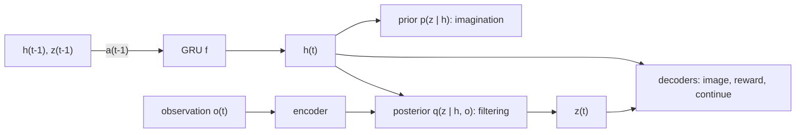

## 为什么重要

“世界模型”（world model）已经成为 AI 领域含义最泛化的术语之一：它既可以指一个“梦见” Atari 游戏画面的循环网络，也可以指 Sora 这样的视频生成器、3D 场景生成器，甚至 LeCun 所提出架构中那个抽象的预测模块。在研究大型生成式系统（本系列第 2-4 篇）之前，有必要先弄清楚这个概念的来源：**基于模型的强化学习**（model-based reinforcement learning）。在这里，世界模型只不过是一个学习得到的“预测接下来会发生什么”的预测器，用来做规划，或者“在想象中”训练策略。如果你有图形学和神经渲染的背景（参见本博客的[神经渲染系列]({{ '/blog/category/neural-rendering/' | relative_url }})），可以把世界模型理解为*从数据中学到的渲染器加模拟器*，并且可以用动作去查询它。

本文是系列的第一篇，将建立后续文章所依赖的基本词汇：MDP、Dyna、潜在动力学、PlaNet/Dreamer 中的 RSSM、想象训练，以及 MuZero 的价值等价模型。

## 前置知识

- 深度学习基础（MLP、RNN/GRU、反向传播、Adam）以及 PyTorch。
- 概率论：期望、高斯分布、KL 散度（KL divergence）。
- 了解基本的强化学习循环（状态、动作、奖励、策略）会有帮助，但不是必需的。我们会回顾所需的内容。

## 1. 我们所说的“世界模型”是什么？

这个想法比深度学习古老得多。1943 年，心理学家 Kenneth Craik 提出，人的心智中携带着一个外部现实的“小尺度模型”（small-scale model），在采取行动之前用它来尝试各种可能。在机器学习领域，Schmidhuber 在 1990 年代初关于学习可微环境模型并通过它进行规划的工作，以及 Sutton 的 Dyna 架构（1991），把这一直觉变成了算法。

一个实用的工作定义是：

> **世界模型**是一个学习得到的模型，它预测世界（中与任务相关的部分）如何演化，通常以智能体的动作为条件，并且可以通过向前推演（roll out）来回答“如果……会怎样？”这类问题。

用符号表示，最常见的形式是一个学习得到的转移分布

$$
p_\theta(s_{t+1}, r_{t} \mid s_t, a_t) \quad\text{or, from raw observations,}\quad p_\theta(o_{t+1} \mid o_{\le t}, a_{\le t}).
$$

在众多被称为“世界模型”的系统之间，可以用三个问题加以区分：

| 问题 | 选项 | 例子 |
| --- | --- | --- |
| 预测的是什么？ | 像素 / token、潜在状态、仅与任务相关的量（奖励、价值） | GameNGen（像素）、Dreamer（潜在状态）、MuZero（价值等价） |
| 是否以动作为条件？ | 是（可交互）/ 否（被动的视频预测） | Genie、UniSim（是）；无条件视频模型（否） |
| 用来做什么？ | 规划、在想象中学习策略、数据生成 / 仿真、表示学习 | MuZero（规划）、Dreamer（想象）、Cosmos（合成数据）、V-JEPA（表示） |

本文涵盖每一行中最左侧的选项：为支持控制而训练的紧凑潜在模型。第 3-4 篇将转向大型生成式模拟器，第 5 篇则借助 JEPA 回到潜在空间预测。

## 2. MDP 与基于模型的思想

### 2.1 马尔可夫决策过程

**马尔可夫决策过程**（Markov decision process, MDP）是一个元组 $(\mathcal{S}, \mathcal{A}, P, R, \gamma)$：状态、动作、转移概率 $P(s^\prime \mid s, a)$、奖励函数 $R(s, a)$ 以及折扣因子 $\gamma \in [0, 1)$。策略 $\pi(a \mid s)$ 诱导出回报 $G_t = \sum_{k \ge 0} \gamma^k r_{t+k}$，以及价值函数

$$
V^\pi(s) = \mathbb{E}_\pi\left[G_t \mid s_t = s\right], \qquad
Q^\pi(s, a) = \mathbb{E}_\pi\left[G_t \mid s_t = s, a_t = a\right].
$$

最优动作价值函数满足**贝尔曼最优方程**（Bellman optimality equation）

$$
Q^\ast(s, a) = R(s, a) + \gamma \sum_{s'} P(s' \mid s, a) \max_{a'} Q^\ast(s', a').
$$

如果我们*知道* $P$ 和 $R$，就可以用动态规划（值迭代，value iteration）求解。但真实的智能体通常并不知道它们。当智能体只能接收到无法揭示完整状态的观测 $o_t$（比如一张相机图像）时，问题就变成了**部分可观测 MDP**（partially observable MDP, POMDP）；此时智能体需要一个*信念*（belief），或者一个学习得到的潜在状态，来概括历史 $o_{\le t}, a_{\lt t}$。这正是下文 PlaNet 和 Dreamer 中循环潜在状态所扮演的角色。

下图把这一设定的两部分并排画出：产生经验的交互循环，以及画成图的一个小型 MDP。



### 2.2 无模型与基于模型

- **无模型强化学习**（model-free RL；Q-learning、PPO、SAC）直接从真实转移中学习价值函数或策略。
- **基于模型的强化学习**（model-based RL）还会额外学习 $\hat P_\theta, \hat R_\theta$，并用它们进行规划（在动作序列上搜索）或生成额外的训练数据。

基于模型的强化学习的卖点在于**样本效率**（sample efficiency）：一次观测到的转移可以通过模型“重放”许多次，而且模型还能泛化到从未访问过的状态。其经典风险是**模型误差累积**（compounding model error）：单步误差 $\epsilon$ 会在长度为 $H$ 的推演中不断放大，而针对模型优化的策略会主动寻找模型出错且过于乐观的状态（模型利用，model exploitation）。下面介绍的方法中，几乎每一个设计决策都是在抵御这两个问题。

为了用真实数字看到误差累积，我们只用 300 条随机转移训练了一个小 MLP $\hat P_\theta$ 来模拟带阻尼的单摆（状态 $(\theta, \omega)$、力矩 $u$、时间步长 0.05 s），然后让它与真实动力学并排做开环推演，结果如下图所示。





### 2.3 Dyna：学习、规划与反应

Sutton 的 **Dyna** 架构（Sutton, "Dyna, an integrated architecture for learning, planning, and reacting", SIGART Bulletin 2(4), 1991）是“在想象中训练”的范本。智能体交替进行以下步骤：

1. **行动**：在真实环境中行动，并进行一次普通的 Q-learning 更新。
2. **模型学习**：存储观测到的转移 $(s, a) \to (r, s^\prime)$。
3. **规划**：重复 $n$ 次，采样一个之前见过的 $(s, a)$，向模型询问 $(r, s^\prime)$，并在这个*模拟*的转移上做同样的 Q-learning 更新。

下图展示了这三步如何共享同一个价值函数：真实经验既直接更新 $Q$，也用来训练模型，而模型再产生额外的模拟更新。

{% include blog_figure.liquid path="assets/img/blog/world-models/01-dyna.svg" localized="true" width="85%" caption="Dyna：蓝色箭头是普通的无模型强化学习；橙色路径（先学习模型，再规划）是世界模型额外带来的部分。每个真实步做 $n$ 次规划更新，每条真实转移都会被重复利用很多次。" %}

下面是在带墙的小型网格世界上运行的表格型 Dyna-Q。用 NumPy 一秒钟就能跑完：

```python
import numpy as np

# 6x9 gridworld (Sutton & Barto's Dyna maze): S = start, G = goal, # = wall
MAZE = ["........G",
        "..#....#.",
        "S.#....#.",
        "..#....#.",
        ".....#...",
        "........."]
H, W = len(MAZE), len(MAZE[0])
ACTIONS = [(-1, 0), (1, 0), (0, -1), (0, 1)]  # up, down, left, right
start = next((r, c) for r in range(H) for c in range(W) if MAZE[r][c] == "S")

def step(s, a):
    r, c = s[0] + ACTIONS[a][0], s[1] + ACTIONS[a][1]
    if not (0 <= r < H and 0 <= c < W) or MAZE[r][c] == "#":
        r, c = s                       # bump into wall: stay
    done = MAZE[r][c] == "G"
    return (r, c), float(done), done

def dyna_q(n_planning, episodes=50, alpha=0.1, gamma=0.95, eps=0.1, seed=0):
    rng = np.random.default_rng(seed)
    Q = np.zeros((H, W, 4))
    model = {}                         # (s, a) -> (r, s', done): a deterministic learned model
    steps_per_episode = []
    for _ in range(episodes):
        s, done, n = start, False, 0
        while not done:
            if rng.random() < eps:
                a = int(rng.integers(4))
            else:                      # greedy with random tie-breaking
                q = Q[s]
                a = int(rng.choice(np.flatnonzero(q == q.max())))
            s2, r, done = step(s, a)
            # (1) direct RL update from real experience
            Q[s][a] += alpha * (r + gamma * (0.0 if done else Q[s2].max()) - Q[s][a])
            # (2) model learning
            model[(s, a)] = (r, s2, done)
            # (3) planning: replay simulated transitions from the model
            keys = list(model.keys())
            for _ in range(n_planning):
                ps, pa = keys[rng.integers(len(keys))]
                pr, ps2, pdone = model[(ps, pa)]
                target = pr + gamma * (0.0 if pdone else Q[ps2].max())
                Q[ps][pa] += alpha * (target - Q[ps][pa])
            s, n = s2, n + 1
        steps_per_episode.append(n)
    return steps_per_episode

for n in [0, 5, 50]:
    steps = dyna_q(n)
    print(f"n_planning={n:2d}  steps in episodes 2-10: {steps[1:10]}")
```

当 `n_planning=0`（即普通 Q-learning）时，智能体需要很多个回合才能把奖励传播回起点；而每走一步真实步就做 50 步规划时，只需几个回合就能找到一条短路径。这就是世界模型全部承诺的缩影：**真实数据昂贵，想象数据廉价**。后面的所有内容，都是把查找表 `model` 换成能够泛化的神经网络，把表格型 Q 换成神经网络形式的 actor 和 critic。

我们用 20 个随机种子运行了上面的脚本，结果如下图。



## 3. “World Models”（Ha & Schmidhuber, 2018）

Ha 和 Schmidhuber 的论文（[arXiv:1803.10122](https://arxiv.org/abs/1803.10122)；NeurIPS 2018 版本的标题为 "Recurrent World Models Facilitate Policy Evolution"）让这个术语流行起来，并附带了一篇令人印象深刻的交互式文章。智能体由三部分组成：

- **V（vision，视觉）**：一个 VAE，把每一帧 64x64 的图像 $o_t$ 压缩成一个小的潜变量 $z_t$（我们会在[第 2 篇]({{ '/blog/2026/world-models-02-generative-modeling-foundations/' | relative_url }})中推导 VAE）。
- **M（memory，记忆）**：一个 **MDN-RNN**（混合密度网络 RNN），把 $p(z_{t+1} \mid a_t, z_t, h_t)$ 建模为高斯混合，其中 $h_t$ 是 LSTM 的隐藏状态。
- **C（controller，控制器）**：一个很小的线性策略 $a_t = W_c [z_t; h_t] + b_c$，用进化策略 CMA-ES 训练。

下图展示了每个时间步中信息如何在这三部分之间流动。



由于几乎所有参数都集中在不需要奖励即可训练的 V 和 M 中，控制器足够小，可以用黑盒优化来训练。在 CarRacing 上，论文报告了 100 次试验的平均得分 906 $\pm$ 21；在 VizDoom 的 "Take Cover" 任务中，控制器**完全在 M 生成的梦境中**训练，然后迁移回真实游戏。这篇论文的两个教训在后来的所有工作中反复出现：

1. 学到的模型是**可被利用的**：控制器找到了对抗性策略，使怪物在梦境中永远不开火。Ha 和 Schmidhuber 通过提高 MDN 的采样**温度**（temperature）$\tau$ 来对抗这一点，让梦境更具随机性，从而更难被利用。
2. 把**表示**（V）、**动力学**（M）和**行为**（C）分开是一种强有力的分解，但用像素重建损失训练 V，会把模型容量浪费在可能与任务无关的细节上。第 5 篇会重新讨论这一批评。

## 4. PlaNet 与循环状态空间模型（RSSM）

**PlaNet**（Hafner et al., "Learning Latent Dynamics for Planning from Pixels", ICML 2019, [arXiv:1811.04551](https://arxiv.org/abs/1811.04551)）将动力学与表示*联合*学习，并直接在潜在空间中进行规划。它的关键贡献是**循环状态空间模型**（recurrent state-space model, RSSM），至今仍是 DreamerV3 的骨干。

### 4.1 为什么同时需要确定性状态和随机状态？

纯确定性的 RNN 无法表示多种可能的未来；纯随机的状态空间模型则难以在多步之间记住信息，因为每一步都会注入噪声。RSSM 把潜在状态拆分为确定性部分 $h_t$ 和随机部分 $z_t$：

$$
\begin{aligned}
\text{deterministic state:}\quad & h_t = f_\theta(h_{t-1}, z_{t-1}, a_{t-1}) \quad \text{(a GRU)}\\
\text{prior (transition):}\quad & \hat z_t \sim p_\theta(\hat z_t \mid h_t)\\
\text{posterior (representation):}\quad & z_t \sim q_\theta(z_t \mid h_t, o_t)\\
\text{decoders:}\quad & \hat o_t \sim p_\theta(o_t \mid h_t, z_t), \quad \hat r_t \sim p_\theta(r_t \mid h_t, z_t).
\end{aligned}
$$

**先验**（prior）才是真正意义上的世界模型：它在*不看*观测的情况下预测下一个潜变量，因此在想象中推演的正是它。**后验**（posterior）则是一个滤波器，它还会看当前的图像；在训练时，它告诉先验实际发生了什么。



把同一个模型沿时间展开，就得到下图：左半部分是在真实数据上滤波时的情形，右半部分是想象时的情形。



### 4.2 训练目标

RSSM 是一个序列化的 VAE。以后验作为变分分布，对观测序列的对数似然应用 Jensen 不等式（Jensen's inequality），就得到证据下界（evidence lower bound, ELBO）

$$
\ln p_\theta(o_{1:T}, r_{1:T} \mid a_{1:T})
\;\ge\;
\sum_{t=1}^{T} \Big(
\underbrace{\mathbb{E}_{q}\big[\ln p_\theta(o_t \mid h_t, z_t) + \ln p_\theta(r_t \mid h_t, z_t)\big]}_{\text{reconstruction}}
\;-\;
\underbrace{\mathbb{E}_{q}\big[\mathrm{KL}\big(q_\theta(z_t \mid h_t, o_t)\,\Vert\, p_\theta(z_t \mid h_t)\big)\big]}_{\text{make the prior predict the posterior}}
\Big).
$$

其中 KL 项最为重要：它训练转移先验仅凭过去信息去预测后验从图像中推断出的潜变量。PlaNet 还提出了**潜在超前预测**（latent overshooting），这是该 KL 项的多步版本，用于约束先验在多步之后的预测（Dreamer 后来去掉了它）。

### 4.3 用 CEM 做规划

PlaNet 没有策略网络。在每一个真实步，它都在潜在空间中运行**交叉熵方法**（cross-entropy method, CEM）：从对角高斯分布中采样 $J$ 条长度为 $H$ 的动作序列，用先验分别推演，按预测奖励之和打分，用排名前 $K$ 的序列重新拟合高斯分布，重复几次后执行均值序列的第一个动作。这就是*模型预测控制*（model-predictive control, MPC）。它是有效的，但每一步都要搜索，代价高昂，而且规划视野（planning horizon）限制了能看到多远的奖励。

下图在一个玩具问题上运行 CEM：动作序列只有两个数，因此整个搜索空间都能画出来。



## 5. Dreamer：通过潜在想象学习行为

### 5.1 DreamerV1

**Dreamer**（Hafner et al., "Dream to Control: Learning Behaviors by Latent Imagination", ICLR 2020, [arXiv:1912.01603](https://arxiv.org/abs/1912.01603)）保留了 RSSM，但用一个**完全在想象轨迹上训练的 actor-critic** 取代了在线规划。整个循环由交替进行的三个阶段组成：

1. **收集**：用当前的 actor 收集真实经验，存入回放缓冲区（replay buffer）。
2. **世界模型学习**：采样序列，用上面的 ELBO 训练 RSSM。
3. **在想象中学习行为**：以批次中的后验状态为起点，使用 actor 的动作将*先验*推演 $H = 15$ 步，预测奖励，并更新 actor 和 critic。

下图用 2.2 节的单摆模型充当世界模型，演示第 3 阶段。

{% include blog_figure.liquid path="assets/img/blog/world-models/01-imagination.svg" width="85%" caption="（时间, $\theta$, $\omega$）空间中的想象推演。黑线：一条真实轨迹。从其上的四个状态（圆点；在 Dreamer 中就是后验状态）出发，学到的模型各用五条不同的动作序列推演 $H = 15$ 步。actor 和 critic 只从这些短的想象分支中学习，而这些分支总是从真实情境出发。" %}

critic $v_\psi(s_t)$ 以 **$\lambda$-回报**（$\lambda$-returns）为训练目标。它融合了所有长度的 $n$ 步回报，从而在偏差（来自 critic）和方差（来自长模型推演）之间取得平衡：

$$
V^\lambda_t = \hat r_t + \gamma \Big( (1-\lambda)\, v_\psi(s_{t+1}) + \lambda\, V^\lambda_{t+1} \Big),
\qquad V^\lambda_H = v_\psi(s_H).
$$

把这个递推展开，就能看到 $V^\lambda$ 实际上在对哪些 $n$ 步回报取平均：



关键技巧在于 actor 的训练方式。由于世界模型、奖励头和 critic 都是可微的，Dreamer 通过**沿学到的动力学反向传播解析梯度**，传到 actor 经过重参数化的动作上，从而最大化 $\sum_t V^\lambda_t$：

$$
\max_\phi \; \mathbb{E}\Big[\sum_{t=0}^{H-1} V^\lambda_t\Big],
\qquad a_t = \pi_\phi(s_t) \text{ sampled with the reparameterization trick.}
$$

critic 能看到想象视野之外的回报，这消除了 PlaNet 规划器的主要局限。

### 5.2 DreamerV2：离散潜变量

**DreamerV2**（Hafner et al., "Mastering Atari with Discrete World Models", ICLR 2021, [arXiv:2010.02193](https://arxiv.org/abs/2010.02193)）是第一个通过在单独训练的世界模型中学习行为，在 Atari 基准上达到人类水平的智能体。起作用的是两个改动：

- **类别型潜变量**（categorical latents）：$z_t$ 是由 32 个类别变量组成的向量，每个变量有 32 个类别，采样时使用直通梯度（straight-through gradients）。类别分布可以表示多峰的下一状态分布，而且似乎比高斯分布更容易拟合。
- **KL 平衡**（KL balancing）：KL 项既训练先验向后验靠拢，又把后验向先验正则化。DreamerV2 使用停止梯度 $\mathrm{sg}(\cdot)$ 对这两个方向赋予不同的权重：

$$
\mathcal{L}_{\mathrm{KL}} = \alpha\, \mathrm{KL}\big(\mathrm{sg}(q) \,\Vert\, p\big) + (1-\alpha)\, \mathrm{KL}\big(q \,\Vert\, \mathrm{sg}(p)\big), \qquad \alpha = 0.8,
$$

这样先验可以快速学习，而表示不会被拉向一个训练得还很差的先验。

### 5.3 DreamerV3：一套超参数

**DreamerV3**（Hafner et al., "Mastering Diverse Domains through World Models", [arXiv:2301.04104](https://arxiv.org/abs/2301.04104)；以 "Mastering diverse control tasks through world models" 为题发表于 *Nature* 640, 2025, [doi:10.1038/s41586-025-08744-2](https://doi.org/10.1038/s41586-025-08744-2)）的核心是**鲁棒性**：一套配置覆盖 150 多个任务，从 Atari 到连续控制再到 Minecraft；在 Minecraft 中，它是第一个在没有人类数据和课程学习的情况下从零开始收集到钻石的算法。其主要组成部分是一些归一化技巧，可以在任何世界模型中复用：

- **Symlog 预测**：解码器和奖励头预测 $\mathrm{symlog}(x) = \mathrm{sign}(x)\ln(\lvert x\rvert + 1)$，使得尺度差异很大的目标（0.01 或 1000 的奖励）产生相近大小的梯度。其逆变换为 $\mathrm{symexp}(x) = \mathrm{sign}(x)(\exp(\lvert x\rvert) - 1)$。
- **Two-hot 离散回归**（two-hot discrete regression），用于奖励和价值：把标量目标分摊到一个固定网格（按 symexp 间隔划分）中相邻的两个桶上，并用交叉熵训练网络。这对多峰和重尾的回报很鲁棒。
- **带 free bits 的 KL**：动力学损失和表示损失在 1 nat 以下被截断，即 $\max(1, \mathrm{KL})$，权重为 $\beta_{\mathrm{dyn}} = 0.5$、$\beta_{\mathrm{rep}} = 0.1$，这样模型不会把容量浪费在已经预测得很好的潜变量上。
- **回报归一化**（return normalization），用于 actor：优势值除以 $\max(1, S)$，其中 $S$ 是回报第 5 百分位数到第 95 百分位数之间的范围，这样熵奖励在不同的奖励尺度下都有一致的含义。
- **Unimix 类别分布**：在类别分布中混入 1% 的均匀概率，以避免零概率尖峰和无穷大的 KL。

下图用具体数字展示了前两个技巧。



官方代码：[github.com/danijar/dreamerv3](https://github.com/danijar/dreamerv3)。

## 6. MuZero：只预测重要的东西

**MuZero**（Schrittwieser et al., "Mastering Atari, Go, Chess and Shogi by Planning with a Learned Model", *Nature* 588, 2020, [arXiv:1911.08265](https://arxiv.org/abs/1911.08265), [doi:10.1038/s41586-020-03051-4](https://doi.org/10.1038/s41586-020-03051-4)）采取了与 Ha & Schmidhuber 相反的观点：从不重建观测。它学习三个函数：

$$
s^0 = h_\theta(o_1, \dots, o_t), \qquad
(r^k, s^k) = g_\theta(s^{k-1}, a^k), \qquad
(\mathbf{p}^k, v^k) = f_\theta(s^k),
$$

分别是表示函数、动力学函数和预测（策略与价值）函数。隐藏状态 $s^k$ 不被强加任何语义；训练它的唯一目的，是让模型沿实际执行的动作展开 $K$ 步之后，预测的奖励、价值和策略与各自的目标相匹配：

沿着实际执行的动作展开，这三个函数构成下图中的链条。



$$
\mathcal{L}_t(\theta) = \sum_{k=0}^{K} \Big[\ell^r(u_{t+k}, r^k) + \ell^v(z_{t+k}, v^k) + \ell^p(\boldsymbol{\pi}_{t+k}, \mathbf{p}^k)\Big] + c\,\lVert\theta\rVert^2,
$$

其中 $u$ 是观测到的奖励，$z$ 是自举（bootstrapped）得到的价值目标，$\boldsymbol{\pi}$ 是在学到的模型内部运行**蒙特卡洛树搜索**（Monte Carlo tree search, MCTS）得到的访问次数分布。这样的模型被称为**价值等价**（value-equivalent）模型：它只需要在与规划相关的量上和真实环境保持一致。MuZero 在不被告知规则的情况下，在围棋、国际象棋和将棋上达到了 AlphaZero 的水平，并在当时刷新了 Atari 上的最佳成绩。

Dreamer 和 MuZero 代表了一场贯穿本系列的争论的两极：世界模型应该**重建**世界（像素，这样它也可以当作模拟器使用并供人检查），还是只**预测**决策所需的**抽象量**？第 5 篇将借助 JEPA 继续这条线索。

## 7. 其他基于模型方法的版图

| 类别 | 思想 | 代表性工作 |
| --- | --- | --- |
| 概率集成 + MPC | 用概率 MLP 集成刻画认知不确定性（epistemic uncertainty）；CEM 规划 | PETS (Chua et al., NeurIPS 2018) |
| 为无模型 RL 做短模型推演 | 从真实状态分支出短推演以限制误差累积；在其上训练 SAC | MBPO (Janner et al., NeurIPS 2019) |
| 带价值的潜在 MPC | 隐式（无解码器）潜在模型，MPPI 规划加学习的价值函数，可扩展到大量任务 | TD-MPC2 (Hansen et al., ICLR 2024) |
| Token 世界模型 | 离散自编码器 + 自回归 Transformer 作为世界模型 | IRIS (Micheli et al., ICLR 2023) |
| 扩散世界模型 | 用扩散模型预测下一帧；智能体在其内部训练 | DIAMOND (Alonso et al., NeurIPS 2024) |

IRIS 和 DIAMOND 是通往本系列其余部分的桥梁：一旦动力学模型是一个强大的**生成式**模型（自回归 Transformer、扩散模型），世界模型本身就变成了可以*玩*的东西。DIAMOND 在 Counter-Strike 游戏录像上训练的模型已经是一个小型的神经游戏引擎，是 GameNGen 和 Genie（第 3 篇）的先驱。

## 8. 代码：用 PyTorch 实现 RSSM 单步与想象推演

下面的代码片段是 Dreamer 方案在向量观测上的一个紧凑、可运行的示意实现（因此在 CPU 上几秒钟就能跑完）。它包含 RSSM（`img_step` = 先验，`obs_step` = 后验）、带 KL 平衡和 free bits 的世界模型损失、从后验状态出发的想象推演、$\lambda$-回报，以及 actor/critic 的更新。为了清晰起见，省略了 DreamerV3 的 symlog/two-hot 输出头和回报归一化。

```python
import torch
import torch.nn as nn
import torch.nn.functional as F
import torch.distributions as td

class RSSM(nn.Module):
    """Recurrent state-space model with Gaussian stochastic state (PlaNet / DreamerV1 style)."""
    def __init__(self, embed_dim, action_dim, deter=128, stoch=16, hidden=128):
        super().__init__()
        self.deter, self.stoch = deter, stoch
        self.inp = nn.Linear(stoch + action_dim, hidden)
        self.gru = nn.GRUCell(hidden, deter)
        self.prior_net = nn.Sequential(nn.Linear(deter, hidden), nn.ELU(), nn.Linear(hidden, 2 * stoch))
        self.post_net = nn.Sequential(nn.Linear(deter + embed_dim, hidden), nn.ELU(), nn.Linear(hidden, 2 * stoch))

    def initial(self, batch):
        return torch.zeros(batch, self.deter), torch.zeros(batch, self.stoch)

    @staticmethod
    def dist(stats):
        mean, std = stats.chunk(2, dim=-1)
        return td.Independent(td.Normal(mean, F.softplus(std) + 0.1), 1)

    def img_step(self, h, z, a):
        """Prior: predict the next state from the past only (used for imagination)."""
        x = F.elu(self.inp(torch.cat([z, a], -1)))
        h = self.gru(x, h)
        prior = self.dist(self.prior_net(h))
        return h, prior.rsample(), prior

    def obs_step(self, h, z, a, embed):
        """Posterior: also look at the current observation embedding (used for filtering)."""
        h, _, prior = self.img_step(h, z, a)
        post = self.dist(self.post_net(torch.cat([h, embed], -1)))
        return h, post.rsample(), post, prior

def mlp(i, o, hidden=128):
    return nn.Sequential(nn.Linear(i, hidden), nn.ELU(), nn.Linear(hidden, hidden), nn.ELU(), nn.Linear(hidden, o))

def kl_balanced(post, prior, alpha=0.8, free_nats=1.0):
    """DreamerV2-style KL balancing with free bits (detach = stop-gradient)."""
    sg = lambda d: td.Independent(td.Normal(d.base_dist.loc.detach(), d.base_dist.scale.detach()), 1)
    kl_dyn = td.kl_divergence(sg(post), prior)   # trains the prior
    kl_rep = td.kl_divergence(post, sg(prior))   # regularizes the posterior
    return alpha * kl_dyn.clamp(min=free_nats).mean() + (1 - alpha) * kl_rep.clamp(min=free_nats).mean()

def lambda_return(rewards, values, gamma=0.99, lam=0.95):
    """rewards: [H, N] for steps 0..H-1, values: [H+1, N] for states 0..H. Returns [H, N]."""
    out, last = [], values[-1]
    for t in reversed(range(rewards.shape[0])):
        last = rewards[t] + gamma * ((1 - lam) * values[t + 1] + lam * last)
        out.append(last)
    return torch.stack(out[::-1])

# ----- toy setup -----
torch.manual_seed(0)
B, T, H = 16, 32, 15                    # batch, sequence length, imagination horizon
obs_dim, act_dim, embed_dim = 64, 4, 64
rssm = RSSM(embed_dim, act_dim)
encoder, decoder = mlp(obs_dim, embed_dim), mlp(rssm.deter + rssm.stoch, obs_dim)
reward_head = mlp(rssm.deter + rssm.stoch, 1)
actor, critic = mlp(rssm.deter + rssm.stoch, 2 * act_dim), mlp(rssm.deter + rssm.stoch, 1)
wm_params = [*rssm.parameters(), *encoder.parameters(), *decoder.parameters(), *reward_head.parameters()]
wm_opt = torch.optim.Adam(wm_params, lr=3e-4)
actor_opt = torch.optim.Adam(actor.parameters(), lr=8e-5)
critic_opt = torch.optim.Adam(critic.parameters(), lr=8e-5)

# a fake replay batch: observations, previous actions, rewards
obs = torch.randn(B, T, obs_dim)
act = torch.rand(B, T, act_dim) * 2 - 1
rew = torch.randn(B, T)

def policy(feat):
    mean, std = actor(feat).chunk(2, -1)
    base = td.Normal(mean, F.softplus(std) + 1e-3)
    return torch.tanh(base.rsample()), base.entropy().sum(-1)  # reparameterized action in [-1, 1]

for it in range(3):
    # ---- 1) world-model learning: filter the sequence with the posterior ----
    h, z = rssm.initial(B)
    embed = encoder(obs)
    feats, kl = [], 0.0
    for t in range(T):
        h, z, post, prior = rssm.obs_step(h, z, act[:, t], embed[:, t])
        feats.append(torch.cat([h, z], -1))
        kl = kl + kl_balanced(post, prior)
    feats = torch.stack(feats, 1)                                   # [B, T, deter+stoch]
    recon = F.mse_loss(decoder(feats), obs)
    rew_loss = F.mse_loss(reward_head(feats).squeeze(-1), rew)
    wm_loss = recon + rew_loss + kl / T
    wm_opt.zero_grad(); wm_loss.backward(); wm_opt.step()

    # ---- 2) imagination: roll out the prior from every posterior state ----
    start = feats.detach().reshape(B * T, -1)
    h, z = start[:, :rssm.deter], start[:, rssm.deter:]
    traj, ents = [start], []
    for _ in range(H):
        a, ent = policy(traj[-1])
        h, z, _ = rssm.img_step(h, z, a)
        traj.append(torch.cat([h, z], -1))
        ents.append(ent)
    traj = torch.stack(traj)                                        # [H+1, N, F]
    rewards = reward_head(traj[1:]).squeeze(-1)                     # reward of entering s_{t+1}
    values = critic(traj).squeeze(-1)                               # [H+1, N]
    returns = lambda_return(rewards, values)                        # [H, N]

    # ---- 3) actor: maximize lambda-returns by backprop through the dynamics ----
    actor_loss = -returns.mean() - 1e-4 * torch.stack(ents).mean()
    actor_opt.zero_grad(); actor_loss.backward(); actor_opt.step()

    # ---- 4) critic: regress values of (detached) imagined states onto (detached) returns ----
    critic_loss = F.mse_loss(critic(traj[:-1].detach()).squeeze(-1), returns.detach())
    critic_opt.zero_grad(); critic_loss.backward(); critic_opt.step()
    print(f"iter {it}: wm {wm_loss.item():.3f}  actor {actor_loss.item():.3f}  critic {critic_loss.item():.3f}")
```

有几个细节值得注意：

- **想象从真实序列的后验状态出发**，因此推演从真实的情境开始，只需要在 $H$ 步内保持准确。这与 MBPO 的“短分支推演”思想相同。
- **梯度路由**：actor 损失经由 `rssm.img_step`、`reward_head` 和 `critic` 反向传播到 actor，但只有 `actor_opt` 执行更新。世界模型只由它自己的损失更新（残留的梯度会在下一次迭代中被 `wm_opt.zero_grad()` 清除），critic 也只由其回归损失更新。
- 在实际实现中，还需要预测一个**继续标志**（continue flag，即回合是否终止）来对想象回报打折，使用缓慢更新的**目标 critic**（target critic），并把 MSE 输出头替换为 DreamerV3 的 symlog/two-hot 输出头。

## 9. 小结

| | Ha & Schmidhuber | PlaNet | Dreamer V1-V3 | MuZero |
| --- | --- | --- | --- | --- |
| 潜在状态 | VAE $z$ + LSTM $h$ | RSSM | RSSM（先是高斯，后为类别型） | 抽象的 $s^k$ |
| 是否重建像素？ | 是 | 是 | 是 | 否 |
| 行为 | 在线性控制器上做进化优化（CMA-ES） | CEM 规划 | 在想象中做 actor-critic | 在模型中做 MCTS |
| 主要启示 | 策略可以在梦境中训练 | 联合学习潜在动力学 + 规划 | 带解析梯度的想象训练可以扩展 | 只需要与价值相关的预测 |

这些模型规模小、针对特定任务，并且要在每个环境中从零训练。接下来的两篇将介绍当动力学模型被互联网规模的生成模型取代后发生了什么：先介绍工具箱（VAE、tokenizer、Transformer、扩散、流匹配），再介绍 Genie 和 GameNGen 等视频世界模拟器。

## 代表性论文

| 论文 | 会议/期刊 | 年份 | 链接 | 为什么重要 |
| --- | --- | --- | --- | --- |
| Dyna, an integrated architecture for learning, planning, and reacting (Sutton) | SIGART Bulletin | 1991 | （无链接） | 在模拟经验上训练的范本 |
| World Models / Recurrent World Models Facilitate Policy Evolution (Ha, Schmidhuber) | NeurIPS | 2018 | [arXiv:1803.10122](https://arxiv.org/abs/1803.10122) | V-M-C 分解；在梦境中训练策略 |
| Deep RL in a Handful of Trials using Probabilistic Dynamics Models (PETS, Chua et al.) | NeurIPS | 2018 | [arXiv:1805.12114](https://arxiv.org/abs/1805.12114) | 面向基于模型控制的不确定性感知集成 |
| When to Trust Your Model: Model-Based Policy Optimization (MBPO, Janner et al.) | NeurIPS | 2019 | [arXiv:1906.08253](https://arxiv.org/abs/1906.08253) | 用短分支推演对抗误差累积 |
| Learning Latent Dynamics for Planning from Pixels (PlaNet, Hafner et al.) | ICML | 2019 | [arXiv:1811.04551](https://arxiv.org/abs/1811.04551) | RSSM；在潜在空间中规划 |
| Dream to Control (Dreamer, Hafner et al.) | ICLR | 2020 | [arXiv:1912.01603](https://arxiv.org/abs/1912.01603) | 在想象中做 actor-critic，梯度穿过动力学反向传播 |
| Mastering Atari with Discrete World Models (DreamerV2) | ICLR | 2021 | [arXiv:2010.02193](https://arxiv.org/abs/2010.02193) | 类别型潜变量、KL 平衡、人类水平的 Atari 表现 |
| Mastering diverse control tasks through world models (DreamerV3) | Nature | 2025 | [doi:10.1038/s41586-025-08744-2](https://doi.org/10.1038/s41586-025-08744-2) | 一套配置覆盖 150+ 个任务；Minecraft 钻石 |
| Mastering Atari, Go, Chess and Shogi by Planning with a Learned Model (MuZero) | Nature | 2020 | [arXiv:1911.08265](https://arxiv.org/abs/1911.08265) | 价值等价模型 + MCTS |
| Transformers are Sample-Efficient World Models (IRIS, Micheli et al.) | ICLR | 2023 | [arXiv:2209.00588](https://arxiv.org/abs/2209.00588) | 离散 token + Transformer 动力学 |
| TD-MPC2: Scalable, Robust World Models for Continuous Control (Hansen et al.) | ICLR | 2024 | [arXiv:2310.16828](https://arxiv.org/abs/2310.16828) | 大规模的无解码器潜在 MPC |
| Diffusion for World Modeling: Visual Details Matter in Atari (DIAMOND, Alonso et al.) | NeurIPS | 2024 | [arXiv:2405.12399](https://arxiv.org/abs/2405.12399) | 以扩散模型作为动力学模型；可玩的 CS:GO 模型 |

## 学习资源

- Sutton & Barto，*Reinforcement Learning: An Introduction*（第 2 版，2018），第 8 章 "Planning and Learning with Tabular Methods"（Dyna）：[incompleteideas.net/book/the-book-2nd.html](http://incompleteideas.net/book/the-book-2nd.html)。
- Ha & Schmidhuber 的交互式文章：[worldmodels.github.io](https://worldmodels.github.io/)。
- Danijar Hafner 的代码：[DreamerV3](https://github.com/danijar/dreamerv3)；如果想要可读性好的 PyTorch 版本，可以搜索社区复现，并与官方 JAX 代码对照。
- Hansen 等人的 [TD-MPC2 代码](https://github.com/nicklashansen/tdmpc2) 和 Alonso 等人的 [DIAMOND 代码](https://github.com/eloialonso/diamond)。
- VAE 与 ELBO 的背景知识：S. Prince，*Understanding Deep Learning*（MIT Press, 2023），可在 [udlbook.github.io/udlbook](https://udlbook.github.io/udlbook/) 免费阅读；以及斯坦福 [CS236 Deep Generative Models](https://deepgenerativemodels.github.io/)。

## 练习

1. 运行 Dyna-Q 脚本，画出 `n_planning` 取 {0, 5, 50} 时每回合的步数。然后在第 25 回合之后改变迷宫（打开一条捷径）。为什么 Dyna-Q 适应得很慢？Dyna-Q+ 的探索奖励是如何解决这个问题的？
2. 从 $\ln \int p(o_{1:T}, z_{1:T} \mid a_{1:T})\, dz_{1:T}$ 出发，使用因子分解的后验 $\prod_t q(z_t \mid h_t, o_t)$，借助 Jensen 不等式推导 4.2 节中的 RSSM ELBO。
3. 在 PyTorch 示例中，把高斯随机状态替换为 8 个各有 8 个类别的类别变量，并使用直通梯度（`one_hot + probs - probs.detach()`）。`kl_balanced` 需要做哪些改动？
4. 在 `lambda_return` 中分别设置 `lam=0` 和 `lam=1`。它们各自对应哪种估计量？各自更信任系统的哪一部分（critic 还是世界模型）？
5. MuZero 从不重建观测。当奖励非常稀疏时，请给出这一选择的一个优点和一种失效模式。

**下一篇：**[第 2 篇]({{ '/blog/2026/world-models-02-generative-modeling-foundations/' | relative_url }})将搭建构成现代世界模型的生成式工具箱：VAE、VQ tokenizer、自回归 Transformer、扩散模型与流匹配。
