# Dossier r1: GUI agents on 2D devices (phones, desktops, the web), state of the art to November 2026

Research dossier for the "3D GUI Agent" column. Working document, not a blog post.
Compiled 2026-11-24. English only. Every arXiv id in this file was checked against the arXiv API
(title and first author match) on 2026-11-24; see §1.4 for the audit method and §10 for what stays unverified.

---

## 1. Scope and search strategy

### 1.1 Questions

1. What can GUI agents on 2D screens do today (November 2026), and how far did they come from 2016?
2. How do they work: observation, grounding, planning, memory, action space, training?
3. How are they evaluated, what are the best verified scores, and how trustworthy are those numbers?
4. How do people interact with them, and what are the safety and privacy problems?
5. Which parts carry over to the 3D user interfaces of VR, AR and MR headsets and glasses, and which break?

### 1.2 Sources and queries

- **arXiv API** (`export.arxiv.org/api/query`): id lookups for the audit, title searches, date-sorted
  searches (`sortBy=submittedDate`) for 2025-2026 on "GUI agent", "computer-use agent", "mobile agent",
  "GUI grounding", "GUI agent reinforcement learning", "GUI world model", "GUI agent safety / prompt injection".
- **OpenAlex API** for venues and DOIs; arXiv comment and journal-ref fields for venue statements.
- **Official pages:** Anthropic, OpenAI, Google / DeepMind, Microsoft, Amazon, ByteDance Seed, H Company
  announcements and system cards; GitHub READMEs (Agent S, AndroidWorld, OSWorld); Hugging Face model cards.
- **Leaderboards:** OSWorld / OSWorld-Verified (osworld-v1.xlang.ai; the table is rendered by JavaScript and
  could not be read, only its banners), AndroidWorld Google sheet (read), WebArena sheet (read),
  ScreenSpot-Pro leaderboard (per-application tables only), Online-Mind2Web HF space (did not load).
- **Proceedings:** ACL Anthology, PMLR, NeurIPS, CVF, ACM DL (often 403; then OpenAlex was used).
- Seven parallel literature sweeps (pre-LLM era; mobile and desktop agents; web and commercial agents;
  grounding models; training and RL; benchmarks; HCI, safety and surveys), then a merged audit.

### 1.3 Inclusion criteria and date range

- Date range: 2016 to 2026-11-24 (pre-LLM foundations from 2016; LLM/VLM agents from 2023).
- Included: agent systems, models, datasets, benchmarks, training methods, user studies and security work
  whose object is an agent operating a graphical user interface on phone, desktop or web. Tool-only
  (API/MCP) agents only when they illuminate GUI agents (e.g. AgentDojo, hybrid GUI+API action spaces).
- Peer-reviewed venues preferred; preprints and technical reports included when they define the state of the
  art (most 2025-2026 industrial models are arXiv technical reports with no peer review, and are marked so).
- Commercial products: only with an official announcement; benchmark numbers marked "primary" (vendor page
  read) or "secondary" (press or aggregator only).

### 1.4 Verification method

- 238 arXiv ids were fetched from the arXiv API in batches; title, first author, first-version date, comment
  and journal-ref fields were compared with the claims. All 238 resolved and matched.
- Abstracts of the papers that carry the headline numbers in §4 and §6 (OSWorld, OSWorld 2.0, AndroidWorld,
  WebArena, Online-Mind2Web, ScreenSpot-Pro, Agent S3, Agent S4, UI-TARS-2, Mobile-Agent-v3 and v3.5, MAI-UI,
  MAI-Gym, Xiaomi-GUI-0, BlueLM-GUI, Qwen-UI-Agent, UFO2, Fara-7B, the online-RL generalisation study) were
  re-read directly from the API.
- Numbers deeper in papers (tables) were read by the sweep agents through HTML renderings; they are given with
  the paper as source, and the comparability caveat in §6.1 applies.
- Venue convention: "arXiv" = preprint/technical report with no venue found; "(OpenAlex)" = venue known only
  from OpenAlex; otherwise the venue appears in the paper's arXiv comment, the proceedings, or both.
- "Year" in tables = year of the first public version.

---

## 2. Map of the area

```mermaid
flowchart TD
    A[GUI agents on 2D screens] --> P[Pre-LLM foundations 2016-2022]
    A --> S[Agent systems 2023-2026]
    A --> M[Perception and grounding models]
    A --> T[Training]
    A --> E[Evaluation]
    A --> H[Humans in the loop]
    A --> X[Safety, security, privacy]

    P --> P1[UI datasets: ERICA, Rico, widget captioning, Screen2Words]
    P --> P2[UI representation models: Screen2Vec, UIBert, VUT, Spotlight, Pix2Struct]
    P --> P3[RL on UIs: World of Bits / MiniWoB, MiniWoB++, CC-Net, AndroidEnv]
    P --> P4[Accessibility and PBD automation: SUGILITE, Screen Recognition]

    S --> S1[Mobile: AppAgent, Mobile-Agent, AutoDroid, MobileGPT]
    S --> S2[Desktop / OS: UFO, Cradle, Agent S, OpenCUA]
    S --> S3[Web: MindAct, SeeAct, WebVoyager, Magentic-One]
    S --> S4[Commercial CUAs: Claude computer use, Operator / CUA, Gemini computer use]
    S --> S5[Native end-to-end agent models: UI-TARS, GUI-Owl, MAI-UI, Qwen-UI-Agent]

    M --> M1[Prompting: Set-of-Mark, OmniParser]
    M --> M2[Grounding models: SeeClick, CogAgent, Ferret-UI, UGround, OS-Atlas, GUI-Actor, UI-Venus]
    M --> M3[Input choice: screenshot vs accessibility tree vs hybrid]

    T --> T1[SFT on trajectories and synthetic data: AndroidControl, OS-Genesis, AgentTrek]
    T --> T2[RL: DigiRL, WebRL, R1-style grounding RL, multi-turn RL at scale]
    T --> T3[World models: WMA, WebDreamer, Code2World]
    T --> T4[Self-evolving agents: Mobile-Agent-E, AppAgentX, SEAgent]

    E --> E1[Offline step-wise: AITW, AndroidControl, Mind2Web]
    E --> E2[Online execution-based: AndroidWorld, OSWorld, WebArena]
    E --> E3[Grounding: ScreenSpot, -v2, -Pro, OSWorld-G]
    E --> E4[Live web and long horizon: Online-Mind2Web, OSWorld 2.0]

    H --> H1[Delegation, confirmation, pausing: Morae, confirmation scheduling]
    H --> H2[Accessibility: BLV users, older adults]
    X --> X1[Injection through the screen: EIA, pop-ups, VPI-Bench, RedTeamCUA]
    X --> X2[Harm and privacy benchmarks: OS-Harm, MobileSafetyBench, PriMobiBench]
```

**Pre-LLM foundations (2016-2022).** Two lines of work prepared the ground. HCI and mobile-systems groups
mined apps at scale (ERICA, Rico: 72k unique Android screens with view hierarchies) and learned representations
of screens and widgets (widget captioning, Screen2Vec, UIBert, Screen2Words, VUT); Google's Spotlight and
Pix2Struct showed that screenshot-only vision-language models could beat view-hierarchy models, which are often
missing or corrupted. In parallel, RL researchers built synthetic UI environments (World of Bits / MiniWoB,
MiniWoB++, AndroidEnv) and showed that pixels + keyboard/mouse policies could reach human level on
mini-tasks with enough demonstrations (CC-Net: 2.4M demonstrations). Accessibility research (SUGILITE,
Screen Recognition) contributed the idea of driving apps through, or reconstructing, accessibility metadata.
AITW (715k episodes) closed the era as the first large human device-control dataset.

**Agent systems (2023-2026).** With GPT-4 and GPT-4V, prompted "framework" agents appeared on every platform:
AppAgent, Mobile-Agent, AutoDroid and MobileGPT on Android; UFO, OS-Copilot, Cradle and Agent S on desktops;
MindAct, SeeAct, WebVoyager, Agent-E and Magentic-One on the web. Their common ingredients are a perception
front-end (accessibility tree, OCR/icon detection or Set-of-Mark labels), a planner, a grounder, reflection and
memory, and often an exploration phase that writes app documentation. From late 2024 the field moved to
**native agent models** trained end-to-end on screenshots (UI-TARS, Aguvis, OpenCUA, GUI-Owl, MAI-UI,
UI-Venus, Xiaomi-GUI-0, BlueLM-GUI, Qwen-UI-Agent) and to **commercial computer-use agents** built into
frontier models (Anthropic computer use, Oct 2024; OpenAI CUA/Operator, Jan 2025; Gemini 2.5 Computer Use,
Oct 2025; computer use merged into GPT-5.4 in Mar 2026 and into Gemini 3.5 Flash by mid-2026).

**Perception and grounding.** Grounding, mapping "the Save button" to a screen location, was the main
bottleneck in 2024 (OSWorld's authors name it as a primary failure cause). Specialised grounders (SeeClick,
CogAgent, Ferret-UI, UGround, OS-Atlas, ShowUI, Aria-UI, GUI-Actor, Jedi, UI-Venus, GTA1, Holo) and R1-style
RL raised single-pass ScreenSpot-Pro accuracy from 18.9% (Apr 2025 best at release) to about 74-77% (Aug 2026),
and above 80% with zoom-in or cascades. Pure-vision input won out over accessibility trees for general agents,
but trees remain a strong auxiliary signal where available.

**Training.** The 2025-2026 recipe is SFT on human and synthetic trajectories, then grounding RL with
rule-based rewards (needing only thousands of samples), then online multi-turn RL in thousands to tens of
thousands of parallel emulators or VMs, or on hundreds of real phones. World models (text, HTML/code or pixel
predictions of the next screen) are used for look-ahead, as RL environments and for data synthesis.

**Evaluation.** Benchmarks moved from offline step-matching (AITW, Mind2Web, AndroidControl) to online,
execution-checked tasks (AndroidWorld, OSWorld, WebArena, WindowsAgentArena) and live-web judging
(Online-Mind2Web). Several flagship benchmarks are now saturated or near human level (AndroidWorld ~100%
self-reported; OSWorld-Verified above the 72.36% human baseline since late 2025), and harder long-horizon
suites (OSWorld 2.0, best 20.6% binary) have taken over.

**Humans in the loop.** HCI work studies when the agent should pause and ask (Morae), how often users should
confirm (confirmation scheduling, CHI 2026), how users oversee and intervene, and how well agents serve
blind and low-vision users and older adults. Vendors converged on confirmations before consequential
actions, takeover for credentials and "watch mode".

**Safety, security, privacy.** Everything on the screen is an input channel: pop-ups, injected page text and
small pixel perturbations hijack agents (pop-ups: 86% attack success; adaptive visual injection beats all 21
tested defense configurations at ~92%). Benchmarks measure misuse compliance (OS-Harm), mobile harm
(MobileSafetyBench), cross-screen harm (SEAM) and screenshot privacy leakage (PriMobiBench).

---

## 3. Key works

### 3.1 Key works table

Links are arXiv abstract pages unless marked. "Relevance" is relevance to 3D GUI agents.

#### A. Pre-LLM UI understanding and UI automation (2016-2023)

| # | Title | First author et al. | Venue / status | Year | Link | Contribution (one line) | Relevance to 3D GUI agents (one line) |
|---|---|---|---|---|---|---|---|
| 1 | ERICA: Interaction Mining Mobile Apps | Deka et al. | UIST 2016 | 2016 | [doi](https://doi.org/10.1145/2984511.2984581) | Captures app UIs and interaction traces at runtime with crowd + automation | Template for mining interaction traces from XR apps |
| 2 | SUGILITE: Creating Multimodal Smartphone Automation by Demonstration | T. J.-J. Li et al. | CHI 2017 | 2017 | [doi](https://doi.org/10.1145/3025453.3025483) | Programming by demonstration via Android accessibility API plus speech | Demonstrate-once automation is natural with hand tracking |
| 3 | Rico: A Mobile App Dataset for Building Data-Driven Design Applications | Deka et al. | UIST 2017 | 2017 | [doi](https://doi.org/10.1145/3126594.3126651) | 9.7k+ apps, 72k+ unique screens with view hierarchies and traces | No XR counterpart exists; a "Rico for XR" is a gap |
| 4 | World of Bits: An Open-Domain Platform for Web-Based Agents (MiniWoB) | Shi et al. | ICML 2017 | 2017 | [PMLR](https://proceedings.mlr.press/v70/shi17a.html) | Web RL platform with keyboard/mouse actions and MiniWoB mini-tasks | Model for a synthetic 3D-UI mini-task suite |
| 5 | Reinforcement Learning on Web Interfaces Using Workflow-Guided Exploration (MiniWoB++) | E. Z. Liu et al. | ICLR 2018 | 2018 | [1802.08802](https://arxiv.org/abs/1802.08802) | Demonstration-derived workflows constrain exploration | Few-demo RL for sparse-reward 3D tasks |
| 6 | Learning to Navigate the Web | Gur et al. | ICLR 2019 | 2018 | [1812.09195](https://arxiv.org/abs/1812.09195) | Curriculum DQN plus meta-learned instruction generator | Curricula for long 3D navigation sequences |
| 7 | DOM-Q-NET: Grounded RL on Structured Language | Jia et al. | ICLR 2019 | 2019 | [1902.07257](https://arxiv.org/abs/1902.07257) | Graph network over the DOM with separate click/type heads | Same idea applies to a scene graph |
| 8 | Mapping Natural Language Instructions to Mobile UI Action Sequences (Seq2Act, PixelHelp, RicoSCA) | Y. Li et al. | ACL 2020 | 2020 | [2005.03776](https://arxiv.org/abs/2005.03776) | Instruction to phrase tuples to grounded actions; 70.59% complete match on PixelHelp | The instruction / grounding / action factorisation transfers |
| 9 | Widget Captioning | Y. Li et al. | EMNLP 2020 | 2020 | [2010.04295](https://arxiv.org/abs/2010.04295) | 162,859 captions for 61,285 UI elements | Unlabelled 3D widgets also need generated labels |
| 10 | Screen2Vec: Semantic Embedding of GUI Screens and GUI Components | T. J.-J. Li et al. | CHI 2021 | 2021 | [2101.11103](https://arxiv.org/abs/2101.11103) | Self-supervised embeddings of screens and components | Embedding spatial UI states for retrieval and memory |
| 11 | Screen Recognition: Creating Accessibility Metadata for Mobile Applications from Pixels | X. Zhang et al. | CHI 2021 (see §10) | 2021 | [2101.04893](https://arxiv.org/abs/2101.04893) | On-device detector rebuilds accessibility metadata from pixels (77,637 iOS screens) | XR apps rarely expose accessibility trees; same remedy |
| 12 | UIBert: Learning Generic Multimodal Representations for UI Understanding | Bai et al. | IJCAI 2021 | 2021 | [2107.13731](https://arxiv.org/abs/2107.13731) | Joint screenshot and view-hierarchy pretraining | Fusion of render and structure for 3D scenes |
| 13 | Screen2Words: Automatic Mobile UI Summarization with Multimodal Learning | B. Wang et al. | UIST 2021 | 2021 | [2108.03353](https://arxiv.org/abs/2108.03353) | 112k summaries of 22k screens | Summarising a spatial scene for the user or the planner |
| 14 | Screen Parsing: Towards Reverse Engineering of UI Models from Screenshots | J. Wu et al. | UIST 2021 | 2021 | [2109.08763](https://arxiv.org/abs/2109.08763) | Predicts UI hierarchy (elements and grouping) from pixels | Parsing passthrough or rendered views into a UI graph |
| 15 | AndroidEnv: A Reinforcement Learning Platform for Android | Toyama et al. | arXiv | 2021 | [2105.13231](https://arxiv.org/abs/2105.13231) | RL platform on the Android emulator with touch actions | Emulator-as-environment pattern for XR simulators |
| 16 | VUT: Versatile UI Transformer for Multi-Modal Multi-Task UI Modeling | Y. Li et al. | arXiv | 2021 | [2112.05692](https://arxiv.org/abs/2112.05692) | One model for five UI tasks | Multi-task UI model as a backbone |
| 17 | A Data-Driven Approach for Learning to Control Computers (CC-Net) | Humphreys et al. | ICML 2022 | 2022 | [2202.08137](https://arxiv.org/abs/2202.08137) | BC + RL from pixels and DOM; human-level mean on MiniWoB++ with 2.4M demos | Shows the data scale pixel-level control needed |
| 18 | A Dataset for Interactive Vision-Language Navigation with Unknown Command Feasibility (MoTIF) | Burns et al. | ECCV 2022 | 2022 | [2202.02312](https://arxiv.org/abs/2202.02312) | Mobile tasks where the command may be infeasible | Agents must say "cannot be done here" |
| 19 | WebShop: Towards Scalable Real-World Web Interaction with Grounded Language Agents | Yao et al. | NeurIPS 2022 | 2022 | [2207.01206](https://arxiv.org/abs/2207.01206) | 1.18M-product simulated shop; best agent 29% vs human expert 59% | Simulated-but-realistic environment design |
| 20 | META-GUI: Towards Multi-modal Conversational Agents on Mobile GUI | L. Sun et al. | EMNLP 2022 | 2022 | [2205.11029](https://arxiv.org/abs/2205.11029) | Dialogue plus GUI-operation dataset | Conversational control of a spatial UI |
| 21 | UGIF: UI Grounded Instruction Following | Gubbi Venkatesh et al. | arXiv | 2022 | [2211.07615](https://arxiv.org/abs/2211.07615) | Multilingual how-to instructions to UI action sequences | Guiding mode: show the user the steps |
| 22 | Spotlight: Mobile UI Understanding using Vision-Language Models with a Focus | G. Li et al. | ICLR 2023 | 2022 | [2209.14927](https://arxiv.org/abs/2209.14927) | Screenshot-only ViT + T5 with a focus region; beats view-hierarchy models | "Focus region" maps to gaze-selected region |
| 23 | Pix2Struct: Screenshot Parsing as Pretraining for Visual Language Understanding | K. Lee et al. | ICML 2023 | 2022 | [2210.03347](https://arxiv.org/abs/2210.03347) | Pretraining on masked screenshot to simplified HTML (~80M pairs) | Render-to-structure pretraining for 3D UIs |
| 24 | ScreenQA: Large-Scale Question-Answer Pairs over Mobile App Screenshots | Hsiao et al. | NAACL 2025 | 2022 | [2209.08199](https://arxiv.org/abs/2209.08199) | Screen question answering | Answering "where is X" in a scene |
| 25 | Enabling Conversational Interaction with Mobile UI using Large Language Models | B. Wang et al. | CHI 2023 | 2022 | [2209.08655](https://arxiv.org/abs/2209.08655) | First LLM prompting study on four mobile-UI conversation tasks | Bridge from UI understanding to LLM agents |
| 26 | Android in the Wild: A Large-Scale Dataset for Android Device Control (AITW) | Rawles et al. | NeurIPS 2023 D&B | 2023 | [2307.10088](https://arxiv.org/abs/2307.10088) | 715,142 episodes, 30,378 prompts, gesture-level actions | Gesture-level action logging is the model for XR traces |

#### B. LLM / VLM agents on mobile phones

| # | Title | First author et al. | Venue / status | Year | Link | Contribution (one line) | Relevance to 3D GUI agents (one line) |
|---|---|---|---|---|---|---|---|
| 27 | DroidBot-GPT: GPT-powered UI Automation for Android | Wen et al. | arXiv | 2023 | [2304.07061](https://arxiv.org/abs/2304.07061) | First GPT prompting over UI-state text; 39.39% of tasks completed | Text-serialised UI state is the simplest baseline |
| 28 | AutoDroid: LLM-powered Task Automation in Android | Wen et al. | MobiCom 2024 | 2023 | [2308.15272](https://arxiv.org/abs/2308.15272) | Offline exploration builds UI-transition memory; 71.3% on DroidTask, -51.7% query cost | Pre-exploring an XR app to build a UI graph |
| 29 | You Only Look at Screens: Multimodal Chain-of-Action Agents (Auto-GUI) | Z. Zhang et al. | Findings ACL 2024 | 2023 | [2309.11436](https://arxiv.org/abs/2309.11436) | Screenshot-only agent with chain-of-action history | No reliance on view hierarchy |
| 30 | GPT-4V in Wonderland: LMMs for Zero-Shot Smartphone GUI Navigation (MM-Navigator) | A. Yan et al. | arXiv | 2023 | [2311.07562](https://arxiv.org/abs/2311.07562) | Early GPT-4V phone navigation with marks | Zero-shot VLM baseline |
| 31 | Explore, Select, Derive, and Recall (MobileGPT) | S. Lee et al. | MobiCom 2024 (OpenAlex) | 2023 | [2312.03003](https://arxiv.org/abs/2312.03003) | Hierarchical app memory of reusable sub-tasks | Reusable sub-task memory across XR sessions |
| 32 | AppAgent: Multimodal Agents as Smartphone Users | C. Zhang et al. | CHI 2025 | 2023 | [2312.13771](https://arxiv.org/abs/2312.13771) | Exploration or demonstration writes per-app element docs; 73.3% / 84.4% success | Exploration phase for unfamiliar 3D apps |
| 33 | AutoTask: Executing Arbitrary Voice Commands by Exploring and Learning from Mobile GUI | Pan et al. | arXiv | 2023 | [2312.16062](https://arxiv.org/abs/2312.16062) | Voice-command agent that explores and backtracks | Voice is a primary XR input |
| 34 | Mobile-Agent: Autonomous Multi-Modal Mobile Device Agent with Visual Perception | J. Wang et al. | ICLR 2024 Workshop | 2024 | [2401.16158](https://arxiv.org/abs/2401.16158) | Screenshot-only perception with OCR and icon detection | Vision-only perception, no system metadata |
| 35 | Android in the Zoo: Chain-of-Action-Thought for GUI Agents (AitZ) | J. Zhang et al. | arXiv | 2024 | [2403.02713](https://arxiv.org/abs/2403.02713) | Chain-of-action-thought annotations on AITW-derived data | Explicit action-outcome reasoning |
| 36 | Prompt2Task: Automating UI Tasks on Smartphones from Textual Prompts | T. Huang et al. | ACM TOCHI 2025 | 2024 | [2404.02475](https://arxiv.org/abs/2404.02475) | Prompt-to-task automation with user interventions | Intervention design |
| 37 | Mobile-Agent-v2: Effective Navigation via Multi-Agent Collaboration | J. Wang et al. | NeurIPS 2024 (OpenAlex) | 2024 | [2406.01014](https://arxiv.org/abs/2406.01014) | Planning, decision and reflection agents plus memory; 75.0% vs 43.2% (v1) | Reflection agent checks each action's effect |
| 38 | MobileExperts: A Dynamic Tool-Enabled Agent Team in Mobile Devices | J. Zhang et al. | arXiv | 2024 | [2407.03913](https://arxiv.org/abs/2407.03913) | Expert agent team with tool creation | Tool creation for repeated spatial edits |
| 39 | AppAgent v2: Advanced Agent for Flexible Mobile Interactions | Y. Li et al. | arXiv | 2024 | [2408.11824](https://arxiv.org/abs/2408.11824) | Structured knowledge base with flexible actions | Knowledge base of app affordances |
| 40 | MobA: Multifaceted Memory-Enhanced Adaptive Planning for Efficient Mobile Task Automation | Z. Zhu et al. | NAACL 2025 Demo | 2024 | [2410.13757](https://arxiv.org/abs/2410.13757) | Two-level planner and executor with memory | Global planner / local executor split |
| 41 | AutoGLM: Autonomous Foundation Agents for GUIs | X. Liu et al. | arXiv | 2024 | [2411.00820](https://arxiv.org/abs/2411.00820) | Web and Android agent; AndroidLab 36.2%, VAB-WebArena-Lite 55.2% | Industrial phone agent with curriculum RL |
| 42 | AutoDroid-V2: Boosting SLM-based GUI Agents via Code Generation | Wen et al. | arXiv | 2024 | [2412.18116](https://arxiv.org/abs/2412.18116) | On-device small LM writes scripts run by an interpreter | On-device execution on headset compute budgets |
| 43 | Mobile-Agent-E: Self-Evolving Mobile Assistant for Complex Tasks | Z. Wang et al. | arXiv | 2025 | [2501.11733](https://arxiv.org/abs/2501.11733) | Hierarchical agents with evolved Tips and Shortcuts; +22% on Mobile-Eval-E | Learned shortcuts for repeated spatial workflows |
| 44 | AppAgentX: Evolving GUI Agents as Proficient Smartphone Users | W. Jiang et al. | arXiv | 2025 | [2503.02268](https://arxiv.org/abs/2503.02268) | Compresses repeated action chains into shortcut actions | Macro-actions shorten long 3D sequences |
| 45 | LLM-Explorer: Towards Efficient and Affordable LLM-based Exploration for Mobile Apps | S. Zhao et al. | MobiCom 2025 | 2025 | [2505.10593](https://arxiv.org/abs/2505.10593) | Cheap exploration, LLM used sparingly (>148x cheaper) | Cheap exploration of 3D apps |
| 46 | Mobile-Agent-v3: Fundamental Agents for GUI Automation (GUI-Owl) | J. Ye et al. | arXiv | 2025 | [2508.15144](https://arxiv.org/abs/2508.15144) | Native GUI-Owl model plus multi-agent framework; AndroidWorld 73.3, OSWorld 37.7 | Cross-platform cloud environment and RL |
| 47 | ColorAgent: Building a Robust, Personalized, and Interactive OS Agent | N. Li et al. | arXiv | 2025 | [2510.19386](https://arxiv.org/abs/2510.19386) | Step-wise RL plus multi-agent framework; AndroidWorld 77.2% | Personalisation and interaction |
| 48 | MAI-UI Technical Report: Real-World Centric Foundation GUI Agents | H. Zhou et al. | arXiv | 2025 | [2512.22047](https://arxiv.org/abs/2512.22047) | Device-cloud collaboration, user interaction and MCP in the action space; AndroidWorld 76.7 | Device-cloud split matches headset + phone/cloud |
| 49 | Mobile-Agent-v3.5: Multi-platform Fundamental GUI Agents (GUI-Owl-1.5) | H. Xu et al. | arXiv | 2026 | [2602.16855](https://arxiv.org/abs/2602.16855) | 2B-235B open models; OSWorld 56.5, AndroidWorld 71.6, ScreenSpot-Pro 80.3 | Open multi-platform base for an XR port |
| 50 | Do Multi-Agents Dream of Electric Screens? 100% on AndroidWorld (Minitap mobile-use) | Favreau et al. | NeurIPS 2026 workshop | 2026 | [2602.07787](https://arxiv.org/abs/2602.07787) | Five-role multi-agent system; pass@3 100%, pass^3 94.0% on held-out seeds | Shows AndroidWorld is saturated; reliability metrics |
| 51 | ClawMobile: Rethinking Smartphone-Native Agentic Systems | H. Du et al. | EuroMLSys 2026 | 2026 | [2602.22942](https://arxiv.org/abs/2602.22942) | Separates LLM reasoning from deterministic control | Deterministic low-level control for 6-DoF actions |
| 52 | MobileExplorer: Accelerating On-Device Inference for Mobile GUI Agents | R. Huang et al. | arXiv | 2026 | [2605.26546](https://arxiv.org/abs/2605.26546) | Explores in parallel while the VLM reasons; -23% latency | Hiding latency on-device |
| 53 | Xiaomi-GUI-0 Technical Report | W. Cao et al. | arXiv | 2026 | [2606.31410](https://arxiv.org/abs/2606.31410) | Real-device closed-loop training; AndroidWorld 78.9%, RealMobile 72.0% | Real-device training loop |
| 54 | Qwen-UI-Agent Technical Report | H. Zhou et al. | arXiv | 2026 | [2607.28227](https://arxiv.org/abs/2607.28227) | GUI + CLI action space, >10,000 concurrent RL environments; OSWorld-Verified 79.5 | Hybrid GUI + API action space |
| 55 | BlueLM-GUI Technical Report | T. Ye et al. | arXiv | 2026 | [2609.12394](https://arxiv.org/abs/2609.12394) | 35B-A3B agent, agentic RL on hundreds of real phones; AndroidWorld 84.9 | Real-hardware RL farms |
| 56 | MAPLE: A Multimodal Mobile Agent with Playbook-Learned Experience | J. Wang et al. | arXiv | 2026 | [2611.01351](https://arxiv.org/abs/2611.01351) | Gradient-free shared experience playbook | Experience sharing across users and apps |

#### C. Desktop and operating-system agents

| # | Title | First author et al. | Venue / status | Year | Link | Contribution (one line) | Relevance to 3D GUI agents (one line) |
|---|---|---|---|---|---|---|---|
| 57 | UFO: A UI-Focused Agent for Windows OS Interaction | C. Zhang et al. | arXiv | 2024 | [2402.07939](https://arxiv.org/abs/2402.07939) | HostAgent / AppAgent pair over Windows UI Automation | OS-level accessibility API as the observation |
| 58 | OS-Copilot: Towards Generalist Computer Agents with Self-Improvement (FRIDAY) | Z. Wu et al. | arXiv | 2024 | [2402.07456](https://arxiv.org/abs/2402.07456) | Self-improving agent with a tool library | Tool growth over time |
| 59 | ScreenAgent: A Vision Language Model-driven Computer Control Agent | Niu et al. | IJCAI 2024 | 2024 | [2402.07945](https://arxiv.org/abs/2402.07945) | VLM controls a PC via VNC; plan-act-reflect | Remote-desktop control pattern |
| 60 | Cradle: Empowering Foundation Agents Towards General Computer Control | W. Tan et al. | arXiv | 2024 | [2403.03186](https://arxiv.org/abs/2403.03186) | Screen + keyboard/mouse only, including 3D games (Red Dead Redemption 2) | Closest 2D-era evidence on 3D scenes and camera control |
| 61 | Agent S: An Open Agentic Framework that Uses Computers Like a Human | Agashe et al. | ICLR 2025 | 2024 | [2410.08164](https://arxiv.org/abs/2410.08164) | Experience-augmented hierarchical planning plus Agent-Computer Interface | ACI concept: design the interface for the agent |
| 62 | Windows Agent Arena (introduces Navi) | Bonatti et al. | ICML 2025 (OpenAlex) | 2024 | [2409.08264](https://arxiv.org/abs/2409.08264) | 154-task Windows benchmark; Navi 19.5% vs human 74.5% | Parallel VM evaluation in the cloud |
| 63 | PC-Agent: Hierarchical Multi-Agent Collaboration for PC Tasks | H. Liu et al. | arXiv | 2025 | [2502.14282](https://arxiv.org/abs/2502.14282) | Manager / progress / decision agents; active perception | Active perception: look closer before acting |
| 64 | Agent S2: A Compositional Generalist-Specialist Framework | Agashe et al. | COLM 2025 (README) | 2025 | [2504.00906](https://arxiv.org/abs/2504.00906) | Mixture-of-Grounding plus proactive hierarchical planning | Specialist grounders per target type |
| 65 | UFO2: The Desktop AgentOS | C. Zhang et al. | arXiv | 2025 | [2504.14603](https://arxiv.org/abs/2504.14603) | Unified GUI-API actions, UIA + vision detection, Picture-in-Picture desktop | Agent works in a separate space while the user keeps theirs |
| 66 | GTA1: GUI Test-time Scaling Agent | Y. Yang et al. | ICLR 2026 (OpenAlex) | 2025 | [2507.05791](https://arxiv.org/abs/2507.05791) | Sample several plans, judge picks, RL grounder | Test-time scaling for ambiguous 3D targets |
| 67 | CoAct-1: Computer-using Multi-Agent System with Coding Actions | L. Song et al. | arXiv | 2025 | [2508.03923](https://arxiv.org/abs/2508.03923) | Orchestrator chooses GUI operator or programmer; OSWorld 60.76% | Bypassing hard GUI steps through code/APIs |
| 68 | OpenCUA: Open Foundations for Computer-Use Agents | X. Wang et al. | NeurIPS 2025 (OpenAlex) | 2025 | [2508.09123](https://arxiv.org/abs/2508.09123) | AgentNet data (3 OSes, 200+ apps), annotation tool, open models; 45.0% OSWorld-Verified | Open recipe and annotation tool to copy for XR |
| 69 | Scaling Agents for Computer Use (Agent S3, Behavior Best-of-N) | Gonzalez-Pumariega et al. | TMLR 2026 (OpenAlex) | 2025 | [2510.02250](https://arxiv.org/abs/2510.02250) | Multiple rollouts compared as behaviour narratives; OSWorld 72.6% > human 72.36% | Rollout selection needs resettable environments |
| 70 | Surfer 2: The Next Generation of Cross-Platform Computer Use Agents | Andreux et al. | arXiv | 2025 | [2510.19949](https://arxiv.org/abs/2510.19949) | One agent across web, desktop, Android | Cross-platform evidence |
| 71 | UFO3: Weaving the Digital Agent Galaxy | C. Zhang et al. | arXiv | 2025 | [2511.11332](https://arxiv.org/abs/2511.11332) | Orchestration across Windows, Linux and Android devices | Headset + phone + PC as one agent space |
| 72 | Evolving Agent Interfaces (Agent S4) | Agashe et al. | arXiv | 2026 | [2610.28601](https://arxiv.org/abs/2610.28601) | Meta-agent evolves its own interfaces; OSWorld V2 21.3% with a 27B open model | Agent-made interfaces instead of human GUIs |

#### D. Web agents

| # | Title | First author et al. | Venue / status | Year | Link | Contribution (one line) | Relevance to 3D GUI agents (one line) |
|---|---|---|---|---|---|---|---|
| 73 | WebGPT: Browser-assisted Question-Answering with Human Feedback | Nakano et al. | arXiv | 2021 | [2112.09332](https://arxiv.org/abs/2112.09332) | GPT-3 drives a text browser; imitation + human feedback | Text-only browsing ancestor |
| 74 | Mind2Web: Towards a Generalist Agent for the Web (MindAct) | X. Deng et al. | NeurIPS 2023 D&B | 2023 | [2306.06070](https://arxiv.org/abs/2306.06070) | 2,000+ tasks on 137 sites; small LM filters HTML for the LLM | Candidate filtering before grounding |
| 75 | A Real-World WebAgent with Planning, Long Context Understanding, and Program Synthesis | Gur et al. | ICLR 2024 | 2023 | [2307.12856](https://arxiv.org/abs/2307.12856) | HTML-T5 planner/summariser + Flan-U-PaLM program synthesis | Programs as actions |
| 76 | GPT-4V(ision) is a Generalist Web Agent, if Grounded (SeeAct) | B. Zheng et al. | ICML 2024 | 2024 | [2401.01614](https://arxiv.org/abs/2401.01614) | Separates action generation and grounding; 51.1% live with oracle grounding vs 37.8% best practical | Grounding is the bottleneck |
| 77 | WebVoyager: Building an End-to-End Web Agent with Large Multimodal Models | H. He et al. | ACL 2024 | 2024 | [2401.13919](https://arxiv.org/abs/2401.13919) | Set-of-Mark screenshots on live sites; 59.1%; GPT-4V judge | Live evaluation with a VLM judge |
| 78 | WILBUR: Adaptive In-Context Learning for Robust and Accurate Web Agents | Lutz et al. | arXiv | 2024 | [2404.05902](https://arxiv.org/abs/2404.05902) | Adaptive demonstration retrieval and backtracking | Backtracking when an action fails |
| 79 | Tree Search for Language Model Agents | Koh et al. | TMLR 2025 (OpenAlex) | 2024 | [2407.01476](https://arxiv.org/abs/2407.01476) | Best-first search at inference; VisualWebArena 26.4% | Search needs undo, which 3D world state may lack |
| 80 | Agent-E: From Autonomous Web Navigation to Foundational Design Principles | Abuelsaad et al. | arXiv | 2024 | [2407.13032](https://arxiv.org/abs/2407.13032) | Hierarchical planner + navigator with DOM distillation | Observation distillation |
| 81 | Agent Q: Advanced Reasoning and Learning for Autonomous AI Agents | Putta et al. | arXiv | 2024 | [2408.07199](https://arxiv.org/abs/2408.07199) | MCTS with self-critique and DPO on web tasks | Search + preference learning |
| 82 | Agent Workflow Memory | Z. Z. Wang et al. | ICML 2025 (OpenAlex) | 2024 | [2409.07429](https://arxiv.org/abs/2409.07429) | Induces reusable workflows; +24.6% (Mind2Web), +51.1% (WebArena) relative | Workflow memory across sessions |
| 83 | AgentOccam: A Simple Yet Strong Baseline for LLM-Based Web Agents | K. Yang et al. | arXiv | 2024 | [2410.13825](https://arxiv.org/abs/2410.13825) | Aligns observation and action spaces with LLM priors; +9.8 points WebArena | Observation design matters as much as the model |
| 84 | OpenWebVoyager | H. He et al. | ACL 2025 (OpenAlex) | 2024 | [2410.19609](https://arxiv.org/abs/2410.19609) | Open multimodal web agent with exploration-feedback-optimisation loop | Self-improvement loop |
| 85 | Magentic-One: A Generalist Multi-Agent System for Solving Complex Tasks | Fourney et al. | arXiv | 2024 | [2411.04468](https://arxiv.org/abs/2411.04468) | Orchestrator with task/progress ledgers + WebSurfer, FileSurfer, Coder, Terminal | Orchestrator pattern |
| 86 | Fara-7B: An Efficient Agentic Model for Computer Use | Awadallah et al. | arXiv | 2025 | [2511.19663](https://arxiv.org/abs/2511.19663) | 7B on-device-size screenshot-only web agent; synthetic trajectories ~$1 each | Small model size suits headset compute |
| 87 | OpAgent: Operator Agent for Web Navigation | Y. Guo et al. | arXiv | 2026 | [2602.13559](https://arxiv.org/abs/2602.13559) | Online agentic RL with hybrid rewards; WebArena 71.6% | Online RL on real sites |
| 88 | OpenWebRL: Demystifying Online Multi-turn RL for Visual Web Agents | R. Yang et al. | arXiv | 2026 | [2606.02031](https://arxiv.org/abs/2606.02031) | Open recipe for online RL on live sites; Online-Mind2Web 67.0% | Open RL recipe |
| 89 | Browser Use (open-source library) technical report | Browser Use team | Blog, self-reported | 2024 | [blog](https://browser-use.com/posts/sota-technical-report) | Open browser-agent library; WebVoyager 89.1% (586 tasks, self-reported) | De-facto open harness |

#### E. Perception and grounding models, native agent models

| # | Title | First author et al. | Venue / status | Year | Link | Contribution (one line) | Relevance to 3D GUI agents (one line) |
|---|---|---|---|---|---|---|---|
| 90 | Set-of-Mark Prompting Unleashes Extraordinary Visual Grounding in GPT-4V | J. Yang et al. | arXiv | 2023 | [2310.11441](https://arxiv.org/abs/2310.11441) | Numbered marks on segmented regions let a VLM refer to them | Marks can be anchored on 3D objects in view |
| 91 | CogAgent: A Visual Language Model for GUI Agents | W. Hong et al. | CVPR 2024 | 2023 | [2312.08914](https://arxiv.org/abs/2312.08914) | 18B VLM with 1120x1120 high-res branch; Mind2Web and AITW SOTA at the time | Dense small text on headset panels |
| 92 | SeeClick: Harnessing GUI Grounding for Advanced Visual GUI Agents (ScreenSpot) | K. Cheng et al. | ACL 2024 | 2024 | [2401.10935](https://arxiv.org/abs/2401.10935) | Grounding pretraining; introduced ScreenSpot | A "ScreenSpot-3D" is missing |
| 93 | ScreenAI: A Vision-Language Model for UI and Infographics Understanding | Baechler et al. | IJCAI 2024 | 2024 | [2402.04615](https://arxiv.org/abs/2402.04615) | UI + infographics VLM with screen annotation schema | Schema-based screen annotation |
| 94 | Ferret-UI: Grounded Mobile UI Understanding with Multimodal LLMs | K. You et al. | ECCV 2024 | 2024 | [2404.05719](https://arxiv.org/abs/2404.05719) | Any-resolution sub-images for tall screens and small widgets | Tiling for wide or curved panels |
| 95 | OmniParser for Pure Vision Based GUI Agent | Y. Lu et al. | arXiv | 2024 | [2408.00203](https://arxiv.org/abs/2408.00203) | Icon detector + captioner + OCR turn screenshots into marked elements | A detector-based parser for 3D UI is buildable |
| 96 | Navigating the Digital World as Humans Do (UGround) | Gou et al. | ICLR 2025 | 2024 | [2410.05243](https://arxiv.org/abs/2410.05243) | Visual-only grounder trained on ~10M synthetic web elements | Synthetic data from structure (DOM there, scene graph here) |
| 97 | Ferret-UI 2: Mastering Universal UI Understanding Across Platforms | Z. Li et al. | ICLR 2025 | 2024 | [2410.18967](https://arxiv.org/abs/2410.18967) | Five platforms incl. TV and watch; adaptive gridding | Cross-device UI model |
| 98 | OS-ATLAS: A Foundation Action Model for Generalist GUI Agents | Z. Wu et al. | ICLR 2025 | 2024 | [2410.23218](https://arxiv.org/abs/2410.23218) | 13.58M-element cross-platform grounding corpus; introduced ScreenSpot-v2 | Open data model for an XR corpus |
| 99 | ShowUI: One Vision-Language-Action Model for GUI Visual Agent | K. Q. Lin et al. | CVPR 2025 | 2024 | [2411.17465](https://arxiv.org/abs/2411.17465) | UI-guided visual token selection (fewer tokens) | Token pruning for stereo / high-res views |
| 100 | Aguvis: Unified Pure Vision Agents for Autonomous GUI Interaction | Y. Xu et al. | ICML 2025 | 2024 | [2412.04454](https://arxiv.org/abs/2412.04454) | Two-stage grounding-then-planning training of a pure-vision agent | Pure-vision agent recipe |
| 101 | Aria-UI: Visual Grounding for GUI Instructions | Y. Yang et al. | ACL 2025 (Findings per OpenAlex) | 2024 | [2412.16256](https://arxiv.org/abs/2412.16256) | MoE grounder using action history as context | Context-aware grounding |
| 102 | UI-TARS: Pioneering Automated GUI Interaction with Native Agents | Y. Qin et al. | arXiv | 2025 | [2501.12326](https://arxiv.org/abs/2501.12326) | Native screenshot-to-action model with System-2 reasoning and reflection tuning | End-to-end model to adapt to XR |
| 103 | Qwen2.5-VL Technical Report | S. Bai et al. | arXiv | 2025 | [2502.13923](https://arxiv.org/abs/2502.13923) | General VLM with built-in GUI grounding and agent ability | Base model of most 2025 GUI models |
| 104 | UI-TARS-1.5 (model release) | ByteDance Seed | Model card, Apr 2025 | 2025 | [HF](https://huggingface.co/ByteDance-Seed/UI-TARS-1.5-7B) | RL-trained; ScreenSpot-Pro 61.6, OSWorld 42.5 (full model) | Open 7B weights |
| 105 | Seed1.5-VL Technical Report | D. Guo et al. | arXiv | 2025 | [2505.07062](https://arxiv.org/abs/2505.07062) | General VLM with strong GUI scores (ScreenSpot-Pro 60.9) | General VLMs absorb GUI skills |
| 106 | Scaling Computer-Use Grounding via UI Decomposition and Synthesis (Jedi, OSWorld-G) | T. Xie et al. | NeurIPS 2025 D&B | 2025 | [2505.13227](https://arxiv.org/abs/2505.13227) | 4M synthetic grounding examples; OSWorld-G; o3 + Jedi lifts OSWorld 23% to 51% | Decompose UI into widget types and synthesise |
| 107 | GUI-Actor: Coordinate-Free Visual Grounding for GUI Agents | Q. Wu et al. | NeurIPS 2025 (OpenAlex) | 2025 | [2506.03143](https://arxiv.org/abs/2506.03143) | Attention-based action head instead of coordinate tokens, plus verifier | Heatmap output maps to ray/gaze targets |
| 108 | Phi-Ground Tech Report | M. Zhang et al. | arXiv | 2025 | [2507.23779](https://arxiv.org/abs/2507.23779) | Systematic study of grounding training; planner + grounder split | Planner/grounder separation |
| 109 | UI-Venus Technical Report | Z. Gu et al. | arXiv | 2025 | [2508.10833](https://arxiv.org/abs/2508.10833) | RFT with point-in-box reward; ScreenSpot-Pro 61.9 (72B) | Simple verifiable rewards |
| 110 | InfiGUI-G1: Adaptive Exploration Policy Optimization for GUI Grounding | Y. Liu et al. | AAAI 2026 | 2025 | [2508.05731](https://arxiv.org/abs/2508.05731) | RL exploration for semantic alignment | Semantic vs spatial grounding errors |
| 111 | UI-TARS-2 Technical Report | H. Wang et al. | arXiv | 2025 | [2509.02544](https://arxiv.org/abs/2509.02544) | Multi-turn RL, data flywheel, hybrid GUI+terminal sandbox; OSWorld 47.5, AndroidWorld 73.3 | RL infrastructure template |
| 112 | GUI-ARP: Adaptive Region Perception for GUI Grounding | X. Ye et al. | arXiv | 2025 | [2509.15532](https://arxiv.org/abs/2509.15532) | Adaptive zoom into regions; ScreenSpot-Pro 60.8 (7B) | Look-then-zoom, like foveation |
| 113 | Ferret-UI Lite: Lessons from Building Small On-Device GUI Agents | Z. Yang et al. | arXiv | 2025 | [2509.26539](https://arxiv.org/abs/2509.26539) | 3B on-device agent; ScreenSpot-Pro 53.3, AndroidWorld 28.0 | On-device limits |
| 114 | Holo2 (H Company) | H Company | Blog, Nov 2025 | 2025 | [blog](https://hcompany.ai/holo2) | Qwen3-VL-based localisation models; ScreenSpot-Pro 66.1 (30B-A3B) | Commercial open grounders |
| 115 | Qwen3-VL Technical Report | S. Bai et al. | arXiv | 2025 | [2511.21631](https://arxiv.org/abs/2511.21631) | General VLM family (2B-235B); backbone of most 2026 GUI agents | Base for XR grounding fine-tunes |
| 116 | Chain-of-Ground: Improving GUI Grounding via Iterative Reasoning and Reference Feedback | A. Y. Li et al. | arXiv | 2025 | [2512.01979](https://arxiv.org/abs/2512.01979) | Iterative grounding; ScreenSpot-Pro 68.4 | Iterative refinement of a target |
| 117 | UI-Venus-1.5 Technical Report | Venus Team | arXiv | 2026 | [2602.09082](https://arxiv.org/abs/2602.09082) | Mid-training + online RL + model merging; ScreenSpot-Pro 69.6, AndroidWorld 77.6 | Model merging of specialists |
| 118 | UI-Venus-2 Technical Report | Venus Team | arXiv | 2026 | [2609.00028](https://arxiv.org/abs/2609.00028) | 170+ apps, verified tasks, safety-aware execution; ScreenSpot-Pro 74.1 (27B) | Safety-aware execution of consequential actions |
| 119 | GroundCascade: Selective Second Opinions for GUI Grounding | Phoulady et al. | arXiv | 2026 | [2611.13177](https://arxiv.org/abs/2611.13177) | Cascade of grounders; ScreenSpot-Pro 85.33 (system) | Confidence-gated second pass |

#### F. Training: data, RL, world models, self-evolution

| # | Title | First author et al. | Venue / status | Year | Link | Contribution (one line) | Relevance to 3D GUI agents (one line) |
|---|---|---|---|---|---|---|---|
| 120 | On the Effects of Data Scale on UI Control Agents (AndroidControl) | W. Li et al. | NeurIPS 2024 D&B | 2024 | [2406.03679](https://arxiv.org/abs/2406.03679) | 15,283 demos over 833 apps; in-domain scales, out-of-domain scales slowly | Expect poor transfer to unseen XR apps |
| 121 | DigiRL: Training In-The-Wild Device-Control Agents with Autonomous RL | H. Bai et al. | NeurIPS 2024 (OpenAlex) | 2024 | [2406.11896](https://arxiv.org/abs/2406.11896) | Offline-to-online RL with VLM evaluator; AitW 17.7% to 67.2% (1.3B) | RL in emulators with VLM rewards |
| 122 | Synatra: Turning Indirect Knowledge into Direct Demonstrations | T. Ou et al. | arXiv | 2024 | [2409.15637](https://arxiv.org/abs/2409.15637) | Tutorials to 100K demos at ~$0.031 each | XR how-to videos and docs as data |
| 123 | NNetNav: Unsupervised Learning of Browser Agents Through Environment Interaction | Murty et al. | arXiv | 2024 | [2410.02907](https://arxiv.org/abs/2410.02907) | Explore, then label retroactively | Retroactive labelling of XR exploration |
| 124 | DistRL: Asynchronous Distributed RL for On-Device Control Agents | T. Wang et al. | arXiv (ICLR 2025 per OpenAlex) | 2024 | [2410.14803](https://arxiv.org/abs/2410.14803) | Centralised training, distributed collection; ~3x efficiency | Distributed headset/emulator farms |
| 125 | WebRL: Self-Evolving Online Curriculum RL | Z. Qi et al. | ICLR 2025 | 2024 | [2411.02337](https://arxiv.org/abs/2411.02337) | Failure-driven curriculum + outcome reward model; Llama-3.1-8B 4.8% to 42.4% | Curriculum from failures |
| 126 | AgentTrek: Trajectory Synthesis via Guiding Replay with Web Tutorials | Y. Xu et al. | ICLR 2025 | 2024 | [2412.09605](https://arxiv.org/abs/2412.09605) | Tutorials replayed by a VLM agent, ~$0.55 per trajectory | Tutorial replay for XR apps |
| 127 | OS-Genesis: GUI Agent Trajectory Construction via Reverse Task Synthesis | Q. Sun et al. | ACL 2025 | 2024 | [2412.19723](https://arxiv.org/abs/2412.19723) | Explore first, derive tasks from state transitions; reward model filters | Task-free exploration in 3D apps |
| 128 | Explorer: Scaling Exploration-driven Web Trajectory Synthesis | Pahuja et al. | Findings ACL 2025 | 2025 | [2502.11357](https://arxiv.org/abs/2502.11357) | 94K trajectories at ~$0.28 each | Cost reference |
| 129 | Digi-Q: Learning Q-Value Functions for Training Device-Control Agents | H. Bai et al. | ICLR 2025 | 2025 | [2502.15760](https://arxiv.org/abs/2502.15760) | Offline TD learning on VLM features; +21.2% on AitW | Offline RL when online is costly |
| 130 | UI-R1: Enhancing Efficient Action Prediction of GUI Agents by RL | Z. Lu et al. | arXiv | 2025 | [2503.21620](https://arxiv.org/abs/2503.21620) | Rule-based action reward + GRPO with 136 tasks | Rule rewards for 3D hit tests |
| 131 | GUI-R1: A Generalist R1-Style Vision-Language Action Model | R. Luo et al. | arXiv | 2025 | [2504.10458](https://arxiv.org/abs/2504.10458) | Unified action-space rule reward, ~3K samples | Small-data RL |
| 132 | TongUI: Internet-Scale Trajectories from Multimodal Web Tutorials | B. Zhang et al. | AAAI 2026 | 2025 | [2504.12679](https://arxiv.org/abs/2504.12679) | GUI-Net, 143K trajectories from tutorials | Video tutorials as data |
| 133 | InfiGUI-R1: From Reactive Actors to Deliberative Reasoners | Y. Liu et al. | arXiv | 2025 | [2504.14239](https://arxiv.org/abs/2504.14239) | Reasoning distillation + RL with sub-goals and error recovery | Error-recovery training |
| 134 | SE-GUI: Enhancing Visual Grounding via Self-Evolutionary RL | X. Yuan et al. | arXiv | 2025 | [2505.12370](https://arxiv.org/abs/2505.12370) | 3K samples; ScreenSpot-Pro 47.3% (7B) | Data-efficient grounding |
| 135 | GUI-G1: Understanding R1-Zero-Like Training for Visual Grounding | Y. Zhou et al. | arXiv | 2025 | [2505.15810](https://arxiv.org/abs/2505.15810) | Box-size constraint against reward hacking; ScreenSpot-Pro 37.1 (3B) | Reward hacking in spatial rewards |
| 136 | ARPO: End-to-End Policy Optimization for GUI Agents with Experience Replay | F. Lu et al. | arXiv | 2025 | [2505.16282](https://arxiv.org/abs/2505.16282) | GRPO with replay buffer on OSWorld | Sparse-reward replay |
| 137 | UI-Genie: A Self-Improving Approach for Mobile GUI Agents | H. Xiao et al. | arXiv | 2025 | [2505.21496](https://arxiv.org/abs/2505.21496) | Reward model + data-model co-improvement | Self-improvement with a learned reward |
| 138 | ZeroGUI: Automating Online GUI Learning at Zero Human Cost | C. Yang et al. | arXiv | 2025 | [2505.23762](https://arxiv.org/abs/2505.23762) | VLM task generation + VLM reward for online RL | Label-free online learning |
| 139 | GUI-G²: Gaussian Reward Modeling for GUI Grounding | F. Tang et al. | arXiv | 2025 | [2507.15846](https://arxiv.org/abs/2507.15846) | Gaussian point and coverage rewards | Continuous rewards for 3D targets |
| 140 | SEAgent: Self-Evolving Computer Use Agent | Z. Sun et al. | arXiv | 2025 | [2508.04700](https://arxiv.org/abs/2508.04700) | Learns unfamiliar software from experience; 11.3% to 34.5% | Learning new XR apps by itself |
| 141 | Test-Time RL for GUI Grounding via Region Consistency (GUI-RCPO) | Y. Du et al. | AAAI 2026 | 2025 | [2508.05615](https://arxiv.org/abs/2508.05615) | Label-free test-time grounding improvement | Adaptation on the user's device |
| 142 | ComputerRL: Scaling End-to-End Online RL for Computer Use Agents | H. Lai et al. | arXiv | 2025 | [2508.14040](https://arxiv.org/abs/2508.14040) | API-GUI actions, thousands of VMs, alternating RL/SFT; OSWorld 48.9% (9B) | Hybrid actions + RL at scale |
| 143 | GUI-360°: A Comprehensive Dataset and Benchmark for Computer-Using Agents | J. Mu et al. | arXiv | 2025 | [2511.04307](https://arxiv.org/abs/2511.04307) | 1.2M+ Windows office action steps incl. failures and GUI+API actions | Failure data matters |
| 144 | How Far Does Online RL Generalize in Mobile GUI Agents? | L. Gu et al. | arXiv | 2026 | [2603.07432](https://arxiv.org/abs/2603.07432) | RL gains decay with distribution shift (+4.2 / +0 on unseen apps) | Warns against over-trusting RL transfer to new XR apps |
| 145 | OS-Themis: A Scalable Critic Framework for Generalist GUI Rewards | Z. Li et al. | arXiv | 2026 | [2603.19191](https://arxiv.org/abs/2603.19191) | Multi-agent critic as RL reward; +10.3% AndroidWorld | Critics for non-verifiable 3D tasks |
| 146 | MobileGym: A Verifiable and Highly Parallel Simulation Platform | D. Wu et al. | EMNLP 2026 | 2026 | [2605.26114](https://arxiv.org/abs/2605.26114) | Browser-hosted phone simulator; 95.1% of RL gains kept on real devices | Cheap simulators can transfer |
| 147 | MAI-Gym: Open Platform for GUI Agent Evaluation and RL Training | P. Tong et al. | arXiv | 2026 | [2610.20939](https://arxiv.org/abs/2610.20939) | 20,000 parallel instances, synthesised apps; 9B model 76.2% OSWorld-Verified | Mocked apps transfer (28.8% to 48.1% on a real phone) |
| 148 | Trace2World: Reconstructing App Worlds from Real Interaction Traces | Z. Wang et al. | arXiv | 2026 | [2610.30792](https://arxiv.org/abs/2610.30792) | 1,570 traces become 50 executable environments | Building XR training worlds from user traces |
| 149 | Web Agents with World Models (WMA) | Chae et al. | ICLR 2025 | 2024 | [2410.13232](https://arxiv.org/abs/2410.13232) | Predicts transition-focused text differences for look-ahead | Predict consequences before irreversible 3D actions |
| 150 | Is Your LLM Secretly a World Model of the Internet? (WebDreamer) | Y. Gu et al. | arXiv (TMLR 2025 per OpenAlex) | 2024 | [2411.06559](https://arxiv.org/abs/2411.06559) | LLM simulates candidate actions; 4-5x more efficient than tree search | Simulate-then-act for unsafe actions |
| 151 | ViMo: A Generative Visual GUI World Model for App Agents | D. Luo et al. | arXiv | 2025 | [2504.13936](https://arxiv.org/abs/2504.13936) | Generates next screenshots with text placeholders | Visual next-view prediction |
| 152 | WebEvolver: Web Agent Self-Improvement with Coevolving World Model | T. Fang et al. | EMNLP 2025 | 2025 | [2504.21024](https://arxiv.org/abs/2504.21024) | World model co-evolves with the agent | Co-evolving simulator |
| 153 | NeuralOS: Simulating Operating Systems via Neural Generative Models | Rivard et al. | ICLR 2026 | 2025 | [2507.08800](https://arxiv.org/abs/2507.08800) | RNN state tracker + diffusion renderer simulates a desktop | Neural simulation of an interface |
| 154 | MobileDreamer: Generative Sketch World Model for GUI Agent | Y. Cao et al. | arXiv | 2026 | [2601.04035](https://arxiv.org/abs/2601.04035) | Textual sketch world model for rollouts | Lightweight imagination |
| 155 | DynaWeb: Model-Based RL of Web Agents | H. Ding et al. | arXiv | 2026 | [2601.22149](https://arxiv.org/abs/2601.22149) | Trains in imagined rollouts of a learned web world model | Model-based RL |
| 156 | Generative Visual Code Mobile World Models | W. Koh et al. | ICML 2026 | 2026 | [2602.01576](https://arxiv.org/abs/2602.01576) | Next screen predicted as renderable code | Render-from-code suits 3D scene description formats |
| 157 | Code2World: A GUI World Model via Renderable Code Generation | Y. Zheng et al. | arXiv | 2026 | [2602.09856](https://arxiv.org/abs/2602.09856) | Next screen as HTML; +9.5% AndroidWorld for Gemini-2.5-Flash | Same: predict a USD/glTF scene delta |
| 158 | WebWorld: A Large-Scale World Model for Web Agent Training | Z. Xiao et al. | arXiv | 2026 | [2602.14721](https://arxiv.org/abs/2602.14721) | Open-web simulator from 1M+ interactions | Scale of interaction data needed |
| 159 | WM-R1: Training GUI Agents to Reason and Leverage World Models with RL | Y. Han et al. | arXiv | 2026 | [2608.27508](https://arxiv.org/abs/2608.27508) | World-model rollouts replace the real environment in RL | RL without a full XR simulator |

#### G. Humans in the loop and accessibility

| # | Title | First author et al. | Venue / status | Year | Link | Contribution (one line) | Relevance to 3D GUI agents (one line) |
|---|---|---|---|---|---|---|---|
| 160 | Morae: Proactively Pausing UI Agents for User Choices | Y.-H. Peng et al. | UIST 2025 | 2025 | [2508.21456](https://arxiv.org/abs/2508.21456) | Agent pauses at ambiguous decision points with accessible choices (BLV users) | Pausing at ambiguity applies to "which of these objects" |
| 161 | When Should Users Check? Modeling Confirmation Frequency in Multi-Step Agentic AI Tasks | J. Zhou et al. | CHI 2026 | 2025 | [2510.05307](https://arxiv.org/abs/2510.05307) | Confirmation as scheduling; 81% preferred intermediate checks, -13.54% time | Confirmation cadence in headsets |
| 162 | Characterizing Unintended Consequences in Human-GUI Agent Collaboration for Web Browsing | S. Zhang et al. | arXiv (CHI 2026 unverified) | 2025 | [2505.09875](https://arxiv.org/abs/2505.09875) | Social-media + interviews on agent failures and trust | Failure handling and trust |
| 163 | DroidRetriever: A Transparent and Steerable Automation System for Collaborative Mobile Information Seeking | Y. Bian et al. | CHI 2026 | 2025 | [2505.03364](https://arxiv.org/abs/2505.03364) | Transparent, steerable automation over 24 apps | Steering the agent mid-task |
| 164 | FingerTip 20K: A Benchmark for Proactive and Personalized Mobile LLM Agents | Q. Yang et al. | ICLR 2026 | 2025 | [2507.21071](https://arxiv.org/abs/2507.21071) | 20K demonstrations for proactive suggestions + personalised execution | Proactive help from context (gaze, place) |
| 165 | Why Johnny Can't Use Agents: Industry Aspirations vs. User Realities | Shome et al. | CAIS 2026 | 2025 | [2509.14528](https://arxiv.org/abs/2509.14528) | Review of 102 commercial agents + usability test (N=31) of Operator and Manus | Usability gap of shipped agents |
| 166 | Dark Patterns Meet GUI Agents | J. Tang et al. | arXiv | 2025 | [2509.10723](https://arxiv.org/abs/2509.10723) | Agent susceptibility to 16 dark-pattern types | Manipulative spatial UIs |
| 167 | From Struggle to Success: Context-Aware Guidance for Screen Reader Users in Computer Use | N. Chen et al. | CHI 2026 | 2026 | [2601.18092](https://arxiv.org/abs/2601.18092) | Guidance (not action) for screen-reader users, N=12 | "Guide me" mode vs "do it" mode |
| 168 | A11y-CUA Dataset: Characterizing the Accessibility Gap in Computer Use Agents | Gubbi Mohanbabu et al. | CHI 2026 | 2026 | [2602.09310](https://arxiv.org/abs/2602.09310) | CUA success 78.3% drops to 41.67% keyboard-only, 28.3% magnifier | Assistive-technology settings break agents |
| 169 | Modeling Distinct Human Interaction in Web Agents (CowCorpus) | Huq et al. | arXiv | 2026 | [2602.17588](https://arxiv.org/abs/2602.17588) | 400 real-user trajectories, intervention prediction | Predicting when users take over |
| 170 | Comparing Human Oversight Strategies for Computer-Use Agents | C. Chen et al. | arXiv | 2026 | [2604.04918](https://arxiv.org/abs/2604.04918) | 4 oversight strategies, 48 participants, 192 live sessions | Oversight in a headset |
| 171 | Beyond Chat and Clicks: GUI Agents for In-Situ Assistance via Live Interface Transformation | P. Hao et al. | arXiv | 2026 | [2604.14668](https://arxiv.org/abs/2604.14668) | Agent transforms the live interface instead of clicking | Agent reshapes the 3D UI around the user |
| 172 | Assistant or Actor? Student Trust, Control, and Delegation Regret | Pochampally et al. | IEEE VL/HCC 2026 | 2026 | [2607.18257](https://arxiv.org/abs/2607.18257) | Trust and approval demand by task (N=20) | Stakes-dependent confirmation |
| 173 | Are We There Yet? CUAs for Blind Users' Accessible Interaction with Desktop Applications | Kodandaram et al. | EMNLP 2026 | 2026 | [2609.00524](https://arxiv.org/abs/2609.00524) | 8 blind users, 1,258 commands; GPT-5 52.5% success | Assistive-agent evaluation method |
| 174 | ElderBench: Benchmarking Autonomous Mobile Agents for Older Adults | W. Zhan et al. | arXiv | 2026 | [2609.04850](https://arxiv.org/abs/2609.04850) | 249 tasks elicited from older adults on 20 apps | Target group for XR assistance |
| 175 | Too Long to Watch, Too Short to Leave: Designing for Agent Micro-Waits | K. Pu et al. | arXiv | 2026 | [2610.27170](https://arxiv.org/abs/2610.27170) | Design study of short waits during agent runs | Waiting inside a headset is worse |

#### H. Safety, security and privacy

| # | Title | First author et al. | Venue / status | Year | Link | Contribution (one line) | Relevance to 3D GUI agents (one line) |
|---|---|---|---|---|---|---|---|
| 176 | Dissecting Adversarial Robustness of Multimodal LM Agents (VWA-Adv) | C. H. Wu et al. | ICLR 2025 | 2024 | [2406.12814](https://arxiv.org/abs/2406.12814) | Perturbing <5% of page pixels hijacks agents (up to 67%) | Adversarial textures on 3D objects |
| 177 | AgentDojo (tool agents; reference) | Debenedetti et al. | arXiv | 2024 | [2406.13352](https://arxiv.org/abs/2406.13352) | 97 tasks, 629 injection cases for tool agents | Injection baseline |
| 178 | Caution for the Environment: Multimodal LLM Agents are Susceptible to Environmental Distractions | X. Ma et al. | ACL 2025 | 2024 | [2408.02544](https://arxiv.org/abs/2408.02544) | Benign distractions derail agents | Cluttered mixed-reality scenes |
| 179 | EIA: Environmental Injection Attack on Generalist Web Agents for Privacy Leakage | Z. Liao et al. | ICLR 2025 | 2024 | [2409.11295](https://arxiv.org/abs/2409.11295) | Injected page content steals PII (up to 70%) | Injected world-anchored content |
| 180 | ST-WebAgentBench: Safety and Trustworthiness in Web Agents | I. Levy et al. | ICLR 2026 | 2024 | [2410.06703](https://arxiv.org/abs/2410.06703) | Completion-under-policy metric on 222 enterprise tasks | Policy-compliant success metric |
| 181 | AdvAgent: Controllable Blackbox Red-teaming on Web Agents | C. Xu et al. | ICML 2025 | 2024 | [2410.17401](https://arxiv.org/abs/2410.17401) | RL-trained black-box attacker | Automated attacks scale |
| 182 | MobileSafetyBench: Evaluating Safety of Autonomous Agents in Mobile Device Control | J. Lee et al. | arXiv | 2024 | [2410.17520](https://arxiv.org/abs/2410.17520) | Harm and injection tests in an Android emulator | Device-level harm |
| 183 | Attacking Vision-Language Computer Agents via Pop-ups | Y. Zhang et al. | ACL 2025 | 2024 | [2411.02391](https://arxiv.org/abs/2411.02391) | Adversarial pop-ups: 86% attack success, -47% task success | Spatial pop-ups / notifications in XR |
| 184 | WASP: Benchmarking Web Agent Security Against Prompt Injection Attacks | Evtimov et al. | arXiv | 2025 | [2504.18575](https://arxiv.org/abs/2504.18575) | End-to-end injection benchmark | Injection benchmark design |
| 185 | RedTeamCUA: Realistic Adversarial Testing of CUAs in Hybrid Web-OS Environments | Z. Liao et al. | ICLR 2026 | 2025 | [2505.21936](https://arxiv.org/abs/2505.21936) | 864 examples; web injection aimed at OS actions | Cross-surface attacks |
| 186 | VPI-Bench: Visual Prompt Injection Attacks for Computer-Use Agents | T. Cao et al. | ICLR 2026 | 2025 | [2506.02456](https://arxiv.org/abs/2506.02456) | 306 cases, 5 platforms; up to 51% CUA, 100% browser agents | Visual injection |
| 187 | OS-Harm: A Benchmark for Measuring Safety of Computer Use Agents | Kuntz et al. | NeurIPS 2025 D&B | 2025 | [2506.14866](https://arxiv.org/abs/2506.14866) | 150 OSWorld tasks: misuse, injection, misbehaviour; LLM judge | Harm taxonomy |
| 188 | StepJack: CUA Safety Against Multi-Step Indirect Prompt Injection | Z. Zhan et al. | arXiv | 2026 | [2608.06477](https://arxiv.org/abs/2608.06477) | Injection split over steps raises success 41.7% to 72.9% | Trajectory-level checks |
| 189 | MobileWorldSafety | S. Chen et al. | arXiv | 2026 | [2608.17659](https://arxiv.org/abs/2608.17659) | Environmental injection on real Android apps; 40.4-66.9% attack success | Real-app injection |
| 190 | PriMobiBench: Visual Privacy Leakage in VLM-Driven Mobile GUI Agents | Q. Cen et al. | ACM CCS 2026 | 2026 | [2609.13873](https://arxiv.org/abs/2609.13873) | VLMs extract sensitive data up to 82.5%; masking cuts profiling up to 58% | Headset cameras see far more |
| 191 | Cross-Interface Authorization for AI Computer-Use Agents | G. Zhu et al. | arXiv | 2026 | [2610.41397](https://arxiv.org/abs/2610.41397) | Authorisation tied to effect across GUI, CLI, API and MCP | Same consent whether the agent acts via UI or API |
| 192 | SEAM: Computer-Use Agents Know the Harm Between Screens, and Commit It Anyway | Y. Zhou et al. | arXiv | 2026 | [2611.22971](https://arxiv.org/abs/2611.22971) | 600 tasks with harm split across screens; up to 92% harmful completion | Harm spread across spatial windows |
| 193 | Benchmarking Web Agent Defenses Against Adaptive Visual Prompt Injection | H. Zhang et al. | arXiv | 2026 | [2611.29268](https://arxiv.org/abs/2611.29268) | Adaptive attacks beat 21 defence configs, ~91.9% success | Prompt-level defences are insufficient |

#### I. Surveys (2024-2026)

| # | Title | First author et al. | Venue / status | Year | Link | Contribution (one line) | Relevance to 3D GUI agents (one line) |
|---|---|---|---|---|---|---|---|
| 194 | Personal LLM Agents: Insights and Survey about the Capability, Efficiency and Security | Y. Li et al. | arXiv | 2024 | [2401.05459](https://arxiv.org/abs/2401.05459) | Personal agents on devices: capability, efficiency, security, privacy | On-device personal agent framing |
| 195 | GUI Agents with Foundation Models: A Comprehensive Survey | S. Wang et al. | arXiv | 2024 | [2411.04890](https://arxiv.org/abs/2411.04890) | Unified framework; datasets, benchmarks, commercial apps | Component taxonomy |
| 196 | Large Language Model-Brained GUI Agents: A Survey | C. Zhang et al. | arXiv | 2024 | [2411.18279](https://arxiv.org/abs/2411.18279) | History, frameworks, data, large action models, evaluation | Most complete roadmap |
| 197 | GUI Agents: A Survey | D. Nguyen et al. | Findings ACL 2025 | 2024 | [2412.13501](https://arxiv.org/abs/2412.13501) | Perception, reasoning, planning, acting framework | Concise reference |
| 198 | Towards Trustworthy GUI Agents: A Survey | Y. Shi et al. | arXiv | 2025 | [2503.23434](https://arxiv.org/abs/2503.23434) | Perception / reasoning / interaction trust | Trust taxonomy |
| 199 | A Survey on (M)LLM-Based GUI Agents | F. Tang et al. | arXiv | 2025 | [2504.13865](https://arxiv.org/abs/2504.13865) | Perception, exploration, planning, interaction | Component view |
| 200 | LLM-Powered GUI Agents in Phone Automation: Surveying Progress and Prospects | G. Liu et al. | TMLR 2025 | 2025 | [2504.19838](https://arxiv.org/abs/2504.19838) | Phone automation; frameworks vs modelling | Mobile focus |
| 201 | A Survey on GUI Agents with Foundation Models Enhanced by Reinforcement Learning | J. Li et al. | arXiv | 2025 | [2504.20464](https://arxiv.org/abs/2504.20464) | GUI tasks as MDPs; prompt / SFT / RL training | RL framing |
| 202 | OS Agents: A Survey on MLLM-based Agents for General Computing Devices Use | X. Hu et al. | ACL 2025 | 2025 | [2508.04482](https://arxiv.org/abs/2508.04482) | Environment, observation, action space; understanding, planning, grounding | Taxonomy to extend with XR |
| 203 | Reinforcement Learning in GUI Agents: A Survey Toward Digital Inhabitants | J. Hu et al. | TMLR 2026 | 2026 | [2604.27955](https://arxiv.org/abs/2604.27955) | Offline / online / hybrid RL, reward engineering, world-model training | RL state of the art |
| 204 | Software Engineering for and with GUI Agent | S. Yu et al. | arXiv | 2026 | [2608.09278](https://arxiv.org/abs/2608.09278) | 336 papers 2018-Apr 2026; recovery, escalation, oversight underdeveloped | Engineering gaps |
| 205 | Efficient GUI Agents: A Systems Survey of Observation, Memory, Action, and Runtime Optimization | B. Bai et al. | arXiv (workshop) | 2026 | [2609.02309](https://arxiv.org/abs/2609.02309) | Efficiency by observation, memory, action, runtime | Latency on headsets |

#### J. Benchmark papers (details in §5)

| # | Title | First author et al. | Venue / status | Year | Link | Contribution (one line) | Relevance to 3D GUI agents (one line) |
|---|---|---|---|---|---|---|---|
| 206 | OSWorld: Benchmarking Multimodal Agents for Open-Ended Tasks in Real Computer Environments | T. Xie et al. | NeurIPS 2024 D&B | 2024 | [2404.07972](https://arxiv.org/abs/2404.07972) | 369 execution-checked tasks in real VMs; human 72.36%, best 12.24% at release | Template for an execution-checked XR benchmark |
| 207 | AndroidWorld: A Dynamic Benchmarking Environment for Autonomous Agents | Rawles et al. | ICLR 2025 (OpenAlex) | 2024 | [2405.14573](https://arxiv.org/abs/2405.14573) | 116 parameterised tasks, 20 apps, programmatic rewards | Parameterised tasks resist memorisation |
| 208 | WebArena: A Realistic Web Environment for Building Autonomous Agents | S. Zhou et al. | ICLR 2024 | 2023 | [2307.13854](https://arxiv.org/abs/2307.13854) | Self-hosted sites, functional correctness; GPT-4 14.41% vs human 78.24% | Self-hosted reproducible environment |
| 209 | VisualWebArena | J. Y. Koh et al. | ACL 2024 | 2024 | [2401.13649](https://arxiv.org/abs/2401.13649) | Visually grounded web tasks | Visual grounding necessity |
| 210 | ScreenSpot-Pro: GUI Grounding for Professional High-Resolution Computer Use | K. Li et al. | ACM MM 2025 (OpenAlex) | 2025 | [2504.07981](https://arxiv.org/abs/2504.07981) | 23 professional apps; best 18.9% at release; ScreenSeekeR 48.1% | High-res, small targets, like XR panels at distance |
| 211 | An Illusion of Progress? Assessing the Current State of Web Agents (Online-Mind2Web) | T. Xue et al. | COLM 2025 | 2025 | [2504.01382](https://arxiv.org/abs/2504.01382) | 300 live tasks on 136 sites; WebJudge ~85% human agreement; over-optimism found | Benchmarks overstate progress |
| 212 | OSWorld-Human: Benchmarking the Efficiency of Computer-Use Agents | Abhyankar et al. | arXiv | 2025 | [2506.16042](https://arxiv.org/abs/2506.16042) | Measures agent steps and latency vs human trajectories | Latency is a first-class metric |
| 213 | OSWorld 2.0: Benchmarking Computer Use Agents on Long-Horizon Real-World Tasks | M. Yuan et al. | arXiv | 2026 | [2606.29537](https://arxiv.org/abs/2606.29537) | 108 workflows (~1.6 h each); best 20.6% binary | Long-horizon failure modes |
| 214 | EntWorld: Environment and Benchmark for Verifiable Enterprise GUI Agents | Y. Mo et al. | arXiv | 2026 | [2601.17722](https://arxiv.org/abs/2601.17722) | Enterprise apps; compares a11y / screenshot / hybrid input | Input-modality evidence |

Count: 214 numbered works (A 26, B 30, C 16, D 17, E 30, F 40, G 16, H 18, I 12, J 9).

### 3.2 Commercial computer-use agents (products and frontier models)

"Primary" = number read on the vendor page; "secondary" = press or aggregator only.

| Product / model | Company | Announced | Source | Published numbers | Notes |
|---|---|---|---|---|---|
| Computer use (Claude 3.5 Sonnet, new) | Anthropic | 2024-10-22 | [anthropic.com](https://www.anthropic.com/news/3-5-models-and-computer-use) | OSWorld 14.9% screenshot-only, 22.0% with more steps; next best 7.8% (primary) | Public beta API tool; "experimental, at times cumbersome and error-prone" |
| Claude Sonnet 4 / Sonnet 4.5 | Anthropic | 2025-05 / 2025-09-29 | [anthropic.com](https://www.anthropic.com/news/claude-sonnet-4-5) | OSWorld(-Verified) Sonnet 4.5 61.4%, Sonnet 4 42.2% (primary) | Anthropic notes that scores before Sonnet 4.5 used original OSWorld |
| Claude Opus 4.5 / 4.6 / Sonnet 4.6 / Opus 4.7 / Opus 4.8 | Anthropic | 2025-11-24 to 2026-05-28 | anthropic.com news pages | OSWorld-Verified 66.3 / 72.7 / 72.5 / ~78.0 (re-scored 82.3) / 83.4 (secondary; vendor tables are images) | Treat as approximate |
| Project Mariner | Google DeepMind | 2024-12-11 | [blog.google](https://blog.google/technology/google-deepmind/google-gemini-ai-update-december-2024/) | WebVoyager 83.5% single agent (primary) | Chrome extension, trusted testers, acts in the active tab |
| Computer-Using Agent (CUA) and Operator | OpenAI | 2025-01-23 | [openai.com](https://openai.com/index/computer-using-agent/) | OSWorld 38.1% (human 72.4%), WebArena 58.1% (human 78.2%), WebVoyager 87.0% (primary) | GPT-4o vision + RL; Pro users in the US; merged into ChatGPT agent July 2025 |
| Operator system card | OpenAI | 2025-01-23 | [openai.com](https://openai.com/index/operator-system-card) | Confirmation recall 92% on 607 tasks; injection monitor 99% recall / 90% precision; susceptibility 23% mitigated vs 62% unmitigated (primary) | Safety reference design |
| ChatGPT agent | OpenAI | 2025-07-17 | [openai.com](https://openai.com/index/introducing-chatgpt-agent/) | BrowseComp 68.9%; WebArena "improves on o3-powered CUA" (primary) | Operator + deep research combined |
| ChatGPT Atlas (browser with agent mode) | OpenAI | 2025-10-21 | [openai.com](https://openai.com/index/introducing-chatgpt-atlas/) | Online-Mind2Web 70.9% (cited on the GPT-5.4 page) | Reported shut down 2026-08 (secondary, §10) |
| GPT-5.4 (native computer use) | OpenAI | 2026-03-05 | [openai.com](https://openai.com/index/introducing-gpt-5-4/) | OSWorld-Verified 75.0% (GPT-5.2 47.3%, human 72.4%); WebArena-Verified 67.3%; Online-Mind2Web 92.8% screenshot-only (primary) | Computer use becomes a general model skill |
| GPT-5.5 | OpenAI | 2026-04-23 | [openai.com](https://openai.com/index/introducing-gpt-5-5/) | OSWorld-Verified 78.7% (primary) | |
| Gemini 2.5 Computer Use | Google DeepMind | 2025-10-07 | [blog.google](https://blog.google/technology/google-deepmind/gemini-computer-use-model/) | Leads on Online-Mind2Web, WebVoyager, AndroidWorld per vendor; exact numbers only in an unreadable model-card table (§10) | Browser-first, "not yet optimized for desktop OS-level control"; per-step safety decision |
| Gemini 3.x computer use | Google | 2026 | press | OSWorld: Gemini 3.5 Flash 78.4, 3.1 Pro 76.2 (secondary) | Computer use folded into the main models |
| Gemini screen automation on Android (Galaxy S26) | Google / Samsung | 2026-02-25 (live 2026-03-12) | [9to5google](https://9to5google.com/2026/03/12/gemini-android-app-automation-galaxy-s26-rollout/) | none | Runs apps in a virtual phone environment; beta, US and Korea |
| Copilot Actions / Agent Workspace (Windows) | Microsoft | 2025-10 / Insider 2025-11-17 | Windows Insider blog post of 2025-11-17 (blogs.windows.com) | none | Off by default; separate agent account and workspace |
| Fara-7B | Microsoft Research | 2025-11-24 | [microsoft.com](https://www.microsoft.com/en-us/research/blog/fara-7b-an-efficient-agentic-model-for-computer-use/) | WebVoyager 73.5%, Online-Mind2Web 34.1% (primary blog) | Open weights (MIT) |
| Nova Act | Amazon | 2025-03-31 (GA 2025-12-02) | [TechCrunch](https://techcrunch.com/2025/03/31/amazon-unveils-nova-act-an-ai-agent-that-uses-a-web-browser/) | ScreenSpot Web Text 94% (Amazon-reported) | SDK for browser agents |
| UI-TARS-1.5 / UI-TARS-2 / Doubao phone assistant | ByteDance | 2025-04 / 2025-09 / 2025-12 | HF card; [2509.02544](https://arxiv.org/abs/2509.02544) | UI-TARS-2: OSWorld 47.5, AndroidWorld 73.3, Online-Mind2Web 88.2 (primary) | Doubao phone agent on ZTE nubia prototype (secondary) |
| AutoGLM / Open-AutoGLM | Zhipu AI | 2024-10 / 2025-12 | [2411.00820](https://arxiv.org/abs/2411.00820) | AndroidLab 36.2%, VAB-WebArena-Lite 55.2% (paper) | Phone agent; open release reported 2025-12 (secondary) |
| Qwen-UI-Agent | Alibaba (Tongyi) | 2026-07-30 | [2607.28227](https://arxiv.org/abs/2607.28227) | OSWorld-Verified 79.5, MobileWorld 82.1, WebArena 73.6, ScreenSpot-Pro 81.5 (primary) | GUI + CLI unified actions |
| Manus; Perplexity Comet; Opera Neon | Manus (acquired by Meta 2025-12-29), Perplexity, Opera | 2025 | press | none verified | Agentic products without published benchmark numbers |
| Siri with on-screen awareness | Apple | WWDC 2026-06-08 | 9to5mac (secondary) | none | App Intents rather than pixel control (secondary) |

<!-- SECTION-4 -->
