# Dossier r1: GUI agents on 2D devices (phones, desktops, the web), state of the art to November 2026

Research dossier for the "3D GUI Agent" column. Working document, not a blog post.
Compiled 2026-11-24. English only. Every arXiv id in this file was checked against the arXiv API
(title and first author match) on 2026-11-24; see §1.4 for the audit method and §10 for what stays unverified.

---

## 1. Scope and search strategy

### 1.1 Questions

1. What can GUI agents on 2D screens do today (November 2026), and how far did they come from 2016?
2. How do they work: observation, grounding, planning, memory, action space, training?
3. How are they evaluated, what are the best verified scores, and how trustworthy are those numbers?
4. How do people interact with them, and what are the safety and privacy problems?
5. Which parts carry over to the 3D user interfaces of VR, AR and MR headsets and glasses, and which break?

### 1.2 Sources and queries

- **arXiv API** (`export.arxiv.org/api/query`): id lookups for the audit, title searches, date-sorted
  searches (`sortBy=submittedDate`) for 2025-2026 on "GUI agent", "computer-use agent", "mobile agent",
  "GUI grounding", "GUI agent reinforcement learning", "GUI world model", "GUI agent safety / prompt injection".
- **OpenAlex API** for venues and DOIs; arXiv comment and journal-ref fields for venue statements.
- **Official pages:** Anthropic, OpenAI, Google / DeepMind, Microsoft, Amazon, ByteDance Seed, H Company
  announcements and system cards; GitHub READMEs (Agent S, AndroidWorld, OSWorld); Hugging Face model cards.
- **Leaderboards:** OSWorld / OSWorld-Verified (osworld-v1.xlang.ai; the table is rendered by JavaScript and
  could not be read, only its banners), AndroidWorld Google sheet (read), WebArena sheet (read),
  ScreenSpot-Pro leaderboard (per-application tables only), Online-Mind2Web HF space (did not load).
- **Proceedings:** ACL Anthology, PMLR, NeurIPS, CVF, ACM DL (often 403; then OpenAlex was used).
- Seven parallel literature sweeps (pre-LLM era; mobile and desktop agents; web and commercial agents;
  grounding models; training and RL; benchmarks; HCI, safety and surveys), then a merged audit.

### 1.3 Inclusion criteria and date range

- Date range: 2016 to 2026-11-24 (pre-LLM foundations from 2016; LLM/VLM agents from 2023).
- Included: agent systems, models, datasets, benchmarks, training methods, user studies and security work
  whose object is an agent operating a graphical user interface on phone, desktop or web. Tool-only
  (API/MCP) agents only when they illuminate GUI agents (e.g. AgentDojo, hybrid GUI+API action spaces).
- Peer-reviewed venues preferred; preprints and technical reports included when they define the state of the
  art (most 2025-2026 industrial models are arXiv technical reports with no peer review, and are marked so).
- Commercial products: only with an official announcement; benchmark numbers marked "primary" (vendor page
  read) or "secondary" (press or aggregator only).

### 1.4 Verification method

- 239 arXiv ids were fetched from the arXiv API in batches; title, first author, first-version date, comment
  and journal-ref fields were compared with the claims. All resolved and matched; every one of the 229
  distinct arXiv ids cited in this file is among them (checked by script).
- Abstracts of the papers that carry the headline numbers in §4 and §6 (OSWorld, OSWorld 2.0, AndroidWorld,
  WebArena, Online-Mind2Web, ScreenSpot-Pro, Agent S3, Agent S4, UI-TARS-2, Mobile-Agent-v3 and v3.5, MAI-UI,
  MAI-Gym, Xiaomi-GUI-0, BlueLM-GUI, Qwen-UI-Agent, UFO2, Fara-7B, the online-RL generalisation study) were
  re-read directly from the API.
- Numbers deeper in papers (tables) were read by the sweep agents through HTML renderings; they are given with
  the paper as source, and the comparability caveat in §6.1 applies.
- Venue convention: "arXiv" = preprint/technical report with no venue found; "(OpenAlex)" = venue known only
  from OpenAlex; otherwise the venue appears in the paper's arXiv comment, the proceedings, or both.
- "Year" in tables = year of the first public version.

---

## 2. Map of the area

```mermaid
flowchart TD
    A[GUI agents on 2D screens] --> P[Pre-LLM foundations 2016-2022]
    A --> S[Agent systems 2023-2026]
    A --> M[Perception and grounding models]
    A --> T[Training]
    A --> E[Evaluation]
    A --> H[Humans in the loop]
    A --> X[Safety, security, privacy]

    P --> P1[UI datasets: ERICA, Rico, widget captioning, Screen2Words]
    P --> P2[UI representation models: Screen2Vec, UIBert, VUT, Spotlight, Pix2Struct]
    P --> P3[RL on UIs: World of Bits / MiniWoB, MiniWoB++, CC-Net, AndroidEnv]
    P --> P4[Accessibility and PBD automation: SUGILITE, Screen Recognition]

    S --> S1[Mobile: AppAgent, Mobile-Agent, AutoDroid, MobileGPT]
    S --> S2[Desktop / OS: UFO, Cradle, Agent S, OpenCUA]
    S --> S3[Web: MindAct, SeeAct, WebVoyager, Magentic-One]
    S --> S4[Commercial CUAs: Claude computer use, Operator / CUA, Gemini computer use]
    S --> S5[Native end-to-end agent models: UI-TARS, GUI-Owl, MAI-UI, Qwen-UI-Agent]

    M --> M1[Prompting: Set-of-Mark, OmniParser]
    M --> M2[Grounding models: SeeClick, CogAgent, Ferret-UI, UGround, OS-Atlas, GUI-Actor, UI-Venus]
    M --> M3[Input choice: screenshot vs accessibility tree vs hybrid]

    T --> T1[SFT on trajectories and synthetic data: AndroidControl, OS-Genesis, AgentTrek]
    T --> T2[RL: DigiRL, WebRL, R1-style grounding RL, multi-turn RL at scale]
    T --> T3[World models: WMA, WebDreamer, Code2World]
    T --> T4[Self-evolving agents: Mobile-Agent-E, AppAgentX, SEAgent]

    E --> E1[Offline step-wise: AITW, AndroidControl, Mind2Web]
    E --> E2[Online execution-based: AndroidWorld, OSWorld, WebArena]
    E --> E3[Grounding: ScreenSpot, -v2, -Pro, OSWorld-G]
    E --> E4[Live web and long horizon: Online-Mind2Web, OSWorld 2.0]

    H --> H1[Delegation, confirmation, pausing: Morae, confirmation scheduling]
    H --> H2[Accessibility: BLV users, older adults]
    X --> X1[Injection through the screen: EIA, pop-ups, VPI-Bench, RedTeamCUA]
    X --> X2[Harm and privacy benchmarks: OS-Harm, MobileSafetyBench, PriMobiBench]
```

**Pre-LLM foundations (2016-2022).** Two lines of work prepared the ground. HCI and mobile-systems groups
mined apps at scale (ERICA, Rico: 72k unique Android screens with view hierarchies) and learned representations
of screens and widgets (widget captioning, Screen2Vec, UIBert, Screen2Words, VUT); Google's Spotlight and
Pix2Struct showed that screenshot-only vision-language models could beat view-hierarchy models, which are often
missing or corrupted. In parallel, RL researchers built synthetic UI environments (World of Bits / MiniWoB,
MiniWoB++, AndroidEnv) and showed that pixels + keyboard/mouse policies could reach human level on
mini-tasks with enough demonstrations (CC-Net: 2.4M demonstrations). Accessibility research (SUGILITE,
Screen Recognition) contributed the idea of driving apps through, or reconstructing, accessibility metadata.
AITW (715k episodes) closed the era as the first large human device-control dataset.

**Agent systems (2023-2026).** With GPT-4 and GPT-4V, prompted "framework" agents appeared on every platform:
AppAgent, Mobile-Agent, AutoDroid and MobileGPT on Android; UFO, OS-Copilot, Cradle and Agent S on desktops;
MindAct, SeeAct, WebVoyager, Agent-E and Magentic-One on the web. Their common ingredients are a perception
front-end (accessibility tree, OCR/icon detection or Set-of-Mark labels), a planner, a grounder, reflection and
memory, and often an exploration phase that writes app documentation. From late 2024 the field moved to
**native agent models** trained end-to-end on screenshots (UI-TARS, Aguvis, OpenCUA, GUI-Owl, MAI-UI,
UI-Venus, Xiaomi-GUI-0, BlueLM-GUI, Qwen-UI-Agent) and to **commercial computer-use agents** built into
frontier models (Anthropic computer use, Oct 2024; OpenAI CUA/Operator, Jan 2025; Gemini 2.5 Computer Use,
Oct 2025; computer use became a native skill of GPT-5.4 in Mar 2026 and, per press reports, of Gemini 3.5 Flash
by mid-2026).

**Perception and grounding.** Grounding, mapping "the Save button" to a screen location, was the main
bottleneck in 2024 (OSWorld's authors name it as a primary failure cause). Specialised grounders (SeeClick,
CogAgent, Ferret-UI, UGround, OS-Atlas, ShowUI, Aria-UI, GUI-Actor, Jedi, UI-Venus, GTA1, Holo) and R1-style
RL raised single-pass ScreenSpot-Pro accuracy from 18.9% (Apr 2025 best at release) to about 74-77% (Aug 2026),
and above 80% with zoom-in or cascades. Pure-vision input won out over accessibility trees for general agents,
but trees remain a strong auxiliary signal where available.

**Training.** The 2025-2026 recipe is SFT on human and synthetic trajectories, then grounding RL with
rule-based rewards (needing only thousands of samples), then online multi-turn RL in thousands to tens of
thousands of parallel emulators or VMs, or on hundreds of real phones. World models (text, HTML/code or pixel
predictions of the next screen) are used for look-ahead, as RL environments and for data synthesis.

**Evaluation.** Benchmarks moved from offline step-matching (AITW, Mind2Web, AndroidControl) to online,
execution-checked tasks (AndroidWorld, OSWorld, WebArena, WindowsAgentArena) and live-web judging
(Online-Mind2Web). Several flagship benchmarks are now saturated or near human level (AndroidWorld ~100%
self-reported; OSWorld-Verified above the 72.36% human baseline since late 2025), and harder long-horizon
suites (OSWorld 2.0, best 20.6% binary) have taken over.

**Humans in the loop.** HCI work studies when the agent should pause and ask (Morae), how often users should
confirm (confirmation scheduling, CHI 2026), how users oversee and intervene, and how well agents serve
blind and low-vision users and older adults. Vendors converged on confirmations before consequential
actions, takeover for credentials and "watch mode".

**Safety, security, privacy.** Everything on the screen is an input channel: pop-ups, injected page text and
small pixel perturbations hijack agents (pop-ups: 86% attack success; adaptive visual injection beats all 21
tested defense configurations at ~92%). Benchmarks measure misuse compliance (OS-Harm), mobile harm
(MobileSafetyBench), cross-screen harm (SEAM) and screenshot privacy leakage (PriMobiBench).

### 2.1 Anatomy of a 2D GUI agent (architectures and agent loops)

The common loop is: **observe → (parse) → plan → ground → act → verify/reflect → update memory**, repeated
until the agent declares the task complete or infeasible, asks the user, or hits a step limit.

| Component | Design options in 2D (representative works) | Notes |
|---|---|---|
| Observation | Accessibility / view tree or DOM (DroidBot-GPT, AutoDroid, UFO, MindAct); screenshot only (Mobile-Agent, UI-TARS, Aguvis, OpenAI CUA, Claude computer use); hybrid screenshot + tree or Set-of-Mark labels (WebVoyager, AppAgent, UFO2) | Trees are compact and exact but missing or wrong in many apps; screenshots are universal; native models made screenshot-only competitive by 2025 |
| Parsing | None (native model); OCR + icon detection + captioning (Mobile-Agent, OmniParser); HTML candidate ranking (MindAct) | Parsing errors propagate to grounding |
| Planning | Single model with chain of thought (UI-TARS "System-2"); hierarchical manager + worker (Mobile-Agent-v3, Agent S2, UFO2 HostAgent, PC-Agent); orchestrator + specialists (Magentic-One, CoAct-1) | Planner/grounder split lets a frontier planner use a small specialist grounder (SeeAct, UGround, Jedi, Agent S2) |
| Grounding | Mark index; coordinates as text tokens (SeeClick, UI-TARS); attention heatmap (GUI-Actor); zoom / cascade (ScreenSeekeR, GroundCascade) | Main 2024 bottleneck; ~75-85% on the hardest grounding benchmark by late 2026 |
| Action space | Tap/click, long press, swipe/scroll, drag, type, key/hotkey, back/home, wait, finish, infeasible, ask-user; plus API/CLI/MCP calls (UFO2, MAI-UI, Qwen-UI-Agent, UI-TARS-2) and code (CoAct-1) | Smaller, element-level action spaces raise success sharply (AppAgent) |
| Verification / reflection | Reflection agent judges each step (Mobile-Agent-v2); verifiers and judges select among candidates (GTA1, Agent S3 bBoN); read-back of typed text and on-device goal checks (Minitap) | OSWorld 2.0 shows agents still skip verification |
| Memory | Short-term progress notes (Mobile-Agent-v2, v3 notetaker); app documents from exploration (AppAgent); UI transition graph (AutoDroid); reusable sub-tasks, workflows, tips, shortcuts (MobileGPT, AWM, Mobile-Agent-E, AppAgentX); evolved interfaces (Agent S4) | Long-horizon tasks need hidden-state tracking |
| Multi-agent | 2-5 role agents (Mobile-Agent-v2/E/v3, Minitap: planning, subgoal tracking, state capture, decision, execution) | Removing decomposition cost Minitap -26.1 points; but each role adds latency |
| Test-time scaling | Best-of-N rollouts (Agent S3), sampled plans + judge (GTA1), tree search (Koh et al.), world-model look-ahead (WebDreamer, WMA) | Requires resettable environments or a simulator |
| Deployment | Cloud VM / remote browser (Operator, Claude computer use); on-device small model (AutoDroid-V2, Ferret-UI Lite, Fara-7B); device-cloud routing (MAI-UI); isolated agent desktop (UFO2 Picture-in-Picture, Windows Agent Workspace, Gemini's virtual phone environment) | Isolation protects the user's session and data |
| Cost and latency | 2.5-4 s per model round (UI-TARS-2); tasks take tens of minutes, 2.7-4.3x more steps than humans (OSWorld-Human); speculative multi-action planning and batched actions reduce calls (UFO2, Qwen-UI-Agent) | Latency rather than accuracy limits everyday use |

---

## 3. Key works

### 3.1 Key works table

Links are arXiv abstract pages unless marked. "Relevance" is relevance to 3D GUI agents.

#### A. Pre-LLM UI understanding and UI automation (2016-2023)

| # | Title | First author et al. | Venue / status | Year | Link | Contribution (one line) | Relevance to 3D GUI agents (one line) |
|---|---|---|---|---|---|---|---|
| 1 | ERICA: Interaction Mining Mobile Apps | Deka et al. | UIST 2016 | 2016 | [doi](https://doi.org/10.1145/2984511.2984581) | Captures app UIs and interaction traces at runtime with crowd + automation | Template for mining interaction traces from XR apps |
| 2 | SUGILITE: Creating Multimodal Smartphone Automation by Demonstration | T. J.-J. Li et al. | CHI 2017 | 2017 | [doi](https://doi.org/10.1145/3025453.3025483) | Programming by demonstration via Android accessibility API plus speech | Demonstrate-once automation is natural with hand tracking |
| 3 | Rico: A Mobile App Dataset for Building Data-Driven Design Applications | Deka et al. | UIST 2017 | 2017 | [doi](https://doi.org/10.1145/3126594.3126651) | 9.7k+ apps, 72k+ unique screens with view hierarchies and traces | No XR counterpart exists; a "Rico for XR" is a gap |
| 4 | World of Bits: An Open-Domain Platform for Web-Based Agents (MiniWoB) | Shi et al. | ICML 2017 | 2017 | [PMLR](https://proceedings.mlr.press/v70/shi17a.html) | Web RL platform with keyboard/mouse actions and MiniWoB mini-tasks | Model for a synthetic 3D-UI mini-task suite |
| 5 | Reinforcement Learning on Web Interfaces Using Workflow-Guided Exploration (MiniWoB++) | E. Z. Liu et al. | ICLR 2018 | 2018 | [1802.08802](https://arxiv.org/abs/1802.08802) | Demonstration-derived workflows constrain exploration | Few-demo RL for sparse-reward 3D tasks |
| 6 | Learning to Navigate the Web | Gur et al. | ICLR 2019 | 2018 | [1812.09195](https://arxiv.org/abs/1812.09195) | Curriculum DQN plus meta-learned instruction generator | Curricula for long 3D navigation sequences |
| 7 | DOM-Q-NET: Grounded RL on Structured Language | Jia et al. | ICLR 2019 | 2019 | [1902.07257](https://arxiv.org/abs/1902.07257) | Graph network over the DOM with separate click/type heads | Same idea applies to a scene graph |
| 8 | Mapping Natural Language Instructions to Mobile UI Action Sequences (Seq2Act, PixelHelp, RicoSCA) | Y. Li et al. | ACL 2020 | 2020 | [2005.03776](https://arxiv.org/abs/2005.03776) | Instruction to phrase tuples to grounded actions; 70.59% complete match on PixelHelp | The instruction / grounding / action factorisation transfers |
| 9 | Widget Captioning | Y. Li et al. | EMNLP 2020 | 2020 | [2010.04295](https://arxiv.org/abs/2010.04295) | 162,859 captions for 61,285 UI elements | Unlabelled 3D widgets also need generated labels |
| 10 | Screen2Vec: Semantic Embedding of GUI Screens and GUI Components | T. J.-J. Li et al. | CHI 2021 | 2021 | [2101.11103](https://arxiv.org/abs/2101.11103) | Self-supervised embeddings of screens and components | Embedding spatial UI states for retrieval and memory |
| 11 | Screen Recognition: Creating Accessibility Metadata for Mobile Applications from Pixels | X. Zhang et al. | CHI 2021 (see §10) | 2021 | [2101.04893](https://arxiv.org/abs/2101.04893) | On-device detector rebuilds accessibility metadata from pixels (77,637 iOS screens) | XR apps rarely expose accessibility trees; same remedy |
| 12 | UIBert: Learning Generic Multimodal Representations for UI Understanding | Bai et al. | IJCAI 2021 | 2021 | [2107.13731](https://arxiv.org/abs/2107.13731) | Joint screenshot and view-hierarchy pretraining | Fusion of render and structure for 3D scenes |
| 13 | Screen2Words: Automatic Mobile UI Summarization with Multimodal Learning | B. Wang et al. | UIST 2021 | 2021 | [2108.03353](https://arxiv.org/abs/2108.03353) | 112k summaries of 22k screens | Summarising a spatial scene for the user or the planner |
| 14 | Screen Parsing: Towards Reverse Engineering of UI Models from Screenshots | J. Wu et al. | UIST 2021 | 2021 | [2109.08763](https://arxiv.org/abs/2109.08763) | Predicts UI hierarchy (elements and grouping) from pixels | Parsing passthrough or rendered views into a UI graph |
| 15 | AndroidEnv: A Reinforcement Learning Platform for Android | Toyama et al. | arXiv | 2021 | [2105.13231](https://arxiv.org/abs/2105.13231) | RL platform on the Android emulator with touch actions | Emulator-as-environment pattern for XR simulators |
| 16 | VUT: Versatile UI Transformer for Multi-Modal Multi-Task UI Modeling | Y. Li et al. | arXiv | 2021 | [2112.05692](https://arxiv.org/abs/2112.05692) | One model for five UI tasks | Multi-task UI model as a backbone |
| 17 | A Data-Driven Approach for Learning to Control Computers (CC-Net) | Humphreys et al. | ICML 2022 | 2022 | [2202.08137](https://arxiv.org/abs/2202.08137) | BC + RL from pixels and DOM; human-level mean on MiniWoB++ with 2.4M demos | Shows the data scale pixel-level control needed |
| 18 | A Dataset for Interactive Vision-Language Navigation with Unknown Command Feasibility (MoTIF) | Burns et al. | ECCV 2022 | 2022 | [2202.02312](https://arxiv.org/abs/2202.02312) | Mobile tasks where the command may be infeasible | Agents must say "cannot be done here" |
| 19 | WebShop: Towards Scalable Real-World Web Interaction with Grounded Language Agents | Yao et al. | NeurIPS 2022 | 2022 | [2207.01206](https://arxiv.org/abs/2207.01206) | 1.18M-product simulated shop; best agent 29% vs human expert 59% | Simulated-but-realistic environment design |
| 20 | META-GUI: Towards Multi-modal Conversational Agents on Mobile GUI | L. Sun et al. | EMNLP 2022 | 2022 | [2205.11029](https://arxiv.org/abs/2205.11029) | Dialogue plus GUI-operation dataset | Conversational control of a spatial UI |
| 21 | UGIF: UI Grounded Instruction Following | Gubbi Venkatesh et al. | arXiv | 2022 | [2211.07615](https://arxiv.org/abs/2211.07615) | Multilingual how-to instructions to UI action sequences | Guiding mode: show the user the steps |
| 22 | Spotlight: Mobile UI Understanding using Vision-Language Models with a Focus | G. Li et al. | ICLR 2023 | 2022 | [2209.14927](https://arxiv.org/abs/2209.14927) | Screenshot-only ViT + T5 with a focus region; beats view-hierarchy models | "Focus region" maps to gaze-selected region |
| 23 | Pix2Struct: Screenshot Parsing as Pretraining for Visual Language Understanding | K. Lee et al. | ICML 2023 | 2022 | [2210.03347](https://arxiv.org/abs/2210.03347) | Pretraining on masked screenshot to simplified HTML (~80M pairs) | Render-to-structure pretraining for 3D UIs |
| 24 | ScreenQA: Large-Scale Question-Answer Pairs over Mobile App Screenshots | Hsiao et al. | NAACL 2025 | 2022 | [2209.08199](https://arxiv.org/abs/2209.08199) | Screen question answering | Answering "where is X" in a scene |
| 25 | Enabling Conversational Interaction with Mobile UI using Large Language Models | B. Wang et al. | CHI 2023 | 2022 | [2209.08655](https://arxiv.org/abs/2209.08655) | First LLM prompting study on four mobile-UI conversation tasks | Bridge from UI understanding to LLM agents |
| 26 | Android in the Wild: A Large-Scale Dataset for Android Device Control (AITW) | Rawles et al. | NeurIPS 2023 D&B | 2023 | [2307.10088](https://arxiv.org/abs/2307.10088) | 715,142 episodes, 30,378 prompts, gesture-level actions | Gesture-level action logging is the model for XR traces |

#### B. LLM / VLM agents on mobile phones

| # | Title | First author et al. | Venue / status | Year | Link | Contribution (one line) | Relevance to 3D GUI agents (one line) |
|---|---|---|---|---|---|---|---|
| 27 | DroidBot-GPT: GPT-powered UI Automation for Android | Wen et al. | arXiv | 2023 | [2304.07061](https://arxiv.org/abs/2304.07061) | First GPT prompting over UI-state text; 39.39% of tasks completed | Text-serialised UI state is the simplest baseline |
| 28 | AutoDroid: LLM-powered Task Automation in Android | Wen et al. | MobiCom 2024 | 2023 | [2308.15272](https://arxiv.org/abs/2308.15272) | Offline exploration builds UI-transition memory; 71.3% on DroidTask, -51.7% query cost | Pre-exploring an XR app to build a UI graph |
| 29 | You Only Look at Screens: Multimodal Chain-of-Action Agents (Auto-GUI) | Z. Zhang et al. | Findings ACL 2024 | 2023 | [2309.11436](https://arxiv.org/abs/2309.11436) | Screenshot-only agent with chain-of-action history | No reliance on view hierarchy |
| 30 | GPT-4V in Wonderland: LMMs for Zero-Shot Smartphone GUI Navigation (MM-Navigator) | A. Yan et al. | arXiv | 2023 | [2311.07562](https://arxiv.org/abs/2311.07562) | Early GPT-4V phone navigation with marks | Zero-shot VLM baseline |
| 31 | Explore, Select, Derive, and Recall (MobileGPT) | S. Lee et al. | MobiCom 2024 (OpenAlex) | 2023 | [2312.03003](https://arxiv.org/abs/2312.03003) | Hierarchical app memory of reusable sub-tasks | Reusable sub-task memory across XR sessions |
| 32 | AppAgent: Multimodal Agents as Smartphone Users | C. Zhang et al. | CHI 2025 | 2023 | [2312.13771](https://arxiv.org/abs/2312.13771) | Exploration or demonstration writes per-app element docs; 73.3% / 84.4% success | Exploration phase for unfamiliar 3D apps |
| 33 | AutoTask: Executing Arbitrary Voice Commands by Exploring and Learning from Mobile GUI | Pan et al. | arXiv | 2023 | [2312.16062](https://arxiv.org/abs/2312.16062) | Voice-command agent that explores and backtracks | Voice is a primary XR input |
| 34 | Mobile-Agent: Autonomous Multi-Modal Mobile Device Agent with Visual Perception | J. Wang et al. | ICLR 2024 Workshop | 2024 | [2401.16158](https://arxiv.org/abs/2401.16158) | Screenshot-only perception with OCR and icon detection | Vision-only perception, no system metadata |
| 35 | Android in the Zoo: Chain-of-Action-Thought for GUI Agents (AitZ) | J. Zhang et al. | arXiv | 2024 | [2403.02713](https://arxiv.org/abs/2403.02713) | Chain-of-action-thought annotations on AITW-derived data | Explicit action-outcome reasoning |
| 36 | Prompt2Task: Automating UI Tasks on Smartphones from Textual Prompts | T. Huang et al. | ACM TOCHI 2025 | 2024 | [2404.02475](https://arxiv.org/abs/2404.02475) | Prompt-to-task automation with user interventions | Intervention design |
| 37 | Mobile-Agent-v2: Effective Navigation via Multi-Agent Collaboration | J. Wang et al. | NeurIPS 2024 (OpenAlex) | 2024 | [2406.01014](https://arxiv.org/abs/2406.01014) | Planning, decision and reflection agents plus memory; 75.0% vs 43.2% (v1) | Reflection agent checks each action's effect |
| 38 | MobileExperts: A Dynamic Tool-Enabled Agent Team in Mobile Devices | J. Zhang et al. | arXiv | 2024 | [2407.03913](https://arxiv.org/abs/2407.03913) | Expert agent team with tool creation | Tool creation for repeated spatial edits |
| 39 | AppAgent v2: Advanced Agent for Flexible Mobile Interactions | Y. Li et al. | arXiv | 2024 | [2408.11824](https://arxiv.org/abs/2408.11824) | Structured knowledge base with flexible actions | Knowledge base of app affordances |
| 40 | MobA: Multifaceted Memory-Enhanced Adaptive Planning for Efficient Mobile Task Automation | Z. Zhu et al. | NAACL 2025 Demo | 2024 | [2410.13757](https://arxiv.org/abs/2410.13757) | Two-level planner and executor with memory | Global planner / local executor split |
| 41 | AutoGLM: Autonomous Foundation Agents for GUIs | X. Liu et al. | arXiv | 2024 | [2411.00820](https://arxiv.org/abs/2411.00820) | Web and Android agent; AndroidLab 36.2%, VAB-WebArena-Lite 55.2% | Industrial phone agent with curriculum RL |
| 42 | AutoDroid-V2: Boosting SLM-based GUI Agents via Code Generation | Wen et al. | arXiv | 2024 | [2412.18116](https://arxiv.org/abs/2412.18116) | On-device small LM writes scripts run by an interpreter | On-device execution on headset compute budgets |
| 43 | Mobile-Agent-E: Self-Evolving Mobile Assistant for Complex Tasks | Z. Wang et al. | arXiv | 2025 | [2501.11733](https://arxiv.org/abs/2501.11733) | Hierarchical agents with evolved Tips and Shortcuts; +22% on Mobile-Eval-E | Learned shortcuts for repeated spatial workflows |
| 44 | AppAgentX: Evolving GUI Agents as Proficient Smartphone Users | W. Jiang et al. | arXiv | 2025 | [2503.02268](https://arxiv.org/abs/2503.02268) | Compresses repeated action chains into shortcut actions | Macro-actions shorten long 3D sequences |
| 45 | LLM-Explorer: Towards Efficient and Affordable LLM-based Exploration for Mobile Apps | S. Zhao et al. | MobiCom 2025 | 2025 | [2505.10593](https://arxiv.org/abs/2505.10593) | Cheap exploration, LLM used sparingly (>148x cheaper) | Cheap exploration of 3D apps |
| 46 | Mobile-Agent-v3: Fundamental Agents for GUI Automation (GUI-Owl) | J. Ye et al. | arXiv | 2025 | [2508.15144](https://arxiv.org/abs/2508.15144) | Native GUI-Owl model plus multi-agent framework; AndroidWorld 73.3, OSWorld 37.7 | Cross-platform cloud environment and RL |
| 47 | ColorAgent: Building a Robust, Personalized, and Interactive OS Agent | N. Li et al. | arXiv | 2025 | [2510.19386](https://arxiv.org/abs/2510.19386) | Step-wise RL plus multi-agent framework; AndroidWorld 77.2% | Personalisation and interaction |
| 48 | MAI-UI Technical Report: Real-World Centric Foundation GUI Agents | H. Zhou et al. | arXiv | 2025 | [2512.22047](https://arxiv.org/abs/2512.22047) | Device-cloud collaboration, user interaction and MCP in the action space; AndroidWorld 76.7 | Device-cloud split matches headset + phone/cloud |
| 49 | Mobile-Agent-v3.5: Multi-platform Fundamental GUI Agents (GUI-Owl-1.5) | H. Xu et al. | arXiv | 2026 | [2602.16855](https://arxiv.org/abs/2602.16855) | 2B-235B open models; OSWorld 56.5, AndroidWorld 71.6, ScreenSpot-Pro 80.3 | Open multi-platform base for an XR port |
| 50 | Do Multi-Agents Dream of Electric Screens? 100% on AndroidWorld (Minitap mobile-use) | Favreau et al. | NeurIPS 2026 workshop | 2026 | [2602.07787](https://arxiv.org/abs/2602.07787) | Five-role multi-agent system; pass@3 100%, pass^3 94.0% on held-out seeds | Shows AndroidWorld is saturated; reliability metrics |
| 51 | ClawMobile: Rethinking Smartphone-Native Agentic Systems | H. Du et al. | EuroMLSys 2026 | 2026 | [2602.22942](https://arxiv.org/abs/2602.22942) | Separates LLM reasoning from deterministic control | Deterministic low-level control for 6-DoF actions |
| 52 | MobileExplorer: Accelerating On-Device Inference for Mobile GUI Agents | R. Huang et al. | arXiv | 2026 | [2605.26546](https://arxiv.org/abs/2605.26546) | Explores in parallel while the VLM reasons; -23% latency | Hiding latency on-device |
| 53 | Xiaomi-GUI-0 Technical Report | W. Cao et al. | arXiv | 2026 | [2606.31410](https://arxiv.org/abs/2606.31410) | Real-device closed-loop training; AndroidWorld 78.9%, RealMobile 72.0% | Real-device training loop |
| 54 | Qwen-UI-Agent Technical Report | H. Zhou et al. | arXiv | 2026 | [2607.28227](https://arxiv.org/abs/2607.28227) | GUI + CLI action space, >10,000 concurrent RL environments; OSWorld-Verified 79.5 | Hybrid GUI + API action space |
| 55 | BlueLM-GUI Technical Report | T. Ye et al. | arXiv | 2026 | [2609.12394](https://arxiv.org/abs/2609.12394) | 35B-A3B agent, agentic RL on hundreds of real phones; AndroidWorld 84.9 | Real-hardware RL farms |
| 56 | MAPLE: A Multimodal Mobile Agent with Playbook-Learned Experience | J. Wang et al. | arXiv | 2026 | [2611.01351](https://arxiv.org/abs/2611.01351) | Gradient-free shared experience playbook | Experience sharing across users and apps |

#### C. Desktop and operating-system agents

| # | Title | First author et al. | Venue / status | Year | Link | Contribution (one line) | Relevance to 3D GUI agents (one line) |
|---|---|---|---|---|---|---|---|
| 57 | UFO: A UI-Focused Agent for Windows OS Interaction | C. Zhang et al. | arXiv | 2024 | [2402.07939](https://arxiv.org/abs/2402.07939) | HostAgent / AppAgent pair over Windows UI Automation | OS-level accessibility API as the observation |
| 58 | OS-Copilot: Towards Generalist Computer Agents with Self-Improvement (FRIDAY) | Z. Wu et al. | arXiv | 2024 | [2402.07456](https://arxiv.org/abs/2402.07456) | Self-improving agent with a tool library | Tool growth over time |
| 59 | ScreenAgent: A Vision Language Model-driven Computer Control Agent | Niu et al. | IJCAI 2024 | 2024 | [2402.07945](https://arxiv.org/abs/2402.07945) | VLM controls a PC via VNC; plan-act-reflect | Remote-desktop control pattern |
| 60 | Cradle: Empowering Foundation Agents Towards General Computer Control | W. Tan et al. | arXiv | 2024 | [2403.03186](https://arxiv.org/abs/2403.03186) | Screen + keyboard/mouse only, including 3D games (Red Dead Redemption 2) | Closest 2D-era evidence on 3D scenes and camera control |
| 61 | Agent S: An Open Agentic Framework that Uses Computers Like a Human | Agashe et al. | ICLR 2025 | 2024 | [2410.08164](https://arxiv.org/abs/2410.08164) | Experience-augmented hierarchical planning plus Agent-Computer Interface | ACI concept: design the interface for the agent |
| 62 | Windows Agent Arena (introduces Navi) | Bonatti et al. | ICML 2025 (OpenAlex) | 2024 | [2409.08264](https://arxiv.org/abs/2409.08264) | 154-task Windows benchmark; Navi 19.5% vs human 74.5% | Parallel VM evaluation in the cloud |
| 63 | PC-Agent: Hierarchical Multi-Agent Collaboration for PC Tasks | H. Liu et al. | arXiv | 2025 | [2502.14282](https://arxiv.org/abs/2502.14282) | Manager / progress / decision agents; active perception | Active perception: look closer before acting |
| 64 | Agent S2: A Compositional Generalist-Specialist Framework | Agashe et al. | COLM 2025 (README) | 2025 | [2504.00906](https://arxiv.org/abs/2504.00906) | Mixture-of-Grounding plus proactive hierarchical planning | Specialist grounders per target type |
| 65 | UFO2: The Desktop AgentOS | C. Zhang et al. | arXiv | 2025 | [2504.14603](https://arxiv.org/abs/2504.14603) | Unified GUI-API actions, UIA + vision detection, Picture-in-Picture desktop | Agent works in a separate space while the user keeps theirs |
| 66 | GTA1: GUI Test-time Scaling Agent | Y. Yang et al. | ICLR 2026 (OpenAlex) | 2025 | [2507.05791](https://arxiv.org/abs/2507.05791) | Sample several plans, judge picks, RL grounder | Test-time scaling for ambiguous 3D targets |
| 67 | CoAct-1: Computer-using Multi-Agent System with Coding Actions | L. Song et al. | arXiv | 2025 | [2508.03923](https://arxiv.org/abs/2508.03923) | Orchestrator chooses GUI operator or programmer; OSWorld 60.76% | Bypassing hard GUI steps through code/APIs |
| 68 | OpenCUA: Open Foundations for Computer-Use Agents | X. Wang et al. | NeurIPS 2025 (OpenAlex) | 2025 | [2508.09123](https://arxiv.org/abs/2508.09123) | AgentNet data (3 OSes, 200+ apps), annotation tool, open models; 45.0% OSWorld-Verified | Open recipe and annotation tool to copy for XR |
| 69 | Scaling Agents for Computer Use (Agent S3, Behavior Best-of-N) | Gonzalez-Pumariega et al. | TMLR 2026 (OpenAlex) | 2025 | [2510.02250](https://arxiv.org/abs/2510.02250) | Multiple rollouts compared as behaviour narratives; OSWorld 72.6% > human 72.36% | Rollout selection needs resettable environments |
| 70 | Surfer 2: The Next Generation of Cross-Platform Computer Use Agents | Andreux et al. | arXiv | 2025 | [2510.19949](https://arxiv.org/abs/2510.19949) | One agent across web, desktop, Android | Cross-platform evidence |
| 71 | UFO3: Weaving the Digital Agent Galaxy | C. Zhang et al. | arXiv | 2025 | [2511.11332](https://arxiv.org/abs/2511.11332) | Orchestration across Windows, Linux and Android devices | Headset + phone + PC as one agent space |
| 72 | Evolving Agent Interfaces (Agent S4) | Agashe et al. | arXiv | 2026 | [2610.28601](https://arxiv.org/abs/2610.28601) | Meta-agent evolves its own interfaces; OSWorld V2 21.3% with a 27B open model | Agent-made interfaces instead of human GUIs |

#### D. Web agents

| # | Title | First author et al. | Venue / status | Year | Link | Contribution (one line) | Relevance to 3D GUI agents (one line) |
|---|---|---|---|---|---|---|---|
| 73 | WebGPT: Browser-assisted Question-Answering with Human Feedback | Nakano et al. | arXiv | 2021 | [2112.09332](https://arxiv.org/abs/2112.09332) | GPT-3 drives a text browser; imitation + human feedback | Text-only browsing ancestor |
| 74 | Mind2Web: Towards a Generalist Agent for the Web (MindAct) | X. Deng et al. | NeurIPS 2023 D&B | 2023 | [2306.06070](https://arxiv.org/abs/2306.06070) | 2,000+ tasks on 137 sites; small LM filters HTML for the LLM | Candidate filtering before grounding |
| 75 | A Real-World WebAgent with Planning, Long Context Understanding, and Program Synthesis | Gur et al. | ICLR 2024 | 2023 | [2307.12856](https://arxiv.org/abs/2307.12856) | HTML-T5 planner/summariser + Flan-U-PaLM program synthesis | Programs as actions |
| 76 | GPT-4V(ision) is a Generalist Web Agent, if Grounded (SeeAct) | B. Zheng et al. | ICML 2024 | 2024 | [2401.01614](https://arxiv.org/abs/2401.01614) | Separates action generation and grounding; 51.1% live with oracle grounding vs 37.8% best practical | Grounding is the bottleneck |
| 77 | WebVoyager: Building an End-to-End Web Agent with Large Multimodal Models | H. He et al. | ACL 2024 | 2024 | [2401.13919](https://arxiv.org/abs/2401.13919) | Set-of-Mark screenshots on live sites; 59.1%; GPT-4V judge | Live evaluation with a VLM judge |
| 78 | WILBUR: Adaptive In-Context Learning for Robust and Accurate Web Agents | Lutz et al. | arXiv | 2024 | [2404.05902](https://arxiv.org/abs/2404.05902) | Adaptive demonstration retrieval and backtracking | Backtracking when an action fails |
| 79 | Tree Search for Language Model Agents | Koh et al. | TMLR 2025 (OpenAlex) | 2024 | [2407.01476](https://arxiv.org/abs/2407.01476) | Best-first search at inference; VisualWebArena 26.4% | Search needs undo, which 3D world state may lack |
| 80 | Agent-E: From Autonomous Web Navigation to Foundational Design Principles | Abuelsaad et al. | arXiv | 2024 | [2407.13032](https://arxiv.org/abs/2407.13032) | Hierarchical planner + navigator with DOM distillation | Observation distillation |
| 81 | Agent Q: Advanced Reasoning and Learning for Autonomous AI Agents | Putta et al. | arXiv | 2024 | [2408.07199](https://arxiv.org/abs/2408.07199) | MCTS with self-critique and DPO on web tasks | Search + preference learning |
| 82 | Agent Workflow Memory | Z. Z. Wang et al. | ICML 2025 (OpenAlex) | 2024 | [2409.07429](https://arxiv.org/abs/2409.07429) | Induces reusable workflows; +24.6% (Mind2Web), +51.1% (WebArena) relative | Workflow memory across sessions |
| 83 | AgentOccam: A Simple Yet Strong Baseline for LLM-Based Web Agents | K. Yang et al. | arXiv | 2024 | [2410.13825](https://arxiv.org/abs/2410.13825) | Aligns observation and action spaces with LLM priors; +9.8 points WebArena | Observation design matters as much as the model |
| 84 | OpenWebVoyager | H. He et al. | ACL 2025 (OpenAlex) | 2024 | [2410.19609](https://arxiv.org/abs/2410.19609) | Open multimodal web agent with exploration-feedback-optimisation loop | Self-improvement loop |
| 85 | Magentic-One: A Generalist Multi-Agent System for Solving Complex Tasks | Fourney et al. | arXiv | 2024 | [2411.04468](https://arxiv.org/abs/2411.04468) | Orchestrator with task/progress ledgers + WebSurfer, FileSurfer, Coder, Terminal | Orchestrator pattern |
| 86 | Fara-7B: An Efficient Agentic Model for Computer Use | Awadallah et al. | arXiv | 2025 | [2511.19663](https://arxiv.org/abs/2511.19663) | 7B on-device-size screenshot-only web agent; synthetic trajectories ~$1 each | Small model size suits headset compute |
| 87 | OpAgent: Operator Agent for Web Navigation | Y. Guo et al. | arXiv | 2026 | [2602.13559](https://arxiv.org/abs/2602.13559) | Online agentic RL with hybrid rewards; WebArena 71.6% | Online RL on real sites |
| 88 | OpenWebRL: Demystifying Online Multi-turn RL for Visual Web Agents | R. Yang et al. | arXiv | 2026 | [2606.02031](https://arxiv.org/abs/2606.02031) | Open recipe for online RL on live sites; Online-Mind2Web 67.0% | Open RL recipe |
| 89 | Browser Use (open-source library) technical report | Browser Use team | Blog, self-reported | 2024 | [blog](https://browser-use.com/posts/sota-technical-report) | Open browser-agent library; WebVoyager 89.1% (586 tasks, self-reported) | De-facto open harness |

#### E. Perception and grounding models, native agent models

| # | Title | First author et al. | Venue / status | Year | Link | Contribution (one line) | Relevance to 3D GUI agents (one line) |
|---|---|---|---|---|---|---|---|
| 90 | Set-of-Mark Prompting Unleashes Extraordinary Visual Grounding in GPT-4V | J. Yang et al. | arXiv | 2023 | [2310.11441](https://arxiv.org/abs/2310.11441) | Numbered marks on segmented regions let a VLM refer to them | Marks can be anchored on 3D objects in view |
| 91 | CogAgent: A Visual Language Model for GUI Agents | W. Hong et al. | CVPR 2024 | 2023 | [2312.08914](https://arxiv.org/abs/2312.08914) | 18B VLM with 1120x1120 high-res branch; Mind2Web and AITW SOTA at the time | Dense small text on headset panels |
| 92 | SeeClick: Harnessing GUI Grounding for Advanced Visual GUI Agents (ScreenSpot) | K. Cheng et al. | ACL 2024 | 2024 | [2401.10935](https://arxiv.org/abs/2401.10935) | Grounding pretraining; introduced ScreenSpot | A "ScreenSpot-3D" is missing |
| 93 | ScreenAI: A Vision-Language Model for UI and Infographics Understanding | Baechler et al. | IJCAI 2024 | 2024 | [2402.04615](https://arxiv.org/abs/2402.04615) | UI + infographics VLM with screen annotation schema | Schema-based screen annotation |
| 94 | Ferret-UI: Grounded Mobile UI Understanding with Multimodal LLMs | K. You et al. | ECCV 2024 | 2024 | [2404.05719](https://arxiv.org/abs/2404.05719) | Any-resolution sub-images for tall screens and small widgets | Tiling for wide or curved panels |
| 95 | OmniParser for Pure Vision Based GUI Agent | Y. Lu et al. | arXiv | 2024 | [2408.00203](https://arxiv.org/abs/2408.00203) | Icon detector + captioner + OCR turn screenshots into marked elements | A detector-based parser for 3D UI is buildable |
| 96 | Navigating the Digital World as Humans Do (UGround) | Gou et al. | ICLR 2025 | 2024 | [2410.05243](https://arxiv.org/abs/2410.05243) | Visual-only grounder trained on ~10M synthetic web elements | Synthetic data from structure (DOM there, scene graph here) |
| 97 | Ferret-UI 2: Mastering Universal UI Understanding Across Platforms | Z. Li et al. | ICLR 2025 | 2024 | [2410.18967](https://arxiv.org/abs/2410.18967) | Five platforms incl. TV and watch; adaptive gridding | Cross-device UI model |
| 98 | OS-ATLAS: A Foundation Action Model for Generalist GUI Agents | Z. Wu et al. | ICLR 2025 | 2024 | [2410.23218](https://arxiv.org/abs/2410.23218) | 13.58M-element cross-platform grounding corpus; introduced ScreenSpot-v2 | Open data model for an XR corpus |
| 99 | ShowUI: One Vision-Language-Action Model for GUI Visual Agent | K. Q. Lin et al. | CVPR 2025 | 2024 | [2411.17465](https://arxiv.org/abs/2411.17465) | UI-guided visual token selection (fewer tokens) | Token pruning for stereo / high-res views |
| 100 | Aguvis: Unified Pure Vision Agents for Autonomous GUI Interaction | Y. Xu et al. | ICML 2025 | 2024 | [2412.04454](https://arxiv.org/abs/2412.04454) | Two-stage grounding-then-planning training of a pure-vision agent | Pure-vision agent recipe |
| 101 | Aria-UI: Visual Grounding for GUI Instructions | Y. Yang et al. | ACL 2025 (Findings per OpenAlex) | 2024 | [2412.16256](https://arxiv.org/abs/2412.16256) | MoE grounder using action history as context | Context-aware grounding |
| 102 | UI-TARS: Pioneering Automated GUI Interaction with Native Agents | Y. Qin et al. | arXiv | 2025 | [2501.12326](https://arxiv.org/abs/2501.12326) | Native screenshot-to-action model with System-2 reasoning and reflection tuning | End-to-end model to adapt to XR |
| 103 | Qwen2.5-VL Technical Report | S. Bai et al. | arXiv | 2025 | [2502.13923](https://arxiv.org/abs/2502.13923) | General VLM with built-in GUI grounding and agent ability | Base model of most 2025 GUI models |
| 104 | UI-TARS-1.5 (model release) | ByteDance Seed | Model card, Apr 2025 | 2025 | [HF](https://huggingface.co/ByteDance-Seed/UI-TARS-1.5-7B) | RL-trained; ScreenSpot-Pro 61.6, OSWorld 42.5 (full model) | Open 7B weights |
| 105 | Seed1.5-VL Technical Report | D. Guo et al. | arXiv | 2025 | [2505.07062](https://arxiv.org/abs/2505.07062) | General VLM with strong GUI scores (ScreenSpot-Pro 60.9) | General VLMs absorb GUI skills |
| 106 | Scaling Computer-Use Grounding via UI Decomposition and Synthesis (Jedi, OSWorld-G) | T. Xie et al. | NeurIPS 2025 D&B | 2025 | [2505.13227](https://arxiv.org/abs/2505.13227) | 4M synthetic grounding examples; OSWorld-G; o3 + Jedi lifts OSWorld 23% to 51% | Decompose UI into widget types and synthesise |
| 107 | GUI-Actor: Coordinate-Free Visual Grounding for GUI Agents | Q. Wu et al. | NeurIPS 2025 (OpenAlex) | 2025 | [2506.03143](https://arxiv.org/abs/2506.03143) | Attention-based action head instead of coordinate tokens, plus verifier | Heatmap output maps to ray/gaze targets |
| 108 | Phi-Ground Tech Report | M. Zhang et al. | arXiv | 2025 | [2507.23779](https://arxiv.org/abs/2507.23779) | Systematic study of grounding training; planner + grounder split | Planner/grounder separation |
| 109 | UI-Venus Technical Report | Z. Gu et al. | arXiv | 2025 | [2508.10833](https://arxiv.org/abs/2508.10833) | RFT with point-in-box reward; ScreenSpot-Pro 61.9 (72B) | Simple verifiable rewards |
| 110 | InfiGUI-G1: Adaptive Exploration Policy Optimization for GUI Grounding | Y. Liu et al. | AAAI 2026 | 2025 | [2508.05731](https://arxiv.org/abs/2508.05731) | RL exploration for semantic alignment | Semantic vs spatial grounding errors |
| 111 | UI-TARS-2 Technical Report | H. Wang et al. | arXiv | 2025 | [2509.02544](https://arxiv.org/abs/2509.02544) | Multi-turn RL, data flywheel, hybrid GUI+terminal sandbox; OSWorld 47.5, AndroidWorld 73.3 | RL infrastructure template |
| 112 | GUI-ARP: Adaptive Region Perception for GUI Grounding | X. Ye et al. | arXiv | 2025 | [2509.15532](https://arxiv.org/abs/2509.15532) | Adaptive zoom into regions; ScreenSpot-Pro 60.8 (7B) | Look-then-zoom, like foveation |
| 113 | Ferret-UI Lite: Lessons from Building Small On-Device GUI Agents | Z. Yang et al. | arXiv | 2025 | [2509.26539](https://arxiv.org/abs/2509.26539) | 3B on-device agent; ScreenSpot-Pro 53.3, AndroidWorld 28.0 | On-device limits |
| 114 | Holo2 (H Company) | H Company | Blog, Nov 2025 | 2025 | [blog](https://hcompany.ai/holo2) | Qwen3-VL-based localisation models; ScreenSpot-Pro 66.1 (30B-A3B) | Commercial open grounders |
| 115 | Qwen3-VL Technical Report | S. Bai et al. | arXiv | 2025 | [2511.21631](https://arxiv.org/abs/2511.21631) | General VLM family (2B-235B); backbone of most 2026 GUI agents | Base for XR grounding fine-tunes |
| 116 | Chain-of-Ground: Improving GUI Grounding via Iterative Reasoning and Reference Feedback | A. Y. Li et al. | arXiv | 2025 | [2512.01979](https://arxiv.org/abs/2512.01979) | Iterative grounding; ScreenSpot-Pro 68.4 | Iterative refinement of a target |
| 117 | UI-Venus-1.5 Technical Report | Venus Team | arXiv | 2026 | [2602.09082](https://arxiv.org/abs/2602.09082) | Mid-training + online RL + model merging; ScreenSpot-Pro 69.6, AndroidWorld 77.6 | Model merging of specialists |
| 118 | UI-Venus-2 Technical Report | Venus Team | arXiv | 2026 | [2609.00028](https://arxiv.org/abs/2609.00028) | 170+ apps, verified tasks, safety-aware execution; ScreenSpot-Pro 74.1 (27B) | Safety-aware execution of consequential actions |
| 119 | GroundCascade: Selective Second Opinions for GUI Grounding | Phoulady et al. | arXiv | 2026 | [2611.13177](https://arxiv.org/abs/2611.13177) | Cascade of grounders; ScreenSpot-Pro 85.33 (system) | Confidence-gated second pass |

#### F. Training: data, RL, world models, self-evolution

| # | Title | First author et al. | Venue / status | Year | Link | Contribution (one line) | Relevance to 3D GUI agents (one line) |
|---|---|---|---|---|---|---|---|
| 120 | On the Effects of Data Scale on UI Control Agents (AndroidControl) | W. Li et al. | NeurIPS 2024 D&B | 2024 | [2406.03679](https://arxiv.org/abs/2406.03679) | 15,283 demos over 833 apps; in-domain scales, out-of-domain scales slowly | Expect poor transfer to unseen XR apps |
| 121 | DigiRL: Training In-The-Wild Device-Control Agents with Autonomous RL | H. Bai et al. | NeurIPS 2024 (OpenAlex) | 2024 | [2406.11896](https://arxiv.org/abs/2406.11896) | Offline-to-online RL with VLM evaluator; AitW 17.7% to 67.2% (1.3B) | RL in emulators with VLM rewards |
| 122 | Synatra: Turning Indirect Knowledge into Direct Demonstrations | T. Ou et al. | arXiv | 2024 | [2409.15637](https://arxiv.org/abs/2409.15637) | Tutorials to 100K demos at ~$0.031 each | XR how-to videos and docs as data |
| 123 | NNetNav: Unsupervised Learning of Browser Agents Through Environment Interaction | Murty et al. | arXiv | 2024 | [2410.02907](https://arxiv.org/abs/2410.02907) | Explore, then label retroactively | Retroactive labelling of XR exploration |
| 124 | DistRL: Asynchronous Distributed RL for On-Device Control Agents | T. Wang et al. | arXiv (ICLR 2025 per OpenAlex) | 2024 | [2410.14803](https://arxiv.org/abs/2410.14803) | Centralised training, distributed collection; ~3x efficiency | Distributed headset/emulator farms |
| 125 | WebRL: Self-Evolving Online Curriculum RL | Z. Qi et al. | ICLR 2025 | 2024 | [2411.02337](https://arxiv.org/abs/2411.02337) | Failure-driven curriculum + outcome reward model; Llama-3.1-8B 4.8% to 42.4% | Curriculum from failures |
| 126 | AgentTrek: Trajectory Synthesis via Guiding Replay with Web Tutorials | Y. Xu et al. | ICLR 2025 | 2024 | [2412.09605](https://arxiv.org/abs/2412.09605) | Tutorials replayed by a VLM agent, ~$0.55 per trajectory | Tutorial replay for XR apps |
| 127 | OS-Genesis: GUI Agent Trajectory Construction via Reverse Task Synthesis | Q. Sun et al. | ACL 2025 | 2024 | [2412.19723](https://arxiv.org/abs/2412.19723) | Explore first, derive tasks from state transitions; reward model filters | Task-free exploration in 3D apps |
| 128 | Explorer: Scaling Exploration-driven Web Trajectory Synthesis | Pahuja et al. | Findings ACL 2025 | 2025 | [2502.11357](https://arxiv.org/abs/2502.11357) | 94K trajectories at ~$0.28 each | Cost reference |
| 129 | Digi-Q: Learning Q-Value Functions for Training Device-Control Agents | H. Bai et al. | ICLR 2025 | 2025 | [2502.15760](https://arxiv.org/abs/2502.15760) | Offline TD learning on VLM features; +21.2% on AitW | Offline RL when online is costly |
| 130 | UI-R1: Enhancing Efficient Action Prediction of GUI Agents by RL | Z. Lu et al. | arXiv | 2025 | [2503.21620](https://arxiv.org/abs/2503.21620) | Rule-based action reward + GRPO with 136 tasks | Rule rewards for 3D hit tests |
| 131 | GUI-R1: A Generalist R1-Style Vision-Language Action Model | R. Luo et al. | arXiv | 2025 | [2504.10458](https://arxiv.org/abs/2504.10458) | Unified action-space rule reward, ~3K samples | Small-data RL |
| 132 | TongUI: Internet-Scale Trajectories from Multimodal Web Tutorials | B. Zhang et al. | AAAI 2026 | 2025 | [2504.12679](https://arxiv.org/abs/2504.12679) | GUI-Net, 143K trajectories from tutorials | Video tutorials as data |
| 133 | InfiGUI-R1: From Reactive Actors to Deliberative Reasoners | Y. Liu et al. | arXiv | 2025 | [2504.14239](https://arxiv.org/abs/2504.14239) | Reasoning distillation + RL with sub-goals and error recovery | Error-recovery training |
| 134 | SE-GUI: Enhancing Visual Grounding via Self-Evolutionary RL | X. Yuan et al. | arXiv | 2025 | [2505.12370](https://arxiv.org/abs/2505.12370) | 3K samples; ScreenSpot-Pro 47.3% (7B) | Data-efficient grounding |
| 135 | GUI-G1: Understanding R1-Zero-Like Training for Visual Grounding | Y. Zhou et al. | arXiv | 2025 | [2505.15810](https://arxiv.org/abs/2505.15810) | Box-size constraint against reward hacking; ScreenSpot-Pro 37.1 (3B) | Reward hacking in spatial rewards |
| 136 | ARPO: End-to-End Policy Optimization for GUI Agents with Experience Replay | F. Lu et al. | arXiv | 2025 | [2505.16282](https://arxiv.org/abs/2505.16282) | GRPO with replay buffer on OSWorld | Sparse-reward replay |
| 137 | UI-Genie: A Self-Improving Approach for Mobile GUI Agents | H. Xiao et al. | arXiv | 2025 | [2505.21496](https://arxiv.org/abs/2505.21496) | Reward model + data-model co-improvement | Self-improvement with a learned reward |
| 138 | ZeroGUI: Automating Online GUI Learning at Zero Human Cost | C. Yang et al. | arXiv | 2025 | [2505.23762](https://arxiv.org/abs/2505.23762) | VLM task generation + VLM reward for online RL | Label-free online learning |
| 139 | GUI-G²: Gaussian Reward Modeling for GUI Grounding | F. Tang et al. | arXiv | 2025 | [2507.15846](https://arxiv.org/abs/2507.15846) | Gaussian point and coverage rewards | Continuous rewards for 3D targets |
| 140 | SEAgent: Self-Evolving Computer Use Agent | Z. Sun et al. | arXiv | 2025 | [2508.04700](https://arxiv.org/abs/2508.04700) | Learns unfamiliar software from experience; 11.3% to 34.5% | Learning new XR apps by itself |
| 141 | Test-Time RL for GUI Grounding via Region Consistency (GUI-RCPO) | Y. Du et al. | AAAI 2026 | 2025 | [2508.05615](https://arxiv.org/abs/2508.05615) | Label-free test-time grounding improvement | Adaptation on the user's device |
| 142 | ComputerRL: Scaling End-to-End Online RL for Computer Use Agents | H. Lai et al. | arXiv | 2025 | [2508.14040](https://arxiv.org/abs/2508.14040) | API-GUI actions, thousands of VMs, alternating RL/SFT; OSWorld 48.9% (9B) | Hybrid actions + RL at scale |
| 143 | GUI-360°: A Comprehensive Dataset and Benchmark for Computer-Using Agents | J. Mu et al. | arXiv | 2025 | [2511.04307](https://arxiv.org/abs/2511.04307) | 1.2M+ Windows office action steps incl. failures and GUI+API actions | Failure data matters |
| 144 | How Far Does Online RL Generalize in Mobile GUI Agents? | L. Gu et al. | arXiv | 2026 | [2603.07432](https://arxiv.org/abs/2603.07432) | RL gains decay with distribution shift (+4.2 / +0 on unseen apps) | Warns against over-trusting RL transfer to new XR apps |
| 145 | OS-Themis: A Scalable Critic Framework for Generalist GUI Rewards | Z. Li et al. | arXiv | 2026 | [2603.19191](https://arxiv.org/abs/2603.19191) | Multi-agent critic as RL reward; +10.3% AndroidWorld | Critics for non-verifiable 3D tasks |
| 146 | MobileGym: A Verifiable and Highly Parallel Simulation Platform | D. Wu et al. | EMNLP 2026 | 2026 | [2605.26114](https://arxiv.org/abs/2605.26114) | Browser-hosted phone simulator; 95.1% of RL gains kept on real devices | Cheap simulators can transfer |
| 147 | MAI-Gym: Open Platform for GUI Agent Evaluation and RL Training | P. Tong et al. | arXiv | 2026 | [2610.20939](https://arxiv.org/abs/2610.20939) | 20,000 parallel instances, synthesised apps; 9B model 76.2% OSWorld-Verified | Mocked apps transfer (28.8% to 48.1% on a real phone) |
| 148 | Trace2World: Reconstructing App Worlds from Real Interaction Traces | Z. Wang et al. | arXiv | 2026 | [2610.30792](https://arxiv.org/abs/2610.30792) | 1,570 traces become 50 executable environments | Building XR training worlds from user traces |
| 149 | Web Agents with World Models (WMA) | Chae et al. | ICLR 2025 | 2024 | [2410.13232](https://arxiv.org/abs/2410.13232) | Predicts transition-focused text differences for look-ahead | Predict consequences before irreversible 3D actions |
| 150 | Is Your LLM Secretly a World Model of the Internet? (WebDreamer) | Y. Gu et al. | arXiv (TMLR 2025 per OpenAlex) | 2024 | [2411.06559](https://arxiv.org/abs/2411.06559) | LLM simulates candidate actions; 4-5x more efficient than tree search | Simulate-then-act for unsafe actions |
| 151 | ViMo: A Generative Visual GUI World Model for App Agents | D. Luo et al. | arXiv | 2025 | [2504.13936](https://arxiv.org/abs/2504.13936) | Generates next screenshots with text placeholders | Visual next-view prediction |
| 152 | WebEvolver: Web Agent Self-Improvement with Coevolving World Model | T. Fang et al. | EMNLP 2025 | 2025 | [2504.21024](https://arxiv.org/abs/2504.21024) | World model co-evolves with the agent | Co-evolving simulator |
| 153 | NeuralOS: Simulating Operating Systems via Neural Generative Models | Rivard et al. | ICLR 2026 | 2025 | [2507.08800](https://arxiv.org/abs/2507.08800) | RNN state tracker + diffusion renderer simulates a desktop | Neural simulation of an interface |
| 154 | MobileDreamer: Generative Sketch World Model for GUI Agent | Y. Cao et al. | arXiv | 2026 | [2601.04035](https://arxiv.org/abs/2601.04035) | Textual sketch world model for rollouts | Lightweight imagination |
| 155 | DynaWeb: Model-Based RL of Web Agents | H. Ding et al. | arXiv | 2026 | [2601.22149](https://arxiv.org/abs/2601.22149) | Trains in imagined rollouts of a learned web world model | Model-based RL |
| 156 | Generative Visual Code Mobile World Models | W. Koh et al. | ICML 2026 | 2026 | [2602.01576](https://arxiv.org/abs/2602.01576) | Next screen predicted as renderable code | Render-from-code suits 3D scene description formats |
| 157 | Code2World: A GUI World Model via Renderable Code Generation | Y. Zheng et al. | arXiv | 2026 | [2602.09856](https://arxiv.org/abs/2602.09856) | Next screen as HTML; +9.5% AndroidWorld for Gemini-2.5-Flash | Same: predict a USD/glTF scene delta |
| 158 | WebWorld: A Large-Scale World Model for Web Agent Training | Z. Xiao et al. | arXiv | 2026 | [2602.14721](https://arxiv.org/abs/2602.14721) | Open-web simulator from 1M+ interactions | Scale of interaction data needed |
| 159 | WM-R1: Training GUI Agents to Reason and Leverage World Models with RL | Y. Han et al. | arXiv | 2026 | [2608.27508](https://arxiv.org/abs/2608.27508) | World-model rollouts replace the real environment in RL | RL without a full XR simulator |

#### G. Humans in the loop and accessibility

| # | Title | First author et al. | Venue / status | Year | Link | Contribution (one line) | Relevance to 3D GUI agents (one line) |
|---|---|---|---|---|---|---|---|
| 160 | Morae: Proactively Pausing UI Agents for User Choices | Y.-H. Peng et al. | UIST 2025 | 2025 | [2508.21456](https://arxiv.org/abs/2508.21456) | Agent pauses at ambiguous decision points with accessible choices (BLV users) | Pausing at ambiguity applies to "which of these objects" |
| 161 | When Should Users Check? Modeling Confirmation Frequency in Multi-Step Agentic AI Tasks | J. Zhou et al. | CHI 2026 | 2025 | [2510.05307](https://arxiv.org/abs/2510.05307) | Confirmation as scheduling; 81% preferred intermediate checks, -13.54% time | Confirmation cadence in headsets |
| 162 | Characterizing Unintended Consequences in Human-GUI Agent Collaboration for Web Browsing | S. Zhang et al. | arXiv (CHI 2026 unverified) | 2025 | [2505.09875](https://arxiv.org/abs/2505.09875) | Social-media + interviews on agent failures and trust | Failure handling and trust |
| 163 | DroidRetriever: A Transparent and Steerable Automation System for Collaborative Mobile Information Seeking | Y. Bian et al. | CHI 2026 | 2025 | [2505.03364](https://arxiv.org/abs/2505.03364) | Transparent, steerable automation over 24 apps | Steering the agent mid-task |
| 164 | FingerTip 20K: A Benchmark for Proactive and Personalized Mobile LLM Agents | Q. Yang et al. | ICLR 2026 | 2025 | [2507.21071](https://arxiv.org/abs/2507.21071) | 20K demonstrations for proactive suggestions + personalised execution | Proactive help from context (gaze, place) |
| 165 | Why Johnny Can't Use Agents: Industry Aspirations vs. User Realities | Shome et al. | CAIS 2026 | 2025 | [2509.14528](https://arxiv.org/abs/2509.14528) | Review of 102 commercial agents + usability test (N=31) of Operator and Manus | Usability gap of shipped agents |
| 166 | Dark Patterns Meet GUI Agents | J. Tang et al. | arXiv | 2025 | [2509.10723](https://arxiv.org/abs/2509.10723) | Agent susceptibility to 16 dark-pattern types | Manipulative spatial UIs |
| 167 | From Struggle to Success: Context-Aware Guidance for Screen Reader Users in Computer Use | N. Chen et al. | CHI 2026 | 2026 | [2601.18092](https://arxiv.org/abs/2601.18092) | Guidance (not action) for screen-reader users, N=12 | "Guide me" mode vs "do it" mode |
| 168 | A11y-CUA Dataset: Characterizing the Accessibility Gap in Computer Use Agents | Gubbi Mohanbabu et al. | CHI 2026 | 2026 | [2602.09310](https://arxiv.org/abs/2602.09310) | CUA success 78.3% drops to 41.67% keyboard-only, 28.3% magnifier | Assistive-technology settings break agents |
| 169 | Modeling Distinct Human Interaction in Web Agents (CowCorpus) | Huq et al. | arXiv | 2026 | [2602.17588](https://arxiv.org/abs/2602.17588) | 400 real-user trajectories, intervention prediction | Predicting when users take over |
| 170 | Comparing Human Oversight Strategies for Computer-Use Agents | C. Chen et al. | arXiv | 2026 | [2604.04918](https://arxiv.org/abs/2604.04918) | 4 oversight strategies, 48 participants, 192 live sessions | Oversight in a headset |
| 171 | Beyond Chat and Clicks: GUI Agents for In-Situ Assistance via Live Interface Transformation | P. Hao et al. | arXiv | 2026 | [2604.14668](https://arxiv.org/abs/2604.14668) | Agent transforms the live interface instead of clicking | Agent reshapes the 3D UI around the user |
| 172 | Assistant or Actor? Student Trust, Control, and Delegation Regret | Pochampally et al. | IEEE VL/HCC 2026 | 2026 | [2607.18257](https://arxiv.org/abs/2607.18257) | Trust and approval demand by task (N=20) | Stakes-dependent confirmation |
| 173 | Are We There Yet? CUAs for Blind Users' Accessible Interaction with Desktop Applications | Kodandaram et al. | EMNLP 2026 | 2026 | [2609.00524](https://arxiv.org/abs/2609.00524) | 8 blind users, 1,258 commands; GPT-5 52.5% success | Assistive-agent evaluation method |
| 174 | ElderBench: Benchmarking Autonomous Mobile Agents for Older Adults | W. Zhan et al. | arXiv | 2026 | [2609.04850](https://arxiv.org/abs/2609.04850) | 249 tasks elicited from older adults on 20 apps | Target group for XR assistance |
| 175 | Too Long to Watch, Too Short to Leave: Designing for Agent Micro-Waits | K. Pu et al. | arXiv | 2026 | [2610.27170](https://arxiv.org/abs/2610.27170) | Design study of short waits during agent runs | Waiting inside a headset is worse |

#### H. Safety, security and privacy

| # | Title | First author et al. | Venue / status | Year | Link | Contribution (one line) | Relevance to 3D GUI agents (one line) |
|---|---|---|---|---|---|---|---|
| 176 | Dissecting Adversarial Robustness of Multimodal LM Agents (VWA-Adv) | C. H. Wu et al. | ICLR 2025 | 2024 | [2406.12814](https://arxiv.org/abs/2406.12814) | Perturbing <5% of page pixels hijacks agents (up to 67%) | Adversarial textures on 3D objects |
| 177 | AgentDojo (tool agents; reference) | Debenedetti et al. | arXiv | 2024 | [2406.13352](https://arxiv.org/abs/2406.13352) | 97 tasks, 629 injection cases for tool agents | Injection baseline |
| 178 | Caution for the Environment: Multimodal LLM Agents are Susceptible to Environmental Distractions | X. Ma et al. | ACL 2025 | 2024 | [2408.02544](https://arxiv.org/abs/2408.02544) | Benign distractions derail agents | Cluttered mixed-reality scenes |
| 179 | EIA: Environmental Injection Attack on Generalist Web Agents for Privacy Leakage | Z. Liao et al. | ICLR 2025 | 2024 | [2409.11295](https://arxiv.org/abs/2409.11295) | Injected page content steals PII (up to 70%) | Injected world-anchored content |
| 180 | ST-WebAgentBench: Safety and Trustworthiness in Web Agents | I. Levy et al. | ICLR 2026 | 2024 | [2410.06703](https://arxiv.org/abs/2410.06703) | Completion-under-policy metric on 222 enterprise tasks | Policy-compliant success metric |
| 181 | AdvAgent: Controllable Blackbox Red-teaming on Web Agents | C. Xu et al. | ICML 2025 | 2024 | [2410.17401](https://arxiv.org/abs/2410.17401) | RL-trained black-box attacker | Automated attacks scale |
| 182 | MobileSafetyBench: Evaluating Safety of Autonomous Agents in Mobile Device Control | J. Lee et al. | arXiv | 2024 | [2410.17520](https://arxiv.org/abs/2410.17520) | Harm and injection tests in an Android emulator | Device-level harm |
| 183 | Attacking Vision-Language Computer Agents via Pop-ups | Y. Zhang et al. | ACL 2025 | 2024 | [2411.02391](https://arxiv.org/abs/2411.02391) | Adversarial pop-ups: 86% attack success, -47% task success | Spatial pop-ups / notifications in XR |
| 184 | WASP: Benchmarking Web Agent Security Against Prompt Injection Attacks | Evtimov et al. | arXiv | 2025 | [2504.18575](https://arxiv.org/abs/2504.18575) | End-to-end injection benchmark | Injection benchmark design |
| 185 | RedTeamCUA: Realistic Adversarial Testing of CUAs in Hybrid Web-OS Environments | Z. Liao et al. | ICLR 2026 | 2025 | [2505.21936](https://arxiv.org/abs/2505.21936) | 864 examples; web injection aimed at OS actions | Cross-surface attacks |
| 186 | VPI-Bench: Visual Prompt Injection Attacks for Computer-Use Agents | T. Cao et al. | ICLR 2026 | 2025 | [2506.02456](https://arxiv.org/abs/2506.02456) | 306 cases, 5 platforms; up to 51% CUA, 100% browser agents | Visual injection |
| 187 | OS-Harm: A Benchmark for Measuring Safety of Computer Use Agents | Kuntz et al. | NeurIPS 2025 D&B | 2025 | [2506.14866](https://arxiv.org/abs/2506.14866) | 150 OSWorld tasks: misuse, injection, misbehaviour; LLM judge | Harm taxonomy |
| 188 | StepJack: CUA Safety Against Multi-Step Indirect Prompt Injection | Z. Zhan et al. | arXiv | 2026 | [2608.06477](https://arxiv.org/abs/2608.06477) | Injection split over steps raises success 41.7% to 72.9% | Trajectory-level checks |
| 189 | MobileWorldSafety | S. Chen et al. | arXiv | 2026 | [2608.17659](https://arxiv.org/abs/2608.17659) | Environmental injection on real Android apps; 40.4-66.9% attack success | Real-app injection |
| 190 | PriMobiBench: Visual Privacy Leakage in VLM-Driven Mobile GUI Agents | Q. Cen et al. | ACM CCS 2026 | 2026 | [2609.13873](https://arxiv.org/abs/2609.13873) | VLMs extract sensitive data up to 82.5%; masking cuts profiling up to 58% | Headset cameras see far more |
| 191 | Cross-Interface Authorization for AI Computer-Use Agents | G. Zhu et al. | arXiv | 2026 | [2610.41397](https://arxiv.org/abs/2610.41397) | Authorisation tied to effect across GUI, CLI, API and MCP | Same consent whether the agent acts via UI or API |
| 192 | SEAM: Computer-Use Agents Know the Harm Between Screens, and Commit It Anyway | Y. Zhou et al. | arXiv | 2026 | [2611.22971](https://arxiv.org/abs/2611.22971) | 600 tasks with harm split across screens; up to 92% harmful completion | Harm spread across spatial windows |
| 193 | Benchmarking Web Agent Defenses Against Adaptive Visual Prompt Injection | H. Zhang et al. | arXiv | 2026 | [2611.29268](https://arxiv.org/abs/2611.29268) | Adaptive attacks beat 21 defence configs, ~91.9% success | Prompt-level defences are insufficient |

#### I. Surveys (2024-2026)

| # | Title | First author et al. | Venue / status | Year | Link | Contribution (one line) | Relevance to 3D GUI agents (one line) |
|---|---|---|---|---|---|---|---|
| 194 | Personal LLM Agents: Insights and Survey about the Capability, Efficiency and Security | Y. Li et al. | arXiv | 2024 | [2401.05459](https://arxiv.org/abs/2401.05459) | Personal agents on devices: capability, efficiency, security, privacy | On-device personal agent framing |
| 195 | GUI Agents with Foundation Models: A Comprehensive Survey | S. Wang et al. | arXiv | 2024 | [2411.04890](https://arxiv.org/abs/2411.04890) | Unified framework; datasets, benchmarks, commercial apps | Component taxonomy |
| 196 | Large Language Model-Brained GUI Agents: A Survey | C. Zhang et al. | arXiv | 2024 | [2411.18279](https://arxiv.org/abs/2411.18279) | History, frameworks, data, large action models, evaluation | Most complete roadmap |
| 197 | GUI Agents: A Survey | D. Nguyen et al. | Findings ACL 2025 | 2024 | [2412.13501](https://arxiv.org/abs/2412.13501) | Perception, reasoning, planning, acting framework | Concise reference |
| 198 | Towards Trustworthy GUI Agents: A Survey | Y. Shi et al. | arXiv | 2025 | [2503.23434](https://arxiv.org/abs/2503.23434) | Perception / reasoning / interaction trust | Trust taxonomy |
| 199 | A Survey on (M)LLM-Based GUI Agents | F. Tang et al. | arXiv | 2025 | [2504.13865](https://arxiv.org/abs/2504.13865) | Perception, exploration, planning, interaction | Component view |
| 200 | LLM-Powered GUI Agents in Phone Automation: Surveying Progress and Prospects | G. Liu et al. | TMLR 2025 | 2025 | [2504.19838](https://arxiv.org/abs/2504.19838) | Phone automation; frameworks vs modelling | Mobile focus |
| 201 | A Survey on GUI Agents with Foundation Models Enhanced by Reinforcement Learning | J. Li et al. | arXiv | 2025 | [2504.20464](https://arxiv.org/abs/2504.20464) | GUI tasks as MDPs; prompt / SFT / RL training | RL framing |
| 202 | OS Agents: A Survey on MLLM-based Agents for General Computing Devices Use | X. Hu et al. | ACL 2025 | 2025 | [2508.04482](https://arxiv.org/abs/2508.04482) | Environment, observation, action space; understanding, planning, grounding | Taxonomy to extend with XR |
| 203 | Reinforcement Learning in GUI Agents: A Survey Toward Digital Inhabitants | J. Hu et al. | TMLR 2026 | 2026 | [2604.27955](https://arxiv.org/abs/2604.27955) | Offline / online / hybrid RL, reward engineering, world-model training | RL state of the art |
| 204 | Software Engineering for and with GUI Agent | S. Yu et al. | arXiv | 2026 | [2608.09278](https://arxiv.org/abs/2608.09278) | 336 papers 2018-Apr 2026; recovery, escalation, oversight underdeveloped | Engineering gaps |
| 205 | Efficient GUI Agents: A Systems Survey of Observation, Memory, Action, and Runtime Optimization | B. Bai et al. | arXiv (workshop) | 2026 | [2609.02309](https://arxiv.org/abs/2609.02309) | Efficiency by observation, memory, action, runtime | Latency on headsets |

#### J. Benchmark papers (details in §5)

| # | Title | First author et al. | Venue / status | Year | Link | Contribution (one line) | Relevance to 3D GUI agents (one line) |
|---|---|---|---|---|---|---|---|
| 206 | OSWorld: Benchmarking Multimodal Agents for Open-Ended Tasks in Real Computer Environments | T. Xie et al. | NeurIPS 2024 D&B | 2024 | [2404.07972](https://arxiv.org/abs/2404.07972) | 369 execution-checked tasks in real VMs; human 72.36%, best 12.24% at release | Template for an execution-checked XR benchmark |
| 207 | AndroidWorld: A Dynamic Benchmarking Environment for Autonomous Agents | Rawles et al. | ICLR 2025 (OpenAlex) | 2024 | [2405.14573](https://arxiv.org/abs/2405.14573) | 116 parameterised tasks, 20 apps, programmatic rewards | Parameterised tasks resist memorisation |
| 208 | WebArena: A Realistic Web Environment for Building Autonomous Agents | S. Zhou et al. | ICLR 2024 | 2023 | [2307.13854](https://arxiv.org/abs/2307.13854) | Self-hosted sites, functional correctness; GPT-4 14.41% vs human 78.24% | Self-hosted reproducible environment |
| 209 | VisualWebArena | J. Y. Koh et al. | ACL 2024 | 2024 | [2401.13649](https://arxiv.org/abs/2401.13649) | Visually grounded web tasks | Visual grounding necessity |
| 210 | ScreenSpot-Pro: GUI Grounding for Professional High-Resolution Computer Use | K. Li et al. | ACM MM 2025 (OpenAlex) | 2025 | [2504.07981](https://arxiv.org/abs/2504.07981) | 23 professional apps; best 18.9% at release; ScreenSeekeR 48.1% | High-res, small targets, like XR panels at distance |
| 211 | An Illusion of Progress? Assessing the Current State of Web Agents (Online-Mind2Web) | T. Xue et al. | COLM 2025 | 2025 | [2504.01382](https://arxiv.org/abs/2504.01382) | 300 live tasks on 136 sites; WebJudge ~85% human agreement; over-optimism found | Benchmarks overstate progress |
| 212 | OSWorld-Human: Benchmarking the Efficiency of Computer-Use Agents | Abhyankar et al. | arXiv | 2025 | [2506.16042](https://arxiv.org/abs/2506.16042) | Measures agent steps and latency vs human trajectories | Latency is a first-class metric |
| 213 | OSWorld 2.0: Benchmarking Computer Use Agents on Long-Horizon Real-World Tasks | M. Yuan et al. | arXiv | 2026 | [2606.29537](https://arxiv.org/abs/2606.29537) | 108 workflows (~1.6 h each); best 20.6% binary | Long-horizon failure modes |
| 214 | EntWorld: Environment and Benchmark for Verifiable Enterprise GUI Agents | Y. Mo et al. | arXiv | 2026 | [2601.17722](https://arxiv.org/abs/2601.17722) | Enterprise apps; compares a11y / screenshot / hybrid input | Input-modality evidence |
| 215 | GUI-World: A Video Benchmark and Dataset for Multimodal GUI-oriented Understanding | D. Chen et al. | ICLR 2025 | 2024 | [2406.10819](https://arxiv.org/abs/2406.10819) | 12,379 GUI videos in 6 scenarios with QA; includes 393 XR videos | The only XR GUI data found in the 2D agent literature |

| 216 | MobileWorld: Benchmarking Autonomous Mobile Agents in Agent-User Interactive and MCP-Augmented Environments | Q. Kong et al. | arXiv | 2025 | [2512.19432](https://arxiv.org/abs/2512.19432) | 201 long-horizon cross-app tasks incl. asking the user and MCP tools; successor to saturated AndroidWorld | Agent-user interaction as a scored task type |

Count: 216 numbered works (A 26, B 30, C 16, D 17, E 30, F 40, G 16, H 18, I 12, J 11).

### 3.2 Commercial computer-use agents (products and frontier models)

"Primary" = number read on the vendor page; "secondary" = press or aggregator only.

| Product / model | Company | Announced | Source | Published numbers | Notes |
|---|---|---|---|---|---|
| Computer use (Claude 3.5 Sonnet, new) | Anthropic | 2024-10-22 | [anthropic.com](https://www.anthropic.com/news/3-5-models-and-computer-use) | OSWorld 14.9% screenshot-only, 22.0% with more steps; next best 7.8% (primary) | Public beta API tool; "experimental, at times cumbersome and error-prone" |
| Claude Sonnet 4 / Sonnet 4.5 | Anthropic | 2025-05 / 2025-09-29 | [anthropic.com](https://www.anthropic.com/news/claude-sonnet-4-5) | OSWorld(-Verified) Sonnet 4.5 61.4%, Sonnet 4 42.2% (primary) | Anthropic notes that scores before Sonnet 4.5 used original OSWorld |
| Claude Opus 4.5 / 4.6 / Sonnet 4.6 / Opus 4.7 / Opus 4.8 | Anthropic | 2025-11-24 to 2026-05-28 | anthropic.com news pages | OSWorld-Verified 66.3 / 72.7 / 72.5 / ~78.0 (re-scored 82.3) / 83.4 (secondary; vendor tables are images) | Treat as approximate |
| Project Mariner | Google DeepMind | 2024-12-11 | [blog.google](https://blog.google/technology/google-deepmind/google-gemini-ai-update-december-2024/) | WebVoyager 83.5% single agent (primary) | Chrome extension, trusted testers, acts in the active tab |
| Computer-Using Agent (CUA) and Operator | OpenAI | 2025-01-23 | [openai.com](https://openai.com/index/computer-using-agent/) | OSWorld 38.1% (human 72.4%), WebArena 58.1% (human 78.2%), WebVoyager 87.0% (primary) | GPT-4o vision + RL; Pro users in the US; merged into ChatGPT agent July 2025 |
| Operator system card | OpenAI | 2025-01-23 | [openai.com](https://openai.com/index/operator-system-card) | Confirmation recall 92% on 607 tasks; injection monitor 99% recall / 90% precision; susceptibility 23% mitigated vs 62% unmitigated (primary) | Safety reference design |
| ChatGPT agent | OpenAI | 2025-07-17 | [openai.com](https://openai.com/index/introducing-chatgpt-agent/) | BrowseComp 68.9%; WebArena "improves on o3-powered CUA" (primary) | Operator + deep research combined |
| ChatGPT Atlas (browser with agent mode) | OpenAI | 2025-10-21 | [openai.com](https://openai.com/index/introducing-chatgpt-atlas/) | Online-Mind2Web 70.9% (cited on the GPT-5.4 page) | Reported shut down 2026-08 (secondary, §10) |
| GPT-5.4 (native computer use) | OpenAI | 2026-03-05 | [openai.com](https://openai.com/index/introducing-gpt-5-4/) | OSWorld-Verified 75.0% (GPT-5.2 47.3%, human 72.4%); WebArena-Verified 67.3%; Online-Mind2Web 92.8% screenshot-only (primary) | Computer use becomes a general model skill |
| GPT-5.5 | OpenAI | 2026-04-23 | [openai.com](https://openai.com/index/introducing-gpt-5-5/) | OSWorld-Verified 78.7% (primary) | |
| Gemini 2.5 Computer Use | Google DeepMind | 2025-10-07 | [blog.google](https://blog.google/technology/google-deepmind/gemini-computer-use-model/) | Leads on Online-Mind2Web, WebVoyager, AndroidWorld per vendor; exact numbers only in an unreadable model-card table (§10) | Browser-first, "not yet optimized for desktop OS-level control"; per-step safety decision |
| Gemini 3.x computer use | Google | 2026 | press | OSWorld: Gemini 3.5 Flash 78.4, 3.1 Pro 76.2 (secondary) | Computer use folded into the main models |
| Gemini screen automation on Android (Galaxy S26) | Google / Samsung | 2026-02-25 (live 2026-03-12) | [9to5google](https://9to5google.com/2026/03/12/gemini-android-app-automation-galaxy-s26-rollout/) | none | Runs apps in a virtual phone environment; beta, US and Korea |
| Copilot Actions / Agent Workspace (Windows) | Microsoft | 2025-10 / Insider 2025-11-17 | Windows Insider blog post of 2025-11-17 (blogs.windows.com) | none | Off by default; separate agent account and workspace |
| Fara-7B | Microsoft Research | 2025-11-24 | [microsoft.com](https://www.microsoft.com/en-us/research/blog/fara-7b-an-efficient-agentic-model-for-computer-use/) | WebVoyager 73.5%, Online-Mind2Web 34.1% (primary blog) | Open weights (MIT) |
| Nova Act | Amazon | 2025-03-31 (GA 2025-12-02) | [TechCrunch](https://techcrunch.com/2025/03/31/amazon-unveils-nova-act-an-ai-agent-that-uses-a-web-browser/) | ScreenSpot Web Text 94% (Amazon-reported) | SDK for browser agents |
| UI-TARS-1.5 / UI-TARS-2 / Doubao phone assistant | ByteDance | 2025-04 / 2025-09 / 2025-12 | HF card; [2509.02544](https://arxiv.org/abs/2509.02544) | UI-TARS-2: OSWorld 47.5, AndroidWorld 73.3, Online-Mind2Web 88.2 (primary) | Doubao phone agent on ZTE nubia prototype (secondary) |
| AutoGLM / Open-AutoGLM | Zhipu AI | 2024-10 / 2025-12 | [2411.00820](https://arxiv.org/abs/2411.00820) | AndroidLab 36.2%, VAB-WebArena-Lite 55.2% (paper) | Phone agent; open release reported 2025-12 (secondary) |
| Qwen-UI-Agent | Alibaba (Tongyi) | 2026-07-30 | [2607.28227](https://arxiv.org/abs/2607.28227) | OSWorld-Verified 79.5, MobileWorld 82.1, WebArena 73.6, ScreenSpot-Pro 81.5 (primary) | GUI + CLI unified actions |
| Manus; Perplexity Comet; Opera Neon | Manus (acquired by Meta 2025-12-29), Perplexity, Opera | 2025 | press | none verified | Agentic products without published benchmark numbers |
| Siri with on-screen awareness | Apple | WWDC 2026-06-08 | 9to5mac (secondary) | none | App Intents rather than pixel control (secondary) |

---

## 4. Deep notes on the most relevant works

31 notes, grouped as foundations (4.1-4.4), agent systems (4.5-4.15), perception and grounding models
(4.16-4.22), training (4.23-4.26), evaluation (4.27-4.29), and humans and security (4.30-4.31). Numbers are
from the cited paper or page; "(abstract)" means re-read from the arXiv API on 2026-11-24.
Each note ends with **3D:**, what transfers to 3D GUIs and what does not.

### 4.1 Rico (Deka et al., UIST 2017) and the UI-dataset lineage

- **Problem.** Data-driven UI design and modelling lacked a large corpus of real app UIs with structure.
- **Method.** Crowd workers plus an automated explorer run each app and record screenshots, view hierarchies
  (bounds, classes, text, clickability) and interaction traces.
- **Data.** 9.7k+ Android apps in 27 categories, 72k+ unique screens (abstract).
- **Results.** Enabled UI layout embeddings and query-by-example design search; became the substrate of
  widget captioning (162,859 captions), Screen2Words (112k summaries), RicoSCA (295k synthetic commands),
  Screen2Vec, UIBert, Spotlight and SeeClick's mobile data.
- **Limitations.** Android phones only, a 2017 snapshot, and noisy view hierarchies (Spotlight's authors call
  them often corrupted or missing).
- **3D.** Transfers: the recipe (automated exploration + structure + traces) and the downstream task family
  (captioning, summarisation, grounding). Breaks: XR apps have no standard view hierarchy; the closest
  analogues are engine scene graphs (Unity/Unreal), OpenXR action sets, platform UI frameworks
  (SwiftUI/RealityKit on visionOS, Android XR Jetpack) and accessibility trees where exposed. A "Rico for XR"
  (rendered views + scene graph + head/hand/gaze traces) does not exist and is a clear opportunity.

### 4.2 World of Bits / MiniWoB, MiniWoB++ and CC-Net (2017-2022)

- **Problem.** Train agents to complete web tasks with low-level keyboard and mouse actions.
- **Method.** World of Bits (Shi et al., ICML 2017) provides MiniWoB, synthetic mini-tasks (click a button,
  fill a form) with scripted rewards. Workflow-guided exploration (Liu et al., ICLR 2018) turns a few
  demonstrations into "workflow lattices" that constrain exploration (MiniWoB++). CC-Net (Humphreys et al.,
  ICML 2022) combines behaviour cloning on a large human corpus with RL, from pixels plus DOM.
- **Data.** CC-Net: about 2.4M demonstrations, ~6,300 hours, 104 MiniWoB++ tasks (paper text).
- **Results.** CC-Net reaches mean human-level performance on MiniWoB++; workflow-guided exploration needs
  only a handful of demonstrations per task (paper text).
- **Limitations.** Toy tasks; CC-Net's performance falls sharply without DOM input (paper text), i.e. pixels
  alone were not enough in 2022.
- **3D.** Transfers: synthetic, scripted-reward mini-tasks are the fastest way to bootstrap a benchmark and an
  RL curriculum; a "MiniWoB-XR" (grab, rotate, place, open menu, find the hidden panel) is cheap to build in a
  game engine. Breaks: 3D tasks add continuous 6-DoF control and viewpoint changes that MiniWoB's discrete
  click/type space never had.

### 4.3 Android in the Wild, AITW (Rawles et al., NeurIPS 2023 D&B)

- **Problem.** No large, realistic dataset of human device control.
- **Data.** 715,142 episodes, 30,378 unique prompts, ~5.7M screens, 8 device types, Android 10-13, 159 apps
  and 198+ websites; actions are dual-point gestures (tap, scroll, drag), type, back, home, enter, complete,
  impossible.
- **Metric.** Offline action matching (tap counts if within 14% of screen distance or inside the enlarged
  element box); partial and complete episode match.
- **Results.** Behaviour cloning with history 73.1 partial match; PaLM-2 zero-shot 30.9, with chain of
  thought 39.6; BC falls to 59.2 on unseen Android versions and 52.2 on unseen domains.
- **Limitations.** Offline matching penalises valid alternative paths; raters used mouse and keyboard on an
  emulator; English only. Later work (Online-Mind2Web, AndroidWorld) showed offline numbers overstate
  real success.
- **3D.** Transfers: gesture-level logging (start point, end point) generalises to (ray origin, direction,
  pinch state) or 6-DoF controller poses; the split by unseen OS version and unseen domain is the right
  generalisation test. Breaks: an XR "screen" is a viewpoint, so the same state looks different on every frame.

### 4.4 Spotlight (ICLR 2023) and Pix2Struct (ICML 2023): pixels beat view hierarchies

- **Problem.** UI models depended on view hierarchies that are often missing or wrong.
- **Method.** Spotlight: ViT encoder + mT5 decoder on screenshots, with a "focus" region (a box) turned into
  queries; Pix2Struct: pretraining by parsing masked web screenshots into simplified HTML (~80M pairs),
  variable resolution, prompts rendered into the image.
- **Results (paper text).** Spotlight L/16: widget captioning CIDEr 141.8 (prior 99.3), screen
  summarisation 106.7 (prior 65.6), command grounding 95.8% (prior 82.1%). Pix2Struct: RefExp 94.2,
  Screen2Words CIDEr 109.4; state of the art on 6 of 9 tasks (abstract).
- **Limitations.** Single-step tasks; no action loop.
- **3D.** Transfers: the "focus region" input is exactly what gaze provides in a headset; render-to-structure
  pretraining (screenshot to HTML) has a 3D counterpart (rendered view to scene description). Breaks: XR
  frames include real-world passthrough, depth and stereo, which these encoders never saw.

### 4.5 Set-of-Mark prompting (Yang et al., 2023) and OmniParser (Lu et al., 2024)

- **Problem.** General VLMs could describe screens but not point precisely.
- **Method.** Set-of-Mark overlays numbered marks on segmented regions so the model answers "click 17".
  WebVoyager, MM-Navigator, AppAgent and Mobile-Agent adopted marks from the accessibility tree or detectors.
  OmniParser builds marks from pixels only: a fine-tuned YOLOv8 icon detector, a BLIP-2 icon captioner and OCR.
- **Results.** OmniParser + GPT-4V: ScreenSpot 73.0; on Mind2Web, screenshot-only OmniParser + GPT-4V beats
  GPT-4 given HTML (step SR 36.5 vs 30.1 cross-website, 42.0 vs 26.4 cross-domain).
- **Limitations.** Detector errors propagate; marks clutter dense screens; SeeAct found mark-style image
  annotation weaker than textual candidate lists for GPT-4V (§4.11).
- **3D.** Transfers directly: marks can be rendered as labels anchored to 3D objects in the current view, and an
  XR OmniParser (detector + captioner over rendered frames) is buildable from engine data. Breaks: occlusion
  and depth ordering (a mark may sit on an object behind another), and marks for off-screen targets.

### 4.6 AppAgent (C. Zhang et al., CHI 2025; arXiv Dec 2023)

- **Problem.** Let an LLM operate arbitrary smartphone apps without system APIs or fine-tuning.
- **Method.** Simplified action space (tap, long press, swipe, text, back, exit) on numbered elements from the
  XML tree. Two phases: exploration (autonomous trial, or watching a human demonstration) writes a per-app
  document describing what each element does; deployment reasons over the screen, the document and history.
- **Data.** 50 tasks on 10 apps (45 tasks on 9 apps in the main table); GPT-4.
- **Results.** Success 2.2% with raw actions, 48.9% with the simplified action space, 73.3% with autonomous
  exploration, 84.4% with demonstration-based docs, 95.6% with manually written docs.
- **Limitations.** No multi-touch; small benchmark; relies on the XML tree; proprietary model.
- **3D.** Transfers: the exploration-then-document idea (an agent learns what each spatial control does before
  the user needs it) and the dramatic effect of a well-designed action space. Breaks: exploration in 3D can
  move or delete objects in the user's space; exploration must run in a sandboxed copy.

### 4.7 Mobile-Agent-v2 (NeurIPS 2024) and Mobile-Agent-E (2025)

- **Problem.** Long-horizon, multi-app navigation where one agent loses track of progress and focus content.
- **Method.** v2: a planning agent condenses history into a task progress, a decision agent acts, a reflection
  agent classifies each action as correct, erroneous or ineffective, and a memory unit keeps focus content.
  Perception uses OCR, GroundingDINO and Qwen-VL captions (screenshot only). Mobile-Agent-E adds a manager,
  a perceptor, and self-evolved "Tips" and "Shortcuts" written after each task.
- **Results.** v2: 75.0% vs 43.2% for v1 on 88 instructions; 72.7% vs 27.3% on non-English tasks.
  Mobile-Agent-E: +22% absolute over prior SOTA on Mobile-Eval-E (abstract); GPT-4o satisfaction 75.1, 86.9
  with evolution, vs 53.0 for v2 (paper).
- **Limitations.** Tiny benchmarks on one device; latency grows with each extra agent.
- **3D.** Transfers: reflection on action outcome (did the panel actually open?) and persistent shortcuts.
  Breaks: multi-agent prompting multiplies latency, which a headset user feels more than a phone user.

### 4.8 AutoDroid (Wen et al., MobiCom 2024)

- **Problem.** LLMs lack app-specific knowledge, and per-step prompting is expensive.
- **Method.** Offline, LLM-free random exploration builds a UI transition graph; at run time this memory is
  converted into app-specific prompt hints, the UI is serialised compactly, and queries are merged.
- **Data.** DroidTask, 158 tasks.
- **Results.** GPT-4 71.3% task success; prompt length 625 to 339 tokens; query cost -51.7%.
- **Limitations.** Cloud LLM dependence (AutoDroid-V2 moves to an on-device small LM that writes scripts).
- **3D.** Transfers: a precomputed interaction graph of an XR app lets the agent plan without trial and error,
  and cheap offline exploration fits headset constraints. Breaks: 3D state includes object poses, so "states"
  are continuous and a graph needs abstraction (which panel is open, which object is selected).

### 4.9 UFO2: The Desktop AgentOS (C. Zhang et al., 2025)

- **Problem.** Screenshot-clicking desktop agents are fragile, slow and take over the user's screen.
- **Method.** A HostAgent decomposes tasks and dispatches per-application AppAgents; a unified GUI-API action
  layer uses native APIs when they exist; control detection fuses Windows UI Automation with vision parsing;
  speculative multi-action planning reduces LLM calls; a Picture-in-Picture virtual desktop lets the agent
  work while the user keeps the main desktop.
- **Results (paper tables, as extracted).** WindowsAgentArena 30.5% (o1) / 27.9% (GPT-4o) vs Operator
  20.8%, UFO 19.5%, Navi 13.3%; OSWorld-Windows 32.7% (o1) vs Operator 14.3%. Adding API actions to GUI
  actions improved success in the ablation (16.3% GUI-only to 22.4-24.5% GUI+API; recheck the exact pairing).
- **Limitations.** Windows only; relies on UIA and app-specific APIs.
- **3D.** Transfers: the hybrid action space (call an app intent when available, fall back to spatial
  manipulation) and the Picture-in-Picture idea, which maps to an agent working in a separate volume or a
  virtual copy of the scene so it does not move things under the user's hands. UFO3 extends orchestration
  across devices, the natural model for headset + phone + PC.

### 4.10 The Agent S family (Simular): S, S2, S3 (bBoN), S4

- **Agent S (ICLR 2025).** Experience-augmented hierarchical planning (web search + narrative and episodic
  memory) and an Agent-Computer Interface (ACI) that exposes a constrained, grounded action set; +9.37 points
  absolute on OSWorld over the baseline (abstract).
- **Agent S2 (2025).** Generalist planner plus a Mixture-of-Grounding (visual, textual, structural specialist
  grounders) and proactive hierarchical planning; OSWorld 27.0% (15 steps) and 34.5% (50 steps), WAA 29.8%,
  AndroidWorld 54.3% (paper).
- **Agent S3 / Behavior Best-of-N (TMLR 2026).** Runs several full rollouts, converts each into a "behaviour
  narrative", and a judge compares narratives; OSWorld 72.6%, above the 72.36% human baseline (abstract, v2),
  the first published above-human OSWorld result (Dec 2025).
- **Agent S4 (Oct 2026).** A meta-agent evolves the agent's own interfaces (tools, scripts, usage knowledge)
  from unlabeled task experience; OSWorld V2 21.3% binary with Qwen3.8-27B, 3.8x the same model with fixed
  interfaces, above GPT-5.5 (13.0%) and Claude Opus 4.8 (20.6%) at about 4.3% and 1.5% of their cost
  (abstract).
- **Limitations.** bBoN needs several independent, resettable copies of the environment and multiplies cost.
- **3D.** Transfers: the ACI idea (design the agent's interface rather than force it through the human one),
  which matters even more in XR where the human interface is gestures. Breaks: best-of-N over rollouts is
  impossible on the user's live physical surroundings; it needs a simulated twin.

### 4.11 SeeAct (Zheng et al., ICML 2024)

- **Problem.** Can GPT-4V be a generalist web agent on live websites?
- **Method.** Two stages: the model writes an action description, then a grounding step maps it to an element.
  Grounding strategies: element attributes, image annotation (marks), textual choices (candidate list).
- **Results.** Live websites: 51.1% with oracle grounding, 37.8% with the best practical grounding (textual
  choices) (paper). Offline Mind2Web step success: oracle 61.9 / 65.0 / 62.1, textual choices 39.1 / 32.7 /
  42.0, image annotation 20.3 / 13.9 / 23.7 (cross-task / -website / -domain).
- **Limitations.** A 20-30 point gap between oracle and practical grounding; offline metrics undercount valid
  alternative paths.
- **3D.** Transfers: the decomposition into "what to do" and "where to do it"; the lesson that grounding, not
  planning, was the bottleneck. Breaks: in 3D the "where" includes depth and may need viewpoint changes first.

### 4.12 WebVoyager (He et al., ACL 2024)

- **Problem.** End-to-end multimodal agent on live websites, and a way to evaluate it.
- **Method.** Selenium browser; Set-of-Mark screenshots with numbered elements; thought-then-action loop;
  only the last three observations kept; 15-step cap. GPT-4V as automatic judge.
- **Data.** 643 tasks over 15 popular websites.
- **Results.** 59.1% success vs 30.8% for GPT-4 (All Tools) and 40.1% for the text-only variant; the judge
  agrees with humans 85.3% (kappa 0.70). Failures: navigation stuck 44.4%, grounding 24.8%, hallucination
  21.8%.
- **Limitations.** Live sites change; WebVoyager later became saturated (OpenAI CUA 87.0%, Browser Use 89.1%
  self-reported) and its tasks are described as easy by OpenAI.
- **3D.** Transfers: VLM-as-judge for tasks without programmatic checks. Breaks: judging a 3D outcome from one
  screenshot is unreliable (the object may be placed correctly but occluded).

### 4.13 Anthropic computer use (Oct 2024) and the Claude trajectory

- **Problem.** Let a general model drive any desktop through screenshots and mouse/keyboard, without per-app
  APIs.
- **Method.** An API tool: the model receives screenshots and returns actions (mouse moves and clicks,
  typing, key presses, scrolling, dragging); the developer runs the loop in a VM or container.
- **Results.** Claude 3.5 Sonnet (new): OSWorld 14.9% screenshot-only and 22.0% with more steps; next best
  7.8% (primary). Sonnet 4 42.2%, Sonnet 4.5 61.4% (primary); later models 72-83% on OSWorld-Verified
  (secondary, §3.2).
- **Limitations (vendor).** Scrolling, dragging and zooming were hard; latency; injection risk; guidance to
  run in a minimal-privilege VM, avoid sensitive data, use allowlists and confirm consequential actions.
- **3D.** Transfers: screenshot + generic input-event action space is platform-neutral, so the same loop can
  drive a headset emulator's mirrored view. Breaks: a mirrored 2D view loses depth, head pose and hand state.

### 4.14 OpenAI Computer-Using Agent and Operator (Jan 2025) to GPT-5.4 (Mar 2026)

- **Problem.** A general agent operating arbitrary GUIs from pixels, as a consumer product.
- **Method.** GPT-4o vision plus RL-trained reasoning (CUA) acting via screenshots, mouse and keyboard in a
  remote browser (Operator). Safety: confirmations before state-changing actions, takeover for logins and
  payments, watch mode on sensitive sites, an injection monitor.
- **Results (primary).** OSWorld 38.1% (human 72.4%), WebArena 58.1% (human 78.2%), WebVoyager 87.0%.
  System card: confirmation recall 92% on 607 tasks; injection monitor recall 99%, precision 90%; prompt-
  injection susceptibility 23% with mitigations vs 62% without. GPT-5.4 (2026-03-05): OSWorld-Verified 75.0%,
  Online-Mind2Web 92.8% screenshot-only; GPT-5.5 (2026-04-23): OSWorld-Verified 78.7%.
- **Limitations.** Operator declined high-risk tasks (banking); unfamiliar UIs needed trial and error; Operator
  was folded into ChatGPT agent (July 2025).
- **3D.** Transfers: the product safety pattern (confirm, take over, watch). Breaks: "takeover" in XR means
  handing back control of the user's own hands and view mid-action, which needs new interaction design.

### 4.15 Gemini 2.5 Computer Use (Oct 2025) and Project Mariner (Dec 2024)

- **Project Mariner.** A Chrome extension research prototype acting in the active tab; WebVoyager 83.5%
  single-agent (primary).
- **Gemini 2.5 Computer Use.** A model variant exposed as a tool in the Gemini API, run in a Playwright or cloud
  browser loop; each proposed action carries a safety decision (allowed / require confirmation / blocked) that
  the client must honour. Each turn takes the request, a screenshot and recent action history; developers can
  exclude actions or add custom functions. Safety: an out-of-model, inference-time "per-step safety service"
  checks each proposed action, plus system instructions to refuse or confirm high-stakes actions (blog,
  2025-10-07). Google reports leading results on Online-Mind2Web, WebVoyager and AndroidWorld at lower latency;
  exact numbers appear only in charts and the model card (not readable here, §10). Browser-optimised, "not yet
  optimized for desktop OS-level control".
- **Later.** Computer use folded into Gemini 3.x models and Android screen automation shipped on Galaxy S26
  (2026, secondary), running apps in a virtual phone environment.
- **3D.** Transfers: per-step safety classification by the provider. Google also owns Android XR, so it is the
  vendor most likely to bring this loop to headsets first (inference, not a sourced claim).

### 4.16 CogAgent (Hong et al., CVPR 2024)

- **Problem.** Low-resolution (224 px) encoders cannot read dense GUI text.
- **Method.** CogVLM-17B plus a 1120x1120 high-resolution cross-attention branch (18B total).
- **Data.** CCS400K screenshots with 140M referring/grounding pairs.
- **Results.** Mind2Web step SR 58.2 overall; AITW 76.88 vs 74.27 for Auto-GUI (paper); ScreenSpot 47.4
  (as reported by SeeClick).
- **Limitations.** Imprecise coordinates; single image; heavy.
- **3D.** Transfers: a dedicated high-resolution path for small text, relevant to panels viewed at distance
  through headset optics. Breaks: compute cost on a headset.

### 4.17 SeeClick and the ScreenSpot family (2024-2025)

- **SeeClick (ACL 2024).** Qwen-VL continually pretrained on ~1M grounding samples (web, mobile, general);
  introduced ScreenSpot (600+ screenshots, 1.2k+ instructions across iOS, Android, macOS, Windows, web).
  ScreenSpot 53.4 vs CogAgent 47.4 vs GPT-4V 16.2; showed that better grounding improves downstream agent
  success (MiniWoB, AITW, Mind2Web).
- **ScreenSpot-v2** (released with OS-Atlas) fixed annotation errors.
- **ScreenSpot-Pro (ACM MM 2025).** 23 professional applications, 5 industries, 3 OSes, high-resolution
  screens and tiny targets; best model 18.9% at release; ScreenSeekeR (planner-guided cascaded search)
  48.1% without training (abstract). By August 2026 single-pass models reach ~74-77% and cascades 85%
  (§6.3).
- **3D.** Transfers: the benchmark recipe (instruction, screenshot, target box, hit/miss). A 3D version needs a
  target volume, a viewpoint and possibly a required viewpoint change. ScreenSpot-Pro's finding that
  reducing the search area helps is the 2D version of foveation.

### 4.18 Ferret-UI (ECCV 2024), Ferret-UI 2 (ICLR 2025), Ferret-UI Lite (2025), Apple

- **Problem.** General MLLMs mishandle tall mobile screens and tiny widgets.
- **Method.** "Any resolution": split the screen into sub-images (1x2 or 2x1) plus a global view; train on
  elementary tasks (icon recognition, text finding, widget listing, referring, grounding) and advanced ones.
  Ferret-UI 2 covers iPhone, Android, iPad, web and AppleTV with adaptive gridding. Ferret-UI Lite is a 3B
  on-device agent.
- **Results.** Ferret-UI beats GPT-4V on elementary tasks (e.g. Android grounding 83.5 vs 4.7); Ferret-UI Lite:
  ScreenSpot-v2 91.6, ScreenSpot-Pro 53.3, AndroidWorld 28.0 (paper).
- **Limitations.** Detector-dependent data; small on-device models still lag in multi-step tasks.
- **3D.** Transfers: aspect-ratio-aware tiling for wide or curved virtual panels; Apple's cross-device UI work
  (including TV) is the closest to a visionOS UI model, but no visionOS dataset is published.

### 4.19 UGround (ICLR 2025 Oral) and OS-Atlas (ICLR 2025)

- **UGround.** Argues agents should perceive like humans (pixels only) and act by pixel coordinates. Trains a
  visual-only grounder on ~10M synthetic GUI elements over 1.3M screenshots, mostly generated from web
  pages' DOM. ScreenSpot 73.3 (LLaVA-NeXT version); UGround-V1 on Qwen2-VL 77.7 / 86.3 / 89.4 (2B / 7B / 72B);
  plugged into GPT-4o as planner it improves end-to-end agents (e.g. AndroidWorld 44.0, paper).
- **OS-Atlas.** 13.58M elements from 2.24M screenshots across Windows, macOS, Linux, Android and web;
  ScreenSpot 82.47 (7B), released ScreenSpot-v2; ScreenSpot-Pro only 18.9 (reported later).
- **Limitations.** Synthetic web-derived data transfers less to professional desktop apps.
- **3D.** Transfers: generating grounding data automatically from structure is the most promising data path
  for XR, where engines know every object's pose and label and can render it from many viewpoints.

### 4.20 GUI-Actor (Q. Wu et al., NeurIPS 2025)

- **Problem.** Predicting coordinates as text tokens gives weak spatial supervision and a single brittle point.
- **Method.** An `<ACTOR>` token attends over visual patches and outputs an attention map; all patches
  overlapping the target box are supervised; a lightweight verifier ranks candidate regions.
- **Results (paper).** Qwen2.5-VL-7B backbone: ScreenSpot-v2 92.1 (92.5 with verifier), ScreenSpot-Pro 44.6
  (47.7 with verifier).
- **Limitations.** Fixed 28x28 patch size hurts tiny icons.
- **3D.** Transfers: a heatmap over the view is easy to turn into a 3D target by ray-casting through its peak
  and intersecting the scene, and its spread is a confidence signal for when to ask the user.

### 4.21 UI-TARS (Jan 2025), UI-TARS-1.5 (Apr 2025), UI-TARS-2 (Sep 2025), ByteDance Seed

- **Problem.** Framework agents built on prompts, trees and many modules are brittle; can one model do it all?
- **Method.** UI-TARS: native model (2B/7B/72B; 7B and 72B on Qwen2-VL) on screenshots only, with a unified
  cross-platform action space, enhanced perception data, "System-2" reasoning traces and reflection tuning
  from online traces. UI-TARS-2: data flywheel, multi-turn RL (PPO with stability fixes), hybrid GUI +
  terminal + file-system sandbox, several thousand VMs.
- **Results.** UI-TARS: OSWorld 24.6 (50 steps), AndroidWorld 46.6; ScreenSpot-Pro 38.1 (72B). UI-TARS-1.5:
  OSWorld 42.5, ScreenSpot-Pro 61.6 (model card). UI-TARS-2: OSWorld 47.5, WindowsAgentArena 50.6,
  AndroidWorld 73.3, Online-Mind2Web 88.2; 15-game suite at ~60% of human (abstract); W4A8 quantisation
  cuts per-round latency 4.0 s to 2.5 s at a cost of 3.1 OSWorld points (paper).
- **Limitations.** Outcome reward model false positives; game plateaus.
- **3D.** Transfers: UI-TARS-2 already plays 3D-ish browser games, so a native model trained with RL in 3D
  environments is a direct extension. The latency numbers (2.5-4 s per step) show how far this is from the
  sub-second loop users expect from a headset.

### 4.22 GUI-Owl / Mobile-Agent-v3 (Aug 2025) and GUI-Owl-1.5 / Mobile-Agent-v3.5 (Feb 2026), Alibaba

- **Method.** GUI-Owl is a native model (Qwen2.5-VL based) trained with a self-evolving trajectory production
  loop in cloud environments spanning Android, Ubuntu, macOS and Windows, and asynchronous RL (TRPO,
  trajectory-aware relative policy optimisation). Mobile-Agent-v3 wraps it in manager / worker / reflector /
  notetaker roles. GUI-Owl-1.5 (2B-235B, Qwen3-VL based) adds tool/MCP use, memory and the MRPO
  multi-platform RL algorithm.
- **Results (abstract).** GUI-Owl-7B AndroidWorld 66.4, OSWorld 29.4 (34.9 after RL); Mobile-Agent-v3
  73.3 / 37.7. GUI-Owl-1.5: OSWorld 56.5, AndroidWorld 71.6, WebArena 48.4, ScreenSpot-Pro 80.3,
  OSWorld-MCP 47.6, MobileWorld 46.8.
- **Limitations.** Technical reports without peer review; only a few recent screenshots fit in context.
- **3D.** Transfers: open weights at many sizes and a documented cloud-sandbox RL loop are the most practical
  starting point for an XR research prototype.

### 4.23 DigiRL (NeurIPS 2024) and the limits of online RL (2026)

- **DigiRL.** Problem: SFT on static demonstrations fails in stochastic, changing real apps. Method: offline RL
  initialisation, then offline-to-online RL with advantage-weighted updates, an automatic curriculum and a
  VLM-based success evaluator, in parallel Android emulators. Result: a 1.3B VLM goes from 17.7% to 67.2% on
  AitW tasks, vs 38.5% for CogAgent and 57.8% for filtered behaviour cloning (paper).
- **Scaling.** By 2025-2026 online RL runs on thousands of VMs (UI-TARS-2, ComputerRL), 10,000+ (Qwen-UI-Agent)
  or 20,000 instances (MAI-Gym), or hundreds of real phones (BlueLM-GUI). MAI-UI reports +5.2 points from
  scaling parallel environments 32 to 512 (abstract).
- **Generalisation (Gu et al., 2026).** With the same RL algorithm, gains shrink as test tasks move away from
  training: +17.5 / +11.1 / +4.2 (UI-TARS-7B-SFT) and +10.3 / +7.4 / +0 (Qwen3-VL-8B) for unseen instance /
  template / application; few-shot adaptation in the target app recovers +22.9 (abstract).
- **3D.** Transfers: offline-to-online RL with VLM judges in emulators. Breaks: XR emulators are heavier than
  Android emulators (GPU rendering per instance), and RL gains may not transfer to unseen XR apps without
  test-time adaptation.

### 4.24 R1-style grounding RL: UI-R1, GUI-R1, GUI-G1, GUI-G², SE-GUI (2025)

- **Problem.** SFT grounding needs millions of labelled elements (OS-Atlas used 13M).
- **Method.** GRPO with rule-based rewards (format + hit inside box, or IoU), on a few hundred to a few
  thousand samples. GUI-G1 adds a box-size constraint against reward hacking and finds long chain-of-thought
  hurts grounding; GUI-G² replaces binary hits with Gaussian point and coverage rewards.
- **Results.** UI-R1 (Qwen2.5-VL-3B, 136 tasks): +22.1 ScreenSpot, +6.0 ScreenSpot-Pro, +12.7 AndroidControl
  over base (abstract). GUI-R1: beats OS-Atlas with ~3K samples. GUI-G1-3B: ScreenSpot-Pro 37.1 with 17K
  samples. SE-GUI-7B: ScreenSpot-Pro 47.3 with 3K samples.
- **3D.** Transfers very well: in 3D, "did the ray hit the target collider" is a free, exact reward, so
  grounding RL for spatial targets can be bootstrapped from engine data with no human labels.

### 4.25 Trajectory data and synthesis: AndroidControl, OS-Genesis, AgentTrek and successors

- **AndroidControl (NeurIPS 2024 D&B).** 15,283 human demonstrations over 833 apps, with high- and low-level
  instructions; in-domain performance scales with data, out-of-domain much more slowly.
- **OS-Genesis (ACL 2025).** Explore first (rule-based clicks, typing, scrolls), then let GPT-4o derive
  low-level and high-level tasks from observed transitions ("reverse task synthesis"), execute them and score
  trajectories with a reward model. With ~1K trajectories, Qwen2-VL-7B reaches AndroidWorld 17.41 vs 6.25 for
  task-driven synthesis (paper).
- **Tutorial-based synthesis.** AgentTrek (~$0.55/trajectory), Synatra (~$0.031/demo), TongUI (143K
  trajectories), Explorer (94K at ~$0.28). Fara-7B's FaraGen produces verified trajectories at about $1 each
  (abstract).
- **3D.** Transfers: reverse task synthesis fits XR well, since random exploration in an engine produces state
  transitions that a VLM can describe as tasks. Tutorial videos of headset apps exist but are first-person
  and do not show hand-ray targets explicitly.

### 4.26 World models for GUI agents: WMA, WebDreamer, Code2World and others

- **WMA (ICLR 2025).** Learns to predict transition-focused natural-language descriptions of how the page
  changes; used for look-ahead action selection on WebArena and Mind2Web without policy training.
- **WebDreamer (2024).** The LLM simulates the outcome of each candidate action and scores it; 4-5x more
  efficient than tree search on live sites.
- **Code-based world models (2026).** Code2World predicts the next screen as renderable HTML (+9.5% AndroidWorld
  for Gemini-2.5-Flash); Generative Visual Code Mobile World Models (ICML 2026) do the same for mobile.
  WebWorld scales to 1M+ interactions; WM-R1 uses world-model rollouts instead of a real Android environment
  for RL; NeuralOS simulates a desktop with a diffusion renderer.
- **3D.** Transfers: simulate-before-acting is more valuable in 3D, where actions (moving or deleting an object,
  sending content to a shared space) are harder to undo. Predicting a scene-description delta (e.g. USD or
  glTF transform changes) is the 3D analogue of predicting HTML.

### 4.27 OSWorld (NeurIPS 2024 D&B), OSWorld-Verified (Jul 2025) and OSWorld 2.0 (Jun 2026)

- **OSWorld.** Real Ubuntu/Windows/macOS VMs with execution-based checkers; 369 tasks across real apps, file I/O
  and multi-app workflows. Humans 72.36%, best model 12.24% at release; failures were mainly GUI grounding and
  operational knowledge (abstract). Input study: with GPT-4V, screenshot 5.26% vs screenshot + accessibility
  tree 12.17%; with GPT-4o, tree-only 11.36% vs screenshot 5.03% (paper, Table 5).
- **OSWorld-Verified (2025-07-28).** Rebuild that fixed 300+ issues, mostly evaluators, and moved to cloud
  parallel evaluation; scores before and after are not directly comparable.
- **Trajectory of the best reported scores.** 14.9% (Claude, Oct 2024), 38.1% (OpenAI CUA, Jan 2025), 61.4%
  (Sonnet 4.5, Sep 2025), 72.6% (Agent S3 with bBoN, Dec 2025, first above human), 75.0% (GPT-5.4, Mar 2026),
  78.7% (GPT-5.5, Apr 2026), 79.5-80.5% (Qwen-UI-Agent, UI-Venus-2, Jul-Aug 2026), 83.4% (Opus 4.8, secondary),
  86-90% claimed on aggregators (unverified).
- **OSWorld 2.0.** 108 long-horizon workflows (median ~1.6 h for humans; on average 318 tool calls vs ~30 in
  OSWorld 1.0); best: Claude Opus 4.8 20.6% binary completion, 54.8% partial; GPT-5.5 ~13%. Failure analysis:
  agents "lose track of constraints, miss information that arrives mid-task, guess rather than ask the user,
  and skip verification" (abstract).
- **3D.** Transfers: VM snapshots + execution checkers. An XR OSWorld needs a headless XR runtime (e.g. an
  OpenXR simulator or engine build) whose scene state can be queried by checkers. The OSWorld 2.0 failure list
  (asking, verifying, tracking hidden state) is exactly what a 3D agent will face.

### 4.28 AndroidWorld (Rawles et al., ICLR 2025)

- **Design.** 116 programmatic tasks across 20 real Android apps, each with initialisation, success check and
  tear-down; tasks are parameterised so they can be instantiated in unlimited ways (abstract). Includes
  MobileMiniWoB++.
- **Results.** Best agent at release (M3A, GPT-4 Turbo) 30.6% (abstract); text-only accessibility input
  scored higher than screenshot + SoM for GPT-4 Turbo (30.6 vs 25.4, paper), so multimodal input did not
  help by default in 2024.
- **Saturation.** 73.3 (UI-TARS-2, Sep 2025), 76.7 (MAI-UI, Dec 2025), 78.9 (Xiaomi-GUI-0), 84.9 (BlueLM-GUI,
  Sep 2026); Minitap reports pass@3 100% and pass^3 94.0% on held-out seeds (abstract); the official sheet
  lists several self-reported 100% entries and marks the benchmark saturated.
- **3D.** Transfers: parameterised tasks with programmatic checks and resets are the right design. Breaks: an
  XR task's "success" may depend on spatial tolerances (placed within 5 cm, facing the user), which must be
  specified per task.

### 4.29 Mind2Web (NeurIPS 2023) and Online-Mind2Web, "An Illusion of Progress?" (COLM 2025)

- **Mind2Web.** 2,000+ open-ended tasks on 137 websites in 31 domains, with recorded action sequences;
  MindAct uses a small LM to rank HTML elements before an LLM chooses. Offline, step-wise metrics.
- **Online-Mind2Web.** 300 tasks on 136 live websites; WebJudge, an LLM-as-judge, reaches ~85% agreement with
  human judgement (abstract). The paper finds a "very different picture" from earlier claims: many agents do
  not beat the 2024 SeeAct baseline; Claude computer use 3.7 and Operator were the exceptions (paper).
- **Later.** UI-TARS-2 88.2; GPT-5.4 92.8% screenshot-only (OpenAI page); Atlas agent mode 70.9%.
- **3D.** Transfers: the warning. Offline and self-chosen benchmarks overstate progress; a 3D GUI agent
  benchmark needs live, held-out apps and human-validated judges from the start.

### 4.30 Morae: Proactively Pausing UI Agents for User Choices (Peng et al., UIST 2025)

- **Problem.** UI agents silently resolve ambiguity (which flight, which size), which harms blind and
  low-vision (BLV) users who cannot see what was chosen.
- **Formative study.** 4 BLV users: the agent reported "completed" for 484 of 576 feasible queries, but only 189
  were correct; 182 failures involved ambiguity (paper).
- **Method.** Detects decision points, pauses, and generates accessible choice interfaces (radio buttons, text
  fields) with audio cues.
- **Results.** 256-task technical evaluation: 55.2% vs Operator 53.1% overall, 65.6% vs 50.8% on tasks
  requiring a pause. User study (10 BLV participants): tasks completed 5.50 (Morae) vs 3.90 (Operator) vs
  2.60 (TaxyAI); usefulness 6.50 / 5.60 / 3.20 on 7-point scales; slower (129 s vs 87 s vs 56 s per task)
  (paper).
- **3D.** Transfers: pause-on-ambiguity is essential in 3D where references are spatially ambiguous ("move it
  over there"). The generated choice UI can be a world-anchored panel near the candidates.

### 4.31 Injection through the screen: pop-ups, EIA, VWA-Adv, VPI-Bench, RedTeamCUA, adaptive attacks

- **Attacks.** Adversarial pop-ups on OSWorld and VisualWebArena: 86% average attack success, -47% task
  success; telling the agent to ignore pop-ups does not help (ACL 2025). EIA: injected page content steals
  specific PII in up to 70% of cases (ICLR 2025). VWA-Adv: perturbing under 5% of page pixels hijacks agents
  up to 67% (ICLR 2025). VPI-Bench: up to 51% on CUAs and 100% on browser agents (ICLR 2026).
  RedTeamCUA: web injections aimed at OS actions, 864 examples; more capable agents can be more exploitable
  (ICLR 2026). StepJack: splitting an injection over three pages raises success 41.7% to 72.9%. Adaptive
  visual injection defeats all 21 defence configurations tested, ~91.9% average success (2026).
- **Defences in products.** OpenAI's Operator injection monitor (99% recall, 90% precision on 77 attempts);
  Anthropic's screenshot classifiers plus VM isolation; Google's per-step safety decision.
- **3D.** Transfers directly and gets worse: an XR agent reads the physical world through passthrough
  (posters, screens, signs) plus shared or multi-user virtual content, all of which can carry injected
  instructions. Treat every pixel as untrusted data, and check intent at the trajectory level.

---

## 5. Datasets and benchmarks

### 5.1 Main table

Required columns first; the last two columns add human performance and the best score found, with date and
source type. "Self-rep." = self-reported by the submitter; "n/v" = no current best verified.

| Name | Platform / modality | Size | Tasks | Metrics | Venue / year | Link | Human | Best score found (Nov 2026) |
|---|---|---|---|---|---|---|---|---|
| Rico | Android screenshots + view hierarchies + traces | 72k+ unique screens, 9.7k+ apps | Design mining, UI modelling | n/a | UIST 2017 | [doi](https://doi.org/10.1145/3126594.3126651) | n/a | n/a |
| RicoSCA / AndroidHowTo / PixelHelp | Android | 295,476 synthetic commands / 32,436 how-to points / 187 test tasks | Instruction to action sequence | Partial / complete match | ACL 2020 | [2005.03776](https://arxiv.org/abs/2005.03776) | n/a | 70.59% complete (paper, 2020) |
| Widget Captioning | Rico screens | 162,859 captions, 61,285 elements | Element captioning | CIDEr | EMNLP 2020 | [2010.04295](https://arxiv.org/abs/2010.04295) | n/a | Spotlight CIDEr 141.8 (2022) |
| Screen2Words | Rico screens | 112k+ summaries, ~22k screens | Screen summarisation | CIDEr | UIST 2021 | [2108.03353](https://arxiv.org/abs/2108.03353) | n/a | Pix2Struct 109.4 (2022) |
| MiniWoB / MiniWoB++ | Synthetic web widgets, pixels + DOM | 104 tasks (MiniWoB++, per CC-Net) | Click, type, forms | Success / reward | ICML 2017; ICLR 2018 | [PMLR](https://proceedings.mlr.press/v70/shi17a.html), [1802.08802](https://arxiv.org/abs/1802.08802) | Human mean (CC-Net paper) | CC-Net: human-level mean (2022) |
| WebShop | Simulated shopping site, text | 1.18M products, 12,087 instructions | Find and buy | Reward, success | NeurIPS 2022 | [2207.01206](https://arxiv.org/abs/2207.01206) | 59% (expert) | 29% at release |
| AITW | Android, screenshots + gestures | 715,142 episodes, 30,378 prompts | Device control (offline) | Partial / complete action match | NeurIPS 2023 D&B | [2307.10088](https://arxiv.org/abs/2307.10088) | n/a | Online subsets: DigiRL 67.2% (2024) |
| AitZ | Android (AITW-derived) | Not re-checked | Chain-of-action-thought annotations | Step accuracy | arXiv 2024 | [2403.02713](https://arxiv.org/abs/2403.02713) | n/a | n/v |
| AndroidControl | Android | 15,283 demos, 14,548 tasks, 833 apps | High- and low-level instruction following (offline) | Step accuracy | NeurIPS 2024 D&B | [2406.03679](https://arxiv.org/abs/2406.03679) | n/a | Qwen2.5-VL-72B 93.7 low-level (Qwen report); no current leader verified |
| AMEX | Android | 104K+ high-res screenshots, 3 annotation levels | Grounding, functionality, instruction chains | Step accuracy | Findings ACL 2025 | [2407.17490](https://arxiv.org/abs/2407.17490) | n/a | n/v |
| GUIOdyssey | Android, cross-app | 8,334 episodes, 212 apps, 6 devices | Cross-app navigation (offline) | Step accuracy | ICCV 2025 | [2406.08451](https://arxiv.org/abs/2406.08451) | n/a | n/v |
| AndroidArena | Android | Not in abstract | Cross-app and constraint tasks | Adaptive metrics | KDD 2024 (OpenAlex) | [2402.06596](https://arxiv.org/abs/2402.06596) | n/a | n/v |
| MobileAgentBench | Android | 100 tasks, 10 apps | Easy to hard tasks | Success, efficiency | arXiv 2024 | [2406.08184](https://arxiv.org/abs/2406.08184) | n/a | n/v |
| Mobile-Bench | Android, UI + 103 APIs | 832 entries, 200+ multi-app | Single/multi-app, single/multi-task | CheckPoint | ACL 2024 | [2407.00993](https://arxiv.org/abs/2407.00993) | n/a | n/v |
| AndroidWorld (+ MobileMiniWoB++) | Live Android emulator | 116 parameterised tasks, 20 apps | Real-app tasks with programmatic checks | Success rate | ICLR 2025 (OpenAlex) | [2405.14573](https://arxiv.org/abs/2405.14573) | 80.0% (secondary) | Saturated: BlueLM-GUI 84.9 (Sep 2026, paper); Minitap pass@3 100% / pass^3 94.0% (Feb 2026, paper); sheet lists self-rep. 100% |
| AndroidLab | Live Android, text + vision | 138 tasks, 9 apps | Benchmark + instruction data | Success, sub-goal | ACL 2025 | [2410.24024](https://arxiv.org/abs/2410.24024) | n/a | ColorAgent 50.7% (Oct 2025, paper) |
| SPA-Bench | Live Android, English + Chinese | Not in abstract; 10+ agents | System and third-party apps | 7 metrics (completion, cost) | ICLR 2025 | [2410.15164](https://arxiv.org/abs/2410.15164) | n/a | n/v |
| B-MoCA | Android, randomised configurations | 131 tasks | Generalisation across device configs | Success | ICLR 2024 workshop | [2404.16660](https://arxiv.org/abs/2404.16660) | n/a | n/v |
| A3 (Android Agent Arena) | Live online Android apps | 100 tasks, 20 apps | Dynamic online apps | Essential-state procedural (MLLM judge) | arXiv 2025 (Findings ACL 2026 per DOI, §10) | [2501.01149](https://arxiv.org/abs/2501.01149) | n/a | n/v |
| MobileWorld | Android, open-source app stand-ins (e.g. Mattermost for Slack), backend-verified | 201 tasks, 20 apps; 27.8 steps avg; 62.2% multi-app | Long-horizon cross-app, agent-user interaction, MCP-augmented tasks | Success | arXiv 2025 | [2512.19432](https://arxiv.org/abs/2512.19432) | n/a | At release 51.7% (framework) / 20.9% (end-to-end); Qwen-UI-Agent 82.1 (Jul 2026, abstract); MAI-Gym-9B 78.4 |
| ElderBench | Android | 249 tasks, 20 apps | Tasks elicited from older adults | Success | arXiv 2026 | [2609.04850](https://arxiv.org/abs/2609.04850) | n/a | n/v |
| GUI-World | Video; 6 scenarios: Android, software, website, iOS, multi-window, **XR** (VR/AR/MR, e.g. Apple Vision Pro) | 12,379 videos (393 XR); 8 question types in 3 formats | Dynamic GUI understanding (QA), not acting | MCQA accuracy, LLM-judged free-form score | ICLR 2025 | [2406.10819](https://arxiv.org/abs/2406.10819) | n/a | XR split: GPT-4o 84.3% MCQA (paper, Table 3) |
| ScreenSpot | Mobile, desktop, web grounding | 600+ screenshots, 1.2k+ instructions | Single-step grounding | Click accuracy | ACL 2024 | [2401.10935](https://arxiv.org/abs/2401.10935) | n/a | Saturated (~90%+) |
| ScreenSpot-v2 | Same, corrected labels | Same scale | Grounding | Accuracy | ICLR 2025 (with OS-Atlas) | [2410.23218](https://arxiv.org/abs/2410.23218) | n/a | Qwen-UI-Agent 97.5 (Jul 2026, paper) |
| ScreenSpot-Pro | Professional desktop apps, high-res | 23 apps, 5 industries, 3 OSes (~1.6k items, not re-checked) | Grounding of tiny targets | Accuracy | ACM MM 2025 (OpenAlex) | [2504.07981](https://arxiv.org/abs/2504.07981) | n/a | Single model: UI-Venus-2-27B 74.1; with zoom Qwen-UI-Agent 81.5 (abstract); cascade GroundCascade 85.33 (Nov 2026) |
| OSWorld-G | Desktop grounding | 564 samples | Fine-grained grounding incl. layout, text | Accuracy | NeurIPS 2025 D&B | [2505.13227](https://arxiv.org/abs/2505.13227) | n/a | Holo2-30B 76.1 (blog, Nov 2025); MAI-UI 70.9 (abstract) |
| UI-Vision | Desktop | 83 applications | Element / layout grounding, action prediction | Accuracy | ICML 2025 | [2503.15661](https://arxiv.org/abs/2503.15661) | n/a | MAI-UI 49.2 (Dec 2025, abstract) |
| MMBench-GUI | Windows, macOS, Linux, iOS, Android, web | Not in abstract | 4 levels: understanding, grounding, automation, collaboration | Accuracy, efficiency-quality | arXiv 2025 | [2507.19478](https://arxiv.org/abs/2507.19478) | n/a | L2 grounding: MAI-UI 91.3 (abstract) |
| OSWorld / OSWorld-Verified | Ubuntu, Windows, macOS VMs | 369 tasks | Open-ended computer tasks, multi-app | Execution-based success | NeurIPS 2024 D&B; Verified 2025-07-28 | [2404.07972](https://arxiv.org/abs/2404.07972) | 72.36% | GPT-5.5 78.7 (Apr 2026, primary); UI-Venus-2 80.5, Qwen-UI-Agent 79.5 (papers); Opus 4.8 83.4 (secondary); official board unreadable |
| OSWorld-Human | OSWorld + human trajectories | 369 annotated trajectories | Efficiency | Steps vs human, latency | arXiv 2025 | [2506.16042](https://arxiv.org/abs/2506.16042) | Reference | Best agents take 2.7-4.3x more steps than needed |
| OSWorld 2.0 | Desktop, long-horizon workflows | 108 tasks | ~1.6 h human median; 318 tool calls avg | Binary at 500 steps + partial | arXiv 2026 | [2606.29537](https://arxiv.org/abs/2606.29537) | n/a | Claude Opus 4.8 20.6% binary / 54.8% partial (Jun 2026, abstract); Agent S4 open 21.3% (OSWorld V2) |
| Windows Agent Arena | Windows VMs | 154 tasks | OSWorld-style Windows tasks | Success | ICML 2025 (OpenAlex) | [2409.08264](https://arxiv.org/abs/2409.08264) | 74.5% | UI-TARS-2 50.6 (Sep 2025, abstract) |
| macOSWorld | macOS | 202 tasks, 30 apps, 5 languages | Multilingual GUI tasks | Success | NeurIPS 2025 D&B | [2506.04135](https://arxiv.org/abs/2506.04135) | n/a | At release proprietary >30%, open <5% |
| OSUniverse | Desktop | Levels of complexity | Precision clicking to multi-app | Score (auto validation <2% error) | arXiv 2025 | [2505.03570](https://arxiv.org/abs/2505.03570) | ~100% (white-collar workers) | SOTA calibrated ≤50% at release |
| VideoGUI | Professional software, instructional videos | Not in abstract | Hierarchical planning + atomic actions | Per-level metrics | NeurIPS 2024 D&B | [2406.10227](https://arxiv.org/abs/2406.10227) | n/a | GPT-4o poor at high-level planning |
| GUI-360° | Windows Office apps | 1.2M+ action steps | Grounding, screen parsing, action | Multiple | arXiv 2025 | [2511.04307](https://arxiv.org/abs/2511.04307) | n/a | n/v |
| EntWorld | Enterprise web (CRM, ITIL, ERP) | 1,756 tasks, 6 domains | Long-horizon enterprise workflows | SQL-verified success | arXiv 2026 | [2601.17722](https://arxiv.org/abs/2601.17722) | Higher than models | GPT-4.1 47.61% at release |
| Mind2Web | Web, offline | 2,000+ tasks, 137 sites, 31 domains | Action prediction | Element acc., step SR | NeurIPS 2023 D&B | [2306.06070](https://arxiv.org/abs/2306.06070) | n/a | Superseded by online variants |
| Mind2Web-Live / WebCanvas | Live web | Not re-checked | Key-node evaluation | Key-node completion | arXiv 2024 | [2406.12373](https://arxiv.org/abs/2406.12373) | n/a | n/v |
| Online-Mind2Web | Live web | 300 tasks, 136 sites | Real-user-like tasks | Success via WebJudge (~85% human agreement) | COLM 2025 | [2504.01382](https://arxiv.org/abs/2504.01382) | n/a | GPT-5.4 92.8% screenshot-only (Mar 2026, OpenAI page) |
| WebVoyager | Live web, multimodal | 643 tasks, 15 sites | End-to-end tasks | Success (GPT-4V judge) | ACL 2024 | [2401.13919](https://arxiv.org/abs/2401.13919) | n/a | Saturated: Surfer 2 97.1 (paper); Browser Use 89.1 (self-rep.) |
| WebArena | Self-hosted web (shop, forum, GitLab, CMS) | 812 tasks (not re-checked) | Functional-correctness tasks | Success | ICLR 2024 | [2307.13854](https://arxiv.org/abs/2307.13854) | 78.24% | Leaderboard sheet: 86.1% (Sep 2026, self-rep.); papers: Qwen-UI-Agent 73.6, OpAgent 71.6 |
| VisualWebArena | Visual web tasks | 910 tasks (not re-checked) | Visually grounded tasks | Success | ACL 2024 | [2401.13649](https://arxiv.org/abs/2401.13649) | n/a | n/v |
| WorkArena / WorkArena++ | ServiceNow enterprise web | 33 tasks / 682 tasks | Knowledge work | Success | ICML 2024 / NeurIPS 2024 D&B | [2403.07718](https://arxiv.org/abs/2403.07718), [2407.05291](https://arxiv.org/abs/2407.05291) | Studied (++) | n/v |
| WebLINX | Real websites, multi-turn dialogue | 100K interactions, 2,300 demos, 150+ sites | Conversational navigation | Turn-level scores | ICML 2024 (not re-checked) | [2402.05930](https://arxiv.org/abs/2402.05930) | n/a | n/v |
| AssistantBench | Open web | 214 tasks | Time-consuming information tasks | Accuracy | EMNLP 2024 | [2407.15711](https://arxiv.org/abs/2407.15711) | n/a | <26 at release; Magentic-One 27.7 |
| BrowseComp (note) | Browsing | Not re-checked | Hard-to-find facts | Accuracy | arXiv 2025 | [2504.12516](https://arxiv.org/abs/2504.12516) | n/a | GPT-5.5 84.4% (OpenAI page) |
| Safety benchmarks | Desktop / web / mobile | OS-Harm 150; MobileSafetyBench; VPI-Bench 306; RTC-Bench 864; ST-WebAgentBench 222; SEAM 600 | Misuse, injection, harm | Attack success, completion under policy | 2024-2026 | see §3.1 H | n/a | see §4.31 |

**XR coverage in the 2D literature.** The only XR material found in the 2D GUI-agent benchmarks is GUI-World's
XR scenario: 393 screen-recording videos of VR/AR/MR interfaces (Apple Vision Pro is the paper's example),
evaluated as video question answering (GPT-4o 84.3% MCQA on XR, the best model in the paper's Table 3). It
tests understanding of recorded XR GUIs, not acting in them. No interactive benchmark in which an agent
operates a VR, AR or MR interface was found in any of the sweeps; that is the domain of the companion
dossiers on XR.

### 5.2 Evaluation methodology issues

1. **Offline vs online.** Offline step-wise datasets (AITW, AndroidControl, AMEX, GUIOdyssey, Mind2Web)
   compare each action with one reference path, so valid alternatives count as errors and single-step
   accuracy overstates end-to-end success. Online benchmarks check the final state (AndroidWorld, OSWorld,
   WebArena) or judge live results (WebVoyager, Online-Mind2Web).
2. **Judge reliability.** WebVoyager's GPT-4V judge agrees with humans 85.3%; Online-Mind2Web's WebJudge ~85%.
   Agreement on one agent's trajectories can be much lower (49-77% in an Ai2 check of Fara-7B trajectories,
   reported in the Online-Mind2Web repository, secondary).
3. **Over-optimism.** Online-Mind2Web found earlier web-agent claims over-optimistic ("An Illusion of
   Progress?").
4. **Evaluator bugs.** OSWorld-Verified fixed 300+ issues, mostly in evaluators (July 2025); Anthropic re-scored
   Opus 4.7 from ~78.0 to 82.3 after changing its run method (secondary). Harness, step limit and thinking
   budget change scores by several points.
5. **Self-reporting and saturation.** The AndroidWorld sheet and aggregator boards are mostly self-reported;
   AndroidWorld, ScreenSpot(-v2), WebVoyager are saturated; OSWorld-Verified is above the human baseline.
6. **Reliability metrics.** Minitap reports pass@3 (100%) and pass^3 (94.0%) separately; consumer use needs
   the latter (every attempt succeeds).
7. **Efficiency.** OSWorld-Human: agents take 2.7-4.3x more steps than humans; later steps take up to 3x
   longer; tasks take tens of minutes; planning, reflection and judging calls dominate latency (abstract).
8. **Generalisation splits.** RL gains shrink on unseen apps (AndroidWorld-Generalization); AITW gains shrink
   on unseen Android versions and domains.

---

## 6. Facts and numbers useful for the blog

### 6.1 Caveat for all numbers

Scores come from different harnesses, step limits, reasoning budgets and benchmark versions (original OSWorld
vs OSWorld-Verified vs OSWorld 2.0). Compare within one source when possible. "Primary" = vendor or paper
read directly; "secondary" = press or aggregator.

### 6.2 Progress over time

- **OSWorld:** human 72.36%; best model 12.24% at release (Apr 2024, abstract) → Claude 3.5 Sonnet 14.9% / 22.0%
  (Oct 2024, primary) → OpenAI CUA 38.1% (Jan 2025, primary) → Claude Sonnet 4.5 61.4% (Sep 2025, primary) →
  Agent S3 72.6%, first above human (Dec 2025 arXiv v2, abstract) → GPT-5.4 75.0% (Mar 2026, primary) → GPT-5.5
  78.7% (Apr 2026, primary) → ~80% open/industrial models (Qwen-UI-Agent 79.5, UI-Venus-2 80.5, Jul-Aug 2026)
  → Opus 4.8 83.4% (May 2026, secondary). About 6.5x in two years.
- **OSWorld 2.0** (Jun 2026): best 20.6% binary; the harder benchmark resets the scale (abstract).
- **AndroidWorld:** 30.6% (May 2024, abstract) → 73.3 (UI-TARS-2 and Mobile-Agent-v3, 2025) → 84.9 (BlueLM-GUI,
  Sep 2026) → pass@3 100% (Minitap, Feb 2026). Human reported as 80.0% (secondary).
- **ScreenSpot-Pro:** 18.9% best at release (Apr 2025, abstract) → 61.6 (UI-TARS-1.5, Apr 2025) → 67.9 / 73.5
  zoom (MAI-UI, Dec 2025) → 74.1 (UI-Venus-2-27B, Aug 2026) → 81.5 with zoom (Qwen-UI-Agent, Jul 2026) → 85.33
  cascade (Nov 2026).
- **WebArena:** GPT-4 14.41% vs human 78.24% (2023, abstract) → OpenAI CUA 58.1% (Jan 2025) → 71.6-73.6%
  (2026 papers) → 86.1% leaderboard self-report (Sep 2026).
- **Online-Mind2Web:** most 2024 agents did not beat SeeAct (2025) → UI-TARS-2 88.2 (Sep 2025) → GPT-5.4 92.8%
  (Mar 2026).

### 6.3 Other numbers worth quoting

- Grounding was the bottleneck in 2024: SeeAct 51.1% live success with oracle grounding vs 37.8% with the best
  practical grounding (ICML 2024); OSWorld's authors name GUI grounding as a primary failure cause (abstract);
  OpenAI o3 as planner + Jedi grounder: OSWorld 23% → 51% (Jedi paper).
- Action space design matters: AppAgent success 2.2% with raw actions vs 48.9% with a simplified element-level
  action space (paper).
- Exploration pays: AppAgent 73.3% with self-exploration docs, 84.4% with demonstration docs, 95.6% with
  manual docs (paper).
- Input modality was model-dependent in 2024: OSWorld GPT-4V screenshot 5.26% vs screenshot + tree 12.17%;
  AndroidWorld GPT-4 Turbo text a11y 30.6% vs SoM 25.4% (papers). Pure-vision native models later closed the
  gap; trees remain a useful extra signal (EntWorld: hybrid 53.7% vs a11y 35.2% vs screenshot 15.6% for a
  trained agent, paper).
- Data cost: synthetic trajectories cost about $0.03-$1 each (Synatra ~$0.031, Explorer ~$0.28, AgentTrek
  ~$0.55, FaraGen ~$1).
- RL scale: thousands of VMs (UI-TARS-2, ComputerRL), >10,000 concurrent environments (Qwen-UI-Agent),
  20,000 instances (MAI-Gym), hundreds of real phones (BlueLM-GUI); +5.2 points from 32→512 parallel
  environments (MAI-UI).
- RL generalisation decays on unseen apps (+4.2 / +0) while few-shot adaptation recovers +22.9 (2026 study).
- Latency: UI-TARS-2 2.5-4.0 s per round (quantised vs full); OSWorld-Human: tasks take "tens of minutes",
  2.7-4.3x more steps than necessary; Morae's careful pausing costs ~40 s per task over Operator.
- Small models: Fara-7B (web), Ferret-UI Lite 3B (on-device), MAI-UI 2B-8B with device-cloud routing
  (+33% on-device performance, -40% cloud calls, abstract).
- Long-horizon failures (OSWorld 2.0): agents lose constraints, miss mid-task information, guess instead of
  asking, skip verification (abstract).
- Safety: pop-up attacks 86% success; adaptive visual injection ~91.9% against 21 defences; Operator's
  injection susceptibility 23% with mitigations vs 62% without; confirmation recall 92%.
- Accessibility: CUA success 78.3% drops to 41.67% (keyboard-only) and 28.3% (magnifier) (A11y-CUA, CHI 2026);
  GPT-5 52.5% on blind users' real desktop commands (EMNLP 2026).
- Confirmation: 81% of 48 participants preferred intermediate confirmation; task time -13.54% (CHI 2026).
- Privacy: VLM agents extract sensitive on-screen data up to 82.5% and infer user profiles ~70%; masking
  task-irrelevant UI cuts profiling by up to 58% at ~8% performance cost (PriMobiBench, CCS 2026).

---

## 7. Open problems and gaps, as they bear on 3D GUI agents

1. **No interactive 3D GUI agent benchmark.** In the 2D literature nothing like AndroidWorld or OSWorld exists
   for headsets; the only XR material is GUI-World's 393 XR videos for question answering. There is no
   Rico/AITW-scale corpus of XR UI states and interaction traces and no ScreenSpot for spatial targets.
2. **Observation format.** 2D agents settled on screenshots (+ optional trees). For XR there is no agreed
   observation: stereo frames, depth, scene graph, platform accessibility tree, head/hand/gaze poses, or a
   rendered "agent view" from a chosen viewpoint.
3. **Grounding with depth and occlusion.** 2D grounding outputs a point; 3D needs a target object or volume,
   handling occlusion, distance-dependent size and targets outside the field of view.
4. **Action space.** 2D actions are a small discrete set over 2D points. XR needs rays, pinch, grab with 6-DoF
   pose, two-handed manipulation, locomotion and teleport, gaze dwell, voice, plus platform intents.
5. **Reversibility and simulation.** Search, best-of-N and RL rely on resettable VMs/emulators; XR state
   includes the user's physical surroundings and shared spaces, so look-ahead needs a digital twin or world
   model.
6. **Latency.** 2-4 s per step and tens of minutes per task are tolerable on a desktop in the background,
   much less in a headset where the user waits inside the interface.
7. **Long-horizon reliability and asking.** OSWorld 2.0 shows agents still guess instead of asking; spatial
   references ("put it there") are more ambiguous than 2D ones.
8. **Generalisation to unseen apps.** RL gains do not transfer well to unseen apps; XR apps vary more than
   phone apps because there is no shared widget toolkit.
9. **Security surface.** Passthrough brings uncontrolled real-world text and images into the agent's input;
   2D results show prompt-level defences fail.
10. **Privacy.** Headset cameras, eye tracking and room scans are far more sensitive than screenshots; the
    2D masking results (PriMobiBench) are a starting point.
11. **Guide vs do.** Most 2D agents act for the user; HCI work (screen-reader guidance, live interface
    transformation) shows "guide me" and "reshape the UI" modes, which may suit XR better than full autonomy.
12. **Evaluation trust.** Self-reported, saturated leaderboards and judge noise in 2D suggest that an XR
    benchmark should start with execution-based checks, held-out apps and reliability metrics (pass^k).

---

## 8. Ideas for figures and interactive widgets

1. **Timeline chart: OSWorld success vs human baseline (2024-2026).** Line of best reported scores with
   primary/secondary markers, horizontal line at 72.36%, and an inset for OSWorld 2.0 (20.6%). Data in §6.2.
2. **Agent loop diagram, 2D vs 3D.** Observe → ground → plan → act → verify, with the 2D version (screenshot,
   point, tap) beside the 3D version (stereo view + scene graph, target volume, ray/pinch/6-DoF place).
3. **Interactive "grounding playground".** A canvas with a mock phone screen and a mock 3D room (WebGL); the
   reader types "the blue settings icon" and sees (a) Set-of-Mark labels, (b) a coordinate point, (c) a
   GUI-Actor-style heatmap, and in 3D a ray cast from the heatmap peak, including an occluded target case.
4. **Action-space comparison table/graphic.** Tap, long press, swipe, type, key, scroll, drag (2D) vs ray select,
   pinch, grab + 6-DoF move, rotate, scale, two-hand, teleport, gaze dwell, voice (3D), with degrees of freedom
   per action.
5. **Field-of-view widget.** A top-down view of a user and windows placed around them; the agent's camera
   frustum shows which targets are visible; the reader rotates the head and sees why the agent needs a search
   or "turn toward" action before grounding (the 2D analogue is scrolling).
6. **Benchmark map.** Scatter of benchmarks by platform (mobile, desktop, web) and evaluation type (offline,
   online, live-web, grounding), sized by number of tasks, with an empty "XR" column.
7. **ScreenSpot-Pro progress bar chart.** Single-pass vs zoom vs cascade scores over time (§6.2), illustrating
   look-then-zoom ≈ foveation.
8. **Attack demo widget.** A mock page with a benign task; toggling an adversarial pop-up shows how the agent's
   chosen click changes; a 3D version with a poster in passthrough carrying an instruction.
9. **Confirmation cadence slider.** Simulates a 10-step task with a fixed error rate; the reader chooses when to
   confirm and sees expected time lost to the confirm-diagnose-correct-redo cycle (after the CHI 2026 model).
10. **Training-recipe pipeline figure.** SFT on trajectories → grounding RL with rule rewards → online
    multi-turn RL in parallel environments → test-time adaptation, with the 3D substitutions (engine-generated
    data, collider-hit rewards, XR simulator farms).

All widget ideas are feasible as hand-written WebGL 2 / canvas JavaScript without external libraries, matching
the site's conventions.

---

## 9. What transfers to 3D GUIs, and what breaks

### 9.1 Observation: screenshot vs spatial scene

- **Transfers.** The screenshot-first lesson: native vision models (UI-TARS, GUI-Owl, MAI-UI) learned to work
  from pixels alone and beat tree-based pipelines, so a rendered view of the XR scene is a valid primary
  observation. Structured side channels still help (OSWorld, EntWorld), and XR engines have a rich one: the
  scene graph with object names, types, poses and interactability. Set-of-Mark labels anchored to objects work
  the same way.
- **Breaks.** A headset view is egocentric and changes with every head movement; the same UI state yields
  different images. There is depth, stereo, occlusion and passthrough of the real world. Platform accessibility
  trees for XR exist only partially (e.g. visionOS and Android XR build on their 2D accessibility stacks), and
  many immersive apps render custom 3D UI in an engine with no accessibility metadata at all, the situation
  Screen Recognition addressed on iOS in 2021. The agent's "screen" is a choice: the user's view, a virtual
  camera elsewhere, or a top-down map.

### 9.2 Grounding: 2D coordinates vs 3D targets

- **Transfers.** Grounding models and RL recipes. The best 2D grounders already output heatmaps (GUI-Actor) or
  zoom in two passes (ScreenSeekeR, GUI-ARP, MAI-UI zoom, GroundCascade), which map to ray-casting and foveation.
  Rule-based grounding rewards become exact and free in 3D: did the ray hit the target collider.
  Synthetic data from structure (UGround, OS-Atlas, Jedi) becomes easier: engines can render any object from
  any viewpoint with exact labels.
- **Breaks.** The output is an object or volume, not a pixel; one pixel can correspond to several objects at
  different depths; small, distant or edge-on targets have tiny projections; the same instruction ("the panel on
  my left") is relative to the user's body. ScreenSpot-Pro shows how badly models do on small targets in dense
  professional UIs; XR panels at reading distance through headset optics are comparable or worse.

### 9.3 Action space: tap vs ray, pinch, grab, 6-DoF placement, locomotion

- **Transfers.** A small, well-designed action space matters more than model size (AppAgent 2.2% → 48.9%).
  Hybrid GUI + API actions (UFO2, CoAct-1, Qwen-UI-Agent, UI-TARS-2) map to "use a platform intent or app API
  when one exists, otherwise manipulate". Deterministic low-level controllers under LLM reasoning (ClawMobile)
  fit continuous control.
- **Breaks.** Actions become continuous and higher-dimensional: 6-DoF pose for grab-and-place, rotation and
  scale, two-handed gestures, gaze + pinch selection, locomotion or teleport, and voice. Many XR actions have
  no "click" equivalent, and their success has tolerances (aligned within a few degrees). Synthetic input
  injection is also less standard than Android's `adb` or OS mouse events; it depends on simulator or
  platform test hooks.

### 9.4 The field-of-view problem

- **Transfers.** 2D agents already handle hidden content by scrolling, switching tabs and opening menus; active
  perception (PC-Agent), exploration memories (AppAgent, AutoDroid's UI graph) and memory units
  (Mobile-Agent-v2) are the building blocks.
- **Breaks.** In XR, targets can be behind the user, occluded by real or virtual objects, or in another room;
  the agent must decide where to look (or ask the user to turn), keep a persistent spatial memory of where
  windows and objects are, and cope with the user moving. There is no 2D equivalent of "the window is behind
  you"; a spatial map (a scene graph with anchors) replaces the screen as the agent's state.

### 9.5 Latency

- **Transfers.** Speculative multi-action planning (UFO2), batched actions per model call (Qwen-UI-Agent),
  quantisation (UI-TARS-2 W4A8: 4.0 → 2.5 s per round), small on-device models (Ferret-UI Lite, Fara-7B,
  AutoDroid-V2) and device-cloud routing (MAI-UI) all apply.
- **Breaks.** Seconds per step and tens of minutes per task (OSWorld-Human) are unacceptable when the user is
  inside the interface and watching; XR also has a hard 72-120 Hz rendering budget on the same device, so heavy
  on-device inference competes with rendering. Split designs (headset perceives and renders, phone or cloud
  plans) and "guide the user while the agent thinks" interaction become necessary.

### 9.6 Evaluation

- **Transfers.** Execution-based checkers over resettable environments (OSWorld, AndroidWorld), parameterised
  tasks, held-out apps, reliability metrics (pass^k), efficiency metrics (OSWorld-Human), safety suites
  (OS-Harm, VPI-Bench) and human-validated LLM judges.
- **Breaks.** Resettable VMs become XR simulators or engine builds that must run headless at scale with GPU
  rendering; success checks need spatial tolerances; judges looking at one frame cannot see occluded results;
  real-device testing involves a person's body and room. Every one of these is an open benchmark-design problem
  (see §7.1 and the figure ideas in §8).

### 9.7 Humans in the loop and safety

- **Transfers.** Pause on ambiguity (Morae), schedule confirmations (CHI 2026), confirm consequential actions
  (all vendors), take over for credentials, guide-instead-of-do modes, accessibility as a design driver.
- **Breaks.** Confirmation and takeover must work without a mouse and keyboard and without breaking presence;
  the agent acting in the user's space can startle or physically mislead (moving content the user is reaching
  for); passthrough enlarges the injection surface; eye tracking and room scans enlarge the privacy surface.

---

## 10. Unverified items and caveats

- **Commercial model scores from secondary sources only:** Claude Opus 4.5 (66.3), Opus 4.6 (72.7), Sonnet 4.6
  (72.5), Opus 4.7 (~78.0, re-scored 82.3), Opus 4.8 (83.4) on OSWorld-Verified; Gemini 3 Flash / 3.1 Pro /
  3.5 Flash OSWorld numbers (65.1 / 76.2 / 78.4); aggregator entries (BenchLM, llm-stats) such as Qwen3.8 Max
  86.1, "Intelligence-Indeed" 90.19, ScreenSpot-Pro 92.7 for "GPT-6 Astra". The OSWorld-Verified leaderboard
  page is JavaScript-rendered and could not be read.
- **Gemini 2.5 Computer Use exact numbers:** secondary sources conflict (WebVoyager 88.9% vs 79.9%;
  Online-Mind2Web ~65.7-70%; AndroidWorld 69.7%); the model card table was unreadable.
- **Claude 3.7 Sonnet OSWorld ~28%:** aggregator only.
- **UI-TARS-1.5 numbers** come from the Hugging Face model card (blog body not read).
- **Venues known only from OpenAlex** (marked "(OpenAlex)" in §3.1): MobileGPT, Mobile-Agent-v2, AndroidWorld,
  Windows Agent Arena, DigiRL, DistRL (ICLR 2025), WebDreamer (TMLR 2025), Tree Search (TMLR 2025), Agent
  Workflow Memory (ICML 2025), OpenWebVoyager, GUI-Actor, OpenCUA, GTA1 (ICLR 2026), Agent S3 (TMLR 2026),
  ScreenSpot-Pro (ACM MM 2025), AndroidArena (KDD 2024), Aria-UI (Findings vs main ACL 2025).
- **Venue from a README only:** Agent S2 (COLM 2025).
- **Screen Recognition (CHI 2021):** the arXiv record lists no venue; CHI 2021 is from the brief and widely
  cited but was not re-opened at ACM DL. **VUT:** no venue found (possibly CHI 2022; unconfirmed).
- **A3 at Findings of ACL 2026** (DOI 10.18653/v1/2026.findings-acl.184): DOI not opened.
- **"Characterizing Unintended Consequences..." at CHI 2026:** search snippet only.
- **AndroidWorld human performance 80.0%:** secondary (aggregator); not found on the GitHub page.
- **Numbers marked "paper" / "paper text"** were read from HTML renderings by the sweep agents and not re-read
  in this audit; abstract-level numbers were re-read. Notable items to re-check before quoting in a post:
  UFO2's GUI vs GUI+API ablation pairing; CC-Net's pixel-only drop; Spotlight and Pix2Struct table values;
  Morae's user-study means (the abstract confirms only the direction of the result). Re-confirmed from
  abstracts on 2026-11-24: RedTeamCUA (42.9% Claude 3.7 Sonnet CUA, 7.6% Operator, 60% Claude 4.5 Sonnet CUA,
  attempt rate up to 92.5%), pop-ups (86%, -47%), A11y-CUA (78.3 / 41.67 / 28.3%), confirmation study (81%,
  -13.54%), PriMobiBench (82.5%, ~70%, -58%, ~8%), SeeAct (51.1% with manual grounding; "set-of-mark prompting
  turns out to be not effective for web agents"). Vendor pages re-read: GPT-5.4 (OSWorld-Verified 75.0, GPT-5.2
  47.3, human 72.4, WebArena-Verified 67.3, Online-Mind2Web 92.8 vs Atlas 70.9; "first general-purpose model
  with native computer-use capabilities"); Opus 4.8 post (only the Opus 4.7 re-score to 82.3% is in text).
- **Product facts from press only:** ChatGPT Atlas shutdown (reported 2026-07-09 / 2026-08-09), ChatGPT Work,
  Doubao phone assistant on ZTE nubia, Open-AutoGLM release, Manus acquisition by Meta (TechCrunch), Gemini
  Android screen automation details, Apple Siri on-screen awareness at WWDC 2026.
- **Sizes not re-checked:** ScreenSpot-Pro (~1.6k items), WebArena (812), VisualWebArena (910), AitZ, SPA-Bench.
- **Holo2 235B preview scores (70.6 / 78.5)** and **POINTS-GUI-G (59.9)**: search snippets only; omitted from
  tables.
- **Not covered in depth:** game-playing agents beyond Cradle and UI-TARS-2, GUI testing agents (software
  engineering), and Chinese phone-vendor agents (Honor, Huawei, OPPO) for which no paper or official
  benchmark was found.
