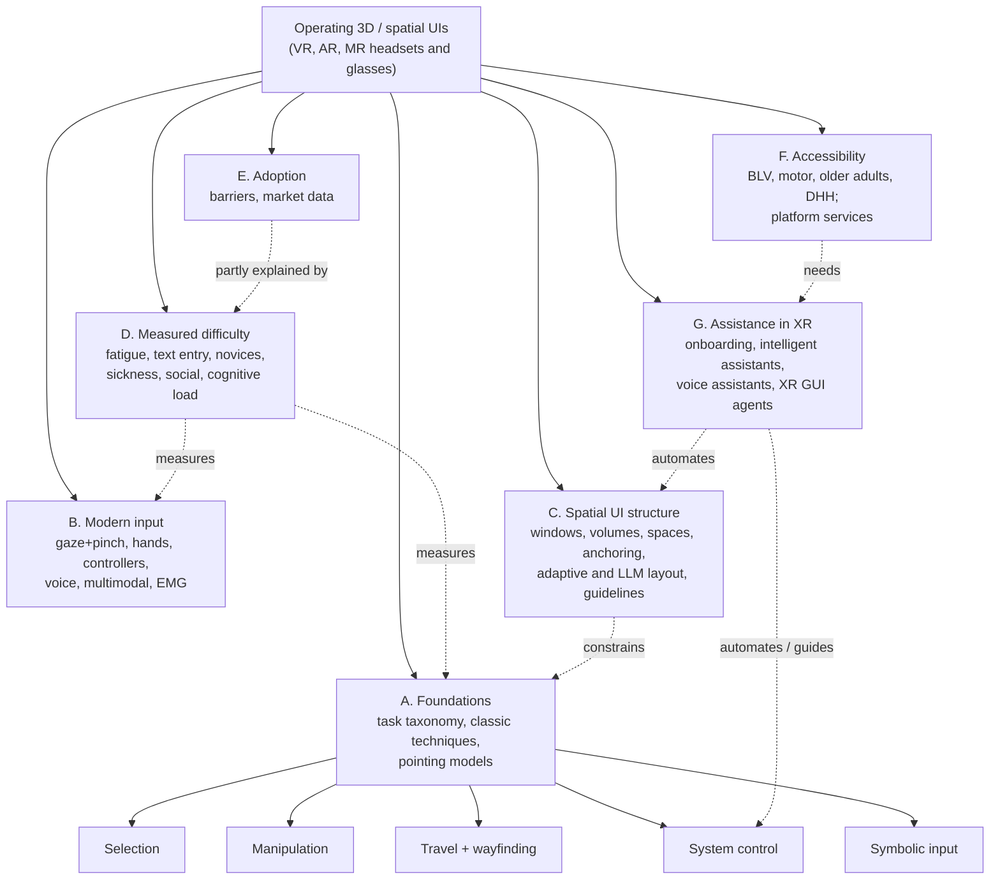
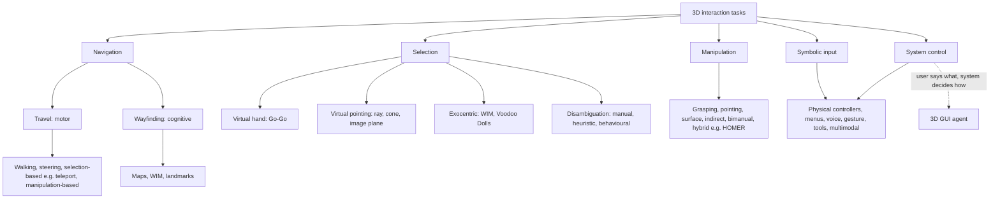

# Dossier r2: 3D user interfaces and XR interaction — why spatial UIs are hard to operate

Status: research dossier for the "3D GUI Agent" column. Compiled 2026-11-24 on branch `api/r2-xr-ui`.
Written in English; blog posts in three languages are written later from it. Work IDs (A01, B05, C22, …)
are stable across the whole file. The letter gives the branch of the map in section 2:

| Prefix | Branch | Works | Deep notes |
|---|---|---|---|
| A | Foundations of 3D interaction: task taxonomy, classic techniques, pointing models | 26 | 3 |
| B | Modern input: gaze, pinch, hands, controllers, voice, multimodal, EMG | 20 | 3 |
| C | Spatial UI structure, adaptive and LLM-based layout, platform design guidance | 33 | 5 |
| D | Measured difficulty: fatigue, text entry, novices, cybersickness, social acceptability, cognitive load | 23 | 4 |
| E | Adoption barriers and market data | 20 (E10 = D16) | 2 |
| F | Accessibility in XR | 20 | 2 |
| G | Assistance already in XR: onboarding, intelligent assistants, voice assistants, first XR GUI-agent work | 22 (G05 = B18) | 3 |
| | **Total** | **164 rows, 162 distinct works** | **22** |

## Summary

1. **Operating a headset is a different and harder motor and perceptual task than operating a phone.**
   The 3D UI literature splits it into selection, manipulation, travel, wayfinding, system control and
   symbolic input (A01). Each has measured costs. Pointing at targets at different depths is slower and
   less accurate because of the stereo-display deficiencies of headsets (A21, A22, A26). Mid-air input tires
   the arm (D01–D03). Text entry with the tools a headset provides runs at about 5–15 wpm for selection-based
   virtual keyboards (D04), against 36 wpm on phones (D12).
2. **The platforms know this and constrain the design space with numbers.** Examples: angular target sizes,
   1.25–5 m comfort zones and "one primary + two supporting windows" (C01–C04). They also leave much of the
   work to the user. The user places, resizes and arranges windows. They find occluded or out-of-view content
   and learn gaze + pinch (B05, B20).
3. **Adaptive and LLM-based systems already take over part of that work, with measured gains.** Examples:
   −36% secondary-task interactions (C22), −33% manual adaptations (C23), and 34.5% faster layout matching on
   Vision Pro with an LLM window manager (C30). They arrange the UI; they do not operate it.
4. **The evidence that complexity *hinders adoption* is weaker than the evidence that complexity *exists*.**
   Price, comfort, content and sickness dominate every ranked survey and analyst report (E01, E11–E13, E18).
   Usability appears as a contributing factor: learning curve, discoverability ("not aware of its
   capabilities" 22.3%, E18), input precision and window management (E02). Section 7.1 gives the honest
   framing.
5. **Shipping assistants are only starting to act on the spatial GUI.** Gemini on Galaxy XR can
   "organize these windows" (G21). Siri AI on visionOS 27 (beta) takes app actions (G15). Voice Control
   reaches any labelled element but has no planner (G16). Research perception of XR GUIs is still weak: F1
   46% for interactable-element detection (G12), and XR is the hardest scenario in GUI-World (G11). No
   benchmark measures an agent *operating* a headset UI.

## 1. Scope and search strategy

**Questions.**
1. What are the elementary operations of 3D interaction, and how are they done today on headsets?
2. What is the measured cost of each (time, errors, fatigue, sickness, learning)?
3. How do the platforms structure spatial UI, and what do their guidelines say about comfort and complexity?
4. Does interface complexity contribute to the slow adoption of VR/AR/MR, and how strongly?
5. What do accessibility research and platform accessibility services already provide?
6. What assistance (tutorials, adaptive UIs, voice and LLM assistants) exists, and what can it operate?

**Sources.**
- Bibliographic APIs: OpenAlex, Semantic Scholar, dblp, the arXiv API (including date-sorted listings to
  catch 2025–2026 preprints) and Europe PMC.
- Primary pages: ACM DL, IEEE Xplore, `doi.org` and publisher pages, open author copies.
- Official platform documentation: the Apple HIG, read through Apple's JSON data endpoints because the pages
  render with JavaScript; Android Developers; Meta Horizon developer docs; Microsoft Learn.
- Company newsrooms, filings (SEC 10-Q, earnings releases) and analyst press releases (IDC, Counterpoint,
  Omdia).

**Queries.** Examples: "3D user interfaces taxonomy selection manipulation travel system control",
"ray-casting Go-Go World-in-Miniature HOMER Voodoo Dolls image plane", "Fitts law 3D depth stereo
pointing", "gaze pinch interaction", "Midas touch gaze", "hand tracking accuracy Quest", "consumed endurance
arm fatigue", "text entry virtual reality wpm", "cybersickness meta-analysis dropout", "social
acceptability head-mounted display", "adaptive mixed reality interfaces optimization", "LLM window
management XR", "VR headset abandonment continuance", "IDC AR/VR headset shipments", "SeeingVR low vision VR",
"VR accessibility LLM guide", "user onboarding virtual reality", "GUI agent virtual reality", "Gemini
Android XR", "Siri visionOS".

**Date range.** 1954 (Fitts) to 2026-11-24, with emphasis on 2017–2026 for headsets. Classic works are
included where they define a technique or model still used today.

**Inclusion criteria.**
- The work defines a 3D interaction task, technique or model; or measures the cost of operating an XR UI;
  or structures spatial UI (platform guidance, layout and adaptation); or evidences adoption barriers; or
  provides assistance or accessibility in XR.
- Peer-reviewed works and arXiv preprints are both included, and the status is always stated.
- Market numbers are taken only from company filings and announcements, named analysts (IDC, Counterpoint,
  Omdia) or reputable press relaying them. Each is labelled reported, estimate, forecast or press report.

**Verification (citation-audit method).**
- Each research part was checked work by work against a primary record: a DOI resolved via OpenAlex or the
  publisher, an arXiv abs record, or an official page.
- A second, automated pass on 2026-11-24 resolved every DOI and arXiv id in the key-works table against
  OpenAlex and the arXiv API, and compared titles, first authors and years. Section 9.1 lists the results.
- Numbers come only from text that was actually read (abstract or full text). The deep notes say which.
- Items that could not be verified are in section 9 and nowhere else.

**How the dossier was produced.** Seven research parts (A–G) were researched and verified separately and
then merged here. The per-part verification notes are kept in 1.1.

### 1.1 Verification notes per part

**Part A (Foundations of 3D interaction).** Compiled 2026-11-24 for the column "3D GUI agents". Every entry in the table was checked against a
primary record: a DOI resolved through OpenAlex or Semantic Scholar (title, first author, venue,
year, pages), an arXiv abs page, or the publisher's or author's official page. The text that was
actually read differs by entry and is noted in each deep note and fact. Full text was read for
Argelaguet & Andujar 2013 (accepted manuscript), Barrera Machuca & Stuerzlinger 2019 (author PDF),
Lane et al. 2025 (arXiv HTML), Qiu et al. 2026 (arXiv HTML), Bashar et al. 2026 (arXiv HTML), Mine
1995 (UNC tech-report PDF) and the Pearson sample pages of LaViola et al. 2017 (front matter and the
whole of Chapter 9, "System Control"). For the other entries only the abstract was read, or for a
few only the metadata (these are marked). Numbers appear only where they were read in the source
named next to them. The research APIs rate-limited part of the session. Items that could not be
confirmed are listed in Section 8 and are not in the table.

**Part B (Modern XR input).** Compiled 2026-11-24 for the column "3D GUI agents". Each entry was checked against a primary record:
the DOI metadata (title, authors, venue, year, pages) through OpenAlex, an arXiv abs page, or the
official page. Apple HIG pages render with JavaScript, so their text was read through Apple's JSON
endpoints (`developer.apple.com/tutorials/data/design/human-interface-guidelines/eyes.json` and
`gestures.json`). The human-readable URLs are the ones cited. Every number below comes from text that
was actually read. The source is either the abstract (from OpenAlex or the publisher) or the full
text (author or repository PDF, Europe PMC full text, arXiv). Each note says which. Where only the
abstract was read, the note says so. ACM DL full texts returned HTTP 403, so for some ACM papers only
the abstract was read.

**Part C (Spatial UI structure, adaptive layout, platform guidance).** Compiled 2026-11-24 for the column "3D GUI agents". Every entry below was checked against a primary
source (official documentation page, DOI resolved through Crossref/OpenAlex, or an arXiv abs record).
Apple HIG pages render with JavaScript, so their text was read through Apple's own JSON data endpoints
(`developer.apple.com/tutorials/data/design/human-interface-guidelines/<page>.json`). The human-readable
URLs are the ones cited. All numbers come from text that was actually read. Where a number was reported
second-hand, the note says so.

**Part D (Measured difficulty).** Compiled 2026-11-24 for the column "3D GUI agents". The title, first author, venue, year and DOI of every
entry were checked against OpenAlex and Crossref records. The DOIs of 2025 papers were also checked against
the arXiv abs page that OpenAlex links. Numbers come from text that was actually read, and each note says
where. "Full text" means the paper itself was read: an author copy (university repository or lab page), an
arXiv/ar5iv HTML version, or the open-access publisher page. "Abstract" means only the abstract was
available (OpenAlex/Semantic Scholar record), so no numbers beyond the abstract are given for that work.
Where a number was reported second-hand by another paper, the note says so.

**Part E (Adoption barriers and market data).** Compiled 2026-11-24 for the column "3D GUI agents". How entries were checked:

- **Papers.** Title, authors, venue and date were checked against the OpenAlex record for the DOI (or the arXiv abs page). Abstracts were read for every paper. Full texts were read for E01 (open-access PDF from the authors' repository), E02 (arXiv HTML), E03 (PubMed Central) and E09 (PubMed Central). For E04 and E06 only the abstract was available (the publisher returned HTTP 403), so their notes stay at abstract level.
- **Market data.** Numbers come from text that was actually read: IDC press releases on idc.com, the Counterpoint and Omdia pages, Meta's Q4 2025 press release and Q3 2026 10-Q on sec.gov, and Apple, Meta and Samsung announcement pages. Where only a press article quoting an analyst could be read, the entry says so and the number is labelled "press report".
- **Survey data.** The two Variety VIP+ survey numbers were read from the Datawrapper CSV files behind the published charts.
- **Arithmetic.** Where we derived a number ourselves (for example, a unit total from a growth rate), it is marked "derived".

**Part F (Accessibility in XR).** Compiled 2026-11-24 for the column "3D GUI agents". Each work in the table was checked against a primary
record: the DOI resolved through OpenAlex or the Semantic Scholar API (title, authors, venue, year), an arXiv
abs page, or the official W3C / project page. Numbers come from text that was actually read: the full paper
text for SeeingVR (F01), Canetroller (F02) and Siu et al. (F03) (author PDFs hosted by Microsoft Research), the
arXiv HTML full text for VRSight (F07), and abstracts or publisher / PMC pages for the rest. Platform features
(Section 3) come from official help pages read on 2026-11-24. Meta's consumer help pages render client-side and
returned no body text, so the Meta row relies on Meta's developer accessibility checklist. When a number is
taken from an abstract and not from the body, the note says "abstract".

**Part G (Assistance already in XR).** Compiled 2026-11-24 for the column "3D GUI agents". Each academic entry was checked against a primary
record. DOIs were resolved through the OpenAlex works endpoint, which returned title, authors, venue and
abstract. arXiv-only entries were checked on their arXiv abs pages, and numbers were taken from the arXiv
HTML full text where noted. For Kao et al. (G02), numbers come from the authors' PDF
(people.csail.mit.edu). Product entries cite official pages only (apple.com newsroom, support.apple.com,
about.fb.com, blog.google, developer.android.com, Samsung's press site). Dates are the dates printed on
those pages. Meta's help-center and meta.com blog pages render client-side and could not be read, so
claims that rest only on them are listed under "Unverified". Every number below comes from text that was
actually read. Where two parts of one source disagree, the note says so.

## 2. Map of the area

**A. Foundations (A01–A26).**
- The 3D UI book (A01) splits every interaction into five universal tasks. Selection and manipulation act on
  objects; navigation is travel (motor) plus wayfinding (cognitive); system control issues commands and
  changes modes; symbolic input enters text and numbers.
- The classic techniques (A04–A12) solve the reach and precision problems of selection and manipulation:
  ray-casting, Go-Go, World-in-Miniature, HOMER, image-plane selection, Voodoo Dolls, progressive refinement.
- The surveys (A13–A15, A23) show that no technique wins across densities, distances and occlusion.
- Pointing models (A17–A22, A24–A26) extend Fitts' law to 3D. Depth and the vergence–accommodation conflict
  make headset pointing slower and less accurate than the same movement on a 2D screen.
- For a GUI agent, this branch supplies the *action vocabulary*. 2D agents have tap, swipe and type. A 3D
  agent needs select(target), manipulate(object, pose), travel(to), find(object) and command(menu path).

**B. Modern input (B01–B20).**
- Headsets moved from controllers to hands and eyes. Gaze + pinch (B05, B06) is now the default on Vision
  Pro (B20) and is available on Android XR. It solves reach but inherits the Midas touch problem (B01) and
  eye-tracker error of about 0.5–1.7° (B12, B13).
- Hands lack haptics and tire (B14, B15). Voice and multimodal "put that there" (B16–B18) is the natural
  channel to an agent. EMG wristbands (B19) bring subtle input to glasses.
- The input that best expresses *intent* (gaze, speech, pointing) is the least precise, which is the gap an
  agent fills.

**C. Spatial UI structure (C01–C33).**
- Every platform organises content into 2D panels or windows, 3D volumes and exclusive immersive spaces.
- Content is anchored to the world, the body or the head (C05, C06, C11).
- The guidelines (C01–C04) give numeric comfort envelopes: distances, angular sizes, neck and gaze angles,
  and window counts.
- Window management in 3D is a recurring manual burden (C12–C16). Adaptive UI research (C22–C27) and
  LLM/VLM-based layout (C28–C33) already automate it with measured gains.

**D. Measured difficulty (D01–D23).**
- Arm fatigue (D01–D03): consumed endurance, NICER.
- Text entry far below phone and desktop speeds (D04–D12).
- Spatial input under external forces (D13) and novices failing to discover gestures (D14).
- Cybersickness, with a pooled SSQ of 28 and 15.6% sickness dropout (D15–D18).
- Social acceptability and bystanders (D19–D22), and mixed results on AR's cognitive load (D23).

**E. Adoption (E01–E20).**
- XR remains small: about 14.5 M devices in 2025 against about 1.26 B smartphones (E11, E17). Headset
  shipments fell while display-less AI glasses grew (E11, E12, E15). Meta Reality Labs lost $19.2 B in 2025
  (E14).
- Peer-reviewed and survey evidence ranks price, comfort, content and sickness above usability (E01, E18).
  Usability appears as a contributing factor (E02, E12).

**F. Accessibility (F01–F20).**
- XR adds new barriers for blind and low-vision users, people with limited mobility, older adults and deaf
  or hard-of-hearing users (F09, F11, F16, F17).
- Research tools exist: SeeingVR (F01), cane simulation (F02, F03), sighted and AI guides (F05–F08), and
  VRSight (F07).
- Platform accessibility services (VoiceOver, Voice Control, Pointer and Dwell Control, TalkBack) are the
  closest existing "agent-like" layers. They expose a UI tree and actions, but only for elements that apps
  label.

**G. Assistance in XR (G01–G22).**
- Onboarding is mostly static tutorials (G01, G02). AR task guidance works for physical tasks (G03, G07, G08).
- LLM assistants answer questions about what the user looks at (G05, G06, G14).
- The first XR GUI-understanding work detects interactable elements in VR apps (G12, G13, G11).
- Shipping assistants (Siri AI, Meta AI, Gemini on Android XR) act mostly through app intents and a few
  system commands (G15–G22).

### 2.1 The task taxonomy in detail (Part A)

**Selection.** Indicating one or more objects, then confirming. Techniques split into the virtual
hand (local reach, extended by Go-Go [A07]) and virtual pointing (ray [A04], cone/flashlight [A05],
image-plane [A09]), with exocentric variants (WIM [A06], Voodoo Dolls [A10]). Difficulty follows
angular size and amplitude [A20, A24], density and occlusion [A11, A13], and the change in depth
between targets [A21, A22, A26]. Disambiguation is manual, heuristic or behavioural [A13].

**Manipulation.** Setting position, orientation and scale of a selected object. The 2nd-ed.
book groups techniques as grasping, pointing, surface, indirect, bimanual and hybrid metaphors
[A01]. Hybrids separate grabbing from manipulating [A08]. Mid-air manipulation is natural but
imprecise [A15].

**Travel.** The motor part of navigation: moving the viewpoint. The 2nd-ed. book groups travel as
walking, steering, selection-based (for example, point and teleport) and manipulation-based
[A01]. Pointing-directed steering beats gaze-directed steering for relative motion, and teleporting
increases disorientation [A03].

**Wayfinding.** The cognitive part of navigation: knowing where you are and how to get where you
want. It was a full chapter in the 1st ed. and is §8.9 in the 2nd [A01]. Aids include maps and
miniatures [A04, A06].

**System control.** Issuing commands to run a function, change mode or change state, where the
user says "what" and the system decides "how" [A01]. Six families: physical controllers,
graphical menus, voice, gesture, tools, multimodal [A01]. This is the "glue" between the other
tasks [A01, Ch. 9 intro].

**Symbolic input.** Entering text, numbers and symbols. In 3D apps it is occasional and short, and
it serves system control (file names, numeric parameters) [A01]. It was merged into Ch. 9 in the
2nd ed.

### 2.2 Input modalities compared (Part B)

Throughput values come from different studies with different devices and task designs. Compare within a row, not across rows.

| Modality | How it selects / confirms | Strengths | Weaknesses (Midas touch, fatigue, precision) | Numbers (with IDs) | What an agent can observe from it |
|---|---|---|---|---|---|
| Gaze + dwell | Look, and the target fires after a fixation threshold | Hands-free. Works for motor-impaired users | Midas Touch [B01]. Dwell caps speed. Thresholds need tuning per person | Gaze typing 6.9 → 19.9 wpm as dwell fell 876 → 282 ms over 10 sessions; errors 1.28% → 0.36% [B02]. Dwell had the fewest errors but was significantly slower than pinch or click [B07] | If the platform exposes it: fixations as a strong but ambiguous intent signal. On visionOS, nothing for apps [B20] |
| Gaze + pinch (indirect) | Look to target, finger-thumb tap to commit | Low effort, works at any distance, flat Fitts' slope | Early and late triggers [B06]. Gaze error of about 0.5–1.7° [B12, B13] limits small targets. Visual attention is tied to the target at the commit | Gaze&Pinch MT = 0.63 + 0.35·ID; +0.83 bit/s over Handray at 2 m [B09]. Pinch not significantly worse than a button click [B07] | Commits (tap events) and the system-drawn hover, but not the pre-commit gaze on visionOS [B20] |
| Gaze-hand alignment | Gaze pre-selects. The hand's pointer crossing the target commits | No click gesture. Faster than hands-only | Parallax for finger-in-line-of-sight variants at depth [B09] | Gaze&Handray most preferred (9/20); Gaze&Finger +1.00 bit/s over Handray at 0.5 m [B09] | Hand pose (with permission); gaze as above |
| Hand ray + pinch | Palm ray points, pinch confirms | No device. Default on Quest and HoloLens 2 | Pinch moves the ray (Heisenberg problem). Arm fatigue. Tracking loss outside the FOV [B09, B15] | Handray MT = −0.27 + 0.88·ID [B09]. Bare-hand raycast 11.8% slower than a controller [B15] | Hand skeleton (Quest 2 fingertip error 1.1 cm, 45 ms delay [B14]) |
| Direct touch (hands) | Touch virtual buttons within reach | Intuitive. Preferred over controllers for touch [B15] | No haptics. Gorilla arm: Apple says direct gestures are "best for infrequent use" [B20]. Higher, forward arm posture [B15] | Touch throughput 3.5 bit/s, error 7.3% (hands and controllers pooled); 19/24 choices favoured hands [B15] | Hand pose and contact events |
| Controller ray | Ray from controller, trigger button | Precise, buttons, haptics, lower exertion | Device to carry. Not available on Vision Pro or most glasses | Raycast throughput 4.71 bit/s; controller 11.8% faster and 18.9% more accurate in tracing than a bare-hand ray [B15] | Controller pose and button events |
| Eye + head | Head-supported vs eyes-only gaze shifts. Pursuit matching for occluded targets | Uses natural eye-head coordination. Handles occlusion [B10, B11] | Head movement is tiring for frequent use | Outline Pursuits: less movement than raycasting; time and accuracy less affected by heavy occlusion [B11] (no numbers read) | Head pose. The visionOS statements quoted in B20 restrict eye input only; access to head pose per platform was not checked here |
| Voice (+ gaze / pointing) | Speak a command. A deictic word is grounded by gaze or a point | Hands-free, expressive, good for abstract commands | Ambiguous referents. Not private. Users do not always combine modes [B17] | GazePointAR lab study N=12 [B18] | Transcript plus whatever deictic signal the system fuses |
| sEMG wristband | Decoded micro-gestures (click, swipe, pinch-rotate), handwriting | Discreet, works with the hand out of view, no calibration | No spatial pointer. Slower than conventional baselines | 0.66 acquisitions/s, 0.88 gestures/s, 20.9 wpm [B19] | Discrete events (through the glasses OS) |

### 2.3 Platform comparison of spatial UI structure (Part C)

| Concept | visionOS | Android XR | Meta Horizon OS | Windows Mixed Reality / HoloLens |
|---|---|---|---|---|
| UI containers | Windows (glass plane with window bar, close, resize); volumes (3D, viewable from any angle); `ImmersiveSpace` (unbounded, one at a time); ornaments float slightly in front of a window and move with it. visionOS 26 widgets must attach to a surface (C01) | Spatial panels as building blocks; orbiters (floating controls anchored to a panel, default 15 dp z-elevation, 20 dp offset); spatial elevation levels for popups and dialogs; 3D models; environments (C02) | Panels (2D surfaces); system windows with system-provided control bar, edge handles and resize handles for panel apps (C03) | Holograms. UI patterns in the docs read: hand menu (hand-attached), tag-along and billboarded panels, body-locked HUD (C04) |
| Shared vs exclusive mode | Shared Space (apps side by side) vs Full Space (one app, others hidden); Full Space immersion styles mixed / progressive / full (C01) | Home Space (multitasking; default app 1024×720 dp, min 385×595, max 2560×1800 dp; no spatial panels or 3D models) vs Full Space (one app; spatial UI available only here) (C02) | Not formalized as two named spaces in the pages read. Multi-window guidance assumes several windows coexist (C03) | Not covered in the design pages read (C04) |
| Default spawn distance and size | First window placed about 2 m away, 1280×720 pt, apparent width about 3 m (C01) | Apps launch 1.75 m away (not overridable in Home Space). Panel centre 5° below eye level. At 1.75 m, 1024 dp is perceived as 1556.24 mm; 0.868 dp-to-dmm (C02) | Touch UI 42–46 cm. Indirect (ray/gaze) comfortable at about 0.8–3 m. Avoid 0.5–0.8 m. MR guideline: 2D window about 45 cm for direct hands, about 1 m for indirect, about 70 cm for hands + controllers (C03) | Optimal hologram zone 1.25–5 m. Display focal distance about 2.0 m. Fade at 40 cm, clip at 30 cm. Near-depth "budget" example: at most 25% of time (C04) |
| Allowed depth range / scaling | Dynamic scale keeps apparent size constant with distance. Fixed scale for real-object replicas (C01) | Panel movement limits 0.75–5 m. Size constant between 0.75 and 1.75 m, then scales at 0.5 m per m (C02) | Movable panels keep angular size rather than physical size when moved in z (C03) | Keep content mostly at 1 m or more on immersive devices (C04) |
| Target size and spacing | Default control 60×60 pt (min 28×28). Centres at least 60 pt apart or 16 pt margin (C01) | Target 56×56 dp or larger (icon 48 dp). At least 8 dp between targets. No overlapping pointer targets (C02) | Hit target at least 48 dp. Angular collider about 2.5°–3°. At least 12 mm between interactables. 7 mm button travel (C03) | Direct touch: at least 2° (1.6×1.6 cm at 45 cm). Ray or gaze: at least 1° (3.5×3.5 cm at 2 m) (C04) |
| Text | Default 17 pt, minimum 12 pt. Avoid adding depth to text (C01) | At least 14 dp, normal weight or heavier (C02) | Not numerically specified in the pages read (C03) | "Making font sizes as large as possible". Test legibility per device (C04) |
| Field of view / head and neck | Keep content within the field of view. Avoid needing head turns. Prefer horizontal layouts. "The system doesn't provide information about a person's field of view" (C01) | Primary content in the central 41° of the FOV. Headsets about 110°+ FOV, wired glasses about 50°–70° (C02) | Constant head and neck movement increases discomfort. Device FOV is smaller than natural FOV (C03) | Avoid gaze more than 10° above or 60° below the horizon and neck rotation over 45°. Resting gaze 10°–20° below the horizon. Content 0°–35° below the horizon (C04) |
| Head-locked content | Avoid. It makes people feel "stuck" and breaks Pointer Control and Zoom. Recentre with the Digital Crown (C01) | Not covered in the pages read. Users can anchor panels to the floor, chairs, walls, ceilings or tables (passthrough only) (C02) | Avoid head-locking HUD content. Anchor to space or follow loosely with smoothing. Do not place virtual objects behind walls (C03) | Body-lock HUDs instead of head-locking. Tag-along keeps content "a glance away" (C04) |
| Number of windows / complexity | "Avoid displaying too many windows". Constrain the number of ornaments (C01) | No API limit on panels. Use orbiters sparingly. Avoid overlapping panels. "Reduce cognitive load" (C02) | One primary window and at most 2 important supporting windows ("a design target, not a capacity limit") (C03) | Hand menu: one column of three buttons works well. Attentional cone about 10°. World-lock large menus (C04) |
| Input | Eyes + indirect pinch (default). Direct touch for nearby content. Pointer Control can drive focus from head, wrist or index finger. Dwell Control (C01) | Hand and eye tracking, voice (Gemini), keyboard, mouse, trackpad, 6DoF controllers. Pinch to select, held pinch to move or resize. Raw eye data not shared with apps (C02) | Hands (direct touch, ray), eyes, controllers. Ray or gaze beyond reach (C03) | Three models: hands and motion controllers, hands-free (gaze/dwell, voice), head-gaze and commit. Use one model per app (C04) |
| Accessibility / UI tree exposed to developers | Yes. SwiftUI accessibility plus RealityKit `AccessibilityComponent` (label, value, traits, actions, rotors) for 3D entities. VoiceOver uses spatial audio. Entities without the component are invisible to VoiceOver (C01) | Panels are Android UI, so TalkBack, dwell control and magnification are adapted to XR. Material targets apply (C02) | Checklist asks for `contentDescription` on interactive elements and alt text. Screen reader is under "Settings > Experimental" (C03) | Not covered in the MR design pages read. Voice commands recommended for every interactable object (C04) |

## 3. Key works table

IDs are grouped by branch. Two works appear in two parts; their second row is replaced by a pointer (E10 = D16, G05 = B18), so the table has 162 distinct works.

### 3.1 A: Foundations of 3D interaction

| # | Title | First author et al. | Venue / status | Year | Link | Contribution (one line) | Relevance to 3D GUI agents (one line) |
|---|---|---|---|---|---|---|---|
| A01 | 3D User Interfaces: Theory and Practice (1st ed.), and 3D User Interfaces: Theory and Practice, 2nd ed. | Doug A. Bowman, Ernst Kruijff, Joseph J. LaViola Jr., Ivan Poupyrev (1st ed.); Joseph J. LaViola Jr., Ernst Kruijff, Ryan P. McMahan, Doug A. Bowman, Ivan Poupyrev (2nd ed.) | Book, Addison-Wesley (1st ed.); Book, Addison-Wesley Professional, ISBN 978-0-13-403447-8 (2nd ed.) | 2004; 2017 | https://people.cs.vt.edu/~bowman/3dui.org/Table_of_Contents.html ; https://people.cs.vt.edu/~bowman/3dui.org/Part_III.html ; https://www.informit.com/store/3d-user-interfaces-theory-and-practice-9780134034478 ; sample pages: https://ptgmedia.pearsoncmg.com/images/9780134034324/samplepages/9780134034324_CH09.pdf | The standard task taxonomy: selection and manipulation, travel, wayfinding, system control and symbolic input. The 2nd ed. folds wayfinding into Travel and symbolic input into System Control. | Gives the action vocabulary for a 3D GUI agent. Its definition of system control ("what, not how") describes what a user delegates to an agent. |
| A02 | Formalizing the Design, Evaluation, and Application of Interaction Techniques for Immersive Virtual Environments | Doug A. Bowman, Larry F. Hodges | Journal of Visual Languages & Computing 10(1):37–53 | 1999 | https://doi.org/10.1006/jvlc.1998.0111 | A systematic method: formal task analysis, categorization of techniques by subtask, and evaluation with several performance measures, applied to three common VE tasks (abstract summary via search; full text not read). | Breaking a task into subtasks (indicate, confirm, give feedback) maps onto the step structure of an agent's action. |
| A03 | Travel in immersive virtual environments: an evaluation of viewpoint motion control techniques | Doug A. Bowman, David Koller, Larry F. Hodges | IEEE VRAIS 1997, pp. 45–52 | 1997 | https://doi.org/10.1109/VRAIS.1997.583043 | Categorization of first-person travel techniques plus three experiments. Pointing beats gaze-directed steering for relative motion. Instant teleport goes with more disorientation. | An agent that moves the user's viewpoint must weigh speed against disorientation. Teleporting the user is not free. |
| A04 | Virtual Environment Interaction Techniques (UNC TR95-018) | Mark R. Mine | Technical report, Dept. of Computer Science, UNC Chapel Hill | 1995 | https://www.cs.unc.edu/techreports/95-018.pdf | Early catalogue: movement, selection, manipulation, scaling, and menu/widget interaction. Selection can be local or at a distance (laser beams or spotlights), gaze-directed, by voice, or from a list. | It already lists voice and list selection, where "the user does not have to be able to see the object". These are the semantic, non-pointing selection channels an agent can use. |
| A05 | JDCAD: A highly interactive 3D modeling system | Jiandong Liang, Mark Green | Computers & Graphics 18(4):499–506 | 1994 | https://doi.org/10.1016/0097-8493(94)90062-0 | 3D modeller with cone ("spotlight") selection. Argelaguet & Andujar [A13] cite it as the source of Flashlight selection. | Volumetric selection trades precision for ambiguity, the same trade-off an agent faces when grounding "that one". (Metadata only. Content from A13's citation.) |
| A06 | Virtual reality on a WIM: interactive worlds in miniature | Richard Stoakley, Matthew J. Conway, Randy Pausch | ACM CHI 1995, pp. 265–272 | 1995 | https://doi.org/10.1145/223904.223938 | A hand-held miniature copy of the world used to select, manipulate and navigate. | An exocentric proxy view, which an agent could generate on demand to show the user where something is or will move. (Metadata only. No abstract in the index.) |
| A07 | The go-go interaction technique: non-linear mapping for direct manipulation in VR | Ivan Poupyrev, Mark Billinghurst, Suzanne Weghorst, Tadao Ichikawa | ACM UIST 1996, pp. 79–80 | 1996 | https://doi.org/10.1145/237091.237102 | The virtual arm grows non-linearly, so the same hand reaches both near and far objects by direct manipulation. | Control-display mappings are user-side tricks. An agent acting on the scene directly does not need them, but a guiding agent must explain them. |
| A08 | An evaluation of techniques for grabbing and manipulating remote objects in immersive virtual environments | Doug A. Bowman, Larry F. Hodges | ACM I3D 1997, pp. 35ff. | 1997 | https://doi.org/10.1145/253284.253301 | Six remote-manipulation techniques compared, leading to hybrid techniques that treat grabbing and manipulation separately (the paper's HOMER family). | Separating "select" from "manipulate" fits an agent's two-step plan: ground the target first, then act on it. |
| A09 | Image plane interaction techniques in 3D immersive environments | Jeffrey S. Pierce, Andrew Forsberg, Matthew J. Conway, Seung Hong, Robert Zeleznik, Mark R. Mine | ACM I3D 1997, pp. 39ff. | 1997 | https://doi.org/10.1145/253284.253303 | The user interacts with the 2D projections of 3D objects on the image plane, for selection, manipulation and navigation. | This is how a screenshot-based agent already "sees" a headset: a 2D projection. It is the bridge from 2D GUI agents to 3D. |
| A10 | Voodoo dolls: seamless interaction at multiple scales in virtual environments | Jeffrey S. Pierce, Brian C. Stearns, Randy Pausch | ACM I3D 1999, pp. 141–145 | 1999 | https://doi.org/10.1145/300523.300540 | Two-handed manipulation through transient hand-held copies ("dolls"), scaled to half a metre. Allows selection of visible and occluded objects. | A proxy-object action space that makes occlusion and scale irrelevant. An agent could manipulate such proxies, or show them to the user. |
| A11 | Exploring the Effects of Environment Density and Target Visibility on Object Selection in 3D Virtual Environments | Lode Vanacken, Tovi Grossman, Karin Coninx | IEEE 3DUI 2007, pp. 115–122 | 2007 | https://doi.org/10.1109/3DUI.2007.340783 | Depth Ray and 3D Bubble Cursor, extended to fully occluded targets. Both beat a point cursor. Depth Ray was best overall. | Density and occlusion are the main reasons pointing fails, so they are the cases where an agent's direct object access helps most. |
| A12 | Rapid and accurate 3D selection by progressive refinement | Regis Kopper, Felipe Bacim, Doug A. Bowman | IEEE 3DUI 2011, pp. 67–74 | 2011 | https://doi.org/10.1109/3DUI.2011.5759219 | SQUAD: sphere-cast, then refine through a QUAD menu. Much more accurate than ray-casting, and faster with small targets in less cluttered scenes. | Progressive refinement is a dialogue. It is also how an agent should resolve ambiguous references ("which of these four?"). |
| A13 | A survey of 3D object selection techniques for virtual environments | Ferran Argelaguet, Carlos Andujar | Computers & Graphics 37(3):121–136 | 2013 | https://doi.org/10.1016/j.cag.2012.12.003 | Pointing models, a classification by selection tool, tool control, motor/visual space, disambiguation, trigger and feedback, and factors affecting performance. | The most complete map of why 3D selection fails, which is where an agent would intervene (see deep note). |
| A14 | Advances in Interaction with 3D Environments | Jacek Jankowski, Martin Hachet | Computer Graphics Forum 34(1):152–190 | 2015 (online 2014) | https://doi.org/10.1111/cgf.12466 | Survey of non-immersive (desktop, touch) 3D navigation, selection and manipulation, and system control, with the 3DIT testbed. | Covers the desktop and touch side, which matters for agents that drive 3D apps through 2D input (for example a 3D viewer in a browser). |
| A15 | A Survey on 3D Virtual Object Manipulation: From the Desktop to Immersive Virtual Environments | Daniel Mendes et al. (last author Joaquim Jorge) | Computer Graphics Forum 38(1):21–45 | 2019 (online 2018) | https://doi.org/10.1111/cgf.13390 | A new taxonomy of manipulation properties (position, orientation, scale) across mouse, touch and mid-air input. Mid-air is natural but "often lack[s] precision and control". | Precision is the gap: an agent can set exact numeric poses that mid-air hands cannot. |
| A16 | 3D User Interfaces: New Directions and Perspectives | Doug A. Bowman, Sabine Coquillart, Bernd Froehlich, Michitaka Hirose, Yoshifumi Kitamura, Kiyoshi Kiyokawa, Wolfgang Stuerzlinger | IEEE Computer Graphics and Applications 28(6):20–36 | 2008 | https://doi.org/10.1109/MCG.2008.109 | The founders of IEEE 3DUI review the state of the art and future directions. | Historical anchor. It is a CG&A article, not CACM as sometimes cited. |
| A17 | Fitts' law and its HCI standardization: (a) The information capacity of the human motor system in controlling the amplitude of movement; (b) Fitts' Law as a Research and Design Tool in Human-Computer Interaction; (c) Towards a standard for pointing device evaluation, perspectives on 27 years of Fitts' law research in HCI | (a) Paul M. Fitts; (b) I. Scott MacKenzie; (c) R. William Soukoreff, I. Scott MacKenzie | (a) J. Experimental Psychology 47(6):381–391; (b) Human-Computer Interaction 7(1):91–139; (c) Int. J. Human-Computer Studies 61(6):751–789 | 1954; 1992; 2004 | https://doi.org/10.1037/h0055392 ; https://doi.org/10.1207/s15327051hci0701_3 ; https://doi.org/10.1016/j.ijhcs.2004.09.001 | Movement time grows with log2 of amplitude over width. MacKenzie's Shannon formulation. The ISO 9241-9 method for throughput (c: section titled "The ISO standard versus Anarchy"; abstract not readable). | The baseline cost model. An agent can predict how hard a target is for the user and decide whether to do the step or only guide it. |
| A18 | Pointing at trivariate targets in 3D environments | Tovi Grossman, Ravin Balakrishnan | ACM CHI 2004, pp. 447–454 | 2004 | https://doi.org/10.1145/985692.985749 | Target size along the primary movement axis matters most. Movement angle matters. A new trivariate model beats earlier ones. | Target difficulty in 3D depends on direction, not just size, so an agent's difficulty estimate needs the approach direction. |
| A19 | Pointing at 3D targets in a stereo head-tracked virtual environment | Robert J. Teather, Wolfgang Stuerzlinger | IEEE 3DUI 2011, pp. 87–94 | 2011 | https://doi.org/10.1109/3DUI.2011.5759222 | ISO 9241-9 tasks in fish-tank VR. 2D Fitts works for planar tasks even with stereo and without tactile feedback. Fully 3D motions are less well modelled. | 2D GUI-agent difficulty models carry over only to planar UI (panels). Depth targets need other models. |
| A20 | A human motor behavior model for distal pointing tasks | Regis Kopper, Doug A. Bowman, Mara G. Silva, Ryan P. McMahan | Int. J. Human-Computer Studies 68(10):603–615 | 2010 | https://doi.org/10.1016/j.ijhcs.2010.05.001 | For ray pointing, time depends on angular amplitude and angular target size. Size matters much more, and difficulty grows quadratically (r = 96%). | Angular size, not metric size, is what makes a far button hard. An agent can compute it from the scene graph and the head pose. |
| A21 | The Effect of Stereo Display Deficiencies on Virtual Hand Pointing | Mayra Donaji Barrera Machuca, Wolfgang Stuerzlinger | ACM CHI 2019, pp. 1–14 | 2019 | https://doi.org/10.1145/3290605.3300437 | Pointing along the depth axis is slower for virtual targets but not for physical ones. A Fitts' law extension with a change-in-target-depth term. | Quantifies a cost that is specific to stereo XR. An agent can avoid creating it by keeping targets on one depth plane (see deep note). |
| A22 | Do Head-Mounted Display Stereo Deficiencies Affect 3D Pointing Tasks in AR and VR? | Anil Ufuk Batmaz, Mayra Donaji Barrera Machuca, Duc Minh Pham, Wolfgang Stuerzlinger | IEEE VR 2019, pp. 585–592 | 2019 | https://doi.org/10.1109/VR.2019.8797975 | On headsets, movements toward or away from the head were slower and less accurate than lateral ones. No significant AR vs VR difference in pointing. | Confirms the depth penalty on commercial headsets, so it applies to the devices an agent would run on. |
| A23 | Object Selection and Manipulation in VR Headsets: Research Challenges, Solutions, and Success Measurements | Difeng Yu, Tilman Dingler, Eduardo Velloso, Jorge Goncalves | ACM Computing Surveys 57(4), Article 98 | 2024 | https://doi.org/10.1145/3706417 | Systematic review of 106 papers on headset selection and manipulation. It categorizes solutions and success measures and proposes a framework for choosing a solution. | The newest consolidated view of the problems, and the measures an agent-assisted technique would be judged on. |
| A24 | Revisiting Performance Models of Distal Pointing Tasks in Virtual Reality | Logan Lane, Feiyu Lu, Shakiba Davari, Robert J. Teather, Doug A. Bowman | IEEE TVCG 31(10):8283–8296 | 2025 | https://doi.org/10.1109/TVCG.2025.3567078 (arXiv: https://arxiv.org/abs/2505.03027) | On Quest 2, with a new non-reciprocal data-collection method, the best distal-pointing model is a plain Fitts index with angular amplitude and width. | A simple, current cost model an agent can run per target: ID = log2(alpha/omega + 1). |
| A25 | Direct vs. Score-based Selection: Understanding the Heisenberg Effect in Target Acquisition Across Input Modalities in Virtual Reality | Linjie Qiu et al. | arXiv preprint. The authors state "Accepted by TVCG and IEEE VR'26" | 2026 | https://arxiv.org/abs/2602.01061 | On Quest 3, most ray-selection errors come from the confirm action moving the ray (the Heisenberg effect). A history-based intention model (weighted VOTE) cuts errors. | Intent inference from pointing history is a small "agent" in its own right. It shows how much error a model can remove from raw input. |
| A26 | Evaluating the Vergence-Accommodation Conflict in Gaze-Based 3D Target Selection | Mohammad Raihanul Bashar et al. (last author Anil Ufuk Batmaz) | arXiv preprint. Journal ref. on the abs page: IEEE TVCG, special issue on IEEE ISMAR 2026 | 2026 | https://arxiv.org/abs/2607.27369 | Gaze+pinch selection on Quest Pro gets worse with depth. A Fitts model with a variation-in-diopter term fits much better than a linear one. | Gaze is the primary input on Vision Pro-class devices. Depth placement changes its cost, and an agent placing or guiding to targets should account for that. |

### 3.2 B: Modern XR input

| # | Title | First author et al. | Venue / status | Year | Link | Contribution (one line) | Relevance to 3D GUI agents (one line) |
|---|---|---|---|---|---|---|---|
| B01 | What you look at is what you get: eye movement-based interaction techniques (extended as "The use of eye movements in human-computer interaction techniques: what you look at is what you get", ACM TOIS 9(2):152–169, 1991) | Robert J. K. Jacob | ACM CHI 1990, pp. 11–18 | 1990 | https://doi.org/10.1145/97243.97246 (TOIS: https://doi.org/10.1145/123078.128728) | The first eye-movement interaction techniques. It names the "Midas Touch" problem: if gaze acts as a pointer that also triggers, every look issues a command. | The founding statement of why gaze is an intent signal with a high false-positive rate. An agent that reads gaze inherits the same problem. |
| B02 | Fast gaze typing with an adjustable dwell time | Päivi Majaranta et al. | ACM CHI 2009, pp. 357–360 | 2009 | https://doi.org/10.1145/1518701.1518758 | Longitudinal study: with a user-adjustable dwell time, gaze typing rose from 6.9 to 19.9 wpm while the dwell time fell from 876 to 282 ms. | Dwell thresholds are personal and change with practice. An agent's notion of "the user is looking at it on purpose" has to adapt too. |
| B03 | Interacting with eye movements in virtual environments | Vildan Tanriverdi and Robert J. K. Jacob | ACM CHI 2000, pp. 265–272 | 2000 | https://doi.org/10.1145/332040.332443 | Eye-based selection in VR was faster than 3D pointing, especially for distant objects, but spatial recall was weaker. | Early evidence that gaze helps most at a distance and may lower the user's memory of the layout. An agent might need to compensate for that. |
| B04 | The Eye in Extended Reality: A Survey on Gaze Interaction and Eye Tracking in Head-worn Extended Reality | Alexander Plopski et al. | ACM Computing Surveys 55(3), article 1–39 | 2022 | https://doi.org/10.1145/3491207 | Reviews 215 publications since 1985 on gaze for direct interaction, attentive (gaze-adaptive) interfaces, and collaboration in XR. | Maps the uses of gaze beyond pointing, especially attentive UIs, which is the use closest to an agent that infers intent. |
| B05 | Gaze + pinch interaction in virtual reality | Ken Pfeuffer et al. | ACM SUI 2017, pp. 99–108 | 2017 | https://doi.org/10.1145/3131277.3132180 | Gaze selects the target and an indirect freehand pinch manipulates it, at any distance and without controllers. Shown in a unified prototype (3D manipulation, navigation, zooming), informally tested. | The research origin of the visionOS input model, and therefore of the action space a 3D GUI agent on Vision Pro must emulate or guide. |
| B06 | Design Principles and Challenges for Gaze + Pinch Interaction in XR | Ken Pfeuffer et al. | IEEE Computer Graphics and Applications 44(3):74–81 | 2024 | https://doi.org/10.1109/MCG.2024.3382961 (precursor read in full: https://arxiv.org/abs/2401.10948) | Five design principles (division of labor, minimal multimodal timing, flexible gestures, "infallible eyes", compatibility with hand UIs) and five issues (learning, early/late triggers, control-display ratio, drag-and-drop, continuous eye selection). | Lists the failure modes (early and late triggers, losing a dropped object) that an agent watching the user could detect and fix. |
| B07 | Pinch, Click, or Dwell: Comparing Different Selection Techniques for Eye-Gaze-Based Pointing in Virtual Reality | Aunnoy K. Mutasim et al. | ACM ETRA 2021 (short paper), pp. 1–7 | 2021 | https://doi.org/10.1145/3448018.3457998 | Fitts' law study in VR: pinch vs button click vs dwell as the confirmation for gaze pointing. Pinch was not significantly worse than click. Dwell made the fewest errors but was significantly slower. | Shows that the confirmation channel, not gaze pointing itself, sets the speed and error trade-off. An agent can supply that confirmation instead of the user. |
| B08 | Gaze-Hand Alignment: Combining Eye Gaze and Mid-Air Pointing for Interacting with Menus in Augmented Reality | Mathias N. Lystbæk et al. | Proc. ACM HCI 6 (ETRA), pp. 1–18 | 2022 | https://doi.org/10.1145/3530886 | Selection fires when the hand's pointer crosses the target that gaze has pre-selected, so no click is needed. In a menu task, gaze-assisted techniques beat hands-only input. | Selection as the coincidence of two signals. This is a model for how an agent could fuse gaze with a second cue before acting. |
| B09 | A Fitts' Law Study of Gaze-Hand Alignment for Selection in 3D User Interfaces | Uta Wagner et al. | ACM CHI 2023, pp. 1–15 | 2023 | https://doi.org/10.1145/3544548.3581423 | N=20 on HoloLens 2. Gaze&Finger, Gaze&Handray and Gaze&Pinch reached higher throughput than Handray and HeadCrusher. Depth (parallax) hurts image-plane techniques. | Gives per-technique Fitts' law models that can serve as a cost model of human selection, against which agent help can be judged. |
| B10 | Eye&Head: Synergetic Eye and Head Movement for Gaze Pointing and Selection | Ludwig Sidenmark and Hans Gellersen | ACM UIST 2019, pp. 1161–1174 | 2019 | https://doi.org/10.1145/3332165.3347921 | Separates head-supported from eyes-only gaze and uses the difference for pointer coupling, hover, exploration around a pre-selection, and confirmation. | Head motion carries part of the gaze signal. Where eye data is private, head pose may be a weaker substitute intent signal for an agent. |
| B11 | Outline Pursuits: Gaze-assisted Selection of Occluded Objects in Virtual Reality | Ludwig Sidenmark et al. | ACM CHI 2020, pp. 1–13 | 2020 | https://doi.org/10.1145/3313831.3376438 | Candidates in a pointing cone get moving outlines. Smooth-pursuit matching picks the target, so the user need not move for line of sight. Timing and accuracy hold up better than raycasting under heavy occlusion. | Occlusion is a 3D-specific ambiguity. A disambiguation step (offered by the system or by an agent) is an established remedy. |
| B12 | A Preliminary Study of the Eye Tracker in the Meta Quest Pro | Shu Wei et al. | ACM IMX 2023, pp. 216–221 | 2023 | https://doi.org/10.1145/3573381.3596467 | Head-free accuracy 1.652°, precision 0.699° (SD) and 0.849° (RMS) over a 15° field. | Shows the size of gaze error that any gaze-based intent inference (human or agent) must tolerate. |
| B13 | The eye-tracking accuracy of Apple Vision Pro and its impact on perceived usability | Zehao Huang et al. | Virtual Reality 30(4), article 181 (Springer) | 2026 | https://doi.org/10.1007/s10055-026-01442-y | Accuracy measured from the outside, because raw gaze is inaccessible: 0.45°–1.06° within about 34°×18°. SUS 76.05. No significant correlation between accuracy and usability. | Confirms from outside the platform that third-party code cannot read Vision Pro gaze. An app-level agent is blind to it. |
| B14 | A methodological framework to assess the accuracy of virtual reality hand-tracking systems: A case study with the Meta Quest 2 | Diar Abdlkarim et al. | Behavior Research Methods 56(2):1052–1063 (online 2023-02-13) | 2023 (issue 2024) | https://doi.org/10.3758/s13428-022-02051-8 | Quest 2 hand tracking: mean fingertip position error 1.1 cm, finger joint-angle error 9.6°, delay 45.0 ms. | Sets the noise floor for any agent that reads hand pose to infer what the user is reaching for. |
| B15 | Controllers or Bare Hands? A Controlled Evaluation of Input Techniques on Interaction Performance and Exertion in Virtual Reality | Tiffany Luong et al. | IEEE TVCG 29(11):4633–4643 | 2023 | https://doi.org/10.1109/TVCG.2023.3320211 | N=24 with mocap-grade tracking. For raycast, controllers were faster (11.8%), more accurate and less exerting than bare hands. For touch there was no significant difference and hands were preferred. | Separates the cost of free-hand input from tracking quality. Fatigue and precision limits remain even with perfect tracking, which is where offloading to an agent pays. |
| B16 | "Put-that-there": Voice and gesture at the graphics interface | Richard A. Bolt | ACM SIGGRAPH 1980, pp. 262–270 | 1980 | https://doi.org/10.1145/800250.807503 | Speech plus simultaneous pointing lets users use pronouns ("that", "there") to command shapes on a wall display. | The archetype of the deictic command an XR agent must ground: the referent lies outside the words. |
| B17 | Ten myths of multimodal interaction | Sharon L. Oviatt | Communications of the ACM 42(11):74–81 | 1999 | https://doi.org/10.1145/319382.319398 | Uses empirical evidence to refute ten common assumptions about multimodal input, and calls for architectures for time-critical parallel signals and error robustness. | Warns agent designers not to assume users will speak and point together, or that combining two error-prone recognizers must make things worse. |
| B18 | GazePointAR: A Context-Aware Multimodal Voice Assistant for Pronoun Disambiguation in Wearable Augmented Reality | Jaewook Lee et al. | ACM CHI 2024, pp. 1–20 | 2024 | https://doi.org/10.1145/3613904.3642230 (arXiv: https://arxiv.org/abs/2404.08213) | A voice assistant for wearable AR that fuses gaze, pointing and conversation history to resolve "this" and "over there". Lab study N=12 plus a diary study. | The nearest existing system to a "3D GUI agent" that takes deictic commands. It also shows when pronoun use felt counter-intuitive. |
| B19 | A generic non-invasive neuromotor interface for human-computer interaction (product: Meta Ray-Ban Display with Meta Neural Band) | Patrick Kaifosh et al. (CTRL-labs at Reality Labs) | Nature 645(8081):702–711 | 2025 | https://doi.org/10.1038/s41586-025-09255-w (product: https://about.fb.com/news/2025/09/meta-ray-ban-display-ai-glasses-emg-wristband/) | An sEMG wristband with generic decoders trained on data from thousands of people. Closed loop: 0.66 target acquisitions/s, 0.88 gestures/s, 20.9 wpm handwriting, without per-user calibration. | Discreet, low-effort input that suits a glasses agent: the user confirms or vetoes with a micro-gesture while the agent does the spatial work. |
| B20 | Apple visionOS Human Interface Guidelines: Eyes; Gestures. Apple "Eyes, Hands & Privacy" | Apple | Official guidelines and privacy notice (living pages) | 2023–2026 | https://developer.apple.com/design/human-interface-guidelines/eyes ; https://developer.apple.com/design/human-interface-guidelines/gestures ; https://www.apple.com/legal/privacy/data/en/eyes-hands/ | Look to target and pinch to act (indirect), or touch (direct). The system draws the hover highlight. Apps are not told where the user looks before a tap. | Defines what an agent can and cannot observe on the most important gaze-first platform. Gaze is visible to the OS only. |

### 3.3 C: Spatial UI structure, adaptive layout, platform guidance

| # | Title | First author et al. | Venue / status | Year | Link | Contribution (one line) | Relevance to 3D GUI agents (one line) |
|---|---|---|---|---|---|---|---|
| C01 | Apple visionOS Human Interface Guidelines and visionOS developer docs (Designing for visionOS, Spatial layout, Windows, Immersive experiences, Eyes, Ornaments, Accessibility; SwiftUI `ImmersiveSpace`; RealityKit `AccessibilityComponent`; WWDC23 "Create accessible spatial experiences"; widgets support article) | Apple | Official guidelines and docs (living pages) | 2023–2026 | https://developer.apple.com/design/human-interface-guidelines/designing-for-visionos ; https://developer.apple.com/design/human-interface-guidelines/spatial-layout ; https://developer.apple.com/design/human-interface-guidelines/windows ; https://developer.apple.com/design/human-interface-guidelines/immersive-experiences ; https://developer.apple.com/design/human-interface-guidelines/eyes ; https://developer.apple.com/design/human-interface-guidelines/ornaments ; https://developer.apple.com/design/human-interface-guidelines/accessibility ; https://developer.apple.com/documentation/swiftui/immersivespace ; https://developer.apple.com/documentation/realitykit/accessibilitycomponent ; https://developer.apple.com/videos/play/wwdc2023/10034/ ; https://support.apple.com/en-us/124816 | Defines the window / volume / immersive-space structure, Shared vs Full Space, and the comfort, spacing and size rules. | The best-documented spatial UI model, and it has an accessibility tree that reaches 3D entities (VoiceOver + `AccessibilityComponent`). |
| C02 | Android XR design guidelines (Overview, Foundations, Spatial UI, Visual design, Get started) | Google (Android Developers) | Official guidelines (SDK in Developer Preview) | 2024–2026 | https://developer.android.com/design/ui/xr ; https://developer.android.com/design/ui/xr/guides/foundations ; https://developer.android.com/design/ui/xr/guides/spatial-ui ; https://developer.android.com/design/ui/xr/guides/visual-design ; https://developer.android.com/design/ui/xr/guides/get-started | Home Space vs Full Space, spatial panels, orbiters and spatial elevation, with the most numerically explicit distance and size rules of any platform. | The panels are Android views, so TalkBack and the Android accessibility tree apply. Gemini voice control is already a built-in "agent" path. |
| C03 | Meta Horizon OS design guidelines (Panels, Multi-window layouts, Windows implementation, Hands UI best practices, Comfort, MR design guideline, Accessibility checklist) | Meta | Official guidelines (pages dated 2025-10 to 2026-09) | 2025–2026 | https://developers.meta.com/horizon/design/panels/ ; https://developers.meta.com/horizon/design/multi-window-layouts ; https://developers.meta.com/horizon/design/windows_implementation/ ; https://developers.meta.com/horizon/design/hands-ui-best-practices/ ; https://developers.meta.com/horizon/design/comfort/ ; https://developers.meta.com/horizon/design/mr-design-guideline/ ; https://developers.meta.com/horizon/design/accessibility-checklist/ | Panels and system windows, a one-primary-plus-two-supporting multi-window target, and touch vs ray distance bands. | Gives explicit layout targets an agent could optimize against. The screen reader is still listed under "Experimental". |
| C04 | Microsoft Mixed Reality design docs (Comfort, Billboarding and tag-along, Hand menu, Instinctual interactions, Interactable object) | Microsoft | Official guidelines (HoloLens / Windows MR) | 2018–2026 (pages updated 2026-10-26) | https://learn.microsoft.com/en-us/windows/mixed-reality/design/comfort ; https://learn.microsoft.com/en-us/windows/mixed-reality/design/billboarding-and-tag-along ; https://learn.microsoft.com/en-us/windows/mixed-reality/design/hand-menu ; https://learn.microsoft.com/en-us/windows/mixed-reality/design/interaction-fundamentals ; https://learn.microsoft.com/en-us/windows/mixed-reality/design/interactable-object | Vergence-accommodation zone (1.25–5 m), gaze and neck angle limits, body-locked HUDs, hand-menu ergonomics, and angular target sizes. | The most quantitative comfort envelope available. It is a ready-made constraint set for an agent's placement policy. |
| C05 | Windows on the world: 2D windows for 3D augmented reality | Steven Feiner et al. | ACM UIST 1993 | 1993 | https://doi.org/10.1145/168642.168657 | X-server windows that are head-fixed, surround-fixed (body), or fixed to world objects. | The original taxonomy of reference frames an agent must reason about when it "places" a window. |
| C06 | An evaluation of wearable information spaces | Mark Billinghurst et al. | IEEE VRAIS 1998 | 1998 | https://doi.org/10.1109/VRAIS.1998.658418 | Body-stabilised displays beat head-stabilised ones for search, ease and intuitiveness. Spatial audio and visual cues help further. | Early evidence that the frame of reference changes findability, which matters for where an agent puts things. |
| C07 | The personal cockpit: a spatial interface for effective task switching on head-worn displays | Barrett M. Ens et al. | ACM CHI 2014 | 2014 | https://doi.org/10.1145/2556288.2557058 | A body-centric layout of virtual windows around the user. 40% faster application switching than view-fixed baselines. | A tuned multi-window layout an agent could reproduce or use as a default target. |
| C08 | Ethereal planes: a design framework for 2D information space in 3D mixed reality environments | Barrett M. Ens et al. | ACM SUI 2014 | 2014 | https://doi.org/10.1145/2659766.2659769 | Seven design dimensions (from a literature review) for 2D information spaces in 3D. | A vocabulary for describing a window's spatial state, usable as an agent's action and state schema. |
| C09 | Walking with adaptive augmented reality workspaces: design and usage patterns | Wallace S. Lages and Doug A. Bowman | ACM IUI 2019 | 2019 | https://doi.org/10.1145/3301275.3302278 | Contextual studies of adaptation strategies for AR windows while walking. | Shows that window management while mobile is a recurring burden that automation could take over. |
| C10 | Adjustable adaptation for spatial augmented reality workspaces | Wallace S. Lages and Doug A. Bowman | ACM SUI 2019 | 2019 | https://doi.org/10.1145/3357251.3358755 | A unified system for quickly switching and fine-tuning spatial adaptation. A small set of behaviours suffices. | Suggests a small discrete action set (adaptation modes) for an agent. |
| C11 | User Preferences for UI Anchoring in MR: Effects of Task Mobility and Interface Properties | João Belo et al. | Accepted to IEEE ISMAR 2026 (arXiv preprint) | 2026 | https://arxiv.org/abs/2608.28064 | Users shift from world-anchored to body-anchored UIs during locomotion. No single body anchor dominates. | Anchoring is personal, so an agent needs per-user preference models and should not apply one fixed rule. |
| C12 | Do we still need physical monitors? An evaluation of the usability of AR virtual monitors for productivity work | Leonardo Pavanatto et al. | IEEE VR 2021 | 2021 | https://doi.org/10.1109/VR50410.2021.00103 | Physical vs virtual (AR) vs hybrid monitors. Virtual monitors are feasible but inferior. Hybrid is the best trade-off. | A baseline for multi-window productivity in AR headsets. |
| C13 | Virtual monitors vs. physical monitors: an empirical comparison for productivity work | Leonardo Pavanatto et al. | Frontiers in Virtual Reality | 2023 | https://doi.org/10.3389/frvir.2023.1215820 | N=27 comparison of workstation, virtual monitors and laptop. Virtual was 9.10% slower (n.s.) and less comfortable. | Quantifies the comfort and focus costs that an assisting agent could reduce. |
| C14 | Quantifying the Effects of Working in VR for One Week | Verena Biener et al. | IEEE TVCG 2022 | 2022 | https://doi.org/10.1109/TVCG.2022.3203103 (arXiv: https://arxiv.org/abs/2206.03189) | 16 participants worked 5 days × 8 h in VR vs a physical desktop. Worse ratings on most measures and 2 day-one dropouts. | Long-session costs. An agent that reduces interaction counts may matter more over days than in one-hour lab studies. |
| C15 | Augmented Reality Productivity In-the-Wild: A Diary Study of Usage Patterns and Experiences of Working With AR Laptops in Real-World Settings | Yi Fei Cheng et al. | IEEE TVCG 31(10) 2025 (presented at ISMAR 2025) | 2025 | https://doi.org/10.1109/TVCG.2025.3592962 (arXiv: https://arxiv.org/abs/2502.14241) | 14 participants, 40-min daily sessions over two weeks, 103 h of AR work on Spacetop EA. Workspace configuration patterns. | Real-world evidence of how people configure virtual displays: demonstrations an agent could learn from. |
| C16 | Long-Term Experiences From Working with Extended Reality in the Wild | Verena Biener et al. | arXiv preprint | 2025 | https://arxiv.org/abs/2509.05067 | Interviews with 10 Apple Vision Pro users. Limitations include workflow integration and limited ability to adapt and customize. | "Limited customization" is a gap an agent could fill on today's visionOS. |
| C17 | A Taxonomy of 3D Occlusion Management for Visualization | Niklas Elmqvist and Philippas Tsigas | IEEE TVCG 2008 | 2008 | https://doi.org/10.1109/TVCG.2008.59 | Classifies 50 occlusion-management techniques and derives 5 orthogonal design patterns. | A menu of strategies an agent can use to reveal a hidden window or target (e.g., move it, make it transparent, explode the layout). |
| C18 | View management for virtual and augmented reality | Blaine Bell et al. | ACM UIST 2001 | 2001 | https://doi.org/10.1145/502348.502363 | Real-time view-plane constraint solving (position, size, transparency) to avoid occlusion, with temporal coherence. | The first "layout manager for 3D". Its free-space representation is close to what an agent needs for placement. |
| C19 | Evaluating label placement for augmented reality view management | Ronald T. Azuma and Chris Furmanski | IEEE/ACM ISMAR 2003 | 2003 | https://doi.org/10.1109/ISMAR.2003.1240689 | Compared four label-placement algorithms. Users read fastest with algorithms that removed overlap quickest. | Speed of de-cluttering matters more than optimality, which bears on agent latency budgets. |
| C20 | Vergence–accommodation conflicts hinder visual performance and cause visual fatigue | David M. Hoffman et al. | Journal of Vision 8(3) | 2008 | https://doi.org/10.1167/8.3.33 | With correct focus cues: faster stereo identification, better stereoacuity, less distortion and less fatigue. | A physiological reason an agent should keep content near the display's focal distance and avoid depth jumps. |
| C21 | The Effects of Text Drawing Styles, Background Textures, and Natural Lighting on Text Legibility in Outdoor Augmented Reality | Joseph L. Gabbard et al. | Presence 15(1) | 2006 | https://doi.org/10.1162/pres.2006.15.1.16 | Significant effects of background texture, illuminance and text drawing style on text identification in optical see-through AR. | Legibility depends on what is behind the panel, so an agent placing windows must model the background. |
| C22 | Context-Aware Online Adaptation of Mixed Reality Interfaces | David Lindlbauer et al. | ACM UIST 2019 | 2019 | https://doi.org/10.1145/3332165.3347945 | Real-time rule-based + combinatorial optimization deciding which apps show, how much detail, and where, based on cognitive load. Secondary-task interactions −36%. | The canonical "system decides when, where and how much" formulation, i.e. what a 3D GUI agent would do. |
| C23 | SemanticAdapt: Optimization-based Adaptation of Mixed Reality Layouts Leveraging Virtual-Physical Semantic Connections | Yi Fei Cheng et al. | ACM UIST 2021 | 2021 | https://doi.org/10.1145/3472749.3474750 | A linear program placing UI elements by semantic association with physical objects, utility, layout and spatio-temporal consistency. Manual adaptations −33%. | Semantic links (e.g., a recipe next to the stove) are exactly what a VLM agent can infer. |
| C24 | AUIT – the Adaptive User Interfaces Toolkit for Designing XR Applications | João Marcelo Evangelista Belo et al. | ACM UIST 2022 | 2022 | https://doi.org/10.1145/3526113.3545651 | Toolkit of composable adaptation objectives (reachability, visibility, consistency) with a real-time multi-objective solver. | A ready objective library that could serve as an agent's "tools" or a verifier for agent-proposed layouts. |
| C25 | InteractionAdapt: Interaction-driven Workspace Adaptation for Situated Virtual Reality Environments | Yi Fei Cheng et al. | ACM UIST 2023 | 2023 | https://doi.org/10.1145/3586183.3606717 | Optimization assigns each UI element to the most suitable input technique (surface touch, mid-air, cursor) given physical affordances. | An agent's placement choice also changes how the user can interact, so it is an input-aware layout. |
| C26 | User-Driven Constraints for Layout Optimisation in Augmented Reality | Aziz Niyazov et al. | ACM CHI 2023 | 2023 | https://doi.org/10.1145/3544548.3580873 | Users define layout constraints in situ through elicited gestures. Design space of constraints × regions × parameters. | A model for how users could instruct or correct an agent ("keep this within reach"). |
| C27 | Adaptive 3D UI Placement in Mixed Reality Using Deep Reinforcement Learning | Feiyu Lu et al. | ACM CHI EA 2024 | 2024 | https://doi.org/10.1145/3613905.3651059 (arXiv: https://arxiv.org/abs/2504.21731) | An RL policy for continuous, pose- and environment-aware content placement (preliminary). | A learned-policy alternative to optimization. It hints at training placement agents in simulation. |
| C28 | LLMR: Real-time Prompting of Interactive Worlds using Large Language Models | Fernanda De La Torre et al. | ACM CHI 2024 | 2024 | https://doi.org/10.1145/3613904.3642579 | An LLM framework (scene understanding, planning, self-debugging, memory) that creates and edits Unity MR scenes. 4× lower average error than standard GPT-4. Usability study N=11. | An LLM acting on a 3D scene graph through code. It is the "API agent" counterpart of a GUI agent. |
| C29 | SituationAdapt: Contextual UI Optimization in Mixed Reality with Situation Awareness via LLM Reasoning | Zhipeng Li et al. | ACM UIST 2024 | 2024 | https://doi.org/10.1145/3654777.3676470 (arXiv: https://arxiv.org/abs/2409.12836) | Perception (objects, people) + VLM (GPT-4V) reasoning about overlay and interaction suitability + optimizer. Ranked first by all 12 study participants. | The closest existing system to a VLM agent that decides where spatial UI may go. |
| C30 | DuoZone: A User-Centric, LLM-Guided Mixed-Initiative XR Window Management System | Jing Qian et al. | arXiv preprint (venue fields in the PDF are unfilled template text) | 2025 | https://arxiv.org/abs/2511.15676 | LLM (GPT-4.1) recommends apps and layouts. Users refine in an arrangement zone. On Vision Pro, N=16: 34.5% faster layout matching, lower NASA-TLX. | Direct evidence that an LLM can take over window arrangement on a commercial headset. |
| C31 | Revisiting put-that-there, context aware window interactions via LLMs | Riccardo Bovo et al. | arXiv preprint | 2025 | https://arxiv.org/abs/2511.02378 | GPT-4 fuses a segmented 3D scene, app metadata, speech, pointing and head gaze, and emits JSON `place`/`remove` actions on surfaces. | A concrete action schema for a 3D window agent. No user evaluation yet. |
| C32 | Say It or Grab It? Conversational Control of UI Adaptations in Mixed Reality | Sina Elahimanesh et al. | arXiv preprint | 2026 | https://arxiv.org/abs/2610.24640 | ConverseMR maps spoken requests to adaptation objectives and constraints. Elicitation N=19, study N=24: speech and direct manipulation are complementary. | Users refine spoken commands after seeing the result, so an agent must support iterative, user-led correction. |
| C33 | AdjustAR: AI-Driven In-Situ Adjustment of Site-Specific Augmented Reality Content | Nels Numan et al. | ACM UIST 2025 Adjunct (poster) | 2025 | https://doi.org/10.1145/3746058.3758362 (arXiv: https://arxiv.org/abs/2508.06826) | An MLLM compares the authored view with the live view, proposes 2D placement corrections and backprojects them to 3D. | A "screenshot to 2D fix to 3D action" loop, the same perception trick a GUI agent would use in XR. |

### 3.4 D: Measured difficulty

| # | Title | First author et al. | Venue / status | Year | Link | Contribution (one line) | Relevance to 3D GUI agents (one line) |
|---|---|---|---|---|---|---|---|
| D01 | Consumed endurance: a metric to quantify arm fatigue of mid-air interactions | Juan David Hincapié-Ramos et al. | ACM CHI 2014 | 2014 | https://doi.org/10.1145/2556288.2557130 | Defines Consumed Endurance (CE), a torque-based estimate of the "gorilla-arm" effect that correlates with Borg CR10. Applies it to selection methods and a mid-air keyboard layout (full text, author copy). | A cheap, real-time fatigue signal an agent could use to decide when to take over or move a panel. |
| D02 | Modeling cumulative arm fatigue in mid-air interaction based on perceived exertion and kinetics of arm motion | Sujin Jang et al. | ACM CHI 2017 | 2017 | https://doi.org/10.1145/3025453.3025523 | Estimates each user's maximum shoulder torque from a pointing task and models cumulative subjective fatigue over time (abstract). | Fatigue builds up over a session, so an agent's help is worth more late in a session than early. |
| D03 | NICER: A New and Improved Consumed Endurance and Recovery Metric to Quantify Muscle Fatigue of Mid-Air Interactions | Yi Li et al. | ACM Transactions on Graphics 43(4) | 2024 | https://doi.org/10.1145/3658230 (arXiv: https://arxiv.org/abs/2406.08875) | Hybrid fatigue model with a shoulder-specific endurance function, an empirical term for above-shoulder work, and recovery during rest. Correlation with Borg CR10 ρ = 0.978/0.976 (full text, ar5iv). | The current best open model for predicting when a user's arm is tired. It could serve as an agent's cost function. |
| D04 | Selection-based Text Entry in Virtual Reality | Marco Speicher et al. | ACM CHI 2018 | 2018 | https://doi.org/10.1145/3173574.3174221 | Six virtual-keyboard selection methods on an HTC Vive, N = 24. Controller pointing was fastest at 15.44 wpm. The discrete cursor was slowest at 5.31 wpm (full text, DFKI copy). | The standard benchmark for "type with what the headset gives you". Every method is below half of phone speed. |
| D05 | Text Entry in Immersive Head-Mounted Display-Based Virtual Reality Using Standard Keyboards | Jens Grubert et al. | IEEE VR 2018 | 2018 | https://doi.org/10.1109/VR.2018.8446059 (arXiv: https://arxiv.org/abs/1802.00626) | Desktop and touchscreen keyboards used inside VR (Rift DK2, N = 24). Desktop: 41.4 wpm outside vs 26.3 wpm inside VR. Touchscreen: 23.98 vs 11.6 wpm (full text, ar5iv). | Even a real keyboard loses about 40% of its speed when the user cannot see it, which is a cost an agent can avoid entirely. |
| D06 | Physical Keyboards in Virtual Reality: Analysis of Typing Performance and Effects of Avatar Hands | Pascal Knierim et al. | ACM CHI 2018 | 2018 | https://doi.org/10.1145/3173574.3173919 | Tracked hands and keyboard rendered in VR, N = 32. Inexperienced typists: 31.8 wpm with no hands vs 45.4 wpm in the real world. Experienced typists: 61.8 vs 67.2 wpm (full text, Aalto copy). | Novices suffer most from missing visual feedback, which makes them the main beneficiaries of an assisting agent. |
| D07 | A Dose of Reality: Overcoming Usability Challenges in VR Head-Mounted Displays | Mark McGill et al. | ACM CHI 2015 | 2015 | https://doi.org/10.1145/2702123.2702382 | Survey of 108 HMD users plus a typing study. Typing in VR without a view of reality: 23.6 wpm and 30.86% total error rate, vs 58.9 wpm and 4.64% in reality (full text, Glasgow eprint). | Early evidence that interacting with peripherals and real objects is a major impediment to HMD use, not only input inside VR. |
| D08 | Tap, Dwell or Gesture? Exploring Head-Based Text Entry Techniques for HMDs | Chun Yu et al. | ACM CHI 2017 | 2017 | https://doi.org/10.1145/3025453.3025964 | Head-pointing keyboards: DwellType 10.59, TapType 15.58, GestureType 19.04 wpm. Refined GestureType reached 24.73 wpm after 60 min of training (abstract). | Hands-free input exists but is slow and needs training, so voice-plus-agent input competes with it directly. |
| D09 | Fast and Precise Touch-Based Text Entry for Head-Mounted Augmented Reality with Variable Occlusion | John J. Dudley et al. | ACM TOCHI 25(6) | 2018 | https://doi.org/10.1145/3232163 | VISAR mid-air touch keyboard with a statistical decoder for AR HMDs: 17.75 wpm, CER < 1%, 19.6% faster than a HoloLens gaze-then-gesture baseline (abstract). | Shows how much of XR typing speed comes from decoding (inference), which is the same kind of help an agent provides. |
| D10 | Performance Envelopes of Virtual Keyboard Text Input Strategies in Virtual Reality | John J. Dudley et al. | IEEE ISMAR 2019 | 2019 | https://doi.org/10.1109/ISMAR.2019.00027 | Upper bounds with ideal tracking and simulated auto-correction, N = 24: 55.6 wpm (two fingers on a surface) down to 34.5 wpm (ten fingers in mid-air) (full text, Cambridge repository). | Even the best case for mid-air typing is below desktop typing. A physical surface is the main lever. |
| D11 | Text Entry for XR Trove (TEXT): Collecting and Analyzing Techniques for Text Input in XR | Arpit Bhatia et al. | ACM CHI 2025 | 2025 | https://doi.org/10.1145/3706598.3713382 (arXiv: https://arxiv.org/abs/2503.11357) | Database of 176 XR text-entry techniques. Mean reported speed 20.36 wpm (range 2.8 to 55.6, 137 techniques). Only 20% of user studies were longitudinal (full text, arXiv HTML). | A survey of the whole field, and a ready table for comparing an agent's "type for me" against the alternatives. |
| D12 | How do People Type on Mobile Devices? Observations from a Study with 37,000 Volunteers | Kseniia Palin et al. | ACM MobileHCI 2019 | 2019 | https://doi.org/10.1145/3338286.3340120 | 37,370 volunteers typed on phones at 36.2 wpm on average with 2.3% uncorrected errors (abstract). | The phone baseline: the speed users expect for entering text. |
| D13 | Bumpy Ride? Understanding the Effects of External Forces on Spatial Interactions in Moving Vehicles | Markus Sasalovici et al. | ACM CHI 2025 | 2025 | https://doi.org/10.1145/3706598.3714077 (arXiv: https://arxiv.org/abs/2502.16656) | Field study (Varjo XR-3, N = 24) of Gaze&Pinch, DirectTouch, Handray and HeadGaze in a car. Error rates of 8.8 to 23.5% at standstill and 20.4 to 36.0% while moving (full text, arXiv HTML). | Selection on current headsets misses often, and more so in real-world contexts, so an agent must verify that each action took effect. |
| D14 | "Do I Just Tap My Headset?": How Novice Users Discover Gestural Interactions with Consumer Augmented Reality Applications | Anjali Khurana et al. | Proc. ACM IMWUT 7(4) | 2023 | https://doi.org/10.1145/3631451 | Observed 25 novices using four AR applications. Most errors came from not knowing the action sequence (gulf of execution) or not being able to evaluate the result (gulf of evaluation). Expert validation with 8 practitioners (abstract). | The clearest evidence that discoverability, not motor skill, blocks first-time XR users. This is the gap a guiding agent fills. |
| D15 | Simulator Sickness Questionnaire: An Enhanced Method for Quantifying Simulator Sickness | Robert S. Kennedy et al. | International Journal of Aviation Psychology 3(3) | 1993 | https://doi.org/10.1207/s15327108ijap0303_3 | Derives the SSQ from the Pensacola MSQ through factor analysis, using a database of more than 1,100 MSQs from 10 Navy simulators and data from 3,691 simulator hops (abstract). | The standard instrument for the sickness side of "how hard is XR to use". Any agent study in XR should report it. |
| D16 | Factors Associated With Virtual Reality Sickness in Head-Mounted Displays: A Systematic Review and Meta-Analysis | Dimitrios Saredakis et al. | Frontiers in Human Neuroscience 14 | 2020 | https://doi.org/10.3389/fnhum.2020.00096 | 55 articles, 3,016 participants. Pooled total SSQ 28.00. Mean sickness dropout 15.6% across 46 experiments (full text, Frontiers). | Sets the baseline: about one in six study participants quit because of sickness. An agent that shortens exposure or cuts head motion attacks this directly. |
| D17 | Identifying Causes of and Solutions for Cybersickness in Immersive Technology: Reformulation of a Research and Development Agenda | Kay M. Stanney et al. | IJHCI 36(19) | 2020 | https://doi.org/10.1080/10447318.2020.1828535 | Calls cybersickness "a common user problem" and sets an R&D agenda: lighter untethered displays, lower latency, standard measurement, better countermeasures (abstract). | Places sickness among the main barriers to mass adoption, i.e. to the user population an agent would serve. |
| D18 | You're Making Me Sick: A Systematic Review of How Virtual Reality Research Considers Gender & Cybersickness | Cayley MacArthur et al. | ACM CHI 2021 | 2021 | https://doi.org/10.1145/3411764.3445701 | Review of 71 publications (59 studies, 12 surveys). The claimed gender gap in cybersickness is confounded by study design, missing demographics and recruitment bias (full text, UWSpace author copy). | Warns that user models used by an agent (e.g., "who gets sick") rest on weak and biased data. |
| D19 | Usable gestures for mobile interfaces: evaluating social acceptability | Julie Rico and Stephen A. Brewster | ACM CHI 2010 | 2010 | https://doi.org/10.1145/1753326.1753458 | A survey and an in-situ study (including a busy street). Location and audience significantly affect willingness to perform gestures (abstract). | Mid-air gestures and speech are judged by bystanders, which limits which modalities an agent can ask the user to perform. |
| D20 | Social Acceptability in HCI: A Survey of Methods, Measures, and Design Strategies | Marion Koelle et al. | ACM CHI 2020 | 2020 | https://doi.org/10.1145/3313831.3376162 | Systematic analysis of 69 papers. Finds no established methods and shortcomings in the measures used (abstract). | There is no standard way to measure whether an agent-mediated interaction is socially acceptable. |
| D21 | Virtual reality on the go? A study on social acceptance of VR glasses | Valentin Schwind et al. | ACM MobileHCI 2018 Adjunct | 2018 | https://doi.org/10.1145/3236112.3236127 | Online experiment across six contexts. VR glasses are acceptable in bed, metro or train, but significantly less so in a living room or café, where interaction with others is expected (abstract). | Context decides whether headset use is acceptable at all. An agent cannot fix this, but it can shorten exposure. |
| D22 | In situ with bystanders of augmented reality glasses: perspectives on recording and privacy-mediating technologies | Tamara Denning et al. | ACM CHI 2014 | 2014 | https://doi.org/10.1145/2556288.2557352 | 12 café field sessions, 31 bystanders interviewed. Reactions split between indifferent and negative. Bystanders want to be asked before being recorded (abstract). | An agent that perceives the world through the glasses' cameras raises the bystander problem directly. |
| D23 | The impact of augmented reality on cognitive load and performance: A systematic review | Josef Buchner et al. | Journal of Computer Assisted Learning 38(1) | 2022 (online 2021) | https://doi.org/10.1111/jcal.12617 | 58 studies. AR seems less demanding than other media, but the evidence is mostly media comparisons. AR glasses can add unnecessary cognitive load. Spatial AR beats see-through AR (abstract). | The headset itself adds load, so a guiding agent must keep its own overlays lean. |

### 3.5 E: Adoption barriers and market data

| # | Title | First author et al. | Venue / status | Year | Link | Contribution (one line) | Relevance to 3D GUI agents (one line) |
|---|---|---|---|---|---|---|---|
| E01 | A holistic analysis towards understanding consumer perceptions of virtual reality devices in the post-adoption phase | Milad Dehghani (Armani Dehghani), Fulya Açikgöz, Atefeh Mashatan, Seung Hwan Lee | Behaviour & Information Technology 41(7):1453–1471 (peer-reviewed) | 2021 (online), 2022 (issue) | https://doi.org/10.1080/0144929X.2021.1876767 | Coded 3,205 Amazon verified-purchase reviews of 10 VR products, then ran an SEM survey of 119 users. Discomfort and health risk lower continuance. "Effort expectancy" was a minor review theme. | The largest review-based study of why owners keep or stop using VR. Usability shows up, but it is small next to discomfort. |
| E02 | Wearable AR in Everyday Contexts: Insights from a Digital Ethnography of YouTube Videos | Tram Thi Minh Tran, Shane Brown, Oliver Weidlich, Soojeong Yoo, Callum Parker | ACM CHI 2025 (peer-reviewed) | 2025 | https://doi.org/10.1145/3706598.3713572 (arXiv: https://arxiv.org/abs/2502.06191) | Analysed 112 videos (about 27 h) of sustained use of Vision Pro, Quest 3, Ray-Ban Meta, XREAL and Viture. Use is mostly media and games. Productivity is limited by hardware and apps. | Lists concrete interaction pain points (no precise input, hand tracking failing in the dark, hidden modes) that an assisting agent could address. |
| E03 | Psychological predictors of consumer-level virtual reality technology adoption and usage | James J. Cummings, Tiernan J. Cahill, Blake Wertz, Qiankun Zhong | Virtual Reality 27(2):1357–1379 (peer-reviewed) | 2022 (online), 2023 (issue) | https://doi.org/10.1007/s10055-022-00736-1 (PMC: https://pmc.ncbi.nlm.nih.gov/articles/PMC9800239/) | Two-wave US panel survey (1,005 valid cases: 737 owners, 268 non-owners). Traits such as immersive tendencies and absorption predict adoption timing and usage better than demographics. | Shows that who keeps using VR depends on user traits. Ease of use was not measured, so the paper is silent on complexity. |
| E04 | Adoption of Virtual Reality Headsets: The Role of Metaverse Trials for Consumers' Usage and Purchase Intentions | Thorsten Hennig-Thurau, Alina Marie Herting, David Jütte | Journal of Interactive Marketing 60(2):145–160 (peer-reviewed) | 2024 (online), 2025 (issue) | https://doi.org/10.1177/10949968241263353 | Almost 100 participants in an extensive metaverse trial plus matched non-trialists. After the trial, intention to use headsets was higher and intention to buy them was lower. | Trying a headset does not convert to purchase. That points to value and price rather than first-contact difficulty (abstract-level evidence only). |
| E05 | Affordance, usefulness, enjoyment, and aesthetics in sustaining virtual reality engagement | Hyeon Jo, Do-Hyung Park | Scientific Reports 13:15097 (peer-reviewed) | 2023 | https://doi.org/10.1038/s41598-023-42113-1 | PLS-SEM model of VR users' continuance intention. Functional, cognitive and physical affordances feed usefulness and enjoyment, which drive continuance. | "Cognitive affordance" (how easily users grasp what to do) is one route to continued use. This is the construct an agent would act on. |
| E06 | The User Affordances of Apple Vision Pro: Insights from Early Adopters | Wondwesen Tafesse | SAGE Open 16(3) (peer-reviewed, open access) | 2026 | https://doi.org/10.1177/21582440261464433 | Content analysis of early adopters' YouTube reviews. Seven affordances, including "intuitive user interface", mapped onto Rogers' innovation attributes (including complexity). | Early adopters rate the Vision Pro interface as intuitive. This is evidence against "the UI is too complex" for that group (abstract-level evidence only). |
| E07 | Augmented reality smart glasses: an investigation of technology acceptance drivers | Philipp A. Rauschnabel, Young Kyun Ro | International Journal of Technology Marketing 11(2):123 (peer-reviewed) | 2016 | https://doi.org/10.1504/IJTMKT.2016.075690 | A pre-market acceptance model for AR smart glasses. Drivers are functional benefits, ease of use, individual differences, brand attitude and social norms. Privacy and self-presentation mattered less. | Ease of use is a named adoption driver for glasses, measured before people could use the devices. |
| E08 | Fostering consumer acceptance of smart glasses: the moderating role of price sensitivity | Anita Ciunova-Shuleska et al. | Technology Analysis & Strategic Management 37(12):2771–2784 (peer-reviewed) | 2024 (online), 2025 (issue) | https://doi.org/10.1080/09537325.2024.2372780 | Value-attitude-behaviour model using Amazon Echo Frames. Wearable comfort, fashionability and lifestyle compatibility drive perceived value. Price sensitivity weakens the value-to-attitude link. | For glasses, comfort, looks and price dominate. Interface ease is not among the named drivers. |
| E09 | Exploring social perceptions of everyday smartglass use in Australia | Fareed Kaviani, Ben Lyall, Sjaan Koppel | PLOS ONE 19(11):e0313001 (peer-reviewed) | 2024 | https://doi.org/10.1371/journal.pone.0313001 | Survey of 1,037 Australians (608 Ray-Ban Stories owners, 429 non-owners). Non-owners see more privacy issues and expect others to be more offended. | Social acceptability is a barrier for camera glasses that is independent of UI complexity. |
| E10 | Factors Associated With Virtual Reality Sickness in Head-Mounted Displays: A Systematic Review and Meta-Analysis | — | — | — | — | Same work as D16; see that row. | — |
| E11 | IDC Worldwide Quarterly AR/VR Headset Tracker press releases and blog (2023-03-08, 2023-12-20, 2024-03-05, 2025-03-25, 2025-12-11, 2026-03-23; blog 2026-06-15) | IDC (Jitesh Ubrani, Ramon T. Llamas) | Analyst press releases (estimates from a tracker) | 2023–2026 | https://www.idc.com/resource-center/press-releases/global-shipments-of-ar-vr-headsets-decline-sharply-in-2022-following-the-prior-years-strong-results-according-to-idc/ ; https://www.idc.com/resource-center/press-releases/ar-vr-headset-market-forecast-to-decline-8-3-in-2023-but-remains-on-track-to-rebound-in-2024-according-to-idc/ ; https://www.idc.com/?p=103563 ; https://www.idc.com/resource-center/press-releases/growth-expected-to-pause-for-ar-vr-headsets-according-to-idc/ ; https://www.idc.com/resource-center/press-releases/global-xr-shipments-rebound-behind-glasses-first-momentum-idc-reports/ ; https://www.idc.com/resource-center/press-releases/xr-market-grew-44-4-in-2025-as-smart-glasses-redefine-the-category/ ; https://www.idc.com/resource-center/blog/smart-glasses-surge-the-xr-market-is-rewriting-its-own-rules/ | Yearly headset shipments 2021–2025, the 2025 shift to glasses, and forecasts for 2026–2030. | The scale of the market, and the fact that growth has moved to devices with little or no UI. |
| E12 | Counterpoint Research: VR headset and AR smart glasses insights (H1 2025, Q4 2025) and "Apple Vision Pro Long-Term Review" | Counterpoint Research (Flora Tang et al.; Ritesh Bendre) | Analyst reports and insight pages | 2025–2026 | https://counterpointresearch.com/en/insights/global-vr-headset-market-in-h1-2025 ; https://counterpointresearch.com/en/reports/Global-AR-VR-Market-Insights-and-Development-Trends-Q4-2025 ; https://counterpointresearch.com/en/insights/apple-vision-pro-long-term-review-reality-check-spatial-computing | VR shipments −14% in H1 2025 and −28% in FY2025. AR smart glasses +108% in FY2025. A 10-user test of Vision Pro names comfort and price as the main barriers, plus "a bit of a learning curve". | A second analyst series that confirms IDC's direction. It also offers a small, non-peer-reviewed note on the learning curve. |
| E13 | Reality check for VR: Omdia forecasts decline as Apple's entry fails to galvanize market | Omdia (George Jijiashvili) | Analyst press release (PR Newswire) | 2024-12-12 | https://prnewswire.com/news-releases/reality-check-for-vr-omdia-forecasts-decline-as-apples-entry-fails-to-galvanize-market-302330338.html | 2024 headset sales of 6.9 M (−10%). Headsets in active use fell 8% to 21.9 M. Content and engagement are named as the problems. | The only usage-base (installed and active) estimate found from a recognised analyst. |
| E14 | Meta: Q4 and full-year 2025 results press release; Form 10-Q for Q3 2026 | Meta Platforms | Company filings and press release | 2026-01-28 ; 2026 (Q3 10-Q) | https://investor.atmeta.com/investor-news/press-release-details/2026/Meta-Reports-Fourth-Quarter-and-Full-Year-2025-Results/ ; https://www.sec.gov/Archives/edgar/data/0001326801/000162828026066773/meta-20260930.htm | Reality Labs revenue and operating loss for 2024, 2025 and Q3 2026. | Shows how much the leading vendor spends against how little hardware revenue it earns. |
| E15 | EssilorLuxottica Q4/FY2025 results (AI glasses units), as reported by UploadVR | EssilorLuxottica (company); UploadVR (David Heaney) | Company results release (2026-02-11); press report | 2026 | https://www.essilorluxottica.com/en/newsroom/press-releases/q4-full-year-2025-results ; https://uploadvr.com/meta-essilorluxottica-sold-7-million-smart-glasses-in-2025/ | More than 7 M Ray-Ban Meta and Oakley Meta AI glasses sold in 2025, against 2 M from October 2023 to February 2025. | The best-selling smart wearable in this space has almost no spatial GUI (voice, camera, audio). |
| E16 | Product launch announcements: Apple Vision Pro (2024-01-08), Vision Pro with M5 (2025-10-15), Meta Ray-Ban Display (2025-09-17, updated 2025-09-30), Samsung Galaxy XR (2025-10-22) | Apple; Meta; Samsung | Company announcements | 2024–2025 | https://www.apple.com/newsroom/2024/01/apple-vision-pro-available-in-the-us-on-february-2/ ; https://www.apple.com/newsroom/2025/10/apple-vision-pro-upgraded-with-the-m5-chip-and-dual-knit-band/ ; https://about.fb.com/news/2025/09/meta-ray-ban-display-ai-glasses-emg-wristband/ ; https://www.samsung.com/ae/news/local/introducing-galaxy-xr-opening-new-worlds/ (price: https://www.axios.com/2025/10/22/samsung-galaxy-xr-project-moohan ; https://www.macrumors.com/2025/10/21/samsung-galaxy-xr-headset/) | Prices and dates: Vision Pro $3,499 (Feb 2024 and Oct 2025), Ray-Ban Display $799 with Neural Band, Galaxy XR $1,799. | Price points of the platforms a 3D GUI agent would run on. |
| E17 | Worldwide Smartphone Market Grows 2.3% in Q4 2025 | IDC | Analyst press release (preliminary data) | 2026-01-13 | https://www.idc.com/resource-center/press-releases/q425mobilephonetop5/ | 1,260.3 M smartphones shipped in 2025 and 1,236.3 M in 2024. | The scale comparison for "XR has not become the next phone". |
| E18 | Variety Intelligence Platform (VIP+) surveys: CivicScience "Apple Vision Pro Study" (June 2023, Jan–Feb 2024) and SmithGeiger "VR/MR Entertainment Survey" (Feb 2024) | Variety VIP+ with CivicScience and SmithGeiger Group | Commercial consumer surveys (US, online). Medium quality: methods notes only, no questionnaire published | 2023–2024 | https://datawrapper.dwcdn.net/tcgki/1/ ; https://datawrapper.dwcdn.net/VDWc3/3/ | Reasons for not buying a Vision Pro (price at 65.5% leads) and for not watching video in VR (comfort at 33% leads). | Neither survey offered "too hard to use" as an answer. The nearest item is "not aware of its capabilities" (22.3%). |
| E19 | American teens aren't excited about virtual reality, with only 4% using it daily (Piper Sandler "Taking Stock With Teens", spring 2023) | CNBC (Kif Leswing), reporting Piper Sandler | Press report of a bank's consumer survey | 2023-04-04 | https://www.cnbc.com/2023/04/04/american-teens-not-into-virtual-reality-only-4percent-use-it-daily-.html | 29% of teens own a VR device. 4% of owners use it daily and 14% weekly. 7% plan to buy. | The clearest usage-frequency number from a large sample, though it covers teens only. |
| E20 | Press reports of Vision Pro and Quest volumes and of the FT report on Vision Pro cuts: The Register (2026-01-02), MacTech (2026-01-02) | The Register (O'Ryan Johnson); MacTech (Dennis Sellers), relaying IDC, the Financial Times and Sensor Tower | Press reports | 2026 | https://www.theregister.com/on-prem/2026/01/02/apple-meta-ship-significantly-fewer-vr-headsets-in-2025/2670882 ; https://www.mactech.com/2026/01/02/apple-reportedly-further-scales-back-production-marketing-of-the-vision-pro | IDC estimates: about 390,000 Vision Pro units in 2024, about 45,000 in Q4 2025, and 5.6 M Quest units in 2024. The FT reports that production and marketing were scaled back. | Second-hand, but the only unit estimates for Vision Pro and Quest found. |

### 3.6 F: Accessibility in XR

| # | Title | First author et al. | Venue / status | Year | Link | Contribution (one line) | Relevance to 3D GUI agents (one line) |
|---|---|---|---|---|---|---|---|
| F01 | SeeingVR: A Set of Tools to Make Virtual Reality More Accessible to People with Low Vision | Yuhang Zhao et al. | ACM CHI 2019 | 2019 | https://doi.org/10.1145/3290605.3300341 | 14 low-vision tools (magnifier, bifocal lens, edge enhancement, depth measurement, highlight, guideline, object description, etc.). 9 are injected post hoc into Unity apps with no developer effort, and 5 need developer metadata. Evaluated with 11 low-vision participants. | The first "accessibility overlay" for VR. Its split between what can be done post hoc from pixels/engine state and what needs semantic labels is the same split a 3D GUI agent faces. |
| F02 | Enabling People with Visual Impairments to Navigate Virtual Reality with a Haptic and Auditory Cane Simulation | Yuhang Zhao et al. | ACM CHI 2018 | 2018 | https://doi.org/10.1145/3173574.3173690 | Canetroller: a wearable brake, vibrotactile and spatial-audio cane controller that lets cane users transfer real cane skills into VR. Study with 9 visually impaired cane users. | Shows that non-visual access to a 3D scene can be built from contact queries against scene geometry. An agent can issue the same queries without a physical device. |
| F03 | Virtual Reality Without Vision: A Haptic and Auditory White Cane to Navigate Complex Virtual Worlds | Alexa F. Siu et al. | ACM CHI 2020 | 2020 | https://doi.org/10.1145/3313831.3376353 | A three-axis brake cane controller with voice-coil textures and geometry-aware spatial audio. 7 of 8 users navigated a 6x6 m virtual room to targets while avoiding collisions. | Navigation without vision is possible but slow and hardware-bound. An agent that moves the user or describes the route is the software alternative. |
| F04 | VRBubble: Enhancing Peripheral Awareness of Avatars for People with Visual Impairments in Social Virtual Reality | Tiger F. Ji et al. | ACM ASSETS 2022 | 2022 | https://doi.org/10.1145/3517428.3544821 (arXiv: https://arxiv.org/abs/2208.11071) | Audio notifications of nearby avatars, organised by Hall's proxemic zones (intimate, conversation, social). With 12 participants it beat an audio-beacon baseline for avatar awareness, but was more distracting in crowds. | An agent that narrates a scene must filter and rank events. VRBubble shows the cost of over-reporting. |
| F05 | "The Guide Has Your Back": Exploring How Sighted Guides Can Enhance Accessibility in Social Virtual Reality for Blind and Low Vision People | Jazmin Collins et al. | ACM ASSETS 2023 | 2023 | https://doi.org/10.1145/3597638.3608386 (arXiv: https://arxiv.org/abs/2410.21659) | A human sighted guide in VR: the user virtually holds on to the guide, moves with them, and hears descriptions. 16 BLV participants with varied preferences. | The human "guide" role is the job description of a 3D GUI agent in guide mode. |
| F06 | An AI Guide to Enhance Accessibility of Social Virtual Reality for Blind People | Jazmin Collins et al. | ACM ASSETS 2024 (short paper, pp. 1–5) | 2024 | https://arxiv.org/abs/2410.14058 | An AI-powered guide with six personas (behaviour and appearance), visual interpretation and navigation help. Design paper, no user study yet. | First step from a human guide to an AI guide in VR. |
| F07 | VRSight: An AI-Driven Scene Description System to Improve Virtual Reality Accessibility for Blind People | Daniel Killough et al. | ACM UIST 2025 | 2025 | https://doi.org/10.1145/3746059.3747641 (arXiv: https://arxiv.org/abs/2508.02958) | Post hoc "3D screen reading" from the mirrored headset video: YOLOv8n trained on a new VR dataset (DISCOVR, 30 classes, 17 apps), DepthAnythingV2, OCR, GPT-4o, spatial audio. 9 BLV participants in Rec Room. | The closest existing system to a perception-only 3D GUI agent. Menus were its weakest task (11% completion). |
| F08 | Understanding the Use of a Large Language Model-Powered Guide to Make Virtual Reality Accessible for Blind and Low Vision People | Jazmin Collins et al. | ACM CHI 2026 (arXiv preprint of the paper) | 2026 | https://arxiv.org/abs/2603.09964 | An LLM-powered guide tested with 16 BLV participants in social VR with confederates. Alone, people treated it as a tool. With others present, they treated it socially (nicknames, excusing its errors). | The first user study of an LLM agent that guides BLV users in VR. Social presence changes how users judge agent errors. |
| F09 | "I just went into it assuming that I wouldn't be able to have the full experience": Understanding the Accessibility of Virtual Reality for People with Limited Mobility | Martez Mott et al. | ACM ASSETS 2020 | 2020 | https://doi.org/10.1145/3373625.3416998 | Interviews with 16 people with limited mobility. 7 physical-access barriers, from first setup to keeping controllers in view of the headset's tracking cameras. | Lists the steps that block motor-impaired users before any app UI is reached. Several (setup, re-centering, controller handling) are system-level steps an agent could take over. |
| F10 | Nearmi: A Framework for Designing Point of Interest Techniques for VR Users with Limited Mobility | Rachel L. Franz et al. | ACM ASSETS 2021 | 2021 | https://doi.org/10.1145/3441852.3471230 | POI techniques composed of four parts (representation, display, selection, transition) that let a user notice a POI and turn the virtual camera to it without turning the body. Video elicitation with 17 participants. | A "show me X, then face X" action is a core agent primitive. Nearmi is a design space for how it should look and move. |
| F11 | A Critical Examination of Virtual Reality Technology in the Context of the Minority Body | Kathrin Gerling and Katta Spiel | ACM CHI 2021 | 2021 | https://doi.org/10.1145/3411764.3445196 | Theoretical analysis (Surrogate Body theory + Critical Disability Studies): VR assumes a "corporeal standard", a non-disabled body, and fails to accommodate disabled people. | Warns that an agent that only "fixes" inputs keeps the same body assumptions. It argues for changing the system, not the user. |
| F12 | Using Immersive Virtual Reality to Enhance Social Interaction Among Older Adults: A Cross-Site Investigation | Saleh Kalantari et al. | Innovation in Aging 7(4) | 2023 | https://doi.org/10.1093/geroni/igad031 (arXiv: https://arxiv.org/abs/2210.04954) | 36 adults aged 60+ (mean 70.8) at 3 US sites on Quest 2 social VR. Complaints: headset weight, no eyeglass fit, controllers needing finger dexterity, too little training. | Older first-time users fail at hardware and controller steps, which a guiding agent could coach. |
| F13 | Exploring Augmented Reality Approaches to Real-Time Captioning: A Preliminary Autoethnographic Study | Dhruv Jain et al. | ACM DIS 2018 Companion | 2018 | https://doi.org/10.1145/3197391.3205404 | HMD (HoloLens) captions whose shape, number and placement users manipulate in 3D. Autoethnography: more glanceable and better visual contact with speakers than laptop captions. | Caption placement is a 3D layout decision that an agent could make from speaker position. |
| F14 | Towards Sound Accessibility in Virtual Reality | Dhruv Jain et al. | ACM ICMI 2021 | 2021 | https://doi.org/10.1145/3462244.3479946 | A design space of visual and haptic substitutes for VR sounds, with prototypes evaluated with 11 DHH users and 4 VR developers. | Sound is an unlabeled output channel. An agent that perceives audio events could convert them into visual or haptic cues. |
| F15 | Accessible by Design: An Opportunity for Virtual Reality | Martez E. Mott et al. | IEEE ISMAR-Adjunct 2019 (position paper) | 2019 | https://doi.org/10.1109/ISMAR-Adjunct.2019.00122 | Argues VR should build accessibility in and develop cross-industry standards, since post hoc or third-party patches are less optimal. | States the design-time vs post-hoc tension that decides whether an agent can rely on semantics or must infer from pixels. |
| F16 | Inclusive Immersion: a review of efforts to improve accessibility in virtual reality, augmented reality and the metaverse | John J. Dudley et al. | Virtual Reality (Springer) | 2023 | https://doi.org/10.1007/s10055-023-00850-8 | Review of research and commercial efforts on VR/AR accessibility, a synthesis of strategies, and open challenges. | Survey entry point for the whole area. |
| F17 | Inclusive AR/VR: accessibility barriers for immersive technologies | Chris Creed et al. | Universal Access in the Information Society (online 2023) | 2023 | https://doi.org/10.1007/s10209-023-00969-0 (arXiv: https://arxiv.org/abs/2304.13465) | Two multidisciplinary "sandpit" workshops (researchers, industry, people with disabilities, assistive technologists, charities) mapping barriers across physical, cognitive, visual and auditory impairments. | One of the few sources that covers cognitive barriers in XR alongside the others. |
| F18 | An Equitable Experience? How HCI Research Conceptualizes Accessibility of Virtual Reality in the Context of Disability | Kathrin Gerling et al. | ACM Transactions on Accessible Computing (DOI 10.1145/3770755 per Semantic Scholar); arXiv preprint | 2024 (arXiv) | https://arxiv.org/abs/2411.04489 | Literature study of 28 VR accessibility papers: accessibility is rarely defined, work is barrier-centric, and experience (presence, immersion) is rarely evaluated. | Task completion is not enough. An agent that "does it for the user" may remove the experience the user came for. |
| F19 | XR Accessibility User Requirements (XAUR) | W3C Accessible Platform Architectures WG (eds. Janina Sajka, Scott Hollier et al.) | W3C Working Group Note | 2021 | https://www.w3.org/TR/2021/NOTE-xaur-20210825/ | 19 user-need areas with requirements (immersive semantics, motion-agnostic interaction, target customization, voice commands, second screen, captions, etc.). | Its requirements (objects locatable and describable by AT, all UI reachable with one input method) are also the preconditions for a 3D GUI agent. |
| F20 | XR Access (initiative) | Cornell Tech (research initiative) | Official site | 2019– (site read 2026-11-24) | https://xraccess.org/ | Community for accessible XR. Runs the XR Access Symposium (2025 edition held June 26–27, New York) and an XR accessibility GitHub repository with the XR Association. | Main venue where industry and researchers align on XR accessibility practice. Its homepage shows a "XR Access Enters Hibernation" notice with no further detail. |

### 3.7 G: Assistance already in XR

| # | Title | First author et al. | Venue / status | Year | Link | Contribution (one line) | Relevance to 3D GUI agents (one line) |
|---|---|---|---|---|---|---|---|
| G01 | User Onboarding in Virtual Reality: An Investigation of Current Practices | Edwige Chauvergne, Martin Hachet, Arnaud Prouzeau | ACM CHI 2023 | 2023 | https://doi.org/10.1145/3544548.3581211 (HAL: https://hal.science/hal-04009287) | 21 ergonomic reviews of VR tutorials and 15 interviews with VR onboarding experts, which lead to a conceptual framework for VR onboarding. | Documents that learning how to interact is a separate, costly phase in VR, and that phase is what a guiding agent would replace or shorten. |
| G02 | Evaluating Tutorial-Based Instructions for Controllers in Virtual Reality Games | Dominic Kao, Alejandra J. Magana, Christos Mousas | PACM HCI 5 (CHI PLAY), Art. 234 | 2021 | https://doi.org/10.1145/3474661 | Content analysis of 50 VR games plus four online experiments (433 retained participants with their own headsets) comparing Text, Text+Diagram and Text+Spatial (controller tooltip) tutorials. | Spatially anchored help works in some apps and not in others, so a guiding agent must choose its help modality per app. |
| G03 | Comparative effectiveness of augmented reality in object assembly | Arthur Tang et al. | ACM CHI 2003 | 2003 | https://doi.org/10.1145/642611.642626 | 3D instructions registered on the work pieces cut assembly errors by 82% compared with a printed manual and two computer-assisted conditions, and lowered mental effort. | The founding evidence that in-situ, step-by-step overlays beat separate instructions. A guiding agent inherits this format. |
| G04 | XAIR: A Framework of Explainable AI in Augmented Reality | Xuhai Xu et al. (Meta Reality Labs) | ACM CHI 2023 | 2023 | https://doi.org/10.1145/3544548.3581500 (arXiv: https://arxiv.org/abs/2303.16292) | Framework for when, what and how to explain AI output in AR. Built from a literature review, a survey of 500+ end users and workshops with 12 experts. Checked with 10 designers and 12 end users. | An agent that acts in a headset must explain itself. XAIR gives the design rules for those explanations. |
| G05 | GazePointAR: A Context-Aware Multimodal Voice Assistant for Pronoun Disambiguation in Wearable Augmented Reality | — | — | — | — | Same work as B18; see that row. | — |
| G06 | G-VOILA: Gaze-Facilitated Information Querying in Daily Scenarios | Zeyu Wang et al. | PACM IMWUT 8(2), Art. 78 | 2024 | https://doi.org/10.1145/3659623 (arXiv: https://arxiv.org/abs/2405.07652) | Combines gaze, visual field and voice for querying. Enactment study (21 participants, 3 scenarios) found ambiguous query language and a gaze-voice coordination pattern. A proof of concept beat a no-gaze baseline (16 participants). | Gaze is a cheap, strong intent signal for an XR agent that ordinary 2D GUI agents do not have. |
| G07 | XaiR: An XR Platform that Integrates Large Language Models with the Physical World | Sruti Srinidhi, Edward Lu, Anthony Rowe | IEEE ISMAR 2024 (Best Student Paper) | 2024 | https://doi.org/10.1109/ISMAR62088.2024.00091 | Split architecture: MLLM on a server, 3D processing and pose on the headset. A cognitive assistant for coffee making or furniture assembly reached over 90% task-guidance accuracy and 85% anchoring accuracy (15 participants). | A reference system design for an XR agent's perception loop (frames + pose to server, anchored output back). |
| G08 | Satori: Towards Proactive AR Assistant with Belief-Desire-Intention User Modeling | Chenyi Li et al. | ACM CHI 2025 | 2025 | https://doi.org/10.1145/3706598.3714188 (arXiv: https://arxiv.org/abs/2410.16668) | Proactive AR guidance for physical tasks that models the user's belief, desire and intention with a multimodal LLM. Matched designer-made Wizard-of-Oz systems in a 16-participant within-subject study. | A model of when to step in without being asked, which a guiding 3D GUI agent needs. |
| G09 | VRCopilot: Authoring 3D Layouts with Generative AI Models in VR | Lei Zhang et al. | ACM UIST 2024 | 2024 | https://doi.org/10.1145/3654777.3676451 (arXiv: https://arxiv.org/abs/2408.09382) | Mixed-initiative VR layout authoring with manual, scaffolded (wireframe) and automatic creation. Scaffolded creation gave more agency than automatic creation. | Evidence on how much users want an AI to act for them in VR: full automation lowered the sense of agency. |
| G10 | RAVEN: Realtime Accessibility in Virtual ENvironments for Blind and Low-Vision People | Xinyun Cao et al. | ACM CHI 2026 | 2026 | https://doi.org/10.1145/3772318.3791616 (arXiv: https://arxiv.org/abs/2510.06573) | An LLM receives a semantic scene graph of a Unity scene and generates and runs C# code to answer queries or modify the scene. 8 BLV users: 75.3% of 336 prompts succeeded, with a mean response time of 3.1 s. | One of the few XR assistants that acts on the virtual environment. It acts through a scene graph and code, not through the GUI. |
| G11 | GUI-World: A Video Benchmark and Dataset for Multimodal GUI-oriented Understanding | Dongping Chen et al. | ICLR 2025 | 2025 | https://arxiv.org/abs/2406.10819 | GUI video benchmark with six scenarios, one of them XR (393 videos, e.g., Apple Vision Pro GUIs). Strong MLLMs score lowest on XR free-form questions. | The first GUI-agent benchmark found that includes XR. It measures understanding only, not acting. |
| G12 | Grounded GUI Understanding for Vision-Based Spatial Intelligent Agent: Exemplified by Extended Reality Apps (Orienter) | Shuqing Li et al. | arXiv preprint (v4, 2025-10-01) | 2024–2025 | https://arxiv.org/abs/2409.10811 | Zero-shot, context-sensitive detection of interactable GUI elements in VR app screenshots (100 Steam VR apps, 1,552 frames, 4,470 annotations). Beats 2D GUI detectors and direct LMM prompting. | The most direct "XR GUI agent" perception work found: it treats a VR frame the way a 2D GUI agent treats a screenshot. |
| G13 | Harnessing large language models for virtual reality exploration testing: a case study | Zhenyu Qi et al. | Automated Software Engineering 33, 7 (2026), online 2025 | 2025 | https://doi.org/10.1007/s10515-025-00535-3 (arXiv: https://arxiv.org/abs/2501.05625) | GPT-4o field-of-view analysis for VR testing. Prompt engineering raised entity identification from 41.67% to 71.30%. Matching the same entity across views reached F1 0.70. The model failed to label entities. | Shows what a VLM can and cannot read from a VR view, the first step of any agent that operates a VR app. |
| G14 | VisionClaw: Always-On AI Agents through Smart Glasses | Xiaoan Liu et al. | arXiv preprint | 2026 | https://arxiv.org/abs/2604.03486 | Ray-Ban Meta camera and microphone stream to Gemini Live. Function calls go to OpenClaw agents (browser, email, calendar, smart home). Lab study N=12 plus an in-the-wild deployment. | The clearest research example of glasses that see and then act through software agents. It acts on phone and web services, not on the glasses' own UI. |
| G15 | Apple Vision Pro: Apple Intelligence (visionOS 2.4) and Siri AI with Visual Intelligence (visionOS 27) | Apple | Official newsroom and Apple Vision Pro User Guide | 2025–2026 | https://www.apple.com/newsroom/2025/03/apple-intelligence-comes-to-apple-vision-pro-today-with-visionos-2-4/ ; https://www.apple.com/newsroom/2026/06/apple-introduces-siri-ai-a-profoundly-more-capable-and-personal-assistant/ ; https://support.apple.com/guide/apple-vision-pro/get-started-with-siri-ai-tan1a7f30d92/visionos ; https://support.apple.com/guide/apple-vision-pro/find-info-and-get-things-done-tan462de531e/visionos ; https://support.apple.com/guide/apple-vision-pro/siri-ai-use-visual-intelligence-tanee58a6e66/visionos | Writing and image tools (2025-03-31). Then, announced 2026-06-08: Siri AI with onscreen awareness, systemwide app actions, gaze-to-invoke and Visual Intelligence on Vision Pro (beta). | The first-party assistant that sees windows and surroundings. Its documented actions go through app actions, not arbitrary UI. |
| G16 | Use Voice Control to interact with Apple Vision Pro | Apple | Official Apple Vision Pro User Guide (visionOS 27 pages) | 2026 (living page) | https://support.apple.com/guide/apple-vision-pro/perform-actions-with-your-voice-tan14d179ad1/visionos | "Show names / numbers / grid" overlays and commands such as "Tap [number]", "Long press [number]", "Swipe up at [number]". | A shipping accessibility channel that can address any UI element, the same action space a GUI agent would need. |
| G17 | Meta AI on Meta Quest (announcement) | Meta | about.fb.com newsroom, 2024-07-23 (updated 2025-01-27) | 2024 | https://about.fb.com/news/2024/07/meta-ai-is-now-multilingual-more-creative-and-smarter/ | Meta AI replaces Voice Commands on Quest, "allowing you to control your headset hands-free". Meta AI with Vision answers questions about the physical surroundings seen in Passthrough. Experimental rollout in the US and Canada. | A headset assistant that both answers and issues system commands, but whose vision covers the physical room. |
| G18 | Ray-Ban Meta glasses: new AI features (no more "look and", video for continuous help, reminders, live translation) | Meta | about.fb.com newsroom, 2024-09-25 | 2024 | https://about.fb.com/news/2024/09/ray-ban-meta-glasses-new-ai-features-and-partner-integrations/ | Questions about what you see no longer need "look and". Meta announced video in Meta AI for continuous real-time help (later shipped as "live AI"). | The camera-first glasses assistant. It answers and captures, with no UI to operate. |
| G19 | Meta Ray-Ban Display: AI Glasses With an EMG Wristband | Meta | about.fb.com newsroom, 2025-09-17 (updated 2025-09-30) | 2025 | https://about.fb.com/news/2025/09/meta-ray-ban-display-ai-glasses-emg-wristband/ | In-lens display, Meta AI that shows answers and "step-by-step how-tos", and the Meta Neural Band (EMG): swipe, pinch, wrist-rotate. $799 including the band. | The first mass-market glasses with a real GUI to operate. Meta AI guides users step by step on that display. |
| G20 | Android XR: The Gemini era comes to headsets and glasses; A new look at how Android XR will bring Gemini to glasses and headsets | Google (Shahram Izadi) | blog.google, 2024-12-12; I/O 2025 post (page undated, refers to I/O 2025) | 2024–2025 | https://blog.google/products/android/android-xr/ ; https://blog.google/products/android/android-xr-gemini-glasses-headsets/ | Announced Android XR with Gemini that can "have conversations about what you're seeing or control your device", later "understanding what you're seeing and taking actions on your behalf". | The first XR platform pitched with an assistant that controls the device. |
| G21 | Introducing Galaxy XR, the first Android XR headset; Samsung "Introducing Galaxy XR: Opening New Worlds" | Google (Shahram Izadi); Samsung Electronics | blog.google (page undated); Samsung press release dated 2025-10-22 (Seoul), on sale 2025-10-21 (US) | 2025 | https://blog.google/products/android/samsung-galaxy-xr/ ; https://www.samsungmobilepress.com/press-releases/galaxy-xr-opening-new-worlds/ | Gemini Live "can better understand what you're seeing and doing" and can "take action on your behalf across your apps". "Hey Google, organize these windows" makes Gemini arrange open windows. Circle to Search works on virtual and real objects. | The closest shipping product to a 3D GUI agent: it sees the mixed scene and is claimed to act on apps and on the window layout. |
| G22 | Intelligent eyewear with Gemini is coming this fall (I/O 2026); Integrate with the Gemini Live API for audio glasses and display glasses | Google (Shahram Izadi); Android Developers | blog.google, 2026-05-19; developer.android.com (living page) | 2026 | https://blog.google/products-and-platforms/platforms/android/android-xr-io-2026/ ; https://developer.android.com/develop/xr/jetpack-xr-sdk/gemini-live | Audio glasses with Gemini that can "execute tasks on your behalf". "Gemini Intelligence handles multi-step tasks in the background", for example a DoorDash order, with the user confirming the final order. Developers expose app functions to Gemini through `FunctionDeclaration`. | 2026 agentic features on glasses act through phone apps and declared functions, not by operating a spatial GUI. |

## 4. Deep notes on the most relevant works

22 works, grouped by branch. Each note gives problem, method, data, results with numbers and where they were read, limitations, and what transfers to 3D GUI agents.

### 4.1 A: Foundations of 3D interaction

#### A01: The 3D UI book taxonomy (Bowman et al. 2004; LaViola et al. 2017)

**Problem.** 3D UIs had many techniques but no shared vocabulary of tasks to compare them by. The
book organizes the field around a small set of "universal" interaction tasks.

**Method.** The 1st edition (Part III, read on the authors' book site) has one chapter per task:
Ch. 5 Selection and Manipulation, Ch. 6 Travel, Ch. 7 Wayfinding, Ch. 8 System Control, Ch. 9
Symbolic Input. The Part III introduction defines travel as "the motor component of navigation" and
wayfinding as "the cognitive component of navigation". It defines system control as "changing the
mode or state of the system, often through commands or menus" and symbolic input as "the task of
entering or editing text, numbers, and other symbols". The 2nd edition (Pearson sample pages: front
matter and the whole of Ch. 9) keeps the task-centred core (Part IV: Ch. 7 Selection and
Manipulation, pp. 255–316; Ch. 8 Travel, pp. 317–378; Ch. 9 System Control, pp. 379–418). The preface
says three 1st-edition chapters, "on wayfinding, symbolic input, and augmented reality", "have been
fused into other parts of the book". Wayfinding became §8.9 "Wayfinding in 3D Environments", and
Ch. 9 treats "system control and symbolic input concurrently". Ch. 7 is organized by metaphor:
grasping, pointing, surface, indirect, bimanual, hybrid (§7.4–7.9). Ch. 8 is organized by walking,
steering, selection-based and manipulation-based travel (§8.4–8.7).

**Data and results.** This is a book, so it has no single experiment. The quantitative content read
is structural. Ch. 9 classifies system control into six families: physical controllers, graphical
menus, voice commands, gestural commands, tools, and multimodal techniques (Figure 9.1, read in the
sample). Ch. 9 defines system control as "the user task in which commands are issued to 1. request
the system to perform a particular function, 2. change the mode of interaction, or 3. change the
system state". It adds: "In system control tasks, the user typically specifies only what should be
done and leaves it up to the system to determine the details." §9.10 warns that "there still have
not been many empirical evaluations of system control techniques for 3D UIs", so "most of the
guidelines should be regarded as rules of thumb". The guidelines include "Design for
discoverability" for "invisible" voice and gesture commands, "Avoid mode errors", and "Use an
appropriate spatial reference frame".

**Limitations.** The taxonomy is technique-centred and assumes the human is the only actor. The
2nd edition dates from 2017, before Vision Pro-style gaze+pinch, passthrough MR and LLM assistants.
Ch. 9 explicitly sets aside implicit, behaviour-observing mode changes ("we will not focus on this
breed of interfaces"), and that is exactly the space an agent would occupy.

**Transfers to agents.** (1) The five tasks give a ready action schema: `select(target)`,
`manipulate(target, pose)`, `travel(destination)`, `wayfind(query)`, `command(function)`,
`input_text(string)`. (2) The book's own definition of system control, "what, not how", describes
delegation to an agent exactly. In practice an agent turns any task into system control: the user
says what, the agent works out how. (3) The discoverability guideline for invisible commands is
the main usability risk of a voice-driven agent.

**Does not transfer.** The taxonomy says nothing about who acts. It has no concept of a second
actor whose actions the user must monitor, trust and undo. Wayfinding is a cognitive task, and an
agent can replace the motor part (travel) more easily than the user's need to build a mental map.

#### A13: Argelaguet & Andujar 2013, survey of 3D object selection

**Problem.** Pointing at 3D objects is the first step of most VR interaction, yet "effective
selection with pointing gestures remains an open problem" (abstract). The survey connects motor
models, rendering issues (feedback, depth perception, occlusion) and technique design.

**Method.** A literature survey. It reviews Fitts' law and the optimized initial impulse model,
classifies techniques in Table 1 by selection tool (ray, cone, cube, sphere), tool control, motor
and visual space relationship (control-display ratio, clutching), disambiguation mechanism,
selection trigger and feedback, and then analyses factors: target geometry, distance and reach,
density, input/output devices, fatigue, latency and noise, and user preference. Indirect selection
(menus, semantic queries) is out of scope.

**Data and results.** (Read in the accepted manuscript.) A virtual ray controlled by hand position
and orientation has five DoF, but "in most situations the two orientation DoFs suffice". Virtual
pointing is less tolerant of noise than the virtual hand because it "mainly rel[ies] on rotational
data". Eye-hand visibility mismatch: objects can be visible from the eye but unreachable by a ray
from the hand, and the reverse. Ray-casting from the eye removes this and "showed a significant
improvement ... in cluttered environments". Disambiguation for volumetric tools falls into three
groups: manual (cycling, Flow Ray menus, SQUAD [A12], Depth Ray), heuristic (for example, closest to
the cone axis), and behavioural (IntenSelect-style scores accumulated over time). Precise
techniques do better for easy targets or dense scenes. Manual disambiguation does better for
sparse scenes or hard (small) targets. Trigger: the dwell threshold "must be in the range of
350–600 ms" (citing Müller). Latency: the survey states, citing prior work, that "60 ms is the
maximum latency that can be introduced without degrading interaction" and that people can detect
latency fluctuations "as low as 16 ms". For targets the survey notes that enlarging W can lead users
to "decrease their accuracy", so a lower ID can be offset by a lower index of performance. Distant
selection: the further away an object is, the more accuracy is required. "Navigate-to-select" has
its own costs (losing the target, losing context).

**Limitations.** It predates consumer headsets (2013), hand tracking without controllers and eye
tracking as a primary input. Its own conclusion notes that the "lack of de-facto standard datasets"
and the many hardware setups make fair comparison hard. Techniques were "evaluated in isolation",
whereas real tasks mix selection with manipulation and navigation.

**Transfers to agents.** (1) Its failure modes (small angular size, density, occlusion, eye-hand
mismatch, jitter, Heisenberg effect at confirmation) are a checklist of where a user needs help.
(2) The disambiguation taxonomy maps onto agent design: heuristic and behavioural ranking is intent
inference, and manual disambiguation is a clarification question. (3) The note that indirect,
semantic selection is out of scope shows the gap that language-driven agents fill.

**Does not transfer.** Its performance factors are about human motor control. An agent with
scene-graph or accessibility access has no motor noise. For an agent that acts on pixels through
simulated input, ray jitter and occlusion come back as perception problems, not motor ones.

#### A21: Barrera Machuca & Stuerzlinger 2019, stereo display deficiencies and virtual hand pointing

**Problem.** Stereo displays have the vergence-accommodation conflict and other depth-cue
deficiencies. Does that make pointing at targets that differ in depth slower than Fitts' law
predicts?

**Method.** (Author PDF, read in full.) Three studies with 12 participants each. Study 1: an 85"
stereo TV (3840×2160), eight 250 Hz OptiTrack cameras, a wand with a 1 cm sphere cursor, and
targets 40–70 cm from the user (5–35 cm in front of the screen). It compares lateral movements with
movements along the view direction. Study 2: the same layout with physical targets on motorized
faders. Study 3: an ISO-style circle of 11 targets in a plane perpendicular to the screen, so that
each pair has a different change in target depth (CTD).

**Data and results.** Virtual targets: movements in the view direction had "consistently about
20% fewer bps than lateral ones". For depth movements, 15% of correction phases were high-speed
(more than 20% of maximum) against 6% for lateral ones, which the authors read as gross
depth-estimation errors. Physical targets showed the opposite pattern (lateral slower). The
observed "25% slower for depth movements" is "well beyond" the 9% that visual-size differences
alone could explain. The authors relate it to vergence times of roughly 200–350 ms (citing
Suryakumar et al.). The fitted model is MT = 167.6 + 273.5·ID + 3.35·CTD, with r² = 0.98 and AIC = 344,
against r² = 0.96 and AIC = 359 for plain Fitts (Table 4). Design advice: the "best" working
distance is 50–65 cm. Avoid several interactive objects on one line of sight. Avoid depth changes
"of 20 cm or more". Avoid targets close to the eyes.

**Limitations.** It uses a fish-tank stereo TV, not a headset (A22 repeats the depth effect on
headsets). Peripersonal space only. Small samples (12 per study). It models a virtual hand, not a
ray or gaze (A26 extends the depth question to gaze).

**Transfers to agents.** (1) It gives a cost term an agent can add to a 2D-style difficulty
estimate: change in depth between consecutive targets. (2) The design advice is a direct layout
policy for an agent that places panels or buttons: one depth plane, 50–65 cm for touch, nothing
stacked along the line of sight. (3) It explains why a "just reach and press" instruction from a
guiding agent can still fail: the user misjudges depth.

**Does not transfer.** An agent that acts through APIs does not suffer stereo deficiencies at all.
The effect matters only when the human performs the step, or when the agent's perception relies on
stereo depth estimates of rendered content.

### 4.2 B: Modern XR input

#### B05 (with B06): Gaze + Pinch

**Problem.** Freehand input lets users reach only what is near. Hand rays reach far, but one hand must both point and confirm, and the pinch moves the ray (B09 calls this the Heisenberg problem). The eyes already point at what the user wants. Gaze alone, however, suffers from the Midas Touch problem (B01).

**Method.** B05 (abstract read) splits the work: "eye gaze to select targets, and indirect freehand gestures to manipulate them". Any pinch gesture applies to whatever object the user looks at, near or far. The authors built one VR prototype that combines technique variants, menus and applications (3D manipulation, scene navigation, image zooming) and tested it informally. B06 (arXiv precursor 2401.10948 read in full) distils seven years of follow-up work into five principles. (1) Division of labor: "the eyes perform selection tasks, the hands do the actual work". (2) Minimalistic multimodal timing: gaze only matters at the instant finger and thumb first touch, so afterwards the eyes are free and eye input cannot trigger anything by accident. (3) Flexible gesture support: one- and two-handed and single- and multi-object manipulation all carry over. (4) "Infallible eyes": the eyes are either on target or elsewhere, with no speed-accuracy trade-off, but large buttons invite the eyes to wander, so salient centers and buffer space help. (5) Compatibility with direct hand input through time- or space-multiplexing.

**Data and results.** B05 has no controlled study. Its result is the design space and a working system. The numbers come from the follow-up studies. On HoloLens 2, Gaze&Pinch fits Fitts' law as MT = 0.63 + 0.35·ID (R² = 0.90), against Handray's MT = −0.27 + 0.88·ID (R² = 0.97). The slope is 2.5 times flatter, so gaze-based selection degrades much less with difficulty. At 2 m, Gaze&Pinch had 0.83 bit/s higher throughput than Handray [B09, full text]. In VR, gaze with a pinch was not significantly slower or more error-prone than gaze with a button click [B07, abstract]. B06 names five issues: learning (moving the hand toward the target is the habit), early and late triggers, control-display ratio for distant drags, drag-and-drop sequences (after dropping, "you can look away" and must look back to pick the object up again), and continuous eye selection. B06's fix for timing errors is to use "the last fixation (~200 300ms of a stable gaze)" rather than the current gaze sample. A 2026 follow-up on Samsung Galaxy XR (Collins et al., CHI EA 2026, N = 9, abstract read, https://doi.org/10.1145/3772363.3798839) tested a "Sticky" temporal buffer and a "Magnetic" spatial field against early and late triggers. Errors fell significantly while throughput stayed stable.

**Limitations.** B05 was tested informally only. B06 is a design essay based on the author's experience and the literature, not a new experiment. The supporting studies use large targets: B09 used 3° targets precisely to factor out eye-tracker error. Small targets need hand refinement, which B06 admits departs "from the original simplicity".

**Transfers to agents.** Gaze + Pinch already factors interaction into an intent pointer (gaze) and a commit event (pinch), which matches an agent's action schema. An agent can (a) act as the commit (the user looks and says "yes"), (b) correct early or late triggers by re-targeting to the last stable fixation, and (c) take over the drag-and-drop sequences and long distant drags that B06 identifies as awkward.

**Does not transfer.** On visionOS the gaze half is not visible to apps (B20), so a third-party agent sees only the commits, not the pointer. An agent cannot "look" on the user's behalf either. Synthetic input on Vision Pro must enter through accessibility or system APIs, not by faking eye movements.

#### B09: Fitts' law study of gaze-hand alignment, gaze+pinch and hand rays (with B15 for controllers)

**Problem.** Which freehand technique selects distant 3D targets best, and how much does target depth (parallax between eye and hand) matter?

**Method.** N = 20 (10 female, 10 male, all right-handed, 13 with glasses or contacts). Microsoft HoloLens 2 (43°×29° FOV, eye-tracking accuracy stated as 1.5°) running MRTK. Five techniques: Gaze&Finger and Gaze&Handray (gaze-hand alignment, no click), Gaze&Pinch, Handray (palm ray plus pinch, the HoloLens 2 / Quest default) and HeadCrusher (image-plane pinch). Within-subject 5 × 3 × 3 design: depth 0.5, 1 and 2 m; amplitude 3.5°, 8° and 15°; target size 3°. ISO 9241-9 throughput, NASA-TLX and preference ranking. About 50 min per participant. [full text, Aarhus repository PDF]

**Data and results.** Users reached significantly higher throughput (p ≤ .026) with Gaze&Finger, Gaze&Pinch and Gaze&Handray than with HeadCrusher and Handray. Task completion time showed the same ordering. Pairwise throughput gains over Handray: Gaze&Finger +1.00 bit/s and Gaze&Handray +0.86 bit/s at 0.5 m, Gaze&Pinch +0.83 bit/s at 2 m. Gaze&Finger got significantly worse with depth because of parallax. HeadCrusher had the highest error rate in all conditions. Fitts' models: Handray MT = −0.27 + 0.88·ID (R² .97), HeadCrusher 0.96 + 0.49·ID (.77), Gaze&Finger 0.71 + 0.35·ID (.65), Gaze&Pinch 0.63 + 0.35·ID (.90), Gaze&Handray −0.59 + 0.79·ID (.85). Most-preferred counts: Gaze&Handray 9, Gaze&Pinch 7, Gaze&Finger 2, Handray 1, HeadCrusher 1. HeadCrusher had significantly higher NASA-TLX workload than Handray, Gaze&Pinch and Gaze&Handray. Users said Handray "need[ed] pronounced head and arm movement". For controllers, B15 (full text, author PDF) adds the following. On Quest 2 with OptiTrack tracking (N = 24), raycast with a controller was 11.8% faster than with a bare hand and 18.9% more accurate in trajectory tracing. Mean error rates were 7.3% (touch) and 8.1% (raycast). Effective throughput was 3.5 bit/s (touch) and 4.71 bit/s (raycast). In raycast, 19 of 24 choices favoured the controller. In touch, 19 of 24 favoured the bare hand.

**Limitations.** As stated by the authors: large 3° targets only; Fitts' law is a 2D model and its use in 3D is "relatively unclear"; selection only (no drag-and-drop); and hand-tracking loss and the narrow FOV affected performance. The throughput values from B09 and B15 come from different devices and designs, so they are not directly comparable.

**Transfers to agents.** The per-technique Fitts' law models give a usable cost model. An agent can estimate how long and how error-prone a human selection would be (from ID and depth) and decide whether to act, guide, or enlarge and move the target. Depth-dependent failure (parallax) is a concrete trigger for agent help.

**Does not transfer.** The models describe one-shot selection of large isolated targets. They say nothing about menus, scrolling, text, or the cognitive part of finding the target, which is often where an agent's help matters most.

#### B19: Generic non-invasive neuromotor interface (sEMG wristband)

**Problem.** Smart glasses have no good input. Touchpads on the frame are limited. Camera gesture tracking fails when the hand is out of view or occluded. Voice is not private. Earlier EMG work needed per-user training. Can one wristband decode gestures for anyone, out of the box?

**Method.** A dry-electrode sEMG research device (sEMG-RD) with 48 electrode pins forming 16 bipolar channels, sampled at 2 kHz, in four sizes. Training data came from 162 to 6,627 participants depending on the task (wrist control, discrete gestures, handwriting). Generic neural decoders were evaluated on held-out people, then closed-loop with naive test users. [full text, Europe PMC PMC12443603]

**Data and results.** Offline accuracy was above 90% for held-out participants on handwriting and gesture classification. Wrist-angle velocity error was below 13°/s. Closed loop, the 1D cursor task (n = 17) reached 0.66 target acquisitions/s, with a median acquisition time of 1.51 s against 0.68 s for a MacBook trackpad and 0.96 s for mocap ground truth. Discrete grid navigation (n = 24) reached 0.88 gestures/s against 1.45 with a Nintendo Joy-Con (n = 23). Handwriting (n = 20) reached 20.9 wpm, against 25.1 wpm for open-loop handwriting without a pen; the authors cite 36 wpm for a phone keyboard. Personalizing with 20 min of a user's data improved median handwriting performance by 16%, even for a generic model trained on 6,400 participants. The authors state that "these baseline devices outperform our sEMG decoders". Productization: Meta Ray-Ban Display ships with the Meta Neural Band, "an EMG wristband that translates the signals created by your muscle activity into commands for your glasses". It supports scroll, click, thumb swipes, and pinch-and-rotate for volume. Meta says it was trained with data from "nearly 200,000 research participants" and lists up to 18 h of battery life and IPX7. The price starts at $799 including the band, on sale from 30 September 2025. Handwriting was announced for "the near future" [official Meta newsroom post].

**Limitations.** The paper's tasks are desktop-screen tasks, not glasses UIs. Every closed-loop metric is below the conventional baseline. The 200,000-participant figure is Meta's marketing claim, not the paper's.

**Transfers to agents.** A glasses agent needs a cheap, private, low-bandwidth channel: confirm, cancel, next, back. A few reliable micro-gestures at about 0.9 per second fit "agent proposes, user confirms" well, which shifts work from pointing to approving.

**Does not transfer.** EMG gives no spatial pointer into the world. An agent still needs gaze, head pose or camera context to know what "this" is. The decoded events are delivered to the glasses OS, and whether third-party agents can receive them is not documented in the sources read.

### 4.3 C: Spatial UI structure, adaptive layout, platform guidance

#### C01: visionOS HIG and app structure

**Problem.** Apple's guidelines and docs define how spatial UI is structured and kept comfortable on Vision Pro.

**Structure.** Apps launch by default in the Shared Space, "where multiple apps can run side-by-side and people can open, close, and relocate windows". A Full Space makes the app "the only app running". There are two scene types:
- Windows: 2D or 3D content on a glass plane, with a close button, window bar and resize controls.
- Volumes: 3D content viewable from any angle.

An `ImmersiveSpace` is an unbounded scene. "The system allows only one immersive space to be open at a time", and opening one "hides all other visible apps".

**Numbers.**
- The default window is 1280×720 pt. The system places it about 2 m in front of the wearer, for an apparent width of about 3 m.
- Points are angular: "visionOS defines a point as an angle".
- Button centres should be at least 60 pt apart, or have a 16 pt margin around each item.
- Default control size is 60×60 pt; the minimum is 28×28 pt. Text is 17 pt by default, 12 pt minimum.
- Reading content should be at least 1 m away.
- Progressive and full immersion define a boundary of about 1.5 m. The Digital Crown adjusts immersion between 120° and 360°.

**Comfort rules.** "Display content within a person's field of view… Avoid placing content in places where people have to turn their head." Also "Avoid displaying too many windows". Avoid head-anchored content, because it blocks Pointer Control and Zoom.

**Accessibility.** VoiceOver exists on visionOS, and RealityKit entities expose label, value, traits and actions through `AccessibilityComponent` (WWDC23 10034).

**Limitations.** The guidance is qualitative about cognitive complexity. "The system doesn't provide information about a person's field of view."

**Transfers to agents.** There is a semantic accessibility tree for windows and opted-in 3D entities. The constraint set is explicit.

**Does not transfer.** Third-party code cannot move other apps' windows. Window placement in the Shared Space belongs to the system and the user (the system places only the first window). So an agent either runs at OS level or only guides.

#### C22: Lindlbauer, Feit and Hilliges, UIST 2019

**Problem.** Users manually adjust which MR applications are visible, how much information they show, and where they sit. They must redo this at every context switch, and context switches happen "many times a day".

**Method.** A real-time mix of rule-based decision making and combinatorial optimization. Inputs are the user's current cognitive load plus knowledge of the task and environment. It jointly decides visibility, level of detail and placement for each app.

**Data and results.** Proof-of-concept applications in several scenarios. In a dual-task evaluation the approach "decreased secondary tasks interactions by 36%" (abstract, via DOI record). The participant count and the cognitive-load measure were not read (see Unverified).

**Limitations.** Utility and rules are hand-specified by designers. Cognitive-load estimation is assumed available. Applications must expose discrete levels of detail.

**Transfers to agents.** This is the cleanest formal statement of the decision a 3D GUI agent makes: when, where and how much. It could serve as a planner or verifier under an LLM front end. The 36% drop in interactions is a measurable target for agent studies.

**Does not transfer.** The system has full access to an app model (elements, levels of detail, utilities). A pixel-level GUI agent operating third-party apps on a commercial headset has none of that. It must infer app semantics from rendering or the accessibility tree. The method also does not operate apps' internal controls; it only arranges them.

#### C23: SemanticAdapt (Yi Fei Cheng et al., UIST 2021)

**Problem.** MR layouts (the position and scale of virtual elements) must be manually re-adapted whenever users change environment or task. This is "tedious and time consuming".

**Method.** Layout as a combinatorial optimization solved as a single linear program in real time. Its terms are:
- semantic association between virtual elements and physical objects (e.g., an app placed near a related object);
- utility for the current task;
- layout factors;
- spatio-temporal consistency with previous layouts.

**Results.** Against a naive adaptive baseline without semantic associations, it "decreased the number of manual interface adaptations by 33%" (abstract via DOI record). The paper also presents several application scenarios.

**Limitations.** Semantic associations are pre-specified or scored offline, not inferred open-vocabulary. Physical scenes must be segmented into known objects. Evaluation used controlled environments.

**Transfers to agents.** The key ingredient, virtual-to-physical semantic affinity, is precisely what VLMs now supply cheaply. SituationAdapt (C29) and put-that-there (C31) essentially replace SemanticAdapt's hand-coded associations with LLM/VLM reasoning. The temporal-consistency term is a lesson for agents: rearranging too often is itself a usability cost.

**Does not transfer.** It optimizes the layout once per context change. It does not handle user intent expressed in language, and it does not operate the content of the windows.

#### C29: SituationAdapt (Zhipeng Li et al., UIST 2024)

**Problem.** Adaptive MR layouts assume static, private environments. In shared, mobile settings, UI can block relevant real-world cues (a display, a person) or break social norms.

**Method.** Three modules:
1. Perception: object and person detection with YOLOv3 categories.
2. Reasoning: "GPT4 Vision 2024-02-15-Preview" on Azure, few-shot prompted, rating each area of interest for overlay and interaction suitability.
3. Optimization: produces layouts that respect these ratings plus temporal constraints.

**Data and results** (arXiv HTML v1).
- Validation: 42 participants and 42 VLM instances rated 64 areas in 18 scenarios. VLM ratings were not more extreme than humans' (overlay p<0.04; interaction p=0.0, bootstrap). VLM SDs were smaller (1.18 vs 1.72 for overlay).
- Reasoning modes matched humans in 50% of overlay ratings (chance 20%) but only 25% for interaction.
- User study, N=12: SituationAdapt beat SurfaceAdapt and UserCentric on overlay suitability (F(2,66)=67.35, p<.0001) and interaction suitability (F=68.93). It received mean preference rank 1.0 (SD 0).

**Limitations.** One simulated lecture scenario. YOLOv3 classes do not include walls. The VLM cannot infer social relationships, and its rationales often diverged from users'. No latency was reported.

**Transfers to agents.** A VLM can judge where UI may go in a real scene about as well as people on a rating scale.

**Does not transfer.** It adapts layouts. It does not operate apps or follow open-ended user goals. The VLM latency is unknown, which matters for real-time XR.

#### C30: DuoZone (Jing Qian et al., arXiv 2025)

**Problem.** "Current window management systems require users to manually place, resize, and organize multiple applications across large 3D spaces."

**Method.** Two zones in a mixed-initiative design:
- Recommendation Zone: layout templates, plus app recommendations from goals given by voice or text. ChatGPT 4.1 handles relevance and layout assignment; Meta's Wit does speech-to-text.
- Arrangement Zone: direct-manipulation refinement (drag, resize, snap).

**Platform.** Apple Vision Pro (1st gen), with a Unity PolySpatial client and a separate GPU host.

**Data and results** (arXiv HTML v1). N=16 professionals, within-subject, compared with native visionOS manual window adjustment.
- Task 1 (layout matching): 34.5% faster (t(15)=6.22, p<0.001).
- Task 2 (workspace construction): 168.3 ± 16.1 s vs 218.1 ± 18.0 s (p=0.0056).
- Overall NASA-TLX was lower: 33.30 vs 47.71 in Task 1, 22.38 vs 34.16 in Task 2.
- Users accepted 90.3% of app recommendations, 82.8% of layout suggestions and 76.5% of automatic orderings.
- Satisfaction did not differ (3.69 vs 3.81, p=.927).

**Limitations.** Remote-LLM dependence. Occlusion-free areas were evaluated only qualitatively. No long-term use with real apps. The venue metadata is unfilled template text. The manual-scaling percentages are internally inconsistent (39.6% vs 37.3%).

**Transfers to agents.** This is the strongest quantitative evidence that LLM-proposed window layouts are accepted and save time on a shipping headset. The ~17% rejection of layout suggestions shows that a direct-manipulation fallback is required.

**Does not transfer.** It runs inside a Unity app with its own windows, not on visionOS system windows. The agent only arranges windows; it does not operate their content.

### 4.4 D: Measured difficulty

#### D01: Consumed Endurance (Hincapié-Ramos et al., CHI 2014)

**Problem.** Mid-air input causes arm fatigue, the "gorilla-arm effect". Designers blamed it for the limits
of their techniques but had no quantitative way to measure it.

**Method.** CE models the arm as a lever, estimates shoulder torque from skeleton tracking (Kinect), and
normalizes it by maximum torque. It then uses Rohmert's endurance-time function to predict how long the pose
could be held. CE is interaction time divided by that endurance time, in percent. The paper notes that
Rohmert's equation "is asymptotic at 15% of the maximum force": forces below 15% can be held for a long time
(full text, section on endurance). Validation: 16 participants (8 female) held the arm at different angles
for 15, 30, 45 and 60 s, giving 768 CE measurements and 256 Borg CR10 ratings. Three design experiments with
12 participants each used a 4 × 2.3 m projected screen with participants standing 3.3 m away.

**Data and results** (all from the author PDF at hci.cs.umanitoba.ca, results sections):
- CE vs Borg CR10: linear regression R² = 0.716 (p < 0.001). CE showed no gender effect.
- Experiment 1 (plane location × arm extension): CE was lowest for the center plane (27.23%) and the bent
  arm (23.44%). The lowest single cell was center plane + bent arm at 15.55%. Completion time (average 45 s)
  and landing error did not differ significantly. In the authors' words, "differences in fatigue emerge even
  when other measurements are flat".
- Experiment 2 (selection method): CE was lowest for a mouse click held in the other hand (8.18%). Click was
  also fastest (40.76 s per block of targets). Dwell used a 1.5 s threshold.
- Experiment 3 (mid-air dwell keyboard, SEATO vs QWERTY): over the grid, required strength ranged from 9.2%
  of maximum (lower-left cell) to 20.46% (upper-right cell). The best block reached only 4.55 wpm
  (SD 1.26). The paper states that SEATO "had a lower average CE compared to QWERTY at 6.43%" but does not make
  clear whether 6.43% is SEATO's mean or the difference.

**Limitations.** Done on a large wall display with Kinect, not a headset. It uses a population constant for
maximum torque. Li et al. later found that CE overestimates endurance time for low-exertion poses and that a
torque-only model misses extra exertion above 90° of shoulder elevation (Li et al. VRST 2023, abstract;
see Section 8). NICER (D03) reports that CE produced no predictions at all in its low-exertion selection
task, because of the 15% asymptote (ar5iv full text, Table 3).

**Transfers to agents.** (1) Fatigue is measurable from the same pose stream an XR agent already has, so an
agent can watch CE or NICER live and offer to take over when it rises. (2) Time and error rates did not show
the fatigue difference, so an agent judged only on task success will miss it. (3) The low-CE zone (center,
elbow bent) is a concrete placement target for an agent that moves panels.

**Does not transfer.** CE says nothing about which actions are hard to discover or plan. It measures the
arm, not the interface. Gaze-and-pinch with the hand resting in the lap (visionOS) largely sidesteps the
torque problem, so CE matters most for direct touch and ray pointing.

#### D04: Selection-based text entry in VR (Speicher et al., CHI 2018)

**Problem.** Consumer VR shipped without a text-entry solution, and there was little comparative data on
virtual-keyboard selection methods.

**Method.** A design space for selection-based VR text entry, then a within-subjects study of six methods on
an HTC Vive with tracked controllers. Head Pointing (HP), Controller Pointing (CP), Controller Tapping (CT,
the controller held like a pen), Freehand (FH), Discrete Cursor (DC, d-pad) and Continuous Cursor (CC).
24 participants (19 male, 5 female, aged 22 to 29), 5 phrases per method (720 trials), Latin-square order.
Measures were WPM, corrected error rate, UEQ, NASA-TLX subscales, sickness and immersion.

**Data and results** (DFKI author PDF, Results section and Table 3; mean ± SD):

| Method | WPM | Error rate (%, corrected) |
|---|---|---|
| Controller Pointing | 15.44 ± 2.68 | 0.97 ± 1.19 |
| Controller Tapping | 12.69 ± 2.27 | 1.94 ± 2.22 |
| Head Pointing | 10.20 ± 1.91 | 1.15 ± 2.14 |
| Freehand | 9.77 ± 4.78 | 7.57 ± 7.69 |
| Continuous Cursor | 8.35 ± 1.58 | 2.15 ± 2.93 |
| Discrete Cursor | 5.31 ± 1.05 | 2.79 ± 3.02 |

WPM differed significantly (F(5,120) = 36.28, p < 0.01, η² = 0.60). FH, CC and HP formed one speed group.
CP was rated best on user experience (M = 1.17 on a −3 to 3 scale) and lowest on frustration. The body text
gives error rates as "M = 0.01" (CP) and "M = 0.76" (FH), which do not match Table 3. The table values are
used here.

**Limitations.** Only five phrases per method, so there is no learning curve. Young, mostly male sample.
Hardware from 2016 (Vive). No word prediction or auto-correction.

**Transfers to agents.** The fastest built-in method (15.44 wpm) is about 43% of the phone mean
(36.2 wpm, D12) and about 37% of the desktop-keyboard baseline in D05 (41.4 wpm). Typing a URL, search query or
message is a clear task to hand to an agent (dictation + LLM rewrite + one confirmation). Freehand, the
closest analogue to today's hand-tracking keyboards, had both low speed and the highest error rate.

**Does not transfer.** Lab copy-typing measures motor speed only. Composing text, editing it and correcting
an agent's mistakes have their own costs, and none of these were measured. Today's keyboards (Quest, visionOS)
add prediction and swipe, so absolute numbers are lower bounds for current products.

#### D16: VR sickness meta-analysis (Saredakis et al., Frontiers in Human Neuroscience 2020)

**Problem.** Many HMD users still get sick. How much does content matter, and which user factors are
involved?

**Method.** PRISMA systematic review and meta-analysis of HMD studies that reported SSQ scores. 55 articles,
3,016 participants, mean age range 19.5 to 80, 41% female.

**Data and results** (Frontiers full text: Abstract, Table 3, Results "Dropouts", Discussion):
- Pooled total SSQ across content: 28.00 (95% CI 24.66 to 31.35), from 54 experiments.
- By content: gaming 34.26 (29.57 to 38.95, n = 25), 360° video 27.42 (n = 10), minimalist 21.71 (n = 5),
  scenic 17.33 (n = 10). The content effect was significant (Q = 18.745, p < 0.001).
- Exposure time, total SSQ: < 10 min 23.47; ≥ 10 min 33.42; ≥ 20 min 27.35. Not significant for the total
  (p = 0.066).
- Age: samples with mean age < 35 scored 28.44 vs 14.30 for ≥ 35 (n = 4 experiments; p = 0.006). The
  authors caution that the evidence base for older users is small.
- Sex: no relation between percentage female and total SSQ (r = −0.172, p = 0.170).
- Dropouts: mean dropout due to VR sickness was 15.6% across 46 experiments. The authors note that
  22 studies did not report dropouts, so the figure may be inflated. Earlier gaming studies they cite reported
  dropouts from 44 to 100%.
- Cut-offs (citing Kennedy et al. 2003): 10 to 15 significant symptoms, 15 to 20 a concern, > 20 a "problem
  simulator". The authors note these come from military flight-simulator personnel.

**Limitations.** SSQ cut-offs are borrowed from simulators. Older users are under-represented. Heterogeneous
hardware, many of them older HMDs. The analysis covers sickness during exposure, not difficulty of operation
as such.

**Transfers to agents.** (1) Sickness rises with visual motion and locomotion, so an agent that operates
menus or navigates for the user can reduce head and view motion. (2) A pooled mean of 28 is already above
the "problem" cut-off, so short sessions matter, and an agent that finishes tasks faster cuts exposure.
(3) Dropout is a real cost in agent user studies: plan for about 15% attrition.

**Does not transfer.** Sickness comes from the display and content, not from the UI logic. An agent cannot
remove latency or vergence-accommodation conflict. If an agent moves the user's viewpoint automatically, that
is artificial locomotion, which D16 lists among the factors that shape sickness profiles, so it could make
sickness worse.

#### D14: Novice discovery of AR gestures (Khurana et al., IMWUT 2023)

**Problem.** Consumer AR apps on immersive headsets require unfamiliar gestures and interaction paradigms.
How do everyday users discover them, and what goes wrong?

**Method** (abstract, Semantic Scholar/OpenAlex record; research questions also confirmed from the
anonymized draft hosted at hci.cs.sfu.ca through search snippets). An observational study of 25 novices
"from diverse backgrounds and technical knowledge" using four different AR applications that need a range of
interaction techniques. Gesture interaction traces were coded for errors. An expert validation study followed
with eight professional AR designers, engineers and researchers. The research questions ask how novices
discover the required gestural input, what barriers they face, and what workarounds they use.

**Data and results.** From the abstract: "users struggled to discover the correct gestures, with the
majority of errors occurring when participants could not determine the correct sequence of actions to
perform or could not evaluate their actions". In Norman's terms these are the gulfs of execution and
evaluation (the draft uses these terms). The full paper (28 pages) could not be read. The ACM PDF returned
HTTP 403 and the author draft exceeds the fetch size limit, so no per-category error counts are given here.

**Limitations.** Small qualitative sample. Specific apps and devices (not recorded here because the full
text was not read). Single session, so the work shows first contact, not learning over time.

**Transfers to agents.** This is the strongest case for a guiding agent. The errors are about knowing
what to do next and whether it worked, which is exactly what a VLM agent with screen understanding can
answer ("pinch with thumb and index while looking at the button; the panel moved, so it worked"). The
authors' own implications are AR-specific onboarding and help systems, and better system-level gesture
recognition. Related evidence: in D06 the typing deficit in VR was concentrated in inexperienced typists, and
in D11 only 20% of text-entry studies were longitudinal, so novice difficulty is under-measured in general.

**Does not transfer.** An agent cannot perform physical gestures for the user in a gesture-first app if the
platform exposes no API or accessibility action. In that case the agent can only guide, and the guidance
itself is one more overlay to understand (see D23).

### 4.5 E: Adoption barriers and market data

#### E01: Dehghani et al. 2021, consumer perceptions of VR devices after purchase

**Problem.** What makes people who already own a VR device continue using it (continuance), as opposed to adopting it in the first place?

**Method.** The study had two parts.
- Study 1 was a netnographic content analysis of 3,205 Amazon verified-purchase reviews (2,335 positive, 870 critical) of the ten most popular VR products "as of 2019". These were HTC Vive (1,142 comments), Oculus Rift (1,135), Google Cardboard (344), Daydream View (218), Samsung Gear (92), PlayStation VR (77), HTC Vive Pro (72), Lenovo Mirage Solo (52), Homido V2 (54) and Merge VR (19). The reviews came to 460 pages of transcripts, coded in NVivo 12 by a single coder (intra-rater reliability checked).
- Study 2 was a survey of VR users recruited through the ten most active VR groups on Facebook, from November 2019 to January 2020. There were 136 responses. 8 people who had received the device as a gift were removed, and the analysed sample was 119. The model was tested with PLS-SEM (SmartPLS 3.2.8, 1,000 bootstrap resamples), based on IS continuance theory.

**Data and results.**
- Share of codes per theme in Study 1 (Table 3, "percentage" column):
  - Perceived discomfort: 39%. Example: "The first couple of days using the Vive gave was uncomfortable".
  - Perceived focused immersion: 39%.
  - Perceived functional benefit / task quality: 34%.
  - Temporal dissociation: 34%.
  - Perceived visual appeal: 30%.
  - Perceived health risk: 30%.
  - Perceived complementary goods (content): 21%. Example: "Limited contents and most of the available contents require purchase".
  - Perceived external compatibilities (needing a new PC): 21%.
  - Interoperability: 12%.
  - Health motivation: 11%.
  - Perceived spatial quality (room size): 11%.
  - **Effort expectancy: 7%.** This is the ease-of-use / complexity theme. The example is about remembering controller buttons: "trying to remember where the buttons are is not instinctual yet".
  - Hedonic motivation: 7%.
  - Perceived interactivity: 3%.
  - Aesthetic appeal: 2%.
- Study 2 (Table 6; the sign symbols in the PDF render as a negative sign):
  - Perceived discomfort lowered continuance intention (β = −0.159, p = 0.034) and usage (β = −0.262, p = 0.014).
  - Perceived health risk lowered continuance intention (β = −0.234, p = 0.002).
  - Temporal dissociation raised usage (β = 0.294, p < 0.001).
  - Task quality raised usage (β = 0.229; the table's p and t columns appear swapped for this row).
  - Continuance intention raised usage (β = 0.452, p = 0.002).
  - Effort expectancy was not carried into Study 2.
- The discussion names "nausea and motion sickness while wearing the headset for extended periods" as a consumer issue and recommends attention to comfort.

**Limitations.**
- The devices are from 2016–2019, mostly PC-tethered and phone-based. There were no standalone Quest headsets and no mixed-reality passthrough.
- Study 1 used a single coder.
- Study 2 is a small (N = 119) enthusiast sample from Facebook groups.
- Theme percentages do not sum to 100, and the paper does not define them precisely.
- Reviews are written near the time of purchase, so they say little about abandonment months later.

**Transfers to agents.**
- Interaction friction exists but is a minority theme (7% of codes). The example is about learning controller mappings, which a guiding agent could teach in context.
- Compatibility and setup themes (21% external compatibilities, 12% interoperability) are partly configuration problems that an agent could take on.

**Does not transfer.** The two largest negative drivers, physical discomfort and perceived health risk, are hardware and physiology problems. No software agent removes them. In this study they, not interface complexity, are the measured predictors of lower continuance.

#### E02: Tran et al. CHI 2025, wearable AR in everyday contexts

**Problem.** How do early adopters actually use consumer AR/MR headsets and glasses over days to months, outside the lab?

**Method.**
- Digital ethnography of YouTube videos. The search found 305 videos, and 112 were kept: 36 excluded as sponsored, 97 for unclear usage duration, 60 as demos, reviews or first impressions.
- The kept videos total 26 h 53 min and range from 2 min to 1 h 4 min.
- Devices had to be consumer devices released June 2022 to June 2024. The sample was Vision Pro 64 (57.1%), Ray-Ban Meta 21 (18.8%), Quest 3 19 (16.9%), XREAL 6 (5.4%) and Viture 2 (1.8%).
- Two coders applied a coding framework to a 10% sample, then coded the full set. Data were collected in mid-July 2024.

**Data and results.**
- Length of use shown: hours 13.4%, weeks 56.2%, months 30.4%. In 82 videos (73.2%) the creator reflects on use after a period of time.
- Main uses are media consumption and gaming. Productivity is wanted, but "frequent use is constrained by current hardware limitations and the nascent application ecosystem".
- Pain points reported:
  - Weight, felt more when leaning forward to work.
  - Eye strain and headaches.
  - Battery (Quest users carried power banks).
  - Poor low-light tracking.
  - Many visionOS apps were iPad ports, and native YouTube and Spotify apps were missing. Some apps crashed during long sessions.
  - Lack of precise input such as a mouse.
  - Hand tracking degraded in the dark.
  - Travel Mode had to be enabled manually, and some users did not know it existed.
  - Loneliness ("It's just you in there. It's kind of lonely") and difficulty for bystanders to tell whether the wearer was available.
  - Safety warnings that hide content when the wearer moves.
  - Ray-Ban Meta's recording LED was hard to see in daylight.
- Users want their headset or glasses to continue their phone, tablet and computer experience.

**Limitations.**
- Self-selected YouTube creators, judged to be 90.2% male by visual assessment and mostly North American.
- Heavy Vision Pro skew.
- Sponsored videos were excluded, which under-samples cheap display glasses.
- Short- to medium-term use only.
- The paper does not analyse learning curve or interface complexity as a theme.

**Transfers to agents.**
- Several pain points are discoverability or configuration problems: the hidden Travel Mode, window management by voice (praised, but "not a complete substitute"), and continuity with other devices.
- Imprecise input is a problem an agent can sidestep by acting on the user's behalf.
- This is the most direct peer-reviewed evidence that some everyday friction is in the interaction layer.

**Does not transfer.** The dominant constraints (weight, eye strain, battery, missing native apps, social isolation, safety) are hardware, ecosystem or social problems.

### 4.6 F: Accessibility in XR

#### F01: SeeingVR (Zhao et al., CHI 2019)

**Problem.** Mainstream VR apps did not support people with low vision (vision loss short of blindness that
glasses cannot correct). In a formative study, participants had trouble seeing details at a distance, perceiving
depth, and searching for and tracking targets. Their needs varied by condition, scene lighting and task. They
wanted one consistent set of tools across all apps, and the tools had to avoid clashing with each app's own
interaction scheme.

**Method.** Fourteen tools that overlay visual and audio augmentations. Users select, combine and tune them.
To avoid clashing with app input, the tools are controlled by speech (a Wizard-of-Oz voice invocation in the
study). Two deployment paths:
- A *post hoc plugin* with 9 tools (Magnification Lens, Bifocal Lens, Brightness Lens, Contrast Lens, Edge
  Enhancement, Peripheral Remapping, Text Augmentation, Text to Speech, Depth Measurement). It injects a DLL into
  a compiled Unity app through the Illusion Plugin Architecture and loads the tools from an AssetBundle at runtime.
  No source code or developer effort is needed.
- A *Unity toolkit* that adds the remaining 5 tools (Object Recognition/Description, Highlight, Guideline,
  Recoloring, and an assistive-app tool modelled on smartphone apps such as VizWiz/Seeing AI). These need
  metadata that "we cannot easily get by automatic recognition". The toolkit extends Unity's GameObject with
  three fields: `Description` (alt text), `isSalient` (important object, used by Highlight and Guideline) and
  `isWholeObject` (object hierarchy, used by Recoloring).

**Data and results.** 11 participants with low vision did three tasks with and without SeeingVR.
- Menu navigation (7 of 14 items on a menu 10 m away): all participants completed it with SeeingVR. Only 4 could
  complete it without any augmentation. For those 4, time fell from 4.67 s (SD 1.62) to 2.22 s (SD 0.35)
  (paired t-test, p = 0.039, d = 1.76). Two of them had 40% and 60% accuracy without tools and 100% with them.
- Visual search (pick 1 of 10 objects on a desk): 7.51 s (SD 4.94) without vs 3.98 s (SD 2.33) with
  (p = 0.004, d = 1.11). Accuracy reached 100% for all with SeeingVR.
- Target shooting: 27.08 s (SD 13.56) vs 16.04 s (SD 9.60) (p = 0.0004, d = 1.55).
- All participants preferred SeeingVR. Tool choice varied by task: Text Augmentation and Magnification for
  menus, Highlight for search, Guideline for moving targets. Many used Depth Measurement as a better laser
  pointer, to tell which menu item the controller was pointing at.
- The plugin ran on the 10 most popular Unity VR apps. Six Unity developers found the toolkit easy to use. One
  found filling in `Description` too time-consuming.

**Limitations.** Unity-only. The semantic tools depend on developers filling in metadata. Some participants
felt Recoloring and Edge Enhancement hurt the aesthetics, and that Guideline "feels like cheating" in games.
Tool invocation in the study was Wizard-of-Oz speech, not a deployed input method. The study was short and in
the lab.

**Transfers to agents.** (1) The post hoc / metadata split is the key design fact: with engine access but no
semantics, you can change how things look (zoom, contrast, edges, depth), but you cannot say what things are or
which are important. That second half is what a VLM agent adds. (2) The three fields `Description`,
`isSalient` and `isWholeObject` are a minimal 3D accessibility schema, close to what an agent needs as an
observation (label, priority, object grouping). (3) "Guideline", a line from the view centre to an important
off-screen object, is a ready guidance primitive for an agent in "guide" mode. (4) Participants wanted one
consistent tool set across apps, which argues for an OS-level agent rather than per-app features.

**Does not transfer.** SeeingVR leaves the user in control of every action. It only changes perception, so it
avoids the safety, trust and "cheating" questions an acting agent raises. Its post hoc path depends on
injecting code into Unity builds, which closed platforms (visionOS, Horizon OS store apps) do not allow.

#### F07: VRSight (Killough et al., UIST 2025)

**Problem.** Blind users cannot use most VR apps, and fixes that need developer integration (as in F01's
toolkit) rarely ship. The authors aim at a post hoc system that works on unmodified apps.

**Method.** The headset view is cast from a Meta Quest 3 (Meta Quest Developer Hub, then OBS Studio at 640x640
as a virtual camera) to a PC. The pipeline:
- object detection with YOLOv8n fine-tuned on DISCOVR,
- depth from DepthAnythingV2 to place sounds in 3D,
- OCR with Azure AI Vision for signs, notifications and avatar names,
- GPT-4o to read the scene's mood (to pick a speech tone) and to describe icons and emoji,
- spatial audio played through a PlayCanvas WebVR page in the background.

Four tools are triggered from a three-key keypad on the left controller:
- *ContextCompass* gives a short summary of the scene.
- *SceneSweep* reads the detected objects from left to right, with spatial audio.
- *AimAssist* describes what is near the pointer or hand.
- *SafeGuard* gives a spatial-audio warning near the play-area boundary.

DISCOVR has 17,691 annotated images from 17 apps (15 social VR apps and 2 Oculus demos), with 30 classes in six
categories (avatars, informational, interactables, safety, seating, VR system). The classes include menu,
button, UI-text and UI-graphic.

**Data and results.**
- Detector on the DISCOVR test set: mAP@50 67.3, mAP@50-95 46.3. The weakest classes were "locomotion-target"
  (14.5) and "portal" (21.1).
- On an RTX 4090: detection about 45 ms per frame, depth about 134 ms, GPT-4o 1.69 s, OCR 1.23 s. Time from
  keypress to response was about 2.25 to 2.55 s, and an audio cue masks part of that wait.
- 9 BLV participants (5 blind, 4 low vision), mostly with little VR experience, used Rec Room:
  - Dorm room: they identified 7.11 objects on average, with a 17.2% object identification error rate.
  - Avatar count: 6 of 9 were exactly right.
  - Open seat: 5 of 9 found and sat in an open seat.
  - Menu: all found the menu, but only 1 (P7) found the specific backpack icon and the "Join Public Room" button.
    The paper reports an 11% completion rate for menu trials.
- Ratings: ContextCompass was rated most helpful (6 of 7). AimAssist was rated lowest (3.44).

**Limitations.** The system needs a separate PC and a casting setup, which may need sighted help to start. The
spatial-audio app cannot read the headset's IMU when it is not in focus, so head-tracked audio is limited. It
depends on cloud services, and repeated presses give varying descriptions, which makes mental mapping harder.
It is weaker in dark, fast or crowded scenes. Pointer detection fails when an app's pointer is not the usual
style. Users asked for verbal direction and distance cues, and the study measured first use only. The authors
ask headset makers to allow such post hoc accessibility tools.

**Transfers to agents.** (1) It proves the perception half of a pixel-based 3D GUI agent on a consumer
headset: a VR-specific detector plus OCR plus an LLM, at about 2 s per query. (2) The menu result marks
the gap. Describing a scene is far easier than *operating* a 3D UI. Even with good descriptions, participants
could not reach a specific button with a free pointer. They asked for d-pad style navigation, snapping
cursors and row/column reading. In other words, they asked for a discrete, enumerable action space, which is
what an agent needs too. (3) Inconsistent LLM wording hurts spatial memory, so an agent should cache
descriptions per location or object. (4) Its platform barriers (no access to the frame or head pose from a
background service) are the same ones an OS-level 3D GUI agent would hit.

**Does not transfer.** VRSight only describes. It never acts for the user, so it does not show whether
automatic actions would be accepted. Its 30 classes come from social VR and will not cover productivity apps or
passthrough MR scenes, which the authors did not evaluate rigorously.

### 4.7 G: Assistance already in XR

#### G02: Kao et al. 2021, tutorials for VR controllers (onboarding)

**Problem.** VR games must teach controller mappings to players who cannot see their real hands or
controllers. Developers mostly design tutorials from intuition and examples. The paper asks which tutorial
modality works: plain text, text with a controller diagram, or text with tooltips attached to the virtual
controllers ("Text+Spatial").

**Method.** First, a directed content analysis of 50 popular VR games (list from mid-2019), coded by three
researchers over five rounds until consensus. Second, four between-subjects experiments, each using a
different VR game (a third-person shooter, a puzzle game, a wave shooter and a rhythm game), comparing
Text, Text+Diagram and Text+Spatial. Participants were Amazon Mechanical Turk workers who had to prove they
owned an Oculus Rift or HTC Vive. Measures included controls learnability, performance, player experience,
intrinsic motivation and mental load.

**Data and results.** Content analysis: 90% of the games had a tutorial level, 40% had embedded help
(loading-screen hints, hints on walls, just-in-time cues), 88% used text help, 56% used diagrams or images,
and 22% labelled the player's virtual controllers. After screening, 433 participants were retained. In the
third-person shooter, Text+Spatial gave significantly higher controls learnability than Text and
Text+Diagram, and higher performance, player experience and intrinsic motivation than Text. In the puzzle
game, Text+Spatial gave higher learnability and performance than Text, and Text+Diagram gave higher
learnability than Text. In the wave shooter and the rhythm game, differences were negligible on all
measures. The authors conclude that game type decides how much tutorial modality matters.

**Limitations.** Remote, self-run study with crowd workers who already own headsets. The authors note that
this sample is male-skewed and that its spatial ability may differ from lab samples. Only games, only
controllers (no hand tracking, gaze or voice), and only one-shot tutorials, not help on demand later.

**Transfers to agents.** A guiding agent can attach its help to the thing being learned (the controller,
the hand, the target widget), which is the format that won where modality mattered. The 22% figure shows
that most shipped help is still text, so an agent that renders spatial cues on demand fills a real gap.
Combined with G01 (21 tutorial reviews, 15 expert interviews), onboarding is a known, separate cost of VR
use.

**Does not transfer.** Learning a motor mapping (which button, which pinch) cannot be done by an agent on
the user's behalf. The agent can only guide or remove the need for the skill (e.g., by voice). Results are
game-specific, and no condition included adaptive or conversational help.

#### G12: Orienter, grounded GUI understanding for XR apps (the closest XR GUI-agent work)

**Problem.** An agent that operates or tests a VR app must first find which things in the 3D view are
interactable GUI elements (IGEs). 2D detectors trained on mobile or desktop UIs fail because XR elements
are open-vocabulary (any object can be a control), their interactability depends on context (a tree may be
a control in one app and scenery in another), and multimodal models localize poorly and hallucinate.

**Method.** Zero-shot pipeline on single 2D right-eye frames (960×540). Module I: an LMM reads the app's
store page and the frame to build global and local context. Module II: an LMM describes candidate
elements, an open-vocabulary grounding model (APE) localizes them, and a reflection loop (zoom-and-compare,
region-wise checks, an LMM "advisor") decides whether to iterate. Module III: chain-of-thought
classification of interactability using the context. LMMs tried: GPT-4V, GPT-4o, Claude 3.5 Sonnet and
Gemini 1.5 Pro. Output per element: bounding box, open-vocabulary label and an interactable flag.

**Data and results.** 100 VR-only Steam apps sampled from 4,610. 1,552 frames recorded by 13 annotators.
4,470 interactable annotations in 766 semantic categories. On the genre split at IoU 0.75, interactability
F1 was 46.00% for Orienter (Gemini 1.5 Pro) against 29.32% for the best baseline (CenterNet2). Direct LMM
prompting did poorly, mainly because of localization errors. Orienter-guided black-box testing reached 0.83
element coverage against 0.65 for random testing. The abstract and the body report different percentage
gains for testing, so only the raw values are given here.

**Limitations.** Single frames, with no depth, no stereo and no history. Interactability is labelled by
annotators, which brings subjectivity. Applications with unusual interaction paradigms may not generalize.
The testing evaluation is a simplified simulation, and nothing is executed on a real headset by a policy.

**Transfers to agents.** It is the perception half of a 3D GUI agent: a "set-of-marks" over a VR frame
built from app context, grounding and self-checking. App-store text as context is a cheap trick a headset
agent could reuse. The low absolute F1 (46%) quantifies how far XR perception is behind 2D GUI grounding.

**Does not transfer.** It detects elements but does not act, and it has no notion of gaze/pinch targeting,
depth, or elements behind the user. It works on PC VR game frames, not on system UIs (launchers, settings,
windows) of visionOS, Horizon OS or Android XR, which is where an assistant for everyday headset use would
operate.

#### G21 (with G20, G22): Gemini on Android XR, the closest shipping assistant

**Problem.** Google positions Android XR as the first XR platform built around an assistant. The question
for this column is what Gemini on Galaxy XR is documented to perceive and to operate.

**Method (as described officially).** Galaxy XR (on sale 2025-10-21 in the US) tracks head, hands and
eyes and has six microphones (Samsung release). Input is "voice, hands and eyes", plus an optional
keyboard and mouse (Google blog). Gemini is invoked with "Hey Google". Samsung says it "understands users'
surroundings by seeing what they see and hearing what they hear" and that Gemini is integrated "at the
system level".

**Data and results (official claims, no measurements).** Google's Galaxy XR post says that Gemini Live
"can better understand what you're seeing and doing" and can "take action on your behalf across your apps
— with just a conversation". It names one concrete operation on the spatial GUI: "just say, 'Hey Google,
organize these windows,' and Gemini will instantly arrange them into a neat layout." Other examples are
answering questions about videos, photos and games, explaining a landmark in Google Maps, and Circle to
Search on "a virtual object — or a real-world item in your room". Samsung adds navigation in Google Maps,
finding content in YouTube and in-game coaching. The 2024 announcement (G20) had already promised that
users can "control your device" and that Gemini can "guide you through tasks". The 2025-12-08 Android
Show update (https://blog.google/products/android/android-show-xr-edition-updates/) describes gameplay
tips and glasses features, but no new on-device actions. At I/O 2026 (G22),
the agentic claims moved to glasses: Gemini can "execute tasks on your behalf", and "Gemini Intelligence
handles multi-step tasks in the background", with the DoorDash example ending at "the final order
confirmation" done by the user. On glasses, developers expose app capabilities through Gemini Live API
`FunctionDeclaration`s. The developer page warns that the API needs a persistent connection, has
concurrency limits, and "might not be ideal for handling error conditions".

**Limitations.** No official page found lists which apps or which UI actions Gemini can perform on Galaxy
XR, how it acts (app functions vs. accessibility vs. pixels), its success rate, or how it confirms risky
actions. No support page with a capability list was found. All evidence is marketing text.

**Transfers to agents.** It confirms the product direction: an assistant with access to the mixed
scene (passthrough + windows) that both explains and acts, including one genuinely spatial action (window
layout). The function-declaration route on glasses is the API-agent counterpart of a GUI agent.

**Does not transfer.** Nothing documented shows Gemini clicking arbitrary controls inside third-party XR
apps, operating 3D content in immersive apps, or teaching the user a gesture. "Organize these windows" is a
system-level layout command, not general GUI operation.

## 5. Datasets and benchmarks

This area has almost no shared datasets. It measures with standard questionnaires and task paradigms rather
than with corpora. The table lists the datasets, corpora and measurement instruments found, then what is
missing. Sizes are from the text read (see the cited ID).

| Name | Platform / modality | Size | Tasks | Metrics | Venue / year | Link |
|---|---|---|---|---|---|---|
| GUI-World (G11) | GUI screen-recording videos in six scenarios, one of them XR (e.g., Apple Vision Pro GUIs) | XR scenario: 393 videos. The total corpus size was not read. | GUI video understanding: eight question types in three formats. No acting. | Free-form answer scores (GPT-4o on XR: 3.285, against 3.558–3.740 in other scenarios) and scores per question format | ICLR 2025 | https://arxiv.org/abs/2406.10819 |
| Orienter dataset (G12) | Screenshots of VR apps (Meta Quest store apps) | 100 apps, 1,552 frames, 4,470 annotations, 766 categories | Detect interactable GUI elements in VR frames; use them for automated testing | Interactability F1 (46.00% vs 29.32% best baseline at IoU 0.75); testing coverage | arXiv preprint 2024–2025 | https://arxiv.org/abs/2409.10811 |
| DISCOVR (F07, VRSight) | Images from social VR apps | 17,691 images, 30 classes, 17 apps (15 social VR + 2 Oculus demos) | Object detection of VR scene and UI objects (incl. menus, locomotion targets) for BLV scene description | mAP@50 67.3, mAP@50-95 46.3 | UIST 2025 (arXiv) | https://arxiv.org/abs/2508.02958 |
| VR exploration-testing views (G13) | Screenshots of VR scenes, GPT-4o | See G13 (case study) | Entity identification, cross-view matching for VR testing | Identification 41.67% → 71.30% with prompt engineering; matching F1 0.70 | Automated Software Engineering (online 2025) | https://doi.org/10.1007/s10515-025-00535-3 |
| RAVEN prompt log (G10) | Unity VR scenes queried by BLV users | 336 prompts from 8 BLV users | Natural-language scene queries and edits through the scene graph | Success 75.3%; failure 22.0%; latency 3.1 s; SUS 79.7 | ACM CHI 2026 | https://doi.org/10.1145/3772318.3791616 |
| SituationAdapt validation set (C29) | MR scenario images with areas of interest | 64 areas in 18 scenarios, rated by 42 humans and 42 VLM instances | Rate overlay and interaction suitability of real-world regions | Agreement with human ratings (50% overlay, 25% interaction; chance 20%) | UIST 2024 | https://arxiv.org/abs/2409.12836 |
| Text Entry for XR Trove, TEXT (D11) | Literature corpus of XR text-entry techniques | 176 techniques (137 report speed; 58 report TER) | Comparison of text-entry techniques | WPM (mean 20.36, range 2.8–55.6), TER (mean 7.96%) | ACM CHI 2025 | https://doi.org/10.1145/3706598.3713382 |
| Palin et al. mobile typing data (D12) | Smartphone typing, web test | 37,000 volunteers | Transcription typing | WPM (mean 36.2), error rates | MobileHCI 2019 | https://doi.org/10.1145/3338286.3340120 |
| Saredakis meta-analysis data (D16) | Published HMD studies | 55 studies (3,016 participants); dropout from 46 experiments | Cybersickness | Pooled SSQ total 28.00; 15.6% sickness dropout | Frontiers in Human Neuroscience 2020 | https://doi.org/10.3389/fnhum.2020.00096 |
| Kao et al. tutorial survey + experiments (G02) | 50 popular VR games; 433 crowd participants with Rift or Vive | 50 games; 4 experiments | Tutorial design for controllers | Tutorial features (90% had a tutorial level); performance and experience measures | CHI PLAY 2021 (PACM HCI) | https://doi.org/10.1145/3474661 |
| Dehghani et al. review corpus (E01) | Amazon reviews of 10 VR devices + survey | 3,205 reviews; 119 survey respondents | Coding of post-purchase perceptions; continuance model | Code shares (discomfort 39%, ease of use 7%); path coefficients | Behaviour & Information Technology 2021/2022 | https://doi.org/10.1080/0144929X.2021.1876767 |
| Tran et al. YouTube corpus (E02) | YouTube videos of sustained Vision Pro, Quest 3, Ray-Ban Meta use | 112 videos (about 27 h) | Digital ethnography of everyday wearable AR | Qualitative themes | CHI 2025 | https://doi.org/10.1145/3706598.3713572 |
| Simulator Sickness Questionnaire (D15) | Questionnaire instrument | 16 symptoms, 3 subscales | Measure simulator and cybersickness | SSQ total and subscale scores | Int. J. Aviation Psychology 1993 | https://doi.org/10.1207/s15327108ijap0303_3 |
| ISO 9241-9/411 throughput (A17) | Pointing-task method | n/a | Multi-directional tapping in 2D/3D | Effective throughput (bits/s) | ISO standard; Soukoreff & MacKenzie 2004 | See A17 |
| NASA-TLX, SUS | Questionnaire instruments | n/a | Workload, usability | TLX 0–100; SUS 0–100 | (standard instruments; used in C30, G10, G05) | n/a |

**What is missing.**
- No benchmark measures an agent *completing tasks* on a headset UI (open an app, place a window, change a
  setting) with task-success metrics, in the way AndroidWorld or OSWorld do in 2D (G §5, D §5, A §5).
- No dataset pairs spatial UI states with poses: window and entity poses, depth, occlusion and per-eye views
  together with the accessibility tree.
- No human baselines for such whole tasks on commercial headsets: time, errors and fatigue per task.
- Layout adaptation papers (C22–C33) each use their own scenarios, with no shared task suite.

## 6. Facts and numbers useful for the blog

### 6.1 Difficulty at a glance (Part D)

| Dimension | Measure | Value(s) | Condition / device | Source ID |
|---|---|---|---|---|
| Text entry, reference | WPM, error | 36.2 wpm, 2.3% uncorrected errors | Phones, 37,370 web volunteers | D12 |
| Text entry, reference | WPM | 41.4 (Grubert); 45.4 inexperienced / 67.2 experienced (Knierim); 58.9 (McGill) | Desktop keyboard, outside VR | D05, D06, D07 |
| Text entry, physical keyboard in VR | WPM, error | 26.3 wpm (about 59% of own baseline); CER 2.1% vs 0.9% outside | Rift DK2, keyboard and hands rendered in place ("NoReposition") | D05 |
| Text entry, physical keyboard in VR, no hands | WPM | 31.8 inexperienced / 61.8 experienced | Tracked keyboard, no hand rendering | D06 |
| Text entry, physical keyboard in VR, no view of reality | WPM, total error | 23.6 wpm, 30.86% TER (vs 58.9, 4.64% in reality); with keyboard blended in: 38.5 wpm, 9.20% | VR HMD, CHI 2015 study (headset model not recorded here) | D07 |
| Text entry, touchscreen keyboard in VR | WPM | 11.6 (vs 23.98 outside VR) | Rift DK2 | D05 |
| Text entry, controller pointing | WPM, error | 15.44 wpm, 0.97% | HTC Vive | D04 |
| Text entry, head pointing | WPM | 10.20 (Speicher); dwell 10.59, tap 15.58, gesture 19.04, gesture after 60 min 24.73 (Yu) | Vive; HMD head-pointing | D04, D08 |
| Text entry, freehand / mid-air | WPM, error | 9.77 wpm, 7.57% (freehand); 4.55 wpm (mid-air dwell on a wall display) | Vive; Kinect + projector | D04, D01 |
| Text entry, AR mid-air touch with decoder | WPM, CER | 17.75 wpm, < 1% | AR HMD (HoloLens baseline) | D09 |
| Text entry, upper bound | WPM (simulated auto-correct) | 55.6 (2 fingers on surface), 51.6 (10 on surface), 42.1 (2 mid-air), 34.5 (10 mid-air) | Ideal tracking, N = 24 | D10 |
| Text entry, field average | WPM, TER | Mean 20.36 wpm (2.8 to 55.6, 137 techniques); mean TER 7.96% (58 techniques) | 176 XR techniques | D11 |
| Arm fatigue | CE | 15.55% best (center, bent arm) to higher for shoulder-height or extended arm; 9.2 to 20.46% of max strength across a mid-air keyboard grid | Kinect, standing | D01 |
| Arm fatigue model fit | Pearson ρ with Borg CR10 | NICER 0.978 / 0.976; CF (2023 update) 0.966 / 0.923; CF (Jang 2017) 0.954 / 0.940; CE no prediction | Mid-air selection, two methods | D03 (CF from D02) |
| Selection errors | Error rate | Standstill: HeadGaze 8.8%, Handray 15.0%, DirectTouch 15.6%, Gaze&Pinch 23.5%. Moving car: 20.4 to 36.0% | Varjo XR-3, 4.25° targets at 40 cm | D13 |
| Selection throughput | bits/s | 1.93 (HeadGaze) to 2.19 (DirectTouch); 2.25 standstill vs 1.82 moving (pooled) | Same | D13 |
| Cybersickness | Total SSQ | Pooled 28.00; gaming 34.26; scenic 17.33; > 20 = "problem simulator" cut-off | 55 HMD studies | D16 |
| Cybersickness dropout | % leaving due to sickness | 15.6% mean across 46 experiments (possibly inflated) | Same | D16 |
| Sex / gender and sickness | SSQ, review | No sex effect in meta-analysis (r = −0.172); review of 71 papers finds the gender evidence confounded; female share about 47.5% across reviewed studies | HMD studies | D16, D18 |
| Learnability | Error source | Majority of novice errors: not knowing the action sequence or not being able to evaluate it | 25 novices, 4 AR apps | D14 |
| Learnability | Learning effect | No significant learning effect for keyboards in VR (D05). Head-gesture typing rose to 24.73 wpm after 60 min (D08). Only 20% of XR text-entry studies longitudinal (D11) | Various | D05, D08, D11 |
| Social acceptability | Context effect | Acceptable in bed, metro, train; significantly less in living room or café | Online experiment, six contexts | D21 |
| Bystander privacy | Interview | 31 bystanders: reactions split between indifferent and negative; want to be asked before recording | Café field sessions | D22 |
| Cognitive load | Review | 58 studies: AR glasses can add unnecessary load; spatial AR better than see-through | Learning settings | D23 |

### 6.2 Market numbers (Part E)

| Metric | Value | Period | Source ID | Type | Date of source |
|---|---|---|---|---|---|
| AR/VR headset shipments, worldwide | 11.2 M ("pandemic-era peak") | 2021 | E11 (2025-03-25) | Estimate (IDC tracker) | 2025-03-25 |
| AR/VR headset shipments | 8.8 M, −20.9% YoY | 2022 | E11 (2023-03-08) | Estimate (IDC) | 2023-03-08 |
| AR/VR headset shipments | −23.5% vs 2022 (≈6.7 M, derived) | 2023 | E11 (2024-03-05) | Estimate (IDC); unit total derived by us | 2024-03-05 |
| IDC's own forecast for 2023 made in Dec 2023 | 8.1 M (−8.3%); 2027 forecast 28.6 M | 2023 / 2027 | E11 (2023-12-20) | Forecast (IDC) | 2023-12-20 |
| AR/VR headset shipments | +10% YoY (≈7.4 M, derived). Meta 74.6%, Apple 5.2%, Sony 4.3%, ByteDance 4.1%, XREAL 3.3% | 2024 | E11 (2025-03-25) | Estimate (IDC); unit total derived by us | 2025-03-25 |
| IDC forecast made in Mar 2025 | 2025 −12%, 2026 +87%, CAGR 38.6% for 2025–2029 | 2025–2029 | E11 (2025-03-25) | Forecast (IDC) | 2025-03-25 |
| XR devices including glasses | 14.5 M, +41.6% (forecast). MR/VR headsets −42.8% (forecast). Rest of XR +211.2% | 2025 | E11 (2025-12-11) | Forecast (IDC) | 2025-12-11 |
| XR devices including glasses | +44.4% YoY. Meta share 72.2%. Meta Quest shipments −42.3%. Display-less glasses are the majority | 2025 | E11 (2026-03-23) | Estimate (IDC) | 2026-03-23 |
| XR forecast | 2026 +33.5%; CAGR 26.5% for 2026–2030. Display glasses to pass VR/MR headsets in volume by 2027 | 2026–2030 | E11 (2026-03-23) | Forecast (IDC) | 2026-03-23 |
| Display-less smart glasses | ≈2.25 M in Q1 2026 (+167% YoY). Meta share of XR in Q1 2026: 69.2% | Q1 2026 | E11 (blog 2026-06-15) | Estimate (IDC) | 2026-06-15 |
| 2026 forecasts by class | Display-less glasses ≈13.6 M; MR headsets 3.2 M; display glasses 3 M | 2026 | E11 (blog 2026-06-15) | Forecast (IDC) | 2026-06-15 |
| VR headset shipments | −14% YoY (H1 2025); −28% YoY (FY2025); −44% YoY (Q4 2025). Meta ≈80% share (H1 2025) | 2025 | E12 | Estimate (Counterpoint) | 2025-09-25; 2026-03-11 |
| AR smart glasses shipments | +50% YoY (H1 2025); +108% YoY (FY2025) | 2025 | E12 | Estimate (Counterpoint) | 2025-09-25; 2026-03-11 |
| VR headset sales (Omdia definition) | 6.9 M in 2024, down 10% from 7.7 M in 2023 | 2023–2024 | E13 | Estimate (Omdia) | 2024-12-12 |
| VR headsets in active use | 21.9 M, −8% | 2024 | E13 | Estimate (Omdia) | 2024-12-12 |
| Quest 2 cumulative sales | "over 20 million" since 2020 | 2020–2024 | E13 | Estimate (Omdia) | 2024-12-12 |
| Meta Reality Labs revenue / operating loss | $2,146 M / −$17,729 M | FY2024 | E14 | Reported (company) | 2026-01-28 |
| Meta Reality Labs revenue / operating loss | $2,207 M / −$19,193 M | FY2025 | E14 | Reported (company) | 2026-01-28 |
| Meta Reality Labs revenue / operating loss | $955 M / −$6,021 M (Q4 2024: $1,083 M / −$4,967 M) | Q4 2025 | E14 | Reported (company) | 2026-01-28 |
| Meta Reality Labs revenue / loss from operations | $443 M / −$4,129 M (Q3 2025: $470 M / −$4,432 M). Nine-month revenue $1,276 M (2025: $1,252 M) | Q3 2026 | E14 (10-Q) | Reported (company) | 2026 (Q3 10-Q) |
| Meta guidance for Reality Labs 2026 losses | "similar to 2025 levels" (Jan 2026); $18–19 B (Oct 2026, as reported by MIXED) | 2026 | E14; MIXED (https://mixed-news.com/en/meta-quest-sales-fall-vr-hardware-breakthroughs-q3-2026/) | Company guidance; the Oct figure is a press report | 2026-01-28; 2026-10-28 |
| Ray-Ban Meta + Oakley Meta AI glasses sold | more than 7 M | 2025 | E15 | Reported (company), read via UploadVR and the release snippet | 2026-02-11 |
| Ray-Ban Meta units, launch to Feb 2025 | 2 M (Oct 2023 – Feb 2025) | 2023–2025 | E15 (UploadVR) | Company statement, as reported by the press | 2026-02-11 |
| EssilorLuxottica production capacity target | 10 M units per year by end of 2026 | 2026 | E15 (UploadVR) | Company plan, as reported by the press | 2026-02-11 |
| Apple Vision Pro price and launch | $3,499 (256 GB), US sales from 2024-02-02 | 2024 | E16 | Reported (company) | 2024-01-08 |
| Vision Pro with M5 | $3,499; available 2025-10-22; "up to two and a half hours of general use" | 2025 | E16 | Reported (company) | 2025-10-15 |
| Meta Ray-Ban Display | "Starting at $799 USD, which includes both the glasses and Meta Neural Band"; on sale 2025-09-30 (US) | 2025 | E16 | Reported (company) | 2025-09-17 (updated 2025-09-30) |
| Samsung Galaxy XR (first Android XR device) | $1,799 ($1,799.99 per MacRumors); available 2025-10-21 US / 2025-10-22 Korea | 2025 | E16 | Availability: company; price: press report | 2025-10-21/22 |
| Vision Pro shipments | ≈390,000 (≈$1.4 B revenue) | 2024 | E20 (The Register) | IDC estimate, as reported by the press | 2026-01-02 |
| Vision Pro shipments | ≈45,000 in Q4 2025 (MacTech). The Register gives ≈45,000 for 2025 and says none shipped in Q1–Q3 | 2025 | E20 | IDC estimate, as reported by the press (sources disagree on the period) | 2026-01-02 |
| Quest + Quest Pro shipments | 5.6 M (≈$2.9 B) in 2024; 1.7 M in Q1–Q3 2025 | 2024–2025 | E20 (The Register) | IDC estimate, as reported by the press | 2026-01-02 |
| Vision Pro production and marketing | Scaled back. Sensor Tower: digital ad spend down more than 95% in 2025 in markets such as the US and UK | 2025 | E20 (MacTech, relaying the FT) | Press report | 2026-01-02 |
| Smartphone shipments, worldwide | 1,260.3 M (2025); 1,236.3 M (2024) | 2024–2025 | E17 | Estimate (IDC, preliminary) | 2026-01-13 |
| Teen VR ownership and use (US) | 29% own; of owners, 4% daily and 14% weekly; 7% plan to buy | Spring 2023 | E19 | Survey (Piper Sandler), as reported by the press | 2023-04-04 |

Scale check (derived): 14.5 M XR devices in 2025 is about 1.2% of the 1,260.3 M smartphones shipped the same year. The more than 7 M Meta AI glasses are about 0.6%.

### 6.3 Barriers named in the adoption evidence (Part E)

| Barrier | Evidence with IDs | Is interface complexity / usability involved? |
|---|---|---|
| Price / value for money | E18 (price 67% in Jun 2023 and 65.5% in Feb 2024 among Vision Pro non-buyers; hardware cost 31% for VR video). E12 (nearly half of 10 Vision Pro testers likely to buy, but at a preferred price of $1,000–2,000). E04 (trial lowers purchase intention). E08 (price sensitivity moderates value). E11 (Dec 2023: rising prices "risk alienating some consumers") | No |
| Physical discomfort, weight, wearing time | E01 (39% of codes; β = −0.159 on continuance, −0.262 on usage). E18 (33% "uncomfortable for extended periods" for VR video; 15–19% for Vision Pro). E12 (most testers comfortable for under an hour; front-heavy, 600–650 g). E02 (weight, eye strain). E08 (wearable comfort drives glasses' value) | No |
| Lack of content, apps or use case; substitutes are good enough | E01 (complementary goods 21%). E02 (iPad ports, missing native apps; media and games dominate). E13 ("new content is limited", engagement dwindled). E11 (demand narrowing to gaming). E18 ("can use phone, TV or laptop" 20.9–29%; "same content on my TV" 32%; "not enough content" 12–14%) | Partial: missing productivity tools also mean missing input precision (E02) |
| Cybersickness and health concerns | E10 (pooled SSQ 28.00). E01 (health risk 30% of codes; β = −0.234 on continuance; nausea in long sessions). E18 (13.5–19%) | Partial: locomotion and interaction design affect sickness (E10) |
| Social isolation and social acceptability | E18 (isolation 10.2–16%; wanting to share viewing 30%). E02 (loneliness; bystanders cannot read availability). E09 (non-owners expect others to be offended; privacy concerns) | No |
| Battery, heat, tracking hardware | E02 (power banks; low-light hand tracking). E16 (Vision Pro M5: up to 2.5 h general use) | No |
| Setup, compatibility, configuration | E01 (external compatibilities 21%, interoperability 12%). E03 ("technical effort" of tethered and mobile VR). E02 (Travel Mode must be enabled manually) | Partial: configuration and discoverability are interface problems |
| Learning the interaction (controllers, eyes and hands, gestures), ease of use | E01 (effort expectancy 7%; controller buttons "not instinctual yet"). E12 ("a bit of a learning curve when using the eyes, hands and gestures"; 10 testers). E07 (ease of use is an acceptance driver for glasses). E05 (cognitive affordance drives usefulness and enjoyment). E02 (no precise input; voice window management helps). E18 ("not aware of its capabilities" 21–22.3%). Counter-evidence: E06 (early adopters list "intuitive user interface" as a positive affordance) | **Strong** as a category (this row is the usability barrier itself). Its measured weight is small to moderate, never the top-ranked factor |
| Market-level explanations by analysts | E11 (headset demand narrowing to gaming; glasses win on everyday wearability). E13 (engagement, content, developer ROI). E11 (Dec 2025): "Convincing someone who doesn't need prescription eyewear to wear glasses all day is far more challenging" | No. Analysts never name UI complexity |

### 6.4 Platform accessibility features (Part F)

Accessibility services are the closest thing to an "agent layer" on headsets today. They read a UI tree
(labels, roles, focus order) and perform actions on behalf of the user (activate, scroll, next item). The
table records what each platform documents. P-IDs are used in Section 4.

| Platform | Features (official names) | What they can operate | What they cannot (or what the docs do not claim) | Source |
|---|---|---|---|---|
| P1 Apple Vision Pro (visionOS) | VoiceOver (pinch-gesture set: right index pinch = next item, right middle = previous, left index or right ring = activate. Pinch-and-hold right index = explore, which speaks items "you look at". A rotor, Item Chooser, "Describe passthrough", and "Label item"). Zoom (visionOS 26 adds "Zoom into your surroundings", e.g. physical books or people in the room). Live Recognition (on-device machine learning, per the visionOS 26 notes. It gives spoken, braille or sound descriptions of scenes, people, furniture and text). Pointer Control (pointer driven by eyes, head, wrist or finger). Dwell Control (eyes only: Long Look to Tap or Glance Up to Tap, Activation Time, Movement Tolerance, scroll buttons). Switch Control. AssistiveTouch. Guided Access. Live Captions. Sound Recognition. | All system UI and SwiftUI windows that expose accessibility elements. 3D RealityKit entities can expose labels and actions through `AccessibilityComponent` (see Part C, C01). VoiceOver offers linear navigation, look-to-explore, item search (Item Chooser) and user-added labels for unlabeled items. | The gesture guide does not explain how immersive spaces or 3D content behave under VoiceOver. Unlabeled 3D entities have no description beyond what the user adds with "Label item". Apple says Live Recognition should not be relied on for navigation or in situations where the user could be harmed. Dwell Control documents tap and scroll only (no drag). | https://support.apple.com/guide/apple-vision-pro/get-started-with-accessibility-features-tan426c48bdc/visionos ; https://support.apple.com/guide/apple-vision-pro/learn-voiceover-gestures-tanf5c9d873d/visionos ; https://support.apple.com/guide/apple-vision-pro/use-a-pointer-to-navigate-tan3869c8a85/visionos ; https://support.apple.com/guide/apple-vision-pro/perform-actions-with-your-eyes-tan0ba69a1f1/visionos ; https://support.apple.com/guide/apple-vision-pro/get-live-descriptions-with-live-recognition-tanb4e29f7a1/visionos ; https://support.apple.com/en-gb/123024 |
| P2 Android XR (headsets) | TalkBack (on via volume buttons, Settings, accessibility toolbar or "Hey Gemini, turn on TalkBack". Palm-out pinch moves focus forward or back. Palm-in pinch-and-hold gestures for Launcher, Recents and Back. Explore mode: aim a hand pointer and pinch to select). Magnification. Color correction. Relumino outline. Reduce animations. Accessibility toolbar. Live Caption (English only at time of reading). Hover actions (gaze to select, with hover duration and movement tolerance). | Android views in spatial panels, through the standard Android accessibility tree. Focus order starts at the top of each screen and moves down. Gemini can switch accessibility features on by voice. | The TalkBack page does not say how immersive environments or 3D content are read. Gesture reliability is a stated issue ("try a slower pinch"). | https://support.google.com/android-xr/answer/16659712?hl=en ; https://support.google.com/android-xr/answer/16659361?hl=en |
| P3 Meta Quest (Horizon OS) | Screen reader (listed as "Settings > Experimental" in Meta's developer checklist). Color correction. Live captions. Meta's developer checklist recommends one-hand / one-controller play, all interactions reachable from a fixed seated or standing position, subtitles for all dialogue and sound effects, and `contentDescription` on interactive elements. | System UI and 2D (Android-based) panel apps that provide content descriptions. | Immersive apps draw their UI in their own engine. Meta's checklist items are *recommended*, not required for Store submission. The screen reader is still experimental. VRSight's authors found that a background app loses head-pose (IMU) access when it is not in focus. | https://developers.meta.com/horizon/design/accessibility-checklist/ (updated 2026-04-13); F07 |
| P4 Microsoft HoloLens 2 (Windows Holographic) | Voice: "select" brings up a gaze cursor that is steered by head direction, then "select" again. "What can I say?" lists commands. "Go to Start", "Close", "Hide hand rays". Most hand actions have voice equivalents. One-handed Start gesture using eye gaze. | System shell, Start menu, 2D app windows, window move/resize/follow. | No HoloLens-specific screen reader or magnifier page was found on Microsoft Learn (Windows Narrator documentation is PC-oriented). Hand input works only inside the hand-tracking frame. | https://learn.microsoft.com/en-us/hololens/hololens2-basic-usage |

**What the existing "agent layer" can and cannot do in 3D.**
- *Can:* enumerate labelled elements in 2D panels, move focus linearly, activate, scroll, switch apps, and accept
  alternative inputs (gaze dwell, head or wrist pointer, switches, voice). On visionOS, focus can follow gaze,
  and users can add their own labels.
- *Cannot (as documented):* give spatial structure (what is left, behind, near or far) beyond a reading order.
  They cannot describe or act on unlabeled 3D content, which is most content inside immersive apps and games.
  They cannot move the user's viewpoint or body (locomotion, turning) except where the app provides a POI or
  teleport feature (F10). Nor can they map a free-form 3D manipulation (grab, rotate, place) to a discrete
  command. XAUR (F19) names the missing piece: "a need for accessibility API's that map custom user interface
  actions to control types."

### 6.5 Assistants on shipping devices (Part G)

| Device | Assistant | Perceives | Can operate | Cannot operate (as documented) | Source ID, date |
|---|---|---|---|---|---|
| Apple Vision Pro (visionOS 27) | Siri AI (beta) with Visual Intelligence | Speech; onscreen content ("Ask Siri about something in your view—like a webpage"); objects in surroundings or windows by looking at them. The capture method is not stated. | App-specific actions in the guide's examples (message, playlist, groceries, alarm, meeting), Environments ("Open this Environment", "Make it daytime"), accessibility toggles ("Turn on VoiceOver / Voice Control"), "systemwide app actions" (newsroom) | The guide documents no general "change any setting" or "press any button" ability. Visual Intelligence returns facts and tappable buttons, and the user taps them. Beta, 6 languages, not in mainland China or for users under 13, daily usage limits for server-side features. | G15, 2026-06-08 (newsroom); support pages are for visionOS 27 |
| Apple Vision Pro | Voice Control (accessibility) | Speech; the system's UI element tree (names, numbers) | Any element that has a name or number, and grid cells for the rest: tap, long press, swipe, double tap; "Go home", "Open Control Center" | Commands only. It does not plan or understand goals, and the user must name each step. | G16, living page (visionOS 27) |
| Apple Vision Pro (visionOS 2.4) | Apple Intelligence (writing and image tools) | Text and photos inside apps | Writing Tools, Image Playground, Genmoji, Smart Reply, summaries | No device control. U.S. English only at launch. | G15, 2025-03-31 |
| Meta Quest 3 / 3S (and other Quest models for the voice part) | Meta AI ("Hey Meta"), replacing Voice Commands | Speech; with Vision, the physical room seen in Passthrough | "control your headset hands-free", plus answers and real-time information | Experimental in the US and Canada at launch. Recognition of virtual objects and app UIs is not documented (see Unverified). | G17, 2024-07-23 |
| Ray-Ban Meta glasses | Meta AI; live AI | Speech; camera (no "look and" needed) | Photos and video, reminders, live translation, continuous video help | There is no GUI to operate. The page documents no app control on the glasses beyond these features. | G18, 2024-09-25 |
| Meta Ray-Ban Display + Neural Band | Meta AI with visual answers | Speech; camera; EMG gestures | Shows answers and "step-by-step how-tos". The user steps through them by thumb swipe. Messages, video calls, walking navigation (beta), captions and translation | Meta AI is not documented as operating the display UI for the user. The user drives the UI with swipe, pinch and rotate gestures. Handwriting is "near future". | G19, 2025-09-17 |
| Samsung Galaxy XR (Android XR) | Gemini / Gemini Live ("Hey Google"), Circle to Search | Speech; "what you're seeing and doing" (passthrough and app content); head, hand and eye tracking | "take action on your behalf across your apps"; "organize these windows"; Maps navigation, YouTube search, game coaching | No public list of supported actions or apps, and no documentation of acting inside immersive third-party apps | G20 2024-12-12; G21 2025-10-21/22 |
| Android XR audio glasses (announced I/O 2026; display glasses later) | Gemini, Gemini Intelligence | Speech; camera; location and heading | Calls, texts, message summaries, music, photos, translation, multi-step phone-app tasks in the background (user confirms the final order); third-party functions via Gemini Live API | No display on audio glasses. The developer page warns the Live API may not suit error handling on audio glasses. | G22, 2026-05-19 |

### 6.6 Facts: Foundations of 3D interaction (A)

- System control is defined as issuing commands to "request the system to perform a particular function", "change the mode of interaction", or "change the system state". In system control "the user typically specifies only what should be done and leaves it up to the system to determine the details" [A01, https://ptgmedia.pearsoncmg.com/images/9780134034324/samplepages/9780134034324_CH09.pdf].
- In the 2nd ed., the wayfinding, symbolic input and AR chapters of the 1st ed. "no longer stand on their own but have been fused into other parts of the book" [A01, same PDF, preface].
- Mine's 1995 report lists movement, selection, manipulation and scaling as the fundamental forms, with menu and widget interaction as a fifth, derived form. At-a-distance selection uses "laser beams or spotlights". With list selection "the user does not have to be able to see the object" [A04, https://www.cs.unc.edu/techreports/95-018.pdf].
- A hand-controlled ray has 5 DoF, but 2 orientation DoF usually suffice to point at any object (when there is no visibility mismatch) [A13, https://doi.org/10.1016/j.cag.2012.12.003].
- Dwell-to-select thresholds are recommended at 350–600 ms (survey citing Müller). A latency of 60 ms is given as the maximum that does not degrade interaction, and latency fluctuations as small as 16 ms may be detectable (survey citing prior work) [A13, https://doi.org/10.1016/j.cag.2012.12.003].
- Distal pointing time depends on angular amplitude and angular size. Size has the much larger effect, difficulty grows quadratically, and the model fit has r = 96% [A20, https://doi.org/10.1016/j.ijhcs.2010.05.001].
- On Quest 2 (N = 20, 13,868 trials analysed, alpha 10–70°, omega 2–136°), ID = log2(alpha/omega + 1) fitted with R² = 97.86%. Kopper et al.'s model reached 73.3% [A24, https://arxiv.org/abs/2505.03027].
- The ISO 9241-411 reciprocal task restricts the ID range and creates trial interdependence, according to Lane et al. Parameter ranges were limited by the Quest 2 field of view [A24, https://arxiv.org/abs/2505.03027].
- In virtual-hand pointing on a stereo display, depth movements were 25% slower, which is well beyond the 9% that visual-size differences alone could explain. Throughput was about 20% lower in the view direction [A21, https://doi.org/10.1145/3290605.3300437].
- MT = 167.6 + 273.5·ID + 3.35·CTD (r² = 0.98, AIC = 344) against plain Fitts (r² = 0.96, AIC = 359). The advice is to avoid depth changes of 20 cm or more and to put touch targets 50–65 cm from the user [A21, https://doi.org/10.1145/3290605.3300437].
- On AR and VR headsets, movements toward or away from the head were slower and less accurate than lateral ones. AR vs VR showed no significant difference in pointing performance [A22, https://doi.org/10.1109/VR.2019.8797975].
- Planar pointing in stereo fish-tank VR follows 2D Fitts' law, but "fully 3D motions using the ray and mouse based techniques are less well modeled" [A19, https://doi.org/10.1109/3DUI.2011.5759222].
- For gaze+pinch on Quest Pro (focal distance 1.33 m, depths 66.6–400 cm, N = 24), depth had a large effect on movement time (ηp² = .767). For gaze, R² was 0.63 for MT = a + b·ID and 0.93 for the variation-in-diopter model [A26, https://arxiv.org/abs/2607.27369].
- With ray selection at 8 m on Quest 3 (N = 24), the Heisenberg effect caused 80.57% of errors with a controller and 71.86% with a bare hand (direct selection). Error rates were 15.20% (controller) and 32.92% (hand) [A25, https://arxiv.org/abs/2602.01061].
- Weighted VOTE lowered the error rate of score-based hand selection from 21.96% to 7.93% (7.54% with the adaptive variant) [A25, https://arxiv.org/abs/2602.01061].
- SQUAD was "much more accurate than ray-casting", and faster with small targets in less cluttered scenes [A12, https://doi.org/10.1109/3DUI.2011.5759219].
- Depth Ray and 3D Bubble Cursor both beat a point cursor across density and visibility conditions. Depth Ray was best overall [A11, https://doi.org/10.1109/3DUI.2007.340783].
- Instant teleporting is correlated with increased disorientation. Pointing beats gaze-directed steering for relative motion [A03, https://doi.org/10.1109/VRAIS.1997.583043].
- A 2024 systematic review of headset selection and manipulation covered 106 papers [A23, https://doi.org/10.1145/3706417].

### 6.7 Facts: Modern XR input (B)

- Jacob named the "Midas Touch" problem of gaze input: when looking also triggers, the user cannot look anywhere without issuing a command [B01, https://doi.org/10.1145/97243.97246]. (The exact wording was not read in the original; see section 8.)
- Gaze typing in earlier studies ran at about 5–10 wpm with constant dwell times of 450–1000 ms. With adjustable dwell, novices reached 19.9 wpm by session 10, with a 282 ms dwell [B02, https://doi.org/10.1145/1518701.1518758].
- Eye-based selection in a VR environment was faster than 3D pointing, especially for distant objects, but spatial recall was weaker [B03, https://doi.org/10.1145/332040.332443].
- The CSUR survey covers 215 publications on gaze in head-worn XR since 1985 [B04, https://doi.org/10.1145/3491207].
- Gaze + Pinch timing: gaze matters only at the moment finger and thumb touch. To counter early and late triggers, use the last fixation (about 200–300 ms of stable gaze) [B06, https://arxiv.org/abs/2401.10948].
- In a VR Fitts' task, gaze + pinch was slower, more error-prone and lower in throughput than gaze + button click, but none of these differences was significant. Dwell had the fewest errors but was significantly slower [B07, https://doi.org/10.1145/3448018.3457998].
- On HoloLens 2 (N=20, 3° targets), the gaze-assisted techniques beat Handray and HeadCrusher in throughput (p ≤ .026) and completion time. Gaze&Handray was most preferred (9 of 20), then Gaze&Pinch (7) [B09, https://doi.org/10.1145/3544548.3581423].
- Quest Pro eye tracking: 1.652° accuracy, 0.699° SD and 0.849° RMS precision, head-free over 15° [B12, https://doi.org/10.1145/3573381.3596467].
- Apple Vision Pro eye tracking measured from outside: 0.45°–1.06° accuracy within about 34°×18°, because "raw gaze data are inaccessible to developers" [B13, https://doi.org/10.1007/s10055-026-01442-y].
- Quest 2 hand tracking: 1.1 cm fingertip error, 9.6° joint-angle error, 45.0 ms delay [B14, https://doi.org/10.3758/s13428-022-02051-8]. A robotic test of Quest Pro and Quest 3 found best-case errors of 1.22 cm and 1.73 cm, jitter of 1.77 cm and 1.11 cm, and latency varying between 15.8 and 229.2 ms (Quest Pro) and 14.4 and 220.5 ms (Quest 3) (Godden et al., IEEE TVCG 31(5), 2025, abstract read, https://doi.org/10.1109/TVCG.2025.3549182).
- With mocap-grade tracking (N=24), controllers beat bare hands for raycast: 11.8% faster selection, 18.9% more accurate tracing, lower exertion, more agency. Bare hands put the hand 14.3% higher and 66.2% further forward [B15, https://doi.org/10.1109/TVCG.2023.3320211].
- Put-that-there: with simultaneous pointing, "the free usage of pronouns becomes possible", and "gesture aided by voice gains precision in its power to reference" [B16, https://doi.org/10.1145/800250.807503].
- GazePointAR fuses gaze, pointing and conversation history to resolve pronouns. Participants liked pronoun queries, "although sometimes pronoun use was counter-intuitive" [B18, https://doi.org/10.1145/3613904.3642230].
- A later VR study added gaze, laser-pointing and scene metadata to speech transcripts and reported a 26.5% improvement in GPT coreference accuracy over speech alone (12 participants in 6 pairs; Bovo et al., arXiv preprint 2025, https://arxiv.org/abs/2509.08689).
- sEMG wristband: 16 bipolar channels at 2 kHz. Generic decoders reached 0.66 acquisitions/s, 0.88 gestures/s and 20.9 wpm. Personalization with 20 min of data gave +16% [B19, https://doi.org/10.1038/s41586-025-09255-w].
- Meta Neural Band: trained with data from "nearly 200,000 research participants", up to 18 h battery, IPX7, $799 with the Ray-Ban Display glasses, on sale from 30 September 2025 [B19, https://about.fb.com/news/2025/09/meta-ray-ban-display-ai-glasses-emg-wristband/].
- visionOS: "To help preserve people's privacy, visionOS doesn't provide direct information about where people are looking before they tap." Custom hover effects run out of process, so the app does not know when they are shown [B20, https://developer.apple.com/design/human-interface-guidelines/eyes].
- Apple privacy page: "Your eye input is not shared with apps, websites, or Apple." Apps must ask permission to access hand structure and movements [B20, https://www.apple.com/legal/privacy/data/en/eyes-hands/].
- visionOS spacing rule for gaze targets: a margin of at least 16 pt around each item, or centers at least 60 pt apart [B20, https://developer.apple.com/design/human-interface-guidelines/eyes].
- visionOS gestures: "Prefer indirect gestures for UI and common components like buttons". Direct gestures "are best for infrequent use" because raised arms tire [B20, https://developer.apple.com/design/human-interface-guidelines/gestures].

### 6.8 Facts: Spatial UI structure, adaptive layout, platform guidance (C)

- visionOS default window: 1280×720 pt, placed about 2 m away, apparent width about 3 m [C01, https://developer.apple.com/design/human-interface-guidelines/windows].
- visionOS defines a point as an angle. Interactive items need centres at least 60 pt apart or a 16 pt margin [C01, https://developer.apple.com/design/human-interface-guidelines/spatial-layout; https://developer.apple.com/design/human-interface-guidelines/eyes].
- visionOS default control size is 60×60 pt; the minimum is 28×28 pt. Default text 17 pt, minimum 12 pt [C01, https://developer.apple.com/design/human-interface-guidelines/accessibility]. Note: 60 pt is the default, not the minimum.
- visionOS reading content should be at least 1 m away [C01, https://developer.apple.com/design/human-interface-guidelines/eyes].
- visionOS progressive and full immersion: boundary about 1.5 m from the initial head position. The Digital Crown adjusts immersion over a default 120°–360° [C01, https://developer.apple.com/design/human-interface-guidelines/immersive-experiences].
- Only one `ImmersiveSpace` can be open at a time. Opening one hides all other visible apps [C01, https://developer.apple.com/documentation/swiftui/immersivespace].
- visionOS: "The system doesn't provide information about a person's field of view." [C01, spatial-layout].
- visionOS 26 widgets snap to walls, doors and desks (not ceilings), cannot float freely, and reappear per room [C01, https://support.apple.com/en-us/124816].
- Android XR Home Space: default 1024×720 dp, minimum 385×595 dp, maximum 2560×1800 dp, launch at 1.75 m [C02, https://developer.android.com/design/ui/xr/guides/foundations].
- Android XR panels: movement limits 0.75–5 m. Constant size between 0.75 and 1.75 m. Spawn at 1.75 m with the centre 5° below eye level. Content in the central 41° of the FOV [C02, https://developer.android.com/design/ui/xr/guides/spatial-ui].
- Android XR: 0.868 dp-to-dmm. At 1.75 m, 1024 dp ≈ 1556.24 mm and 720 dp ≈ 1093.66 mm. Targets 56 dp or larger; spacing at least 8 dp; text at least 14 dp [C02, https://developer.android.com/design/ui/xr/guides/visual-design].
- Android XR does not share raw eye-tracking data with apps. Hover highlights for eye tracking are drawn by the system and are inaccessible to the app [C02, foundations; visual-design].
- Android XR headset FOV is about 110°+; wired XR glasses about 50°–70° [C02, https://developer.android.com/design/ui/xr/guides/get-started].
- Meta: default panel 1024×640 dp, minimum 384×500 dp [C03, https://developers.meta.com/horizon/design/panels/].
- Meta: one primary window plus at most two supporting windows that are important at the same time [C03, https://developers.meta.com/horizon/design/multi-window-layouts].
- Meta: touch UI at 42–46 cm. Indirect interaction comfortable at about 0.8–3 m. Avoid 0.5–0.8 m. Hit target at least 48 dp; angular collider about 2.5°–3°; at least 12 mm spacing [C03, https://developers.meta.com/horizon/design/hands-ui-best-practices/].
- Microsoft: optimal hologram placement 1.25–5 m. HoloLens focal distance about 2.0 m. Fade at 40 cm, clip at 30 cm. Near-content depth budget example: at most 25% of time [C04, https://learn.microsoft.com/en-us/windows/mixed-reality/design/comfort].
- Microsoft: avoid gaze more than 10° above or 60° below the horizon and neck rotation over 45°. Resting gaze 10°–20° below the horizon [C04, comfort].
- Microsoft: target at least 2° for direct touch (1.6 cm at 45 cm) and at least 1° for ray or gaze (3.5 cm at 2 m) [C04, https://learn.microsoft.com/en-us/windows/mixed-reality/design/interactable-object].
- Microsoft hand menu: attentional cone about 10°. One column of three buttons works well. Place the menu 13 cm above the palm [C04, https://learn.microsoft.com/en-us/windows/mixed-reality/design/hand-menu].
- Personal Cockpit: 40% improvement in application switching time over view-fixed baselines [C07, https://doi.org/10.1145/2556288.2557058].
- Virtual vs physical monitors (N=27, ages 20–46): mean task time was 614.37 s on the workstation, 674.52 s with virtual monitors and 703.19 s on the laptop. Virtual was 9.10% slower than the workstation (n.s.). Accuracy was about 82% in all conditions (p=.771). Virtual monitors scored 37% lower than the laptop on "could continue comfortably for 1 h" (p=.003) and 24% lower than the workstation on focus (p=.004) [C13, https://doi.org/10.3389/frvir.2023.1215820].
- C13 reports that the earlier HoloLens 2 study (C12) found about 14% lower performance with virtual monitors, attributed to resolution and FOV. This figure is second-hand [C13].
- One week in VR: 16 participants, 5 days × 8 h. Two dropped out on day one (migraine, nausea, anxiety). "Significantly worse ratings across most measures" [C14, https://arxiv.org/abs/2206.03189].
- AR laptop in the wild: 14 participants, 40-min sessions over two weeks, 103 h total [C15, https://arxiv.org/abs/2502.14241].
- Lindlbauer et al.: secondary-task interactions −36% [C22]. SemanticAdapt: manual adaptations −33% [C23].
- LLMR: 4× lower average error rate than standard GPT-4. Usability study N=11 [C28, https://doi.org/10.1145/3613904.3642579].
- SituationAdapt: VLM vs human rating validation with 42 + 42 raters, 64 areas, 18 scenarios. User study N=12: mean preference rank 1.0 vs 2.25 and 2.75 for the baselines [C29, https://arxiv.org/abs/2409.12836].
- DuoZone on Vision Pro (N=16): 34.5% faster layout matching. Workspace construction 168.3 s vs 218.1 s. Overall NASA-TLX 33.30 vs 47.71 (Task 1). 82.8% of layout suggestions accepted [C30, https://arxiv.org/abs/2511.15676].
- Elmqvist and Tsigas: 50 occlusion-management techniques classified into 5 design patterns [C17].

### 6.9 Facts: Measured difficulty (D)

- CE correlates with Borg CR10 with R² = 0.716 over 768 measurements from 16 participants [D01, https://doi.org/10.1145/2556288.2557130].
- In CE's plane/extension experiment, fatigue differed significantly while completion time (about 45 s) and landing error did not [D01, https://doi.org/10.1145/2556288.2557130].
- Rohmert's endurance function used by CE is asymptotic at 15% of maximum force. NICER replaces it because CE cannot register fatigue from low-intensity work, and CE gave no prediction in NICER's selection task [D01, D03, https://doi.org/10.1145/3658230].
- NICER's correlation with Borg CR10 was ρ = 0.978 and 0.976 for two interaction methods, vs 0.966 and 0.923 for the Cumulative Fatigue model. The authors note overlapping confidence intervals [D03, https://arxiv.org/abs/2406.08875].
- Controller pointing was the fastest of six VR selection keyboards at 15.44 wpm. The discrete cursor was slowest at 5.31 wpm [D04, https://doi.org/10.1145/3173574.3174221].
- A desktop keyboard used inside VR fell from 41.4 to 26.3 wpm, and a touchscreen keyboard from 23.98 to 11.6 wpm. The abstract states retention of about 60% and 40 to 45% [D05, https://doi.org/10.1109/VR.2018.8446059].
- Inexperienced typists reached 31.8 wpm with no hands shown in VR vs 45.4 wpm in the real world. Experienced typists reached 61.8 vs 67.2 wpm [D06, https://doi.org/10.1145/3173574.3173919].
- Typing in VR without seeing reality gave 30.86% total error rate. Blending in the real keyboard cut it to 9.20% [D07, https://doi.org/10.1145/2702123.2702382].
- In a survey of 108 HMD users, over half of respondents agreed that interacting with peripherals and with real-world objects impeded their HMD use [D07, https://doi.org/10.1145/2702123.2702382].
- Head-based typing reached 10.59 (dwell), 15.58 (tap) and 19.04 wpm (gesture), and 24.73 wpm after 60 minutes of training [D08, https://doi.org/10.1145/3025453.3025964].
- An AR mid-air touch keyboard with a statistical decoder reached 17.75 wpm with CER below 1% [D09, https://doi.org/10.1145/3232163].
- With ideal tracking and simulated auto-correction, typing on a surface reached 55.6 wpm (two fingers). Ten-finger mid-air typing reached 34.5 wpm, and users "overwhelmingly fail to effectively engage all ten fingers in mid-air" [D10, https://doi.org/10.1109/ISMAR.2019.00027].
- Across 137 XR text-entry techniques reporting speed, the mean is 20.36 wpm. Only 29 of 140 techniques with user studies (20%) used a longitudinal design [D11, https://arxiv.org/abs/2503.11357].
- Phone typing averages 36.2 wpm with 2.3% uncorrected errors [D12, https://doi.org/10.1145/3338286.3340120].
- On a Varjo XR-3 in a parked car, selection error rates were 8.8 to 23.5% depending on technique. They rose to 20.4 to 36.0% while driving [D13, https://arxiv.org/abs/2502.16656].
- Novices using consumer AR apps mostly failed at knowing the action sequence or judging its result, not at executing the motion [D14, https://doi.org/10.1145/3631451].
- The pooled total SSQ across 55 HMD studies is 28.00, above the > 20 "problem simulator" cut-off. Gaming content scores highest at 34.26 [D16, https://doi.org/10.3389/fnhum.2020.00096].
- On average 15.6% of participants dropped out because of VR sickness (46 experiments) [D16, https://doi.org/10.3389/fnhum.2020.00096].
- Samples with mean age ≥ 35 had lower SSQ (14.30 vs 28.44), based on only 4 experiments [D16, https://doi.org/10.3389/fnhum.2020.00096].
- MacArthur et al. quote a study by Stanney et al. with 1,102 participants in which female participants had 15% higher total symptom severity. This is second-hand, and the underlying Stanney paper was not identified or read [D18, https://doi.org/10.1145/3411764.3445701].
- VR glasses are judged acceptable in bed or on a train but significantly less so in a living room or café [D21, https://doi.org/10.1145/3236112.3236127].
- Bystanders of AR glasses want to be asked permission before being recorded [D22, https://doi.org/10.1145/2556288.2557352].
- A review of 58 AR learning studies concludes that AR glasses can unnecessarily increase cognitive load [D23, https://doi.org/10.1111/jcal.12617].

### 6.10 Facts: Adoption barriers and market data (E)

- 3,205 Amazon reviews of 10 VR devices were coded. Discomfort was 39% of codes and effort expectancy (ease of use) 7% [E01, https://doi.org/10.1080/0144929X.2021.1876767].
- In a sample of 119 users, perceived discomfort lowered continuance intention (β = −0.159) and usage (β = −0.262). Perceived health risk lowered continuance intention (β = −0.234) [E01, https://doi.org/10.1080/0144929X.2021.1876767].
- In 112 YouTube videos (≈27 h) of sustained AR/MR use, use was mainly media and gaming. Productivity was limited by hardware and the app ecosystem [E02, https://doi.org/10.1145/3706598.3713572].
- After an extensive metaverse trial (almost 100 participants), intention to use headsets rose but intention to purchase fell [E04, https://doi.org/10.1177/10949968241263353].
- The pooled SSQ total across 55 HMD studies (3,016 participants) was 28.00, which the authors call "relatively high" against cut-offs. Gaming content was highest at 34.26 [E10, https://doi.org/10.3389/fnhum.2020.00096].
- IDC: AR/VR headset shipments peaked at 11.2 M in 2021, fell to 8.8 M in 2022 and fell another 23.5% in 2023 [E11, https://www.idc.com/resource-center/press-releases/growth-expected-to-pause-for-ar-vr-headsets-according-to-idc/].
- IDC repeatedly over-forecast. In December 2023 it expected 8.1 M units in 2023 and 28.6 M in 2027 [E11, https://www.idc.com/resource-center/press-releases/ar-vr-headset-market-forecast-to-decline-8-3-in-2023-but-remains-on-track-to-rebound-in-2024-according-to-idc/].
- IDC: XR shipments grew 44.4% in 2025, but Meta's Quest shipments fell 42.3%, and display-less glasses became the majority of XR shipments [E11, https://www.idc.com/resource-center/press-releases/xr-market-grew-44-4-in-2025-as-smart-glasses-redefine-the-category/].
- Counterpoint: VR headset shipments fell 28% in FY2025, and AR smart glasses grew 108% [E12, https://counterpointresearch.com/en/reports/Global-AR-VR-Market-Insights-and-Development-Trends-Q4-2025].
- Omdia: VR headsets in active use fell 8% to 21.9 M in 2024. Omdia says VR "will remain a niche market as long as it remains in its current form" [E13, https://prnewswire.com/news-releases/reality-check-for-vr-omdia-forecasts-decline-as-apples-entry-fails-to-galvanize-market-302330338.html].
- Meta Reality Labs lost $19,193 M on $2,207 M of revenue in 2025 [E14, https://investor.atmeta.com/investor-news/press-release-details/2026/Meta-Reports-Fourth-Quarter-and-Full-Year-2025-Results/].
- In Q3 2026, Reality Labs revenue fell to $443 M from $470 M. Its loss from operations was $4,129 M [E14, https://www.sec.gov/Archives/edgar/data/0001326801/000162828026066773/meta-20260930.htm].
- EssilorLuxottica sold more than 7 M Ray-Ban Meta and Oakley Meta AI glasses in 2025 [E15, https://uploadvr.com/meta-essilorluxottica-sold-7-million-smart-glasses-in-2025/].
- Vision Pro launched at $3,499 on 2024-02-02. The M5 refresh kept $3,499 and quotes up to 2.5 h of general use per charge [E16, https://www.apple.com/newsroom/2025/10/apple-vision-pro-upgraded-with-the-m5-chip-and-dual-knit-band/].
- Meta Ray-Ban Display costs $799 including the Neural Band, which takes EMG finger-gesture input [E16, https://about.fb.com/news/2025/09/meta-ray-ban-display-ai-glasses-emg-wristband/].
- IDC estimates (as reported by the press) put Vision Pro shipments at ≈390,000 in 2024 [E20, https://www.theregister.com/on-prem/2026/01/02/apple-meta-ship-significantly-fewer-vr-headsets-in-2025/2670882].
- 1,260.3 M smartphones were shipped in 2025 (IDC, preliminary) [E17, https://www.idc.com/resource-center/press-releases/q425mobilephonetop5/].
- Vision Pro non-buyers (Feb 2024, N=1,069) gave these reasons: price 65.5%, not aware of its capabilities 22.3%, phone/TV/laptop suffice 20.9%, uncomfortable 15%, nausea 13.5%, not enough content 12.2%, isolation 10.2% [E18, https://datawrapper.dwcdn.net/tcgki/1/].
- Among US adults not interested in watching video in VR (Feb 2024, N=1,069), the top reason was discomfort over long periods (33%) [E18, https://datawrapper.dwcdn.net/VDWc3/3/].
- In spring 2023, 4% of teen VR owners used the device daily and 14% weekly [E19, https://www.cnbc.com/2023/04/04/american-teens-not-into-virtual-reality-only-4percent-use-it-daily-.html].

### 6.11 Facts: Accessibility in XR (F)

- SeeingVR has 14 tools, 9 of them post hoc with no developer effort, and was evaluated with 11 low-vision participants [F01, https://doi.org/10.1145/3290605.3300341].
- In SeeingVR's menu task, only 4 of 11 low-vision participants could complete it without augmentation. All completed it with SeeingVR [F01, https://doi.org/10.1145/3290605.3300341].
- SeeingVR roughly halved visual search time (7.51 s to 3.98 s, p = 0.004) and cut target shooting from 27.08 s to 16.04 s (p = 0.0004) [F01, https://doi.org/10.1145/3290605.3300341].
- SeeingVR's post hoc plugin worked on the 10 most popular Unity VR apps [F01, https://doi.org/10.1145/3290605.3300341].
- Canetroller: 9 cane users. In the indoor scene all located and identified all virtual objects, and 8 of 9 correctly pointed out all object locations afterwards [F02, https://doi.org/10.1145/3173574.3173690].
- Siu et al.: 7 of 8 users navigated a 6x6 m virtual room to targets while avoiding collisions [F03, https://doi.org/10.1145/3313831.3376353].
- VRBubble: 12 participants with visual impairments. Better avatar awareness than an audio beacon, but more distracting in crowded scenes (abstract) [F04, https://doi.org/10.1145/3517428.3544821].
- VRSight's DISCOVR dataset: 17,691 images, 30 classes, 17 apps. Detector mAP@50 67.3 on test [F07, https://arxiv.org/abs/2508.02958].
- VRSight: GPT-4o responses took 1.69 s and OCR 1.23 s. Keypress-to-response was about 2.25–2.55 s on an RTX 4090 [F07, https://arxiv.org/abs/2508.02958].
- VRSight, 9 BLV users: menu trials had an 11% completion rate. 6 of 9 counted avatars exactly. 5 of 9 found an open seat. Object identification error rate was 17.2% [F07, https://arxiv.org/abs/2508.02958].
- LLM guide in social VR: 16 BLV participants. Users treated it as a tool when alone and socially when others were present (abstract) [F08, https://arxiv.org/abs/2603.09964].
- Human sighted guide in VR: 16 BLV participants with a wide range of preferences (abstract) [F05, https://doi.org/10.1145/3597638.3608386].
- Limited mobility: 16 interviewees and 7 physical-access barriers, from setup to keeping controllers in view of the headset cameras (abstract) [F09, https://doi.org/10.1145/3373625.3416998].
- Nearmi: 17 participants with limited mobility. Preferences showed trade-offs among accessibility, realism, spatial awareness, comfort and familiarity (abstract) [F10, https://doi.org/10.1145/3441852.3471230].
- Older adults: 36 participants aged 60+ (mean 70.8) on Quest 2. Complaints included headset weight, no eyeglass fit, and controllers needing too much finger dexterity. Exit-interview responses were coded 39 "unusable" and 23 "usable" [F12, https://doi.org/10.1093/geroni/igad031].
- Sound accessibility in VR: prototypes evaluated with 11 DHH users and 4 VR developers (abstract) [F14, https://doi.org/10.1145/3462244.3479946].
- Review of 28 VR accessibility papers: accessibility is seldom defined, and experience (presence, immersion) is rarely designed for or evaluated [F18, https://arxiv.org/abs/2411.04489].
- XAUR REQ 2b: all areas of the interface should be reachable with one input method. REQ 4c: no action should require multiple simultaneous inputs or gestures [F19, https://www.w3.org/TR/2021/NOTE-xaur-20210825/].
- visionOS VoiceOver has "Describe passthrough" and "Label item" commands, and its explore mode speaks items the user looks at [P1, https://support.apple.com/guide/apple-vision-pro/learn-voiceover-gestures-tanf5c9d873d/visionos].
- Android XR TalkBack can be turned on by asking Gemini, and has an explore mode with a hand-aimed pointer [P2, https://support.google.com/android-xr/answer/16659712?hl=en].
- Meta's developer accessibility checklist lists the screen reader under "Settings > Experimental". All checklist items are recommended, not required [P3, https://developers.meta.com/horizon/design/accessibility-checklist/].

### 6.12 Facts: Assistance already in XR (G)

- 21 VR tutorial ergonomic reviews and 15 expert interviews underlie the VR onboarding framework [G01, https://doi.org/10.1145/3544548.3581211].
- Of 50 popular VR games, 90% had a tutorial level, 40% had embedded help, 88% used text help, 56% used diagrams or images, and 22% labelled the virtual controllers [G02, https://doi.org/10.1145/3474661].
- Four tutorial experiments retained 433 crowd participants who owned a Rift or Vive. Text+Spatial helped in a shooter and a puzzle game, with negligible differences in a wave shooter and a rhythm game [G02, https://doi.org/10.1145/3474661].
- AR instructions overlaid on the work pieces reduced assembly error rate by 82% [G03, https://doi.org/10.1145/642611.642626].
- XAIR rests on a survey of 500+ end users and workshops with 12 experts, and was checked with 10 designers and 12 end users [G04, https://doi.org/10.1145/3544548.3581500].
- GazePointAR (HoloLens 2, gpt-3.5-turbo in v2) had about 7.5–7.9 s end-to-end latency. Lab SUS was 62.1 against 80.0 for Google voice assistant and 66.3 for Google Lens, while it was ranked highest for perceived intelligence. It answered 13 of 32 participant-invented queries satisfactorily. In the diary study, 20 of 48 queries were satisfactory [G05, https://arxiv.org/abs/2404.08213].
- G-VOILA: enactment study with 21 participants in 3 scenarios, and an evaluation with 16 participants against a no-gaze baseline [G06, https://doi.org/10.1145/3659623].
- XaiR: over 90% task-guidance accuracy and 85% AR-anchoring accuracy with 15 participants [G07, https://doi.org/10.1109/ISMAR62088.2024.00091].
- Satori: two formative studies with 12 experts. A 16-participant within-subject study found it comparable to designer-made Wizard-of-Oz systems [G08, https://doi.org/10.1145/3706598.3714188].
- RAVEN: of 336 prompts from 8 BLV users, 75.3% succeeded, 2.7% were correctly flagged out of scope and 22.0% failed (14 intent and 60 technical errors). Mean response time was 3.1 s and SUS 79.7 [G10, https://arxiv.org/abs/2510.06573].
- GUI-World XR scenario: 393 videos. GPT-4o scored 3.285 on XR free-form questions against 3.558–3.740 in the other scenarios [G11, https://arxiv.org/abs/2406.10819].
- Orienter: 100 VR apps, 1,552 frames, 4,470 annotations, 766 categories. Interactability F1 was 46.00% against 29.32% for the best baseline (IoU 0.75, genre split). Testing coverage was 0.83 against 0.65 for random testing [G12, https://arxiv.org/abs/2409.10811].
- GPT-4o entity identification in VR views rose from 41.67% to 71.30% with prompt engineering. Cross-view matching reached F1 0.70 [G13, https://doi.org/10.1007/s10515-025-00535-3].
- VisionClaw: tasks were 13–37% faster with 7–46% lower perceived difficulty than the baselines (N=12). Success rates were 85.4% for VisionClaw, 89.6% for Agent Only and 97.9% for Always-On Only. Deployment logs: 555 interactions, median latency 12.2 s, 3.2 tool calls per command [G14, https://arxiv.org/abs/2604.03486].
- Apple Intelligence reached Vision Pro on 2025-03-31 (visionOS 2.4), U.S. English only [G15, https://www.apple.com/newsroom/2025/03/apple-intelligence-comes-to-apple-vision-pro-today-with-visionos-2-4/].
- Siri AI on Vision Pro: invoke by "looking at it and starting to speak". Visual Intelligence lets users "ask Siri about things just by looking at them". Announced 2026-06-08 as a beta [G15, https://www.apple.com/newsroom/2026/06/apple-introduces-siri-ai-a-profoundly-more-capable-and-personal-assistant/].
- Meta AI on Quest was to "replace the current Voice Commands on Quest, allowing you to control your headset hands-free" [G17, https://about.fb.com/news/2024/07/meta-ai-is-now-multilingual-more-creative-and-smarter/].
- Meta Ray-Ban Display costs $799 including the Neural Band, and was on sale from 2025-09-30 at limited US retailers [G19, https://about.fb.com/news/2025/09/meta-ray-ban-display-ai-glasses-emg-wristband/].
- Galaxy XR: "Hey Google, organize these windows" makes Gemini arrange open windows [G21, https://blog.google/products/android/samsung-galaxy-xr/].

## 7. Open problems and gaps, as they bear on 3D GUI agents

### 7.0 Cross-cutting synthesis

1. **The observation space of a 3D GUI agent is undefined.**
   - A 2D agent sees a screenshot plus an accessibility tree. In XR the user's view is per-eye,
     head-dependent and private.
   - Platforms do not share gaze and do not tell apps the user's field of view (B20, C01, C02).
   - Accessibility trees cover 2D panels and only those 3D entities that developers label (C01, F
     section 3).
   - Pixel-level perception of XR GUIs is weak: F1 46% (G12), and XR is the lowest GUI-World scenario
     (G11).
   - A useful observation would combine the composited view, the scene graph or accessibility tree with
     world poses, the user's gaze ray, and the hand state.
2. **The action space must be richer than tap, swipe and type.**
   - The five universal tasks (A01) suggest primitives: select(target), manipulate(object, 6-DoF pose),
     place(window, anchor), travel(to), find(object) and command(menu path).
   - The platforms' numeric comfort envelopes (C01–C04) and pointing models with depth terms (A21, A24, A26)
     can serve as constraints and as cost functions for such actions.
3. **Some operations should be done for the user, some only guided, and some neither.** The catalogue in
   section 10 classifies 30+ operations.
   - Agents can most clearly *do*:
     - window placement and arrangement (C22, C23, C30);
     - long or symbolic input such as search queries (D04, D11);
     - deep menu navigation (G16);
     - selection of small, distant or occluded targets (A13, B11).
   - Agents should *guide*:
     - motor skills, such as learning gestures (D14, G02);
     - fine alignment judged by eye (C31);
     - safety-relevant transitions, such as entering a Full Space (C01).
4. **Mixed initiative, not autopilot.**
   - Users accept most, but not all, LLM proposals: 82.8% of layout suggestions (C30).
   - They refine spoken commands (C32), want scaffolding (G09) and do not trust high-stakes actions without
     confirmation (G14, G22).
   - Rearranging too often is itself a cost (C23).
5. **Latency matters.** LLM assistants in XR answer in about 3–12 s (G05, G10, G14), while a pinch takes
   well under a second. Agents pay off for multi-step or hard operations, not for single selections.
6. **Accessibility is the strongest near-term case.** Screen readers and Voice Control already offer the
   action space; an agent adds planning. VRSight users heard the scene described but succeeded in only 11%
   of menu trials (F07), which is exactly where an operating agent helps.
7. **Benchmarks and human baselines are missing.** There is no task-success benchmark for headset UIs and no
   per-task human baselines (time, errors, fatigue) on commercial devices (section 5).
8. **The adoption argument must be framed honestly.** Section 7.1 gives the evidence: complexity is a
   contributing barrier, not the dominant one.

### 7.1 How strong is "complexity hinders adoption"? (Part E)

**Verdict: weak to moderate as a direct claim, and moderate as a contributing claim.** The evidence does not support the claim that interface complexity is *the* main reason XR has not gone mainstream.

**Price, comfort, content/value and sickness dominate.**
- Every survey with ranked reasons puts these factors first (E18).
- The only peer-reviewed continuance model with significant negative paths finds them in discomfort and health risk (E01).
- No analyst release from IDC, Counterpoint or Omdia names UI complexity. They name content, engagement, gaming-only demand, price and form factor (E11–E13).
- E04 shows that people who used a headset for an extended trial wanted to *use* it more but *buy* it less. That pattern suggests value and price, not inability to operate the device.

**Where usability appears.**
1. It appears as a minor but real theme in owner reviews: "effort expectancy" was 7% of codes, with controller mappings "not instinctual yet" (E01).
2. Analysts testing the device note "a bit of a learning curve" with eyes, hands and gestures (E12), but this rests on 10 testers.
3. In everyday use, the reported friction is about imprecise input, hidden modes, window management and missing continuity with phone and PC (E02). These are interaction-layer problems an agent could address.
4. In acceptance models, "ease of use" (E07) and "cognitive affordance" (E05) are significant antecedents, but they sit alongside usefulness, comfort and social norms.
5. "Not aware of its capabilities" (22.3%, E18) is a discoverability problem, which is closer to the agent thesis than raw complexity.

**Counter-evidence.**
- Early adopters describe the Vision Pro interface as intuitive (E06).
- The device class that grew fastest in 2025 is display-less AI glasses, which have almost no spatial GUI (E11, E15).
- This can be read two ways. "Simpler interaction wins" supports the column's thesis. "Cheaper, lighter and fashionable wins" does not. The data cannot separate the two, because price, weight and UI simplicity change together.

**Gaps in the evidence.**
- None of the surveys found offers "too hard to use" or "too complicated" as an answer option, so they cannot detect complexity as a barrier.
- No peer-reviewed longitudinal study of consumer headset abandonment (diary or telemetry, months long, with exit interviews) was found for Quest-era or Vision Pro-era devices. The Biener et al. Vision Pro interviews (Part C, C16) cover continued users, not people who stopped.
- Most peer-reviewed data predate standalone MR. E01 covers 2016–2019 devices.

**Honest framing for the column.** "Operating 3D interfaces is harder than operating a phone, and this adds to the price, comfort and content barriers that dominate the evidence. It shows up mainly as learning, discoverability, input precision and configuration effort. An agent can lower these costs. It cannot fix weight, price or sickness."

### 7.2 Open problems: Foundations of 3D interaction (A)

1. **No standard task set or dataset.** A13 names the lack of "de-facto standard datasets" for 3D selection. There is no equivalent of AndroidWorld or OSWorld built on the five tasks, with ground-truth target IDs, poses and depth.
2. **Difficulty models are device- and input-specific.** Ray (A20, A24), virtual hand (A21) and gaze (A26) each need a different index. An agent that decides "do it myself or guide the user" needs a cost model for the user's current input mode, depth and FOV.
3. **The taxonomy has no second actor.** A01 excludes implicit, system-initiated mode changes. Nothing in the classic framework covers mixed initiative, handover, or undo of agent actions in 3D.
4. **Semantic and indirect selection is under-studied.** A13 leaves it out of scope, while A04 already listed voice and list selection in 1995. Language-grounded selection ("the red valve behind the pipe") is now the main channel for an agent, and it lacks a 3D evaluation method.
5. **Perception for pixel-based agents.** Eye-hand mismatch, occlusion and depth ambiguity (A13, A21) come back as perception problems for an agent that sees only the rendered stereo frames.
6. **Travel and wayfinding by an agent.** Teleporting the user is fast but disorienting (A03). How an agent should move a user's viewpoint, or guide them, without breaking their spatial memory is open.
7. **Intent inference is already inside techniques.** Behavioural disambiguation (A13) and weighted VOTE (A25) infer intent from motion history. Where such low-level inference ends and a high-level agent begins is not defined.

### 7.3 Open problems: Modern XR input (B)

1. **Gaze as an agent input is withheld by design.** On visionOS only the OS sees gaze. Apps, websites and Apple do not (B20), and researchers cannot read raw gaze either (B13). A third-party agent therefore cannot use the strongest intent signal. Only a system-level agent could, and that raises the question of what consent model would let a user share gaze with an agent at all. Head pose (B10) and commit events are the fallback signals.
2. **Gaze reveals more than intent.** Jacob's Midas Touch (B01) says that most looks are not commands. For an agent, the risk turns into over-acting on glances. The dwell research (B02) shows that the threshold between "looking" and "meaning" is personal and changes with practice. No agent-level equivalent of an adaptive dwell exists yet.
3. **Deictic grounding is still fragile.** Put-that-there (B16) and GazePointAR (B18) work in lab settings. Users sometimes find pronouns counter-intuitive (B18), and they do not reliably combine modes (B17). Benchmarks for "do that to this" in real XR scenes, with gaze error of 0.5–1.7° (B12, B13) and occlusion (B11), are missing.
4. **Can an agent see what the user sees?** visionOS draws hover highlights out of process (B20). Whether these highlights appear in any frame an agent can capture is not documented in the sources read. If they do not, a screenshot-based agent cannot tell which control the user is about to pinch.
5. **The best channel for user-agent turn-taking.** Gaze + pinch (B05), voice (B18) and EMG micro-gestures (B19) all fit "agent proposes, user confirms". Their error and latency budgets differ (for example, 0.88 gestures/s at a sub-baseline rate, B19). No study compares them for agent confirmation.
6. **Fatigue as a reason for delegation.** Bare-hand raycast costs measurable exertion even with perfect tracking (B15). Whether delegating repetitive spatial operations to an agent lowers exertion without hurting agency (B15 found a link between agency and exertion) is untested.
7. **Fitts' law models are for selection only.** B09 notes that 3D applicability and drag-and-drop are open. An agent needs cost models for scroll, drag, place and multi-select to decide when to help.

### 7.4 Open problems: Spatial UI structure, adaptive layout, platform guidance (C)

- **What the agent perceives.** In 3D, the user's rendered view is per-eye, head-dependent and private. visionOS says it does not even tell apps the user's FOV (C01). Android XR hides raw gaze and draws gaze hover itself (C02). An agent can see a passthrough-composited capture, the app scene graph, or an accessibility tree. Each misses something: occluded windows, out-of-view windows, or 3D entities without labels.
- **A spatial accessibility tree exists only partly.** visionOS exposes 2D SwiftUI views plus RealityKit entities that opt in through `AccessibilityComponent`; unlabelled entities are invisible to VoiceOver (C01). Android XR panels inherit the Android tree, but it is unclear whether 3D models and orbiter positions are represented spatially (C02). Meta's screen reader is still experimental (C03). No platform documents a tree that carries world-space poses of all windows across apps.
- **Window placement is itself a task an agent can do.** C22, C23, C29 and C30 show measurable savings (−36%, −33%, 34.5% faster). Two gaps remain: third-party agents have no documented API to move other apps' windows in the Shared or Home Space, and temporal consistency matters (C23). An over-eager agent that rearranges space creates its own usability cost.
- **Users want control and keep refining.** Speech commands are "rarely final" (C32). About 17% of LLM layout suggestions were rejected (C30). Anchoring preferences are personal (C11). Agents need user-led, correctable adaptation rather than one-shot automation.
- **Comfort constraints are numeric but platform-specific.** For example, Microsoft says 1.25–5 m, Android 0.75–5 m with a 1.75 m spawn, and Meta 42–46 cm for touch. An agent that plans cross-platform needs a per-device constraint model (C02–C04). It must also keep VAC (C20) and legibility against real backgrounds (C21) in mind.
- **Occlusion is two-way in MR.** Virtual UI can hide real hazards or people (C29; C01 dims content near obstacles), and real objects can hide virtual UI. An agent's "find the window" action needs an occlusion-management repertoire (C17, C18) and must also respect safety.
- **Shared vs Full Space switching is app-controlled and safety-relevant.** An immersive space hides other apps and passthrough, and only one can be open (C01). It is unclear whether an agent should ever trigger this on the user's behalf.
- **No benchmarks.** None of the adaptive-layout papers share a common task suite or dataset. A 3D-window-management benchmark (scene + windows + goal → layout, scored by comfort and consistency) is missing.

### 7.5 Open problems: Measured difficulty (D)

1. **No benchmark of "operating an XR system" as a whole.** The literature measures parts (wpm, Fitts
   throughput, SSQ, CE) but not end-to-end tasks such as "change a setting" or "find and open a file" on a
   commercial headset. A 3D GUI agent benchmark needs human baselines for such tasks, and none were found.
2. **Novice data is thin and short.** D14 is a single session. D11 finds only 20% longitudinal text-entry
   studies. Nobody has measured how long novice difficulty lasts, so it is unclear whether a guiding agent is
   needed for hours or for weeks.
3. **Fatigue is modelled, not acted on.** CE and NICER can run in real time, but no system was found that
   uses them to hand control to an agent or relocate content. Whether users accept an agent that intervenes
   because "your arm is tired" is untested.
4. **Error recovery cost.** Selection error rates of 9 to 36% (D13) mean an agent acting through the same
   input channel (synthetic gaze/pinch) would need verification and undo. Its own error rates under these
   conditions are unknown.
5. **Modality trade-offs for delegation.** Voice is the obvious channel for instructing an agent, but social
   acceptability depends on place and audience (D19, D21). The acceptability of speaking to an agent, compared
   with gesturing, in public XR use has not been measured.
6. **Sickness from automation.** Agent-driven viewpoint or content motion is passive motion. No study was
   found on whether automated navigation by an agent raises SSQ compared with user-driven navigation.
7. **Bystander privacy of perceiving agents.** An agent that reads the scene through passthrough cameras
   inherits the bystander concerns of D22, and agent-specific consent designs are missing.

### 7.6 Open problems: Accessibility in XR (F)

1. **No semantic layer for 3D content.** Screen readers work on 2D panels, but inside immersive apps most
   objects carry no label (F01, F07, P3). An agent must either infer semantics from pixels (VRSight-style,
   2 s per query and 17% error) or rely on developer metadata that is rarely provided. A shared 3D accessibility
   schema (label, role, salience, grouping, available actions) would serve both assistive technology and agents.
   XAUR notes this as a need (F19).
2. **Describing is not operating.** BLV users could get rich descriptions but still could not hit a menu button
   (11% in F07). Agents that act directly (select the button for the user) or that turn free pointing into
   discrete steps (d-pad, snapping, row/column reading) address the actual bottleneck.
3. **Platform access.** Post hoc tools need the rendered frame, head pose and input injection. Today these need
   developer modes, a tethered PC, or code injection (F01, F07). An OS-level agent API with user consent does
   not exist on any of the four platforms.
4. **Body-independent actions.** Motor-impaired users are blocked by setup, controller tracking, reach and
   turning (F09, F10, F11). XAUR asks for motion-agnostic interaction (F19). An agent can be the
   motion-agnostic layer ("face the door", "bring the menu down to me"), but it must not quietly assume a standing,
   two-handed user.
5. **Experience versus completion.** Participants worried that aids reduce aesthetics or "feel like cheating"
   (F01), and F18 finds experience is rarely evaluated. An agent that completes tasks may remove the experience.
   Users need control over how much the agent does.
6. **Consistency and trust.** LLM descriptions vary from press to press (F07). Social context changes how users
   forgive agent errors (F08). Agents need stable, cached descriptions and visible error handling.
7. **Gaps in the evidence.** Few XR studies cover cognitive impairment or neurodivergent users (F17 is a workshop
   study, not an evaluation). Older-adult studies are small pilots (F12). Deaf and hard-of-hearing work focuses on
   captions and sound substitution (F13, F14), not on operating UIs.

### 7.7 Open problems: Assistance already in XR (G)

1. **Acting on the spatial GUI itself.** Shipping assistants act through app intents or functions
   (G15, G22) or through a few system commands (G17, G21's window layout). Only Apple's Voice Control
   (G16) reaches any UI element, and it has no planner. No shipping assistant is documented to press
   arbitrary controls in third-party XR apps.
2. **Perception of virtual content.** Research perception of XR GUIs is weak: interactability F1 is 46%
   (G12), VLM entity labelling fails (G13), and XR is the hardest GUI-World scenario (G11). Shipping
   "vision" features started with the physical room (G17), and only recently extended to window content
   (G15, G21).
3. **Referent resolution.** Gaze and pointing make "this/that" usable (G05, G06), but latencies of 7–12 s
   (G05, G14) are far above the time of a direct pinch.
4. **Guiding instead of doing.** Tutorials are still mostly static text (G02), and proactive guidance
   research targets physical tasks (G07, G08), not learning the headset UI. No system found teaches
   gestures or menu paths on demand.
5. **Agency and trust.** Users want scaffolded rather than fully automatic help (G09). They do not trust
   high-stakes actions without visual confirmation (G14). Explanations need design rules (G04). Shipping
   agentic flows keep a final confirmation step (G22).
6. **No benchmark for acting.** GUI-World measures understanding and Orienter measures detection. No
   benchmark found measures task success for an agent operating a headset UI.

## 8. Ideas for figures and interactive widgets

### 8.1 From Foundations of 3D interaction (A)

1. **Angular-size explorer (widget).** A WebGL scene with a ray from a virtual hand and a row of
   buttons at 1, 2, 4 and 8 m. Sliders for target width and distance show the angular size omega,
   amplitude alpha, ID = log2(alpha/omega + 1) [A24], and the Kopper quadratic index [A20] side by
   side. A toggle adds simulated hand jitter and the confirm "kick" [A25], so the reader sees why
   far, small targets fail.
2. **Depth-penalty chart (SVG figure).** Bars for lateral vs view-direction pointing: movement-time
   penalty 25% (with 9% marked as the part explainable by visual size), throughput about 20% lower
   [A21]. A second panel plots predicted MT against change in target depth (CTD), from MT = 167.6 +
   273.5·ID + 3.35·CTD [A21].
3. **Taxonomy-to-agent-action map (diagram).** The Mermaid tree of Section 3, rendered as an SVG
   with each leaf labelled by an agent action (`select(id)`, `set_pose`, `teleport`/`guide_path`,
   `command`, `type`) and coloured by "agent does it / agent guides / user only", following the
   catalogue rows.

### 8.2 From Modern XR input (B)

1. **Midas touch and trigger-timing timeline (interactive widget).** A synthetic gaze trace over three buttons with fixations and saccades, plus pinch events the reader can drag in time. It shows early triggers (pinch before gaze lands), late triggers (gaze already left), and the B06 fix of using the last 200–300 ms fixation. A toggle switches to dwell selection with an adjustable threshold to show false activations (B01, B02).
2. **"Who sees what" data-flow diagram (SVG).** Sensors (eye cameras, hand cameras, EMG band, mic) → OS → app → agent, for visionOS (gaze stops at the OS, hover drawn out of process; B20), visionOS hand data (apps get it only with permission; B20), Quest (hand-tracking noise floor; B14) and Ray-Ban Display (EMG events to the glasses; B19). It shows which intent signals a third-party agent can use on each platform.
3. **Fitts' law lines per technique (SVG chart).** MT against ID for Handray, HeadCrusher, Gaze&Finger, Gaze&Pinch and Gaze&Handray using B09's fitted equations, with the 3° target-size caveat on the plot. A separate small panel shows B15's controller-vs-hand raycast numbers, labelled as a different study and device.

### 8.3 From Spatial UI structure, adaptive layout, platform guidance (C)

1. **Comfort-zone top-down map (interactive SVG/canvas).** A user at the origin, with concentric distance bands per platform:
   - Meta: touch 42–46 cm, dead zone 0.5–0.8 m, ray 0.8–3 m (C03).
   - Android XR: limits 0.75–5 m, spawn 1.75 m (C02).
   - Microsoft: 1.25–5 m optimal, 2.0 m focal, 30/40 cm clip/fade (C04).
   - visionOS: first window about 2 m, reading at 1 m or more (C01).

   Add a toggle per platform and a draggable window that turns red when it violates a rule.
2. **Reference-frame toggle.** A head-rotation slider shows the same panel world-locked, body-locked (with rotation threshold), tag-along (lagging spring) and head-locked (C04, C05, C06, C11). It visualizes why head-locked content breaks Pointer Control and Zoom (C01).
3. **Layout-optimizer toy.** A small room with a desk, wall and stove, plus three app windows. Sliders weight semantic affinity, visibility, reachability and consistency, in the style of SemanticAdapt and AUIT (C23, C24). A button shows an "LLM proposal" as JSON place actions (C31) and scores it with the same cost.
4. **Angular target-size calculator.** Plots the physical size needed against distance for 60 pt (visionOS, angular), 56 dp (Android, 0.868 dp-to-dmm), 2.5°–3° (Meta) and 1°/2° (Microsoft). It shows that "the same button" differs by platform (C01–C04).

### 8.4 From Measured difficulty (D)

1. **Bar chart: wpm by XR text-entry technique.** Bars for Speicher's six methods (D04), Yu's three head
   techniques (D08), VISAR (D09), the Dudley envelope bounds (D10, hatched as "simulated upper bound") and
   the physical keyboard in VR (D05, D06). Horizontal reference lines for phones (36.2, D12) and desktop
   (41.4 from D05; a band to 67.2 for experienced typists from D06). Error rate as a dot on a second axis.
   Script in `bin/figures/` writing SVG.
2. **Interactive arm-fatigue widget.** A 2D arm figure. The reader drags the hand to a position and holds it.
   A simple CE-style estimate (torque relative to maximum, with the 15% line marked) fills a "consumed
   endurance" bar over time, compared with the same task done by an agent (bar stays flat). Labels quote the
   15.55% center-and-bent result from D01. Plain JS in `assets/js/widgets/`, ASCII only.
3. **SSQ by content with cut-offs and dropout.** Horizontal bars for the four content types from D16 with
   95% CIs, vertical lines at 10, 15 and 20 (Kennedy cut-offs as cited by D16), and an inset of "about 1 in 6
   participants dropped out" (15.6%).

### 8.5 From Adoption barriers and market data (E)

1. **Shipments on a log scale, 2021–2026: XR vs smartphones.** One line for AR/VR headsets: IDC 11.2 M (2021), 8.8 M (2022), ≈6.7 M (2023, derived), ≈7.4 M (2024, derived). A second line or point set for XR including glasses: 14.5 M (2025) and the 2026 forecast. A bar for Meta AI glasses (more than 7 M in 2025). A flat line for smartphones at ≈1.24–1.26 B. Annotate the 2–3 orders of magnitude gap. Mark derived points with hollow markers, and overlay IDC's December 2023 forecast (8.1 M in 2023, 28.6 M in 2027) as a dashed line to show the forecast misses.
2. **"Why not?" ranked bars from the two VIP+ surveys (E18).** Feb 2024 Vision Pro non-buyers next to VR-video non-viewers, with items coloured by category: price, comfort, content/substitutes, sickness, social, awareness. Add a greyed "too hard to use: not asked" bar to make the measurement gap visible.
3. **Meta Reality Labs revenue vs operating loss, 2024 – Q3 2026 (E14).** Paired bars per period. The loss is about 8–9× revenue each year (e.g., FY2025: $2.2 B revenue vs $19.2 B loss).

### 8.6 From Accessibility in XR (F)

1. **"Two routes to a 3D accessibility tree" (static SVG).** Left: the design-time route (developer metadata such
   as SeeingVR's `Description` / `isSalient` / `isWholeObject` and RealityKit `AccessibilityComponent`, feeding
   VoiceOver / TalkBack). Right: the post hoc route (frame capture, then detector + depth + OCR + LLM as in
   VRSight). Both feed one node labelled "3D GUI agent". Annotate each route with its measured costs: developer
   effort (F01) on the left, about 2 s latency and 17% error (F07) on the right.
2. **"Linear focus vs. spatial sweep vs. agent" (interactive widget, `assets/js/widgets/`).** A top-down VR room
   with 12 objects, including a small menu button. The reader picks a mode:
   - screen-reader style next/previous focus over labelled items only,
   - a left-to-right SceneSweep inside the view cone,
   - an agent command ("press Join").

   A counter shows the steps needed to reach the button, and unlabeled objects are greyed out in the first mode.
   This shows why describing is not operating.

### 8.7 From Assistance already in XR (G)

1. **Perceive × act map (static SVG).** The x-axis is what the assistant perceives (speech only → camera
   of the physical room → gaze + camera → window/screen content → scene graph or UI tree). The y-axis is
   what it can act on (answer only → fixed system commands → app intents/functions → any UI element → 3D
   scene content). Plot G05–G14 as research points and G15–G22 as product points. The empty upper-right
   region (sees virtual UI, acts on any element) is the 3D GUI agent.
2. **"Who presses the button?" widget (interactive, WebGL or Canvas).** A small 3D room with three floating
   windows and a hidden setting. The reader picks a help mode: static text tutorial, spatial tooltip
   (G02), Voice Control numbers overlay (G16), or "agent does it" (G21-style). The widget counts steps,
   gaze shifts and seconds, and shows where each mode fails (e.g., an element without a name gets a grid).

## 9. Unverified items

### 9.1 Automated citation audit (2026-11-24)

Method: the `citation-audit` approach, automated.
- Every DOI and arXiv id in the key-works table was resolved through OpenAlex; arXiv ids were resolved via
  their `10.48550/arXiv.<id>` DOIs.
- For each, the returned title, first author and year were compared with the table row.
- Rows without a DOI or arXiv id are the official pages and reports: A01, A04, B20, C01–C04, E11–E20, F19,
  F20, G15–G22. The researching part opened and read these; three were re-opened during this audit (below).

**Result.** 164 rows were checked against 165 identifiers. All resolve, and none was invented or wrong.
- **Title similarity below 0.8**, all benign:
  - A17 groups three works (Fitts 1954, MacKenzie 1992, Soukoreff & MacKenzie 2004), and each DOI matches
    its own title.
  - B01 lists Jacob's 1990 CHI paper and the 1991 ACM TOIS extended version. Both DOIs match.
  - B19 carries a product suffix in the title cell. The DOI matches the Nature 2025 paper by Kaifosh et al.
  - A05 (JDCAD, `10.1016/0097-8493(94)90062-0`) was mis-parsed by the script at the parenthesis.
    Re-checked: Liang, 1994, title matches.
- **Year mismatches**, both artefacts of OpenAlex:
  - A03 (VRAIS 1997) and C06 (VRAIS 1998) show 2002 in OpenAlex, an IEEE Xplore indexing date. The DOIs
    (`10.1109/VRAIS.1997.583043`, `10.1109/VRAIS.1998.658418`) confirm the table years.
- **First-author mismatches:** none, apart from the hyphen variant "Hennig‐Thurau" (E04).
- **Duplicates across parts:** E10 = D16 (Saredakis et al. 2020) and G05 = B18 (GazePointAR). They are
  merged in the key-works table.

**Re-opened web sources (2026-11-24).**
- E11: the IDC release of 2026-03-23 confirms XR shipments +44.4% in 2025, Meta 72.2% share, Quest
  shipments −42.3%, display-less glasses "the majority", and 2026 growth 33.5% with a 26.5% CAGR for
  2026–2030.
- G21: Google's Galaxy XR post confirms "Hey Google, organize these windows", "take action on your behalf
  across your apps", and the price "$1799 or $149/month". The Galaxy XR price is therefore also a company
  statement, not only a press report as given in 6.2.
- E15: the UploadVR article of 2026-02-11 confirms "more than 7 million smart glasses in 2025", the earlier
  2 M figure (Oct 2023 – Feb 2025), and the 10 M per year capacity plan. The 20–30 M figure is Bloomberg
  reporting relayed second-hand.
- G15: the Apple newsroom release of 2026-06-08 confirms that Siri AI is coming to Vision Pro and visionOS
  27, with onscreen awareness and actions across apps. It was for developers at announcement, "available
  as a beta to users later this year".

### 9.2 Foundations of 3D interaction (A)

- **Wagner, Lystbæk, Manakhov, Grønbæk, Pfeuffer, Gellersen, "A Fitts' Law Study of Gaze-Hand Alignment for Selection in 3D User Interfaces", ACM CHI 2023, DOI 10.1145/3544548.3581423.** Seen only in search-result summaries. The repository page refused connection, ACM returned 403, and the APIs were rate-limited, so neither the DOI nor the abstract was confirmed.
- **ISO 9241-411:2012 official page** (iso.org returned 403). The standard is cited here only through A17(c), A19 and A24.
- **Clark et al. 2020 "Hand-based pointing evaluation in VR"** (named in the brief with "verify"). No matching record was found in searches, so it may not exist under this title.
- **Batmaz et al., VRST 2022, stereo deficiencies in virtual distal pointing.** Mentioned in a search summary ("vac_distal.pdf" on the SFU site). Not opened.
- **Batmaz et al., IEEE VR 2023, "Measuring the Effect of Stereo Deficiencies on Peripersonal Space Pointing"** (OpenAlex lists DOI 10.1109/VR55154.2023.00063). The record was found but the abstract was not read, so it is not used.
- **Bergström et al., CHI 2021, "How to Evaluate Object Selection and Manipulation in VR? Guidelines from 20 Years of Studies".** Seen only in a search summary.
- **Yu et al. 2024 [A23], the counts "eight research challenges and nine success measurements".** These came from a search summary and not from text read. The table uses only the count of 106 papers, which the repository page confirmed. The repository lists 2024. Whether the journal issue is dated 2025 was not checked.
- **Depth Ray attribution.** A13 attributes Depth Ray to Grossman & Balakrishnan, UIST 2006 (volumetric displays). A11 (2007) adapts it for VR. The UIST 2006 paper itself was not verified here.
- **A05 and A06 content.** Metadata was verified. Their content descriptions rest on citations in A13 and general knowledge, not on reading the papers.

### 9.3 Modern XR input (B)

- The exact wording of Jacob's Midas Touch passage ("Everywhere you look, another command is activated; you cannot look anywhere without issuing a command") was seen only in a search-engine summary of a mirror copy. The ACM full text returned 403. The concept and attribution are standard, but the quotation is not checked against the original.
- Whether Luong et al. (B15) was also presented at IEEE ISMAR 2023 (TVCG journal track): the PDF read says only "accepted for publication in IEEE TVCG".
- The list of the ten myths in Oviatt (B17) was seen only in a secondary summary. The CACM full text returned 403. Only the abstract was read, so no myth-specific numbers are given.
- The Apple Vision Pro Privacy Overview PDF (apple.com/privacy/docs/Apple_Vision_Pro_Privacy_Overview.pdf) was too large to fetch. The privacy statement cited comes from Apple's "Eyes, Hands & Privacy" page and the HIG Eyes page instead.
- No full text was read for B05 (author PDF over the size limit; ACM 403), B07, B08, B10 or B11. Their claims come from abstracts only, and no per-condition numbers are given for them.
- No peer-reviewed user study of the Meta Neural Band on Ray-Ban Display (as opposed to the Nature research device) was found.

### 9.4 Spatial UI structure, adaptive layout, platform guidance (C)

- The brief's "target size minimum 60 pt" for visionOS. The HIG pages read give 60×60 pt as the default control size and 28×28 pt as the minimum, plus "centres at least 60 points apart" (C01). Cite those exact phrasings.
- Lindlbauer et al. 2019 (C22): participant count, task design and cognitive-load measure. Only the abstract was read; no open PDF was found.
- Biener et al. 2022 (C14): SUS, SSQ, NASA-TLX values. The PDF could not be text-extracted in this environment; only abstract-level numbers are used.
- Pavanatto et al. 2021 (C12): sample size and the exact "about 14%" performance drop. The figure is quoted second-hand from C13.
- Personal Cockpit (C07): layout parameters (distance, curvature, grid). Only the abstract (40%) was read.
- DuoZone (C30) venue: the PDF shows unfilled IMWUT template fields. Treat it as an arXiv preprint.
- Meta Quest screen reader behaviour (e.g., controller-only input, what it reads in third-party apps). The help page did not load. Only the checklist entry "Screen reader enabled (Settings > Experimental)" was read (C03).
- Whether visionOS withholds gaze position from apps. Widely stated, but not found in the HIG pages read here. Android XR's equivalent statement is verified (C02).
- Whether HoloLens / Windows Mixed Reality exposes a UI Automation tree for holographic apps. Not covered in the design pages read.
- An alpha Meta quickstart page reportedly recommends 1–1.5 m for UI panels (search snippet only, not read). It may conflict with the 42–46 cm touch guidance.
- Ens et al. "Personal Cockpit" design-space study details, and Dingler et al. 2018 "VR Reading UIs" (CHI EA, DOI 10.1145/3170427.3188695 found via Crossref, content not read). Neither is included in the table for that reason.

### 9.5 Measured difficulty (D)

**Unverified or second-hand (not used as facts):**
- "Villanueva et al. 2023" and "Hou et al." fatigue models in VR, as named in the brief: no matching paper
  was found and none was verified. The verified fatigue line is CE (D01), Jang et al. (D02), NICE (Li et al.
  2023, below) and NICER (D03). WICE (Li et al., UIST 2025, https://doi.org/10.1145/3746059.3747745) appeared
  in an OpenAlex search but was not read.
- The Stanney et al. study with 1,102 participants and "15% higher total severity" for female participants
  is known only from MacArthur et al. (D18). The original was not identified.
- Apple Vision Pro weight (600 to 650 g): the Apple tech specs page was not fetched in this pass, so no
  number is given.
- A forum summary (AppleInsider) of a gaze-and-pinch vs hand-ray study (about 2.5 s vs 4.6 s, 1% vs 3% errors)
  came up in search but is second-hand and was not traced to the paper. Not used.
- A Purdue press release about Jang et al. (D02) gives an 8.4% strength-estimation error. That is a news
  source, so it is not used.

**Verified metadata, content not read or not needed (left out of the table to stay near the target count):**
- Dube and Arif, "Text Entry in Virtual Reality: A Comprehensive Review of the Literature", HCII 2019, LNCS,
  https://doi.org/10.1007/978-3-030-22643-5_33. No abstract or full text was available.
- Rebenitsch and Owen, "Review on cybersickness in applications and visual displays", Virtual Reality 2016,
  https://doi.org/10.1007/s10055-016-0285-9. Paywalled, and no abstract in OpenAlex or Semantic Scholar.
- Chang, Kim and Yoo, "Virtual Reality Sickness: A Review of Causes and Measurements", IJHCI 2020,
  https://doi.org/10.1080/10447318.2020.1778351. Abstract read: groups causes into hardware, content and human
  factors and proposes a "multimodal fidelity hypothesis". No numbers.
- Caserman et al., "Cybersickness in current-generation virtual reality head-mounted displays: systematic
  review and outlook", Virtual Reality 2021, https://doi.org/10.1007/s10055-021-00513-6. Abstract read: 49
  publications. Current HMDs cause significantly less cybersickness (p < 0.001), but some symptoms remain as
  intense.
- Li et al., "Revisiting Consumed Endurance: A NICE Way to Quantify Shoulder Fatigue in Virtual Reality",
  ACM VRST 2023, https://doi.org/10.1145/3611659.3615702. Abstract read: CE overestimates endurance time for
  low-exertion interactions, and a torque-only model misses exertion above 90° shoulder elevation.
- Kern et al., "Text Input for Non-Stationary XR Workspaces: Investigating Tap and Word-Gesture Keyboards in
  Virtual and Augmented Reality", IEEE TVCG 2023, https://doi.org/10.1109/TVCG.2023.3247098. Abstract read:
  N = 64. Tap beat swipe on usability. Both were faster in VR than in video see-through AR. Significant learning
  effect within ten sentences.
- Mutasim et al., "Pinch, Click, or Dwell: Comparing Different Selection Techniques for Eye-Gaze-Based
  Pointing in Virtual Reality", ETRA 2021 Short Papers, https://doi.org/10.1145/3448018.3457998. Read in part:
  targets of 2° to 3°. Pinch had more errors than click (not significant), and dwell had the fewest errors but
  was slowest. The per-condition values sit in figures that could not be read.
- Kytö et al., "Pinpointing: Precise Head- and Eye-Based Target Selection for Augmented Reality", CHI 2018,
  https://doi.org/10.1145/3173574.3173655. Metadata only, since no open copy was found.
- Kao et al., "Evaluating Tutorial-Based Instructions for Controllers in Virtual Reality Games", PACM HCI 5
  (CHI PLAY) 2021, https://doi.org/10.1145/3474661. Full text read: 433 crowd participants who owned VR
  headsets, four games. Spatial tooltips on the virtual controllers raised controls learnability in two of
  the four games, with negligible differences in the other two. Relevant to "guide" designs, but the
  participants were not novices.
- Dhakal et al., "Observations on Typing from 136 Million Keystrokes", CHI 2018,
  https://doi.org/10.1145/3173574.3174220. Abstract read (168,000 volunteers). It contains no speed figure,
  so desktop baselines in this part come from D05 to D07 instead.
- Grubert et al. (D05) states different touchscreen retention figures in different places: 40 to 45% in the
  abstract and 47 to 49% in Section 3.6.1. The raw values are reported in Section 3 above.

### 9.6 Adoption barriers and market data (E)

- **Final 2025 MR/VR headset decline.** The −42.8% figure is IDC's December 2025 *forecast*. The March 2026 release gives Quest at −42.3% but no final headset-only total.
- **Full-year 2025 Vision Pro shipments.** The Register (relaying IDC) says ≈45,000 for 2025 and none in Q1–Q3. MacTech (relaying IDC) says ≈45,000 *in Q4 2025*. The Register's 2026 forecast of 290,000 units was not checked against IDC.
- **Meta Ray-Ban Display volume.** "20,000 units in Q3 2025" appears in The Register without a named source.
- **The FT report itself (Jan 2026) on Vision Pro cuts.** It is paywalled and was read only through MacTech. Secondary reports also say Luxshare halted production in early 2025. Earlier reports (The Information, Oct 2024) of production wind-down were seen only in search snippets.
- **Galaxy XR sales.** No reliable source was found. A blog cites ≈40,000 units in 2025 attributed to IDC/Counterpoint, which could not be traced. The Elec reported a production plan of about 100,000 units (seen only in a snippet).
- **Android XR glasses (Samsung/Google with Warby Parker and Gentle Monster).** Launch dates and prices reported in November 2026 conflict across outlets (e.g., $395–$489 per Android Central against "no price announced" elsewhere). Not verified.
- **Bloomberg report of raising Ray-Ban Meta capacity to 20–30 M units.** Read only via UploadVR and heise.
- **EssilorLuxottica's exact wording.** The phrase "more than 7 million units" was read via UploadVR and a search snippet of the release. The release page itself did not render.
- **Counterpoint category scope.** A search snippet said Counterpoint's AR smart glasses figures exclude display-less glasses such as Ray-Ban Meta. The report page did not state this.
- **Piper Sandler spring 2024.** 33% of teens own VR and 13% use it weekly, seen only via Gigazine. The 2022 figure that 48% of owners "seldom" use their device was also seen only in a snippet.
- **Teen and adult usage claims in BGR and blog roundups.** These include "57.3% of VR users experienced motion sickness" from a "University of Indonesia study"; it was not traced to a paper.
- **Koukopoulos et al. 2024, "Apple Vision Pro: A Reddit-Based Sentiment Analysis".** Proceedings of ICCMI, https://doi.org/10.12681/iccmi.7614. Metadata verified, but the results were not read, so it is not in the table.
- **Berrezueta-Guzman et al., "Apple Vision Pro: The good, the bad, the ugly".** arXiv 2610.40108, a systematic review of 104 papers submitted 2026-10-29. Only the abstract was read. It may be useful for Part A or B.

### 9.7 Accessibility in XR (F)

- **Mott et al. 2020, the seven barriers by name.** Only the abstract-level description was verified ("from
  initial setup to keeping controllers in view of headset cameras"). The ACM full text returned HTTP 403, and the
  author PDF's text layer could not be extracted.
- **Nearmi "13 preferred combinations out of 48".** This comes from a secondary summary and is not in the
  abstract that was read. It is used in Section 6 only with that flag.
- **Kalantari et al. as "first experiences" with VR.** The verified paper (F12) is a social-VR pilot, not a
  first-use barrier study. Roberts et al. (older adults and VR acceptance) and any "Brown" older-adult study were
  not looked up.
- **"Exploring the design space of captions in VR" (Li et al. 2022).** No paper with this title was found.
  Related caption work was found but not verified against DOI records, so it is not in the table: Rothe et al.
  2018 "Dynamic Subtitles in Cinematic Virtual Reality" (TVX), Agulló et al. 2019 (AI EDAM, subtitles in VR), and
  Brescia-Zapata et al. (eye-tracking of 360° subtitles).
- **Game Accessibility Guidelines** (gameaccessibilityguidelines.com). The site refused the connection
  (ECONNREFUSED), so it was not verified.
- **Meta Quest help pages** ("Screen reader on Meta Quest", "Learn about accessibility features for Meta Quest",
  "Text-to-speech on Meta Quest"). These render client-side and returned no body text. Search snippets say the
  screen reader needs Touch controllers and that text-to-speech works only in Horizon UI and some 2D apps, not in
  immersive apps. These claims were not read on the pages themselves and are not used above. The older "Raise
  View" (+0.4 m) feature is also unverified.
- **Apple Voice Control on Vision Pro.** The accessibility overview page lists "Perform actions with sounds, your
  eyes, your voice, or face gestures" but does not name Voice Control, so Voice Control is not claimed.
- **Microsoft HoloLens Narrator.** No HoloLens-specific page was found.
- **XR Access "Hibernation".** The notice was seen on xraccess.org, but its date and meaning were not confirmed.
- **Other candidates not checked:** South et al. 2024 "Barriers to Photosensitive Accessibility in Virtual
  Reality" (CHI, https://doi.org/10.1145/3613904.3642635; only the metadata was seen). Yin et al. "Inclusive
  Immersion: Barriers to Enjoyment and Emerging Design Principles..." (UAIS; not looked up).

### 9.8 Assistance already in XR (G)

- Meta Quest blog "Introducing Meta AI on Meta Quest" (https://www.meta.com/blog/meta-ai-on-meta-quest-3/):
  search-index excerpts say "Only physical objects seen through Passthrough are recognized by this
  experimental version" and that Quest 2 lacks the Vision feature. The page renders client-side and could
  not be read.
- Meta Quest help center (https://www.meta.com/help/quest/486179404363222/): search excerpts list example
  commands ("Take a photo", "Recenter my view", "Quit this game") and US/Canada availability. Not read
  directly.
- Ray-Ban Meta live AI help page (https://www.meta.com/help/ai-glasses/894093646030348/): search excerpts
  describe "Hey Meta, start live AI", interruptions and English-only rollout in the US and Canada. Live AI
  session length of about one to two hours appears only in non-English Connect 2025 recaps. Not read
  directly.
- Chauvergne et al. (G01): findings attributed to it by citing papers (instruction availability, corrective
  feedback, context-based learning) were not checked against the full text, which was blocked. Only the
  abstract was read.
- VisionClaw (G14): the abstract summary mentioned a five-person deployment, while the HTML body reports
  four author-participants. The body figures are used above.
- Orienter (G12): percentage gains for testing differ between the abstract and the body. Raw values are
  used above. The venue, if any, is not confirmed.
- Apple Siri AI status: Apple's own pages differ on whether visionOS 27 Siri AI is a beta or rolling out
  generally. The support pages read on 2026-11-24 say beta.
- Items searched for and not found as named: "SensAI", "VR GPT", an "XR GUI agent" benchmark that measures
  acting on headset UIs. Found but not checked: ClickAIXR (arXiv 2604.04905), GenXR-Bench (arXiv
  2610.29014, a coding-agent benchmark), "A Benchmarking Framework for Context-aware XR Interfaces" (arXiv
  2609.30466), VRScout (arXiv 2511.00002), and "Teaching LLMs to See and Guide" (arXiv 2511.00730, checked
  on arXiv but left out of the table for space).
- VirtualNexus (UIST 2024, https://doi.org/10.1145/3654777.3676377) was verified but left out: it is an
  AR/VR collaboration system, not an assistant.
- LLMR (CHI 2024) is covered in Part C (C28) and is not repeated here.

## 10. A catalogue of 3D UI operations

These are concrete operations a user performs on a headset or on glasses. Each row gives the techniques used
today and the measured or reported difficulty, with source IDs from the key-works table. The last column
judges whether a 3D GUI agent could **do it** for the user, **guide** the user, or **neither**, and why. The
rows were compiled per branch (the "Part" column), so a few operations appear from two angles: for example
selection, seen both as pointing (A) and as input technique (B). The judgments are this dossier's
assessment, not findings of the cited works.

| # | Operation | Techniques used today | Measured / reported difficulty (with source IDs) | Agent could: do it / guide / neither, and why | Part |
|---|---|---|---|---|---|
| 1 | Select a small target at a distance | Ray-casting from the controller or hand, gaze+pinch, cone/flashlight, snapping (score-based), progressive refinement (SQUAD) | Time is dominated by angular size, with quadratic growth [A20]. Angular Fitts fits well on Quest 2 [A24]. The confirm action moves the ray: 80.57% (controller) and 71.86% (hand) of errors at 8 m [A25]. Pointing needs more accuracy the further away the object is [A13]. | **Do it**, if the agent has scene-graph or accessibility access: selection by ID has no motor cost. **Guide** otherwise: highlight the target, enlarge its activation area, or snap. | A |
| 2 | Select an occluded object in a dense scene | Depth Ray, 3D Bubble Cursor, ray-casting from the eye, Voodoo Dolls, WIM, X-ray/transparency | Density and visibility degrade selection. Depth Ray was best overall [A11]. Eye-hand visibility mismatch in clutter [A13]. Proxies allow occluded selection [A10]. | **Do it** through the object list, or **guide** by revealing the target (transparency, a proxy, a miniature). A pixel-only agent faces the same occlusion, so it may need to ask the user to move. | A |
| 3 | Press buttons at different depths (near-field panels, 3D widgets) | Direct touch (virtual hand), poke, gaze+pinch | Depth movements 25% slower. Throughput about 20% lower in the view direction [A21]. Same effect on AR and VR headsets [A22]. Gaze selection degrades with depth [A26]. | **Neither, then fix the layout**: the best agent move is to re-place targets on one depth plane at 50–65 cm [A21], then let the user act or act itself. | A |
| 4 | Travel to a far location | Point-and-teleport, steering, WIM, scaling the world | Teleport increases disorientation. Pointing-directed steering beats gaze-directed steering for relative motion [A03]. Navigate-to-select can lose the target or context [A13]. | **Guide** (path cues, a preview in a miniature) rather than silently teleport, because spatial awareness belongs to the user. Do it only on explicit command. | A |
| 5 | Rotate or scale an object precisely | Grasping (6-DoF hand), HOMER-style hybrids, bimanual handles, widgets with numeric fields | Mid-air manipulation is natural but "often lack[s] precision and control" [A15]. Separating grab from manipulate helps [A08]. | **Do it**: an agent can set exact numeric poses ("rotate 90° about Y", "match the table height"). The user keeps coarse direct control. | A |
| 6 | Select a button by gaze + pinch | visionOS indirect tap. Gaze&Pinch on HoloLens 2, Quest Pro and Galaxy XR | Fast for large targets: MT = 0.63 + 0.35·ID at 3° targets [B09]. Early and late triggers [B06]. Gaze error 0.45–1.7° [B12, B13] limits small targets. Apple asks for a 16 pt margin or 60 pt center spacing [B20] | **Do it**, through accessibility or system APIs, when the target is named ("open Settings"). **Guide** (enlarge or highlight) for small or crowded targets. A third-party agent cannot see the user's pre-commit gaze [B20], so it cannot pre-empt a mis-selection. | B |
| 7 | Select an occluded or distant object in 3D | Hand ray, controller ray, Outline Pursuits, eye + head | Raycasting needs the user to move for line of sight. Outline Pursuits is less affected by heavy occlusion [B11]. Parallax hurts image-plane techniques at depth [B09] | **Do it** if the scene graph or accessibility tree names the object. Otherwise **guide**: offer a disambiguation list or move the object into reach. | B |
| 8 | Drag a slider precisely or move a far object | Gaze + pinch drag, hand ray drag, direct touch | Distant drags at a 1:1 control-display ratio feel slow, and objects get lost after a drop [B06]. Bare-hand ray is 18.9% less accurate than a controller in tracing [B15]. No haptics for direct touch [B20] | **Do it** for exact values ("set volume to 30%"), because a parameter beats a gesture. **Guide** for subjective adjustments the user must judge visually. | B |
| 9 | Scroll a long list | Gaze + pinch-and-drag (indirect swipe), direct swipe, hand ray, EMG thumb swipe on Ray-Ban Display | Direct gestures tire raised arms [B20, B15]. EMG reaches 0.88 gestures/s against 1.45 for a Joy-Con [B19]. No study read reports list-scrolling cost in XR | **Do it** by searching or jumping to the item, which removes the scroll. **Neither** when the user is browsing without a goal: the agent cannot know when to stop. | B |
| 10 | Voice command referring to "that" | Speech plus gaze or pointing (GazePointAR), built-in voice assistants | Pronoun queries felt natural but sometimes counter-intuitive [B18]. Users do not always combine speech with pointing [B17]. Gaze, pointing and scene context raised GPT coreference accuracy by 26.5% over speech alone in VR transcripts (Bovo et al. 2025, arXiv) | **Do it** if the system can fuse gaze or pointing. A third-party agent on visionOS lacks gaze [B20] and must ask a clarifying question or use head pose and pointing instead. | B |
| 11 | Open, place and resize a window | visionOS: the system places the first window about 2 m away; the user drags the window bar and corner resize controls with gaze + pinch (C01). Android XR: held pinch to move or resize (C02). Meta: system control bar and resize handles (C03) | Manual workspace construction 218.1 s vs 168.3 s with LLM help (C30). Without semantics, users make 33% more manual adaptations (C23). Too-small windows can make UI elements overlap (C01) | **Do it** inside an app the agent controls, or with OS-level privileges: placement is a well-posed optimization with explicit numeric constraints (C01–C04). For other apps' windows, **guide** only, because no documented third-party API was found. | C |
| 12 | Find a window that is behind you or occluded | Digital Crown recentre (C01). Tag-along "a glance away" (C04). Spatial audio cues (C06). Occlusion techniques (C17, C18) | Neck rotation beyond 45° should be avoided (C04). View-fixed displays make switching 40% slower than the body-centric cockpit (C07). VoiceOver needs the "where" announced explicitly (C01, WWDC23) | **Do it** if the agent has window poses (scene graph or OS): bring the window into the central FOV (41° on Android XR, C02). Otherwise **guide** with audio or arrow cues. Pixel-only agents cannot see what is behind the user. | C |
| 13 | Arrange several windows for multitasking | Templates and zones (C30). Body-centric cockpit (C07). Flat or curved rows (C02). One primary + at most 2 supporting windows (C03) | Virtual monitors: 9.10% slower (n.s.), 37% lower comfort, 24% lower focus (C13). One-week VR work: worse ratings, dropouts (C14). AVP users cite limited customization (C16) | **Do it**: LLM layout suggestions were 82.8% accepted and 34.5% faster (C30). Keep a direct-manipulation fallback and temporal consistency (C23, C32). | C |
| 14 | Pin a window or widget to a real wall | visionOS 26 widgets snap to walls and desks and persist per room (C01). Android XR anchors panels to walls, tables etc. in passthrough only (C02). Meta: align objects with surfaces and give placement cues (C03) | Scene detectors miss walls (YOLOv3, C29). Flat-surface detection needs thresholds and manual labels (C31). Real environments drift from authored content (C33) | **Do it** where the platform exposes anchors and plane detection; an LLM can choose the semantically right surface (C31). **Guide** when anchoring fails or the surface is ambiguous. | C |
| 15 | Move a virtual object onto a real table | Direct grab or ray manipulation. Snap to detected planes. Voice "put that there" (C31) | No haptics and imperfect depth perception make contact hard to judge (C04 interactable object). VAC discomfort at near distances (C04, C20). Avoid the 0.5–0.8 m dead zone (C03) | **Do it**: "Place X on the coffee table" maps to a JSON place action (C31). **Guide** fine alignment, where the user's judgment of "looks right" dominates. | C |
| 16 | Switch between Shared/Home Space and Full Space | App-initiated `openImmersiveSpace` / `dismissImmersiveSpace`; only one immersive space at a time (C01). Android XR collapse/expand affordances (C02) | Full Space hides other apps. Progressive and full styles impose a 1.5 m boundary. Excessive movement interrupts the experience (C01) | **Guide** (or neither): the transition is app-controlled and changes what the user can see of their surroundings, so it should stay a user decision. An agent can explain or suggest it. | C |
| 17 | Type a search query or short message | Virtual keyboard by ray/controller pointing, direct touch, head/gaze pointing, swipe; dictation; paired physical keyboard | 5.31 to 15.44 wpm for selection keyboards (D04), 10.6 to 19.0 wpm head-based (D08), field mean 20.36 wpm (D11), vs 36.2 wpm on phones (D12). Freehand error 7.57% (D04) | **Do it.** Text entry is the slowest common XR operation and the intent is easy to state by voice. The agent fills the field and asks for one confirmation. A confirmation selection still costs one pinch. | D |
| 18 | Enter a password or PIN | Same virtual keyboards (often without prediction); system passkeys or companion phone where offered | Same speed and error costs as above. Prediction and decoding, which give much of the speed in D09/D10, cannot help with random strings. Bystander concerns with camera-equipped glasses (D22) | **Neither / guide.** An agent should not see or hold secrets. Better: route to OS passkeys or a paired phone, and have the agent only guide the user to that path. | D |
| 19 | Hold the arm up for a long interaction (e.g., arranging windows, a long form) | Direct touch on panels, hand rays, controller rays; gaze-and-pinch with the hand at rest | CE rises with arm height and extension, lowest about 15.55% at center + bent elbow (D01). Fatigue accumulates over the session (D02, D03). Fatigue differences appear even when time and errors do not (D01) | **Do it.** The agent executes multi-step sequences on instruction and moves panels into the low-fatigue zone. A live NICER/CE estimate could trigger the offer. | D |
| 20 | First-time setup or first use of an app by a novice | Built-in tutorials, text plus controller diagrams, spatial tooltips; trial and error | Novices mostly fail at knowing the action sequence or evaluating the result (D14). Inexperienced users lose the most speed in VR (D06). Sickness dropout averages 15.6% in studies (D16) | **Guide.** Physical steps (fit, IPD, boundary, hand calibration) cannot be delegated. The agent can explain the next gesture, point at the target and confirm success, which addresses the gulfs in D14. | D |
| 21 | Select small targets while moving (car, train, walking) | Gaze&Pinch, hand ray, direct touch, head gaze | Error rates 20.4 to 36.0% while driving vs 8.8 to 23.5% stationary (D13). Acceptance depends on the social setting (D21) | **Do it, with confirmation.** The agent can take high-level spoken commands instead of fine pointing. Speech in public carries its own acceptability cost (D19, D21). | D |
| 22 | A blind user finds and presses a specific button in an app menu inside an immersive VR app | System screen reader only for system UI and 2D panels (P1–P3). Inside immersive apps: post hoc scene description plus a free pointer (F07), or a human or AI guide (F05, F06, F08). | VRSight: all 9 found the menu, but only 1 found the target icon and button. 11% completion for menu trials (F07). | **Do it**, with confirmation. An agent that detects the button and issues the press removes the pointing step that failed. Where input injection is not allowed, it can **guide** by snapping or by d-pad navigation over detected elements. | F |
| 23 | A blind user explores a social VR room and finds a free seat or a person | Spatial-audio summaries and left-to-right sweeps (F07), proxemic avatar notifications (F04), virtual cane (F02, F03), human or AI guide (F05, F08). | 5 of 9 found an open seat and 6 of 9 counted avatars correctly (F07). VRBubble was distracting in crowds (F04). | **Guide**, and optionally **do it** (move the user to the seat). Users value agency and social presence (F08, F18), so narration with optional auto-navigation fits better than full automation. | F |
| 24 | A seated user with limited reach or turning selects an object that is behind them or on the floor | Height adjustment and seated modes (P3 checklist). POI techniques that turn the camera to a target (F10). Pointer Control and Dwell Control (P1). Hover actions (P2). | 7 physical-access barriers, including setup and keeping controllers in camera view (F09). 13 preferred POI combinations out of 48 per a secondary summary, not verified (F10). VR assumes a non-disabled "corporeal standard" (F11). | **Do it.** "Bring X to me" or "turn the view to X" is a short sequence of system actions that needs no fine motor control, which is what XAUR REQ 2a/4a ask for (F19). | F |
| 25 | A low-vision user reads distant text and picks a menu item | Magnification, bifocal lens, text augmentation, depth-measurement laser (F01). System Zoom (P1, P2). | Only 4 of 11 could do the menu task without aids. Time 4.67 s vs 2.22 s for those 4 with SeeingVR (F01). | **Guide** (read the text aloud, highlight the target) or **do it** on request. Many low-vision users want to keep doing it themselves with better visibility (F01). | F |
| 26 | Find an app or environment and open it | Launcher by gaze+pinch or ray; voice ("Open this Environment" on Vision Pro, Meta AI system commands on Quest) | No quantitative measure found. Voice routes exist as documented (G15, G17), and onboarding is a known cost for novices (G01). | **Do it.** It is already partly shipped by voice. The gap is a referent like "open the one I used yesterday". | G |
| 27 | Change a setting buried in a menu | Settings app navigation; Voice Control overlays with numbers or a grid (G16); Siri only for documented toggles such as VoiceOver (G15) | No study found. Documented Siri examples cover few settings (G15). Voice Control needs one command per step (G16). | **Do it, with confirmation.** The action space (named or numbered elements) already exists in Voice Control. An agent adds the plan. | G |
| 28 | Learn a new controller mapping or gesture | Tutorial levels (90%), text (88%), diagrams (56%), controller tooltips (22%) (G02); Neural Band swipe, pinch and rotate (G19) | Text+Spatial helped only in some game types (G02). The onboarding framework comes from 21 reviews and 15 interviews (G01). | **Guide.** A motor skill cannot be delegated. An agent can show spatial cues on the hand or controller when needed, or offer a voice alternative. | G |
| 29 | Follow a multi-step procedure | In-situ AR overlays (G03); MLLM task guidance (G07); proactive BDI guidance (G08); step-by-step how-tos on the display (G19) | AR overlays cut errors by 82% (G03). Task guidance was over 90% accurate (G07). Proactive guidance matched Wizard-of-Oz systems (G08). | **Guide** for physical steps. **Do it** for purely virtual steps once GUI perception is reliable. | G |
| 30 | Find and use a control inside a 3D app | Direct manipulation; no assistant support documented | Interactability F1 46% (G12). VLM entity identification 71.30% at best (G13). XR is the lowest GUI-World free-form score (G11). | **Neither yet, reliably.** Perception is the bottleneck. Scene-graph access (G10) works only where the developer provides it. | G |

**Reading the catalogue.**
- **Agent can do it.** These are operations whose goal is easy to state in words but whose execution is
  costly in 3D. Examples: placing and arranging windows, finding content behind or outside the field of
  view, typing a query, navigating a buried setting, selecting a tiny, distant or occluded target, and
  travelling to a named place.
  - Costs: depth-dependent pointing (A21), arm fatigue (D01), text entry at a fraction of phone speed (D04,
    D12), multi-step menus (G16).
  - The agent turns these into one utterance or one confirmation.
- **Agent should guide.** These are operations whose result the user must judge, or whose skill the user
  must acquire. Examples: learning gestures (D14, G02), fine visual alignment, and safety-relevant mode
  changes such as entering a Full Space (C01).
- **Neither (yet).** These are operations that are inherently physical or that perception cannot yet
  support. Examples: fitting and comfort, avoiding sickness, and operating unlabelled controls in arbitrary
  3D apps (G12, G13).
