# r3. AI agents in XR and in 3D environments: the closest prior work and the gap

Research dossier for the "3D GUI Agent" column. Working document, English only. Status as of 2026-11-24.

Companion dossiers in this folder cover 2D GUI agents, XR interaction and other areas; this one maps
everything that comes *close* to a 3D GUI agent, so that the column can say precisely what exists,
what the idea adds, and where it overlaps with others.

**Working definition used throughout.** A *3D GUI agent* is an AI agent that (1) perceives the spatial
user interface of a VR, AR or MR device (headset or glasses): windows, volumes, menus, widgets and
virtual objects placed in 3D, seen through the rendered view and/or through system/app structure;
(2) understands a natural-language (or multimodal) user intent; and (3) operates that 3D GUI on the
user's behalf (select, click, grab, move, resize, navigate menus and apps) or guides the user through
it. "Overlap" below is judged against all three parts.

---

## 1. Scope and search strategy

**Questions.**
1. Which systems put LLMs/VLMs *inside* XR, and do any of them *act on* the XR interface rather than
   answer questions or generate content?
2. Which programs already *operate* XR applications (testing, exploration, navigation), and how do
   they perceive the 3D UI (pixels, scene graph, binary analysis)?
3. What do agents that act in 3D through a rendered view (game agents, 3D software agents, embodied
   web agents) teach about perception, action spaces and latency?
4. What do shipped assistants on headsets and smart glasses actually perceive, and can they act on
   interfaces?
5. What 3D/spatial understanding is available to ground UI elements in space?
6. Which datasets of XR interfaces and interactions exist?
7. What does human-AI interaction research in XR say about shared control, guidance and trust?

**Sources.** arXiv (abstract pages and the export API with date-sorted queries), OpenAlex, ACM DL /
doi.org, IEEE Xplore, CVF open access, NeurIPS proceedings, researchr (FSE 2026 programme), official
project pages; official product pages and blogs (Apple Newsroom, blog.google, Samsung Newsroom,
Meta Newsroom / Meta for Developers, Snap Newsroom); analysts (IDC, Counterpoint) and company
filings (EssilorLuxottica). Semantic Scholar was rate-limited (HTTP 429) during most of the run, and
dblp blocked automated access, so OpenAlex and publisher pages were used for venue checks.

**Queries (several formulations per area, 2023 to November 2026).** "GUI agent VR / virtual reality /
mixed reality / XR", "XR agent", "spatial computing agent", "LLM agent virtual reality interface",
"MLLM agent VR application", "AR assistant operate interface", "3D UI grounding", "spatial GUI
agent", "embodied GUI agent", "VR app automation LLM", "VR app testing LLM", "agent visionOS",
"Android XR agent", "Meta Quest agent", "WebXR agent", "VR UI element detection", "VR screenshot
dataset", arXiv title queries `ti:agent AND ti:"virtual reality" | "mixed reality" | "augmented
reality" | XR`, `ti:GUI AND ti:spatial`, `abs:"Android XR"`, plus area-specific queries (game agents,
egocentric assistants, spatial VLMs, gaze datasets, proactive AR assistants, ghost-hand guidance,
trust in AR assistants). Six parallel search workers ran the areas; every arXiv id in this file was
opened on its abstract page by a worker or by the author of this dossier, and the closest works
(Orienter, Meta XR Operator, Galaxy XR Gemini) were re-checked directly.

**Inclusion criteria.** (a) Systems in which an AI component perceives, reasons about or acts in an
XR or 3D interactive environment; (b) works that operate XR apps automatically even without AI
"intent" (testing), because they solve the perception/action half; (c) 3D-acting agents and spatial
models that supply transferable techniques; (d) datasets of XR UI, XR interaction, gaze or hands;
(e) shipped products, from official sources only. Pure 2D GUI agents are covered by a companion
dossier and appear here only as reference points (e.g. UI-TARS-2, GUI-World).

**Date range.** 2019 to 2026-11-24, with emphasis on 2024 to 2026. Classics (Ego4D, ScanRefer,
3DSSG) are included where they anchor a line of work.

---

## 2. Map of the area

```mermaid
flowchart TD
  G["3D GUI agent<br/>(perceive spatial UI + understand intent + operate / guide)"]
  A["A. XR-UI grounding and operation<br/>Orienter, ComboBench, NavAI, SIAgent,<br/>Put-That-There LLM, DuoZone, Voice2Action"]
  B["B. LLMs that generate or edit XR worlds<br/>LLMR, DreamCodeVR, LLMER, VRCopilot,<br/>XR Blocks, GenXR-Bench, ControlAnything"]
  C["C. XR assistants that answer or guide<br/>GazePointAR, EmBARDiment, Satori,<br/>Sensible Agent, Guided Reality, AgentHands"]
  D["D. Automated operation of XR apps (testing)<br/>VRGuide, VRExplorer, XRintTest, AUTOVR,<br/>ExploreAI, Qi et al., iv4XR"]
  E["E. Agents acting in 3D through a rendered view<br/>SIMA 1/2, Cradle, Lumine, Game-TARS,<br/>NitroGen, Embodied Web Agents, BlenderGym"]
  F["F. Glasses / headset assistants, egocentric AI<br/>Galaxy XR Gemini, Meta AI / Muse, Siri visionOS 27,<br/>Ego4D, EgoLife, HoloAssist, VisionClaw"]
  H["H. 3D and spatial understanding<br/>3D-LLM, LEO, SpatialVLM, SpatialRGPT,<br/>VSI-Bench, ConceptGraphs, ScanRefer"]
  I["I. Agent infrastructure for XR<br/>Meta XR Operator (MCP), XARP Tools,<br/>XR Blocks reality model"]
  J["J. Data: XR UI, interaction, gaze, hands<br/>Orienter set, DISCOVR, GUI-World XR, MineXR,<br/>BOXRR-23, GazeBaseVR, HOT3D"]
  K["K. Human-AI interaction in XR<br/>shared control, explanations in space,<br/>visual guidance, trust, proactivity"]
  A --> G
  B -. "edits world, not UI" .-> G
  C -. "answers / guides only" .-> G
  D -- "perception + action, no intent" --> G
  E -- "3D action from pixels" --> G
  F -- "deployed perception, limited action" --> G
  H -- "grounding in space" --> G
  I -- "action channel" --> G
  J -- "training / evaluation data" --> G
  K -- "how to hand over control" --> G
```

**A. XR-UI grounding and operation (closest branch).** A handful of works, almost all from 2024 to
2026, touch the core: detecting interactable GUI elements in VR screenshots (Orienter, FSE 2026),
translating semantic actions into controller/HMD manipulations (ComboBench), LLM-driven navigation
from VR screenshots (NavAI), intent-to-operation from eye-hand motion (SIAgent), and LLM window
management from speech, pointing and gaze (Revisiting Put-That-There, DuoZone). Each covers one part
of the 3D GUI agent loop; none covers instruction-following operation of arbitrary XR apps.

**B. LLMs that generate or edit XR worlds.** LLMR (CHI 2024) and its successors (DreamCodeVR, LLMER,
VRCopilot, XR Blocks / Vibe Coding XR, ControlAnything, GenXR-Bench) turn language into code or JSON
that creates or changes the virtual scene. They "act" through the engine, not through the UI, and
they build experiences rather than operate existing ones. Useful as an action back-end and as
evidence that LLMs can reason about XR scene structure.

**C. XR assistants that answer or guide.** Gaze- and pointing-aware assistants (GazePointAR,
G-VOILA, EmBARDiment), proactive AR assistants (Satori, Sensible Agent, ProMemAssist, YETI) and
spatial task guidance (Guided Reality, XaiR, AgentHands). They perceive the user's context, but
their output is an answer or a guidance overlay; they do not operate the interface. They are the
best evidence for the *guide* mode of a 3D GUI agent.

**D. Automated operation of XR apps.** Software-engineering work on VR app testing already drives
VR apps automatically: model-based exploration (VRExplorer), interaction-flow graphs (XRintTest),
binary analysis to trigger hidden UI events (AUTOVR), LLM-assisted field-of-view analysis (Qi et
al.), and LLM agents that select and verify targets (ExploreAI). They solve "perceive and act in a
VR app" but have no user intent; the goal is coverage.

**E. Agents acting in 3D through a rendered view.** Game agents (SIMA, SIMA 2, Cradle, Lumine,
Game-TARS, NitroGen) show that a single pixels-in, keyboard/mouse/gamepad-out policy can follow
language across many 3D worlds, and they quantify the costs: latency, 3D perception errors and
memory. Embodied Web Agents show that switching between a 3D world and 2D panels is a distinct
failure mode, very close to XR's mix of floating 2D windows and 3D content. 3D software agents
(BlenderGym, VideoCAD, ComAct) show that pure GUI control of 3D tools fails without API support.

**F. Glasses/headset assistants and egocentric AI.** Shipped assistants perceive camera, screen and
sometimes gaze. Galaxy XR's Gemini is the only shipped headset assistant whose maker claims it can
"take action on your behalf across your apps" and rearrange windows; Siri in visionOS 27 claims app
actions; Meta's Muse agent for glasses acts through service connectors. Egocentric research has
moved from QA (Ego4D, EgoSchema) through proactive assistance (ProAssist, Satori) to glasses agents
that execute tasks through services (VisionClaw); none operates a 3D GUI.

**H. 3D and spatial understanding.** 3D-LLMs (3D-LLM, LEO, Video-3D LLM, GPT4Scene), spatial VLMs
(SpatialVLM, SpatialRGPT, VSI-Bench, Cambrian-S), scene graphs (ConceptGraphs, HOV-SG) and 3D
referring-expression grounding (ScanRefer, ReferIt3D, SeeGround) ground *physical objects* in
space. No work found grounds *UI elements* in 3D space except Orienter (2D screenshots of VR) and
DISCOVR (UI classes detected in VR frames).

**I. Agent infrastructure for XR.** Meta XR Operator (experimental, Meta XR SDK v205, August 2026)
exposes screenshots, room geometry, the Unity scene hierarchy and controller input to agents via
MCP, explicitly to "press buttons, work through menus, and navigate multi-step flows". XARP Tools
(EICS) exposes an XR toolkit to agents as tools/MCP. These provide the action channel a 3D GUI
agent needs, but there is no evaluated agent on top.

**J. Data.** Two VR GUI datasets with UI element boxes exist (Orienter, 1,552 images; DISCOVR,
17,691 images), plus an XR subset in GUI-World (393 videos) and XR layout data (MineXR). There is
no public dataset of instruction-to-action trajectories on XR GUIs (the analogue of AndroidControl
or Mind2Web). Gaze, head/hand motion and egocentric datasets are abundant.

**K. Human-AI interaction in XR.** Mixed-initiative window management (DuoZone), shared control of
text editing (Dudley et al.), explanations in AR (XAIR), visual guidance categories (Guided
Reality), demonstrating agent hands (AgentHands), over-reliance on realistic AR overlays (Liu et
al., CHI 2026) and acceptance surveys (Bozkir and Kasneci). These define how a 3D GUI agent should
hand control back and forth and show its intent in space.

---

## 3. Key works table

Venue/status column: "arXiv" means preprint only (no peer-reviewed venue confirmed). Items marked
(*) have a venue from a secondary source (OpenAlex, project page or search snippet) rather than the
publisher page. Relevance is judged against the working definition above.

### 3.A XR-UI grounding and operation

| # | Title | First author et al. | Venue / status | Year | Link | Contribution (one line) | Relevance to 3D GUI agents (one line) |
|---|---|---|---|---|---|---|---|
| 1 | Look Before You Leap: Context-Sensitive GUI Grounding for Boosting Automated XR Testing (arXiv title: Grounded GUI Understanding for Vision-Based Spatial Intelligent Agent: Exemplified by Extended Reality Apps); method "Orienter" | Shuqing Li et al. | FSE 2026 Research Papers (programme on researchr) | 2024 (arXiv) / 2026 | https://arxiv.org/abs/2409.10811 | Zero-shot, context-sensitive detection of interactable GUI elements in VR screenshots with an LMM + reflection loop; 1,552-image benchmark | The perception/grounding half of a 3D GUI agent; used for test exploration, no NL instructions |
| 2 | ComboBench: Can LLMs Manipulate Physical Devices to Play VR Games? | Shuqing Li et al. | arXiv | 2025 | https://arxiv.org/abs/2510.24706 | 262 scenarios from 4 VR games: map semantic actions to controller/HMD operation sequences | Language-to-XR-device-action planning, text only, not executed |
| 3 | NavAI: A Generalizable LLM Framework for Navigation Tasks in VR Environments | Xue Qin, M. DiGiovanni | arXiv (journal version unverified) | 2026 | https://arxiv.org/abs/2601.03251 | NL request + FOV screenshots to GPT-4o (with model voting) calling move/rotate/look functions in Unity | Closed loop from instruction + rendered view to VR action; locomotion only, no UI |
| 4 | SIAgent: Spatial Interaction Agent via LLM-powered Eye-Hand Motion Intent Understanding in VR | Zhimin Wang, Chenyu Gu, Feng Lu | arXiv | 2026 | https://arxiv.org/abs/2603.00522 | Eye/hand motion verbalized, LLM infers ranked intents, virtual-hand agent executes | Agent executes VR operations for the user; input is gaze/hand, not language |
| 5 | Revisiting put-that-there, context aware window interactions via LLMs | Riccardo Bovo et al. | arXiv | 2025 | https://arxiv.org/abs/2511.02378 | GPT-4 fuses room mesh, window metadata, speech, pointing and gaze into JSON place/remove actions | NL + deixis to XR window-manager actions via metadata/APIs; no evaluation |
| 6 | DuoZone: A User-Centric, LLM-Guided Mixed-Initiative XR Window Management System | Jing Qian et al. | arXiv | 2025 | https://arxiv.org/abs/2511.15676 | LLM recommends and assigns apps to user-defined zones on Vision Pro; user confirms and fine-tunes | NL goal to window layout; mixed-initiative; N=16 study with numbers |
| 7 | Voice2Action: Language Models as Agent for Efficient Real-Time Interaction in Virtual Reality | Yang Su | arXiv | 2023 | https://arxiv.org/abs/2310.00092 | Hierarchical action/entity extraction and execution with environment feedback | Early NL-to-VR-action agent through engine API, not GUI |
| 8 | A Benchmarking Framework for Context-aware XR Interfaces (ContextXR, MineXR++) | Hyunsung Cho et al. | UIST 2026 (per arXiv) | 2026 | https://arxiv.org/abs/2609.30466 | XR apps modelled as graphs of functional facets; benchmark for next-facet suggestion incl. LLMs | Formal model of XR UI structure and navigation cost; predicts, does not act |
| 9 | Harnessing Large Language Model for Virtual Reality Exploration Testing: A Case Study | Zhenyu Qi et al. | Automated Software Engineering 33 (2026) | 2025/2026 | https://arxiv.org/abs/2501.05625 | GPT-4o field-of-view analysis for VR testing; entity identification 41.67% to 71.30% with prompting | MLLM perception of VR scenes; no actions |

### 3.B LLMs that generate or edit XR worlds, and agent infrastructure

| # | Title | First author et al. | Venue / status | Year | Link | Contribution (one line) | Relevance to 3D GUI agents (one line) |
|---|---|---|---|---|---|---|---|
| 10 | LLMR: Real-time Prompting of Interactive Worlds using Large Language Models | Fernanda De La Torre et al. | CHI 2024 (Honorable Mention), doi:10.1145/3613904.3642579 | 2024 | https://arxiv.org/abs/2309.12276 | Orchestrated LLMs (scene analyzer, planner, builder, inspector) generate and edit Unity MR content at runtime | Acts on the world via code, not on an existing UI; shows LLMs can read XR scene graphs |
| 11 | DreamCodeVR: Towards Democratizing Behavior Design in Virtual Reality with Speech-Driven Programming | Daniele Giunchi et al. | IEEE VR 2024 | 2024 | https://doi.org/10.1109/VR58804.2024.00078 | Speech to C# compiled at runtime into a running Unity VR app | Modifies app behaviour; code-generation action channel |
| 12 | LLMER: Crafting Interactive Extended Reality Worlds with JSON Data Generated by Large Language Models | Jiangong Chen et al. | IEEE TVCG 31(5), 2025 | 2025 | https://arxiv.org/abs/2502.02441 | JSON instead of code; over 80% fewer tokens, about 60% less task time than prior work | Structured action format for XR scene edits |
| 13 | VRCopilot: Authoring 3D Layouts with Generative AI Models in VR | Lei Zhang et al. | UIST 2024, doi:10.1145/3654777.3676451 | 2024 | https://arxiv.org/abs/2408.09382 | Manual vs automatic vs scaffolded (wireframe) co-creation; scaffolding increases agency | Evidence on how much autonomy users want from an XR AI |
| 14 | Analyzing Multimodal Interaction Strategies for LLM-Assisted Manipulation of 3D Scenes (AssistVR) | Junlong Chen et al. | IEEE VR 2025 | 2025 | https://arxiv.org/abs/2410.22177 | Speech + raycast LLM scene editing; N=12 study of strategies and barriers | How people instruct an XR agent multimodally |
| 15 | GesPrompt: Leveraging Co-Speech Gestures to Augment LLM-Based Interaction in Virtual Reality | Xiyun Hu et al. | arXiv (DIS 2025 per search, *) | 2025 | https://arxiv.org/abs/2505.05441 | Gestures fill ambiguous references in speech; LLM emits function calls | Multimodal reference resolution for XR commands |
| 16 | Reference-Based Manipulation: A Framework and Pipeline for Multimodal Spatial Reasoning | Yangyang He et al. | UIST 2026 (per arXiv) | 2026 | https://arxiv.org/abs/2608.04798 | Wizard-of-Oz study; Source/Anchor/Frame decomposition of spatial references; LLM pipeline | Grounding deictic spatial intent for XR actions |
| 17 | XR Blocks: Accelerating Human-centered AI + XR Innovation | David Li et al. | arXiv | 2025 | https://arxiv.org/abs/2509.25504 | WebXR + Gemini framework with user/world/interface/agent abstractions | Agent-facing abstraction of XR state |
| 18 | Vibe Coding XR: Accelerating AI + XR Prototyping with XR Blocks and Gemini | Ruofei Du et al. | VRST 2026 (per arXiv) | 2026 | https://arxiv.org/abs/2603.24591 | Prompt-to-WebXR app generation with an LLM-friendly "Reality Model"; VCXR60 prompt set | Reality model as candidate state representation for an agent |
| 19 | GenXR-Bench: Benchmarking Coding Agents for Interactive XR Development | William Huang et al. | arXiv | 2026 | https://arxiv.org/abs/2610.29014 | 112 XR development tasks; best Pass@1 50.9%; scripted interaction tests | Coding agents build XR apps; tests show how XR UIs can be driven programmatically |
| 20 | ControlAnything: Generative UI and On-Demand Device Integration for Mixed-Reality Hand Interaction by a Coding Agent | Bektur Ryskeldiev | arXiv | 2026 | https://arxiv.org/abs/2611.08321 | Coding agent generates AR controls and device connectors at use time on Quest 3; 9/10 requests ready, median 32.5 s | Generates UI rather than operating it |
| 21 | XARP Tools: An Extended Reality Platform for Humans and AI Agents | Arthur Caetano et al. | PACM HCI (EICS) (per arXiv comment) | 2025/2026 | https://arxiv.org/abs/2508.04108 | Python/Unity XR toolkit exposed to agents as tools and via MCP; agents use 19% fewer tokens than writing C# | Agent-ready perception/action API for XR |
| 22 | Meta XR Operator (product/SDK, experimental) | Meta | Meta XR SDK v205, developer blog 2026-08-18 | 2026 | https://developers.meta.com/vr/blog/meta-xr-operator-close-the-build-test-verify-loop-for-vr/ | OpenXR API layer + MCP server: screenshots, room geometry, Unity hierarchy, head pose and controller input for agents | The action channel for a 3D GUI agent, built for developer testing; no evaluation |
| 23 | An Agent-based Architecture for AI-Enhanced Automated Testing for XR Systems (iv4XR) | I. S. W. B. Prasetya et al. | ICSTW 2021 (*) | 2021 | https://arxiv.org/abs/2104.06132 | Architecture of reactive BDI-style testing agents for XR and 3D games | Early "agent operates XR system" framing, no language |

### 3.C XR assistants that answer or guide, and HAI in XR

| # | Title | First author et al. | Venue / status | Year | Link | Contribution (one line) | Relevance to 3D GUI agents (one line) |
|---|---|---|---|---|---|---|---|
| 24 | GazePointAR: A Context-Aware Multimodal Voice Assistant for Pronoun Disambiguation in Wearable Augmented Reality | Jaewook Lee et al. | CHI 2024 | 2024 | https://arxiv.org/abs/2404.08213 | Gaze, pointing and conversation history resolve "this/that"; N=12 lab + diary study | Deictic grounding of intent; answers only |
| 25 | G-VOILA: Gaze-Facilitated Information Querying in Daily Scenarios | Zeyu Wang et al. | IMWUT 8(2), 2024 | 2024 | https://arxiv.org/abs/2405.07652 | Gaze + visual field + voice for information queries; N=21 formative, N=16 evaluation | Gaze as intent signal; answers only |
| 26 | EmBARDiment: an Embodied AI Agent for Productivity in XR | Riccardo Bovo et al. | IEEE VR 2025 | 2025 | https://arxiv.org/abs/2408.08158 | Gaze-selected XR window content becomes LLM context; fewer prompt reformulations | Reads multi-window XR UI via gaze; answers only |
| 27 | OmniActions: Predicting Digital Actions in Response to Real-World Multimodal Sensory Inputs with LLMs | Jiahao Nick Li et al. | CHI 2024, doi:10.1145/3613904.3642068 | 2024 | https://arxiv.org/abs/2405.03901 | 7 general / 17 specific follow-up digital action categories; GPT-4 CoT 94.3% top-3 | Predicts which digital action the user wants next; does not execute |
| 28 | XaiR: An XR Platform that Integrates Large Language Models with the Physical World | Sruti Srinidhi, Edward Lu et al. | ISMAR 2024 (Best Student Paper, per author page *) | 2024 | https://users.ece.cmu.edu/~elu2/assets/pubs/xair_ismar_24.pdf | Headset/server MLLM split; answers anchored in 3D by raycasting to the mesh | Spatially placed agent output |
| 29 | Satori: Towards Proactive AR Assistant with Belief-Desire-Intention User Modeling | Chenyi Li et al. | CHI 2025, doi:10.1145/3706598.3714188 | 2025 | https://arxiv.org/abs/2410.16668 | BDI user model + GPT-4V for proactive step guidance on HoloLens 2 | Intent inference and proactive guide mode |
| 30 | Sensible Agent: A Framework for Unobtrusive Interaction with Proactive AR Agents | Geonsun Lee et al. | UIST 2025 | 2025 | https://arxiv.org/abs/2509.09255 | Chooses action, query format, output modality and input channel from context; WebXR on Android XR | Mixed-initiative proactive agent on an Android XR headset |
| 31 | ProMemAssist: Exploring Timely Proactive Assistance Through Working Memory Modeling in Multi-Modal Wearable Devices | Kevin Pu et al. | UIST 2025, doi:10.1145/3746059.3747770 | 2025 | https://arxiv.org/abs/2507.21378 | Working-memory model drives value-vs-interruption timing; N=12 | When an agent should interrupt |
| 32 | AiGet: Transforming Everyday Moments into Hidden Knowledge Discovery with AI Assistance on Smart Glasses | Runze Cai et al. | CHI 2025 (*) | 2025 | https://arxiv.org/abs/2501.16240 | Gaze + context + profile drive proactive knowledge on glasses | Proactive glasses assistant; answers only |
| 33 | PrISM-Observer: Intervention Agent to Help Users Perform Everyday Procedures Sensed using a Smartwatch | Riku Arakawa et al. | UIST 2024, doi:10.1145/3654777.3676350 | 2024 | https://arxiv.org/abs/2407.16785 | Stochastic belief over procedure steps; 22/25 interventions correct | Timing of guidance (not XR) |
| 34 | YETI (YET to Intervene): Proactive Interventions by Multimodal AI Agents in Augmented Reality Tasks | Saptarashmi Bandyopadhyay et al. | arXiv | 2025 | https://arxiv.org/abs/2501.09355 | SSIM and step-alignment signals decide when to intervene; HoloAssist | When-to-intervene for AR agents |
| 35 | Guided Reality: Generating Visually-Enriched AR Task Guidance with LLMs and Vision Models | Ada Yi Zhao et al. | UIST 2025 | 2025 | https://arxiv.org/abs/2508.03547 | Five visual-guidance categories; localizes interaction points and embeds guidance in space | Visual guidance vocabulary for the guide mode |
| 36 | AgentHands: Generating Interactive Hands Gestures for Spatially Grounded Agent Conversations in XR | Ziyi Liu et al. | CHI 2026 (Google Research page) | 2026 | https://research.google/pubs/agenthands-generating-interactive-hands-gestures-for-spatially-grounded-agent-conversations-in-xr/ | LLM emits word-synced gesture events rendered as agent hands; N=12 vs speech-only | "Ghost hand" demonstration by an agent |
| 37 | Shared Control for Text Editing in VR with Voice, Gaze and Touch | John Dudley et al. | ACM SUI 2025, doi:10.1145/3694907.3765928 (*) | 2025 | https://doi.org/10.1145/3694907.3765928 | Telerobotics-style shared control: LLM voice edits plus touch/gaze context | Explicit shared-control model for an XR UI task |
| 38 | XAIR: A Framework of Explainable AI in Augmented Reality | Xuhai Xu et al. | CHI 2023, doi:10.1145/3544548.3581500 | 2023 | https://arxiv.org/abs/2303.16292 | When/what/how to explain AI in AR; survey of over 500 users, studies with designers and end users | Design basis for explaining agent actions in space |
| 39 | Can AR Embedded Visualizations Foster Appropriate Reliance on AI in Spatial Decision-Making? A Comparative Study of AR X-Ray vs. 2D Minimap | Xianhao Carton Liu et al. | CHI 2026 (per arXiv) | 2026 | https://arxiv.org/abs/2507.14316 | N=32: AR X-ray led to more inappropriate (mostly over-) reliance than a 2D minimap | Realistic in-situ agent output can cause over-reliance |
| 40 | Exploring User Acceptance and Concerns toward LLM-powered Conversational Agents in Immersive Extended Reality | Efe Bozkir, Enkelejda Kasneci | arXiv | 2025 | https://arxiv.org/abs/2512.15343 | Crowdsourced N=1,036; privacy and trust concerns; location data most sensitive | Acceptance constraints for an agent that sees the user's space |
| 41 | Augmenting Human Performance with an XR Agent Learning from Online Behavior and BCI Evidence (OLIVE) | Ziheng Li et al. | UIST 2026 (per arXiv) | 2026 | https://arxiv.org/abs/2608.30369 | Frozen VLM guidance adapted from behaviour + EEG; re-converges 1.27x faster | Adaptive guidance agent in XR; does not operate UI |
| 42 | Reality Copilot: Voice-First Human-AI Collaboration in Mixed Reality Using Large Multimodal Models | Liuchuan Yu et al. | arXiv | 2026 | https://arxiv.org/abs/2602.11025 | Quest 3 voice assistant: scene understanding, 3D generation, retrieval | MR copilot; no headset UI operation |
| 43 | Perceived Agency During Agent-Avatar Control Transitions in Virtual Reality | Jingyi Zhang et al. | arXiv | 2026 | https://arxiv.org/abs/2611.12529 | N=24 study of virtual humans switching between human and computer control | Control-handover perception; avatar, not UI |

### 3.D Automated operation and testing of XR apps

| # | Title | First author et al. | Venue / status | Year | Link | Contribution (one line) | Relevance to 3D GUI agents (one line) |
|---|---|---|---|---|---|---|---|
| 44 | VRExplorer: A Model-based Approach for Semi-Automated Testing of Virtual Reality Scenes | Zhengyang Zhu et al. | ASE 2025 (arXiv journal-ref) | 2025 | https://arxiv.org/abs/2607.10174 | Entity-Action-Task model + NavMesh path finding + probabilistic state machine explore and interact with Unity VR scenes | Automated agent that grabs/triggers VR objects; needs scene access, no language |
| 45 | Automated Testing of Prevalent 3D User Interactions in Virtual Reality Applications (XRintTest, XRBench3D) | Ruizhen Gu et al. | arXiv | 2026 | https://arxiv.org/abs/2601.23139 | Interaction Flow Graph drives fire/manipulate/socket interactions; 456-interaction benchmark, 93% coverage | Executable model of 3D interaction types an agent must master |
| 46 | AUTOVR: Automated UI Exploration for Detecting Sensitive Data Flow Exposures in Virtual Reality Apps | John Y. Kim et al. | USENIX Security 2025 | 2025 | https://arxiv.org/abs/2508.12187 | Binary analysis finds UI event handlers in Unity VR apps and triggers them | UI semantics extracted from app binaries; no pixels, no language |
| 47 | ExploreAI: Agentic Exploration Knowledge Bases for Reproducible Observable-Regression Testing of Black-Box VR and 3D Applications | Jiajie Wang et al. | arXiv | 2026 | https://arxiv.org/abs/2608.21628 | LLM selects targets and verifies; navigation and multi-view capture modules (Unity, AI2-THOR, BeamNG) | LLM agent explores black-box VR apps from task text; objects, not UI |
| 48 | VRTest: An Extensible Framework for Automatic Testing of Virtual Reality Scenes | Xiaoyin Wang | ICSE 2022 Companion (tool demo), pp. 232-236 | 2022 | https://par.nsf.gov/biblio/10333591 | Reads the Unity scene and drives the user camera to explore and interact (random VRMonkey, greedy VRGreed) | Origin of automated VR scene operation; scene-graph access |
| 49 | VRGuide: Efficient Testing of Virtual Reality Scenes via Dynamic Cut Coverage | Xiaoyin Wang, Tahmid Rafi, Na Meng | ASE 2023 | 2023 | https://par.nsf.gov/servlets/purl/10488928 | Computational-geometry camera routes (Cut Extension) cover all interactables; about 31% less time than VRTest; 4 new bugs | Coverage-driven viewpoint planning, click-only actions |
| 50 | VRScout: Towards Real-Time, Autonomous Testing of Virtual Reality Games | Yurun Wu et al. | arXiv | 2025 | https://arxiv.org/abs/2511.00002 | Action Chunking Transformer learned from human demonstrations plays commercial VR games at 60 FPS | Pixel-to-6DoF-action policy for VR; no language |
| 51 | System Test Generation for VR Apps using Scenario Models (UltraInstinctVR) | Gerry Longfils et al. | arXiv | 2026 | https://arxiv.org/abs/2605.07534 | Generates and executes system tests from scenario models on 10 open-source VR apps | Structured task models for multi-step VR flows |
| 52 | Less Cybersickness, Please: Demystifying and Detecting Stereoscopic Visual Inconsistencies in Virtual Reality Apps (StereoID) | Shuqing Li et al. | FSE 2024, doi:10.1145/3660803 | 2024 | https://arxiv.org/abs/2406.09313 | Detects stereo inconsistencies from rendered output only; 171K screenshots from 288 apps | Pixel-level perception of headset output (both eyes) |
| 53 | TARIPlay: A Test Framework for AR Applications based on Interactive Area Tracking in Playback Videos | Seyed Amir Mousavi et al. | ICSE 2026 (arXiv journal-ref) | 2026 | https://arxiv.org/abs/2605.16544 | Vision-based tracking of interactive areas in ARCore/ARKit playback; 55.8% vs 41.98% (Monkey) branch coverage | Vision-based perception + injected input on AR apps |
| 54 | PredART: Towards Automatic Oracle Prediction of Object Placements in Augmented Reality Testing | Tahmid Rafi et al. | ASE 2022, doi:10.1145/3551349.3561160 | 2022 | https://par.nsf.gov/servlets/purl/10397874 | Learned oracle predicts human ratings of virtual-object placement; 85.0% accuracy | Pixel-based judge of AR placement quality (a verifier) |
| 55 | VR Automated Testing in the Wild: A Case Study on Unity-Based VR Applications (arXiv title: Characterizing Virtual Reality Software Testing) | Dhia Elhaq Rzig et al. | ISSTA 2023, doi:10.1145/3597926.3598134 | 2023 | https://arxiv.org/abs/2211.01992 | 314 open-source Unity VR apps: 79% have no automated tests | Motivation: XR apps lack automation hooks |
| 56 | Software Engineering Practice in the VR/AR Software Life Cycle: A Systematic Survey | Hanyang Guo et al. | arXiv (submitted to TSE) | 2026 | https://arxiv.org/abs/2611.18567 | Survey; names LLM agents for VR GUI exploration as open, coordinate localization unsolved | Independent confirmation of the gap (SE view) |
| 57 | Software Testing for Extended Reality Applications: A Systematic Mapping Study | Ruizhen Gu et al. | arXiv | 2025 | https://arxiv.org/abs/2501.08909 | Mapping study of XR testing research | Background for the testing branch |

### 3.E Agents acting in 3D through a rendered view

| # | Title | First author et al. | Venue / status | Year | Link | Contribution (one line) | Relevance to 3D GUI agents (one line) |
|---|---|---|---|---|---|---|---|
| 58 | Scaling Instructable Agents Across Many Simulated Worlds (SIMA) | SIMA Team (Google DeepMind) | arXiv tech report | 2024 | https://arxiv.org/abs/2404.10179 | Language-conditioned keyboard/mouse agent across 10+ 3D games from pixels | One pixel-to-input interface generalizes across 3D apps; language is essential |
| 59 | SIMA 2: A Generalist Embodied Agent for Virtual Worlds | SIMA Team (Google DeepMind; 66 listed authors) | arXiv | 2025 | https://arxiv.org/abs/2512.04797 | Gemini Flash-Lite fine-tuned for gameplay; reasoning, dialogue, self-improvement with Gemini-set tasks and rewards | Foundation model as planner + policy; self-generated tasks for new worlds |
| 60 | Cradle: Empowering Foundation Agents Towards General Computer Control | Weihao Tan et al. | arXiv | 2024 | https://arxiv.org/abs/2403.03186 | Six-module GPT-4o framework writes keyboard/mouse skill code from screenshots (RDR2, OSWorld) | Training-free modular baseline; must pause the game for latency |
| 61 | Voyager: An Open-Ended Embodied Agent with Large Language Models | Guanzhi Wang et al. | TMLR 2024 (*) | 2023 | https://arxiv.org/abs/2305.16291 | GPT-4 curriculum + code skill library + self-verification in Minecraft via Mineflayer API | What a semantic API enables; no pixels |
| 62 | Video PreTraining (VPT): Learning to Act by Watching Unlabeled Online Videos | Bowen Baker et al. | NeurIPS 2022 (*) | 2022 | https://arxiv.org/abs/2206.11795 | Inverse-dynamics model pseudo-labels video; native mouse/keyboard behaviour cloning | Pseudo-labelling actions from recordings of headset use |
| 63 | MineDojo: Building Open-Ended Embodied Agents with Internet-Scale Knowledge | Linxi Fan et al. | NeurIPS 2022 (Outstanding Paper) | 2022 | https://arxiv.org/abs/2206.08853 | Thousands of open-ended tasks; MineCLIP video-language reward | VLM as success detector for open tasks |
| 64 | JARVIS-1: Open-World Multi-task Agents with Memory-Augmented Multimodal Language Models | Zihao Wang et al. | arXiv | 2023 | https://arxiv.org/abs/2311.05997 | Multimodal planner with memory over goal-conditioned controllers; 200+ tasks | Slow planner over fast controller |
| 65 | JARVIS-VLA: Post-Training Large-Scale Vision Language Models to Play Visual Games with Keyboards and Mouse | Muyao Li et al. | ACL 2025 (Findings or main not checked) | 2025 | https://arxiv.org/abs/2503.16365 | Visual-language post-training before action training; +40% over best baseline on 1k+ tasks | Domain visual post-training helps action |
| 66 | Game-TARS: Pretrained Foundation Models for Scalable Generalist Multimodal Game Agents | Zihao Wang et al. (ByteDance Seed) | arXiv | 2025 | https://arxiv.org/abs/2510.23691 | Unified native keyboard/mouse action space, 500B+ token pretraining across OS, web and games; sparse thinking | One action space across 2D GUIs and 3D worlds |
| 67 | Lumine: An Open Recipe for Building Generalist Agents in 3D Open Worlds | Weihao Tan et al. | arXiv | 2025 | https://arxiv.org/abs/2511.08892 | Qwen2-VL-7B, 5 Hz pixels in, 30 Hz text action chunks out; completes 5-hour Genshin storyline | Real-time 3D agent recipe: data, latency, adaptive reasoning |
| 68 | NitroGen: An Open Foundation Model for Generalist Gaming Agents | Loïc Magne et al. (NVIDIA) | CVPR 2026 | 2026 | https://arxiv.org/abs/2601.02427 | 40k hours from 1,000+ games, actions read from gamepad overlays; up to 52% relative gain on unseen games | Controller-native action space, closest to XR controllers |
| 69 | UI-TARS-2 Technical Report: Advancing GUI Agent with Multi-Turn Reinforcement Learning | Haoming Wang et al. | arXiv | 2025 | https://arxiv.org/abs/2509.02544 | Multi-turn RL GUI agent; 59.8 normalized on 15 web games (human 100) | Same primitives span GUI and games; games not truly 3D |
| 70 | VideoGameBench: Can Vision-Language Models complete popular video games? | Alex L. Zhang et al. | arXiv | 2025 | https://arxiv.org/abs/2505.18134 | Real-time play from frames: best models finish 0.48% (1.6% when paused) | Latency is first-order; XR cannot be paused |
| 71 | Embodied Web Agents: Bridging Physical-Digital Realms for Integrated Agent Intelligence | Yining Hong et al. | NeurIPS 2025 Datasets and Benchmarks | 2025 | https://arxiv.org/abs/2506.15677 | About 1.5k tasks linking 3D environments and live websites | 3D world + 2D panels; cross-domain switching is the main failure |
| 72 | EmbodiedBench: Comprehensive Benchmarking Multi-modal LLMs for Vision-Driven Embodied Agents | Rui Yang et al. | ICML 2025 | 2025 | https://arxiv.org/abs/2502.09560 | 1,128 tasks, 24 MLLMs; best (GPT-4o) averages 28.9%, weakest at low level | MLLMs plan, but fail at low-level spatial action |
| 73 | BlenderGym: Benchmarking Foundational Model Systems for Graphics Editing | Yunqi Gu et al. | CVPR 2025 | 2025 | https://arxiv.org/abs/2504.01786 | 245 Blender start/goal scenes edited via code; humans far ahead of VLMs | Render-and-compare verification for 3D edits |
| 74 | VideoCAD: A Dataset and Model for Learning Long-Horizon 3D CAD UI Interactions from Video | Brandon Man et al. | NeurIPS 2025 Datasets and Benchmarks | 2025 | https://arxiv.org/abs/2505.24838 | 41k synthetic Onshape UI videos (about 186 actions each); frontier models fail long-horizon CAD UI tasks | Pixel-level GUI control of 3D software is very hard |
| 75 | ComAct: Reframing Professional Software Manipulation via COM-as-Action Paradigm | Jiaxin Ai et al. | arXiv | 2026 | https://arxiv.org/abs/2606.13239 | Frontier GUI agents reach near-zero success on industrial CAD; API program synthesis instead | Argument for hybrid GUI + API action spaces |
| 76 | Orak: A Foundational Benchmark for Training and Evaluating LLM Agents on Diverse Video Games | Dongmin Park et al. | arXiv | 2025 | https://arxiv.org/abs/2506.03610 | 12 games with plug-and-play MCP interface + fine-tuning data | Semantic (MCP) vs pixel interface comparison |

### 3.F Glasses/headset assistants and egocentric AI

| # | Title | First author et al. | Venue / status | Year | Link | Contribution (one line) | Relevance to 3D GUI agents (one line) |
|---|---|---|---|---|---|---|---|
| 77 | Ego4D: Around the World in 3,000 Hours of Egocentric Video | Kristen Grauman et al. | CVPR 2022 | 2022 | https://arxiv.org/abs/2110.07058 | 3,670 h, 931 wearers; episodic memory, hand-object, social, forecasting benchmarks | Pretraining and "where did I leave X" memory |
| 78 | Ego-Exo4D: Understanding Skilled Human Activity from First- and Third-Person Perspectives | Kristen Grauman et al. | CVPR 2024 | 2024 | https://arxiv.org/abs/2311.18259 | 1,286 h ego+exo with gaze, 3D, IMU and expert commentary | Data for coaching/guidance overlays |
| 79 | EgoSchema: A Diagnostic Benchmark for Very Long-form Video Language Understanding | Karttikeya Mangalam et al. | NeurIPS 2023 (D&B track not confirmed) | 2023 | https://arxiv.org/abs/2308.09126 | 5,000+ MCQ over 3-min clips; models under 33% vs humans about 76% at release | Long-context egocentric reasoning |
| 80 | HoloAssist: an Egocentric Human Interaction Dataset for Interactive AI Assistants in the Real World | Xin Wang et al. | ICCV 2023 | 2023 | https://arxiv.org/abs/2309.17024 | 166 h of instructor-performer sessions on HoloLens 2; mistake detection, intervention type | Closest dataset for an AR assistant deciding when/how to help |
| 81 | EgoLife: Towards Egocentric Life Assistant | Jingkang Yang et al. | CVPR 2025 | 2025 | https://arxiv.org/abs/2503.03803 | About 300 h week-long multi-person glasses data; EgoLifeQA; EgoGPT + EgoRAG | Long-horizon personal memory for a wearable agent |
| 82 | HD-EPIC: A Highly-Detailed Egocentric Video Dataset | Toby Perrett et al. | CVPR 2025 | 2025 | https://arxiv.org/abs/2502.04144 | 41 h with 3D digital twins of kitchens; 26K VQA; best Gemini Pro 38.5% | Grounding answers in 3D scene models |
| 83 | PARSE-Ego4D: Personal Action Recommendation Suggestions for Egocentric Videos | Steven Abreu et al. | ICLR 2025 workshops | 2024/2025 | https://arxiv.org/abs/2407.09503 | 18K+ LLM-suggested assistant actions with 33K human annotations, aimed at AR/VR | Which actions users want an assistant to take |
| 84 | Proactive Assistant Dialogue Generation from Streaming Egocentric Videos (ProAssist) | Yichi Zhang et al. | EMNLP 2025 (main) | 2025 | https://arxiv.org/abs/2506.05904 | Synthetic proactive dialogue data, metrics and a streaming model | When/what to say in guide mode |
| 85 | VisionClaw: Always-On AI Agents through Smart Glasses | Xiaoan Liu et al. | arXiv | 2026 | https://arxiv.org/abs/2604.03486 | Ray-Ban Meta + speech delegate tasks to OpenClaw agents (cart, calendar, IoT); N=12 lab, N=5 deployment | Glasses agent that acts through services, not by operating a UI |
| 86 | Ego-R1: Chain-of-Tool-Thought for Ultra-Long Egocentric Video Reasoning | Shulin Tian et al. | arXiv | 2025 | https://arxiv.org/abs/2506.13654 | RL-trained agent with tool calls over week-long video | Agentic tool use over egocentric memory |
| 87 | CRAG-MM: Multi-modal Multi-turn Comprehensive RAG Benchmark | Jiaqi Wang et al. | arXiv (KDD Cup 2025 basis) | 2025 | https://arxiv.org/abs/2510.26160 | Multimodal RAG QA, 79% egocentric images mostly from Ray-Ban Meta | Smart-glasses QA benchmark; no actions |
| 88 | AI for Service: Proactive Assistance with AI Glasses (Alpha-Service) | Zichen Wen et al. | arXiv | 2025 | https://arxiv.org/abs/2510.14359 | Proactive multi-agent glasses system with tool use | Glasses agent architecture |
| 89 | EgoBlind: Towards Egocentric Visual Assistance for the Blind | Junbin Xiao et al. | NeurIPS 2025 Datasets and Benchmarks | 2025 | https://arxiv.org/abs/2503.08221 | 1,392 videos, 5,311 questions filmed by blind users; best about 60% vs humans 87.4% | Accessibility assistance as a target user group |

### 3.G 3D and spatial understanding

| # | Title | First author et al. | Venue / status | Year | Link | Contribution (one line) | Relevance to 3D GUI agents (one line) |
|---|---|---|---|---|---|---|---|
| 90 | 3D-LLM: Injecting the 3D World into Large Language Models | Yining Hong et al. | NeurIPS 2023 (*) | 2023 | https://arxiv.org/abs/2307.12981 | Multi-view features lifted to 3D as LLM input | LLM reasoning over 3D scenes |
| 91 | An Embodied Generalist Agent in 3D World (LEO) | Jiangyong Huang et al. | ICML 2024 | 2024 | https://arxiv.org/abs/2311.12871 | One 3D agent for captioning, QA, navigation and manipulation | Template for perceive-ground-act in 3D |
| 92 | LL3DA: Visual Interactive Instruction Tuning for Omni-3D Understanding, Reasoning, and Planning | Sijin Chen et al. | CVPR 2024 (*) | 2024 | https://arxiv.org/abs/2311.18651 | Point-cloud LLM that accepts clicks/boxes as visual prompts | Pointing-as-prompt, like XR rays |
| 93 | Video-3D LLM: Learning Position-Aware Video Representation for 3D Scene Understanding | Duo Zheng et al. | CVPR 2025 | 2025 | https://arxiv.org/abs/2412.00493 | Video tokens tagged with 3D positions | Headset video + pose to 3D-aware tokens |
| 94 | GPT4Scene: Understand 3D Scenes from Videos with Vision-Language Models | Zhangyang Qi et al. | ICLR 2026 (*) | 2025 | https://arxiv.org/abs/2501.01428 | Bird's-eye-view image with object markers plus frames | Marker-style prompting, analogous to Set-of-Marks for 3D UI |
| 95 | SpatialLM: Training Large Language Models for Structured Indoor Modeling | Yongsen Mao et al. | NeurIPS 2025 (*) | 2025 | https://arxiv.org/abs/2506.07491 | Point cloud to walls/doors/object boxes as structured text | Structured room model to anchor UI |
| 96 | SpatialVLM: Endowing Vision-Language Models with Spatial Reasoning Capabilities | Boyuan Chen et al. | CVPR 2024 (*) | 2024 | https://arxiv.org/abs/2401.12168 | 2B synthetic spatial QA pairs from 10M images; metric distance/size | Metric reasoning for placing and reaching UI |
| 97 | SpatialRGPT: Grounded Spatial Reasoning in Vision Language Models | An-Chieh Cheng et al. | NeurIPS 2024 | 2024 | https://arxiv.org/abs/2406.01584 | Region prompts + depth plug-in; region-level spatial QA | Region-level queries ("the window left of me") |
| 98 | Thinking in Space: How Multimodal Large Language Models See, Remember, and Recall Spaces (VSI-Bench) | Jihan Yang et al. | CVPR 2025 (*) | 2025 | https://arxiv.org/abs/2412.14171 | 5,000+ QA on 288 indoor videos; best 45.4% vs humans about 79%; cognitive maps help | Remembering where things are from egocentric video |
| 99 | Cambrian-S: Towards Spatial Supersensing in Video | Shusheng Yang et al. | arXiv | 2025 | https://arxiv.org/abs/2511.04670 | VSI-590K data, VSI-SUPER benchmark, predictive sensing | Long-stream spatial memory |
| 100 | ConceptGraphs: Open-Vocabulary 3D Scene Graphs for Perception and Planning | Qiao Gu et al. | ICRA 2024 (*) | 2024 | https://arxiv.org/abs/2309.16650 | Open-vocabulary 3D scene graphs queryable by LLMs | Scene graph as agent memory; UI could be nodes |
| 101 | Hierarchical Open-Vocabulary 3D Scene Graphs for Language-Grounded Robot Navigation (HOV-SG) | Abdelrhman Werby et al. | RSS 2024 (*) | 2024 | https://arxiv.org/abs/2403.17846 | Floor/room/object hierarchy | Analogue of space > app > window > widget hierarchy |
| 102 | ScanRefer: 3D Object Localization in RGB-D Scans using Natural Language | Dave Zhenyu Chen et al. | ECCV 2020 | 2020 | https://arxiv.org/abs/1912.08830 | 51,583 descriptions; language to 3D box | Referring-expression grounding template |
| 103 | SeeGround: See and Ground for Zero-Shot Open-Vocabulary 3D Visual Grounding | Rong Li et al. | CVPR 2025 | 2025 | https://arxiv.org/abs/2412.04383 | Render views of the 3D scene, ground with a 2D VLM | Render-then-ground lets 2D GUI grounders work in 3D |
| 104 | SituationAdapt: Contextual UI Optimization in Mixed Reality with Situation Awareness via LLM Reasoning | Zhipeng Li et al. | UIST 2024 | 2024 | https://arxiv.org/abs/2409.12836 | VLM-reasoned adaptation of MR UI layout to the physical situation | LLM reasons about where MR UI should be; adapts layout, does not operate apps |

### 3.H Datasets of XR interfaces and interactions (papers)

| # | Title | First author et al. | Venue / status | Year | Link | Contribution (one line) | Relevance to 3D GUI agents (one line) |
|---|---|---|---|---|---|---|---|
| 105 | VRSight: An AI-Driven Scene Description System to Improve Virtual Reality Accessibility for Blind People (DISCOVR dataset) | Daniel Killough et al. | UIST 2025 | 2025 | https://arxiv.org/abs/2508.02958 | 17,691 social-VR frames, 30 classes incl. menu/button/HUD; YOLOv8n 46.3 mAP50-95 | Largest VR UI-element detection set; drives screen-reader-like descriptions |
| 106 | GUI-World: A Video Benchmark and Dataset for Multimodal GUI-oriented Understanding | Dongping Chen et al. | ICLR 2025 | 2024/2025 | https://arxiv.org/abs/2406.10819 | 12,379 GUI videos in six scenarios incl. XR (393 videos, 3,930 QA) | Only GUI benchmark with an XR subset; QA, not actions |
| 107 | MineXR: Mining Personalized Extended Reality Interfaces | Hyunsung Cho et al. | CHI 2024 | 2024 | https://arxiv.org/abs/2403.08057 | 31 participants, 695 widgets, 109 layouts | XR layout data: where people put UI |
| 108 | XRZoo: A Large-Scale and Versatile Dataset of Extended Reality (XR) Applications | Shuqing Li et al. | arXiv | 2024 | https://arxiv.org/abs/2412.06759 | Metadata of 12,528 XR apps from 9 stores | Sampling frame for an XR agent benchmark |
| 109 | Berkeley Open Extended Reality Recordings 2023 (BOXRR-23): 4.7 Million Motion Capture Recordings from 105,852 Extended Reality Device Users | Vivek Nair et al. | IEEE TVCG 2024 (*) | 2023/2024 | https://arxiv.org/abs/2310.00430 | 4.7M XR motion recordings from 105,852 users | Head/hand motion priors; no UI labels |
| 110 | GazeBaseVR, a large-scale, longitudinal, binocular eye-tracking dataset collected in virtual reality | Dillon Lohr et al. | Scientific Data 2023 | 2022/2023 | https://arxiv.org/abs/2210.07533 | 407 participants, 5,020 recordings at 250 Hz | Gaze as an intent signal |
| 111 | EHTask: Recognizing User Tasks from Eye and Head Movements in Immersive Virtual Reality | Zhiming Hu et al. | IEEE TVCG 2023 | 2021/2023 | https://doi.org/10.1109/TVCG.2021.3138902 | Task recognition from eye + head in 360 video; 84.4% accuracy | Inferring the user's task from gaze/head |
| 112 | HOT3D: Hand and Object Tracking in 3D from Egocentric Multi-View Videos | Prithviraj Banerjee et al. | CVPR 2025 | 2024/2025 | https://arxiv.org/abs/2411.19167 | 833+ min from Aria and Quest 3, 3.7M+ images, 19 subjects | Hand-object tracking on headset cameras |
| 113 | RAVEN: Realtime Accessibility in Virtual ENvironments for Blind and Low-Vision People | Xinyun Cao et al. | CHI 2026 (conditionally accepted, per arXiv) | 2025/2026 | https://arxiv.org/abs/2510.06573 | NL queries and edits make Unity scenes accessible at runtime; 8 BLV users, 6 developers | NL + scene access to explain and modify a VR scene for a user |
| 114 | EnVisionVR: A Scene Interpretation Tool for Visual Accessibility in Virtual Reality | Junlong Chen et al. | arXiv (TVCG status unconfirmed) | 2025 | https://arxiv.org/abs/2502.03564 | VLM + voice + multimodal feedback to locate and interact with objects; 12 BLV users | Assistive guide mode in VR |
| 115 | SeeingVR: A Set of Tools to Make Virtual Reality More Accessible to People with Low Vision | Yuhang Zhao et al. | CHI 2019 | 2019 | https://www.microsoft.com/en-us/research/project/seeingvr/ | 14 low-vision tools; 9 work as plugins on existing apps without developer effort | UI semantics can be injected into apps post hoc |
| 116 | MetaScanner: An Empirical Study and Proactive Defense against Deceptive UI Attacks in Social VR | Junhee Lee et al. | Computers & Security (accepted, per arXiv comment) | 2026 | https://arxiv.org/abs/2611.25608 | Four deceptive-UI attacks on VRChat (30-user study) and a scanner for world assets | Threat model for an agent that clicks XR UI |
| 117 | Speech recognition assisted by large language models to command software orally -- Application to an augmented and virtual reality web app for immersive molecular graphics | Fabio Cortes Rodriguez et al. | arXiv | 2026 | https://arxiv.org/abs/2603.02901 | LLM maps speech to app commands in a WebXR app | Voice agent acting through an app's own command API |

### 3.I Products (official sources only; details in section 6)

| # | Product / feature | Company | Status | Year | Link | What it does | Relevance |
|---|---|---|---|---|---|---|---|
| 118 | Gemini on Galaxy XR (Android XR) | Google / Samsung | Shipping since 2025-10-21 | 2025 | https://blog.google/products-and-platforms/platforms/android/samsung-galaxy-xr/ | Gemini sees what the user sees; "take action on your behalf across your apps"; "organize these windows" | Only shipped headset assistant claimed to act on apps and the window layout |
| 119 | Siri AI and Visual Intelligence in visionOS 27 | Apple | Announced WWDC 2026-06-08 | 2026 | https://www.apple.com/newsroom/2026/06/apple-unveils-next-generation-of-apple-intelligence-siri-ai-and-more/ | Gaze-addressed Siri; asks about objects or on-screen content by looking; systemwide app actions | In-app actions via app intents; no generic GUI control claimed |
| 120 | Muse personal agent on AI glasses | Meta | Announced Connect 2026-09; "in the coming months" | 2026 | https://about.fb.com/news/2026/09/the-biggest-news-from-connect-2026/ | Acts on what the user looks at via connectors (shopping, payments, booking) | Glasses agent acting through services, not UI |
| 121 | Meta Ray-Ban Display + Neural Band | Meta | On sale 2025-09-30, US, $799 | 2025 | https://about.fb.com/news/2025/09/meta-ray-ban-display-ai-glasses-emg-wristband/ | In-lens display, EMG wrist gestures, Meta AI visual answers and step guides | User operates display UI; agent answers/guides |
| 122 | Project Astra | Google DeepMind | Research prototype | 2024-2025 | https://deepmind.google/models/project-astra/ | Camera/screen understanding, memory, tool use, "interface control" on Android | Phone UI control demos, not 3D |
