# r3. AI agents in XR and in 3D environments: the closest prior work and the gap

Research dossier for the "3D GUI Agent" column. Working document, English only. Status as of 2026-11-24.

Companion dossiers in this folder cover 2D GUI agents, XR interaction and other areas; this one maps
everything that comes *close* to a 3D GUI agent, so that the column can say precisely what exists,
what the idea adds, and where it overlaps with others.

**Working definition used throughout.** A *3D GUI agent* is an AI agent that (1) perceives the spatial
user interface of a VR, AR or MR device (headset or glasses): windows, volumes, menus, widgets and
virtual objects placed in 3D, seen through the rendered view and/or through system/app structure;
(2) understands a natural-language (or multimodal) user intent; and (3) operates that 3D GUI on the
user's behalf (select, click, grab, move, resize, navigate menus and apps) or guides the user through
it. "Overlap" below is judged against all three parts.

---

## 1. Scope and search strategy

**Questions.**
1. Which systems put LLMs/VLMs *inside* XR, and do any of them *act on* the XR interface rather than
   answer questions or generate content?
2. Which programs already *operate* XR applications (testing, exploration, navigation), and how do
   they perceive the 3D UI (pixels, scene graph, binary analysis)?
3. What do agents that act in 3D through a rendered view (game agents, 3D software agents, embodied
   web agents) teach about perception, action spaces and latency?
4. What do shipped assistants on headsets and smart glasses actually perceive, and can they act on
   interfaces?
5. What 3D/spatial understanding is available to ground UI elements in space?
6. Which datasets of XR interfaces and interactions exist?
7. What does human-AI interaction research in XR say about shared control, guidance and trust?

**Sources.** arXiv (abstract pages and the export API with date-sorted queries), OpenAlex, ACM DL /
doi.org, IEEE Xplore, CVF open access, NeurIPS proceedings, researchr (FSE 2026 programme), official
project pages; official product pages and blogs (Apple Newsroom, blog.google, Samsung Newsroom,
Meta Newsroom / Meta for Developers, Snap Newsroom); analysts (IDC, Counterpoint) and company
filings (EssilorLuxottica). Semantic Scholar was rate-limited (HTTP 429) during most of the run, and
dblp blocked automated access, so OpenAlex and publisher pages were used for venue checks.

**Queries (several formulations per area, 2023 to November 2026).** "GUI agent VR / virtual reality /
mixed reality / XR", "XR agent", "spatial computing agent", "LLM agent virtual reality interface",
"MLLM agent VR application", "AR assistant operate interface", "3D UI grounding", "spatial GUI
agent", "embodied GUI agent", "VR app automation LLM", "VR app testing LLM", "agent visionOS",
"Android XR agent", "Meta Quest agent", "WebXR agent", "VR UI element detection", "VR screenshot
dataset", arXiv title queries `ti:agent AND ti:"virtual reality" | "mixed reality" | "augmented
reality" | XR`, `ti:GUI AND ti:spatial`, `abs:"Android XR"`, plus area-specific queries (game agents,
egocentric assistants, spatial VLMs, gaze datasets, proactive AR assistants, ghost-hand guidance,
trust in AR assistants). Six parallel search workers ran the areas; every arXiv id in this file was
opened on its abstract page by a worker or by the author of this dossier, and the closest works
(Orienter, Meta XR Operator, Galaxy XR Gemini) were re-checked directly.

**Inclusion criteria.** (a) Systems in which an AI component perceives, reasons about or acts in an
XR or 3D interactive environment; (b) works that operate XR apps automatically even without AI
"intent" (testing), because they solve the perception/action half; (c) 3D-acting agents and spatial
models that supply transferable techniques; (d) datasets of XR UI, XR interaction, gaze or hands;
(e) shipped products, from official sources only. Pure 2D GUI agents are covered by a companion
dossier and appear here only as reference points (e.g. UI-TARS-2, GUI-World).

**Date range.** 2019 to 2026-11-24, with emphasis on 2024 to 2026. Classics (Ego4D, ScanRefer,
3DSSG) are included where they anchor a line of work.

---

## 2. Map of the area

```mermaid
flowchart TD
  G["3D GUI agent<br/>(perceive spatial UI + understand intent + operate / guide)"]
  A["A. XR-UI grounding and operation<br/>Orienter, ComboBench, NavAI, SIAgent,<br/>Put-That-There LLM, DuoZone, Voice2Action"]
  B["B. LLMs that generate or edit XR worlds<br/>LLMR, DreamCodeVR, LLMER, VRCopilot,<br/>XR Blocks, GenXR-Bench, ControlAnything"]
  C["C. XR assistants that answer or guide<br/>GazePointAR, EmBARDiment, Satori,<br/>Sensible Agent, Guided Reality, AgentHands"]
  D["D. Automated operation of XR apps (testing)<br/>VRGuide, VRExplorer, XRintTest, AUTOVR,<br/>ExploreAI, Qi et al., iv4XR"]
  E["E. Agents acting in 3D through a rendered view<br/>SIMA 1/2, Cradle, Lumine, Game-TARS,<br/>NitroGen, Embodied Web Agents, BlenderGym"]
  F["F. Glasses / headset assistants, egocentric AI<br/>Galaxy XR Gemini, Meta AI / Muse, Siri visionOS 27,<br/>Ego4D, EgoLife, HoloAssist, VisionClaw"]
  H["H. 3D and spatial understanding<br/>3D-LLM, LEO, SpatialVLM, SpatialRGPT,<br/>VSI-Bench, ConceptGraphs, ScanRefer"]
  I["I. Agent infrastructure for XR<br/>Meta XR Operator (MCP), XARP Tools,<br/>XR Blocks reality model"]
  J["J. Data: XR UI, interaction, gaze, hands<br/>Orienter set, DISCOVR, GUI-World XR, MineXR,<br/>BOXRR-23, GazeBaseVR, HOT3D"]
  K["K. Human-AI interaction in XR<br/>shared control, explanations in space,<br/>visual guidance, trust, proactivity"]
  A --> G
  B -. "edits world, not UI" .-> G
  C -. "answers / guides only" .-> G
  D -- "perception + action, no intent" --> G
  E -- "3D action from pixels" --> G
  F -- "deployed perception, limited action" --> G
  H -- "grounding in space" --> G
  I -- "action channel" --> G
  J -- "training / evaluation data" --> G
  K -- "how to hand over control" --> G
```

**A. XR-UI grounding and operation (closest branch).** A handful of works, almost all from 2024 to
2026, touch the core: detecting interactable GUI elements in VR screenshots (Orienter, FSE 2026),
translating semantic actions into controller/HMD manipulations (ComboBench), LLM-driven navigation
from VR screenshots (NavAI), intent-to-operation from eye-hand motion (SIAgent), and LLM window
management from speech, pointing and gaze (Revisiting Put-That-There, DuoZone). Each covers one part
of the 3D GUI agent loop; none covers instruction-following operation of arbitrary XR apps.

**B. LLMs that generate or edit XR worlds.** LLMR (CHI 2024) and its successors (DreamCodeVR, LLMER,
VRCopilot, XR Blocks / Vibe Coding XR, ControlAnything, GenXR-Bench) turn language into code or JSON
that creates or changes the virtual scene. They "act" through the engine, not through the UI, and
they build experiences rather than operate existing ones. Useful as an action back-end and as
evidence that LLMs can reason about XR scene structure.

**C. XR assistants that answer or guide.** Gaze- and pointing-aware assistants (GazePointAR,
G-VOILA, EmBARDiment), proactive AR assistants (Satori, Sensible Agent, ProMemAssist, YETI) and
spatial task guidance (Guided Reality, XaiR, AgentHands). They perceive the user's context, but
their output is an answer or a guidance overlay; they do not operate the interface. They are the
best evidence for the *guide* mode of a 3D GUI agent.

**D. Automated operation of XR apps.** Software-engineering work on VR app testing already drives
VR apps automatically: model-based exploration (VRExplorer), interaction-flow graphs (XRintTest),
binary analysis to trigger hidden UI events (AUTOVR), LLM-assisted field-of-view analysis (Qi et
al.), and LLM agents that select and verify targets (ExploreAI). They solve "perceive and act in a
VR app" but have no user intent; the goal is coverage.

**E. Agents acting in 3D through a rendered view.** Game agents (SIMA, SIMA 2, Cradle, Lumine,
Game-TARS, NitroGen) show that a single pixels-in, keyboard/mouse/gamepad-out policy can follow
language across many 3D worlds, and they quantify the costs: latency, 3D perception errors and
memory. Embodied Web Agents show that switching between a 3D world and 2D panels is a distinct
failure mode, very close to XR's mix of floating 2D windows and 3D content. 3D software agents
(BlenderGym, VideoCAD, ComAct) show that pure GUI control of 3D tools fails without API support.

**F. Glasses/headset assistants and egocentric AI.** Shipped assistants perceive camera, screen and
sometimes gaze. Galaxy XR's Gemini is the only shipped headset assistant whose maker claims it can
"take action on your behalf across your apps" and rearrange windows; Siri in visionOS 27 claims app
actions; Meta's Muse agent for glasses acts through service connectors. Egocentric research has
moved from QA (Ego4D, EgoSchema) through proactive assistance (ProAssist, Satori) to glasses agents
that execute tasks through services (VisionClaw); none operates a 3D GUI.

**H. 3D and spatial understanding.** 3D-LLMs (3D-LLM, LEO, Video-3D LLM, GPT4Scene), spatial VLMs
(SpatialVLM, SpatialRGPT, VSI-Bench, Cambrian-S), scene graphs (ConceptGraphs, HOV-SG) and 3D
referring-expression grounding (ScanRefer, ReferIt3D, SeeGround) ground *physical objects* in
space. No work found grounds *UI elements* in 3D space except Orienter (2D screenshots of VR) and
DISCOVR (UI classes detected in VR frames).

**I. Agent infrastructure for XR.** Meta XR Operator (experimental, Meta XR SDK v205, August 2026)
exposes screenshots, room geometry, the Unity scene hierarchy and controller input to agents via
MCP, explicitly to "press buttons, work through menus, and navigate multi-step flows". XARP Tools
(EICS) exposes an XR toolkit to agents as tools/MCP. These provide the action channel a 3D GUI
agent needs, but there is no evaluated agent on top.

**J. Data.** Two VR GUI datasets with UI element boxes exist (Orienter, 1,552 images; DISCOVR,
17,691 images), plus an XR subset in GUI-World (393 videos) and XR layout data (MineXR). There is
no public dataset of instruction-to-action trajectories on XR GUIs (the analogue of AndroidControl
or Mind2Web). Gaze, head/hand motion and egocentric datasets are abundant.

**K. Human-AI interaction in XR.** Mixed-initiative window management (DuoZone), shared control of
text editing (Dudley et al.), explanations in AR (XAIR), visual guidance categories (Guided
Reality), demonstrating agent hands (AgentHands), over-reliance on realistic AR overlays (Liu et
al., CHI 2026) and acceptance surveys (Bozkir and Kasneci). These define how a 3D GUI agent should
hand control back and forth and show its intent in space.

---

## 3. Key works table

The table has 123 rows: 118 research works (sections 3.A to 3.H) and 5 products (3.I).
Venue/status column: "arXiv" means preprint only (no peer-reviewed venue confirmed). Items marked
(*) have a venue from a secondary source (OpenAlex, project page or search snippet) rather than the
publisher page. Relevance is judged against the working definition above.

### 3.A XR-UI grounding and operation

| # | Title | First author et al. | Venue / status | Year | Link | Contribution (one line) | Relevance to 3D GUI agents (one line) |
|---|---|---|---|---|---|---|---|
| 1 | Look Before You Leap: Context-Sensitive GUI Grounding for Boosting Automated XR Testing (arXiv title: Grounded GUI Understanding for Vision-Based Spatial Intelligent Agent: Exemplified by Extended Reality Apps); method "Orienter" | Shuqing Li et al. | FSE 2026 Research Papers (programme on researchr) | 2024 (arXiv) / 2026 | https://arxiv.org/abs/2409.10811 | Zero-shot, context-sensitive detection of interactable GUI elements in VR screenshots with an LMM + reflection loop; 1,552-image benchmark | The perception/grounding half of a 3D GUI agent; used for test exploration, no NL instructions |
| 2 | ComboBench: Can LLMs Manipulate Physical Devices to Play VR Games? | Shuqing Li et al. | arXiv | 2025 | https://arxiv.org/abs/2510.24706 | 262 scenarios from 4 VR games: map semantic actions to controller/HMD operation sequences | Language-to-XR-device-action planning, text only, not executed |
| 3 | NavAI: A Generalizable LLM Framework for Navigation Tasks in VR Environments | Xue Qin, M. DiGiovanni | arXiv (journal version unverified) | 2026 | https://arxiv.org/abs/2601.03251 | NL request + FOV screenshots to GPT-4o (with model voting) calling move/rotate/look functions in Unity | Closed loop from instruction + rendered view to VR action; locomotion only, no UI |
| 4 | SIAgent: Spatial Interaction Agent via LLM-powered Eye-Hand Motion Intent Understanding in VR | Zhimin Wang, Chenyu Gu, Feng Lu | arXiv | 2026 | https://arxiv.org/abs/2603.00522 | Eye/hand motion verbalized, LLM infers ranked intents, virtual-hand agent executes | Agent executes VR operations for the user; input is gaze/hand, not language |
| 5 | Revisiting put-that-there, context aware window interactions via LLMs | Riccardo Bovo et al. | ISMAR 2025 Adjunct, doi:10.1109/ISMAR-Adjunct68609.2025.00104 (OpenAlex) | 2025 | https://arxiv.org/abs/2511.02378 | GPT-4 fuses room mesh, window metadata, speech, pointing and gaze into JSON place/remove actions | NL + deixis to XR window-manager actions via metadata/APIs; no evaluation |
| 6 | DuoZone: A User-Centric, LLM-Guided Mixed-Initiative XR Window Management System | Jing Qian et al. | IEEE TVCG (published online 2026-11-03), doi:10.1109/TVCG.2026.3747519 (OpenAlex) | 2025/2026 | https://arxiv.org/abs/2511.15676 | LLM recommends and assigns apps to user-defined zones on Vision Pro; user confirms and fine-tunes | NL goal to window layout; mixed-initiative; N=16 study with numbers |
| 7 | Voice2Action: Language Models as Agent for Efficient Real-Time Interaction in Virtual Reality | Yang Su | arXiv | 2023 | https://arxiv.org/abs/2310.00092 | Hierarchical action/entity extraction and execution with environment feedback | Early NL-to-VR-action agent through engine API, not GUI |
| 8 | sMoRe: Enhancing Object Manipulation and Organization in Mixed Reality Spaces with LLMs and Generative AI | Yunhao Xing et al. | arXiv | 2024 | https://arxiv.org/abs/2411.11752 | Voice/text commands; LLM analyses the MR scene to create, place and manage virtual objects under spatial constraints | NL to object placement/organization in MR; acts on scene objects, not app GUIs |
| 9 | A Benchmarking Framework for Context-aware XR Interfaces (ContextXR, MineXR++) | Hyunsung Cho et al. | UIST 2026, doi:10.1145/3830398.3830675 (OpenAlex) | 2026 | https://arxiv.org/abs/2609.30466 | XR apps modelled as graphs of functional facets; benchmark for next-facet suggestion incl. LLMs | Formal model of XR UI structure and navigation cost; predicts, does not act |
| 10 | Harnessing Large Language Model for Virtual Reality Exploration Testing: A Case Study | Zhenyu Qi et al. | Automated Software Engineering 33 (2026) | 2025/2026 | https://arxiv.org/abs/2501.05625 | GPT-4o field-of-view analysis for VR testing; entity identification 41.67% to 71.30% with prompting | MLLM perception of VR scenes; no actions |

### 3.B LLMs that generate or edit XR worlds, and agent infrastructure

| # | Title | First author et al. | Venue / status | Year | Link | Contribution (one line) | Relevance to 3D GUI agents (one line) |
|---|---|---|---|---|---|---|---|
| 11 | LLMR: Real-time Prompting of Interactive Worlds using Large Language Models | Fernanda De La Torre et al. | CHI 2024 (Honorable Mention), doi:10.1145/3613904.3642579 | 2024 | https://arxiv.org/abs/2309.12276 | Orchestrated LLMs (scene analyzer, planner, builder, inspector) generate and edit Unity MR content at runtime | Acts on the world via code, not on an existing UI; shows LLMs can read XR scene graphs |
| 12 | DreamCodeVR: Towards Democratizing Behavior Design in Virtual Reality with Speech-Driven Programming | Daniele Giunchi et al. | IEEE VR 2024 | 2024 | https://doi.org/10.1109/VR58804.2024.00078 | Speech to C# compiled at runtime into a running Unity VR app | Modifies app behaviour; code-generation action channel |
| 13 | LLMER: Crafting Interactive Extended Reality Worlds with JSON Data Generated by Large Language Models | Jiangong Chen et al. | IEEE TVCG 31(5), 2025 | 2025 | https://arxiv.org/abs/2502.02441 | JSON instead of code; over 80% fewer tokens, about 60% less task time than prior work | Structured action format for XR scene edits |
| 14 | VRCopilot: Authoring 3D Layouts with Generative AI Models in VR | Lei Zhang et al. | UIST 2024, doi:10.1145/3654777.3676451 | 2024 | https://arxiv.org/abs/2408.09382 | Manual vs automatic vs scaffolded (wireframe) co-creation; scaffolding increases agency | Evidence on how much autonomy users want from an XR AI |
| 15 | Analyzing Multimodal Interaction Strategies for LLM-Assisted Manipulation of 3D Scenes (AssistVR) | Junlong Chen et al. | IEEE VR 2025 | 2025 | https://arxiv.org/abs/2410.22177 | Speech + raycast LLM scene editing; N=12 study of strategies and barriers | How people instruct an XR agent multimodally |
| 16 | GesPrompt: Leveraging Co-Speech Gestures to Augment LLM-Based Interaction in Virtual Reality | Xiyun Hu et al. | arXiv (DIS 2025 per search, *) | 2025 | https://arxiv.org/abs/2505.05441 | Gestures fill ambiguous references in speech; LLM emits function calls | Multimodal reference resolution for XR commands |
| 17 | Reference-Based Manipulation: A Framework and Pipeline for Multimodal Spatial Reasoning | Yangyang He et al. | UIST 2026 (per arXiv) | 2026 | https://arxiv.org/abs/2608.04798 | Wizard-of-Oz study; Source/Anchor/Frame decomposition of spatial references; LLM pipeline | Grounding deictic spatial intent for XR actions |
| 18 | XR Blocks: Accelerating Human-centered AI + XR Innovation | David Li et al. | arXiv | 2025 | https://arxiv.org/abs/2509.25504 | WebXR + Gemini framework with user/world/interface/agent abstractions | Agent-facing abstraction of XR state |
| 19 | Vibe Coding XR: Accelerating AI + XR Prototyping with XR Blocks and Gemini | Ruofei Du et al. | VRST 2026 (per arXiv) | 2026 | https://arxiv.org/abs/2603.24591 | Prompt-to-WebXR app generation with an LLM-friendly "Reality Model"; VCXR60 prompt set | Reality model as candidate state representation for an agent |
| 20 | GenXR-Bench: Benchmarking Coding Agents for Interactive XR Development | William Huang et al. | arXiv | 2026 | https://arxiv.org/abs/2610.29014 | 112 XR development tasks; best Pass@1 50.9%; scripted interaction tests | Coding agents build XR apps; tests show how XR UIs can be driven programmatically |
| 21 | ControlAnything: Generative UI and On-Demand Device Integration for Mixed-Reality Hand Interaction by a Coding Agent | Bektur Ryskeldiev | arXiv | 2026 | https://arxiv.org/abs/2611.08321 | Coding agent generates AR controls and device connectors at use time on Quest 3; 9/10 requests ready, median 32.5 s | Generates UI rather than operating it |
| 22 | XARP Tools: An Extended Reality Platform for Humans and AI Agents | Arthur Caetano et al. | PACM HCI (EICS) (per arXiv comment) | 2025/2026 | https://arxiv.org/abs/2508.04108 | Python/Unity XR toolkit exposed to agents as tools and via MCP; agents use 19% fewer tokens than writing C# | Agent-ready perception/action API for XR |
| 23 | Meta XR Operator (product/SDK, experimental) | Meta | Meta XR SDK v205, developer blog 2026-08-18 | 2026 | https://developers.meta.com/vr/blog/meta-xr-operator-close-the-build-test-verify-loop-for-vr/ | OpenXR API layer + MCP server: screenshots, room geometry, Unity hierarchy, head pose and controller input for agents | The action channel for a 3D GUI agent, built for developer testing; no evaluation |
| 24 | An Agent-based Architecture for AI-Enhanced Automated Testing for XR Systems (iv4XR) | I. S. W. B. Prasetya et al. | ICSTW 2021 (*) | 2021 | https://arxiv.org/abs/2104.06132 | Architecture of reactive BDI-style testing agents for XR and 3D games | Early "agent operates XR system" framing, no language |

### 3.C XR assistants that answer or guide, and HAI in XR

| # | Title | First author et al. | Venue / status | Year | Link | Contribution (one line) | Relevance to 3D GUI agents (one line) |
|---|---|---|---|---|---|---|---|
| 25 | GazePointAR: A Context-Aware Multimodal Voice Assistant for Pronoun Disambiguation in Wearable Augmented Reality | Jaewook Lee et al. | CHI 2024 | 2024 | https://arxiv.org/abs/2404.08213 | Gaze, pointing and conversation history resolve "this/that"; N=12 lab + diary study | Deictic grounding of intent; answers only |
| 26 | G-VOILA: Gaze-Facilitated Information Querying in Daily Scenarios | Zeyu Wang et al. | IMWUT 8(2), 2024 | 2024 | https://arxiv.org/abs/2405.07652 | Gaze + visual field + voice for information queries; N=21 formative, N=16 evaluation | Gaze as intent signal; answers only |
| 27 | EmBARDiment: an Embodied AI Agent for Productivity in XR | Riccardo Bovo et al. | IEEE VR 2025 | 2025 | https://arxiv.org/abs/2408.08158 | Gaze-selected XR window content becomes LLM context; fewer prompt reformulations | Reads multi-window XR UI via gaze; answers only |
| 28 | OmniActions: Predicting Digital Actions in Response to Real-World Multimodal Sensory Inputs with LLMs | Jiahao Nick Li et al. | CHI 2024, doi:10.1145/3613904.3642068 | 2024 | https://arxiv.org/abs/2405.03901 | 7 general / 17 specific follow-up digital action categories; GPT-4 CoT 94.3% top-3 | Predicts which digital action the user wants next; does not execute |
| 29 | XaiR: An XR Platform that Integrates Large Language Models with the Physical World | Sruti Srinidhi, Edward Lu et al. | ISMAR 2024 (Best Student Paper, per author page *) | 2024 | https://users.ece.cmu.edu/~elu2/assets/pubs/xair_ismar_24.pdf | Headset/server MLLM split; answers anchored in 3D by raycasting to the mesh | Spatially placed agent output |
| 30 | Satori: Towards Proactive AR Assistant with Belief-Desire-Intention User Modeling | Chenyi Li et al. | CHI 2025, doi:10.1145/3706598.3714188 | 2025 | https://arxiv.org/abs/2410.16668 | BDI user model + GPT-4V for proactive step guidance on HoloLens 2 | Intent inference and proactive guide mode |
| 31 | Sensible Agent: A Framework for Unobtrusive Interaction with Proactive AR Agents | Geonsun Lee et al. | UIST 2025 | 2025 | https://arxiv.org/abs/2509.09255 | Chooses action, query format, output modality and input channel from context; WebXR on Android XR | Mixed-initiative proactive agent on an Android XR headset |
| 32 | ProMemAssist: Exploring Timely Proactive Assistance Through Working Memory Modeling in Multi-Modal Wearable Devices | Kevin Pu et al. | UIST 2025, doi:10.1145/3746059.3747770 | 2025 | https://arxiv.org/abs/2507.21378 | Working-memory model drives value-vs-interruption timing; N=12 | When an agent should interrupt |
| 33 | AiGet: Transforming Everyday Moments into Hidden Knowledge Discovery with AI Assistance on Smart Glasses | Runze Cai et al. | CHI 2025 (*) | 2025 | https://arxiv.org/abs/2501.16240 | Gaze + context + profile drive proactive knowledge on glasses | Proactive glasses assistant; answers only |
| 34 | PrISM-Observer: Intervention Agent to Help Users Perform Everyday Procedures Sensed using a Smartwatch | Riku Arakawa et al. | UIST 2024, doi:10.1145/3654777.3676350 | 2024 | https://arxiv.org/abs/2407.16785 | Stochastic belief over procedure steps; 22/25 interventions correct | Timing of guidance (not XR) |
| 35 | YETI (YET to Intervene): Proactive Interventions by Multimodal AI Agents in Augmented Reality Tasks | Saptarashmi Bandyopadhyay et al. | arXiv | 2025 | https://arxiv.org/abs/2501.09355 | SSIM and step-alignment signals decide when to intervene; HoloAssist | When-to-intervene for AR agents |
| 36 | Guided Reality: Generating Visually-Enriched AR Task Guidance with LLMs and Vision Models | Ada Yi Zhao et al. | UIST 2025 | 2025 | https://arxiv.org/abs/2508.03547 | Five visual-guidance categories; localizes interaction points and embeds guidance in space | Visual guidance vocabulary for the guide mode |
| 37 | AgentHands: Generating Interactive Hands Gestures for Spatially Grounded Agent Conversations in XR | Ziyi Liu et al. | CHI 2026 (Google Research page) | 2026 | https://research.google/pubs/agenthands-generating-interactive-hands-gestures-for-spatially-grounded-agent-conversations-in-xr/ | LLM emits word-synced gesture events rendered as agent hands; N=12 vs speech-only | "Ghost hand" demonstration by an agent |
| 38 | Shared Control for Text Editing in VR with Voice, Gaze and Touch | John Dudley et al. | ACM SUI 2025, doi:10.1145/3694907.3765928 (*) | 2025 | https://doi.org/10.1145/3694907.3765928 | Telerobotics-style shared control: LLM voice edits plus touch/gaze context | Explicit shared-control model for an XR UI task |
| 39 | XAIR: A Framework of Explainable AI in Augmented Reality | Xuhai Xu et al. | CHI 2023, doi:10.1145/3544548.3581500 | 2023 | https://arxiv.org/abs/2303.16292 | When/what/how to explain AI in AR; survey of over 500 users, studies with designers and end users | Design basis for explaining agent actions in space |
| 40 | Can AR Embedded Visualizations Foster Appropriate Reliance on AI in Spatial Decision-Making? A Comparative Study of AR X-Ray vs. 2D Minimap | Xianhao Carton Liu et al. | CHI 2026 (per arXiv) | 2026 | https://arxiv.org/abs/2507.14316 | N=32: AR X-ray led to more inappropriate (mostly over-) reliance than a 2D minimap | Realistic in-situ agent output can cause over-reliance |
| 41 | Exploring User Acceptance and Concerns toward LLM-powered Conversational Agents in Immersive Extended Reality | Efe Bozkir, Enkelejda Kasneci | arXiv | 2025 | https://arxiv.org/abs/2512.15343 | Crowdsourced N=1,036; privacy and trust concerns; location data most sensitive | Acceptance constraints for an agent that sees the user's space |
| 42 | Augmenting Human Performance with an XR Agent Learning from Online Behavior and BCI Evidence (OLIVE) | Ziheng Li et al. | UIST 2026 (per arXiv) | 2026 | https://arxiv.org/abs/2608.30369 | Frozen VLM guidance adapted from behaviour + EEG; re-converges 1.27x faster | Adaptive guidance agent in XR; does not operate UI |
| 43 | Reality Copilot: Voice-First Human-AI Collaboration in Mixed Reality Using Large Multimodal Models | Liuchuan Yu et al. | arXiv | 2026 | https://arxiv.org/abs/2602.11025 | Quest 3 voice assistant: scene understanding, 3D generation, retrieval | MR copilot; no headset UI operation |
| 44 | Perceived Agency During Agent-Avatar Control Transitions in Virtual Reality | Jingyi Zhang et al. | arXiv | 2026 | https://arxiv.org/abs/2611.12529 | N=24 study of virtual humans switching between human and computer control | Control-handover perception; avatar, not UI |

### 3.D Automated operation and testing of XR apps

| # | Title | First author et al. | Venue / status | Year | Link | Contribution (one line) | Relevance to 3D GUI agents (one line) |
|---|---|---|---|---|---|---|---|
| 45 | VRExplorer: A Model-based Approach for Semi-Automated Testing of Virtual Reality Scenes | Zhengyang Zhu et al. | ASE 2025 (arXiv journal-ref) | 2025 | https://arxiv.org/abs/2607.10174 | Entity-Action-Task model + NavMesh path finding + probabilistic state machine explore and interact with Unity VR scenes | Automated agent that grabs/triggers VR objects; needs scene access, no language |
| 46 | Automated Testing of Prevalent 3D User Interactions in Virtual Reality Applications (XRintTest, XRBench3D) | Ruizhen Gu et al. | arXiv | 2026 | https://arxiv.org/abs/2601.23139 | Interaction Flow Graph drives fire/manipulate/socket interactions; 456-interaction benchmark, 93% coverage | Executable model of 3D interaction types an agent must master |
| 47 | AUTOVR: Automated UI Exploration for Detecting Sensitive Data Flow Exposures in Virtual Reality Apps | John Y. Kim et al. | USENIX Security 2025 | 2025 | https://arxiv.org/abs/2508.12187 | Binary analysis finds UI event handlers in Unity VR apps and triggers them | UI semantics extracted from app binaries; no pixels, no language |
| 48 | ExploreAI: Agentic Exploration Knowledge Bases for Reproducible Observable-Regression Testing of Black-Box VR and 3D Applications | Jiajie Wang et al. | arXiv | 2026 | https://arxiv.org/abs/2608.21628 | LLM selects targets and verifies; navigation and multi-view capture modules (Unity, AI2-THOR, BeamNG) | LLM agent explores black-box VR apps from task text; objects, not UI |
| 49 | VRTest: An Extensible Framework for Automatic Testing of Virtual Reality Scenes | Xiaoyin Wang | ICSE 2022 Companion (tool demo), pp. 232-236 | 2022 | https://par.nsf.gov/biblio/10333591 | Reads the Unity scene and drives the user camera to explore and interact (random VRMonkey, greedy VRGreed) | Origin of automated VR scene operation; scene-graph access |
| 50 | VRGuide: Efficient Testing of Virtual Reality Scenes via Dynamic Cut Coverage | Xiaoyin Wang, Tahmid Rafi, Na Meng | ASE 2023 | 2023 | https://par.nsf.gov/servlets/purl/10488928 | Computational-geometry camera routes (Cut Extension) cover all interactables; about 31% less time than VRTest; 4 new bugs | Coverage-driven viewpoint planning, click-only actions |
| 51 | VRScout: Towards Real-Time, Autonomous Testing of Virtual Reality Games | Yurun Wu et al. | arXiv | 2025 | https://arxiv.org/abs/2511.00002 | Action Chunking Transformer learned from human demonstrations plays commercial VR games at 60 FPS | Pixel-to-6DoF-action policy for VR; no language |
| 52 | System Test Generation for VR Apps using Scenario Models (UltraInstinctVR) | Gerry Longfils et al. | arXiv | 2026 | https://arxiv.org/abs/2605.07534 | Generates and executes system tests from scenario models on 10 open-source VR apps | Structured task models for multi-step VR flows |
| 53 | Less Cybersickness, Please: Demystifying and Detecting Stereoscopic Visual Inconsistencies in Virtual Reality Apps (StereoID) | Shuqing Li et al. | FSE 2024, doi:10.1145/3660803 | 2024 | https://arxiv.org/abs/2406.09313 | Detects stereo inconsistencies from rendered output only; 171K screenshots from 288 apps | Pixel-level perception of headset output (both eyes) |
| 54 | TARIPlay: A Test Framework for AR Applications based on Interactive Area Tracking in Playback Videos | Seyed Amir Mousavi et al. | ICSE 2026 (arXiv journal-ref) | 2026 | https://arxiv.org/abs/2605.16544 | Vision-based tracking of interactive areas in ARCore/ARKit playback; 55.8% vs 41.98% (Monkey) branch coverage | Vision-based perception + injected input on AR apps |
| 55 | PredART: Towards Automatic Oracle Prediction of Object Placements in Augmented Reality Testing | Tahmid Rafi et al. | ASE 2022, doi:10.1145/3551349.3561160 | 2022 | https://par.nsf.gov/servlets/purl/10397874 | Learned oracle predicts human ratings of virtual-object placement; 85.0% accuracy | Pixel-based judge of AR placement quality (a verifier) |
| 56 | VR Automated Testing in the Wild: A Case Study on Unity-Based VR Applications (arXiv title: Characterizing Virtual Reality Software Testing) | Dhia Elhaq Rzig et al. | ISSTA 2023, doi:10.1145/3597926.3598134 | 2023 | https://arxiv.org/abs/2211.01992 | 314 open-source Unity VR apps: 79% have no automated tests | Motivation: XR apps lack automation hooks |
| 57 | Software Engineering Practice in the VR/AR Software Life Cycle: A Systematic Survey | Hanyang Guo et al. | arXiv (submitted to TSE) | 2026 | https://arxiv.org/abs/2611.18567 | Survey; names LLM agents for VR GUI exploration as open, coordinate localization unsolved | Independent confirmation of the gap (SE view) |
| 58 | Software Testing for Extended Reality Applications: A Systematic Mapping Study | Ruizhen Gu et al. | arXiv | 2025 | https://arxiv.org/abs/2501.08909 | Mapping study of XR testing research | Background for the testing branch |

### 3.E Agents acting in 3D through a rendered view

| # | Title | First author et al. | Venue / status | Year | Link | Contribution (one line) | Relevance to 3D GUI agents (one line) |
|---|---|---|---|---|---|---|---|
| 59 | Scaling Instructable Agents Across Many Simulated Worlds (SIMA) | SIMA Team (Google DeepMind) | arXiv tech report | 2024 | https://arxiv.org/abs/2404.10179 | Language-conditioned keyboard/mouse agent across 10+ 3D games from pixels | One pixel-to-input interface generalizes across 3D apps; language is essential |
| 60 | SIMA 2: A Generalist Embodied Agent for Virtual Worlds | SIMA Team (Google DeepMind; 66 listed authors) | arXiv | 2025 | https://arxiv.org/abs/2512.04797 | Gemini Flash-Lite fine-tuned for gameplay; reasoning, dialogue, self-improvement with Gemini-set tasks and rewards | Foundation model as planner + policy; self-generated tasks for new worlds |
| 61 | Cradle: Empowering Foundation Agents Towards General Computer Control | Weihao Tan et al. | arXiv | 2024 | https://arxiv.org/abs/2403.03186 | Six-module GPT-4o framework writes keyboard/mouse skill code from screenshots (RDR2, OSWorld) | Training-free modular baseline; must pause the game for latency |
| 62 | Voyager: An Open-Ended Embodied Agent with Large Language Models | Guanzhi Wang et al. | TMLR 2024 (*) | 2023 | https://arxiv.org/abs/2305.16291 | GPT-4 curriculum + code skill library + self-verification in Minecraft via Mineflayer API | What a semantic API enables; no pixels |
| 63 | Video PreTraining (VPT): Learning to Act by Watching Unlabeled Online Videos | Bowen Baker et al. | NeurIPS 2022 (*) | 2022 | https://arxiv.org/abs/2206.11795 | Inverse-dynamics model pseudo-labels video; native mouse/keyboard behaviour cloning | Pseudo-labelling actions from recordings of headset use |
| 64 | MineDojo: Building Open-Ended Embodied Agents with Internet-Scale Knowledge | Linxi Fan et al. | NeurIPS 2022 (Outstanding Paper) | 2022 | https://arxiv.org/abs/2206.08853 | Thousands of open-ended tasks; MineCLIP video-language reward | VLM as success detector for open tasks |
| 65 | JARVIS-1: Open-World Multi-task Agents with Memory-Augmented Multimodal Language Models | Zihao Wang et al. | arXiv | 2023 | https://arxiv.org/abs/2311.05997 | Multimodal planner with memory over goal-conditioned controllers; 200+ tasks | Slow planner over fast controller |
| 66 | JARVIS-VLA: Post-Training Large-Scale Vision Language Models to Play Visual Games with Keyboards and Mouse | Muyao Li et al. | ACL 2025 (Findings or main not checked) | 2025 | https://arxiv.org/abs/2503.16365 | Visual-language post-training before action training; +40% over best baseline on 1k+ tasks | Domain visual post-training helps action |
| 67 | Game-TARS: Pretrained Foundation Models for Scalable Generalist Multimodal Game Agents | Zihao Wang et al. (ByteDance Seed) | arXiv | 2025 | https://arxiv.org/abs/2510.23691 | Unified native keyboard/mouse action space, 500B+ token pretraining across OS, web and games; sparse thinking | One action space across 2D GUIs and 3D worlds |
| 68 | Lumine: An Open Recipe for Building Generalist Agents in 3D Open Worlds | Weihao Tan et al. | arXiv | 2025 | https://arxiv.org/abs/2511.08892 | Qwen2-VL-7B, 5 Hz pixels in, 30 Hz text action chunks out; completes 5-hour Genshin storyline | Real-time 3D agent recipe: data, latency, adaptive reasoning |
| 69 | NitroGen: An Open Foundation Model for Generalist Gaming Agents | Loïc Magne et al. (NVIDIA) | CVPR 2026 | 2026 | https://arxiv.org/abs/2601.02427 | 40k hours from 1,000+ games, actions read from gamepad overlays; up to 52% relative gain on unseen games | Controller-native action space, closest to XR controllers |
| 70 | UI-TARS-2 Technical Report: Advancing GUI Agent with Multi-Turn Reinforcement Learning | Haoming Wang et al. | arXiv | 2025 | https://arxiv.org/abs/2509.02544 | Multi-turn RL GUI agent; 59.8 normalized on 15 web games (human 100) | Same primitives span GUI and games; games not truly 3D |
| 71 | VideoGameBench: Can Vision-Language Models complete popular video games? | Alex L. Zhang et al. | arXiv | 2025 | https://arxiv.org/abs/2505.18134 | Real-time play from frames: best models finish 0.48% (1.6% when paused) | Latency is first-order; XR cannot be paused |
| 72 | Embodied Web Agents: Bridging Physical-Digital Realms for Integrated Agent Intelligence | Yining Hong et al. | NeurIPS 2025 Datasets and Benchmarks | 2025 | https://arxiv.org/abs/2506.15677 | About 1.5k tasks linking 3D environments and live websites | 3D world + 2D panels; cross-domain switching is the main failure |
| 73 | EmbodiedBench: Comprehensive Benchmarking Multi-modal LLMs for Vision-Driven Embodied Agents | Rui Yang et al. | ICML 2025 | 2025 | https://arxiv.org/abs/2502.09560 | 1,128 tasks, 24 MLLMs; best (GPT-4o) averages 28.9%, weakest at low level | MLLMs plan, but fail at low-level spatial action |
| 74 | BlenderGym: Benchmarking Foundational Model Systems for Graphics Editing | Yunqi Gu et al. | CVPR 2025 | 2025 | https://arxiv.org/abs/2504.01786 | 245 Blender start/goal scenes edited via code; humans far ahead of VLMs | Render-and-compare verification for 3D edits |
| 75 | VideoCAD: A Dataset and Model for Learning Long-Horizon 3D CAD UI Interactions from Video | Brandon Man et al. | NeurIPS 2025 Datasets and Benchmarks | 2025 | https://arxiv.org/abs/2505.24838 | 41k synthetic Onshape UI videos (about 186 actions each); frontier models fail long-horizon CAD UI tasks | Pixel-level GUI control of 3D software is very hard |
| 76 | ComAct: Reframing Professional Software Manipulation via COM-as-Action Paradigm | Jiaxin Ai et al. | arXiv | 2026 | https://arxiv.org/abs/2606.13239 | Frontier GUI agents reach near-zero success on industrial CAD; API program synthesis instead | Argument for hybrid GUI + API action spaces |
| 77 | Orak: A Foundational Benchmark for Training and Evaluating LLM Agents on Diverse Video Games | Dongmin Park et al. | arXiv | 2025 | https://arxiv.org/abs/2506.03610 | 12 games with plug-and-play MCP interface + fine-tuning data | Semantic (MCP) vs pixel interface comparison |

### 3.F Glasses/headset assistants and egocentric AI

| # | Title | First author et al. | Venue / status | Year | Link | Contribution (one line) | Relevance to 3D GUI agents (one line) |
|---|---|---|---|---|---|---|---|
| 78 | Ego4D: Around the World in 3,000 Hours of Egocentric Video | Kristen Grauman et al. | CVPR 2022 | 2022 | https://arxiv.org/abs/2110.07058 | 3,670 h, 931 wearers; episodic memory, hand-object, social, forecasting benchmarks | Pretraining and "where did I leave X" memory |
| 79 | Ego-Exo4D: Understanding Skilled Human Activity from First- and Third-Person Perspectives | Kristen Grauman et al. | CVPR 2024 | 2024 | https://arxiv.org/abs/2311.18259 | 1,286 h ego+exo with gaze, 3D, IMU and expert commentary | Data for coaching/guidance overlays |
| 80 | EgoSchema: A Diagnostic Benchmark for Very Long-form Video Language Understanding | Karttikeya Mangalam et al. | NeurIPS 2023 (D&B track not confirmed) | 2023 | https://arxiv.org/abs/2308.09126 | 5,000+ MCQ over 3-min clips; models under 33% vs humans about 76% at release | Long-context egocentric reasoning |
| 81 | HoloAssist: an Egocentric Human Interaction Dataset for Interactive AI Assistants in the Real World | Xin Wang et al. | ICCV 2023 | 2023 | https://arxiv.org/abs/2309.17024 | 166 h of instructor-performer sessions on HoloLens 2; mistake detection, intervention type | Closest dataset for an AR assistant deciding when/how to help |
| 82 | EgoLife: Towards Egocentric Life Assistant | Jingkang Yang et al. | CVPR 2025 | 2025 | https://arxiv.org/abs/2503.03803 | About 300 h week-long multi-person glasses data; EgoLifeQA; EgoGPT + EgoRAG | Long-horizon personal memory for a wearable agent |
| 83 | HD-EPIC: A Highly-Detailed Egocentric Video Dataset | Toby Perrett et al. | CVPR 2025 | 2025 | https://arxiv.org/abs/2502.04144 | 41 h with 3D digital twins of kitchens; 26K VQA; best Gemini Pro 38.5% | Grounding answers in 3D scene models |
| 84 | PARSE-Ego4D: Personal Action Recommendation Suggestions for Egocentric Videos | Steven Abreu et al. | ICLR 2025 workshops | 2024/2025 | https://arxiv.org/abs/2407.09503 | 18K+ LLM-suggested assistant actions with 33K human annotations, aimed at AR/VR | Which actions users want an assistant to take |
| 85 | Proactive Assistant Dialogue Generation from Streaming Egocentric Videos (ProAssist) | Yichi Zhang et al. | EMNLP 2025 (main) | 2025 | https://arxiv.org/abs/2506.05904 | Synthetic proactive dialogue data, metrics and a streaming model | When/what to say in guide mode |
| 86 | VisionClaw: Always-On AI Agents through Smart Glasses | Xiaoan Liu et al. | arXiv | 2026 | https://arxiv.org/abs/2604.03486 | Ray-Ban Meta + speech delegate tasks to OpenClaw agents (cart, calendar, IoT); N=12 lab, N=5 deployment | Glasses agent that acts through services, not by operating a UI |
| 87 | Ego-R1: Chain-of-Tool-Thought for Ultra-Long Egocentric Video Reasoning | Shulin Tian et al. | arXiv | 2025 | https://arxiv.org/abs/2506.13654 | RL-trained agent with tool calls over week-long video | Agentic tool use over egocentric memory |
| 88 | CRAG-MM: Multi-modal Multi-turn Comprehensive RAG Benchmark | Jiaqi Wang et al. | arXiv (KDD Cup 2025 basis) | 2025 | https://arxiv.org/abs/2510.26160 | Multimodal RAG QA, 79% egocentric images mostly from Ray-Ban Meta | Smart-glasses QA benchmark; no actions |
| 89 | AI for Service: Proactive Assistance with AI Glasses (Alpha-Service) | Zichen Wen et al. | arXiv | 2025 | https://arxiv.org/abs/2510.14359 | Proactive multi-agent glasses system with tool use | Glasses agent architecture |
| 90 | EgoBlind: Towards Egocentric Visual Assistance for the Blind | Junbin Xiao et al. | NeurIPS 2025 Datasets and Benchmarks | 2025 | https://arxiv.org/abs/2503.08221 | 1,392 videos, 5,311 questions filmed by blind users; best about 60% vs humans 87.4% | Accessibility assistance as a target user group |

### 3.G 3D and spatial understanding

| # | Title | First author et al. | Venue / status | Year | Link | Contribution (one line) | Relevance to 3D GUI agents (one line) |
|---|---|---|---|---|---|---|---|
| 91 | 3D-LLM: Injecting the 3D World into Large Language Models | Yining Hong et al. | NeurIPS 2023 (*) | 2023 | https://arxiv.org/abs/2307.12981 | Multi-view features lifted to 3D as LLM input | LLM reasoning over 3D scenes |
| 92 | An Embodied Generalist Agent in 3D World (LEO) | Jiangyong Huang et al. | ICML 2024 | 2024 | https://arxiv.org/abs/2311.12871 | One 3D agent for captioning, QA, navigation and manipulation | Template for perceive-ground-act in 3D |
| 93 | LL3DA: Visual Interactive Instruction Tuning for Omni-3D Understanding, Reasoning, and Planning | Sijin Chen et al. | CVPR 2024 (*) | 2024 | https://arxiv.org/abs/2311.18651 | Point-cloud LLM that accepts clicks/boxes as visual prompts | Pointing-as-prompt, like XR rays |
| 94 | Video-3D LLM: Learning Position-Aware Video Representation for 3D Scene Understanding | Duo Zheng et al. | CVPR 2025 | 2025 | https://arxiv.org/abs/2412.00493 | Video tokens tagged with 3D positions | Headset video + pose to 3D-aware tokens |
| 95 | GPT4Scene: Understand 3D Scenes from Videos with Vision-Language Models | Zhangyang Qi et al. | ICLR 2026 (*) | 2025 | https://arxiv.org/abs/2501.01428 | Bird's-eye-view image with object markers plus frames | Marker-style prompting, analogous to Set-of-Marks for 3D UI |
| 96 | SpatialLM: Training Large Language Models for Structured Indoor Modeling | Yongsen Mao et al. | NeurIPS 2025 (*) | 2025 | https://arxiv.org/abs/2506.07491 | Point cloud to walls/doors/object boxes as structured text | Structured room model to anchor UI |
| 97 | SpatialVLM: Endowing Vision-Language Models with Spatial Reasoning Capabilities | Boyuan Chen et al. | CVPR 2024 (*) | 2024 | https://arxiv.org/abs/2401.12168 | 2B synthetic spatial QA pairs from 10M images; metric distance/size | Metric reasoning for placing and reaching UI |
| 98 | SpatialRGPT: Grounded Spatial Reasoning in Vision Language Models | An-Chieh Cheng et al. | NeurIPS 2024 | 2024 | https://arxiv.org/abs/2406.01584 | Region prompts + depth plug-in; region-level spatial QA | Region-level queries ("the window left of me") |
| 99 | Thinking in Space: How Multimodal Large Language Models See, Remember, and Recall Spaces (VSI-Bench) | Jihan Yang et al. | CVPR 2025 (*) | 2025 | https://arxiv.org/abs/2412.14171 | 5,000+ QA on 288 indoor videos; best 45.4% vs humans about 79%; cognitive maps help | Remembering where things are from egocentric video |
| 100 | Cambrian-S: Towards Spatial Supersensing in Video | Shusheng Yang et al. | arXiv | 2025 | https://arxiv.org/abs/2511.04670 | VSI-590K data, VSI-SUPER benchmark, predictive sensing | Long-stream spatial memory |
| 101 | ConceptGraphs: Open-Vocabulary 3D Scene Graphs for Perception and Planning | Qiao Gu et al. | ICRA 2024 (*) | 2024 | https://arxiv.org/abs/2309.16650 | Open-vocabulary 3D scene graphs queryable by LLMs | Scene graph as agent memory; UI could be nodes |
| 102 | Hierarchical Open-Vocabulary 3D Scene Graphs for Language-Grounded Robot Navigation (HOV-SG) | Abdelrhman Werby et al. | RSS 2024 (*) | 2024 | https://arxiv.org/abs/2403.17846 | Floor/room/object hierarchy | Analogue of space > app > window > widget hierarchy |
| 103 | ScanRefer: 3D Object Localization in RGB-D Scans using Natural Language | Dave Zhenyu Chen et al. | ECCV 2020 | 2020 | https://arxiv.org/abs/1912.08830 | 51,583 descriptions; language to 3D box | Referring-expression grounding template |
| 104 | SeeGround: See and Ground for Zero-Shot Open-Vocabulary 3D Visual Grounding | Rong Li et al. | CVPR 2025 | 2025 | https://arxiv.org/abs/2412.04383 | Render views of the 3D scene, ground with a 2D VLM | Render-then-ground lets 2D GUI grounders work in 3D |
| 105 | SituationAdapt: Contextual UI Optimization in Mixed Reality with Situation Awareness via LLM Reasoning | Zhipeng Li et al. | UIST 2024 | 2024 | https://arxiv.org/abs/2409.12836 | VLM-reasoned adaptation of MR UI layout to the physical situation | LLM reasons about where MR UI should be; adapts layout, does not operate apps |

### 3.H Datasets of XR interfaces and interactions (papers)

| # | Title | First author et al. | Venue / status | Year | Link | Contribution (one line) | Relevance to 3D GUI agents (one line) |
|---|---|---|---|---|---|---|---|
| 106 | VRSight: An AI-Driven Scene Description System to Improve Virtual Reality Accessibility for Blind People (DISCOVR dataset) | Daniel Killough et al. | UIST 2025 | 2025 | https://arxiv.org/abs/2508.02958 | 17,691 social-VR frames, 30 classes incl. menu/button/HUD; YOLOv8n 46.3 mAP50-95 | Largest VR UI-element detection set; drives screen-reader-like descriptions |
| 107 | GUI-World: A Video Benchmark and Dataset for Multimodal GUI-oriented Understanding | Dongping Chen et al. | ICLR 2025 | 2024/2025 | https://arxiv.org/abs/2406.10819 | 12,379 GUI videos in six scenarios incl. XR (393 videos, 3,930 QA) | Only GUI benchmark with an XR subset; QA, not actions |
| 108 | MineXR: Mining Personalized Extended Reality Interfaces | Hyunsung Cho et al. | CHI 2024 | 2024 | https://arxiv.org/abs/2403.08057 | 31 participants, 695 widgets, 109 layouts | XR layout data: where people put UI |
| 109 | XRZoo: A Large-Scale and Versatile Dataset of Extended Reality (XR) Applications | Shuqing Li et al. | arXiv | 2024 | https://arxiv.org/abs/2412.06759 | Metadata of 12,528 XR apps from 9 stores | Sampling frame for an XR agent benchmark |
| 110 | Berkeley Open Extended Reality Recordings 2023 (BOXRR-23): 4.7 Million Motion Capture Recordings from 105,852 Extended Reality Device Users | Vivek Nair et al. | IEEE TVCG 2024 (*) | 2023/2024 | https://arxiv.org/abs/2310.00430 | 4.7M XR motion recordings from 105,852 users | Head/hand motion priors; no UI labels |
| 111 | GazeBaseVR, a large-scale, longitudinal, binocular eye-tracking dataset collected in virtual reality | Dillon Lohr et al. | Scientific Data 2023 | 2022/2023 | https://arxiv.org/abs/2210.07533 | 407 participants, 5,020 recordings at 250 Hz | Gaze as an intent signal |
| 112 | EHTask: Recognizing User Tasks from Eye and Head Movements in Immersive Virtual Reality | Zhiming Hu et al. | IEEE TVCG 2023 | 2021/2023 | https://doi.org/10.1109/TVCG.2021.3138902 | Task recognition from eye + head in 360 video; 84.4% accuracy | Inferring the user's task from gaze/head |
| 113 | HOT3D: Hand and Object Tracking in 3D from Egocentric Multi-View Videos | Prithviraj Banerjee et al. | CVPR 2025 | 2024/2025 | https://arxiv.org/abs/2411.19167 | 833+ min from Aria and Quest 3, 3.7M+ images, 19 subjects | Hand-object tracking on headset cameras |
| 114 | RAVEN: Realtime Accessibility in Virtual ENvironments for Blind and Low-Vision People | Xinyun Cao et al. | CHI 2026 (conditionally accepted, per arXiv) | 2025/2026 | https://arxiv.org/abs/2510.06573 | NL queries and edits make Unity scenes accessible at runtime; 8 BLV users, 6 developers | NL + scene access to explain and modify a VR scene for a user |
| 115 | EnVisionVR: A Scene Interpretation Tool for Visual Accessibility in Virtual Reality | Junlong Chen et al. | arXiv (TVCG status unconfirmed) | 2025 | https://arxiv.org/abs/2502.03564 | VLM + voice + multimodal feedback to locate and interact with objects; 12 BLV users | Assistive guide mode in VR |
| 116 | SeeingVR: A Set of Tools to Make Virtual Reality More Accessible to People with Low Vision | Yuhang Zhao et al. | CHI 2019 | 2019 | https://www.microsoft.com/en-us/research/project/seeingvr/ | 14 low-vision tools; 9 work as plugins on existing apps without developer effort | UI semantics can be injected into apps post hoc |
| 117 | MetaScanner: An Empirical Study and Proactive Defense against Deceptive UI Attacks in Social VR | Junhee Lee et al. | Computers & Security (accepted, per arXiv comment) | 2026 | https://arxiv.org/abs/2611.25608 | Four deceptive-UI attacks on VRChat (30-user study) and a scanner for world assets | Threat model for an agent that clicks XR UI |
| 118 | Speech recognition assisted by large language models to command software orally -- Application to an augmented and virtual reality web app for immersive molecular graphics | Fabio Cortes Rodriguez et al. | arXiv | 2026 | https://arxiv.org/abs/2603.02901 | LLM maps speech to app commands in a WebXR app | Voice agent acting through an app's own command API |

### 3.I Products (official sources only; details in section 6)

| # | Product / feature | Company | Status | Year | Link | What it does | Relevance |
|---|---|---|---|---|---|---|---|
| 119 | Gemini on Galaxy XR (Android XR) | Google / Samsung | Shipping since 2025-10-21 | 2025 | https://blog.google/products-and-platforms/platforms/android/samsung-galaxy-xr/ | Gemini sees what the user sees; "take action on your behalf across your apps"; "organize these windows" | Only shipped headset assistant claimed to act on apps and the window layout |
| 120 | Siri AI and Visual Intelligence in visionOS 27 | Apple | Announced WWDC 2026-06-08 | 2026 | https://www.apple.com/newsroom/2026/06/apple-unveils-next-generation-of-apple-intelligence-siri-ai-and-more/ | Gaze-addressed Siri; asks about objects or on-screen content by looking; systemwide app actions | In-app actions via app intents; no generic GUI control claimed |
| 121 | Muse personal agent on AI glasses | Meta | Announced Connect 2026-09; "in the coming months" | 2026 | https://about.fb.com/news/2026/09/the-biggest-news-from-connect-2026/ | Acts on what the user looks at via connectors (shopping, payments, booking) | Glasses agent acting through services, not UI |
| 122 | Meta Ray-Ban Display + Neural Band | Meta | On sale 2025-09-30, US, $799 | 2025 | https://about.fb.com/news/2025/09/meta-ray-ban-display-ai-glasses-emg-wristband/ | In-lens display, EMG wrist gestures, Meta AI visual answers and step guides | User operates display UI; agent answers/guides |
| 123 | Project Astra | Google DeepMind | Research prototype | 2024-2025 | https://deepmind.google/models/project-astra/ | Camera/screen understanding, memory, tool use, "interface control" on Android | Phone UI control demos, not 3D |

---

## 4. Deep notes on the 25 most relevant works

Ordered by branch, not by rank (the ranking by overlap is in section 7, "The gap"). Numbers are from
the paper's own text unless stated; where abstract and body disagree, both are given. "Overlap"
uses three levels: **none**, **partial** (one of perceive / understand intent / operate-or-guide on a
3D GUI), **substantial** (two of the three, or one of them very directly).

### 4.1 Orienter / "Look Before You Leap" (Shuqing Li et al., FSE 2026; arXiv 2409.10811)

- **Problem.** Find *interactable GUI elements* (IGEs) in screenshots of VR apps. Unlike 2D mobile
  GUIs, XR elements are open-vocabulary (a lever, a floating panel, a door handle), and whether an
  element is interactable depends on context (the same crate may or may not be grabbable), so 2D
  detectors trained on fixed classes transfer poorly.
- **Method.** Zero-shot pipeline around a large multimodal model (GPT-4V, GPT-4o, Claude 3.5 Sonnet
  or Gemini 1.5 Pro): (I) semantic context comprehension from the frame plus app information crawled
  from Steam; (II) reflection-directed candidate detection, in which the LMM proposes element
  descriptions, the APE open-vocabulary grounding model localizes them, and an LMM "advisor"
  validates them in a loop; (III) context-sensitive interactability classification with
  chain-of-thought.
- **Data.** 1,552 right-eye frames (960x540) from 100 Steam VR apps; 4,470 interactable
  annotations across 766 semantic categories, labelled by 13 annotators over more than 3 months.
- **Results.** Interactability F1 at IoU 0.75: 44.10% (Gemini, app split) vs 32.69% for Faster
  R-CNN and 2.21% for OmniParser; about 46.0% on the genre split vs 31.05% for the best baseline.
  On the context-sensitive split, 32.51% vs about 0.5%. Precision collapses at strict IoU (5.64% at
  IoU 0.95). Prompting an LMM directly for boxes fails at localization. Used to guide automated
  exploration of 77 apps for 60 minutes, element coverage rises from 0.65 to 0.83 and effective
  interactions from 5,911 to 13,038 (the abstract states "103.1% more IGEs, 125.7% more effective
  interactions"; the body figures are smaller, as the search workers noted independently).
- **Limitations.** Single-eye 2D projection; low absolute F1; annotator subjectivity; Steam PC-VR
  apps only; the "acting" is simulated as interaction points on frames, not real 6DoF input; no
  language goal.
- **Transfers / does not.** Transfers: open-vocabulary, context-aware element grounding is the
  perception module a 3D GUI agent needs; the reflection loop and LMM + grounding-model split mirror
  2D GUI agents (Set-of-Marks, OmniParser). Does not transfer: no depth or stereo, no user intent,
  no planning, no real input injection.
- **Overlap with the 3D GUI agent idea: substantial (perception).** Orienter is the only peer-reviewed
  work that grounds GUI elements in rendered XR frames, and its arXiv title even names a
  "Vision-Based Spatial Intelligent Agent". It covers the *perceive* part almost exactly. It does not
  understand user intent and does not operate the UI for a user; its goal is test coverage.

### 4.2 ComboBench (Shuqing Li et al., arXiv 2510.24706, 2025)

- **Problem.** Can LLMs translate a semantic action ("tame the horse", "reload the gun") into the
  sequence of physical headset/controller manipulations a VR game requires?
- **Method/data.** 262 scenarios from Half-Life: Alyx, Into the Radius, Moss: Book II and Vivecraft;
  ground-truth operation sequences recorded on Quest 2; seven LLMs evaluated zero- and few-shot.
- **Results.** Best strict sequence match 11.7% (Gemini-1.5-Pro, 5-shot), GPT-4o 10.9%, GPT-4 8.8%,
  open models about 0-2%; zero-shot at most 5.8%. Normalized alignment scores are high (up to 0.832,
  human 0.833) but step-order accuracy stays low (at most about 0.24 to 0.3). Few-shot examples raise
  order accuracy 10-20x, plateauing after about 3 shots. Mapping steps to motor actions is the
  weakest capability.
- **Limitations.** Text only (no screenshots), nothing executed, single run at temperature 0, small
  human baseline, some inconsistent tables.
- **Transfers / does not.** Transfers: a clean definition of the *intent to XR input* step and
  evidence that LLMs lack procedural knowledge of 6DoF controller use. Does not: no perception and
  no closed loop.
- **Overlap: substantial (action grounding), partial overall.** It isolates the language-to-XR-action
  step of a 3D GUI agent, but on game mechanics rather than GUI widgets, and without execution.

### 4.3 NavAI (Xue Qin, M. DiGiovanni, arXiv 2601.03251, 2026)

- **Problem.** A general LLM framework for navigation tasks inside VR environments.
- **Method.** NL request plus field-of-view screenshots with a grid overlay go to GPT-4o; a vote
  across GPT-4o, Grok-2 and Gemini-2.5-Flash picks the next step; JSON function calls (move,
  rotate, look, scan_360) execute in a Unity simulator.
- **Data/results.** Three Unity scenes (Highway, Ship, Country House): 21/21 basic actions, 16/18
  goal tasks (89%). About 8 turns per task at about 49 s per turn, so up to about 395 s per task.
- **Limitations.** Very slow; simulator, not headset; unreliable stopping; locomotion only, no menus
  or widgets.
- **Transfers / does not.** Transfers: the full *instruction + rendered view to action* loop in VR,
  with a grid overlay as a pointing aid (a 3D analogue of Set-of-Marks). Does not: no UI elements,
  latency two orders of magnitude above interactive use.
- **Overlap: substantial (closed loop), but on navigation, not GUI.** NavAI is the only published
  closed-loop LLM agent that acts in VR from screenshots and NL goals; it moves the viewpoint rather
  than operating interface elements.

### 4.4 SIAgent (Zhimin Wang, Chenyu Gu, Feng Lu, arXiv 2603.00522, 2026)

- **Problem.** Gesture-to-command mappings in VR must be learned and remembered; can an agent infer
  intent from natural eye-hand behaviour and execute the operation?
- **Method.** Pico 4 Pro + Unity (per the HCI worker's reading of the full text). A 3 s gaze window
  at 30 Hz is reduced to 18 points and hand pose/finger states are verbalized; three LLM calls
  (ChatGLM-4) return six ranked intents; a virtual-hand agent executes the chosen one.
- **Data/results.** Study 1 (N=16, 54 trials each) vs controller and gaze+pinch: intent recognition
  97.2% vs 93.1% for gaze+pinch; execution accuracy 86.8%; 7.7 s per task excluding LLM time vs
  5.8 s with a controller; LLM latency about 9.1 s; less arm fatigue; 81% preferred SIAgent. Top-1
  intent accuracy: GLM-4 83.3%, GPT-4o 72.2%, GPT-3.5 46.3%; adding hand to gaze raises top-1 from
  30.2% to 58.3%. Study 2: N=3.
- **Limitations.** Latency; discrete single-intent tasks; predefined operations; tiny Study 2.
- **Transfers / does not.** Transfers: implicit gaze/hand signals as intent evidence, ranked
  intent hypotheses, and an agent-driven virtual hand as the actuator. Does not: no language
  instructions, no GUI perception.
- **Overlap: substantial (intent + operate), but not from language and not on GUI widgets.** It is
  the clearest published case of "the agent operates the VR scene for the user".

### 4.5 Revisiting put-that-there, context aware window interactions via LLMs (Riccardo Bovo et al., ISMAR 2025 Adjunct; arXiv 2511.02378)

- **Problem.** Update Bolt's 1980 "put that there" for modern HMDs: let users manage XR windows by
  speech plus deixis.
- **Method.** GPT-4, prompted without fine-tuning, receives window metadata (id, size, location),
  flat surfaces from the Quest Scene API (about 10 automatic classes plus about 30 hand-annotated
  ones), speech, pointing hover events and head direction, and outputs JSON triplets
  `["place"|"remove", windowId, surface]`. Supports explicit ("put Maps on the coffee table"),
  deictic ("put that there") and goal-level commands ("I need to send a message"), with one-to-many
  actions.
- **Results.** None quantitative; a user study is planned.
- **Limitations.** Acts through window-manager APIs, not GUI perception; only placement, not
  operation inside apps; coarse Quest semantic labels; open issues of control and transparency named
  by the authors.
- **Overlap: substantial (intent + operate on the XR window layer).** It is the cleanest formulation
  of "LLM acts on the XR UI from multimodal intent", restricted to window placement and assuming
  privileged metadata.

### 4.6 DuoZone (Jing Qian et al., IEEE TVCG 2026; arXiv 2511.15676)

- **Problem.** Arranging many app windows in XR by hand is slow and tiring.
- **Method.** On Apple Vision Pro with a GPT-4.1 server: the LLM scores app relevance to the user's
  goal, assigns apps to user-defined zones using a cost matrix (pointing distance, head turn, hand
  movement), and a non-LLM optimizer sizes windows (the LLM alone resized randomly). The user
  confirms before changes apply; about 4 s per request.
- **Data/results.** N=16 professionals, within-subject vs native visionOS: layout matching 34.5%
  faster; workspace construction 168.3 s vs 218.1 s; NASA-TLX 33.3 vs 47.7 and 22.4 vs 34.2;
  acceptance 90.3% of app recommendations, 82.8% of sizing, 76.5% of ordering. Satisfaction did not
  differ.
- **Limitations.** Cloud LLM; baseline always first in task 2; apps not fully functional; short
  sessions.
- **Overlap: substantial (operate the XR window layer under mixed initiative).** The best-evaluated
  NL-to-XR-UI system found; scope limited to window layout, with app metadata instead of GUI
  perception.

### 4.7 Meta XR Operator (Meta, Meta XR SDK v205, developer blog 2026-08-18)

- **What it is.** An experimental OpenXR API layer that exposes XR state and input to AI agents
  "via the Model Context Protocol (MCP)"; a runtime MCP server runs in the app process (localhost
  port 8720) and a proxy keeps the agent connected across app restarts; "no app code changes
  needed". Integrated in Meta XR Core SDK for Unity; standalone package for other OpenXR engines.
- **Capabilities (quoted from the blog).** "Screenshot the running app as rendered in Meta XR
  Simulator"; "Read room geometry"; "Press buttons, move thumbsticks, pull triggers, point and aim";
  "Read the Unity scene hierarchy, check components"; "Press buttons, work through menus, and
  navigate multi-step flows autonomously".
- **Limitations (quoted).** "a single aim-ray per hand with no per-finger data"; "no access to
  audio"; "works from screenshots only"; "operates too slowly for real-time interaction". Meta XR
  Simulator recommended; Quest "with additional setup"; Windows recommended.
- **Purpose.** Closing the build-test-verify loop for developers who use coding agents.
- **Overlap: substantial (infrastructure for perceive + operate), none for user intent.** This is
  the first vendor-supplied channel by which a general LLM agent can see a VR app and drive its UI
  with controller input. There is no published evaluation, no end-user use, and the agent's goal is
  a developer's test, not a user's request. For a 3D GUI agent project it is the most practical
  action and observation interface available on Quest as of November 2026.

### 4.8 Gemini on Samsung Galaxy XR / Android XR (Google and Samsung, shipping since 2025-10-21)

- **Claims (Google blog, Galaxy XR launch).** Gemini Live can "better understand what you're seeing
  and doing" and help "take action on your behalf across your apps"; "Hey Google, organize these
  windows" arranges open windows into a layout; Circle to Search works on virtual or real objects.
  Price $1,799 (or $149/month), US and Korea.
- **Mechanism.** Not published. Android XR's developer guidance tells app developers: "To let your
  users navigate your app using their voice, use the Gemini live API along with function calling",
  i.e. in-app control is built per app through function calling, not by generic GUI operation.
  Android XR's own pitch says Gemini adds capabilities "by helping your users understand what
  they're seeing and taking actions on their behalf".
- **Evidence of capability.** No technical report or benchmark; the research worker found a press
  review describing action capabilities as limited (not cited as evidence).
- **Overlap: substantial in ambition, unknown in substance.** It is the only shipped headset
  assistant whose maker claims cross-app actions and window rearrangement on a 3D UI. Because the
  mechanism, coverage and success rates are undisclosed, the column should present it as the
  industrial signal that the idea is timely, not as prior art that solves it.

### 4.9 Siri AI in visionOS 27 and App Intents onscreen awareness (Apple, WWDC26, 2026-06-08; release notes 2026-11-09)

- **Claims.** Siri AI is "deeply integrated into iPhone, iPad, Mac, Apple Watch, and Apple Vision Pro";
  it "can answer questions related to the content on a user's screen" and "get things done across
  apps with even more systemwide app actions" (Apple Newsroom). visionOS 27 release notes: "Just
  look at Siri and start speaking"; Visual Intelligence lets you "ask Siri about physical objects in
  your room or content on your screen"; Siri uses "app actions" and onscreen awareness (Siri AI
  requires M2 or later).
- **Mechanism (WWDC26 session 343, "Explore advanced App Intents features for Siri and Apple
  Intelligence").** Actions and onscreen awareness go through developer-provided App Intents, App
  Entities, NSUserActivity and view annotations. Apple states: "Siri has an understanding of text on
  screen, but it's limited to exactly what's in the pixels. For example, Siri can't act on the
  tracks shown". The session does not mention visionOS specifically.
- **Related.** RealityKit's `AccessibilityComponent` gives 3D entities labels, values, traits and
  actions for VoiceOver on visionOS (Apple developer documentation, per the testing worker); this is
  structured 3D-UI semantics an agent could read.
- **Overlap: partial (intent + operate via app APIs; gaze-addressed).** Apple's design is the
  opposite pole to a pixel-based GUI agent: the assistant acts only on what developers expose. This
  confirms the gap for apps without intents and frames a key design choice for the column
  (API-first vs GUI-first vs hybrid).

### 4.10 Voice2Action (Yang Su, arXiv 2310.00092, 2023)

- **Method.** Voice/text commands are split into action and entity extraction, then executed
  hierarchically through canonical interaction subsets with environment feedback, in an
  urban-engineering VR scene.
- **Results.** Abstract: on synthetic instruction data in the urban-engineering VR environment,
  Voice2Action "can perform more efficiently and accurately than approaches without
  optimizations"; no user study. Single author, no venue.
- **Overlap: partial (intent to VR actions via engine API).** An early NL-to-VR-action agent; it uses
  engine-level entities rather than the GUI, and the evaluation is thin.

### 4.11 LLMR (Fernanda De La Torre et al., CHI 2024; arXiv 2309.12276)

- **Problem.** Real-time creation and modification of interactive MR worlds from language.
- **Method.** Unity framework orchestrating several GPT-4 roles: a scene analyzer that summarizes
  the scene graph, a planner, a builder that writes C#, an inspector that checks compile/run errors,
  and a skill library and memory.
- **Results.** Average error rate about a quarter of plain GPT-4's (the abstract says 4x lower);
  usability study with 11 participants; CHI 2024 Honorable Mention.
- **Limitations.** Depends on code generation at run time (latency and robustness); evaluated on
  creation/modification tasks only; no operation of existing apps.
- **Overlap: partial (understand intent, act through code on the world).** LLMR shows that an LLM can
  read an XR scene graph and change the world, which is a usable back-end for a 3D GUI agent, but it
  builds new content rather than operating the existing interface on the user's behalf.

### 4.12 EmBARDiment (Riccardo Bovo et al., IEEE VR 2025; arXiv 2408.08158)

- **Method.** An embodied XR chatbot whose context is taken implicitly from the user's gaze over
  multiple windows, their actions and a memory, so that users need not restate what they are
  looking at.
- **Results.** The abstract claims reduced need for "engineered explicit prompts" and more grounded
  interaction; it reports no numbers (the HCI worker read fewer question reformulations in the full
  text).
- **Overlap: partial (perceives the multi-window XR UI through gaze, understands intent; does not
  act).** A direct precedent for using gaze-on-UI as context for a 3D GUI agent.

### 4.13 GazePointAR (Jaewook Lee et al., CHI 2024; arXiv 2404.08213)

- **Method.** Wearable AR voice assistant that resolves pronouns ("what is this?") from gaze,
  pointing and conversation history, replacing the pronoun with a description of the referent before
  querying an LLM.
- **Results.** Three-part lab study (N=12) comparing it with two commercial assistants, testing
  pronoun disambiguation on three tasks and an open-ended phase, then a first-person diary study.
  Participants "appreciated the naturalness and human-like nature of pronoun-driven queries,
  although sometimes pronoun use was counter-intuitive" (abstract).
- **Overlap: partial (intent grounding only).** Its pronoun resolution is exactly what a 3D GUI agent
  needs for "close that", "move this there", but the system answers questions rather than acting.

### 4.14 Sensible Agent (Geonsun Lee et al., UIST 2025; arXiv 2509.09255)

- **Method.** A proactive AR agent (WebXR on an Android XR headset) that, when triggered by a pause
  or a gaze fixation, sends one frame to GPT-4o to choose an action and a query format (multiple
  choice, binary, icon), then selects output modality and input channel (gaze, head, hand, voice)
  by context (e.g. voice off in noise).
- **Data/results.** Workshop N=12; data collection N=40 (960 annotations, 937 analysed);
  preliminary study N=10 with Wizard-of-Oz activation: NASA-TLX 20.55 vs 43.27; mental demand 21.1
  vs 65.0; preference 6.0 vs 3.8 (7-point); SUS 81.3 vs 76.7 (n.s.); interaction time 28.54 s vs
  16.43 s.
- **Overlap: partial (intent + mixed-initiative confirmation; acts only after confirmation, on its own
  suggestions).** The best model for how a 3D GUI agent should ask permission unobtrusively.

### 4.15 Satori (Chenyi Li et al., CHI 2025; arXiv 2410.16668)

- **Method.** HoloLens 2 proactive assistant with a Belief-Desire-Intention user model: belief from
  object detectors and action history, desire (goal) inferred by GPT-4V from 1 fps frames, intention
  (next step) by GPT-4V search-and-reflect, step completion by BLIP-2; guidance as text, generated
  images and speech.
- **Results.** N=16 against a Wizard-of-Oz system built by AR designers: non-inferior on all 11
  usability items; better intention accuracy (6.48 vs 5.95) and guidance location (6.23 vs 5.66);
  guidance timing 81.69%; action-forecast F1 69.88% on GTEA.
- **Limitations.** 2-3 s latency; predefined task database; HoloLens field of view.
- **Overlap: partial (understand intent + guide, physical tasks).** Template for the *guide* mode; it
  guides physical tasks, not GUI operation.

### 4.16 VRExplorer (Zhengyang Zhu et al., ASE 2025; arXiv 2607.10174)

- **Method.** Static and dynamic analysis of Unity scenes, prefabs and scripts; an Entity-Action-Task
  abstraction (developers implement interfaces such as IGrabbable, ITriggerable); NavMesh path
  finding; a probabilistic state machine alternating tasks and exploration.
- **Data/results.** 11 GitHub Unity VR projects: +122.8% executable-line coverage and +52.8% method
  coverage over VRGuide on average (VRChess 10.74% to 71.74%); 100% interactable-object coverage on
  the three projects compared head-to-head; 3 bugs found.
- **Limitations.** Semi-automated (30-90 min manual analysis per project); Unity only.
- **Overlap: partial (operate VR objects automatically, through scene access; no intent).** Shows the
  vocabulary of 3D interactions (grab, trigger, transform) an agent must perform, and that scene-graph
  access makes execution reliable.

### 4.17 XRintTest / XRBench3D (Ruizhen Gu et al., arXiv 2601.23139, 2026; tool demo at ASE 2025)

- **Method.** Four interaction types (fire, manipulate, socket, custom); an Interaction Flow Graph
  parsed from XR Interaction Toolkit components; a greedy navigator; grabs and triggers sent as
  simulated controller events through the XRI device simulator; an oracle that flags unresponsive
  interactions.
- **Data/results.** XRBench3D: 10 scenes, 456 interactions; coverage 97% fire, 94% manipulate, 83%
  socket, 93% overall vs 8% for random; one runtime exception and two unresponsive-interaction bugs.
- **Limitations.** Static parsing misses runtime-spawned objects; custom interactions unsupported;
  Unity/XRI only.
- **Overlap: partial (operate 3D interactions with realistic simulated controller input).** XRBench3D
  is the closest thing to an executable XR interaction benchmark; it has no instructions and no
  pixel perception.

### 4.18 AUTOVR (John Y. Kim et al., USENIX Security 2025; arXiv 2508.12187)

- **Method.** Frida instrumentation of Unity IL2CPP binaries on Quest 2; recovers UI event handlers
  (IEventSystemHandler, UnityEvent callbacks), invokes them directly, forces collider contacts to
  fire physics events, and reloads scenes to explore other paths.
- **Data/results.** 366 Quest Store and SideQuest apps; 390 vs 117 unique sensitive-data exposures
  compared with Android Monkey; about 222 s average runtime per app.
- **Overlap: partial (operates real commercial headset apps; bypasses perception and intent).** Proof
  that third-party Quest app UIs can be driven without developer cooperation, at the cost of binary
  instrumentation, which would not be acceptable for an end-user agent.

### 4.19 VRSight and the DISCOVR dataset (Daniel Killough et al., UIST 2025; arXiv 2508.02958)

- **Method.** A post hoc "3D screen reader" for blind VR users: object detection (YOLOv8n fine-tuned
  on DISCOVR), depth estimation and a multimodal LLM produce spatial-audio descriptions of what is in
  view, without app modifications.
- **Data/results.** DISCOVR: 17,691 frames (1 fps) from 17 social VR apps on Quest 2/Pro/3, 30
  classes in 6 groups including menu, button, ui-text, ui-graphic, HUD and dashboard; about 92K
  instances; 3 apps held out. YOLOv8n test mAP50 67.3, mAP50-95 46.3; menu 62.2, button 45.9. Study
  with 9 blind participants in Rec Room.
- **Overlap: partial (perceives XR UI from pixels in third-party apps; describes, does not act).**
  Together with Orienter, the only pixel-level XR UI perception work; DISCOVR is the largest public
  VR UI-element dataset.

### 4.20 SIMA and SIMA 2 (SIMA Team, Google DeepMind; arXiv 2404.10179 and 2512.04797)

- **SIMA (2024).** Pretrained vision/video encoders plus a transformer policy trained by behaviour
  cloning on human play with language annotations; screen pixels in, keyboard and mouse out; 10+
  commercial games and research environments; 1,485 evaluation tasks in 9 skill categories. On a No
  Man's Sky subset: SIMA 34%, humans 60%, the no-language ablation 11%; 67% average improvement over
  environment-specialized agents.
- **SIMA 2 (2025).** Gemini Flash-Lite fine-tuned on gameplay plus Gemini data; 720p frames in;
  structured text out (reasoning, dialogue, actions) parsed into 96 keys, clicks and discretized
  mouse moves. About double SIMA 1's average success; untuned Gemini Flash-Lite 3.2% and Pro 7.0%
  across 10 training domains; on held-out MineDojo it completes 26 of 50 task categories vs 2 for
  SIMA 1; self-improvement with Gemini as task setter and reward model in ASKA and Genie 3 worlds.
  Fine-tuning costs general reasoning (AIME -15.4%, GPQA -19.5%).
- **Limitations (authors).** Long horizons, short memory, precise keyboard/mouse control,
  understanding of complex 3D scenes.
- **Overlap: partial (language + pixels + action in 3D, but game worlds, not GUIs, and no XR).** The
  strongest evidence that one instructable agent can act across many 3D worlds through a human
  interface; the column can borrow the action-interface design and self-improvement loop.

### 4.21 Lumine (Weihao Tan et al., arXiv 2511.08892, 2025), with Game-TARS (arXiv 2510.23691) as a comparison

- **Method.** Qwen2-VL-7B trained in Genshin Impact: 1280x720 frames at 5 Hz in; each step emits six
  33 ms chunks of text keyboard/mouse actions (30 Hz); reasoning only when needed. Data: 1,731 h of
  filtered human play for pretraining, 200 h instruction-following, 15K reasoning traces.
- **Results.** First-action latency 113.9 ms without reasoning, 234 ms with it; over 80% success on
  simple tasks in four categories; Mondstadt storyline in 56 min vs 53 min for experts; zero-shot
  transfer to Wuthering Waves and Honkai: Star Rail.
- **Limitations.** About half of errors are multimodal understanding errors; 20-frame memory;
  training-domain biases (misreading a key prompt).
- **Game-TARS** uses a unified native action space (mouseMove, mouseClick, keyPress) across OS, web
  and games with 500B+ tokens of pretraining and "sparse thinking" (63% Minecraft success vs 55%
  without thinking and 45% with greedy thinking); below about 10B tokens the native action space
  underperforms GUI-parsing agents.
- **Overlap: partial (real-time 3D action from pixels).** Lumine supplies a latency budget and an
  adaptive-reasoning recipe that a headset agent will need, since XR, unlike Cradle's games, cannot be
  paused.

### 4.22 Embodied Web Agents (Yining Hong et al., NeurIPS 2025 Datasets and Benchmarks; arXiv 2506.15677)

- **Setup.** About 1.5k tasks that require both a 3D environment (AI2-THOR indoors; Google Street
  View/Earth outdoors) and live websites: cooking 911, shopping 216, navigation 144, geolocation 142,
  traveling 110. High-level embodied actions; web actions via Set-of-Marks or accessibility tree.
- **Results.** Best model vs human: navigation 34.72% vs 90.28%; shopping 25.46% vs 92.59%;
  traveling 30.91% vs 91.82%; cooking 6.4% vs 77.08%. 66.6% of GPT-4o cooking failures are
  cross-domain (switching between the 3D world and the web), vs 14.6% embodied-only and 8.0%
  web-only.
- **Overlap: partial (3D world + 2D GUI in one task; not XR).** XR interfaces are exactly this mix:
  flat windows floating in a 3D space. The cross-domain failure statistic is the best available
  evidence that 3D GUI agents need dedicated research rather than a 2D agent plus a 3D wrapper.

### 4.23 VisionClaw (Xiaoan Liu et al., arXiv 2604.03486, 2026)

- **Method.** Always-on perception on Ray-Ban Meta glasses connected to OpenClaw agents that act
  through apps and services: adding items to an Amazon cart, creating calendar events from posters,
  making notes from documents, controlling IoT devices.
- **Results.** Lab study (N=12) and longitudinal deployment (N=5): faster completion and less
  interaction overhead than non-always-on and non-agent baselines; users shifted to opportunistic
  delegation (no effect sizes in the abstract).
- **Overlap: partial (perceive the user's world, understand intent, act; but via services, not a 3D
  GUI).** The closest *wearable agent that acts*; it confirms demand for delegation on glasses and
  shows that today's acting route is APIs, not interface operation.

### 4.24 XARP Tools (Arthur Caetano et al., PACM HCI / EICS; arXiv 2508.04108)

- **Method.** A Python server drives a Unity XR client; the same high-level functions are exposed to
  humans as a library and to AI agents as tools and over MCP.
- **Results.** Acceptance evaluation with 24 XR and AI developers and a six-week longitudinal study
  with two developers; hand and head tracking streamed close to the 72 FPS device rate; AI agents
  using XARP consumed 19% fewer tokens than agents writing equivalent C# Unity code.
- **Overlap: partial (agent-ready perceive/act API for XR; no GUI operation of third-party apps).**
  With Meta XR Operator, this is the infrastructure layer on which a 3D GUI agent could be built in
  apps one controls.

### 4.25 Guided Reality (Ada Yi Zhao et al., UIST 2025; arXiv 2508.03547), with AgentHands (CHI 2026)

- **Method.** An LLM plus vision models generate AR task guidance with five categories of visual
  augmentation, localizing interaction points in the user's view and embedding guidance in space.
  Evaluated with 16 users and 4 instructors.
- **AgentHands** (Ziyi Liu et al., CHI 2026) has an LLM emit word-synchronized gesture events
  rendered as an agent's hands that point and demonstrate in XR (N=10 formative, N=12 comparative
  study vs speech-only).
- **Overlap: partial (guide mode with spatial visual guidance; physical tasks, not GUI).** These
  supply the visual vocabulary (highlights, arrows, demonstrating hands) for a 3D GUI agent that
  *guides* a user through a menu instead of operating it.

---

## 5. Datasets and benchmarks

### 5.1 XR interface and XR interaction data (most relevant)

| Name | Platform / modality | Size | Tasks | Metrics | Venue / year | Link |
|---|---|---|---|---|---|---|
| Orienter IGE benchmark | PC-VR (Steam) right-eye screenshots, 960x540, COCO boxes | 1,552 images, 100 apps, 4,470 interactable annotations, 766 categories | Interactable GUI element detection + semantics | P/R/F1/mAP at IoU 0.75-0.95 | FSE 2026 | https://arxiv.org/abs/2409.10811 |
| DISCOVR (VRSight) | Social VR frames, Quest 2/Pro/3 | 17,691 images, 17 apps, 30 classes (menu, button, ui-text, HUD, dashboard...), about 92K instances | Virtual object and UI detection | mAP (YOLOv8n 46.3 mAP50-95) | UIST 2025 | https://arxiv.org/abs/2508.02958 |
| GUI-World (XR subset) | Screen-recorded GUI videos, one scenario is XR | 12,379 videos total; XR 393 videos, 3,930 QA | GUI video understanding QA | Free-form / MCQ / conversation scores | ICLR 2025 | https://arxiv.org/abs/2406.10819 |
| ComboBench | Text scenarios from 4 VR games; operation sequences recorded on Quest 2 | 262 scenarios | Semantic action to controller/HMD sequence | Strict match, NSAS, step order | arXiv 2025 | https://arxiv.org/abs/2510.24706 |
| XRBench3D | Unity VR scenes (XR Interaction Toolkit) | 10 scenes, 456 interactions | Automated execution of fire/manipulate/socket interactions | Interaction coverage | arXiv 2026 | https://arxiv.org/abs/2601.23139 |
| MineXR / MineXR++ (ContextXR) | Personalized XR layouts created on a headset; app facet graphs | 31 participants, 695 widgets, 109 layouts, 178 apps; MineXR++ 42 apps, 273 facets, 1,007 capabilities | Layout mining; next-facet suggestion | Navigation cost, Recall@10 | CHI 2024 / UIST 2026 | https://arxiv.org/abs/2403.08057 , https://arxiv.org/abs/2609.30466 |
| StereoID screenshot set | Stereo screenshots of VR apps | 171K screenshots, 288 apps | Stereo inconsistency detection | Precision/recall | FSE 2024 | https://arxiv.org/abs/2406.09313 |
| XRZoo | XR app-store metadata (AR/MR/VR) | 12,528 apps, 9 stores | Empirical XR software engineering | — | arXiv 2024 | https://arxiv.org/abs/2412.06759 |
| GenXR-Bench | XR (WebXR) development tasks for coding agents | 112 tasks | Build interactive XR apps | Pass@1 (best 50.9%), test-suite agreement 96.5% | arXiv 2026 | https://arxiv.org/abs/2610.29014 |
| VCXR60 (Vibe Coding XR) | Prompts for WebXR app generation | 60 prompts | Prompt-to-XR-app | Success / quality ratings | VRST 2026 | https://arxiv.org/abs/2603.24591 |
| HoloAssist | HoloLens 2, 7 synchronized streams, instructor-performer dialogue | 166 h, 350 pairs | Mistake detection, intervention type, hand forecasting | Per task | ICCV 2023 | https://arxiv.org/abs/2309.17024 |
| PARSE-Ego4D | Ego4D clips + suggested assistant actions | 18K+ suggestions, 33K human annotations | Personal action recommendation for AR/VR assistants | Precision/recall, human agreement | ICLR 2025 workshops | https://arxiv.org/abs/2407.09503 |

**No public dataset of instruction-to-action trajectories on XR GUIs exists** (no XR analogue of
AndroidControl, AITW, Mind2Web or OSWorld). The closest are GUI-World's XR videos (QA plus a
handful of annotated actions per video), XRBench3D (interaction graph, no instructions), ComboBench
(text sequences, no screenshots) and the Orienter/DISCOVR screenshots (boxes, no actions).

### 5.2 Gaze, motion and hands in XR (behaviour signals an agent could learn intent from)

| Name | Platform / modality | Size | Tasks | Metrics | Venue / year | Link |
|---|---|---|---|---|---|---|
| BOXRR-23 | XR head and hand motion (consumer apps) | 4.7M recordings, 105,852 users | Identification, motion modelling | — | IEEE TVCG 2024 (*) | https://arxiv.org/abs/2310.00430 |
| GazeBaseVR | 250 Hz binocular eye tracking in VR | 407 participants, 5,020 recordings, 26 months | Biometrics, gaze analysis | EER etc. | Scientific Data 2023 | https://arxiv.org/abs/2210.07533 |
| EHTask | Eye + head in 360-degree VR video | 30 participants, 15 videos, 4 tasks | Task (intent) recognition | Accuracy (84.4%) | IEEE TVCG 2023 | https://doi.org/10.1109/TVCG.2021.3138902 |
| OpenEDS / OpenEDS2020 | Eye images from a VR headset | 152 participants (12,759 annotated) / 80 participants (550,400 images) | Segmentation, gaze prediction | mIoU, angular error | arXiv 2019 / 2020 | https://arxiv.org/abs/1905.03702 , https://arxiv.org/abs/2005.03876 |
| Who Is Alyx? | HTC Vive Pro, Half-Life: Alyx; motion, eye, physiology | 71 players, over 110 h | User identification | Accuracy | Frontiers in VR 2023 (*) | https://arxiv.org/abs/2308.03788 |
| HOT3D | Aria glasses and Quest 3, multi-view hands + objects | 833+ min, 3.7M+ images, 19 subjects, 33 objects | 3D hand/object tracking | Pose error | CVPR 2025 | https://arxiv.org/abs/2411.19167 |

### 5.3 Egocentric and 3D-spatial benchmarks (perception the agent needs)

| Name | Platform / modality | Size | Tasks | Metrics | Venue / year | Link |
|---|---|---|---|---|---|---|
| Ego4D | Egocentric video (+ some audio, 3D, gaze) | 3,670 h, 931 wearers, 74 locations, 9 countries | Episodic memory, hands-objects, social, forecasting | Per task | CVPR 2022 | https://arxiv.org/abs/2110.07058 |
| Ego-Exo4D | Ego + exo video, audio, gaze, point clouds, IMU | 1,286 h, 740 participants, 123 scenes | Keystep, proficiency, cross-view, 3D pose | Per task | CVPR 2024 | https://arxiv.org/abs/2311.18259 |
| EgoSchema | Ego4D 3-min clips | 5,000+ MCQ, 250+ h | Very long video QA | Accuracy (humans about 76%, models under 33% at release) | NeurIPS 2023 | https://arxiv.org/abs/2308.09126 |
| EgoLife / EgoLifeQA | Glasses video + audio + exo cameras | About 300 h, 6 people, 1 week | Life-assistant QA | Accuracy | CVPR 2025 | https://arxiv.org/abs/2503.03803 |
| HD-EPIC | Aria video, gaze, 3D kitchen digital twins | 41 h; 26K VQA | VQA, recognition, 3D | Accuracy (best 38.5%) | CVPR 2025 | https://arxiv.org/abs/2502.04144 |
| EgoBlind | Video filmed by blind users | 1,392 videos, 5,311 questions | Assistive VQA | Accuracy (best about 60%, humans 87.4%) | NeurIPS 2025 D&B | https://arxiv.org/abs/2503.08221 |
| VSI-Bench | Indoor videos (ScanNet, ScanNet++, ARKitScenes) | 5,000+ QA, 288 videos, 8 tasks | Visual-spatial reasoning and memory | Accuracy (best 45.4%, humans about 79%) | CVPR 2025 (*) | https://arxiv.org/abs/2412.14171 |
| ScanRefer | ScanNet | 51,583 descriptions | 3D referring-expression grounding | Acc@0.25/0.5 IoU | ECCV 2020 | https://arxiv.org/abs/1912.08830 |
| Embodied Web Agents | AI2-THOR, Street View + live websites | About 1.5k tasks | Cross 3D/web tasks | Success rate | NeurIPS 2025 D&B | https://arxiv.org/abs/2506.15677 |
| EmbodiedBench | 4 simulated environments | 1,128 tasks | High- and low-level embodied tasks | Success rate (best avg 28.9%) | ICML 2025 | https://arxiv.org/abs/2502.09560 |
| VideoGameBench | 10 1990s games, real-time frames | 10 games | Complete games from pixels | Completion % (best 0.48%) | arXiv 2025 | https://arxiv.org/abs/2505.18134 |

---

## 6. Facts and numbers useful for the blog

**Prior work and capability numbers.**
- Best LLM accuracy at mapping a VR game action to the exact controller/HMD sequence: 11.7%
  (Gemini-1.5-Pro, 5-shot), zero-shot at most 5.8% (ComboBench, arXiv 2510.24706).
- Best zero-shot interactable-element F1 on VR screenshots: about 44-46% at IoU 0.75 (Orienter,
  FSE 2026; arXiv 2409.10811), vs about 31-33% for trained detectors.
- Largest public VR UI-element dataset: 17,691 frames, about 92K boxes, 17 apps (DISCOVR, UIST 2025).
- LLM navigation in VR from screenshots: 89% of goal tasks, but about 49 s per decision turn (NavAI,
  arXiv 2601.03251).
- LLM window management on Vision Pro: layout matching 34.5% faster, NASA-TLX 33.3 vs 47.7 (DuoZone,
  arXiv 2511.15676, N=16).
- Gaze+hand intent agent in VR: 97.2% intent recognition, but about 9.1 s LLM latency (SIAgent, arXiv
  2603.00522).
- 79% of 314 open-source Unity VR apps have no automated tests (Rzig et al., ISSTA 2023).
- Embodied Web Agents: 66.6% of GPT-4o failures in cooking tasks come from switching between the 3D
  world and the web (NeurIPS 2025 D&B).
- VideoGameBench: frontier VLMs complete 0.48% of games in real time, 1.6% when the game pauses for
  them (arXiv 2505.18134). Relevant because XR cannot be paused.
- VSI-Bench: best MLLM 45.4% vs humans about 79% on spatial memory from indoor video (arXiv 2412.14171).
- Lumine: about 114 ms to first action without reasoning, 234 ms with reasoning, at 5 Hz perception
  (arXiv 2511.08892): a reference latency budget for real-time 3D agents.
- Over-reliance: AR X-ray visualizations of AI output led to more inappropriate reliance than a 2D
  minimap (Liu et al., CHI 2026, N=32).
- Acceptance: N=1,036 crowdsourced respondents rated location data as the most sensitive data an XR
  conversational agent could use (Bozkir and Kasneci, arXiv 2512.15343).

**Products (official sources, dates).**
- Galaxy XR (Android XR) launched 2025-10-21, $1,799; Google claims Gemini can "take action on your
  behalf across your apps" and "organize these windows" (blog.google, Galaxy XR launch post).
- Android XR developer guidance: to let users navigate an app by voice, "use the Gemini live API
  along with function calling" (developer.android.com/develop/xr/gemini).
- Siri AI on Apple Vision Pro announced 2026-06-08 (Apple Newsroom); visionOS 27 release notes
  (support.apple.com/en-us/149067, 2026-11-09): "Just look at Siri and start speaking"; Visual
  Intelligence for "physical objects in your room or content on your screen".
- Apple WWDC26 session 343: Siri's understanding of screen content is "limited to exactly what's in
  the pixels. For example, Siri can't act on the tracks shown" unless the app adopts onscreen
  awareness APIs.
- Meta XR Operator, Meta XR SDK v205, blog 2026-08-18: agents can "press buttons, work through menus,
  and navigate multi-step flows autonomously" in VR apps via MCP; "too slowly for real-time
  interaction".
- Meta Ray-Ban Display with Neural Band on sale 2025-09-30 in the US at $799 (Meta Newsroom).
- Meta Connect 2026 (late September 2026) announced the Muse agent for AI glasses "in the coming
  months", acting through shopping, payment and booking connectors (Meta Newsroom; not shipped at
  the time of writing).
- Android XR display-less glasses (Warby Parker, Gentle Monster; Samsung-engineered) pre-order
  2026-11-12, on sale 2026-12-10 per Google's blog (as read by the glasses worker; not re-checked by
  the author).

**Market (reported vs estimated; see section 9 for weaker numbers).**
- EssilorLuxottica reported more than 7 million AI-glasses units sold in FY2025 (Ray-Ban Meta and
  Oakley Meta), more than triple 2024 (FY2025 results release, 2026-02-11). *Reported.*
- Counterpoint: global smart-glasses shipments +110% YoY in H1 2025 (Meta share 73%) and +139% YoY
  in H2 2025 (Meta 82%); AI glasses 88% of H2 shipments (counterpointresearch.com, 2026-02-27).
  *Analyst estimate of shipments.*
- IDC: 2025 XR shipments (headsets plus glasses) +44.4%, Meta share 72.2%, Quest -42.3%; 2026
  forecast +33.5% (IDC press release, 2026-03-23). *Analyst estimate.* The decline of headsets while
  glasses grow is the market background for the column.
- IDC (via The Register, 2026-01-02): Apple Vision Pro about 45K units in 2025 vs 390K in 2024.
  *Estimate, secondary report.*

---

## 7. Open problems and gaps, and "The gap"

### 7.1 Open problems as they bear on 3D GUI agents

1. **No task benchmark.** There is no XR benchmark with natural-language tasks, initial states,
   success checks and trajectories for operating XR apps; testing benchmarks (XRBench3D) and
   perception sets (Orienter, DISCOVR) are the nearest substrates.
2. **Perception of 3D UI is weak.** Zero-shot interactable-element F1 is below 50% at IoU 0.75 and
   collapses at stricter IoU; no work uses stereo, depth or head pose to localize UI elements in 3D
   rather than in a 2D projection.
3. **Action grounding in 6DoF is unsolved.** LLMs reach 11.7% exact controller-sequence accuracy;
   there is no standard XR action space (ray + pinch? controller buttons? gaze dwell? window-manager
   API?) comparable to tap/swipe/type on phones.
4. **Latency.** Published XR agents take 4 s (DuoZone) to about 49 s per turn (NavAI); game agents
   show that real-time 3D control needs about 100-250 ms. XR cannot pause, and head motion changes
   the view during inference.
5. **Partial observability and memory.** Windows behind the user, occluded volumes and content out
   of the field of view require spatial memory (scene graphs, cognitive maps); VSI-Bench shows MLLMs
   are poor at this.
6. **API-first vs GUI-first.** Apple and Google route assistant actions through app intents and
   function calling; this covers only apps that opt in. Pixel-level GUI operation covers all apps but
   is fragile. Hybrid action spaces (shown to help in CAD/Blender agents) are unexplored in XR.
7. **Access.** Third-party apps are closed: AUTOVR needed binary instrumentation; Meta XR Operator
   works in the Simulator and in Unity apps one builds. Platform-level agent hooks (accessibility
   trees for 3D UI such as RealityKit `AccessibilityComponent`) are underused.
8. **Shared control in space.** How an agent should show what it is about to do (ghost hand,
   highlight, preview), when to ask, and how to hand control back are studied for guidance and window
   layout only (DuoZone, Sensible Agent, AgentHands), not for GUI operation.
9. **Safety and privacy.** Deceptive UI in social VR (MetaScanner) is a direct threat to agents that
   click; always-on perception of the user's room raises privacy concerns (Bozkir and Kasneci).
   Over-reliance on in-situ AI is documented.
10. **Data.** No large recordings of human XR GUI use with UI annotations and actions; motion and gaze
    datasets lack UI labels.

### 7.2 The gap

**What no existing work does yet (as of 2026-11-24, after the searches in section 1).** No
peer-reviewed paper or arXiv preprint found presents an agent that:

- takes a **natural-language** (or speech + gaze/pointing) request from a headset user,
- **perceives the 3D GUI of existing XR apps** (windows, volumes, menus, widgets placed in depth,
  partially occluded or outside the field of view) from the rendered view and/or UI structure,
- **plans and executes multi-step operations across apps** with XR inputs (ray/pinch, controller,
  gaze, window manager), and
- is **evaluated as a GUI agent** (task success over a set of instructions and apps),

nor a benchmark or dataset of instruction-to-action trajectories on XR GUIs. The two search workers
dedicated to direct overlap (priority sweep and XR testing) reached this conclusion independently,
and a 2026 software-engineering survey (Guo et al., arXiv 2611.18567) names LLM agents for VR GUI
exploration as open, with coordinate localization unsolved.

**What does exist, piece by piece.** Perception of XR GUI elements from pixels (Orienter; DISCOVR);
language to controller-action plans without execution (ComboBench); a closed loop from language and
screenshots to VR locomotion (NavAI); intent to executed VR operations from gaze and hands (SIAgent);
language and deixis to window placement through metadata (Revisiting Put-That-There; DuoZone, with
user confirmation); automated execution of 3D interactions without intent (VRExplorer, XRintTest,
AUTOVR); infrastructure for agents to see and drive VR apps (Meta XR Operator, XARP Tools); and one
shipped assistant with undisclosed cross-app actions and window arrangement (Gemini on Galaxy XR).

**What the 3D GUI agent idea adds.** (1) The unification of these pieces into one evaluated
perceive-understand-operate loop on XR GUIs; (2) the *3D-specific* parts that no piece addresses:
depth, occlusion and off-view UI, 6DoF manipulation of windows and volumes, the mix of flat panels
and 3D content (the Embodied Web Agents failure mode), and gaze/hand deixis as part of the
instruction; (3) a guide mode in which the same agent shows the user how to operate the UI with
spatial cues instead of acting; (4) the motivation that operating complexity hinders adoption of 3D
terminals, which none of the works frames as its problem; and (5) a benchmark and trajectory data.

**Where the column should acknowledge overlap.** Orienter's arXiv title already speaks of a
"Vision-Based Spatial Intelligent Agent" for XR apps; Revisiting Put-That-There and DuoZone already
let an LLM act on the XR window layer from language; Google publicly claims Gemini on Galaxy XR acts
across apps and arranges windows; Meta ships a tool that lets agents work through VR menus. The idea
is therefore *timely and partly anticipated*, and its novelty claim should rest on the unified,
evaluated, user-intent-driven agent for general 3D GUIs, on 3D-specific perception and action, and
on the benchmark, not on "agents in XR" in general.

### 7.3 The closest five works, ranked by overlap

| Rank | Work | What overlaps | What is missing relative to a 3D GUI agent |
|---|---|---|---|
| 1 | Orienter / "Look Before You Leap" (Li et al., FSE 2026; arXiv 2409.10811) | Perceives and grounds interactable GUI elements in rendered frames of real VR apps; framed as a "spatial intelligent agent"; drives automated exploration | No user intent or NL task; 2D single-eye projection; acting simulated; coverage goal |
| 2 | Revisiting put-that-there (Bovo et al., ISMAR 2025 Adjunct; arXiv 2511.02378) | NL + pointing + gaze to executed actions on the XR window layer; goal-level and one-to-many commands | Privileged window metadata instead of GUI perception; placement only, not in-app operation; no evaluation |
| 3 | DuoZone (Qian et al., IEEE TVCG 2026; arXiv 2511.15676) | NL goal to window selection and layout on Vision Pro; mixed initiative; N=16 evaluation | Window layer only; user confirms every change; no GUI perception |
| 4 | NavAI (Qin and DiGiovanni, arXiv 2601.03251) | Closed loop from NL + VR screenshots to executed actions | Locomotion only, no UI elements; about 49 s per turn; simulator |
| 5 | SIAgent (Wang et al., arXiv 2603.00522) | Infers user intent in VR and an agent executes the operation | Intent from gaze/hand, not language; predefined scene operations, not GUI |

Runners-up: ComboBench (language to VR controller sequences, text only, no execution) and
Voice2Action (NL to VR actions via engine API) and sMoRe (voice/text commands to create and place virtual objects in MR, via the LLM's scene analysis). **Non-academic overlap:** Gemini on Galaxy XR (claims
cross-app actions and window arrangement; mechanism and evaluation undisclosed) and Meta XR Operator
(lets an MCP agent screenshot and drive VR app menus; developer testing, no evaluation). If products
were ranked with papers, Galaxy XR Gemini would sit at rank 1-2 by claimed scope, but it cannot be
assessed.

---

## 8. Ideas for figures and interactive widgets

1. **Coverage matrix (static SVG).** Rows: the closest ~15 works and products; columns: *perceive XR
   UI*, *understand NL intent*, *operate*, *guide*, *3D-specific (depth/occlusion/6DoF)*, *evaluated*.
   Filled, half and empty cells; the empty column intersection is the gap. Data in section 7.3 and
   the overlap verdicts in section 4.
2. **Timeline 2023-2026 (static SVG).** Three swim lanes: research (LLMR, GazePointAR, Orienter,
   ComboBench, DuoZone, NavAI, SIAgent), infrastructure (XARP, Meta XR Operator) and products (Meta AI
   on Quest, Galaxy XR Gemini, Siri AI visionOS 27, Muse). Shows the 2025-2026 convergence.
3. **"Pieces of the loop" diagram.** The perceive, understand, plan, act loop with each work placed
   on the stage it covers (Orienter at perceive, ComboBench at plan-to-action, NavAI across the loop
   but for locomotion), leaving the full loop on 3D GUIs empty.
4. **Interactive widget: API-first vs GUI-first agent.** A small WebGL scene with three floating
   windows; the user types a command; toggle between an "intent API" agent (succeeds only on apps
   that expose intents, as in WWDC26 session 343) and a "GUI" agent (clicks via ray, can fail on
   occluded targets). Illustrates coverage vs reliability.
5. **Interactive widget: where is the UI?** A 360-degree room with windows behind and beside the
   user; the field-of-view cone shows what an agent sees in one frame; a memory map fills as the head
   turns. Illustrates partial observability and the need for spatial memory (VSI-Bench).
6. **Latency bar chart.** Seconds per agent decision: Lumine (0.11-0.23 s), Satori (2-3 s), DuoZone
   (about 4 s), SIAgent (about 9 s), NavAI (about 49 s), against comfort thresholds for interactive
   XR. Values from section 4.
7. **Grounding figure.** A VR screenshot with Orienter-style candidate boxes and context-dependent
   interactability labels next to a 2D phone screenshot with OmniParser boxes, to show why XR
   grounding is harder (open vocabulary, context dependence). Must be redrawn, not copied, for rights.
8. **Shared-control spectrum.** A horizontal axis from "explain" through "highlight" and "ghost hand"
   to "ask then act" and "act autonomously", with works placed on it (XAIR, Guided Reality,
   AgentHands, Sensible Agent, DuoZone, SIAgent, Put-That-There).
9. **Market context chart.** EssilorLuxottica AI-glasses units and IDC's headset decline vs glasses
   growth, labelled as reported or estimated; supports the "3D terminals have not yet entered daily
   life" motivation.

---

## 9. Unverified items

Items seen by the search workers that were not verified to the dossier's standard, or with
unresolved discrepancies. They are not used as evidence above.

- **Venue/status doubts.** GesPrompt at DIS 2025 (search snippet only); Dudley et al. at SUI 2025 and
  AiGet at CHI 2025 (venue from arXiv comment/snippets; full text not read); EnVisionVR at IEEE TVCG;
  NavAI journal version (Automated Software Engineering 33, 124 (2026), DOI 10.1007/s10515-026-00676-z,
  snippet only) and its listing at the ASE 2025 VARSE workshop; SIAgent venue (a template header
  suggesting IEEE TVCG); EgoPlan-Bench2 at ICCV 2025; Voyager at TMLR (one lab page); several venues
  taken from OpenAlex only (marked * in tables). The Orienter DOI 10.1145/3808134 is from researchr
  via a worker; the researchr page opened by the author shows the FSE 2026 slot but no DOI.
- **Internal inconsistencies in sources.** Orienter abstract vs body gains (103.1%/125.7% vs
  smaller body figures); DuoZone acceptance figure printed both as 39.6% and 60.4%; Satori N reported
  as 12, 14 and 16; Game-TARS game count (about 100 vs 500+); XRintTest scene/interaction counts;
  VideoCAD depth score; Voyager 3.3x (arXiv) vs 3.1x (NeurIPS listing).
- **Products.** Meta AI on Quest opening apps / taking screenshots (Horizon OS release note seen only
  as a search snippet); Project Astra opening apps and scrolling Android (press reports of the I/O
  2025 demo); Android XR "Gemini Intelligence" agentic features announced at I/O 2026 (secondary
  sources only); Meta XR Operator release date (v205.1 on 2026-07-28 per a third-party site vs the
  2026-08-18 blog); visionOS 27 release month (MacRumors September 2026 vs Apple's support page dated
  2026-11-09); the press review describing Galaxy XR Gemini actions as limited.
- **Meta AI on Quest (2024).** Experimental US/Canada rollout from August 2024 replacing Voice
  Commands; "Meta AI with Vision" on Quest 3 uses passthrough only and reportedly does not recognize
  virtual objects (Meta blog footnote quoted in search results and UploadVR; the meta.com page loaded
  truncated). Horizon OS v2.9 "Hey Meta, open QR code scanner" (MIXED, 2026-10-21). Together these
  suggest system-level commands only, but were not verified to primary-source standard.
- **Market.** IDC December 2025 forecast (14.5M units in 2025, +41.6%; read from search snippets
  because the IDC site returned HTTP 403); IDC Q1-Q2 2026 quarterly unit counts (secondary sites).
- **Works not opened or not found.** agentAR (UIST 2025, DOI 10.1145/3746059.3747676), ImaginateAR
  (UIST 2025), ShadAR (UIST 2026), ClickAIXR (arXiv 2604.04905), XARA (arXiv 2610.21067),
  CognitiveReality (arXiv 2609.31418), OrchestrXR (arXiv 2607.01588), GPT-VR Nexus (IEEE VR
  Workshops 2024), VRAgent (GitHub, HenryLab-XR), SceneVR (possibly ASSETS 2025), VOPA (ISSTA 2024),
  "Where Did My Apps Go?" (CHI 2026), AdaptiveCoPilot (arXiv 2501.04156, abstract versions disagree).
  Searches for "Ubi-Agent", "Stereo-Talker", "VRAgent"/"XRAgent" as papers, "ProactiveBench" and
  "EgoAssist" found nothing.
- **Do not cite.** "Survey of LLMs in XR" (arXiv 2508.03014, withdrawn in v2 for improper reuse of
  material) and VR-GPT (arXiv 2405.11537, v2 withdrawn with an errors note).
