# r4 — XR platforms and tooling: what a 3D GUI agent could observe and control, and how to build one

Research dossier for the "3D GUI Agent" column. Status: working document, not a blog post.
Compiled 2026-11-24 (branch `api/r4-platforms`). All "accessed" dates are 2026-11-24 unless noted.

Conventions used in this file:

- **[doc]** official documentation or SDK reference; **[blog]** official company blog or newsroom;
  **[repo]** source repository; **[paper]** peer-reviewed paper; **[preprint]** arXiv preprint;
  **[news]** third-party press; **[policy]** platform policy text.
- "Verified" means the link was opened during this run (WebFetch, or the arXiv API for arXiv ids) and the
  stated title, author or organisation, and date matched. Anything not verified this way is in Section 10.
- Numbers are as reported by their source; nothing was reproduced.

---

## 1. Scope and search strategy

### Questions

1. **Observe.** On each XR platform, what can an agent see: rendered frames (the composited view, an app's
   canvas, camera passthrough), UI structure (accessibility trees, test semantics trees, engine scene graphs),
   scene semantics (rooms, planes, anchors), and user signals (head pose, gaze, hand joints)?
2. **Act.** How can it act: OS-level input injection, accessibility actions, emulator input, OpenXR/WebXR
   runtime-level injection, semantic action APIs (App Intents, AppFunctions, MCP)?
3. **Build.** Which simulators and emulators can generate data and host benchmarks, and how should traces and
   observations be logged and rendered?
4. **Model.** Which open VLMs ground GUIs well, which handle 3D or video, what are the latency budgets for
   interactive XR, and what runs on-device on headsets and glasses?
5. **Rules.** What do the permission models and store policies allow (camera, screen capture, accessibility
   services, automation), and what are the risks of an agent acting in the user's physical surroundings?

### Sources and method

- Six parallel research passes, each with a precise brief: visionOS; Android XR; Meta Horizon OS;
  cross-platform layers (OpenXR, WebXR, Unity, MRTK3, Godot, Unreal); research environments and logging;
  model side and latency.
- **Primary sources:**
  - developer.apple.com (documentation JSON and WWDC session pages), support.apple.com, Apple Newsroom.
  - developer.android.com (docs, release pages, blog), blog.google, android-developers.googleblog.com.
  - developers.meta.com (Horizon docs and blog), investor.atmeta.com.
  - khronos.org, w3.org/TR, GitHub (KhronosGroup, meta-quest, facebook, mbucchia, MixedRealityToolkit),
    docs.unity3d.com and docs.unity.com, godotengine.org, dev.epicgames.com, monado.freedesktop.org.
  - Hugging Face model cards, arXiv, idc.com.
- **arXiv:** all 81 arXiv ids cited in this file were checked against the arXiv API (`export.arxiv.org/api/query`)
  on 2026-11-24. Title, first author, date and journal-ref or comment fields matched. For the latency and
  agent-model papers whose numbers are quoted, the abstracts were also re-read.
- **Key platform claims re-opened by hand after the delegated passes:**
  - Meta XR Operator blog; IWSDK AI tooling pages.
  - Apple XCUIAutomation overview (documentation JSON); Android XR emulator page; Android Developer Summit
    XR blog.
  - Google "intelligent OS" agent blog; Meta Connect 2026 recap; Meta VR Glasses blog.
  - Meta Q3 2026 earnings release; IDC Q2 2026 blog.
- **Representative queries:**
  - "visionOS XCUITest", "visionOS enterprise API main camera", "AccessibilityComponent RealityKit".
  - "Android XR emulator input", "Jetpack XR compose testing", "AccessibilityService Android XR".
  - "Meta XR Simulator automated testing", "Meta XR Operator MCP", "passthrough camera API Horizon OS".
  - "IWER Playwright", "IWSDK MCP", "OpenXR API layer input injection", "Monado qwerty driver".
  - "XR Interaction Simulator", "VR GUI agent benchmark", "LLM VR testing", "ScreenSpot-Pro 2026",
    "on-glass small language model".

### Date range and inclusion

- **Platform documents:** the current version as of 2026-11-24, with release dates where stated.
- **Research:** 2023–2026, plus a few earlier anchors (AI2-THOR 2017, ML-Agents 2018, ThreeDWorld 2020).
- **Included:** anything that tells us how an agent can observe or act on an XR UI, or how to build, train or
  evaluate one.
- **Excluded:** pure rendering papers and general XR HCI papers without an agent or automation angle. Those are
  left to the other dossiers in this series.

---

## 2. Map of the area

A 3D GUI agent needs two channels into the device, **observation** and **action**. On today's XR platforms,
how much of each it gets depends mostly on **who the agent is**: a test harness inside the developer's own
app, an assistant built into the OS, or a third-party agent trying to operate other people's apps. The
taxonomy below follows that split.

```mermaid
flowchart TB
  A[3D GUI agent] --> O[Observation channels]
  A --> C[Action channels]
  A --> E[Environments for data and evaluation]
  A --> M[Models and deployment]
  O --> O1[Rendered frames<br/>compositor capture, app canvas,<br/>simulator screenshots]
  O --> O2[UI structure<br/>accessibility tree, test semantics,<br/>engine scene graph / ECS]
  O --> O3[World semantics<br/>passthrough camera, rooms, planes,<br/>anchors, spatial entities]
  O --> O4[User signals<br/>head pose, hands, gaze<br/>mostly withheld from apps]
  C --> C1[OS-level injection<br/>adb input, accessibility gestures,<br/>emulator input]
  C --> C2[Runtime-level injection<br/>OpenXR API layers, IWER,<br/>simulator input]
  C --> C3[Semantic actions<br/>App Intents, AppFunctions,<br/>WebMCP, MCP tools]
  C --> C4[Assistive input<br/>Pointer / Dwell / Switch Control,<br/>voice control]
  E --> E1[WebXR: IWER, IWSDK, XR Blocks]
  E --> E2[Engines: Unity XRI simulator,<br/>Meta XR Simulator, Godot, Unreal]
  E --> E3[OS emulators: Android XR emulator,<br/>visionOS simulator]
  E --> E4[Benchmarks and test generators:<br/>GenXR-Bench, XRBench3D, Orienter]
  M --> M1[GUI-grounding VLMs<br/>UI-TARS, OpenCUA, Qwen3-VL ...]
  M --> M2[Spatial / video VLMs<br/>VLM-3R, Spatial-MLLM, VSI-Bench]
  M --> M3[On-device vs cloud<br/>Apple FM, Gemini Nano, AR1+]
```

### 2.1 Observation channels

- **Rendered frames.** The cheapest universal channel, and the one most GUI agents (UI-TARS, Cradle, SIMA)
  are built for.
  - *Simulators and emulators* all give screenshots: the visionOS simulator, the Android XR emulator, Meta XR
    Simulator, IWER/IWSDK (`capture_canvas`, `browser_screenshot`).
  - *On real devices* it is gated:
    - visionOS: passthrough in captures needs an enterprise entitlement, and any view can opt out with
      `contentCaptureProtected`.
    - Quest: MediaProjection with an in-headset consent dialog.
    - Android XR: MediaProjection with per-session consent; its behaviour on XR is undocumented.
- **UI structure.** On 2D Android, the accessibility tree is the backbone of agents such as AppAgent and
  AndroidWorld's agents. On XR it fragments:
  - 2D panels keep a 2D accessibility tree. Jetpack Compose for XR documents the split: a 3D subspace semantics tree of containers, and separate 2D semantics trees inside each panel, which "operate as distinct hierarchies" [#154].
  - Spatial UI only exposes structure to in-process test APIs (Jetpack `compose-testing`'s subspace semantics
    tree) or to the app's own engine scene graph (RealityKit entities, Unity hierarchy, IWSDK ECS).
  - RealityKit content is invisible to VoiceOver unless the developer adds an `AccessibilityComponent`.
  - No platform exposes another app's 3D scene graph to a third party.
  - Horizon OS uses apps' accessibility information internally to target gaze "Look and Pinch" input on 2D panels [#155], but prohibits third-party accessibility services in store apps [#156].
- **World semantics.** Room and plane models (Meta MRUK, ARKit data providers, Jetpack XR ARCore, the OpenXR
  spatial-entities extensions) are structured, labelled and cheap. They describe the room, not the UI, but are
  needed to place or find UI relative to furniture.
- **User signals.** Head pose and hand joints are available to the foreground app under permissions.
  - Gaze is the most protected signal. visionOS never tells apps where the user looks, and Android XR has
    dangerous-level `EYE_TRACKING_*` permissions.
  - Motion data identifies people: Nair et al. identified 94.33% of 55,541 users from 100 s of motion.

### 2.2 Action channels

- **OS-level injection.** On Android, `AccessibilityService.dispatchGesture` and `performAction` are the
  agent's hands. The Android XR emulator drives a right-hand pinch ray, gaze and mouse from the host mouse.
  adb works on Quest, but only `input keyevent` is documented there.
- **Runtime-level injection.** Below the app, an OpenXR API layer can rewrite poses and action states
  (OpenXR-Toolkit's hand-to-controller remapping shows that this works). Monado's qwerty and remote drivers
  and Meta XR Simulator replace the device altogether. In WebXR, IWER replaces `navigator.xr` with a scriptable
  headset, controllers and hands.
- **Semantic actions.** Vendors now prefer apps to expose functions instead of having agents click:
  - Apple App Intents and App Schemas, with onscreen awareness through `.appEntityIdentifier`.
  - Android AppFunctions (caller needs a privileged permission).
  - Meta WebMCP and Meta AI Connectors (developer preview, Sep 2026).
  - Meta XR Operator and IWSDK expose MCP tools for agents that test the developer's own app.
- **Assistive input.** Pointer Control, Dwell Control, Switch Control and Voice Control on visionOS, and
  TalkBack on Android XR, are proof that the UI can be driven without eyes or hands. Third-party apps cannot
  drive them programmatically.

### 2.3 Who the agent is: four levels of access

| Level | Example | Observe | Act | Status |
|---|---|---|---|---|
| L0: test harness in your own app | Meta XR Operator, IWSDK MCP, Jetpack `compose-testing`, XRI simulator | Pixels, scene graph, ECS | Device-level input, component writes | Exists, experimental (2026) |
| L1: agent inside your own app | Foundation Models planner in a visionOS app; EmBARDiment | Own UI plus permitted sensors | Own UI | Feasible today |
| L2: OS assistant | Siri AI (onscreen awareness, app actions); Gemini Live on Galaxy XR; Meta AI agent in Meta VR Glasses | System-wide | Semantic actions; Gemini UI automation on phones | Vendor-only |
| L3: third-party cross-app agent | An "AppAgent for headsets" | Accessibility tree for 2D panels (Android XR, unconfirmed); none on visionOS | Accessibility gestures (Android, policy-restricted) | Largely blocked on devices; open in emulators and WebXR |

The practical conclusion for research is to build L0/L1-style environments that you control: WebXR, Unity,
and the Android XR emulator. Use them to study the L3 problem, which is the research question, without needing
platform permissions that do not exist.

---

## 3. Key works

Grouped by area; numbering is continuous. "Apple", "Google", "Meta" and so on mark documentation without
personal authors.

### 3.1 Apple visionOS

| # | Title | First author et al. | Venue / status | Year | Link | Contribution (one line) | Relevance to 3D GUI agents (one line) |
|---|---|---|---|---|---|---|---|
| 1 | Building spatial experiences for business apps with enterprise APIs for visionOS | Apple | [doc] | 2024–2026 | https://developer.apple.com/documentation/visionos/building-spatial-experiences-for-business-apps-with-enterprise-apis | Lists enterprise entitlements: main camera, camera region, shared coordinate space, passthrough in capture, etc. | The only legitimate route to camera pixels and composited capture on Vision Pro. |
| 2 | Accessing the main camera | Apple | [doc] sample, visionOS 26+ | 2025 | https://developer.apple.com/documentation/visionos/accessing-the-main-camera | `ARKitSession` + `CameraFrameProvider` give left, right or stereo frames; license file required. | Concrete "see what the user sees" pipeline for a VLM. |
| 3 | Introducing enterprise APIs for visionOS (WWDC24 10139) | Apple | [doc] WWDC session | 2024 | https://developer.apple.com/videos/play/wwdc2024/10139/ | Six enterprise APIs; passthrough capture via Broadcast Upload Extension with a user tap each time. | Shows the consent friction of capture-based agents. |
| 4 | Explore enhancements to your spatial business app (WWDC25 223) | Apple | [doc] WWDC session | 2025 | https://developer.apple.com/videos/play/wwdc2025/223/ | visionOS 26: camera access in the Shared Space, `CameraRegionProvider`, `SharedCoordinateSpaceProvider`, `contentCaptureProtected`. | Which pixel channels need a license, and that apps can opt out of capture. |
| 5 | XCUIAutomation (framework overview) | Apple | [doc] | current | https://developer.apple.com/documentation/xcuiautomation | Note: "UI testing isn't available to apps you build using the visionOS SDK." | The main negative finding: no native UI automation route for visionOS apps. |
| 6 | XCUIElement | Apple | [doc] | current | https://developer.apple.com/documentation/xcuiautomation/xcuielement | 2D tap, press, drag, swipe and pinch APIs; no depth, gaze or hand-pose API. | Even for iPad apps on visionOS, the action space is 2D. |
| 7 | Interacting with your visionOS app in Device Hub | Apple | [doc] Xcode | current | https://developer.apple.com/documentation/xcode/interacting-with-your-visionos-app-in-device-hub | Simulator input: click = tap, drag = pinch-drag, pointer = gaze, WASD/QE viewpoint, simulated scenes, game controller. | The visionOS emulator's input model for data collection. |
| 8 | Capturing screenshots and videos from devices | Apple | [doc] Xcode | current | https://developer.apple.com/documentation/xcode/capturing-screenshots-and-videos-from-devices | Screenshots and recordings from simulators and devices. | Pixel stream for a simulator data pipeline. |
| 9 | Create accessible spatial experiences (WWDC23 10034) | Apple | [doc] WWDC session | 2023 | https://developer.apple.com/videos/play/wwdc2023/10034/ | VoiceOver, Switch and Voice Control read `AccessibilityComponent`; Pointer Control, Dwell Control, Direct Gesture Mode. | Closest thing to an accessibility tree for 3D content. |
| 10 | AccessibilityComponent (RealityKit) | Apple | [doc] | current | https://developer.apple.com/documentation/realitykit/accessibilitycomponent | Per-entity `label`, `value`, `traits`, `systemActions`, `customActions`, `customRotors`. | Shows what a 3D UI "node" could look like, and that it is opt-in. |
| 11 | Setting up access to ARKit data | Apple | [doc] | current | https://developer.apple.com/documentation/visionos/setting-up-access-to-arkit-data | Hand tracking and world sensing need authorization and a Full Space. | An agent app cannot read ARKit data while another app is in front. |
| 12 | Adopting best practices for privacy (visionOS) | Apple | [doc] | current | https://developer.apple.com/documentation/visionos/adopting-best-practices-for-privacy | The system processes eye and hand input; apps are not told where the user looks. | Gaze-as-intent is a system privilege, not an app signal. |
| 13 | Detecting available Apple Foundation Models | Apple | [doc] | 2026 | https://developer.apple.com/documentation/foundationmodels/detecting-available-apple-foundation-models | On-device and Private Cloud Compute models, availability per device and OS, visionOS included. | Which planner model can run on Vision Pro. |
| 14 | Meet the Foundation Models framework (WWDC25 286) | Apple | [doc] WWDC session | 2025 | https://developer.apple.com/videos/play/wwdc2025/286/ | ~3B on-device model, 2-bit quantized, guided generation, tool calling; visionOS supported. | On-device tool-calling loop for an in-app agent. |
| 15 | Build intelligent Siri experiences with App Schemas (WWDC26 240) | Apple | [doc] WWDC session | 2026 | https://developer.apple.com/videos/play/wwdc2026/240/ | App Schemas, `@AppEntity(schema:)`, onscreen awareness via `NSUserActivity` or `.appEntityIdentifier`, AppIntentsTesting. | Apple's semantic (non-pixel) route for assistant actions. |
| 16 | About visionOS 27 Updates | Apple Support | [doc] | 2026-11-09 | https://support.apple.com/en-us/149067 | Siri AI with onscreen awareness, app actions, personal context (M2+); Dwell Control update. | The current visionOS baseline, with an OS-level assistant. |
| 17 | Apple Vision Pro upgraded with the M5 chip and Dual Knit Band | Apple Newsroom | [blog] | 2025-10-15 | https://www.apple.com/newsroom/2025/10/apple-vision-pro-upgraded-with-the-m5-chip-and-dual-knit-band/ | M5, $3,499, available 22 Oct 2025. | Hardware status. |
| 18 | App Review Guidelines | Apple | [policy] | current | https://developer.apple.com/app-store/review/guidelines/ | 2.5.1 public APIs only; 2.5.14 consent for recording; 5.1.2 data use incl. third-party AI. | Rules any shipped agent must follow. |
| 19 | Apple Intelligence Foundation Language Models: Tech Report 2025 | Ethan Li et al. (Apple) | [preprint] arXiv 2507.13575 | 2025 | https://arxiv.org/abs/2507.13575 | ~3B on-device model with 2-bit QAT and KV-cache sharing; 300M ViT vision encoder. | Compute envelope of a headset-class on-device VLM. |

### 3.2 Android XR

| # | Title | First author et al. | Venue / status | Year | Link | Contribution (one line) | Relevance to 3D GUI agents (one line) |
|---|---|---|---|---|---|---|---|
| 20 | Build for an expanding lineup of Android XR devices with production-ready tools | Amy Zeppenfeld, Vinny DaSilva (Google) | [blog] | 2026-11-06 | https://developer.android.com/blog/posts/build-android-xr-devices-tools | SceneCore, ARCore for Jetpack XR, XR Runtime and the XR emulators graduated to stable; XREAL AURA launched; Engine Hub stable. | Sets the stable SDK and emulator baseline (Nov 2026). |
| 21 | Jetpack XR SDK core libraries reach beta | Amy Zeppenfeld et al. (Google) | [blog] | 2026-08-18 | https://developer.android.com/blog/posts/jetpack-xr-sdk-core-libraries-reach-beta-the-next-milestone-for-android-xr | 1.0.0-beta02; new testing classes; `Session.create` became suspend. | Test hooks for in-process scene inspection. |
| 22 | Jetpack SceneCore release notes | Google | [doc] | updated 2026-11-18 | https://developer.android.com/jetpack/androidx/releases/xr-scenecore | 1.0.0 stable, 1.1.0-alpha02; `scenecore-testing` artifact. | Exact versions for an agent-side scene reader. |
| 23 | Jetpack Compose for XR release notes | Google | [doc] | updated 2026-11-18 | https://developer.android.com/jetpack/androidx/releases/xr-compose | 1.0.0-rc01; `compose-testing` artifact. | Spatial UI API is close to stable. |
| 24 | `androidx.xr.compose.testing` | Google | [doc] API reference | 2026 | https://developer.android.com/reference/kotlin/androidx/xr/compose/testing/package-summary | `SubspaceTestContext`, `SubspaceSemanticsNodeInteraction`, matchers on tag and content description. | Official 3D semantics tree for spatial UI (in-process only). |
| 25 | Run your app's immersive experiences on the emulator (headsets and wired glasses) | Google | [doc] | 2026 | https://developer.android.com/develop/xr/jetpack-xr-sdk/run/emulator/xr-headsets-glasses | Hand (right-hand pinch only), eye (mouse = gaze), mouse/keyboard modes; simulated passthrough; screenshot and recording. | Main OS-level emulator for data collection. |
| 26 | Run your app's augmented experiences on the emulator (AI glasses) | Google | [doc] | 2026 | https://developer.android.com/develop/xr/jetpack-xr-sdk/run/emulator/ai-glasses | Touchpad, microphone, custom or webcam environment, Gemini Live trigger. | The glasses form factor in emulation. |
| 27 | Jetpack Compose Glimmer | Google | [doc] | 2026 | https://developer.android.com/develop/xr/jetpack-xr-sdk/jetpack-compose-glimmer | Compose UI toolkit for display glasses with focus-based tap and swipe input. | Discrete focus navigation is an easy action space for agents. |
| 28 | Understand permissions for XR | Google | [doc] | 2026 | https://developer.android.com/develop/xr/permissions | Dangerous permissions: `EYE_TRACKING_COARSE/FINE`, `HAND_TRACKING`, `SCENE_UNDERSTANDING_COARSE/FINE`, `FACE_TRACKING`, `BODY_TRACKING`. | Gating for every sensor an agent might want. |
| 29 | Create your own accessibility service | Google | [doc] | current | https://developer.android.com/guide/topics/ui/accessibility/service | `canRetrieveWindowContent`, `AccessibilityNodeInfo`, `performAction`, `dispatchGesture` (plus `takeScreenshot` in the `AccessibilityService` API reference, API 30+). | The standard observation and action API of 2D Android GUI agents. |
| 30 | Media projection | Google | [doc] | current | https://developer.android.com/media/grow/media-projection | Per-session consent, `mediaProjection` foreground service, app-window sharing. | Screen-capture route; behaviour on XR undocumented. |
| 31 | AppFunctions overview | Google | [doc] | 2026 | https://developer.android.com/ai/appfunctions | Apps expose self-describing functions; caller needs `EXECUTE_APP_FUNCTIONS` (privileged). | Semantic action route reserved for system assistants. |
| 32 | The intelligent OS: making AI agents more helpful for Android apps | Matthew McCullough (Google) | [blog] | 2026-02-25 | https://android-developers.googleblog.com/2026/02/the-intelligent-os-making-ai-agents.html | Gemini UI automation preview (Galaxy S26, select Pixel 10); live view, takeover, alerts before sensitive actions. | First-party GUI agent and its safety UX; no XR mention. |
| 33 | Introducing Galaxy XR, the first Android XR headset | Google | [blog] | Oct 2025 (page undated; launch offer ends 2025-12-31) | https://blog.google/products/android/samsung-galaxy-xr | $1,799; Gemini can see what you see and do; Circle to Search on real and virtual objects. | Reference headset; OS-level assistant that sees the view. |
| 34 | XREAL AURA on Android XR | Google | [blog] | 2026-10-28 | https://blog.google/products-and-platforms/platforms/android/xreal-aura/ | First wired XR glasses on Android XR: $1,099, <95 g, compute puck. | The glasses form factor with a spatial GUI. |

### 3.3 Meta Horizon OS / Quest

| # | Title | First author et al. | Venue / status | Year | Link | Contribution (one line) | Relevance to 3D GUI agents (one line) |
|---|---|---|---|---|---|---|---|
| 35 | Introducing Meta XR Operator: close the build-test-verify loop for VR | Meta | [blog] | 2026-08-18 | https://developers.meta.com/horizon/blog/meta-xr-operator-close-the-build-test-verify-loop-for-vr/ | OpenXR API layer + in-app MCP server (`localhost:8720`): screenshots, room geometry, Unity hierarchy, controller input, head pose. | The closest existing "agent operates a VR app" tool; developer-facing and experimental. |
| 36 | Meta XR Operator on Quest | Meta | [doc] | 2026 (v205+) | https://developers.meta.com/horizon/documentation/unity/meta-xr-operator/quest/ | Runs on headset via `adb forward`, MediaProjection screenshots, controller input; head-pose override not on device. | Shows an observe/act loop on real hardware. |
| 37 | Meta XR Simulator | Meta | [doc] | 2026 | https://developers.meta.com/horizon/documentation/unity/xrsim-intro/ | OpenXR runtime with synthetic rooms, keyboard/mouse/gamepad input, device profiles. | Headset-free environment for Unity apps (this page; other Meta pages cover native, see #38). |
| 38 | Meta XR Simulator No-Code Automation Testing | Meta | [doc] | 2026-09-03 | https://developers.meta.com/vr/documentation/native/xrsim-native-automated-testing/ | CI by replaying a recorded VRS session, then requesting OpenXR exit. | Repeatable trajectories; no built-in pass/fail oracle. |
| 39 | Meta XR Simulator session capture | Meta | [doc] | 2026 | https://developers.meta.com/horizon/documentation/native/xrsim-session-capture | Records input to VRS and replays it via `session_capture` settings. | Human demonstration capture for imitation data. |
| 40 | AOSP features on Horizon OS (passthrough camera section) | Meta | [doc] | 2026 (Quest 3/3S, Horizon OS v74+) | https://developers.meta.com/horizon/documentation/android-apps/passthrough-camera | Camera2 vendor tags; `horizonos.permission.HEADSET_CAMERA`; data-use rules. | Real-world RGB for an MR agent. |
| 41 | Unity Passthrough Camera API overview | Meta | [doc] | updated 2026-11-10 | https://developers.meta.com/horizon/documentation/unity/unity-pca-overview/ | Up to 1728×1728 on Quest 3/3S (v209+), up to 1280×1280 on Meta VR Glasses; 60 Hz; 20–40 ms latency. | Perception budget of a camera-based agent. |
| 42 | Unity-PassthroughCameraApiSamples | Meta (oculus-samples) | [repo] | 2026 | https://github.com/oculus-samples/Unity-PassthroughCameraApiSamples | CameraViewer, CameraToWorld, MultiObjectDetection (YOLO via Unity Inference Engine). | Reference for lifting 2D detections to 3D rays. |
| 43 | Spatial SDK: MR Utility Kit (MRUK) | Meta | [doc] | 2026 | https://developers.meta.com/horizon/documentation/spatial-sdk/spatial-sdk-mruk | Room/anchor model with semantic labels (TABLE, COUCH, ...), `raycastRoomAll`. | Structured scene observation. |
| 44 | Meta Spatial SDK explainer | Meta | [doc] | 2026 | https://developers.meta.com/horizon/documentation/spatial-sdk/spatial-sdk-explainer/ | Kotlin SDK; interactive 2D panels built with your preferred 2D UI framework. | Panels are more tractable than engine-rendered UI. |
| 45 | Developer Mode and Wireless ADB | Meta | [doc] | 2026 | https://developers.meta.com/horizon/documentation/spatial-sdk/ts-adb/ | Developer mode, wireless adb. | Base channel for installs and port forwarding. |
| 46 | Use scriptable testing services to enable E2E testing | Meta | [doc] | 2026 | https://developers.meta.com/horizon/documentation/native/android/ts-scriptable-testing/ | Disable boundary, dialogs and auto-sleep; proximity simulation; AutoDriver. | Needed for unattended device runs. |
| 47 | Accessibility checklist (VRC.Quest.Accessibility.1–9) | Meta | [doc] | 2026-04-13 | https://developers.meta.com/horizon/design/accessibility-checklist/ | Recommended accessibility VRCs; system features (captions, color correction, experimental screen reader). | Alt text and focus order help agents only where apps comply. |
| 48 | Meta Connect 2026 developer recap | Meta | [blog] | 2026-09-24 | https://developers.meta.com/blog/meta-connect-recap/ | v207 SDKs; Wearables Toolkit 1.0; WebMCP and Meta AI Connectors in preview; Operator. | Meta's direction: apps expose tools to an OS agent. |
| 49 | Meta VR Glasses announcement | Meta | [blog] | 2026-09-23 | https://www.meta.com/blog/meta-vr-glasses-announcement-meta-connect/ | $1,299.99, spring 2027, Snapdragon Reality Elite, ~100 g + puck, eye/hand/voice input, Meta AI agent built into the OS. | First announced XR glasses with an OS agent that opens apps and adjusts the workspace. |
| 50 | Meta Wearables Device Access Toolkit 1.0 (FAQ) | Meta | [doc] | 2026 | https://developers.meta.com/wearables/faq/ | 1.0: camera, mic, audio, IMU from Meta glasses to iOS/Android apps. | An official developer route to glasses camera data. |
| 51 | Developer Data Use Policy | Meta | [policy] | current | https://developers.meta.com/vr/policy/data-use/ | Device User Data: no surveillance, no identifying people, deletion duties. | Hard limits for camera-based agents. |
| 52 | Meta Reports Third Quarter 2026 Results | Meta IR | [filing/PR] | 2026-10-21 | https://investor.atmeta.com/investor-news/press-release-details/2026/Meta-Reports-Third-Quarter-2026-Results/ | Reality Labs revenue $443M, operating loss $4.129B. | Market context. |

### 3.4 Cross-platform layers and engine tooling

| # | Title | First author et al. | Venue / status | Year | Link | Contribution (one line) | Relevance to 3D GUI agents (one line) |
|---|---|---|---|---|---|---|---|
| 53 | Khronos releases OpenXR 1.1 | Khronos | [blog] press release | 2024-04-15 | https://www.khronos.org/news/press/khronos-releases-openxr-1.1-to-further-streamline-cross-platform-xr-development | Local floor, grip surface, `xrLocateSpaces`, 13 interaction profiles into core. | Stable pose and input semantics for an injection layer. |
| 54 | OpenXR (conformant products) | Khronos | [doc] | live | https://www.khronos.org/openxr/ | Conformant runtimes incl. SteamVR, Meta, Monado, Android XR, PICO. | Which runtimes an OpenXR-level agent could target. |
| 55 | OpenXR API Layers (OpenXR-SDK-Source) | Khronos | [repo] latest release 1.1.65 (releases page) | 2026-10-16 | https://github.com/KhronosGroup/OpenXR-SDK-Source/blob/main/src/api_layers/README.md | Reference layers (`api_dump`, core validation); `XR_API_LAYER_PATH`, `XR_ENABLE_API_LAYERS`. | Template for a logging/injection layer. |
| 56 | OpenXR-Toolkit | Matthieu Bucchia | [repo] MIT | n.d. | https://github.com/mbucchia/OpenXR-Toolkit | Layer-based tweaks, incl. hand-to-controller input simulation. | Existence proof of input rewriting below unmodified apps. |
| 57 | XR_APILAYER_NOVENDOR_hand_to_controller | Matthieu Bucchia | [repo] archived | 2025-12-14 (archived) | https://github.com/mbucchia/XR_APILAYER_NOVENDOR_hand_to_controller | Maps hand tracking to controller actions in a layer. | Same technique an agent layer would use. |
| 58 | Developing with Monado | Monado (Collabora) | [doc] | live | https://monado.freedesktop.org/developing-with-monado.html | Qwerty driver (`QWERTY_ENABLE=1`), remote driver with pose and finger-curl control (port 4242). | Open-source runtime where poses can be injected without hardware. |
| 59 | XR_EXT_spatial_entity (Android XR docs) | Google | [doc] | 2025– | https://developer.android.com/develop/xr/openxr/extensions/XR_EXT_spatial_entity | Ratified cross-vendor spatial-entity extension (no. 741). | Standard vocabulary for planes, anchors and markers. |
| 60 | OpenXR spatial entities extensions (news) | UploadVR | [news] | 2025-06-17 | https://www.uploadvr.com/openxr-spatial-entities-extensions/ | Base `XR_EXT_spatial_entities` plus five extensions (plane tracking, marker tracking, anchors, persistence, persistence operations). | Scene semantics becoming portable. |
| 61 | WebXR Device API | W3C Immersive Web WG | [doc] W3C Candidate Recommendation Draft | 2026-11-09 | https://www.w3.org/TR/webxr/ | Core WebXR API. | Browser route to a fully controllable, inspectable 3D UI. |
| 62 | WebXR Test API | Immersive Web CG | [repo] incubation | live | https://github.com/immersive-web/webxr-test-api | "WPT testing API for WebXR": a simulated-device API used by web-platform-tests. | Browser-internal device simulation. |
| 63 | Immersive Web Emulation Runtime (IWER) | Meta | [repo] MIT | 2024– | https://github.com/meta-quest/immersive-web-emulation-runtime | TypeScript WebXR runtime with a scriptable device (`XRDevice`, `XRController`, `XRHandInput` per its docs site); packages incl. `@iwer/sem` (synthetic environment) and `@iwer/extension-bridge` ("local MCP bridge from coding agents to IWER"). | Scriptable headset, controllers and hands for any WebXR page. |
| 64 | IWER announcement | Meta | [blog] | 2024-07-02 | https://developers.meta.com/horizon/blog/immersive-web-emulation-runtime-iwer-webxr-meta-quest-developer/ | `ActionRecorder` on Quest and `ActionPlayer` replay elsewhere (experimental). | Record human demonstrations on a headset and replay in a browser. |
| 65 | Immersive Web Emulator | Meta | [repo] archived | archived 2026-10-01 | https://github.com/meta-quest/immersive-web-emulator | Chromium extension injecting IWER (hands, hit test, anchors, planes, meshes). | Legacy manual tool; the archive notice points to IWER (and React Three XR) as alternatives. |
| 66 | IWSDK AI-assisted development tooling | Meta | [doc] | updated 2026-03-10 | https://developers.meta.com/horizon/documentation/web/iwsdk-ai-assisted-dev-tooling | 32 MCP tools: device control, `capture_canvas`, scene hierarchy, ECS query/snapshot/diff. | A ready-made observation and action API for agents in WebXR. |
| 67 | AI-Native Development (IWSDK) | Meta | [doc] | updated 2026-11-02 | https://developers.meta.com/horizon/documentation/iwsdk/ai/ | `collaborate` (headed) vs `agent` (headless, fixed viewport) modes; CLI starts a managed Playwright browser; `ui_inspect` for UIKitML panels. | Headless, deterministic agent sessions out of the box. |
| 68 | Immersive Web SDK | Meta | [repo] MIT | 2025– | https://github.com/facebook/immersive-web-sdk | ECS SDK on three.js with an emulation and AI-agent dev plugin. | Open code for building a benchmark host. |
| 69 | XR Interaction Toolkit changelog | Unity | [doc] 3.5.1 | 2026-06-02 | https://docs.unity3d.com/Packages/com.unity.xr.interaction.toolkit@3.5/changelog/CHANGELOG.html | `XRInteractionSimulator` since 3.1.0-pre.1 (2024-12-12); simulated hands in 3.5; `XRDeviceSimulator` deprecated. | Editor-side input simulation for Unity XR scenes. |
| 70 | Input System: Testing | Unity | [doc] 1.14 | current | https://docs.unity3d.com/Packages/com.unity.inputsystem@1.14/manual/Testing.html | "Input testing" (1.14.2): `InputTestFixture` with `Press`, `Set`; low-level `InputSystem.QueueEvent`. | Programmatic input injection for Unity agents. |
| 71 | Unity Accessibility module | Unity | [doc] Unity 6 | current | https://docs.unity.com/en-us/engine/current/manual/accessibility/module-intro | `AccessibilityHierarchy`, `AccessibilityNode`, `AssistiveSupport`. | Pattern for a semantic UI tree in engine apps (built by hand; XR not listed). |
| 72 | Godot 4.5 release | Godot | [blog] | 2025-09-15 (GitHub release `4.5-stable`) | https://godotengine.org/releases/4.5/ | Experimental AccessKit screen-reader support for Control nodes; OpenXR improvements. | Open engine with an emerging UI tree. |
| 73 | Supporting screen readers in Unreal Engine | Epic Games | [doc] UE 5.9 | current | https://dev.epicgames.com/documentation/unreal-engine/supporting-screen-readers-in-unreal-engine | Experimental Slate accessibility (`FSlateAccessibleWidget`). | Widget text for Unreal UI; no XR statement. |
| 74 | Running Gauntlet tests in Unreal Engine | Epic Games | [doc] | current | https://dev.epicgames.com/documentation/unreal-engine/running-gauntlet-tests-in-unreal-engine | `RunUAT RunUnreal` automation harness. | CI harness for Unreal-based environments. |
| 75 | MRTK3 (Mixed Reality Toolkit for Unity) | Mixed Reality Toolkit Org | [repo] BSD-3-Clause | 2023– | https://github.com/MixedRealityToolkit/MixedRealityToolkit-Unity | MRTK3, maintained by the Mixed Reality Toolkit Organization; accessibility package in early preview. | Low priority; legacy HoloLens-era UX toolkit. |
| 76 | XR Accessibility User Requirements (XAUR) | W3C APA WG | [doc] W3C Group Note | 2021-08-25 | https://www.w3.org/TR/xaur/ | Requirements for queryable objects and device-independent input in XR. | Normative argument for the semantic layer agents need. |

### 3.5 Agent environments, XR testing and interaction logging

| # | Title | First author et al. | Venue / status | Year | Link | Contribution (one line) | Relevance to 3D GUI agents (one line) |
|---|---|---|---|---|---|---|---|
| 77 | GenXR-Bench: Benchmarking Coding Agents for Interactive XR Development | William Huang et al. | [preprint] arXiv 2610.29014 | 2026 | https://arxiv.org/abs/2610.29014 | 112 XR coding tasks scored in a WebXR simulator with scripted and VLM "adaptive actors". | The closest existing XR agent environment; its actor API is a 3D GUI action space. |
| 78 | XR Blocks: Accelerating Human-centered AI + XR Innovation | David Li et al. | [preprint] arXiv 2509.25504 | 2025 | https://arxiv.org/abs/2509.25504 | Open WebXR/three.js framework with AI and agent modules and a desktop simulator. | Candidate host for 3D GUI tasks. |
| 79 | XARP Tools: An Extended Reality Platform for Humans and AI Agents | Arthur Caetano et al. | [paper] PACM HCI (EICS) | 2025 | https://arxiv.org/abs/2508.04108 | Python-to-Unity WebSocket toolkit exposing XR to AI agents. | Agent-facing XR API with pose streaming. |
| 80 | Grounded GUI Understanding for Vision-Based Spatial Intelligent Agent (Orienter) | Shuqing Li et al. | [preprint] arXiv 2409.10811 | 2024 | https://arxiv.org/abs/2409.10811 | Zero-shot detection of interactable GUI elements in VR screenshots; 1,552-image dataset. | The only VR GUI grounding dataset found. |
| 81 | VRSight (DISCOVR dataset) | Daniel Killough et al. | [paper] UIST 2025 | 2025 | https://arxiv.org/abs/2508.02958 | Scene description for blind VR users; 30-class social-VR detector dataset. | Detector classes (buttons, text UI) for UI grounding. |
| 82 | Harnessing Large Language Model for Virtual Reality Exploration Testing | Zhenyu Qi et al. | [paper] Automated Software Engineering 33(7) | 2026 | https://arxiv.org/abs/2501.05625 | GPT-4o identifies test entities in VR views. | Measures VLM perception of VR frames. |
| 83 | NavAI: LLM Framework for Navigation Tasks in VR | Xue Qin et al. | [preprint] arXiv 2601.03251 | 2026 | https://arxiv.org/abs/2601.03251 | LLM navigation in 3 VR apps. | LLM agent acting in real VR apps. |
| 84 | ExploreAI: Agentic Exploration Knowledge Bases for Regression Testing | Jiajie Wang et al. | [preprint] arXiv 2608.21628 | 2026 | https://arxiv.org/abs/2608.21628 | LLM-driven exploration with per-object trace records across Unity, AI2-THOR, BeamNG. | Trace record design. |
| 85 | VRScout: Towards Real-Time, Autonomous Testing of VR Games | Yurun Wu et al. | [preprint] arXiv 2511.00002 | 2025 | https://arxiv.org/abs/2511.00002 | Action Chunking Transformer from human demonstrations at 60 FPS. | Imitation-learning baseline for VR control. |
| 86 | Automated Testing of Prevalent 3D User Interactions in VR Applications (XRintTest, XRBench3D) | Ruizhen Gu et al. | [preprint] arXiv 2601.23139 | 2026 | https://arxiv.org/abs/2601.23139 | Interaction Flow Graph from Unity projects; drives the XR Interaction Simulator; 456 interactions. | Ready-made task graph and success oracle for Unity scenes. |
| 87 | VRExplorer: Model-based Semi-Automated Testing of VR Scenes | Zhengyang Zhu et al. | [paper] ASE 2025 | 2025 | https://arxiv.org/abs/2607.10174 | Entity-Action-Task model with NavMesh pathfinding. | Task schema reusable for 3D GUI tasks. |
| 88 | SIAgent: Spatial Interaction Agent via Eye-Hand Motion Intent Understanding | Zhimin Wang et al. | [preprint] arXiv 2603.00522 | 2026 | https://arxiv.org/abs/2603.00522 | LLM interprets eye and hand motion as intents and executes operations. | Gaze and hand as agent inputs. |
| 89 | EmBARDiment: an Embodied AI Agent for Productivity in XR | Riccardo Bovo et al. | [paper] IEEE VR 2025 | 2025 | https://arxiv.org/abs/2408.08158 | Gaze-driven context for an LLM agent across XR windows. | Gaze-grounded multi-window operation. |
| 90 | Revisiting put-that-there: context-aware window interactions via LLMs | Riccardo Bovo et al. | [preprint] arXiv 2511.02378 | 2025 | https://arxiv.org/abs/2511.02378 | LLM emits JSON window-placement actions from scene, speech, pointing, gaze. | A JSON action space for XR window management. |
| 91 | Analyzing Multimodal Interaction Strategies for LLM-Assisted Manipulation of 3D Scenes | Junlong Chen et al. | [paper] IEEE VR 2025 | 2025 | https://arxiv.org/abs/2410.22177 | Speech + raycast selection study for LLM scene editing. | Raycast as a grounding channel. |
| 92 | Reality Copilot: Voice-First Human-AI Collaboration in MR | Liuchuan Yu et al. | [preprint] arXiv 2602.11025 | 2026 | https://arxiv.org/abs/2602.11025 | Voice-first LMM assistant in MR. | MR assistant reference design. |
| 93 | SIMA 2: A Generalist Embodied Agent for Virtual Worlds | SIMA team (Google DeepMind) | [preprint] arXiv 2512.04797 | 2025 | https://arxiv.org/abs/2512.04797 | Gemini-based agent playing commercial 3D games from pixels. | Pixels-to-keyboard/mouse in 3D worlds; self-generated tasks. |
| 94 | Scaling Instructable Agents Across Many Simulated Worlds (SIMA) | SIMA Team | [preprint] arXiv 2404.10179 | 2024 | https://arxiv.org/abs/2404.10179 | Image + language in, keyboard/mouse out, across many 3D games. | Human-like interface contract for 3D environments. |
| 95 | Cradle: Empowering Foundation Agents Towards General Computer Control | Weihao Tan et al. | [preprint] arXiv 2403.03186 | 2024 | https://arxiv.org/abs/2403.03186 | Screenshot to keyboard/mouse code across games and apps. | Bridges game agents and GUI agents. |
| 96 | OSWorld | Tianbao Xie et al. | [paper] NeurIPS 2024 D&B (arXiv 2404.07972) | 2024 | https://arxiv.org/abs/2404.07972 | 369 real-app tasks with execution-based checkers. | Template for state-based success checkers. |
| 97 | AndroidWorld | Christopher Rawles et al. | [preprint] arXiv 2405.14573 (ICLR 2025) | 2024 | https://arxiv.org/abs/2405.14573 | 116 parameterized tasks over 20 apps, with init/check/teardown. | Template for parameterized XR tasks on the Android XR emulator. |
| 98 | AndroidLab | Yifan Xu et al. | [paper] ACL 2025 | 2024 | https://arxiv.org/abs/2410.24024 | 138 tasks; fine-tuning on trajectories raises success. | Training-data value of trajectories. |
| 99 | Set-of-Mark Prompting | Jianwei Yang et al. | [preprint] arXiv 2310.11441 | 2023 | https://arxiv.org/abs/2310.11441 | Numbered overlays improve GPT-4V grounding. | Entity-ID overlays on rendered XR frames. |
| 100 | GPT4Scene | Zhangyang Qi et al. | [preprint] arXiv 2501.01428 | 2025 | https://arxiv.org/abs/2501.01428 | Consistent object-ID markers across video frames and a bird's-eye view. | Persistent IDs across viewpoints. |
| 101 | Unique Identification of 50,000+ VR Users from Head & Hand Motion Data | Vivek Nair et al. | [paper] USENIX Security 2023 | 2023 | https://arxiv.org/abs/2302.08927 | 94.33% identification of 55,541 users from 100 s of motion. | Motion traces are biometric data. |
| 102 | BOXRR-23 | Vivek Nair et al. | [paper] IEEE TVCG / IEEE VR 2024 | 2023 | https://arxiv.org/abs/2310.00430 | 4.7M motion recordings from 105,852 users (XROR format). | Large pose corpus and a recording format. |
| 103 | Ubiq-Exp: A toolkit to build and run remote and distributed mixed reality experiments | Anthony Steed et al. | [paper] Frontiers in Virtual Reality 3 | 2022 | https://www.frontiersin.org/articles/10.3389/frvir.2022.912078/full | Event emitters + central JSON log collector. | Logging architecture to copy. |
| 104 | Habitat 3.0 | Xavier Puig et al. | [preprint] arXiv 2310.13724 (ICLR 2024) | 2023 | https://arxiv.org/abs/2310.13724 | Humans, avatars and robots in simulated homes. | RGB/depth/semantic rendering at scale. |
| 105 | ManiSkill3 | Stone Tao et al. | [preprint] arXiv 2410.00425 | 2024 | https://arxiv.org/abs/2410.00425 | GPU-parallel simulation and rendering. | Fast parallel rollouts as a design target. |
| 106 | BEHAVIOR-1K | Chengshu Li et al. | [preprint] arXiv 2403.09227 | 2024 | https://arxiv.org/abs/2403.09227 | 1,000 everyday activities in OmniGibson. | Predicate-based success definitions. |
| 107 | ThreeDWorld | Chuang Gan et al. | [paper] NeurIPS 2021 D&B | 2020 | https://arxiv.org/abs/2007.04954 | Unity-based multimodal physical simulation. | Unity-hosted agent platform precedent. |
| 108 | Unity: A General Platform for Intelligent Agents (ML-Agents) | Arthur Juliani et al. | [preprint] arXiv 1809.02627 | 2018 | https://arxiv.org/abs/1809.02627 | Unity as an RL environment platform. | Python bridge to Unity XR scenes. |
| 109 | AI2-THOR | Eric Kolve et al. | [preprint] arXiv 1712.05474 | 2017 | https://arxiv.org/abs/1712.05474 | Interactive Unity household environment. | Object-state oracles in Unity. |
| 110 | Isaac Lab | NVIDIA | [preprint] arXiv 2511.04831 | 2025 | https://arxiv.org/abs/2511.04831 | GPU-accelerated multimodal robot learning. | Photoreal rendering with segmentation for synthetic data. |
| 111 | MineStudio | Shaofei Cai et al. | [preprint] arXiv 2412.18293 | 2024 | https://arxiv.org/abs/2412.18293 | Minecraft agent development package. | Game-based agent pipeline tooling. |

### 3.6 Model side: GUI grounding, spatial and video VLMs, latency

| # | Title | First author et al. | Venue / status | Year | Link | Contribution (one line) | Relevance to 3D GUI agents (one line) |
|---|---|---|---|---|---|---|---|
| 112 | UI-TARS: Pioneering Automated GUI Interaction with Native Agents | Yujia Qin et al. (ByteDance) | [preprint] arXiv 2501.12326 | 2025 | https://arxiv.org/abs/2501.12326 | Native pixel-only GUI agent. | Baseline perception-to-action loop without accessibility trees. |
| 113 | UI-TARS-1.5-7B (model card) | ByteDance Seed | [repo] HF, Apache-2.0 | 2025 | https://huggingface.co/ByteDance-Seed/UI-TARS-1.5-7B | Open "7B" (card lists 8B parameters); OSWorld 27.5, ScreenSpot-Pro 49.6 (card). | Practical open baseline. |
| 114 | UI-TARS-2 Technical Report | Haoming Wang et al. (ByteDance) | [preprint] arXiv 2509.02544 | 2025 | https://arxiv.org/abs/2509.02544 | Multi-turn RL in a hybrid GUI/game/terminal sandbox; 59.8 mean normalized score on 15 games. | RL in sandboxes transfers to a synthetic 3D UI gym. |
| 115 | OS-ATLAS | Zhiyong Wu et al. | [preprint] arXiv 2410.23218 | 2024 | https://arxiv.org/abs/2410.23218 | 13M+ cross-platform GUI elements. | Data scale needed; no XR data. |
| 116 | ShowUI | Kevin Qinghong Lin et al. | [preprint] arXiv 2411.17465 | 2024 | https://arxiv.org/abs/2411.17465 | 2B VLA with UI-guided visual-token selection. | Token pruning for latency. |
| 117 | Aguvis | Yiheng Xu et al. | [paper] ICML 2025 | 2024 | https://arxiv.org/abs/2412.04454 | Pure-vision agent with planning/grounding split. | Fits a fast-local/slow-remote split. |
| 118 | UGround | Boyu Gou et al. | [paper] ICLR 2025 | 2024 | https://arxiv.org/abs/2410.05243 | Universal visual grounding on ~10M elements. | Grounding-only module. |
| 119 | SeeClick | Kanzhi Cheng et al. | [paper] ACL 2024 (arXiv 2401.10935) | 2024 | https://arxiv.org/abs/2401.10935 | Introduced ScreenSpot. | Origin of the grounding benchmark lineage. |
| 120 | CogAgent | Wenyi Hong et al. | [paper] CVPR 2024 | 2023 | https://arxiv.org/abs/2312.08914 | 18B GUI VLM with high-resolution branch. | Resolution matters for small text, as in far-away XR panels. |
| 121 | OpenCUA | Xinyuan Wang et al. | [preprint] arXiv 2508.09123 | 2025 | https://arxiv.org/abs/2508.09123 | Open data, tooling and models; 72B: 45.0 OSWorld-Verified (card). | MIT-licensed demonstration-collection recipe. |
| 122 | GUI-Actor | Qianhui Wu et al. | [paper] NeurIPS 2025 (per OpenAlex; arXiv 2506.03143) | 2025 | https://arxiv.org/abs/2506.03143 | Coordinate-free attention-based grounding head. | Patch-level pointing extends naturally to rays. |
| 123 | Scaling Computer-Use Grounding via UI Decomposition and Synthesis (Jedi, OSWorld-G) | Tianbao Xie et al. | [preprint] arXiv 2505.13227 | 2025 | https://arxiv.org/abs/2505.13227 | 4M synthetic grounding examples. | Template for synthesizing XR UI grounding data. |
| 124 | GTA1: GUI Test-time Scaling Agent | Yan Yang et al. | [preprint] arXiv 2507.05791 | 2025 | https://arxiv.org/abs/2507.05791 | Test-time scaling planner + RL grounder. | Accuracy/latency trade-off. |
| 125 | UI-Venus Technical Report | Zhangxuan Gu et al. | [preprint] arXiv 2508.10833 | 2025 | https://arxiv.org/abs/2508.10833 | RFT-trained grounding/navigation, 7B/72B. | Strong open grounder. |
| 126 | UI-Venus-1.5 Technical Report | Venus Team | [preprint] arXiv 2602.09082 | 2026 | https://arxiv.org/abs/2602.09082 | 2B/8B/30B-A3B; ScreenSpot-Pro 69.6, AndroidWorld 77.6 (abstract). | 2B tier plausible on-device. |
| 127 | Phi-Ground Tech Report | Miaosen Zhang et al. | [preprint] arXiv 2507.23779 | 2025 | https://arxiv.org/abs/2507.23779 | Grounding training study. | Small-model grounding recipe. |
| 128 | MAI-UI Technical Report | Hanzhang Zhou et al. | [preprint] arXiv 2512.22047 | 2025 | https://arxiv.org/abs/2512.22047 | 2B–235B-A22B; device-cloud routing; ScreenSpot-Pro 73.5, AndroidWorld 76.7. | Device-cloud split for agents (33% better on-device, −40% cloud calls). |
| 129 | EvoCUA | Taofeng Xue et al. | [preprint] arXiv 2601.15876 | 2026 | https://arxiv.org/abs/2601.15876 | Learning from synthetic experience; OSWorld 56.7 (abstract). | Synthetic-experience scaling. |
| 130 | GLM-4.5V and GLM-4.1V-Thinking | GLM-V Team | [preprint] arXiv 2507.01006 | 2025 | https://arxiv.org/abs/2507.01006 | Open reasoning VLMs with RL. | MIT-licensed, video-capable alternative. |
| 131 | Qwen2.5-VL Technical Report | Shuai Bai et al. | [preprint] arXiv 2502.13923 | 2025 | https://arxiv.org/abs/2502.13923 | Absolute-coordinate grounding, video localization. | Base of most 2025 open GUI agents. |
| 132 | Qwen3-VL Technical Report | Shuai Bai et al. | [preprint] arXiv 2511.21631 | 2025 | https://arxiv.org/abs/2511.21631 | 2B–235B-A22B, 256K context, GUI agent skills, 3D grounding. | Most complete open family for one architecture across device and cloud. |
| 133 | ScreenSpot-Pro | Kaixin Li et al. | [preprint] arXiv 2504.07981 | 2025 | https://arxiv.org/abs/2504.07981 | High-resolution professional GUI grounding. | Small targets in large images, as in XR panels. |
| 134 | Thinking in Space (VSI-Bench) | Jihan Yang et al. | [preprint] arXiv 2412.14171 | 2024 | https://arxiv.org/abs/2412.14171 | Video spatial-intelligence benchmark; cognitive maps help. | Measures spatial competence. |
| 135 | VLM-3R | Zhiwen Fan et al. | [preprint] arXiv 2505.20279 | 2025 | https://arxiv.org/abs/2505.20279 | VLM + instruction-aligned 3D reconstruction from monocular video. | Recover panel layout without depth sensors. |
| 136 | Spatial-MLLM | Diankun Wu et al. | [preprint] arXiv 2505.23747 | 2025 | https://arxiv.org/abs/2505.23747 | Geometry encoder for spatial reasoning from video. | Same. |
| 137 | SpatialVLM | Boyuan Chen et al. | [preprint] arXiv 2401.12168 (CVPR 2024) | 2024 | https://arxiv.org/abs/2401.12168 | Metric spatial QA data. | Distances and sizes of UI objects. |
| 138 | SpatialRGPT | An-Chieh Cheng et al. | [paper] NeurIPS 2024 | 2024 | https://arxiv.org/abs/2406.01584 | Region-level spatial reasoning with depth. | Region prompts map to UI entities. |
| 139 | LLaVA-3D | Chenming Zhu et al. | [preprint] arXiv 2409.18125 | 2024 | https://arxiv.org/abs/2409.18125 | 3D-aware LMM via 3D patches. | 3D grounding in scenes. |
| 140 | Video-3D LLM | Duo Zheng et al. | [paper] CVPR 2025 | 2024 | https://arxiv.org/abs/2412.00493 | Position-aware video representation for 3D scene understanding. | Pose-aware video input. |
| 141 | SpatialLM | Yongsen Mao et al. | [preprint] arXiv 2506.07491 | 2025 | https://arxiv.org/abs/2506.07491 | LLM outputs structured indoor layouts. | Structured scene state as text. |
| 142 | InternVL3 | Jinguo Zhu et al. | [preprint] arXiv 2504.10479 | 2025 | https://arxiv.org/abs/2504.10479 | Open multimodal model family incl. GUI and spatial tasks. | Alternative open base. |
| 143 | LLaVA-Video | Yuanhan Zhang et al. | [preprint] arXiv 2410.02713 | 2024 | https://arxiv.org/abs/2410.02713 | Synthetic video instruction data. | Video-capable open base. |
| 144 | OSWorld-Human: Benchmarking the Efficiency of Computer-Use Agents | Reyna Abhyankar et al. | [preprint] arXiv 2506.16042 | 2025 | https://arxiv.org/abs/2506.16042 | Agent latency analysis: planning/reflection dominate; best agents take 2.7–4.3× more steps than necessary (abstract). | Quantifies the speed gap. |
| 145 | Mitigating Response Delays in Free-Form Conversations with LLM-powered Intelligent Virtual Agents | Mykola Maslych et al. | [paper] CUI 2025 | 2025 | https://arxiv.org/abs/2507.22352 | In VR, latency above 4 s degrades quality of experience; fillers help. | Upper bound for agent response time in VR. |
| 146 | Wait for It: Latency Feedback Mechanisms for LLM Agents in VR | Pratham Arora et al. | [preprint] arXiv 2610.23336 | 2026 | https://arxiv.org/abs/2610.23336 | n=18: embodied gestures beat spinners; spinners break immersion. | How to present agent waiting in XR. |
| 147 | SocialMind: LLM-based Proactive AR Social Assistive System | Bufang Yang et al. | [preprint] arXiv 2412.04036 | 2024 | https://arxiv.org/abs/2412.04036 | Proactive AR assistant on glasses. | Glasses-side assistant architecture. |
| 148 | PastForward: Faster On-Device GUI Agents via Computational Experience Reuse | Taehwan Park et al. | [preprint] arXiv 2609.32166 | 2026 | https://arxiv.org/abs/2609.32166 | 1.63–2.36× action-step speedup on device (AndroidWorld). | On-device agent latency engineering. |
| 149 | Phase Matters: Heterogeneous VLM Inference on a Mobile SoC | Aryama V. Murthy et al. | [paper] MobiSys Workshops 2026 | 2026 | https://arxiv.org/abs/2606.27906 | Snapdragon 8 Elite NPU: 1.64× prefill, 1.18× decode, 20–45× vision encoder vs CPU. | Where on-device VLM time goes. |
| 150 | From Seeing to Acting: Smart Glasses as First-Person Intelligence Platforms | Jiangning Zhang et al. | [preprint] arXiv 2608.24877 | 2026 | https://arxiv.org/abs/2608.24877 | Survey of smart glasses as AI platforms. | Glasses deployment landscape. |
| 151 | Cloud, Edge, or Split? Profiling VLM Deployment for Drone Applications | Zoha Azimi et al. | [paper] iEdge 2026 (accepted per arXiv) | 2026 | https://arxiv.org/abs/2609.25415 | Profiles onboard vs split VLM deployment. | Split inference trade-offs (analogous to puck + glasses). |

### 3.7 Second-pass additions

| # | Title | First author et al. | Venue / status | Year | Link | Contribution (one line) | Relevance to 3D GUI agents (one line) |
|---|---|---|---|---|---|---|---|
| 152 | Vibe Coding XR: Accelerating AI + XR Prototyping with XR Blocks and Gemini | Ruofei Du et al. | [preprint] arXiv 2603.24591 | 2026 | https://arxiv.org/abs/2603.24591 | LLM-native WebXR framework with a semantic "Reality Model"; desktop "simulated reality" to headset loop; VCXR60 prompt set. | A semantic world/UI vocabulary designed for LLMs, which is also a good observation format for agents. |
| 153 | "What Can I Do for You": How Should AI Companions Provide Assistance to Players in VR Games | Taiyu Zhang et al. | [preprint] arXiv 2609.13727 | 2026 | https://arxiv.org/abs/2609.13727 | Vision Pro study (n=24) comparing no help, command-based help, discussion and autonomous agent play. | Autonomous agent play gave the lowest workload but hurt challenge, autonomy, immersion and enjoyment, a warning about "operate for the user" vs "guide the user". |

| 154 | `androidx.xr.compose.subspace.semantics` (API reference) | Google | [doc] Compose for XR 1.0.0-rc01 | 2026 | https://developer.android.com/reference/kotlin/androidx/xr/compose/subspace/semantics/package-summary | `SubspaceModifier.semantics` with `contentDescription` and `testTag`; 3D subspace and 2D semantics trees are "distinct hierarchies". | The official two-level structure of spatial UI (3D containers holding 2D trees). |

| 155 | Android apps on Horizon OS: features overview | Meta | [doc] | updated 2026-11-16 | https://developers.meta.com/vr/documentation/android-apps/features-overview | Look and Pinch "infers interactable elements from your app's view hierarchy and accessibility information"; MediaProjection captures "the user's whole view or a single panel". | The OS itself targets gaze input using the accessibility tree; capture covers whole view or one panel. |
| 156 | Prohibited Android permissions (Horizon OS) | Meta | [policy] | updated 2025-04-30 | https://developers.meta.com/horizon/resources/permissions-prohibited/ | Lists `BIND_ACCESSIBILITY_SERVICE` and `SYSTEM_ALERT_WINDOW` as prohibited. | Store-distributed third-party accessibility-service agents are ruled out on Quest. |

**Total: 156 entries.**

---

## 4. Deep notes on the 15 most useful tools and platforms

Ordered by usefulness for a first research prototype.

### 4.1 IWSDK + IWER (Meta Immersive Web SDK and Emulation Runtime): a ready-made WebXR agent harness

- **What it is.**
  - IWER is an MIT-licensed TypeScript implementation of the WebXR Device API with a scriptable
    `XRDevice`, `XRController` and `XRHandInput` [#63].
  - IWSDK is Meta's ECS framework on three.js. Its Vite plugin injects IWER and runs an MCP server inside
    the dev server, which talks to the browser over WebSocket [#66, #68].
- **Modes.**
  - `collaborate`: a headed browser with DevUI, where person and agent share the session.
  - `agent`: a headless browser with a fixed viewport, "a deterministic, unattended session".
  - The CLI "starts the development server and a managed Playwright browser" [#67, page updated 2026-11-02].
- **Observe.**
  - Pixels: `capture_canvas`, `browser_screenshot`.
  - Logs and device state: `get_console_logs`, `get_device_state`.
  - Structure: `get_scene_hierarchy`, `get_object_transform`.
  - ECS truth: `ecs_query_entity`, `ecs_find_entities`, `ecs_snapshot`, `ecs_diff`.
  - UI panels: `ui_inspect` reads "the live state of a UIKitML panel".
- **Act.**
  - Head and controller poses: `set_transform`, `look_at`, `animate_to`.
  - Input: `select`, `set_select_value`, `set_input_mode` (controllers or hands), `set_gamepad_state`,
    `set_connected`.
  - Direct state edits: `ecs_set_component`.
  - Time control: `ecs_pause`, `ecs_step`.
  - That is 32 tools on the tooling page [#66, updated 2026-03-10].
- **Record and replay.** IWER's `ActionRecorder` captures input on a real Quest, and `ActionPlayer` replays it
  in other browsers (experimental) [#64].
- **Transfers to 3D GUI agents.** Almost everything:
  - The observation includes both pixels and a ground-truth scene and UI tree, so set-of-marks overlays and
    entity-level success checks come for free.
  - The action space is device-level (poses, select, pinch), which is exactly the 3D GUI action space.
  - `ecs_step` gives deterministic time.
  - The same page runs on Quest Browser and other WebXR browsers for human data collection.
- **Does not transfer.**
  - It is not a real OS shell; system UI and other apps are absent.
  - Structure tools only work for IWSDK/ECS apps.
  - It needs Chromium.
  - The `agent` mode is designed for a coding agent testing its own app, not for a GUI agent with restricted
    observations. A benchmark must hide the privileged tools (ECS writes, scene hierarchy) from the agent under
    test and keep them for the checker.
- **Caveat.** The Immersive Web Emulator extension was archived on 2026-10-01 [#65]. Build on IWER/IWSDK,
  not on the extension.

### 4.2 Meta XR Operator: an MCP agent driving a running VR app

- **Announcement.** Introduced on 2026-08-18 as "an OpenXR API layer, now available as an experimental
  component in the Meta XR SDK (v205)" [#35].
- **Architecture.** A runtime MCP server runs inside the app's process on `localhost:8720`, behind an MCP
  proxy that survives app restarts.
- **Observe.** Screenshots on request, not streamed. Room geometry. Unity scene hierarchy and components.
- **Act.**
  - Controller buttons, thumbsticks, triggers, pointing and aiming.
  - Head position and orientation, and look-at.
  - Multi-step menu navigation.
  - Developers can register custom MCP tools from Unity C#.
- **Requirements.** Unity 6000.0.66f2 LTS or newer. Meta XR Simulator is recommended; Quest works with extra
  setup. Other OpenXR engines use a standalone package. Windows is recommended.
- **On Quest [#36].**
  - Port forwarding: `adb forward tcp:8720 tcp:8720`.
  - Screenshots through MediaProjection, with a one-time consent dialog.
  - The head-pose override does not work on the device.
- **Stated limitations (blog).**
  - "a single aim-ray per hand with no per-finger data."
  - No audio.
  - Screenshots only.
  - "too slow for real-time interaction, so it works best with static, deterministic scenarios."
  - May miss subtle visual bugs.
- **Relevance.** This is the first vendor tool in which a general LLM agent operates a 3D UI. Its limitations
  are precisely the research gaps of 3D GUI agents: hand articulation, real-time speed, and moving targets.
- **Not a GUI agent for users.** It works only inside apps that embed the layer, so it cannot operate Horizon
  Home or other apps.

### 4.3 Android XR emulator: the only OS-level XR emulator with a full Android stack

- **What it emulates.** Headset and wired-glasses AVDs, plus a separate AI-glasses AVD [#25, #26]. The
  emulators became stable on 2026-11-06 [#20]. The headset page still asks for the latest Canary Studio; the
  blog says the latest stable Studio is enough.
- **Input [#25].**
  - Hand tracking: "hands automatically direct their raycasts toward your mouse pointer position. Drag to
    perform pinch interactions."
  - Only a right-hand pinch exists: "Left-hand controls and alternative gestures, such as grabbing and poking,
    aren't currently supported."
  - Eye tracking: "simulates the user's eye-gaze focus using your mouse pointer's position in 3D space."
  - Mouse and keyboard.
  - Viewpoint: rotate, pan and dolly, or WASD/QE.
  - Back, Home and Overview buttons, power and volume.
- **Environment.** Simulated passthrough (an indoor room). Dimming for glasses.
- **Capture.** Screenshot and screen recording from the emulator controls.
- **Agent route A: accessibility (L3-style).**
  - Install an `AccessibilityService` with `canRetrieveWindowContent` and `canPerformGestures` [#29].
  - Read `AccessibilityNodeInfo` trees of 2D panels.
  - Act with `performAction` and `dispatchGesture`, and use `takeScreenshot`.
  - This is the AppAgent/AndroidWorld recipe. It is **unverified** how panels placed in 3D map to node bounds
    and gesture coordinates, and whether spatial (Compose for XR) content appears in the tree. A first
    experiment should test this (Section 7).
- **Agent route B: in-process tests (L0).**
  - `androidx.xr.compose.testing` exposes a `SubspaceSemanticsNodeInteraction` tree [#24].
  - `scenecore-testing` exposes the entity scene [#22].
  - These are exact, but only for your own app.
- **Agent route C: host-side.** Drive the emulator from outside: emulator console, adb, host mouse events, and
  screenshots. Whether `adb shell input` and `uiautomator dump` work on XR AVDs is not documented (Section 10).
- **Fit for benchmarks.** It is the natural place to port AndroidWorld-style parameterized tasks [#97] to XR,
  since 2D Android apps run unmodified as panels. That makes it the best testbed for the question "does a 2D GUI
  agent survive being moved into 3D?"

### 4.4 Android accessibility services, AppFunctions and Gemini on Android XR

- **The 2D baseline.** Most open Android agents read `AccessibilityNodeInfo` and act through
  `AccessibilityService`.
- **What Android XR offers.**
  - Google's Android XR help lists TalkBack, magnification and caption settings. I only saw search-result text
    of that page; it was captcha-blocked.
  - 2D apps run as panels by default.
  - No developer doc describes how accessibility services see spatial panels or 3D entities.
- **Policy.** Google states that an accessibility service "is a specialized tool" for general assistive use
  [#29]. Google Play requires a declaration for non-tool uses of the Accessibility API. Search snippets of a
  2025 policy update say autonomous actions through it are prohibited, but I could not open the policy page
  (Section 10).
- **Semantic routes.**
  - AppFunctions: apps expose "self-describing functions that agentic apps can discover and execute". The
    caller needs the privileged `EXECUTE_APP_FUNCTIONS`, so it is in practice for system assistants [#31, #32].
  - Gemini UI automation: launched as an early preview on 2026-02-25 for curated food delivery, grocery and
    rideshare apps on Galaxy S26 and select Pixel 10. Users can watch in "live view", "take manual control at
    any point", and "Gemini is also designed to alert users before completing sensitive tasks" [#32].
  - The post does not mention XR. On Galaxy XR, Gemini Live can see what you see and do [#33].
- **Takeaway.**
  - The safety UX (live view, takeover, confirmation before sensitive actions) is a reusable design pattern
    for XR agents.
  - Third parties have no sanctioned cross-app agent API on Android XR today.
  - Research must use the emulator or its own apps.

### 4.5 Jetpack XR SceneCore + Compose for XR (testing APIs)

- **Versions.** SceneCore 1.0.0 stable, ARCore for Jetpack XR and XR Runtime stable (Nov 2026). Compose for
  XR 1.0.0-rc01 [#20, #22, #23].
- **Structure.**
  - SceneCore is an entity scene graph: `PanelEntity`, glTF models, `ActivitySpace` and `AnchorSpace`.
  - Compose for XR exposes `SpatialPanel`, `Orbiter`, `Subspace` and `SpatialLayout`.
- **Testing.** The compose-testing package queries a 3D semantics tree with matchers such as `hasTestTag` and
  `hasContentDescription`. SceneCore testing rules (`SceneCoreTestRule`, `SceneTester`) were introduced with
  the beta [#21, #24].
- **Two semantics trees (API reference for `androidx.xr.compose.subspace.semantics`) [#154].**
  - `SubspaceModifier.semantics` sets key/value pairs on a 3D container (`SpatialPanel`, the "Picture
    Frame") "for use in testing, accessibility, etc.". Properties include `contentDescription`, "of the
    accessibility node", and `testTag`.
  - Standard Compose `Modifier.semantics` on the 2D content inside (the "Canvas") serves "fine-grained user
    interactions and TalkBack accessibility".
  - Quote: "The 3D Subspace semantics tree and the 2D foundational semantics tree operate as distinct
    hierarchies. Spatial containers do not support merging descendant semantics."
  - This is the most explicit official statement on any platform of how spatial UI structure is organized:
    a 3D tree of containers, each holding a separate 2D tree. An agent's observation should mirror it with
    two levels: panel/volume nodes with poses, then 2D widget trees.
  - The docs do not say whether system accessibility services receive the 3D tree, or only the per-panel
    2D trees.
- **Permissions.** Hand joint data needs `HAND_TRACKING`; basic pinch, poke, aim and grip need no permission.
  Scene understanding needs `SCENE_UNDERSTANDING_*` [#28].
- **Relevance.**
  - This is the cleanest official "spatial accessibility tree" on any platform: semantics plus 3D poses per
    node.
  - It is the obvious data source for labelling: render frames in the emulator and export node IDs and poses
    from the test harness to produce grounding data with exact 3D boxes.
  - Limitation: in-process only.

### 4.6 Meta XR Simulator: record/replay, CI, multi-instance

- **What it is.** An OpenXR runtime that replaces the headset. Meta documents it for Unity [#37] and for native
  OpenXR apps [#38, #39]. Unreal support is listed in Meta's docs per the research pass (not re-opened).
- **Features.**
  - Synthetic rooms.
  - Keyboard, mouse and Xbox controller input.
  - Device profiles.
  - Session capture to VRS and replay [#39].
  - Automated CI runs that replay a VRS session and then request exit [#38].
  - Several clients can attach to one simulator as separate users.
- **Limits.**
  - No Android or OS layer.
  - Passthrough is synthetic; the research pass reported that the Passthrough Camera API is not supported in the simulator (not stated on the PCA overview page; Section 10).
  - Replay has no pass/fail oracle; the harness must use logs, exit codes and timeouts.
- **Relevance.**
  - It records human demonstrations of 3D UI operation (VRS) and replays them deterministically.
  - It combines with Operator (4.2) for agent control.
  - It works with any OpenXR app, not only Unity.

### 4.7 OpenXR API layers + Monado: runtime-level observation and injection for unmodified apps

- **API layers.** Layers sit between app and runtime, intercept chosen functions and pass the rest down. They
  load through `XR_API_LAYER_PATH` and `XR_ENABLE_API_LAYERS` or at `xrCreateInstance` [#55]. The latest
  OpenXR-SDK-Source is 1.1.65 (2026-10-16).
- **Agent layer design (my inference, not a published tool).**
  - Hook `xrSyncActions`, `xrGetActionState*`, `xrLocateSpace` and `xrLocateViews` to log or override poses
    and button states.
  - Hook `xrEndFrame` to copy swapchain images for pixels.
  - OpenXR-Toolkit and the archived hand-to-controller layer prove that input rewriting under unmodified apps
    works [#56, #57].
  - Meta XR Operator is itself such a layer, with MCP on top [#35].
- **Monado.**
  - An open-source runtime, conformant per Khronos [#54].
  - `QWERTY_ENABLE=1` gives a keyboard/mouse HMD and controllers.
  - The remote driver exposes HMD and controller poses and finger curl over a TCP port (4242 in the example)
    [#58].
  - The doc says it is meant for conformance testing without hardware.
- **Observe.** Pixels only; OpenXR has no notion of UI. Structure must come from the app or engine.
- **Relevance.** This is the only channel that works for arbitrary third-party OpenXR apps on PC, which makes
  it useful for collecting human traces in existing apps (pose and action logs plus frames). For UI structure
  it must be paired with pixel-based grounding.

### 4.8 Unity XR Interaction Toolkit simulator + Input System + accessibility hierarchy

- **XRI.**
  - 3.5.1 (2026-06-02). `XRInteractionSimulator` since 3.1.0-pre.1; simulated hands and point-and-click
    since 3.5.
  - The older `XRDeviceSimulator` is deprecated [#69].
- **Injection.** The simulator maps keyboard and mouse to Input System actions. An agent can write device state
  directly with `InputTestFixture`-style `Set` and `Press`, or the low-level `InputSystem.QueueEvent` [#70]. No dedicated scripting API for
  the simulator is documented.
- **Oracles.**
  - XRintTest builds an Interaction Flow Graph (interactors, interactables, actions, conditions) by static
    analysis of Unity projects.
  - It drives the XR Interaction Simulator and listens to XRI events as a success checker. It reached about 93%
    coverage of fire, manipulate and socket interactions on XRBench3D (10 scenes, 456 interactions) [#86].
- **Structure.** Unity's `AccessibilityHierarchy` (Windows, macOS, iOS, Android screen readers) gives a
  label/role/frame tree, but it is built by hand and XR is not listed as a platform [#71]. The alternative is
  reading the scene graph and `XRBaseInteractable` components directly.
- **Relevance.**
  - Unity is where most commercial XR UIs are built.
  - It builds to Quest, Android XR and visionOS (PolySpatial, Unity Pro or higher).
  - ML-Agents [#108] and XARP [#79] give Python bridges.
  - It is the natural host for grab, socket and manipulation tasks that WebXR frameworks cover less.

### 4.9 visionOS accessibility: VoiceOver, AccessibilityComponent, Pointer and Dwell Control

- **SwiftUI.** Windows and volumes expose standard accessibility elements.
- **RealityKit.** Content needs an explicit `AccessibilityComponent` (`label`, `value`, `traits`,
  `systemActions`, `customActions`, `customRotors`) to be visible to VoiceOver, Switch Control and Voice
  Control [#9, #10].
- **Alternative input.**
  - Pointer Control moves focus with head, wrist or finger instead of eyes.
  - Dwell Control selects by gaze; visionOS 27 updated it [#16].
  - Direct Gesture Mode passes raw hands to the app under VoiceOver.
- **Limits.**
  - No public API lets a third-party app read another app's accessibility tree or drive these input modes.
  - Gaze is never delivered to apps [#12].
  - ARKit hand and world data require a Full Space with other apps hidden [#11], so an agent app cannot watch
    another app.
- **Relevance.**
  - The design of `AccessibilityComponent` is the best existing template for what a "3D accessibility node"
    should contain: label, value, traits, actions, custom rotors.
  - Pointer and Dwell Control show how to act on a 3D UI with a single ray plus dwell. A minimal agent action
    space could copy this.

### 4.10 visionOS simulator and the missing UI-test route

- **The key finding.** Apple's XCUIAutomation overview: "UI testing isn't available to apps you build using
  the visionOS SDK. You can still use it to test compatible iPad and iPhone apps ... run in visionOS" [#5].
  - Verified by re-opening the documentation JSON on 2026-11-24.
  - Conflicting signals exist: `XCUIVoiceOverService` lists visionOS 27 in its metadata, and a WWDC25 session
    transcript is ambiguous (Section 10).
- **Simulator (Device Hub) [#7, #8].**
  - Click = tap, click-drag = pinch-drag, Shift-drag moves in depth, pointer = gaze, WASD/QE moves the viewpoint.
  - Simulated scenes, game controller support, screenshots and recordings.
  - Whether `xcrun simctl io` works for visionOS simulators is not documented (Section 10).
- **Relevance.** visionOS is the weakest platform for automated data collection: no UI automation, a closed
  simulator, and capture gated by entitlements. Use it for user studies and for the semantic route (4.12),
  not as the first benchmark host.

### 4.11 visionOS enterprise APIs and capture

- **Entitlements [#1–#4].**
  - Main camera access, camera region, shared coordinate space, `screen-capture.include-passthrough`
    (visionOS 2+), barcode detection, protected content, window body-follow, visual fidelity and others.
  - Each needs a managed entitlement plus a license file.
  - Only the Account Holder of an organization (Developer Program or Enterprise Program) can request it;
    individual enrollments cannot.
  - Distribution is private: in-house or Apple Business Manager custom apps.
- **visionOS 26 changes.**
  - `CameraFrameProvider` works in the Shared Space with left, right or stereo frames.
  - `CameraRegionProvider` was added.
  - UVC and Neural Engine access were opened to all developers.
  - Apps can mark views `contentCaptureProtected()` to hide them from capture [#4].
- **Capture path.** Passthrough capture goes through a ReplayKit Broadcast Upload Extension; the user starts
  each broadcast [#3]. ScreenCaptureKit's documentation lists visionOS 27.0 (untested here).
- **Relevance.** A university lab can, with an organizational account, build an in-house agent that sees the
  main camera and the composited view. Every capture is user-initiated, and protected views stay black.

### 4.12 Apple Foundation Models + App Intents / App Schemas (the semantic route)

- **Foundation Models.**
  - ~3B on-device model, 2-bit quantized, with guided generation (`@Generable`) and tool calling, on visionOS
    26+ [#14].
  - Apple's model table lists the M2 Vision Pro on AFM Core and the M5 on "Core Advanced" (20B, 8K context)
    under visionOS 27 [#13]. That is reported by the research pass; the context sizes were not re-checked.
  - The 2025 tech report describes 2-bit QAT, KV-cache sharing and a 300M-parameter ViT vision encoder [#19].
- **App Intents and App Schemas (WWDC26).**
  - Apps expose entities and actions to Siri through `@AppEntity(schema:)`.
  - Onscreen awareness works through `NSUserActivity` or `.appEntityIdentifier(...)` view annotations.
  - There is a new AppIntentsTesting framework [#15].
  - visionOS 27 brought Siri AI with onscreen awareness and app actions to M2+ Vision Pro (released Sep 2026;
    support note dated 2026-11-09) [#16].
- **Relevance.**
  - This is the "semantic accessibility tree" path: the app declares what is on screen and what can be done.
  - For a research agent it is the clean way to act inside apps the researcher controls.
  - For cross-app agents it is Siri-only.
- **Model limits.** The small context window (a few thousand tokens on-device) limits long trajectories.

### 4.13 Meta Passthrough Camera API + MRUK scene model

- **Access.** Camera2 with vendor tags. The Unity wrapper is `PassthroughCameraAccess` [#40, #41].
- **Image.** Up to 1280×1280 since v83 and 1728×1728 since v209. 60 Hz, 20–40 ms capture latency, about
  45 MB per stream. The image covers less than the user's view.
- **Permissions.** `horizonos.permission.HEADSET_CAMERA` (and/or `android.permission.CAMERA`; Meta's pages
  differ).
- **Rules.** Camera frames are "Device User Data": no surveillance, no identifying people (including via AI),
  no sale, deletion on request, and a public privacy policy [#51].
- **Samples.** YOLO object detection with lifting to 3D rays [#42].
- **MRUK.** Rooms hold anchors labelled TABLE, COUCH, DOOR_FRAME and so on, with planes and volumes, plus
  raycast queries [#43].
- **Relevance.**
  - Camera frames show the room but not the virtual UI. Passthrough frames are not a capture of the
    compositor.
  - An MR agent must fuse three sources: camera (world), MRUK (structure of the room), and its own app's scene
    graph (UI).
- **2D Android apps on Horizon OS and the accessibility route [#155, #156].**
  - Horizon OS's gaze-based "Look and Pinch" input "infers interactable elements from your app's view
    hierarchy and accessibility information". The platform already uses accessibility metadata to ground
    gaze targeting on 2D panels. This is direct evidence that an accessibility tree is a workable grounding
    substrate for 3D input.
  - The Media Projection API can "capture the user's whole view or a single panel". App screen sharing
    (API 34) shares one window and excludes system UI. "Immersive apps can block screen capture through
    OpenXR APIs".
  - Meta's list of prohibited Android permissions includes `BIND_ACCESSIBILITY_SERVICE` (and
    `SYSTEM_ALERT_WINDOW`). An AppAgent-style agent built as an accessibility service cannot be distributed on
    the Horizon Store. Whether a sideloaded one runs in developer mode is unverified.

### 4.14 GenXR-Bench / XR Blocks: the nearest existing benchmark architecture

- **What it measures.** GenXR-Bench (arXiv 2610.29014, v2 Oct 2026; preprint) evaluates coding agents that
  build XR apps, not GUI agents. Its harness is nonetheless the closest thing to a 3D GUI agent benchmark [#77].
- **Harness.**
  - XR Blocks (WebXR/three.js) [#78] runs in Chromium driven by Playwright and Vitest.
  - Scripted actors and VLM "adaptive actors" (`act(instruction)`) operate the app.
- **Actor observations.** A pruned hierarchical object tree with stable IDs, visible-object summaries, and
  set-of-marks screenshots.
- **Actor action space.**
  - Viewer: `navigateTo`, `teleportTo`, `move`, `rotate`.
  - Hand: `moveHand`, `gesture`, `setHandPose`.
  - Targeting: `lookAtTarget`, `pointTo`, `reachTo`.
  - Selection: `startSelect`, `endSelect`, `click`, `rayClick`.
  - Timing and audio: `wait`, `stepFrame`, `injectAudio`.
- **Checkers.** Programmatic assertions on transforms, spatial relations, interaction state and events, plus
  narrow VLM judgments of rendered views.
- **Reported results** (research-pass reading of the paper):
  - 112 tasks.
  - The suite agrees with blinded experts at 96.5% on 124 apps.
  - Best configuration: 50.9% Pass@1.
  - 4.0% flakiness.
- **Transfers.** The actor API and observation format can be reused directly as the action and observation
  spaces of a 3D GUI agent. Fix the app, vary the instruction, and use the assertions as success checkers.

### 4.15 Open GUI-grounding VLMs and spatial VLMs (model stack)

- **Open GUI grounders, mid-2026 (author-reported).**

  | Model | Size | ScreenSpot-Pro | AndroidWorld | Other | Source |
  |---|---|---|---|---|---|
  | UI-TARS-1.5 | 7B | 49.6 | — | OSWorld 27.5 | HF card |
  | OpenCUA | 72B | 60.8 | — | OSWorld-Verified 45.0 | card |
  | UI-Venus-Ground | 72B | 61.9 | — | — | card |
  | UI-Venus-1.5 | 2B / 8B / 30B-A3B | 69.6 | 77.6 | — | abstract |
  | MAI-UI | 2B–235B | 73.5 | 76.7 | OSWorld-G 70.9 | abstract |
  | Qwen3-VL | 32B | not retrieved | 63.7 | OSWorld 41 | report |
  | UI-TARS-2 | — | — | 73.3 | OSWorld 47.5 | abstract; weights unconfirmed |

- **Spatial and video VLMs.**
  - VLM-3R and Spatial-MLLM recover 3D from monocular video [#135, #136].
  - VSI-Bench shows that explicit cognitive maps help more than chain-of-thought [#134].
  - None is trained on rendered UI or outputs actions.
- **Transfer.**
  - The 2D grounders already handle "click the small icon in a large screenshot" (ScreenSpot-Pro). That is the
    per-eye-frame subproblem of XR.
  - Missing: depth and ray actions, stereo and head-pose inputs, moving viewpoints, occlusion, and the
    pointing-at-a-distance error model.
- **Recommended model set.** UI-TARS-1.5-7B (Apache-2.0) as a pixel baseline, a Qwen3-VL size ladder for
  device and cloud tiers, plus a set-of-marks variant fed with entity IDs from the environment.

---

## 5. Datasets, benchmarks and trace logging

### 5.1 Datasets and benchmarks

| Name | Platform / modality | Size | Tasks | Metrics | Venue / year | Link |
|---|---|---|---|---|---|---|
| GenXR-Bench | WebXR simulator (XR Blocks), RGB + object tree | 112 tasks | XR app generation, repair, features (VLM actors operate apps) | Pass@1 (best 50.9%) | arXiv 2026 | https://arxiv.org/abs/2610.29014 |
| XRBench3D | Unity VR scenes (XRI) | 10 scenes, 456 interactions | Interaction testing (fire, manipulate, socket) | Interaction coverage | arXiv 2026 | https://arxiv.org/abs/2601.23139 |
| Orienter VR GUI set | Steam VR screenshots (right eye, 960×540) | 1,552 images, 4,470 boxes, 766 categories, 100 apps | Interactable element detection | P/R/F1 at IoU | arXiv 2024 | https://arxiv.org/abs/2409.10811 |
| DISCOVR | Social VR frames | 17,691 images, 30 classes, 17 apps (HF card, not re-checked) | Object/UI detection | mAP | UIST 2025 | https://huggingface.co/datasets/UWMadAbility/DISCOVR |
| OSWorld | Real desktop OS (VM) | 369 tasks | Open-ended computer use | Execution-based success | NeurIPS 2024 D&B | https://arxiv.org/abs/2404.07972 |
| OSWorld-Human | OSWorld trajectories | 369 tasks with human trajectories | Efficiency | Steps and latency vs human | arXiv 2025 | https://arxiv.org/abs/2506.16042 |
| AndroidWorld | Android emulator | 116 tasks, 20 apps | Parameterized app tasks | Success rate | arXiv 2024 / ICLR 2025 | https://arxiv.org/abs/2405.14573 |
| AndroidLab | Android virtual devices | 138 tasks, 9 apps | Task execution, instruction tuning | Success rate | ACL 2025 | https://arxiv.org/abs/2410.24024 |
| ScreenSpot-Pro | High-res professional GUIs | 1,581 instructions (per paper, not re-checked) | GUI grounding | Accuracy | arXiv 2025 | https://arxiv.org/abs/2504.07981 |
| VSI-Bench | Indoor videos | 5,000+ QA pairs | Visual-spatial reasoning | Accuracy / MRA | arXiv 2024 | https://arxiv.org/abs/2412.14171 |
| BEHAVIOR-1K | OmniGibson (Isaac) | 1,000 activities, 50 scenes | Household activities | Predicate success | arXiv 2024 | https://arxiv.org/abs/2403.09227 |
| BOXRR-23 | Beat Saber + Tilt Brush motion | 4,717,215 recordings, 105,852 users | Motion modeling, identification | — | IEEE TVCG / VR 2024 | https://arxiv.org/abs/2310.00430 |
| Who Is Alyx? | Half-Life: Alyx, HTC Vive Pro | 71 players, ~110 h | User identification | Accuracy | Frontiers in Virtual Reality 2023 | https://arxiv.org/abs/2308.03788 |
| GazeBaseVR | VR eye tracking at 250 Hz | 407 participants, 5,020 recordings | Gaze behaviour, biometrics | — | Scientific Data 2023 | https://www.nature.com/articles/s41597-023-02075-5 |
| HOT3D | Egocentric multi-view (Aria, Quest 3) | 3.7M+ images, 19 subjects, 33 objects | Hand/object tracking | Pose error | CVPR 2025 | https://arxiv.org/abs/2411.19167 |
| Aria Everyday Activities | Project Aria glasses | 143 sequences | Egocentric perception with gaze | — | arXiv 2024 | https://arxiv.org/abs/2402.13349 |
| Ego-Exo4D | Ego + exo video | 1,286 h, 740 participants | Skilled activity understanding | Per task | CVPR 2024 | https://arxiv.org/abs/2311.18259 |
| Aria Gen 2 Pilot Dataset | Aria Gen 2 glasses | not stated in abstract | Daily activities | — | arXiv 2025 | https://arxiv.org/abs/2510.16134 |

There is still no benchmark in which a VLM agent operates headset UIs end to end through controller, hand
or gaze input for user tasks. The XR-specific entries are either coding benchmarks (GenXR-Bench), test
generators (XRBench3D) or perception sets (Orienter, DISCOVR).

### 5.2 Trace logging schema for 3D GUI agent episodes

Write JSONL, one record per tick or event, plus per-episode metadata. Use one monotonic clock across streams.
Log poses at device rate (72–120 Hz), UI snapshots on change and before every action, and frames at the
agent's decision rate.

| Field | Contents | Existing tools / data that log something similar |
|---|---|---|
| `episode_id`, `task_id`, `seed`, `app_build`, `t_mono`, `t_frame` | Identity and timing | Ubiq-Exp structured JSON [#103]; GenXR-Bench deterministic sessions [#77] |
| `head_pose` | Position + quaternion, world frame (e.g. OpenXR `LOCAL_FLOOR`) | BOXRR-23 XROR [#102]; Meta XR Simulator VRS capture [#39]; IWER `ActionRecorder` [#64]; XARP streams [#79] |
| `hands` / `controllers` | Controller pose, buttons, axes; or 26 OpenXR hand joints (`XR_EXT_hand_tracking`) with pinch state | IWER `XRHandInput`; HOT3D; GenXR-Bench `setHandPose` |
| `gaze` | Origin, direction, hit entity ID, validity (only where permitted) | GazeBaseVR; Aria (per-frame 3D gaze); EmBARDiment |
| `ui_tree` | Entity ID, type/role, label, value, transform, world AABB, visibility, interactable, enabled/state, parent | IWSDK `ecs_snapshot`/`ui_inspect` [#66, #67]; Jetpack subspace semantics [#24]; RealityKit `AccessibilityComponent` fields [#10]; XRintTest IFG [#86] |
| `room` | Planes, anchors, semantic labels | MRUK [#43]; OpenXR spatial entities [#59] |
| `action` | Raw device action (pose deltas, select, pinch) and semantic action (verb + target ID) | GenXR-Bench actor API; IWSDK MCP tools; Meta XR Operator |
| `events` | Engine events: hover, select, grab, socket, errors | XRI events (XRintTest); IWSDK console logs |
| `frames` | Per-eye RGB, depth, instance/entity-ID mask, set-of-marks overlay with mark→ID map, intrinsics and extrinsics | GenXR-Bench SoM screenshots; Orienter frames; Set-of-Mark [#99]; GPT4Scene [#100] |
| `outcome` | Checker result, reason, final-state hash | OSWorld scripts; AndroidWorld init/check/teardown [#96, #97] |

**Rendering observations.**
- In WebXR or Unity, render an extra pass with entity IDs encoded as flat colours to get exact instance masks
  and set-of-marks overlays.
- Project each UI entity's world AABB into each eye for 2D boxes; keep the 3D box for ray-based actions.
- Store camera intrinsics and extrinsics so that a click in the image can be turned back into a 3D ray.

**Privacy.** Head and hand motion identify people (Nair et al. [#101]), so human traces are personal data:
- Get consent.
- Store pseudonymous IDs.
- Consider releasing only synthetic or agent traces.

---

## 6. Facts and numbers useful for the blog

### 6.1 Platforms and hardware (status as of 2026-11-24)

| Fact | Source and date |
|---|---|
| Apple Vision Pro refreshed with M5, $3,499, available 22 Oct 2025 | Apple Newsroom, 2025-10-15 [#17] |
| visionOS 27 brings Siri AI (onscreen awareness, app actions, personal context) to M2+ Vision Pro; Siri AI adds French, Japanese, Korean, Spanish in 27.2 | Apple Support 149067, 2026-11-09 [#16] |
| "UI testing isn't available to apps you build using the visionOS SDK." | Apple XCUIAutomation doc, accessed 2026-11-24 [#5] |
| Enterprise camera and capture APIs need an organization account and a license; private distribution only | Apple doc [#1] |
| Galaxy XR: $1,799, US 21 Oct / Korea 22 Oct 2025, Snapdragon XR2+ Gen 2 | Google blog [#33]; Samsung newsroom (search result) |
| Jetpack SceneCore, ARCore for Jetpack XR, XR Runtime and Android XR emulators stable | Android Developers blog, 2026-11-06 [#20] |
| XREAL AURA: first wired XR glasses on Android XR, $1,099 launch price, <95 g, compute puck | Google blog, 2026-10-28 [#34]; Android blog [#20] |
| Samsung/Google Android XR AI glasses (Warby Parker from $395, Gentle Monster $449–$489): preorders 2026-11-12, on sale 2026-12-10 in the US and South Korea; Snapdragon AR1 Gen 1, 12 MP camera with recording LED, Gemini by voice or frame tap. Press reports describe them as display-free. | Android Central, 2026-11-12 (press); TechRepublic (press) |
| Gemini UI automation preview on Galaxy S26 and select Pixel 10 (US, Korea; food, grocery, rideshare apps) | Android Developers blog, 2026-02-25 [#32] |
| Meta XR Operator (OpenXR layer + MCP) released as experimental in Meta XR SDK v205 | Meta developer blog, 2026-08-18 [#35] |
| Meta VR Glasses: $1,299.99, spring 2027, Snapdragon Reality Elite, ~100 g + puck, eye/hand/voice input, Meta AI agent built into the OS ("play a movie, open an app, adjust your workspace") | Meta blog, 2026-09-23 [#49] |
| WebMCP and Meta AI Connectors in developer preview; Wearables Device Access Toolkit 1.0 launched | Meta Connect recap, 2026-09-24 [#48] |
| Passthrough Camera API: 60 Hz, 20–40 ms latency, up to 1728×1728 (v209) | Meta Unity PCA doc, updated 2026-11-10 [#41] |
| Reality Labs Q3 2026: revenue $443M, operating loss $4.129B; 2026 RL losses guided to $18–19B, ~$15B in 2027 | Meta Q3 2026 earnings release, 2026-10-21 [#52] |
| IDC Q2 2026: XR headsets + glasses shipments +35.3% YoY; audio glasses 70.3%, display glasses 14.3%, headsets 15.4% of shipments; Meta 68.7% share (IDC estimates; no unit totals on the page) | IDC blog, 2026-09-16 |
| WebXR Device API is a W3C Candidate Recommendation Draft dated 2026-11-09 | W3C TR [#61] |
| OpenXR 1.1 released 2024-04-15; OpenXR-SDK-Source 1.1.65 on 2026-10-16 | Khronos [#53]; GitHub [#55] |
| Qualcomm AR1+ Gen 1 (AWE, June 2025) runs small language models on the glasses; demo with Llama 3.2 1B | Qualcomm product page and OnQ blog (search results); heise |

### 6.2 Models, latency and on-device compute

| Fact | Source |
|---|---|
| Latency above 4 s degrades quality of experience with LLM virtual agents in VR; conversational fillers help | Maslych et al., CUI 2025 [#145] |
| Embodied "thinking" gestures beat loading spinners; spinners broke immersion (n=18) | Arora et al., arXiv 2026 [#146] |
| Computer-use agents: end-to-end latency can reach tens of minutes for tasks humans finish in minutes; planning, reflection and judging calls dominate; later steps take up to 3× longer than early ones; the best of 16 agents take 2.7–4.3× more steps than necessary | OSWorld-Human abstract [#144] |
| On-device GUI agent step latency reduced 1.63–2.36× by reusing computation (AndroidWorld workloads) | PastForward, 2026 [#148] |
| Snapdragon 8 Elite NPU: 1.64× prefill and 1.18× decode speedup vs CPU; vision encoders 20–45×; 2.52× lower energy | Murthy et al., MobiSys Workshops 2026 [#149] |
| Device-cloud routing improves on-device agent performance by 33% and cuts cloud calls by >40% | MAI-UI [#128] |
| Apple on-device model: ~3B parameters, 2-bit quantization-aware training | WWDC25 286 [#14]; Apple tech report [#19] |
| Meta XR Operator is "too slow for real-time interaction" | Meta blog [#35] |
| UI-TARS-2: 47.5 OSWorld, 73.3 AndroidWorld, 59.8 mean normalized score on 15 games (~60% of human) | arXiv 2509.02544 [#114] |
| Motion-to-photon targets for XR are about 20 ms; agent decisions are seconds. The agent loop and the rendering loop must be decoupled (agent sets goals; local controllers execute pointing). | ~20 ms is a widely cited industry figure; no primary source re-opened (Section 10) |

### 6.3 Privacy, security and policy rules per platform

| Platform | Camera / world sensing | Screen capture | Accessibility / automation policy | Notes |
|---|---|---|---|---|
| visionOS | No camera frames except via enterprise entitlements and license; ARKit hand and world data need authorization and a Full Space [#1, #11] | Passthrough only with enterprise entitlement; user starts each broadcast; `contentCaptureProtected` views hidden [#3, #4] | No third-party cross-app automation; XCUITest not for visionOS-SDK apps; App Review 2.5.1, 2.5.14, 5.1.2 [#5, #18] | Gaze never reaches apps [#12] |
| Android XR | Dangerous permissions for eye, hand, face, scene; passthrough camera access via Camera2 reported (Feb 2025, secondary) [#28] | MediaProjection with per-session consent [#30] | Accessibility services only for genuine assistive tools; Play declaration required (policy text unverified); AppFunctions caller permission privileged [#29, #31] | First-party Gemini sees the view [#33] |
| Meta Horizon OS | `HEADSET_CAMERA` permission; camera frames are Device User Data; ban on surveillance and identifying people [#40, #51] | MediaProjection with consent (as used by Operator) [#36] | `BIND_ACCESSIBILITY_SERVICE` and `SYSTEM_ALERT_WINDOW` on the prohibited-permissions list [#156]; developer mode needed for adb; Operator and test services are developer-only | VRC accessibility items recommended, not required [#47] |
| WebXR | Raw camera access needs a separate module, not used here; sessions need user activation | Canvas capture in-page | Automation via emulator only (IWER); no device-level injection on real headsets | Browser permission prompts for immersive sessions |

**Risks specific to an agent acting in physical space:**
- *Safety.* Moving windows or volumes can occlude real obstacles, and changing the play boundary or
  passthrough level can hide real-world hazards. Meta's scriptable test services can disable the boundary
  [#46], which makes clear that such controls must never be exposed to an autonomous agent on a worn device.
- *Bystander privacy.* Camera frames include other people. Meta forbids identifying people from them [#51].
- *Biometric leakage.* Motion and gaze logs identify users [#101].
- *Irreversible actions.* Purchases and messages need confirmation, as in Gemini's alert before sensitive tasks
  [#32].
- *Spoofing and injection.* Prompt injection through text visible in the scene (posters, other apps' panels)
  is a vector that 2D agents do not face to the same degree. This is an inference; no XR-specific study was
  found.

---

## 7. Open problems and gaps

1. **No cross-app structure on any XR device.**
   - 2D phone agents rely on accessibility trees. On XR, only in-process test APIs (Jetpack subspace
     semantics, RealityKit components, IWSDK ECS) expose 3D UI structure.
   - A third-party agent is pixel-only, or limited to 2D panel trees on Android XR, which is unverified.
   - Research question: how well can pixel-only grounding recover 3D UI entities? Can a "3D accessibility node"
     schema (label, role, actions, pose, AABB) be standardized, in the spirit of W3C XAUR [#76]?
2. **Unverified first experiment.**
   - Do Android `AccessibilityService` trees and `dispatchGesture` work for panels placed in 3D in the Android
     XR emulator?
   - Do `adb shell input`, `uiautomator dump` and `screencap` work on XR AVDs and Galaxy XR?
   - A one-day experiment settles this and decides whether AndroidWorld can be ported directly.
3. **Action space.**
   - Current tools offer controller rays (Operator), right-hand pinch (Android XR emulator) and device poses
     (IWER). None offers a standard articulated-hand action space.
   - Open: which action abstraction is learnable and transferable? Options are target-ID + verb, ray + pinch,
     or 6-DoF pose deltas.
4. **Latency gap.**
   - VR users tolerate agent replies up to about 4 s [#145]. GUI agents take seconds per step and many
     steps [#144], and Operator is "too slow for real-time interaction" [#35].
   - Needed: hierarchical control (slow planner, fast local pointing), speculative execution (PastForward
     [#148]), and embodied waiting feedback [#146].
5. **Moving viewpoint and occlusion.** 2D grounders assume a static screenshot. In XR the agent's view changes
   with the user's head, and targets can be behind the user or occluded. Benchmarks must vary the viewpoint and
   include search behaviour (turning, moving).
6. **No end-to-end XR GUI agent benchmark.**
   - GenXR-Bench evaluates coders, XRBench3D evaluates testers, and Orienter evaluates perception.
   - A benchmark with fixed apps, natural-language user tasks, device-level actions, viewpoint variation and
     state-based checkers is missing. It is the clearest contribution opportunity.
7. **Data.** There is no large XR UI grounding corpus comparable to OS-Atlas (13M elements) [#115]. Synthetic
   rendering with exact entity labels (Sections 4.1, 4.5, 5.2) is the scalable route, following Jedi's UI
   synthesis [#123].
8. **Privacy-preserving perception.** Agents that need camera frames on headsets run into the strictest rules:
   Apple enterprise licensing, Meta Device User Data rules. On-device models and redaction (e.g. blurring faces
   before cloud calls) are under-studied for XR agents.
9. **Vendor lock-in of agent hooks.** Every vendor is building its own agent interface: Siri App Schemas,
   AppFunctions and Gemini automation, WebMCP and Meta AI Connectors, Meta XR Operator. A portable research
   agent should target a thin abstraction, such as MCP-style tools plus an OpenXR layer, rather than one of
   these.
10. **Operate vs guide.** In a Vision Pro game study (n=24), fully autonomous agent play minimized workload
    but reduced challenge, autonomy, immersion and enjoyment [#153]. For productivity tasks the trade-off
    may differ, but a 3D GUI agent should probably support a spectrum of modes and let the user choose:
    - Do it for me.
    - Show me where (highlight or ray hint).
    - Coach me step by step.
11. **Form factors diverge.** The "3D GUI" differs by device class:
    - Headsets (Vision Pro, Galaxy XR, Quest) and wired XR glasses (XREAL AURA; Meta VR Glasses from spring
      2027) have full spatial GUIs.
    - Display glasses (Ray-Ban Display, Glimmer-style UIs [#27]) have small, focus-navigated HUDs, whose
      action space is closer to a TV remote than to a 6-DoF ray.
    - Display-free AI glasses (Samsung/Google, Ray-Ban Meta) have no GUI. The agent is the interface, and
      vision serves world understanding.
    - A research agenda should say which class it targets. The headset/wired-glasses class is where "operating
      the 3D GUI for the user" is meaningful today.
12. **Safety of physical side effects.** No study yet covers an agent rearranging windows, changing immersion
    level or boundaries, or starting MR content in a real room. Guardrails are needed: never touch the
    boundary, confirm immersion changes, keep a hazard-aware placement policy.

---

## 8. Ideas for figures and interactive widgets

1. **"Who can see what" matrix (static SVG).** Rows are agent levels L0–L3; columns are pixels, UI tree,
   scene, gaze and hands. Cells are filled per platform (visionOS, Android XR, Horizon OS, WebXR). Built from
   Sections 2.3 and 9.
2. **Observation-channel stack diagram.** Layers from app UI to engine scene graph, compositor, runtime
   (OpenXR) and device (sensors), with where each tool taps in: accessibility tree, MediaProjection, OpenXR
   layer, IWER, Operator.
3. **Interactive widget: "same UI, three observations."** A small WebGL scene with a few floating panels.
   - Toggle between the raw per-eye frame, a set-of-marks overlay with entity IDs, and the JSON entity tree.
   - Let the reader click a panel and see the 3D ray and the action record that would be logged.
   - Built with the site's hand-written WebGL, no libraries, consistent with `assets/js/` rules.
4. **Interactive widget: "pointing error at a distance."** Drag panel distance and size, and see the angular
   size of a button versus typical hand-ray jitter. This shows why far panels are hard for both humans and
   agents.
5. **Latency budget timeline.**
   - Horizontal log-scale timeline: 20 ms motion-to-photon, 20–40 ms passthrough capture [#41], ~1 s
     on-device decode, about 4 s acceptable reply [#145], and tens of seconds for a multi-step GUI task [#144].
   - Overlay "agent plans, local controller acts".
6. **Feasibility heatmap.** Section 9's matrix as a coloured grid.
7. **Trace replay widget.** Replay a recorded IWER or GenXR-style trace (head pose, ray, target ID) in a small
   3D view, with the timeline scrub synced to the JSON record.
8. **Timeline figure 2023–2026.** When vendor agent hooks appeared:
   - WWDC23 spatial accessibility.
   - IWER (2024-07).
   - OpenXR 1.1 (2024-04).
   - visionOS 26 camera changes (2025-06).
   - Galaxy XR (2025-10).
   - Gemini UI automation (2026-02).
   - Meta XR Operator (2026-08).
   - Meta VR Glasses with OS agent (2026-09).
   - Jetpack XR stable (2026-11).

---

## 9. Feasibility matrix and recommended prototype stacks

### 9.1 Feasibility matrix

Legend: ✔ works and is documented; ◐ partial, restricted or own-app only; ✘ not available; ? undocumented,
test first.

| Platform | Observe pixels | Observe UI structure | Inject input | Automation framework | Emulator for data collection | Licensing / cost | Risk |
|---|---|---|---|---|---|---|---|
| **Apple visionOS** | ◐ Simulator screenshots ✔; device capture via ReplayKit/enterprise; passthrough only with an enterprise license | ◐ Own app only (SwiftUI and RealityKit trees, `AccessibilityComponent`); no cross-app tree | ✘ on device (no third-party injection); simulator maps mouse to pinch and gaze | ✘ XCUITest not for visionOS-SDK apps; AppIntentsTesting for intents | ◐ Device Hub simulator (Mac only); no CLI capture documented | Free SDK; Mac required; enterprise APIs need an org account + license; Vision Pro $3,499 | High: closed, no automation; strict review rules; low install base |
| **Android XR** | ✔ Emulator screenshot/record; ◐ MediaProjection with consent on device (XR behaviour ?) | ◐ 2D panels via AccessibilityService (?); spatial UI via in-process `compose-testing` / `scenecore-testing` | ◐ Emulator hand/eye/mouse; AccessibilityService gestures (? for spatial mapping); adb (?) | ◐ Compose XR and SceneCore test APIs; AndroidWorld-style harness portable | ✔ Android XR emulator (headset, wired glasses, AI glasses), stable Nov 2026 | Free SDK and emulator; Galaxy XR $1,799; XREAL AURA $1,099 | Medium: Play policy on accessibility use; spatial accessibility undocumented |
| **Meta Horizon OS (Quest)** | ✔ MediaProjection (Operator), MQDH/adb capture; PCA camera frames with permission | ◐ Own app (Unity hierarchy via Operator, Spatial SDK panels, MRUK); system UI ✘; `BIND_ACCESSIBILITY_SERVICE` prohibited for store apps | ◐ Operator controller input and head pose (simulator); adb key events; hand injection ✘ | ◐ Meta XR Operator (MCP, experimental), simulator CI replay, AutoDriver | ✔ Meta XR Simulator (synthetic rooms, VRS record/replay, multi-instance); no Android layer | Free SDKs; Quest 3S/3 cheap; Operator needs Unity 6 + Windows | Medium: experimental APIs; developer-only; strict camera data rules |
| **WebXR (IWER / IWSDK)** | ✔ `capture_canvas`, Playwright screenshots, headless | ✔ Own app: scene hierarchy, ECS snapshot/diff, `ui_inspect`; arbitrary pages: pixels + DOM only | ✔ IWER device, controller and hand API; IWSDK MCP tools | ✔ Playwright-managed browser + MCP; Vitest (GenXR-Bench) | ✔ IWER/IWSDK; ActionRecorder from real Quest (experimental) | MIT, free; runs on any PC/CI | Low: synthetic apps, no OS shell; Chromium-only; young SDK |
| **OpenXR desktop (Monado / Meta XR Simulator / layers)** | ◐ Via an API layer on `xrEndFrame` or compositor capture | ✘ None at OpenXR level | ✔ Custom API layer; Monado qwerty/remote drivers; Meta XR Simulator | ◐ Build your own; Khronos layer templates | ✔ Monado (OSS), Meta XR Simulator | Free | Medium–high: you build the layer; UI opaque |
| **Unity XRI** | ✔ Game view / RenderTexture / extra ID pass | ◐ Scene graph via code; `AccessibilityHierarchy` if built | ✔ XR Interaction Simulator; Input System device writes | ✔ Unity Test Framework + `InputTestFixture`; ML-Agents; XRintTest IFG | ✔ Editor simulator; Meta XR Simulator | Unity license (Personal free under revenue cap; PolySpatial needs Pro+) | Medium: no scripting API for the simulator; heavy toolchain |
| **Godot (OpenXR)** | ✔ | ◐ AccessKit for Control nodes (experimental); node tree via code | ◐ Custom code; OpenXR runtimes (Monado) | ? No XR test framework confirmed | ◐ Via Monado / Meta XR Simulator | MIT, free | Medium: least tooling |
| **Unreal (OpenXR)** | ✔ | ◐ Slate/UMG screen-reader support (experimental) | ◐ Custom; Meta XR Simulator | ◐ Automation System + Gauntlet | ◐ Meta XR Simulator | Free to start (royalty terms not checked) | Medium–high: heavy engine, thin XR automation docs |

### 9.2 Recommended stacks for a first research prototype

**Stack A (primary): WebXR benchmark on IWER/IWSDK, driven by Playwright.**

- **Build.**
  - 10–20 small WebXR "apps" with 3D GUIs: settings menus, window manager, volume and model viewer,
    media player, form with keyboard.
  - Use IWSDK, or XR Blocks following GenXR-Bench.
  - Run them headless in IWSDK `agent` mode or a plain Playwright + IWER injection.
- **Agent interface.**
  - The agent under test gets only per-eye RGB (optionally with set-of-marks) and a device-level action API:
    head pose, controller or hand ray, select or pinch.
  - The checker gets privileged ECS/scene access (`ecs_snapshot`, `ecs_diff`, `ui_inspect`).
- **Human data.** Record with IWER `ActionRecorder` on a Quest browser.
- **Pros.**
  - Fully open (MIT) and free.
  - Deterministic stepping and headless CI.
  - Exact ground truth for grounding labels.
  - Same pages run on real headsets for user studies.
  - Direct precedent in GenXR-Bench [#77].
  - Fits the owner's WebGL expertise and this website's interactive-lab style.
- **Cons.**
  - Synthetic apps, no OS shell or system UI.
  - IWSDK is young and Meta-driven.
  - Chromium-only.
  - Results may not transfer to native app UIs.

**Stack B (realism): Android XR emulator + AccessibilityService + host-side controller.**

- **Port.** Port 10–20 AndroidWorld tasks to the Android XR headset AVD; the 2D apps run as spatial panels.
- **Observe.** Emulator screenshots, plus the accessibility tree from a custom `AccessibilityService`.
- **Act.** Accessibility actions and gestures, or host-side emulator input (pinch ray at the mouse position,
  gaze mode).
- **Own apps.** Add Compose for XR apps whose subspace semantics tree (`compose-testing`) provides exact 3D
  labels.
- **First experiment.** Verify the open questions in Section 7, item 2.
- **Pros.**
  - Real Android OS, real apps and panels, system UI (Home, Overview).
  - Direct comparability with 2D AndroidWorld numbers, which is a clean "2D to 3D" study.
  - Free and stable (Nov 2026).
  - Deploys to Galaxy XR and XREAL AURA.
- **Cons.**
  - Spatial accessibility behaviour is undocumented.
  - The emulator supports right-hand pinch only.
  - The emulator is heavy and slow to parallelize.
  - Play policy restricts shipping such a service.
  - Spatial content beyond panels is opaque to third parties.

**Stack C (rich 3D interaction): Unity XRI scene + XR Interaction Simulator, optionally with Meta XR Simulator
and Meta XR Operator.**

- **Build.** Use Unity XRI sample scenes and XRBench3D [#86] as the task pool: grab, socket, manipulate,
  menus.
- **Act.** Inject input through the Input System (`InputTestFixture`-style), or through Meta XR Operator's MCP
  tools in Meta XR Simulator.
- **Oracles.** Use XRintTest's Interaction Flow Graph as task specification and XRI events as success checks.
- **Human data.** Record demonstrations with Meta XR Simulator session capture.
- **Pros.**
  - Most XR apps are Unity apps.
  - Grab and manipulation tasks, which WebXR frameworks cover less.
  - Same scene builds for Quest, Android XR and visionOS.
  - Operator gives an agent loop with screenshots and the scene hierarchy today.
- **Cons.**
  - Unity licensing and a heavy toolchain.
  - Operator is experimental, Unity 6 only, Windows-first, and "too slow for real-time interaction".
  - Operator has no per-finger hand control.
  - Not an OS-level setting.

**Not recommended as a first stack:** visionOS. There is no UI automation for visionOS-SDK apps, device
capture needs enterprise licensing, and there is no cross-app structure. Use it later for (a) user studies on
the most polished 3D UI, and (b) the semantic route (App Intents/App Schemas, Foundation Models) for an L1
in-app agent.

**Suggested sequence.**
1. Stack A to define tasks, action space, checkers and logging (Section 5.2).
2. Stack B to test transfer to a real OS and to 2D apps placed in 3D.
3. Stack C for manipulation-heavy tasks and on-device deployment to Quest.

---

## 10. Unverified items

These items were not confirmed against a primary source during this run, or sources conflict. They are kept
out of the claims above or explicitly flagged there.

**visionOS**
- Whether visionOS-SDK apps can use XCUITest in Xcode 26/27. Apple's overview says no. `XCUIVoiceOverService`
  lists visionOS 27.0 in its metadata (research pass), and the WWDC25 session 344 transcript is
  self-inconsistent.
- Whether `xcrun simctl io` screenshot/recordVideo works with visionOS simulators.
- Whether ScreenCaptureKit works on visionOS 27 as its documentation listing suggests.
- Whether WWDC26 App Schemas and onscreen awareness apply to third-party visionOS apps (session page does not
  say).
- Foundation Models context sizes and the "Core Advanced 20B" entry for M5 on visionOS 27 (research-pass
  reading of Apple's model table, not re-opened).
- IDC Vision Pro shipment estimates (~45,000 units, holiday quarter 2025, relayed by 9to5Mac citing the FT;
  ~390,000 in 2024 via The Register). Secondary sources, not used in Section 6.
- Apple smart glasses: only rumours (Bloomberg/Gurman via MacRumors, 2026-11-15). Not used.

**Android XR**
- Android XR accessibility overview (support.google.com/android-xr/answer/16659361): captcha-blocked. Its
  TalkBack, magnification and caption content is known only from search results.
- How AccessibilityService sees spatial panels, orbiters and `PanelEntity` on Android XR. Whether
  `dispatchGesture` coordinates map to panel space.
- Whether `adb shell input`, `uiautomator dump`, `screencap`, Espresso or UI Automator work on XR AVDs or
  Galaxy XR.
- Whether MediaProjection on Android XR includes passthrough or spatial content.
- Passthrough camera access via Camera2/CameraX: only a Feb 2025 Road to VR report
  (https://roadtovr.com/google-android-xr-passthrough-camera-access/).
- Google Play policy text on autonomous use of the Accessibility API (2025 update). Seen only in search
  snippets.
- Samsung/Google AI glasses: launch facts in Section 6.1 come from press (Android Central, TechRepublic). No
  Samsung or Google primary page was opened. "No display" comes from TechRepublic and search summaries;
  Android Central does not mention a display.
- Counterpoint smart glasses share figures (H1 2026): secondary, not used.
- Whether OpenXR/Unity apps run in the Android XR emulator.

**Meta (additional)**
- Passthrough Camera API support in Meta XR Simulator: reported as unsupported by the research pass, not stated on the PCA overview page re-opened in the audit.

**Meta**
- Whether a sideloaded (developer-mode) third-party AccessibilityService runs on Horizon OS. Store distribution is ruled out: `BIND_ACCESSIBILITY_SERVICE` is a prohibited permission [#156].
- `adb shell input tap/swipe`, `screencap`, `screenrecord`, `scrcpy` and `uiautomator` on current Quest
  firmware (not in the official docs fetched).
- Whether `android.permission.CAMERA` is required in addition to `HEADSET_CAMERA` (Meta pages differ).
- Third-party Horizon OS headsets (ASUS, Lenovo): reported paused in Dec 2025 (Road to VR, search result
  only).
- Meta AI with vision on Quest as a system feature (vr.org, July 2026, not opened).
- The ~70×66° FOV of Meta VR Glasses (not stated on the Meta blog page opened).

**Cross-platform**
- Khronos registry pages for `XR_EXT_hand_tracking` and `XR_EXT_eye_gaze_interaction` returned 403. The
  extensions are well known, but details were not re-checked.
- A Playwright `emulateXRDevice()` API: appears only in a third-party summary and is absent from the
  official Playwright docs. Treat as false.
- No official "Playwright + IWER" recipe outside IWSDK's managed browser. Injecting IWER via `addInitScript`
  is an inference.
- Monado latest release and the simulated driver (GitLab was bot-blocked).
- MRTK3 input simulation details and latest release; godot-xr-tools, ML-Agents and Unreal versions.
- Unreal royalty terms; Unity accessibility module on XR builds.

**Research and models**
- VRGuide (ASE 2023) and VRTest (ICSE 2022 demo): known from NSF PAR and search summaries only; no arXiv id
  verified.
- GenXR-Bench numbers beyond the abstract (96.5% agreement, 50.9% Pass@1, 4.0% flakiness, model names) come
  from a research-pass reading of a truncated HTML page.
- DISCOVR size figures (HF card) and ScreenSpot-Pro size (1,581) not re-checked.
- Licenses for GUI-Actor, ShowUI, Phi-Ground, Aguvis, UGround, OS-Atlas, SeeClick, CogAgent and
  UI-Venus-1.5. Weights availability for UI-TARS-2, MAI-UI and EvoCUA.
- Holo1.5 (H Company) sizes, licenses and ScreenSpot-Pro scores: search summary only. Omitted from the table.
- PastForward per-step breakdown on Galaxy S26 Ultra (~8.3 s median): search snippet only. The abstract's
  1.63–2.36× speedup is verified.
- Motion-to-photon ~20 ms: no primary source re-opened (commonly attributed to Qualcomm and Valve/Oculus
  talks).
- Snapdragon Reality Elite NPU figures (48 TOPS) and XR2+ Gen 2 TOPS: secondary sources only.
- Gemini Nano availability on Android XR devices. The Nov 2026 Android blog mentions "Gemini Nano 4" for
  intelligent eyewear audio apps, but no device list.
