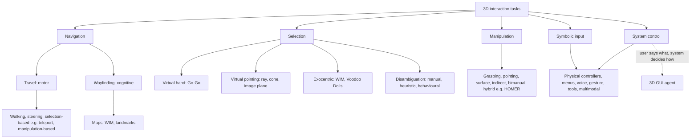

# Part A: Foundations of 3D interaction

Compiled 2026-11-24 for the column "3D GUI agents". Every entry in the table was checked against a
primary record: a DOI resolved through OpenAlex or Semantic Scholar (title, first author, venue,
year, pages), an arXiv abs page, or the publisher's or author's official page. The text that was
actually read differs by entry and is noted in each deep note and fact. Full text was read for
Argelaguet & Andujar 2013 (accepted manuscript), Barrera Machuca & Stuerzlinger 2019 (author PDF),
Lane et al. 2025 (arXiv HTML), Qiu et al. 2026 (arXiv HTML), Bashar et al. 2026 (arXiv HTML), Mine
1995 (UNC tech-report PDF) and the Pearson sample pages of LaViola et al. 2017 (front matter and the
whole of Chapter 9, "System Control"). For the other entries only the abstract was read, or for a
few only the metadata (these are marked). Numbers appear only where they were read in the source
named next to them. The research APIs rate-limited part of the session. Items that could not be
confirmed are listed in Section 8 and are not in the table.

## 1. Works

| ID | Title | First author et al. | Venue / status | Year | Link | Contribution (one line) | Relevance to 3D GUI agents (one line) |
|---|---|---|---|---|---|---|---|
| A01 | 3D User Interfaces: Theory and Practice (1st ed.), and 3D User Interfaces: Theory and Practice, 2nd ed. | Doug A. Bowman, Ernst Kruijff, Joseph J. LaViola Jr., Ivan Poupyrev (1st ed.); Joseph J. LaViola Jr., Ernst Kruijff, Ryan P. McMahan, Doug A. Bowman, Ivan Poupyrev (2nd ed.) | Book, Addison-Wesley (1st ed.); Book, Addison-Wesley Professional, ISBN 978-0-13-403447-8 (2nd ed.) | 2004; 2017 | https://people.cs.vt.edu/~bowman/3dui.org/Table_of_Contents.html ; https://people.cs.vt.edu/~bowman/3dui.org/Part_III.html ; https://www.informit.com/store/3d-user-interfaces-theory-and-practice-9780134034478 ; sample pages: https://ptgmedia.pearsoncmg.com/images/9780134034324/samplepages/9780134034324_CH09.pdf | The standard task taxonomy: selection and manipulation, travel, wayfinding, system control and symbolic input. The 2nd ed. folds wayfinding into Travel and symbolic input into System Control. | Gives the action vocabulary for a 3D GUI agent. Its definition of system control ("what, not how") describes what a user delegates to an agent. |
| A02 | Formalizing the Design, Evaluation, and Application of Interaction Techniques for Immersive Virtual Environments | Doug A. Bowman, Larry F. Hodges | Journal of Visual Languages & Computing 10(1):37–53 | 1999 | https://doi.org/10.1006/jvlc.1998.0111 | A systematic method: formal task analysis, categorization of techniques by subtask, and evaluation with several performance measures, applied to three common VE tasks (abstract summary via search; full text not read). | Breaking a task into subtasks (indicate, confirm, give feedback) maps onto the step structure of an agent's action. |
| A03 | Travel in immersive virtual environments: an evaluation of viewpoint motion control techniques | Doug A. Bowman, David Koller, Larry F. Hodges | IEEE VRAIS 1997, pp. 45–52 | 1997 | https://doi.org/10.1109/VRAIS.1997.583043 | Categorization of first-person travel techniques plus three experiments. Pointing beats gaze-directed steering for relative motion. Instant teleport goes with more disorientation. | An agent that moves the user's viewpoint must weigh speed against disorientation. Teleporting the user is not free. |
| A04 | Virtual Environment Interaction Techniques (UNC TR95-018) | Mark R. Mine | Technical report, Dept. of Computer Science, UNC Chapel Hill | 1995 | https://www.cs.unc.edu/techreports/95-018.pdf | Early catalogue: movement, selection, manipulation, scaling, and menu/widget interaction. Selection can be local or at a distance (laser beams or spotlights), gaze-directed, by voice, or from a list. | It already lists voice and list selection, where "the user does not have to be able to see the object". These are the semantic, non-pointing selection channels an agent can use. |
| A05 | JDCAD: A highly interactive 3D modeling system | Jiandong Liang, Mark Green | Computers & Graphics 18(4):499–506 | 1994 | https://doi.org/10.1016/0097-8493(94)90062-0 | 3D modeller with cone ("spotlight") selection. Argelaguet & Andujar [A13] cite it as the source of Flashlight selection. | Volumetric selection trades precision for ambiguity, the same trade-off an agent faces when grounding "that one". (Metadata only. Content from A13's citation.) |
| A06 | Virtual reality on a WIM: interactive worlds in miniature | Richard Stoakley, Matthew J. Conway, Randy Pausch | ACM CHI 1995, pp. 265–272 | 1995 | https://doi.org/10.1145/223904.223938 | A hand-held miniature copy of the world used to select, manipulate and navigate. | An exocentric proxy view, which an agent could generate on demand to show the user where something is or will move. (Metadata only. No abstract in the index.) |
| A07 | The go-go interaction technique: non-linear mapping for direct manipulation in VR | Ivan Poupyrev, Mark Billinghurst, Suzanne Weghorst, Tadao Ichikawa | ACM UIST 1996, pp. 79–80 | 1996 | https://doi.org/10.1145/237091.237102 | The virtual arm grows non-linearly, so the same hand reaches both near and far objects by direct manipulation. | Control-display mappings are user-side tricks. An agent acting on the scene directly does not need them, but a guiding agent must explain them. |
| A08 | An evaluation of techniques for grabbing and manipulating remote objects in immersive virtual environments | Doug A. Bowman, Larry F. Hodges | ACM I3D 1997, pp. 35ff. | 1997 | https://doi.org/10.1145/253284.253301 | Six remote-manipulation techniques compared, leading to hybrid techniques that treat grabbing and manipulation separately (the paper's HOMER family). | Separating "select" from "manipulate" fits an agent's two-step plan: ground the target first, then act on it. |
| A09 | Image plane interaction techniques in 3D immersive environments | Jeffrey S. Pierce, Andrew Forsberg, Matthew J. Conway, Seung Hong, Robert Zeleznik, Mark R. Mine | ACM I3D 1997, pp. 39ff. | 1997 | https://doi.org/10.1145/253284.253303 | The user interacts with the 2D projections of 3D objects on the image plane, for selection, manipulation and navigation. | This is how a screenshot-based agent already "sees" a headset: a 2D projection. It is the bridge from 2D GUI agents to 3D. |
| A10 | Voodoo dolls: seamless interaction at multiple scales in virtual environments | Jeffrey S. Pierce, Brian C. Stearns, Randy Pausch | ACM I3D 1999, pp. 141–145 | 1999 | https://doi.org/10.1145/300523.300540 | Two-handed manipulation through transient hand-held copies ("dolls"), scaled to half a metre. Allows selection of visible and occluded objects. | A proxy-object action space that makes occlusion and scale irrelevant. An agent could manipulate such proxies, or show them to the user. |
| A11 | Exploring the Effects of Environment Density and Target Visibility on Object Selection in 3D Virtual Environments | Lode Vanacken, Tovi Grossman, Karin Coninx | IEEE 3DUI 2007, pp. 115–122 | 2007 | https://doi.org/10.1109/3DUI.2007.340783 | Depth Ray and 3D Bubble Cursor, extended to fully occluded targets. Both beat a point cursor. Depth Ray was best overall. | Density and occlusion are the main reasons pointing fails, so they are the cases where an agent's direct object access helps most. |
| A12 | Rapid and accurate 3D selection by progressive refinement | Regis Kopper, Felipe Bacim, Doug A. Bowman | IEEE 3DUI 2011, pp. 67–74 | 2011 | https://doi.org/10.1109/3DUI.2011.5759219 | SQUAD: sphere-cast, then refine through a QUAD menu. Much more accurate than ray-casting, and faster with small targets in less cluttered scenes. | Progressive refinement is a dialogue. It is also how an agent should resolve ambiguous references ("which of these four?"). |
| A13 | A survey of 3D object selection techniques for virtual environments | Ferran Argelaguet, Carlos Andujar | Computers & Graphics 37(3):121–136 | 2013 | https://doi.org/10.1016/j.cag.2012.12.003 | Pointing models, a classification by selection tool, tool control, motor/visual space, disambiguation, trigger and feedback, and factors affecting performance. | The most complete map of why 3D selection fails, which is where an agent would intervene (see deep note). |
| A14 | Advances in Interaction with 3D Environments | Jacek Jankowski, Martin Hachet | Computer Graphics Forum 34(1):152–190 | 2015 (online 2014) | https://doi.org/10.1111/cgf.12466 | Survey of non-immersive (desktop, touch) 3D navigation, selection and manipulation, and system control, with the 3DIT testbed. | Covers the desktop and touch side, which matters for agents that drive 3D apps through 2D input (for example a 3D viewer in a browser). |
| A15 | A Survey on 3D Virtual Object Manipulation: From the Desktop to Immersive Virtual Environments | Daniel Mendes et al. (last author Joaquim Jorge) | Computer Graphics Forum 38(1):21–45 | 2019 (online 2018) | https://doi.org/10.1111/cgf.13390 | A new taxonomy of manipulation properties (position, orientation, scale) across mouse, touch and mid-air input. Mid-air is natural but "often lack[s] precision and control". | Precision is the gap: an agent can set exact numeric poses that mid-air hands cannot. |
| A16 | 3D User Interfaces: New Directions and Perspectives | Doug A. Bowman, Sabine Coquillart, Bernd Froehlich, Michitaka Hirose, Yoshifumi Kitamura, Kiyoshi Kiyokawa, Wolfgang Stuerzlinger | IEEE Computer Graphics and Applications 28(6):20–36 | 2008 | https://doi.org/10.1109/MCG.2008.109 | The founders of IEEE 3DUI review the state of the art and future directions. | Historical anchor. It is a CG&A article, not CACM as sometimes cited. |
| A17 | Fitts' law and its HCI standardization: (a) The information capacity of the human motor system in controlling the amplitude of movement; (b) Fitts' Law as a Research and Design Tool in Human-Computer Interaction; (c) Towards a standard for pointing device evaluation, perspectives on 27 years of Fitts' law research in HCI | (a) Paul M. Fitts; (b) I. Scott MacKenzie; (c) R. William Soukoreff, I. Scott MacKenzie | (a) J. Experimental Psychology 47(6):381–391; (b) Human-Computer Interaction 7(1):91–139; (c) Int. J. Human-Computer Studies 61(6):751–789 | 1954; 1992; 2004 | https://doi.org/10.1037/h0055392 ; https://doi.org/10.1207/s15327051hci0701_3 ; https://doi.org/10.1016/j.ijhcs.2004.09.001 | Movement time grows with log2 of amplitude over width. MacKenzie's Shannon formulation. The ISO 9241-9 method for throughput (c: section titled "The ISO standard versus Anarchy"; abstract not readable). | The baseline cost model. An agent can predict how hard a target is for the user and decide whether to do the step or only guide it. |
| A18 | Pointing at trivariate targets in 3D environments | Tovi Grossman, Ravin Balakrishnan | ACM CHI 2004, pp. 447–454 | 2004 | https://doi.org/10.1145/985692.985749 | Target size along the primary movement axis matters most. Movement angle matters. A new trivariate model beats earlier ones. | Target difficulty in 3D depends on direction, not just size, so an agent's difficulty estimate needs the approach direction. |
| A19 | Pointing at 3D targets in a stereo head-tracked virtual environment | Robert J. Teather, Wolfgang Stuerzlinger | IEEE 3DUI 2011, pp. 87–94 | 2011 | https://doi.org/10.1109/3DUI.2011.5759222 | ISO 9241-9 tasks in fish-tank VR. 2D Fitts works for planar tasks even with stereo and without tactile feedback. Fully 3D motions are less well modelled. | 2D GUI-agent difficulty models carry over only to planar UI (panels). Depth targets need other models. |
| A20 | A human motor behavior model for distal pointing tasks | Regis Kopper, Doug A. Bowman, Mara G. Silva, Ryan P. McMahan | Int. J. Human-Computer Studies 68(10):603–615 | 2010 | https://doi.org/10.1016/j.ijhcs.2010.05.001 | For ray pointing, time depends on angular amplitude and angular target size. Size matters much more, and difficulty grows quadratically (r = 96%). | Angular size, not metric size, is what makes a far button hard. An agent can compute it from the scene graph and the head pose. |
| A21 | The Effect of Stereo Display Deficiencies on Virtual Hand Pointing | Mayra Donaji Barrera Machuca, Wolfgang Stuerzlinger | ACM CHI 2019, pp. 1–14 | 2019 | https://doi.org/10.1145/3290605.3300437 | Pointing along the depth axis is slower for virtual targets but not for physical ones. A Fitts' law extension with a change-in-target-depth term. | Quantifies a cost that is specific to stereo XR. An agent can avoid creating it by keeping targets on one depth plane (see deep note). |
| A22 | Do Head-Mounted Display Stereo Deficiencies Affect 3D Pointing Tasks in AR and VR? | Anil Ufuk Batmaz, Mayra Donaji Barrera Machuca, Duc Minh Pham, Wolfgang Stuerzlinger | IEEE VR 2019, pp. 585–592 | 2019 | https://doi.org/10.1109/VR.2019.8797975 | On headsets, movements toward or away from the head were slower and less accurate than lateral ones. No significant AR vs VR difference in pointing. | Confirms the depth penalty on commercial headsets, so it applies to the devices an agent would run on. |
| A23 | Object Selection and Manipulation in VR Headsets: Research Challenges, Solutions, and Success Measurements | Difeng Yu, Tilman Dingler, Eduardo Velloso, Jorge Goncalves | ACM Computing Surveys 57(4), Article 98 | 2024 | https://doi.org/10.1145/3706417 | Systematic review of 106 papers on headset selection and manipulation. It categorizes solutions and success measures and proposes a framework for choosing a solution. | The newest consolidated view of the problems, and the measures an agent-assisted technique would be judged on. |
| A24 | Revisiting Performance Models of Distal Pointing Tasks in Virtual Reality | Logan Lane, Feiyu Lu, Shakiba Davari, Robert J. Teather, Doug A. Bowman | IEEE TVCG 31(10):8283–8296 | 2025 | https://doi.org/10.1109/TVCG.2025.3567078 (arXiv: https://arxiv.org/abs/2505.03027) | On Quest 2, with a new non-reciprocal data-collection method, the best distal-pointing model is a plain Fitts index with angular amplitude and width. | A simple, current cost model an agent can run per target: ID = log2(alpha/omega + 1). |
| A25 | Direct vs. Score-based Selection: Understanding the Heisenberg Effect in Target Acquisition Across Input Modalities in Virtual Reality | Linjie Qiu et al. | arXiv preprint. The authors state "Accepted by TVCG and IEEE VR'26" | 2026 | https://arxiv.org/abs/2602.01061 | On Quest 3, most ray-selection errors come from the confirm action moving the ray (the Heisenberg effect). A history-based intention model (weighted VOTE) cuts errors. | Intent inference from pointing history is a small "agent" in its own right. It shows how much error a model can remove from raw input. |
| A26 | Evaluating the Vergence-Accommodation Conflict in Gaze-Based 3D Target Selection | Mohammad Raihanul Bashar et al. (last author Anil Ufuk Batmaz) | arXiv preprint. Journal ref. on the abs page: IEEE TVCG, special issue on IEEE ISMAR 2026 | 2026 | https://arxiv.org/abs/2607.27369 | Gaze+pinch selection on Quest Pro gets worse with depth. A Fitts model with a variation-in-diopter term fits much better than a linear one. | Gaze is the primary input on Vision Pro-class devices. Depth placement changes its cost, and an agent placing or guiding to targets should account for that. |

## 2. Deep notes

### A01: The 3D UI book taxonomy (Bowman et al. 2004; LaViola et al. 2017)

**Problem.** 3D UIs had many techniques but no shared vocabulary of tasks to compare them by. The
book organizes the field around a small set of "universal" interaction tasks.

**Method.** The 1st edition (Part III, read on the authors' book site) has one chapter per task:
Ch. 5 Selection and Manipulation, Ch. 6 Travel, Ch. 7 Wayfinding, Ch. 8 System Control, Ch. 9
Symbolic Input. The Part III introduction defines travel as "the motor component of navigation" and
wayfinding as "the cognitive component of navigation". It defines system control as "changing the
mode or state of the system, often through commands or menus" and symbolic input as "the task of
entering or editing text, numbers, and other symbols". The 2nd edition (Pearson sample pages: front
matter and the whole of Ch. 9) keeps the task-centred core (Part IV: Ch. 7 Selection and
Manipulation, pp. 255–316; Ch. 8 Travel, pp. 317–378; Ch. 9 System Control, pp. 379–418). The preface
says three 1st-edition chapters, "on wayfinding, symbolic input, and augmented reality", "have been
fused into other parts of the book". Wayfinding became §8.9 "Wayfinding in 3D Environments", and
Ch. 9 treats "system control and symbolic input concurrently". Ch. 7 is organized by metaphor:
grasping, pointing, surface, indirect, bimanual, hybrid (§7.4–7.9). Ch. 8 is organized by walking,
steering, selection-based and manipulation-based travel (§8.4–8.7).

**Data and results.** This is a book, so it has no single experiment. The quantitative content read
is structural. Ch. 9 classifies system control into six families: physical controllers, graphical
menus, voice commands, gestural commands, tools, and multimodal techniques (Figure 9.1, read in the
sample). Ch. 9 defines system control as "the user task in which commands are issued to 1. request
the system to perform a particular function, 2. change the mode of interaction, or 3. change the
system state". It adds: "In system control tasks, the user typically specifies only what should be
done and leaves it up to the system to determine the details." §9.10 warns that "there still have
not been many empirical evaluations of system control techniques for 3D UIs", so "most of the
guidelines should be regarded as rules of thumb". The guidelines include "Design for
discoverability" for "invisible" voice and gesture commands, "Avoid mode errors", and "Use an
appropriate spatial reference frame".

**Limitations.** The taxonomy is technique-centred and assumes the human is the only actor. The
2nd edition dates from 2017, before Vision Pro-style gaze+pinch, passthrough MR and LLM assistants.
Ch. 9 explicitly sets aside implicit, behaviour-observing mode changes ("we will not focus on this
breed of interfaces"), and that is exactly the space an agent would occupy.

**Transfers to agents.** (1) The five tasks give a ready action schema: `select(target)`,
`manipulate(target, pose)`, `travel(destination)`, `wayfind(query)`, `command(function)`,
`input_text(string)`. (2) The book's own definition of system control, "what, not how", describes
delegation to an agent exactly. In practice an agent turns any task into system control: the user
says what, the agent works out how. (3) The discoverability guideline for invisible commands is
the main usability risk of a voice-driven agent.

**Does not transfer.** The taxonomy says nothing about who acts. It has no concept of a second
actor whose actions the user must monitor, trust and undo. Wayfinding is a cognitive task, and an
agent can replace the motor part (travel) more easily than the user's need to build a mental map.

### A13: Argelaguet & Andujar 2013, survey of 3D object selection

**Problem.** Pointing at 3D objects is the first step of most VR interaction, yet "effective
selection with pointing gestures remains an open problem" (abstract). The survey connects motor
models, rendering issues (feedback, depth perception, occlusion) and technique design.

**Method.** A literature survey. It reviews Fitts' law and the optimized initial impulse model,
classifies techniques in Table 1 by selection tool (ray, cone, cube, sphere), tool control, motor
and visual space relationship (control-display ratio, clutching), disambiguation mechanism,
selection trigger and feedback, and then analyses factors: target geometry, distance and reach,
density, input/output devices, fatigue, latency and noise, and user preference. Indirect selection
(menus, semantic queries) is out of scope.

**Data and results.** (Read in the accepted manuscript.) A virtual ray controlled by hand position
and orientation has five DoF, but "in most situations the two orientation DoFs suffice". Virtual
pointing is less tolerant of noise than the virtual hand because it "mainly rel[ies] on rotational
data". Eye-hand visibility mismatch: objects can be visible from the eye but unreachable by a ray
from the hand, and the reverse. Ray-casting from the eye removes this and "showed a significant
improvement ... in cluttered environments". Disambiguation for volumetric tools falls into three
groups: manual (cycling, Flow Ray menus, SQUAD [A12], Depth Ray), heuristic (for example, closest to
the cone axis), and behavioural (IntenSelect-style scores accumulated over time). Precise
techniques do better for easy targets or dense scenes. Manual disambiguation does better for
sparse scenes or hard (small) targets. Trigger: the dwell threshold "must be in the range of
350–600 ms" (citing Müller). Latency: the survey states, citing prior work, that "60 ms is the
maximum latency that can be introduced without degrading interaction" and that people can detect
latency fluctuations "as low as 16 ms". For targets the survey notes that enlarging W can lead users
to "decrease their accuracy", so a lower ID can be offset by a lower index of performance. Distant
selection: the further away an object is, the more accuracy is required. "Navigate-to-select" has
its own costs (losing the target, losing context).

**Limitations.** It predates consumer headsets (2013), hand tracking without controllers and eye
tracking as a primary input. Its own conclusion notes that the "lack of de-facto standard datasets"
and the many hardware setups make fair comparison hard. Techniques were "evaluated in isolation",
whereas real tasks mix selection with manipulation and navigation.

**Transfers to agents.** (1) Its failure modes (small angular size, density, occlusion, eye-hand
mismatch, jitter, Heisenberg effect at confirmation) are a checklist of where a user needs help.
(2) The disambiguation taxonomy maps onto agent design: heuristic and behavioural ranking is intent
inference, and manual disambiguation is a clarification question. (3) The note that indirect,
semantic selection is out of scope shows the gap that language-driven agents fill.

**Does not transfer.** Its performance factors are about human motor control. An agent with
scene-graph or accessibility access has no motor noise. For an agent that acts on pixels through
simulated input, ray jitter and occlusion come back as perception problems, not motor ones.

### A21: Barrera Machuca & Stuerzlinger 2019, stereo display deficiencies and virtual hand pointing

**Problem.** Stereo displays have the vergence-accommodation conflict and other depth-cue
deficiencies. Does that make pointing at targets that differ in depth slower than Fitts' law
predicts?

**Method.** (Author PDF, read in full.) Three studies with 12 participants each. Study 1: an 85"
stereo TV (3840×2160), eight 250 Hz OptiTrack cameras, a wand with a 1 cm sphere cursor, and
targets 40–70 cm from the user (5–35 cm in front of the screen). It compares lateral movements with
movements along the view direction. Study 2: the same layout with physical targets on motorized
faders. Study 3: an ISO-style circle of 11 targets in a plane perpendicular to the screen, so that
each pair has a different change in target depth (CTD).

**Data and results.** Virtual targets: movements in the view direction had "consistently about
20% fewer bps than lateral ones". For depth movements, 15% of correction phases were high-speed
(more than 20% of maximum) against 6% for lateral ones, which the authors read as gross
depth-estimation errors. Physical targets showed the opposite pattern (lateral slower). The
observed "25% slower for depth movements" is "well beyond" the 9% that visual-size differences
alone could explain. The authors relate it to vergence times of roughly 200–350 ms (citing
Suryakumar et al.). The fitted model is MT = 167.6 + 273.5·ID + 3.35·CTD, with r² = 0.98 and AIC = 344,
against r² = 0.96 and AIC = 359 for plain Fitts (Table 4). Design advice: the "best" working
distance is 50–65 cm. Avoid several interactive objects on one line of sight. Avoid depth changes
"of 20 cm or more". Avoid targets close to the eyes.

**Limitations.** It uses a fish-tank stereo TV, not a headset (A22 repeats the depth effect on
headsets). Peripersonal space only. Small samples (12 per study). It models a virtual hand, not a
ray or gaze (A26 extends the depth question to gaze).

**Transfers to agents.** (1) It gives a cost term an agent can add to a 2D-style difficulty
estimate: change in depth between consecutive targets. (2) The design advice is a direct layout
policy for an agent that places panels or buttons: one depth plane, 50–65 cm for touch, nothing
stacked along the line of sight. (3) It explains why a "just reach and press" instruction from a
guiding agent can still fail: the user misjudges depth.

**Does not transfer.** An agent that acts through APIs does not suffer stereo deficiencies at all.
The effect matters only when the human performs the step, or when the agent's perception relies on
stereo depth estimates of rendered content.

## 3. Taxonomy

**Selection.** Indicating one or more objects, then confirming. Techniques split into the virtual
hand (local reach, extended by Go-Go [A07]) and virtual pointing (ray [A04], cone/flashlight [A05],
image-plane [A09]), with exocentric variants (WIM [A06], Voodoo Dolls [A10]). Difficulty follows
angular size and amplitude [A20, A24], density and occlusion [A11, A13], and the change in depth
between targets [A21, A22, A26]. Disambiguation is manual, heuristic or behavioural [A13].

**Manipulation.** Setting position, orientation and scale of a selected object. The 2nd-ed.
book groups techniques as grasping, pointing, surface, indirect, bimanual and hybrid metaphors
[A01]. Hybrids separate grabbing from manipulating [A08]. Mid-air manipulation is natural but
imprecise [A15].

**Travel.** The motor part of navigation: moving the viewpoint. The 2nd-ed. book groups travel as
walking, steering, selection-based (for example, point and teleport) and manipulation-based
[A01]. Pointing-directed steering beats gaze-directed steering for relative motion, and teleporting
increases disorientation [A03].

**Wayfinding.** The cognitive part of navigation: knowing where you are and how to get where you
want. It was a full chapter in the 1st ed. and is §8.9 in the 2nd [A01]. Aids include maps and
miniatures [A04, A06].

**System control.** Issuing commands to run a function, change mode or change state, where the
user says "what" and the system decides "how" [A01]. Six families: physical controllers,
graphical menus, voice, gesture, tools, multimodal [A01]. This is the "glue" between the other
tasks [A01, Ch. 9 intro].

**Symbolic input.** Entering text, numbers and symbols. In 3D apps it is occasional and short, and
it serves system control (file names, numeric parameters) [A01]. It was merged into Ch. 9 in the
2nd ed.

## 4. Facts and numbers

- System control is defined as issuing commands to "request the system to perform a particular function", "change the mode of interaction", or "change the system state". In system control "the user typically specifies only what should be done and leaves it up to the system to determine the details" [A01, https://ptgmedia.pearsoncmg.com/images/9780134034324/samplepages/9780134034324_CH09.pdf].
- In the 2nd ed., the wayfinding, symbolic input and AR chapters of the 1st ed. "no longer stand on their own but have been fused into other parts of the book" [A01, same PDF, preface].
- Mine's 1995 report lists movement, selection, manipulation and scaling as the fundamental forms, with menu and widget interaction as a fifth, derived form. At-a-distance selection uses "laser beams or spotlights". With list selection "the user does not have to be able to see the object" [A04, https://www.cs.unc.edu/techreports/95-018.pdf].
- A hand-controlled ray has 5 DoF, but 2 orientation DoF usually suffice to point at any object (when there is no visibility mismatch) [A13, https://doi.org/10.1016/j.cag.2012.12.003].
- Dwell-to-select thresholds are recommended at 350–600 ms (survey citing Müller). A latency of 60 ms is given as the maximum that does not degrade interaction, and latency fluctuations as small as 16 ms may be detectable (survey citing prior work) [A13, https://doi.org/10.1016/j.cag.2012.12.003].
- Distal pointing time depends on angular amplitude and angular size. Size has the much larger effect, difficulty grows quadratically, and the model fit has r = 96% [A20, https://doi.org/10.1016/j.ijhcs.2010.05.001].
- On Quest 2 (N = 20, 13,868 trials analysed, alpha 10–70°, omega 2–136°), ID = log2(alpha/omega + 1) fitted with R² = 97.86%. Kopper et al.'s model reached 73.3% [A24, https://arxiv.org/abs/2505.03027].
- The ISO 9241-411 reciprocal task restricts the ID range and creates trial interdependence, according to Lane et al. Parameter ranges were limited by the Quest 2 field of view [A24, https://arxiv.org/abs/2505.03027].
- In virtual-hand pointing on a stereo display, depth movements were 25% slower, which is well beyond the 9% that visual-size differences alone could explain. Throughput was about 20% lower in the view direction [A21, https://doi.org/10.1145/3290605.3300437].
- MT = 167.6 + 273.5·ID + 3.35·CTD (r² = 0.98, AIC = 344) against plain Fitts (r² = 0.96, AIC = 359). The advice is to avoid depth changes of 20 cm or more and to put touch targets 50–65 cm from the user [A21, https://doi.org/10.1145/3290605.3300437].
- On AR and VR headsets, movements toward or away from the head were slower and less accurate than lateral ones. AR vs VR showed no significant difference in pointing performance [A22, https://doi.org/10.1109/VR.2019.8797975].
- Planar pointing in stereo fish-tank VR follows 2D Fitts' law, but "fully 3D motions using the ray and mouse based techniques are less well modeled" [A19, https://doi.org/10.1109/3DUI.2011.5759222].
- For gaze+pinch on Quest Pro (focal distance 1.33 m, depths 66.6–400 cm, N = 24), depth had a large effect on movement time (ηp² = .767). For gaze, R² was 0.63 for MT = a + b·ID and 0.93 for the variation-in-diopter model [A26, https://arxiv.org/abs/2607.27369].
- With ray selection at 8 m on Quest 3 (N = 24), the Heisenberg effect caused 80.57% of errors with a controller and 71.86% with a bare hand (direct selection). Error rates were 15.20% (controller) and 32.92% (hand) [A25, https://arxiv.org/abs/2602.01061].
- Weighted VOTE lowered the error rate of score-based hand selection from 21.96% to 7.93% (7.54% with the adaptive variant) [A25, https://arxiv.org/abs/2602.01061].
- SQUAD was "much more accurate than ray-casting", and faster with small targets in less cluttered scenes [A12, https://doi.org/10.1109/3DUI.2011.5759219].
- Depth Ray and 3D Bubble Cursor both beat a point cursor across density and visibility conditions. Depth Ray was best overall [A11, https://doi.org/10.1109/3DUI.2007.340783].
- Instant teleporting is correlated with increased disorientation. Pointing beats gaze-directed steering for relative motion [A03, https://doi.org/10.1109/VRAIS.1997.583043].
- A 2024 systematic review of headset selection and manipulation covered 106 papers [A23, https://doi.org/10.1145/3706417].

## 5. Open problems (as they bear on 3D GUI agents)

1. **No standard task set or dataset.** A13 names the lack of "de-facto standard datasets" for 3D selection. There is no equivalent of AndroidWorld or OSWorld built on the five tasks, with ground-truth target IDs, poses and depth.
2. **Difficulty models are device- and input-specific.** Ray (A20, A24), virtual hand (A21) and gaze (A26) each need a different index. An agent that decides "do it myself or guide the user" needs a cost model for the user's current input mode, depth and FOV.
3. **The taxonomy has no second actor.** A01 excludes implicit, system-initiated mode changes. Nothing in the classic framework covers mixed initiative, handover, or undo of agent actions in 3D.
4. **Semantic and indirect selection is under-studied.** A13 leaves it out of scope, while A04 already listed voice and list selection in 1995. Language-grounded selection ("the red valve behind the pipe") is now the main channel for an agent, and it lacks a 3D evaluation method.
5. **Perception for pixel-based agents.** Eye-hand mismatch, occlusion and depth ambiguity (A13, A21) come back as perception problems for an agent that sees only the rendered stereo frames.
6. **Travel and wayfinding by an agent.** Teleporting the user is fast but disorienting (A03). How an agent should move a user's viewpoint, or guide them, without breaking their spatial memory is open.
7. **Intent inference is already inside techniques.** Behavioural disambiguation (A13) and weighted VOTE (A25) infer intent from motion history. Where such low-level inference ends and a high-level agent begins is not defined.

## 6. Catalogue rows

| Operation | Techniques used today | Measured/reported difficulty (with source IDs) | Agent could: do it / guide / neither, and why |
|---|---|---|---|
| Select a small target at a distance | Ray-casting from the controller or hand, gaze+pinch, cone/flashlight, snapping (score-based), progressive refinement (SQUAD) | Time is dominated by angular size, with quadratic growth [A20]. Angular Fitts fits well on Quest 2 [A24]. The confirm action moves the ray: 80.57% (controller) and 71.86% (hand) of errors at 8 m [A25]. Pointing needs more accuracy the further away the object is [A13]. | **Do it**, if the agent has scene-graph or accessibility access: selection by ID has no motor cost. **Guide** otherwise: highlight the target, enlarge its activation area, or snap. |
| Select an occluded object in a dense scene | Depth Ray, 3D Bubble Cursor, ray-casting from the eye, Voodoo Dolls, WIM, X-ray/transparency | Density and visibility degrade selection. Depth Ray was best overall [A11]. Eye-hand visibility mismatch in clutter [A13]. Proxies allow occluded selection [A10]. | **Do it** through the object list, or **guide** by revealing the target (transparency, a proxy, a miniature). A pixel-only agent faces the same occlusion, so it may need to ask the user to move. |
| Press buttons at different depths (near-field panels, 3D widgets) | Direct touch (virtual hand), poke, gaze+pinch | Depth movements 25% slower. Throughput about 20% lower in the view direction [A21]. Same effect on AR and VR headsets [A22]. Gaze selection degrades with depth [A26]. | **Neither, then fix the layout**: the best agent move is to re-place targets on one depth plane at 50–65 cm [A21], then let the user act or act itself. |
| Travel to a far location | Point-and-teleport, steering, WIM, scaling the world | Teleport increases disorientation. Pointing-directed steering beats gaze-directed steering for relative motion [A03]. Navigate-to-select can lose the target or context [A13]. | **Guide** (path cues, a preview in a miniature) rather than silently teleport, because spatial awareness belongs to the user. Do it only on explicit command. |
| Rotate or scale an object precisely | Grasping (6-DoF hand), HOMER-style hybrids, bimanual handles, widgets with numeric fields | Mid-air manipulation is natural but "often lack[s] precision and control" [A15]. Separating grab from manipulate helps [A08]. | **Do it**: an agent can set exact numeric poses ("rotate 90° about Y", "match the table height"). The user keeps coarse direct control. |

## 7. Figure/widget ideas

1. **Angular-size explorer (widget).** A WebGL scene with a ray from a virtual hand and a row of
   buttons at 1, 2, 4 and 8 m. Sliders for target width and distance show the angular size omega,
   amplitude alpha, ID = log2(alpha/omega + 1) [A24], and the Kopper quadratic index [A20] side by
   side. A toggle adds simulated hand jitter and the confirm "kick" [A25], so the reader sees why
   far, small targets fail.
2. **Depth-penalty chart (SVG figure).** Bars for lateral vs view-direction pointing: movement-time
   penalty 25% (with 9% marked as the part explainable by visual size), throughput about 20% lower
   [A21]. A second panel plots predicted MT against change in target depth (CTD), from MT = 167.6 +
   273.5·ID + 3.35·CTD [A21].
3. **Taxonomy-to-agent-action map (diagram).** The Mermaid tree of Section 3, rendered as an SVG
   with each leaf labelled by an agent action (`select(id)`, `set_pose`, `teleport`/`guide_path`,
   `command`, `type`) and coloured by "agent does it / agent guides / user only", following the
   catalogue rows.

## 8. Unverified

- **Wagner, Lystbæk, Manakhov, Grønbæk, Pfeuffer, Gellersen, "A Fitts' Law Study of Gaze-Hand Alignment for Selection in 3D User Interfaces", ACM CHI 2023, DOI 10.1145/3544548.3581423.** Seen only in search-result summaries. The repository page refused connection, ACM returned 403, and the APIs were rate-limited, so neither the DOI nor the abstract was confirmed.
- **ISO 9241-411:2012 official page** (iso.org returned 403). The standard is cited here only through A17(c), A19 and A24.
- **Clark et al. 2020 "Hand-based pointing evaluation in VR"** (named in the brief with "verify"). No matching record was found in searches, so it may not exist under this title.
- **Batmaz et al., VRST 2022, stereo deficiencies in virtual distal pointing.** Mentioned in a search summary ("vac_distal.pdf" on the SFU site). Not opened.
- **Batmaz et al., IEEE VR 2023, "Measuring the Effect of Stereo Deficiencies on Peripersonal Space Pointing"** (OpenAlex lists DOI 10.1109/VR55154.2023.00063). The record was found but the abstract was not read, so it is not used.
- **Bergström et al., CHI 2021, "How to Evaluate Object Selection and Manipulation in VR? Guidelines from 20 Years of Studies".** Seen only in a search summary.
- **Yu et al. 2024 [A23], the counts "eight research challenges and nine success measurements".** These came from a search summary and not from text read. The table uses only the count of 106 papers, which the repository page confirmed. The repository lists 2024. Whether the journal issue is dated 2025 was not checked.
- **Depth Ray attribution.** A13 attributes Depth Ray to Grossman & Balakrishnan, UIST 2006 (volumetric displays). A11 (2007) adapts it for VR. The UIST 2006 paper itself was not verified here.
- **A05 and A06 content.** Metadata was verified. Their content descriptions rest on citations in A13 and general knowledge, not on reading the papers.
